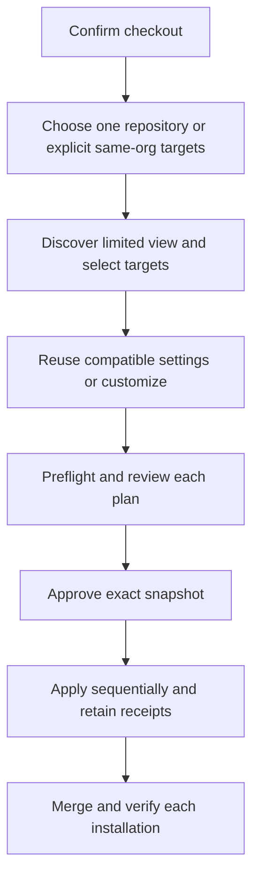
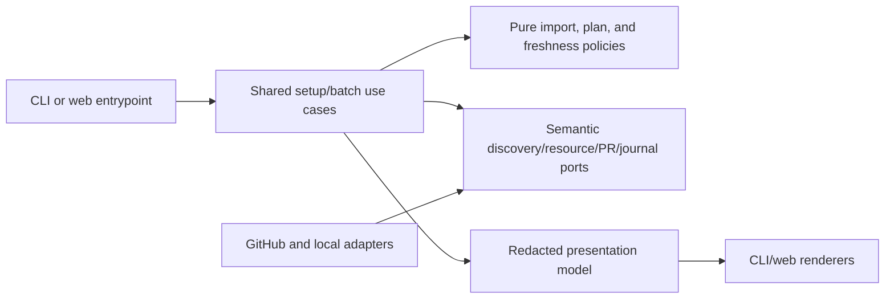
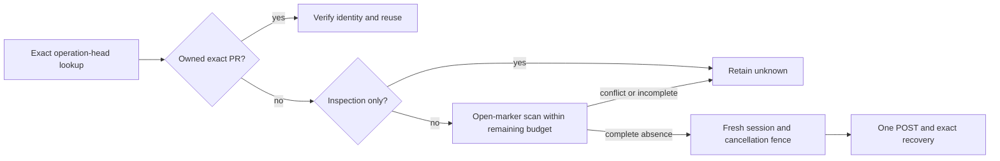

# Organization Configuration Reuse and Batch Setup

- Status: Implemented — local validation complete; pull-request CI and maintainer review pending
- Date: 2026-10-17
- Catalog capability ID: `setup-and-doctor`
- Last verified: 2026-10-17 (automated gates, controlled browser journeys and isolated GitHub Variable probes; PR CI remains a separate merge gate)
- Owners: Copilot maintainers
- Scope: Reuse compatible organization configuration and create reviewed setup pull requests for one to 25 explicitly selected repositories in one organization.
- Related issues/PRs: [Issue #538](https://github.com/vypdev/copilot/issues/538); [#536](https://github.com/vypdev/copilot/issues/536); [#537](https://github.com/vypdev/copilot/pull/537); [platform #159](https://github.com/vypdev/platform/issues/159); [platform #166](https://github.com/vypdev/platform/pull/166)
- Required review gates: product UX, architecture, testing, documentation, security/operations
- Open decisions blocking readiness: None. The owner, limits, limited-token discovery behavior, and installer-owned bootstrap namespace are resolved for this proposal.

## 1. Executive summary

A maintainer can adopt recognized organization settings without repeating completed questions or rewriting shared values, then explicitly select repositories and review a separate plan for each. Single-repository setup remains the default. Batch setup is limited to 1–25 repository IDs in one organization, creates one setup PR per changed target, and reports partial results truthfully. Existing shared Secrets are never written by reuse; uncertain Secret availability blocks that binding until separately provisioned and re-inspected. PR creation is not installation or verification.

```text
Confirm checkout -> choose this repository or selected repositories -> inspect and select targets -> reuse or customize -> review plans -> approve exact snapshot -> create setup PRs -> merge and verify each target
```

## 2. Problem, current behavior, and evidence

### 2.1 Problem

Organization maintainers currently repeat setup questions and re-enter runtime credentials when extending a configured installation. Organization storage and target selection are separate decisions, and organization inventory does not establish that every repository can access a resource. Blind copying risks replacing shared values, hiding repository overrides, creating duplicate setup PRs, or claiming installation before merge and runtime verification.

### 2.2 Current behavior

1. Setup confirms the current checkout and plans configuration for that repository.
2. The wizard collects configuration through the shared questionnaire and credential use cases; PAT preservation is excluded and requires re-entry/audit.
3. Resource inspection primarily describes resources effective for the current repository; `preserveExisting` does not provide complete no-write reuse.
4. Existing-installation management supports inspection and focused edits, while a full installation asks fresh questions.
5. No selected-target batch journey, per-target plan journal, or installer-owned bootstrap namespace is established by this proposal's evidence.

These are the pre-change facts supported by the original catalog/code paths. The implementation and verification evidence below describe the new contract.

### 2.3 Evidence

- Code: `setup_wizard_use_case.ts`, `setup_credentials_use_case.ts`, `setup_configuration_storage_policy.ts`, `setup_questionnaire_policy.ts`, `github_actions_resource_inspector.ts`, and `github_actions_resource_commands.ts`.
- Dogfood: platform #159 and #166 retained 70 effective Variables, preserved the organization PAT, created no repository Secrets, and completed repeated setup without changing existing shared values, visibility, or Secret timestamps.
- Failure evidence: selected organization Variable grants initially returned 404 after updates and needed explicit recovery; permission probes left jobs waiting for an obsolete runner label. Issue #536 / PR #537 addressed a recommendation setup permission mismatch.
- Runtime verification, PAT health, and agent CLI contract passed in the cited dogfood runs. Secret existence, runtime authentication, and complete permission readiness remain distinct facts.
- Unknowns: actual provider behavior under each credential class, rate limits, and precise permission evidence must be established by SDK fixture contracts and controlled live evidence. A resource name alone proves neither target access nor completeness of discovery.
- Primary provider sources: [organization repository listing](https://docs.github.com/en/rest/repos/repos#list-organization-repositories), [organization Variables](https://docs.github.com/en/rest/actions/variables#list-organization-variables), [organization Secrets](https://docs.github.com/en/rest/actions/secrets#list-organization-secrets), [selected repository Secret access](https://docs.github.com/en/rest/actions/secrets#add-selected-repository-to-an-organization-secret), [organization Secret upsert](https://docs.github.com/en/rest/actions/secrets#create-or-update-an-organization-secret), [organization Variable creation](https://docs.github.com/en/rest/actions/variables#create-an-organization-variable), and [PAT management](https://docs.github.com/en/authentication/keeping-your-account-and-data-secure/managing-your-personal-access-tokens).

### 2.4 Retrospective classification (as-built baselines only)

Not applicable: this is a prospective specification and does not reconstruct an implemented baseline.

## 3. Actors, surfaces, and terminology

| Actor | Goal | Entry point | Visible surfaces |
|---|---|---|---|
| Repository maintainer | Configure or extend installation safely | Existing inspect/setup entrypoints | CLI, local web assistant, setup PRs |
| Organization operator | Reuse shared resources and authorize selected targets | Setup journey | Discovery, per-target plans, access review |
| Reviewer | Understand exact setup changes | Setup PR | Files, base/ref, checks, durable operation marker |
| Operator/support | Recover partial work and verify outcomes | Batch report and doctor | CLI/web status, PR/run links, diagnostics |

**Organization reuse** means consuming compatible existing organization Variables and Secrets without changing their values. **Target** means an explicitly selected same-organization repository ID. **Effective access** is target-specific access after considering organization grants and repository overrides. **Installation namespace** means `setup/copilot/<operation-id>`, owned by the installer for approved batch installation and maintenance PRs. It is separate from Action-owned issue branches in both new and installed repositories. **Verified** means the trusted installed/generated health path has supplied the required evidence; it does not mean merely that a Secret exists or `/user` succeeds. Repository labels, files, branches, CI identities, runner requirements, and health are target-owned facts. Organization inventory owns shared resource names, scopes, values where readable, visibility, and membership.

## 4. Goals

### 4.1 Goals

1. Reuse a complete compatible organization configuration with no repeated questions for valid settings and no incidental shared-resource writes.
2. Discover and select explicit repositories with honest visibility and target-specific access checks.
3. Present immutable, reviewable per-target plans before mutation and produce independent, durable outcomes.
4. Preserve the current single-repository journey and use the same application decisions in CLI and web.
5. Make partial success, pending human merge, and runtime verification status clear and recoverable.

### 4.2 Non-goals

1. Organization-wide selection, cross-organization batches, repository creation, automatic merge, release, tag, deployment, or arbitrary code execution.
2. Crawling other repositories to infer shared settings, blind copying, or a mandatory GitHub App/control plane.
3. Importing another codebase's publishing, deployment, CI commands, or approval producers.
4. Collecting or rotating Secret values in batch v1; missing bindings require separate provisioning.
5. Changing the completed setup bugfix or weakening native approval, branch protection, runner-group access, or deployment gates.

### 4.3 Fixed product/safety invariants

1. Default to the current repository. Batch requires explicit selection of 1–25 unique repository IDs in one organization; larger work is split into batches.
2. Preserve existing Variable values, visibility, and memberships. Existing valid values cause zero update calls. Add only explicitly approved missing repository grants through additive add-one-repository operations.
3. Reuse never calls Secret create/update/upsert for a managed shared binding. Existing Secret values are never copied, exported, displayed, logged, or rotated. Missing or uncertain Secret availability blocks that binding pending separate provisioning/customization and fresh inspection. Separately approved disposable permission probes retain their existing journal, collision, and cleanup contract; this exception does not permit writing the reused Secret.
4. Existing overrides remain visible and are never silently deleted or replaced. Resolve conflicts explicitly.
5. Approval binds to exact targets, operation, resource fingerprints, base revisions, and effects. Drift, credential authority change, or target-set change invalidates approval before writes.
6. Apply is sequential in v1, has one active Apply per session and one shared-resource writer per organization/operation, with bounded retries. No cross-repository rollback is implied.
7. Batch installation and maintenance use a disclosed installer-owned `setup/copilot/<operation-id>` ref and verified default base. Installed targets retain Action ownership of every managed issue branch. Never force-push or overwrite human changes. The current-checkout path retains its existing local preview/Apply behavior.

## 5. Current versus proposed product journey

| Stage | Current | Proposed | User/operator effect |
|---|---|---|---|
| Entry | Inspect/setup current checkout | Keep current entrypoints and confirm checkout/organization | Familiar single-repository default |
| Scope | Current repository | Choose “This repository” or “Several repositories in <org>” | Separate storage from target scope; personal repos explain single-only path |
| Discovery | Current checkout facts | Credential-limited paginated/searchable view; explicit exact-name route and temporary operator PAT limited to reviewed IDs | No claim of complete organization discovery |
| Configuration | Questionnaire and explicit PAT re-entry | Reuse compatible settings; ask only missing/invalid and target-specific choices | Provenance and verification limits shown |
| Preflight | Current target | Inspect each selected target's installation, branches, overrides, labels/forms/guidance, CI/runner/access needs | Independent readiness reasons |
| Apply | Single repository | Review exact batch snapshot; sequential setup PR per changed repository | No-op and blocked targets remain independent |
| Finish | Setup result | Per-target PR, waiting, pending verification, verified, action, canceled, unchanged states | PR is never presented as installed |



Text equivalent: confirm checkout, choose scope, discover and select, configure, review, approve, create setup PRs, then merge and verify each target.

## 6. Functional behavior and state model

### 6.1 Happy path

1. Confirm checkout and inferred organization; expose existing inspect and quick-adjustment entrypoints.
2. Default to this repository. If batch is chosen, disclose the credential's current repository view, paginate/search, preselect current repository, and require explicit additional selection.
3. Permit exact repository-name entry when discovery is incomplete. Resolve names to same-organization IDs, then audit/reconnect with a temporary operator PAT limited to reviewed selected targets. Unknown access remains blocked; never assume all-repository access.
4. Offer one choice: “Reuse compatible organization configuration” (recommended) or “Customize configuration.” Explain shared values remain unchanged and selected repositories may need additive access grants. Derive Variable/Secret handling from this choice and storage scope; do not add redundant reuse toggles.
5. Parse recognized organization Variables into typed configuration. Skip valid answers and ask only missing/invalid values and repository-specific choices. Show provenance: Organization, Repository override, New value, Not verified. Secret values are never imported or shown.
6. Preflight every target, including installation, verified default/development branches, effective access and shadows, repository-owned labels/forms/guidance, CI producer identities, runners, required capabilities, and credential authority.
7. Present expandable per-target plans with exact files, grants, new resources, overrides, refs, bases, required permissions, and evidence. A target whose files match has no PR and remains verification pending after resource checks. Approval snapshots all targets and relevant revisions/fingerprints.
8. Revalidate identity, revision, and authority before each write. Apply sequentially, report progress immediately, and journal each receipt. On failure, retain successful results and retry only incomplete work after drift review and any renewed approval.
9. Report each target independently. Require human merge. Run trusted health verification without PR-head code, custom scripts, or model requests.

### 6.2 Alternative paths

- Current-repository Customize follows the existing explicit configuration/replacement contract. Batch Customize changes settings while retaining existing Secret bindings; its label states this limit. Provision missing/replacement credentials through current-repository Customize before restarting batch preflight.
- Existing repository overrides take precedence and require explicit conflict resolution where they conflict with shared values.
- A limited credential may show only its limited view. Exact-name selection plus selected-target reconnect is supported; failure to establish access blocks only affected targets.
- A matching-file target creates no PR; labels, types and resources are still checked and its truthful result is Verification pending. Unchanged is reserved for completely established no-change evidence. Archived, disabled, inaccessible, unsupported, or uninspectable targets cannot be silently included.
- Mixed Variable/Secret scopes are supported; unavailable Secret evidence blocks only the affected binding/target and does not trigger a write.

### 6.3 State machine

| State | Entered when | User-visible meaning | Allowed next states | Recovery/owner |
|---|---|---|---|---|
| Discovering | Read-only inventory starts | Checking selected repository visibility; nothing changed | Selecting, blocked | Maintainer reconnects or enters exact names |
| Selecting | Candidate view available | Explicit targets required | Preflight, canceled | Maintainer edits selection |
| Preflight | Selected IDs resolved | Checking readiness and differences | Review, action, blocked | Setup coordinator retains reasons |
| Review | Plans and snapshot complete | Exact effects awaiting approval | Applying, stale, canceled | Maintainer approves or revises |
| Applying | Approved target operation starts | Sequential work with per-target progress | Partial, complete, canceled, blocked | Journal/use case retains receipts |
| Partial | Some effects succeeded | Completed effects retained; remaining targets need action | Applying, canceled, complete | Retry incomplete targets after inspection |
| Waiting for merge | Setup PR exists | Installation is not complete | Verification pending, canceled | Human reviewer merges/closes |
| Verification pending | Merged but evidence incomplete | Installed state not yet verified | Verified, action | Trusted health path/operator |
| Verified | Required trusted evidence present | Installation verified | — | Doctor/runtime owner |
| Canceled | Pending work stopped | Completed PRs/grants retained | — | Maintainer resumes via fresh inspection |
| Unchanged | Plan has no effects | Target already matches | — | None |

Duplicate apply requests join/reject against the active session; they do not create another operation. Out-of-order or future-schema resumes are rejected. Unknown create responses trigger inspection by durable operation marker and target identity before retry. A stale snapshot cannot be approved or applied.

## 7. User-facing configuration

| Input | Type | Recommended default | Allowed values/range | Scope/persistence |
|---|---|---|---|---|
| Setup scope | Enum | This repository | Current repository or selected same-organization repositories | Operation snapshot |
| Target IDs | Unique repository ID list | Current repository only | 1–25; no duplicates; one org | Journal snapshot |
| Configuration source | Enum | Reuse compatible organization settings after organization storage is selected | Reuse or Customize | Per operation; no independent Variable/Secret toggle |
| Apply mode | Enum | Current checkout retains local preview/Apply; batch creates reviewed PRs sequentially | Batch is PR-only in v1; no automatic merge | Operation snapshot |
| Discovery credential | Paired local operator credential | Existing credential's visible scope | Existing limited view; exact-name route and temporary PAT limited to selected IDs | Local session only; excluded from resume/export |
| Retry count | Bounded policy | At most 3 read attempts; inspect uncertain writes | No blind mutation retry; at most 1 guarded retry per paired session after inspection and fresh approval checks | Operation; not user-expandable |

Validation rejects zero or over-25 targets, duplicates, cross-org IDs, unresolved names, archived/disabled/unsupported targets, missing required capabilities, unknown Secret availability for a required binding, invalid/future resume schema, and invalid branch/base. Precedence is explicit reviewed repository choices > existing repository override > accessible compatible organization values > typed defaults; unknown/unsafe bindings require review. Snapshot non-secret plans, IDs, revisions, fingerprints, operation identity, and receipts; reread remote identities/revisions before writes. Credentials remain paired local session state. Absent legacy batch fields mean single repository; unknown future values fail closed. Example: default single repository with reuse selected after choosing organization storage. Alternative: explicit three-target batch with one blocked target and two actionable plans. Branch names, URLs, commands, secrets, and arbitrary code are never accepted as configuration inputs.

## 8. Clean Architecture

### 8.1 Responsibilities and dependency direction

| Layer/boundary | Owns | Must not own/import |
|---|---|---|
| Domain/pure policy | Typed import, precedence, compatibility, target bounds, plan validity, approval freshness, result states | SDK, HTTP, process, files, UI framework |
| Application | Shared setup coordinator orchestration, discovery/preflight/apply/recovery use cases, immutable per-target contracts | Concrete provider DTOs or CLI/web-specific policy |
| Semantic ports | Repository discovery, resource inventory/access, branch facts, setup PRs, batch journal, credential audit, trusted health evidence | GitHub SDK shapes or product presentation |
| Data/provider adapters | Pagination, endpoint calls, additive grants, PR marker lookup, provider error mapping | Product decisions or secret display |
| Infrastructure/composition | Credential pairing, local persistence, adapter wiring, concurrency locks | Business policy |
| Entrypoints | CLI/web input adaptation and session start/resume | Duplicated orchestration |
| Presentation | Redacted batch view models, localized rendering, status/link formatting | Mutations or transition policy |



### 8.2 Contracts, state, and trust boundaries

- Pure decisions: typed organization import, compatibility, precedence, bounds, target eligibility, diff classification, approval freshness, retry eligibility, and truthful status derivation.
- Application contracts: immutable request, target plan, approval snapshot, apply receipt, and per-target outcome; shared coordinator and existing questionnaire/credential/provisioning use cases are reused through narrow per-target interfaces.
- Semantic ports: paginated visible repository discovery; exact name resolution; target access audit; organization namespace inventory; target effective access/shadow inspection; branch/base inspection; additive grant; PR create/find; trusted health query; durable journal.
- Durable state/schema ownership: application operation model; journal stores schema version, operation ID, non-secret plans/fingerprints, target IDs, receipts, and status. Credentials are never serialized. Reject unknown future schemas.
- Concurrency/idempotency: one active apply per session; one organization shared-resource writer per operation; sequential target writes; durable operation marker plus target identity; inspect before retry after unknown outcomes. Never overwrite human changes.
- Trust: issue/PR/comment text, repository names, labels, provider responses, and discovered values are untrusted data. Sanitize display; do not render as HTML, command, mention, or arbitrary link. Typed schema parsing and allowlisted URL construction only.
- Provider error mapping distinguishes absent, forbidden, not found, rate-limited, transient, malformed, and unknown; 404 after grants is not silently treated as absence. Inventory unavailable means unknown, not empty.

#### Installation refs, ownership and recovery

- The application allocates a canonical UUID operation ID. The only batch installation ref is `setup/copilot/<operation-id>`; users cannot supply a different ref, branch template, base, command, or URL. Each repository has its own ref with that same operation ID.
- The base is the target's authenticated `default_branch` and exact commit observed during preflight. A changed default branch or commit invalidates approval before mutation. Local checkout branch names never determine another target's base.
- The installer owns this namespace for both bootstrap and maintenance. Existing `feature`, `bugfix`, `release`, and other configured issue refs remain owned by the target Action. An installed target does not need a synthetic issue to receive a setup PR. The generated profile, guide and skill must explain this limited installer contract before the batch entrypoint is enabled.
- A prepared installation commit has the approved base as parent and an operation receipt in `.copilot/setup-manifest.json`: schema version 1, operation UUID, repository ID, base SHA and plan digest. It contains no credential or Secret value. The ref is created at that complete prepared commit, rather than at an unmarked intermediate base.
- Recovery requires the exact prepared commit and matching manifest receipt; the ref name alone is not ownership evidence. An unexpected ref, moved head or human change blocks further writes. The installer never force-pushes, deletes an existing branch, or overwrites a PR head.
- The PR body uses `<!-- copilot-setup-operation:v1:<operation-id>:<repository-id> -->`. Before creating a PR, the adapter looks for that exact target/operation marker. An uncertain create response is inspected before any further request. A matching existing PR is reused; a conflicting open installer PR is surfaced for resume/review instead of creating a duplicate.
- Read retries are limited to three total attempts and transient/rate-limit evidence. Mutations are not blindly retried. After an unknown outcome, inspect the operation receipt and effective state; at most one guarded retry per paired session is allowed after identity, revision, authority and approval checks pass again. A new session requires explicit resume, fresh planning/approval and unchanged target/base/digest; it never automatically repeats writes. Longer waits pause the target with a retry action rather than expanding this limit.
- Reuse imports only recognized typed values. CI commands, approval producer identity and branch/runner facts remain target-specific and require their existing checks. Import never executes a discovered command, queries a model, or follows an arbitrary URL. Missing fields and incompatibilities remain explicit questionnaire/review work.
- The fast reuse journey reads existing trusted health evidence; it does not bootstrap or dispatch a workflow. Evidence must match the packaged template, authenticated default-branch SHA, workflow/repository/run identity and current effective Secret metadata, and be at most five minutes old. Each request is bounded to 15 seconds and the complete evidence query to 30 seconds. Missing or stale evidence means verification pending. An actual failed trusted check blocks reuse. PAT authentication alone remains pending for full runtime capabilities.
- Recognized Variable imports are bounded to 30,000 characters per value and parsed through typed configuration validation. A user change to a shared answer becomes an explicitly reviewed repository override; it never updates the shared value. Existing same-name repository values retain precedence. Existing shared values, visibility and other repositories' memberships remain unchanged.
- Agent task Variables MUST retain an equal existing generic fallback when no exact task binding exists. Exact repository/organization task bindings win before generic repository/organization bindings. Review lists the actual consumed name once; additive grants and freshness snapshots refer to that real resource. A reviewed change to the generic binding MUST NOT silently change a task whose desired value still differs. No new configuration option or durable schema is introduced.
- The installation receipt is a nested `installation` object with schema version 1 inside the existing schema-version-2 setup manifest. Legacy manifests without that optional receipt remain readable. Journals persist only operation/target identities, base and plan digests, effect names and PR/commit receipts; configuration values and file contents stay in the paired process and are not written to the journal.
- The existing current-checkout Apply path remains available, including non-interactive saved configurations. Batch is an explicit interactive choice in v1; non-interactive requests cannot silently activate it. Both frontends use the same import and batch application decisions.

### 8.3 Executable architecture constraints

Architecture tests MUST prevent provider imports in domain/application policy and UI orchestration duplication. Contract tests MUST parse workflow/schema structures, validate bootstrap namespace ownership/ref/base disclosure, and enforce dependency-cycle rules. Journal schemas and operation markers require compatibility fixtures. Existing architecture and specification validators remain required; add focused checks for generated collaboration contract before enabling the bootstrap namespace.

## 9. UI/UX and content contract

### 9.1 Information hierarchy

Every report states current status, completed facts, next transition, required human action, impact/retained effects, inspectable links, then collapsed diagnostics. One primary action is shown per state. Counts and reasons are text, never color-only.

### 9.2 Representative primary view

```markdown
<!-- stable marker: copilot-setup-operation:v1:<operation-id> -->
# Copilot setup plans — vypdev

> **Current status:** Review 3 selected repositories. Nothing has changed.
> **Action required:** Approve the plans below or change the selection.

## Progress

- [x] Organization settings inspected; shared values remain unchanged.
- [x] 3 repository plans checked.
- [ ] Apply awaits approval.

| Repository | Configuration | Next action |
|---|---|---|
| copilot | Already configured | Unchanged; no PR |
| platform | Organization settings + 2 local choices | Create setup PR |
| service-api | Selected PAT access missing | Review access; blocked |

## What happens next

Approval creates at most one setup PR for each changed, ready repository. Each PR waits for human merge and later verification.

<details><summary>Technical details</summary>Sanitized IDs, refs, revisions, capability evidence, and provider diagnostics.</details>
```

Pending/no action:

```markdown
# Checking 3 repositories
**Current status:** Read-only discovery is in progress. Nothing has changed.
**Action required:** None. The selected repositories remain visible below.
```

Action required:

```markdown
# Review service-api access
**Current status:** This repository cannot use the organization PAT.
**Action required:** Review the repository access addition or reconnect with a credential limited to the selected targets.
**Impact:** No setup PR was created for service-api; other plans remain available.
```

Blocked before effects:

```markdown
# Setup paused for service-api
**Current status:** Configuration could not be inspected because this credential lacks access.
**Action required:** Reconnect or correct the repository selection, then inspect again.
**Retained state:** No change was made to this target; other reviewed plans are retained.
```

Partial success:

```markdown
# Setup batch needs attention
**Current status:** 2 setup PRs created; 1 repository needs action.
**Completed:** PRs and approved shared-resource grants are retained.
**Action required:** Inspect service-api access, then retry only that target after drift review.
**Links:** Open each setup PR and the operation report.
```

Completed:

```markdown
# Setup results ready
**Current status:** 2 installations verified; 1 repository already matched.
**Completed:** Each target's PR, merge, and verification status is listed separately.
**Action required:** None for verified and unchanged targets.
**Links:** Open setup PRs, verification runs, and configuration.
```

### 9.3 Issue, PR, and comment behavior

- Titles identify setup operation and repository; PR body discloses exact base/ref, files/resources, operation marker, and human merge requirement.
- Merge installs reviewed files and then permits trusted verification. Closing a PR does not remove grants or other shared effects; retry inspects existing marker and state first.
- Durable marker identifies operation and target. Existing setup PR is reused; human changes are preserved and conflicts require review. Unknown create outcome is inspected before retry.
- Cap output at one operation report and one setup PR per changed target. No duplicate notifications on replay.
- Labels/checks are supplemental status, not proof of access or verification. Provide descriptive direct links; no raw provider IDs as the only navigation.

### 9.4 Accessibility, localization, and responsive behavior

Support existing en/es/fr/pt setup catalogs with locale fallback consistent with current application behavior. All four locales cover primary states, actions, reasons, and errors. Selection is keyboard accessible; narrow layouts use readable stacked target cards or horizontally navigable tables with repository labels and counts. Light/dark contrast, semantic headings, visible focus, and textual diagram equivalent are required. Escape untrusted names and values; allowlist GitHub destinations and encode path segments. Never interpret discovered content as Markdown HTML, commands, mentions, markers, or arbitrary URLs.

## 10. Failure, recovery, and cleanup

| Failure/partial state | User impact | Retained facts | Automatic retry | Required action | Cleanup |
|---|---|---|---|---|---|
| Discovery limited/partial | Some org repositories may be absent | Credential view and selected IDs | Bounded pagination only | Enter exact names/reconnect for selected IDs | No broad access request |
| Inventory unavailable | Reuse status unknown | Last successful snapshot, if any | Bounded transient retry | Reinspect; do not treat as empty | None |
| Grant returns 404/ambiguous | Target access uncertain | Grant attempt receipt and shared values unchanged | No blind retry; inspect first | Re-read effective target inventory, then retry if safe | Never remove existing memberships |
| Secret absent/uncertain | Affected binding blocked | Existing Secret untouched | No | Separate provisioning/customization and fresh inspection | None |
| Drift before target write | Approval stale | Earlier target receipts | No | Review new snapshot and approve again | Retain prior PRs/grants |
| PR create unknown outcome | Duplicate risk | Operation marker and target identity | Inspect first | Find existing PR; retry only if absent | Preserve human edits |
| Later target fails | Partial batch | Successful PRs/grants and per-target receipts | Only incomplete target, after inspection | Correct cause and reapprove if snapshot changed | No cross-repo rollback |
| Cancellation | Pending work stops | Completed effects and links | No | Resume through fresh inspection if desired | Do not revoke potentially shared grants |
| Probe side effect | Stray workflow/job may remain | Probe journal and exact run IDs | No | Report exact cleanup action and owner | Cancel only owned probe runs; never broad cleanup |
| Merge/health pending | PR exists but installation unverified | PR/merge/run facts | Health workflow policy | Human merge or inspect trusted run | Never infer verification from PR creation |

Errors follow impact, cause, action, retained state. Retries are bounded and never convert unknown provider responses into success.

## 11. Security, permissions, and privacy

1. Discovery shows only what the credential can see. Exact-name resolution and a temporary operator PAT limited to reviewed selected repositories establish target access; no all-repository credential is assumed or silently requested. Audit least privilege for all selected targets.
2. Organization inventory is namespace-wide only where authorized; target-effective access and overrides are inspected per repository. Do not crawl other repositories.
3. Selected-repository grants use additive endpoints and explicit approval. Preserve all memberships and global/private visibility. Do not claim one writer prevents external administrators changing resources.
4. Reuse performs no Secret upsert. Secret values and operator credentials never enter journal, report, logs, export, or presentation. Operator PAT stays separate from runtime bot PAT.
5. Current workflow PAT re-entry/always-rewrite behavior is explicitly amended for reuse: no replacement; audit available runtime capability/identity only through trusted installed/generated verification. Missing evidence is pending. Invalid required credentials block the affected target. `/user` success proves neither full permission nor native approval readiness.
6. Health jobs do not execute PR-head code, custom scripts, or model requests. Never weaken branch protection, native approval, runner-group access, or deployment gates.
7. Approval and resume are bound to authenticated session, snapshot, operation ID, schema, and target identities. Forged, stale, replayed, or future-schema operations fail closed.

## 12. Observability and operational UX

- User-facing state is per repository and separates PR created, Waiting for merge, Installed; verification pending, Verified, Needs action, Canceled, and Unchanged.
- Operation report records completed facts and retained effects before technical diagnostics. Each receipt links to the setup PR or relevant verification run.
- Logs use correlation operation/target IDs and redacted provider classifications; no PAT, Secret value, or sensitive configuration value.
- Pending external approval/merge/runner availability is distinct from workflow failure.
- Provider retries are bounded, rate-limit-aware, and visible; ambiguous writes require inspection.
- Notification budget: one operation report plus one setup PR per changed target, with idempotent update.

## 13. Compatibility, migration, rollout, and rollback

- Existing single-repository setup and saved configurations remain valid; absent new fields preserve current single-repository behavior.
- Add a versioned batch journal; reject invalid/future schemas. Credentials are reacquired in paired local session and never migrated into artifacts.
- Update the PAT contract so reuse does not require re-entry or rewrite, while explicit replacement/new-install flows retain current behavior. Audit available evidence; label unavailable verification pending.
- Stages: (1) single-repository organization reuse, (2) explicit discovery/preflight, (3) bounded batch PR creation/recovery, (4) shared CLI/web UX, compatibility, and dogfooding. No stage activates batch by default.
- Batch targets use `setup/copilot/<operation-id>` for approved bootstrap or maintenance PRs; exact branch and base appear in approval. Update the generated collaboration contract before activation. Installed targets retain Action ownership of managed issue branches. Recovery ownership and cleanup are documented; never invent an issue branch or force-push. The legacy current-checkout Apply path remains available.
- Rollback disables new entrypoint while retaining journal/PR/grant facts. Reversal of grants is a separate reviewed action because other consumers may rely on them. No automatic cross-repository rollback.

## 14. Testing strategy and numeric budget

Minimum distinct automated cases: 104. Allocations reflect risk inventory and do not double count.

| Area | Minimum distinct cases | Behaviors/risks covered |
|---|---:|---|
| Domain/configuration/pure planning | 22 | Typed import, precedence, compatibility, bounds, conflicts, snapshots, freshness |
| State/application/idempotency/races | 24 | Sequential apply, retry, replay, drift, cancellation, concurrency, partial receipts |
| Adapters/provider contracts | 18 | Pagination, selected access, grants, inventory, 404/forbidden/rate-limit/unknown outcomes |
| Workflows/setup/schema | 12 | Bootstrap ref/base, markers, permission contracts, workflows, labels/forms/guidance |
| Presentation/localization/accessibility/sanitization | 16 | All states, links, four locales, keyboard/narrow view, untrusted data |
| Integration/security/migration | 12 | Secret no-write, credential separation, health boundary, migration, end-to-end recovery |
| **Total** | **104** | Distinct cases; no double counting |

Retain repository coverage gates in `scripts/coverage-budgets.json`; changed modules must meet or exceed existing thresholds. Cover every reachable branch in new pure decision policies. Use deterministic IDs, clocks, fakes, and SDK fixture transport; no real waits or live services in automated tests. Parse workflow/schema contracts structurally. Use semantic UI assertions in addition to golden fixtures. Regression: repeated reuse performs zero existing shared-value/Secret writes and no duplicate grants or PRs. Six controlled manual journeys: new/existing single repository; mixed multi-targets; missing selected access; partial apply/retry; cancellation/resume; limited-token discovery. Live evidence is controlled and supplemental, not a substitute for contracts.

## 15. Documentation and discoverability

| Audience | Artifact/page | Required content | Validation/navigation |
|---|---|---|---|
| User | `docs/how-to-use.mdx` | Normal single path, explicit batch journey, review and status meanings | Route/link validation and UX fixture |
| Setup owner | `docs/authentication.mdx`, `docs/configuration.mdx`, `docs/configuration-checklist.mdx` | Credential scopes, reuse, precedence, selected grants, limits, examples | Contract fixtures and documentation validation |
| Operator | `docs/security-operations/operations/provisioning.mdx`, `troubleshooting.mdx`, `verification.mdx` | Partial results, retry, cancellation, bootstrap ownership, merge/health states | Recovery decision-tree review |
| Contributor | `docs/development/architecture.mdx` and setup SDDs | Ports, trust boundaries, journal, idempotency, validators | Architecture and spec validators |
| Security operator | `docs/security-operations/security/credentials.mdx` | Secret no-write, PAT separation, evidence limits | Documentation contract checks |

Update the existing setup-and-doctor, configuration-management, local-web-assistant, and PAT onboarding specifications as implementation proceeds, preserving their ownership contracts. Register this companion under existing `setup-and-doctor`; related web capability remains evidence. Update `specs/catalog.json` and generated `specs/CATALOG.md` with the implemented source/test evidence; controlled UX and final CI remain explicit gates. Keep examples synchronized with fixtures. Document bootstrap branch ownership and cleanup before activation.

## 16. Acceptance scenarios

1. Given a complete recognized organization configuration, when a maintainer selects reuse for one repository, then valid questions are skipped, PAT is not re-entered or rewritten, shared values are unchanged, and unavailable verification remains pending.
2. Given a limited credential, when the maintainer selects three exact same-organization repository names, then the UI states the limited discovery view, audits/reconnects with a PAT limited to those reviewed targets, and blocks any target whose access remains unknown.
3. Given a missing selected-repository grant, when the maintainer approves it, then only the additive target grant is made; existing memberships and visibility remain unchanged and effective inventory is read back.
4. Given a same-name repository override, when organization reuse is planned, then the override remains visible and no silent replacement occurs.
5. Given one matching-file target, one ready target, and one blocked target, when the batch is reviewed/applied, then the matching-file target has no PR and remains verification pending, one PR is created for the ready target, and the blocked target has a reason without erasing other results.
6. Given a grant or PR create response is ambiguous, when recovery runs, then the system inspects durable operation marker/target identity before retry and does not duplicate effects.
7. Given a target/base revision, credential authority, target set, or relevant shared fingerprint changes after approval, when apply begins, then the stale plan is rejected before mutation and requires renewed review.
8. Given a new or installed batch target, when its setup PR is created, then the exact `setup/copilot/<operation-id>` ref, verified base and manifest receipt are disclosed, human merge is required, and Action-owned issue branches retain their existing lifecycle.
9. Given a matching-file installation without trusted health evidence, when status is rendered, then it says Verification pending and does not infer readiness from `/user`, Secret existence, or PR creation.
10. Given malicious repository names/values containing Markdown, HTML, mention, command, or URL syntax, when rendered in CLI/web/report, then they remain inert escaped text and navigation uses allowlisted links.
11. Given a user navigating with keyboard in each supported locale and a narrow viewport, when selecting targets and reviewing states, then counts, reasons, focus, and primary action remain understandable without color or diagram reliance.
12. Given existing saved configuration without batch fields, when upgraded, then single-repository behavior remains the default and no batch operation activates.

## 17. Requirements traceability

| Requirement | Policy/use case/adapter/presentation | Test or evidence | Documentation |
|---|---|---|---|
| Reuse, typing, provenance, precedence | Import and configuration policies | Pure planning cases; typed fixtures | Configuration and checklist |
| Limited discovery and explicit target bounds | Discovery use case/adapter | Pagination, exact-name, 1/25/26, cross-org cases | Authentication and how-to-use |
| No-write shared reuse and additive grants | Resource adapter and approval policy | Zero-write regression; grant SDK fixtures | Credentials and provisioning |
| Secret no-write and evidence distinction | Credential/health use cases | Security integration cases | Credentials and verification |
| Per-target plans and stale approval | Batch coordinator/journal | Drift, replay, race, cancellation cases | Provisioning/troubleshooting |
| Bootstrap ownership and PR idempotency | Branch/PR ports and workflow contract | Structural workflow and duplicate-create cases | Architecture/provisioning |
| UX states, locales, accessibility | Shared view model/renderers | Semantic fixtures and manual journeys | How-to-use |
| Migration and rollback | Journal schema/composition | Legacy/future schema and migration cases | Troubleshooting/architecture |

## 18. Implementation sequence

1. Define contracts, fixed limits, PAT amendment, bootstrap ownership, and architecture/schema checks.
2. Implement pure import, precedence, target eligibility, plan, and freshness policies with branch-complete tests.
3. Add shared application orchestration, journal, per-target receipts, concurrency, retry, and cancellation.
4. Add discovery, inventory, additive-grant, PR idempotency, and trusted-health adapters with provider contract tests.
5. Build shared redacted view models and CLI/web presentation, localization, accessibility, and state fixtures.
6. Deliver single-repository reuse first, then explicit discovery/preflight, then bounded batch PR apply/recovery. Update docs and generated collaboration contract before enabling bootstrap namespace.
7. Complete migration, controlled dogfooding, six manual journeys, coverage and all repository validators.

## 19. Definition of Done

- [x] Every normative requirement maps to acceptance and traceability.
- [x] Existing setup contracts are preserved or explicitly amended for PAT reuse and bootstrap ownership.
- [x] Architecture boundaries, dependency/cycle checks, structured workflow/schema checks, and journal compatibility checks pass.
- [x] Numeric test budget of 104 distinct cases and repository/changed-module coverage requirements pass; pure-policy branches are covered.
- [x] Configuration defaults, limits, validation, precedence, persistence, and migration agree.
- [x] Pending, action-required, blocked, partial, and completed UI states are reviewed and implemented.
- [x] Accessibility, en/es/fr/pt localization, responsive behavior, sanitization, and notification budgets pass.
- [x] User, setup, operator, security, migration, recovery, and contributor documentation is discoverable and complete.
- [x] Secret no-write, partial-state, retry, idempotency, credential separation, and cleanup requirements pass.
- [x] Generated CLI/web assets and specification/catalog, workflow, documentation, packaging, architecture, and coverage validators pass.
- [x] `specs/catalog.json` and `specs/CATALOG.md` reflect implementation evidence only after implementation; `pnpm run validate:specifications` passes.
- [x] No readiness-blocking decision remains unresolved.

## 20. References and decisions

- Primary sources: GitHub REST documentation linked in §2.3; provider behavior requires fixture contracts and controlled live evidence.
- Related owning specifications: `specs/setup-configuration-credentials-and-doctor.md` and related setup/PAT specs in the `setup-and-doctor` capability. `specs/local-web-setup-assistant.md` is related web evidence; it is not the owning capability. This new companion path is `specs/organization-configuration-reuse-and-batch-setup.md` and does not already own itself.
- Decision: companion under existing `setup-and-doctor`; no new capability ID. Organization reuse is delivered before batch PR orchestration.
- Decision: limited credential view plus exact-name target entry and selected-target-limited temporary operator PAT; no presumed all-repository access or mandatory GitHub App.
- Decision: `setup/copilot/<operation-id>` is an installer-owned namespace for batch bootstrap and maintenance PRs, with authenticated default-branch bases, prepared-commit/manifest ownership evidence and durable per-target receipts. Installed repositories retain Action ownership of managed issue branches; current-checkout Apply remains available. Update the generated collaboration contract before activation.
- Decision: one reuse/customize source choice, 1–25 explicit targets, one active Apply/session, sequential v1, one shared-resource writer per organization/operation, bounded retries, no cross-repo rollback.
- Rejected alternatives: repeated full questionnaire, scanning other repositories, blind copy, organization-wide selection, automatic merge/deploy, and mandatory hosted control plane.
- Follow-up outside scope: evaluate GitHub App only if measured PAT discovery/permission limitations justify a separate decision; platform dependency remediation remains separate.

## 21. Verification evidence and bounded recovery

- Shared preparation/credential/session tests cover independent unknown inventories,
  failed files, pending additive bindings, missing credentials, stale receipts,
  approval-before-probe ordering, cleanup blocking, stop and one guarded retry.
- Real GitHub dogfood confirmed empty Variable values return 422 and native
  comma empty-list values round-trip (201/200) and delete cleanly (204). No
  probe remains, no Secret value was written and no shared value was changed.
- Empty collection overrides use the existing native parsers (`,`, or `;`
  for organization rules), including the published 3.5.6 Action. Empty inherited
  scalars require an explicit valid value because GitHub cannot store a blank
  scalar override. This introduces no runtime DSL or sentinel.
- Current-repository reuse and batch initial PAT bootstrap perform identity/read
  checks only. Temporary Write probes wait for the final approved plan. Ordinary
  Customize retains its existing disclosed bootstrap verification.
- `--resume-operation <UUID>` loads only the private receipt identities, reacquires
  credentials, re-asks configuration and compares desired digest/base before
  probes. A merged or otherwise changed default base requires inspection of
  retained PRs followed by a fresh operation. No background merge/verification
  monitor or automatic cross-repository rollback is included.
- GitHub read requests allow three total attempts, 15 seconds per request.
  Rate-limited reads honor valid provider waits of at most 15 seconds each
  (at most two waits / 30 seconds total); missing, invalid or longer waits pause
  the target instead of guessing or creating retry storms. Namespace and
  membership collections use 30-item pages with a 1,000-resource bound. Repository
  discovery is limited to 1,000 visible candidates with exact-name lookup.

### Controlled UX evidence — 2026-10-17

The real compiled Svelte frontend and paired loopback bridge were exercised
with deterministic, credential-free provider fixtures. These are controlled UX
journeys, not claims of live multi-repository installation:

| Journey | Observed outcome |
|---|---|
| New single repository | Review separates repository writes from retained Secrets; decline leaves the plan unapplied. |
| Existing single repository | Compatible settings and zero Variable writes are shown; retained PAT requests no value. |
| Mixed targets | Two ready targets and one blocked inventory remain distinct; only ready plans can advance. |
| Missing selected access | Review discloses one additive PAT grant and its permission probes, with no Secret replacement. |
| Partial apply / retry | Completed PR stays visible; unfinished target requires another review before retry. |
| Stop / resume | Keyboard-confirmed stop retains a completed PR and marks pending work stopped; exact receipt/base resume is separately exercised through the application flow. |
| Limited discovery | Current target remains selected, unavailable write target is disabled, and exact-name/access guidance remains visible. |

Viewport 360×800 has no horizontal overflow. English and Spanish were inspected
interactively; en/es/fr/pt semantic rendering and controller/disabled states are
automated. A browser-native confirmation required keyboard confirmation in the
in-app browser; the resulting retained/canceled states were visibly verified.
New pure import/access/selection/review policies have an executable 100% coverage
budget in `scripts/coverage-budgets.json`. Repository-wide coverage budgets and
all existing capability budgets remain in force. The acceptance ledger retains
its 14 previously open items; this feature does not close unrelated evidence.

### Final local gates

The final local suite passes **657 suites / 9,868 tests** (35 pre-existing
skips). Coverage is **97.38% lines, 96.23% statements, 97.02% functions and
93.07% branches**. All eight new pure decision modules pass 100% on all four
metrics through the executable budget. Build, package smoke, TypeScript,
Svelte, lint, documentation, workflow, architecture and specification gates
pass. Multi-platform PR CI and maintainer review remain required before merge;
these local results do not authorize merging or publishing this feature.

### Live SDK inspection and branch preflight

Read-only SDK dogfooding resolved both actual repositories and their current
master revisions, verified readable inherited Variables/Secrets, and inspected
the selected development branch. The available operator credential cannot list
the organization-wide namespace (`forbidden`). Batch therefore requires a
properly scoped temporary operator PAT and stops before mutation; this evidence
is not a live multi-target Apply claim. A known inherited PAT can be retained
without applying the replacement-only namespace warning, while replacement
and an unknown/missing binding retain their previous blocking rules.

Preparation establishes the selected development branch before rendering/apply;
missing and unreadable branches remain distinct per-target blockers. Fresh
write preflight checks it again. The installer creates only its reviewed setup
ref and never invents a development ref or initial revision.

### Automatic-review follow-up

The single-checkout reuse preflight compares both repository and inherited
organization Secret revision metadata in addition to names/access. Same-name
rotations or lost revision evidence block Apply; ordering does not. The terminal
selector requires entered IDs or the explicit `confirm` action for the displayed
selection; a blank answer remains in selection. Regression tests exercise both
actual presentation paths and metadata drift without credential values.

### Review clarification: repository visibility and batch Customize

Single-checkout reuse includes repository visibility in its fresh snapshot, so
private/public/internal drift blocks before files or values change. Batch
Customize intentionally customizes non-secret settings while keeping existing
Secret bindings, as required by the v1 no-value-collection boundary. The source
choice names that limit in all four locales. Missing bindings identify their
supported credential options and direct provisioning to the selected target,
then require a fresh batch preview. A regression covers Customize with existing
bindings and another covers a newly selected provider whose key is missing.

### Backup identity regression

Fresh previews retain each generated backup's relative asset path beneath its
stable content directory. Equal basenames and content from different original
paths remain separate plan entries. The adapter regression reproduces the
previous collision, preserves historical backups and verifies reproducibility
after the timestamp changes.

### Rejected audit and unavailable Secret revision evidence

A rejected permission audit has no trustworthy cleanup result. Its target is
persisted as provider-blocked with `cleanupPending: true`; other pending targets
are stopped, completed effects/PRs remain, and the result is partial. Both the
shared session and direct Apply reject further writes for that saved operation,
including after restart. The terminal and all four web locales direct operators
to inspect GitHub history and the local recovery journal, resolve temporary
resources, and start a fresh preview. A normal failed audit with confirmed cleanup
still blocks only its own target.
Audit probes and receipt updates hold the same exclusive operation lock used by
Apply, reloading the receipt after acquisition and releasing it before Apply
acquires its own lock. A concurrent owner cannot overwrite a cleanup incident.

Batch revalidation requires complete, valid repository Secret revision entries
covering the exact names in both reviewed and current inventories. Two absent
revision lists cannot establish freshness for nonempty Secret inventories.
Regression cases cover missing, partial, wrong-name and invalid metadata, harmless
ordering, rejected audits, durable resume, direct Apply and retained completed PRs.


### Native limited-PAT acceptance correction (2026-10-17)

A real preparation of `vypdev/copilot` and `vypdev/platform` authenticated and
read the organization namespace successfully. Copilot imported 57 settings,
retained 61 organization and seven repository Variables, and proposed only a
repository `PR_APPROVAL_POLICY` serialization. Both targets preserve Secrets;
this preparation is not a completed Apply or runtime verification.

Platform's PAT intentionally lacks optional `Checks: read`; its existing
recommendation policy can use manual producer identities. Native Backend and
Frontend check names contain commas. The web helper rejected them and the
questionnaire split explicit tuples on commas. Both surfaces MUST preserve
commas inside exact `name|App ID|workflow` tuples. Comma-separated numeric
observed selections remain compatible, semicolons separate exact tuples, and
pipe/semicolon/newline constraints and eight-producer bounds remain. Existing
producer attestation stays false; entering a tuple does not grant approval or
certify coverage. All four web locales explain this boundary. Two new
questionnaire cases cover actual Backend/Frontend identities and mixed legacy
indices plus a comma-containing workflow; existing two web-helper rows now
verify exact preservation. User setup docs explain the syntax.

Installer PRs intentionally have no synthetic issue. Source and distributed
issue-centric Commit workflows MUST exclude `setup/copilot/**` from their push
subscription; normal PR review and repository CI remain enabled. A structural
workflow validator and two directory cases reject removal of this exclusion.
This is route ownership, not a successful progress assessment or a CI exemption.
Native batch acceptance must still inspect the complete plans, execute Apply,
verify exact prepared refs/receipts and PRs, and retain waiting-for-merge status
until a human merges. No release, tag, deploy, shared-value replacement or
runtime verification is implied by PR creation.

### Atomic Variable preservation and complete Secret freshness (2026-10-17)

Native review of `c56d0d51` found two actionable boundary defects: the batch
Variable writer could upsert a concurrently edited existing name, and individual
reuse could equate two missing Secret revision snapshots. Both are corrected
before native Apply acceptance or merge.

The documented [GitHub Variable create/update API](https://docs.github.com/en/rest/actions/variables#update-a-repository-variable)
does not expose a revision-precondition parameter for an update. The product
therefore MUST NOT infer atomic update safety from separate reads. Organization
reuse and batch setup use a narrow create-only repository Variable capability.
It MAY retain an already equal value or create an absent name using POST; it
MUST NOT call update, including after a racing creation, uncertain response or
retry. A genuinely different existing repository Variable blocks that target
with a separate reviewed update action. Other ready targets may continue.
Single-repository Customize retains its explicit replacement contract.
Valid `PR_APPROVAL_POLICY` JSON with equal decoded content is retained despite
whitespace or property order. Invalid or behaviorally different policy JSON is
not equivalent. Shared values and memberships remain unchanged by value reuse.

The application exposes the create-only operation separately from upsert. The
batch composition injects a frozen facade containing only create-only writes;
individual reuse selects it explicitly and refuses an older writer lacking the
capability. The data adapter never falls back from a POST conflict to PATCH.
Batch preparation identifies existing-name differences before approval. Existing
journal locking, read-only revalidation and retained-effects recovery remain.
No new permission, configuration flag, Secret value, durable schema or limit is
introduced. Legacy journals cannot override the new write boundary.

Every retained repository and inherited Secret name MUST have one matching valid
revision timestamp before individual reuse Apply. Missing, partial, duplicate,
extra or invalid revision metadata is unknown, even when repeated reads are
identical. Empty proven namespaces need no invented timestamp. The wizard stops
before questions or permission write probes when individual reuse lacks this
metadata; web reconfirmation and final resource provisioning independently stop
before their mutations. Batch repository freshness and its shared-resource
revision snapshots remain mandatory. Reordering complete metadata is harmless.

User-facing blocked content explains either “existing repository Variable needs
a separate reviewed update” or “retained Secret revision metadata could not be
verified”, followed by the recovery action and retained-state fact. It MUST NOT
claim an observed edit when only metadata is unavailable. A new preview is
required after recovery; no automatic destructive remediation is offered.

A minimum **20 additional distinct runtime cases** covers validated JSON
formatting versus behavior changes, create-only/no-update and POST collision
races, unavailable create-only capabilities, per-target conflict isolation,
missing/partial/duplicate/invalid/extra Secret revisions, empty namespace and
ordering, individual wizard/web/resource gates before probes/writes, and bound
credential coordinates. These cases extend existing suites and are disjoint
from the progress budget. Existing pure/global/module budgets remain enforced.
Full tests, coverage, build, type/lint, specs/catalog/docs/workflow checks and
current-head native review remain required. Native acceptance repeats the
selected copilot/platform plans with zero unnecessary policy rewrites, creates
only reviewed installer PRs, and compares independent pre/post resource hashes.
No remaining decision is delegated to a retry or an unknown snapshot.

### Native runner preservation acceptance (2026-10-17)

Operation `0082234b-a58a-47cd-964a-0d9e70bb0717` completed native CLI
Apply against copilot and platform, with confirmed probe cleanup, exact prepared
commit parents and matching installation receipts in PRs copilot #550 and
platform #170. Independent hashes proved all 73 organization Variables, six
organization Secret metadata records, 12 copilot Variables, three copilot Secret
metadata records and both existing platform Variables unchanged. The only
addition was platform's missing `AGENT_ALLOWED_MODELS`. A separate disposable
Variable test returned 201, then 409 on a competing create, retained the original
value and confirmed deletion. These are setup effects, not runtime verification.

The installation PR checks exposed a renderer defect: replacing complete
templates discarded installed self-hosted `runs-on` selections, leaving Codex
without runner authentication on ubuntu-latest. Before merge, normal and batch
rendering MUST preserve each existing matching job's static runner string,
label array or group/labels mapping. Compare and copy MUST use the same effective
rendering, keep original backups and remain idempotent. Job identity is local to
that workflow; removed jobs or other targets cannot supply a runner. New jobs
retain template defaults, and the security-isolated approval observer is excluded
from this retention. Its runner MUST remain the reviewed observer template.

Preservation is a pure text/YAML helper called by the shared file adapter; it
adds no configuration, token grant, durable field or provider operation. It
retains the controlled template's steps, triggers and permissions. Invalid YAML,
duplicate keys, multiple documents, malformed runner selections or an unexpected
template layout MUST block rather than claim preservation. A changed workflow
with a dynamic runner expression MUST require separate review: importing that
expression alone could lose its matrix, inputs or dependent outputs. Existing
identical dynamic templates remain unchanged. Batch rendering failure isolates
the affected target through the existing blocked state before probes or writes.

The primary UI remains the generated workflow diff and waiting-for-merge PR.
Example: `runs-on: [self-hosted, codex, Linux]` remains on the updated Copilot job;
a newly added job still shows `ubuntu-latest` and needs infrastructure review.
Documentation MUST explain retained versus new jobs, dynamic runner recovery
and the independent observer. Original installer PRs remain unmerged evidence;
replacement acceptance uses fresh reviewed plans, never force-pushes their refs.

Root-local `uses: ./` workflows are source Action infrastructure, not consumer
templates. Setup MUST retain their complete jobs, native validation, release
steps and permissions. It MAY only append the installer push exclusion to the source Commit job
workflow, after every positive pattern in its explicit string branch-filter
list; ambiguous Commit push filters block for separate review. Branch Sync MUST
retain its all-branch observer contract. Source targets also retain existing
native workflows without root-local steps (including explicit merge-queue Bash)
and complete existing guide/profile/skill/manifest artifacts, whose version
belongs to their checked-in generator. An entirely absent guidance set receives normal generation. A partial source
guidance inventory MUST block before reconciliation: its checked-in generator
version is required to restore the missing artifact without changing the others. Broader runner profiles and source/generator migration are tracked
separately in [#556](https://github.com/vypdev/copilot/issues/556). This narrow compatibility rule introduces no identity-based
repository allowlist. The original observer isolation rule still applies.

Minimum **39 additional distinct cases**: 36 pure cases for runner forms,
idempotency, missing/different jobs, dynamic dependencies and malformed/ambiguous
YAML/layout, source Action preservation and installer push filtering; two compare/copy integration cases for backups and blocking before
replacement; one real-package batch/observer isolation case. These extend
existing coverage thresholds, full local checks and current-head native review.
Acceptance MUST repeat actual target rendering and inspect the installation PR
runner selections before describing this regression as fixed.


### Interrupted operation recovery acceptance (2026-10-17)

An exclusive-lock collision MUST retain the lock and receipt, report the exact
operation ID/path and link to operator recovery. Automatic PID-based stale-lock
reclamation is intentionally unsupported: PID reuse and concurrent acquisition
cannot establish absence safely. The documented recovery MUST require one
operator, stopped setup sessions, a quiescent journal directory, verified absent
owner, removal of only the exact orphaned lock, and fresh reviewed resume.
Unknown owner identity or access fails closed. Existing nonce-based release
continues to preserve a replacement owner's lock.

Cross-process resume MUST reconstruct current shared-resource metadata through
Prepare before review, probes or Apply. Desired plan identity remains stable
across an operation's own additive membership update, while the newly reviewed
snapshot contains its observed revision. Completed `access` skips its mutation;
no old-process revision cache is restored or trusted. A same-name Secret rotation
after this new review MUST still block; directly replaying a stale plan without
new Prepare/review MUST also block. No shared values or new durable fields are
introduced. Journals remain schema v1 and metadata-only.

Minimum **11 additional distinct cases** beyond the 39 runner cases: six pure
source-classification/filter-order cases, two source workflow/guidance integration
cases, one orphan-lock diagnostic/explicit recovery case, one restarted adapter
revision/rotation case and one complete Prepare/session resume case. Existing
pure helper/global/module budgets, full build, lint/type, docs/spec validation
and current-head native review remain required. Live source installation checks
MUST verify Branch Sync filters, merge queue shell, source generator parity and
retained runners before this compatibility fix is accepted.


### Follow-up native review acceptance (2026-10-17)

Organization reuse resource provisioning MUST use the shared remote-facts policy,
including `credentialHealthWorkflow` and organization access. Installing,
removing or losing visibility of this permission-affecting workflow after review
invalidates Apply before files or resources change. No separate snapshot may
omit a field already part of the shared policy.

Rate-limited GET requests MAY retry only within three total request attempts.
The pure wait policy accepts integer-second or HTTP-date `Retry-After`, otherwise
an integer Unix `x-ratelimit-reset` when Retry-After is absent. A valid wait is
0–15,000 ms and uses at least 1,000 ms to prevent an immediate storm; each call
has at most two waits / 30,000 ms total, in addition to its 15-second request
bounds. Invalid, past, missing or excessive waits pause with the existing
rate-limited result and explicit retry action. POST/PUT/PATCH/DELETE do not gain
automatic retries. These bounds are fixed, with no new operator configuration.

A source Action target with some, but not all, canonical guidance artifacts MUST
block before copying or reconciling existing artifacts. Operators restore the
set with that repository's checked-in generator and prepare again. This is an
intentional fail-closed compatibility boundary: generating one artifact from a
new package could disagree with an old source generator. Complete source guidance
continues unchanged; a completely absent set can be generated normally. Broader
source migration remains in #556.

Minimum **26 additional cases**: 17 pure wait-policy boundaries, two adapter
retry-count/read-versus-mutation cases, four partial-source inventory cases and
three workflow-state transitions before provisioning. The pure retry policy
requires 100% in all coverage metrics; existing global/module budgets remain.
User documentation MUST explain bounded waits, renewed review for workflow drift,
and source-generator recovery before the current-head CI/native review gate.


### Target Project column import regression (2026-10-17)

Nonempty Project column Variables MUST be recorded as target-specific review
work without copying their values into the target draft or marking the question
answered. A source Project's Status names are not evidence for another Project.
Explicitly reviewed target columns remain authoritative even if organization
and repository inventory values differ. Empty bindings remain review work.
Project IDs still require the existing target selection and discovery checks.

Minimum **six additional cases**: each of the four column bindings, explicitly
reviewed target values with conflicting inventories, and an empty binding that
cannot suppress review. The existing exhaustive pure-policy budget remains.
The setup guide MUST explain that Project columns are selected for the target,
not silently prefilled from organization defaults.


### Final permission audit and retained-result recovery (2026-10-17)

Ordinary single-repository terminal organization reuse MUST run the wizard's
final configured Write-capability audit after plan confirmation and before
installation. Its initial bootstrap remains read-only. Browser reuse keeps its
existing deferred Apply audit, and batch planning remains preview-only because
its reviewed per-target audit owns that boundary. Dry runs remain read-only.

Batch preparation MUST require complete valid repository and organization Secret
revision entries before questioning/rendering a target. Empty, missing, wrong-name,
extra or invalid-timestamp metadata for a nonempty namespace blocks that target
before approval; other ready targets continue. Projected selected-scope bindings
carry the inspected shared revisions while their explicit grants remain pending;
metadata projection is never proof that access already applies.

A validated completed batch receipt MAY finish the outer journey without a new
mutation. The batch result carries narrow retained-completion/effects evidence
only after operation/plan matching. The coordinator advances the presentation to
its result stage and the journey accepts that explicit proof; it does not call
Apply or mark a new mutation. Partial retained effects remain partial. Prior
management changes or an unproven fresh result cannot certify installation.
Receipt schema and remote effects are unchanged. CLI completion exits zero and
retains the exact existing PR; incomplete/partial outcomes retain their existing
nonzero result. Both frontends share the same coordinator semantics.

Minimum **22 additional distinct cases**: two terminal read/write-audit outcomes,
one browser deferred-audit case, ten
incomplete revision cases across repository/organization namespaces, two projected
revision/pending-grant cases, four CLI retained/unproven/uncertain-cleanup outcomes, three journey/
coordinator retained-result cases. Existing fresh-completion protections remain
regression evidence and are not counted again. These supplement the three Unicode cases in
the semantic-publication SDD; all budgets, full validation and native checks remain.
Operator docs MUST distinguish completing a retained result from repeating writes.

Repository Secret overrides MUST remain the effective binding in both batch
organization reuse and Customize. A same-name candidate organization Secret in
the projected inventory does not change scope: the shared snapshot and additive
grant list exclude the shadowed organization resource. The credential preflight
retains and checks the repository binding, and an invalid trusted result blocks
instead of falling back to the organization Secret. This restates the existing
precedence contract without changing configuration or grants. Minimum **four
additional composition cases** cover both sources with valid/invalid trusted
health, using the real credential collector and shared-access planner together;
each proves no organization grant or Secret-value prompt. Setup operator docs
must explain that projection does not move a repository Secret to organization
scope. Existing pure-policy/global/module budgets remain required.

### Adverse-path coverage acceptance (2026-10-18)

The [Codecov report for #546](https://github.com/vypdev/copilot/pull/546#issuecomment-6237429103)
identified 174 changed lines without complete coverage at `706b7bd5`, despite
the existing global/pure-policy budgets passing. Acceptance MUST exercise the
supported failure and recovery behavior at the real entrypoint/application/
adapter boundaries, including branch partials. The existing configuration,
runtime byte/resource bounds, credential privacy and remote effects are
unchanged. Defensive validation MUST NOT be deleted or excluded to increase
coverage. No threshold or coverage ignore may be weakened.

At least **100 additional distinct cases** are required, distributed without
double-counting: 25 guided-PAT/source/terminal/CLI decisions; 25 discovery,
pagination and malformed-provider cases; 20 effect/receipt/permission/cancellation
cases; 16 trusted-health identity/freshness cases; nine atomic-journal and
isolated-renderer cases; and five browser stop/action cases. Deterministic clocks
and provider/filesystem seams replace external services and real waits. Cases
must assert retained state, absence of unauthorized writes, bounded requests,
or the visible next action, rather than only calling a line.

Each catalogued new batch use case, GitHub read/apply adapter, private receipt
store, renderer, trusted-health reader and batch entrypoint composition MUST
retain at least 95% lines/statements and 90% branches/functions. The original
pure-policy 100% and all repository budgets remain. The executable module list
lives in `scripts/coverage-budgets.json`; the new guided-PAT composition tests
belong in catalog evidence. Report local diff measurements separately from the
uploaded current-head Codecov result and verify the latter before merge. The
setup operator guide records why passing global coverage alone is insufficient
evidence for a new setup/recovery path. A completed live setup receipt remains
evidence only for its exact unchanged runtime package.

### Retained generic agent inheritance (2026-10-18)

Review finding [#546](https://github.com/vypdev/copilot/pull/546#discussion_r4304866067)
showed that import consumed generic agent bindings but planning created redundant
per-task Variables. Reuse MUST keep that inheritance instead of freezing each
role at today's generic value. An organization containing only `AGENT_PROVIDER`
shows that binding once as retained, with no matching `PLANNER_PROVIDER` write.
A selected-visibility grant, if needed, names `AGENT_PROVIDER` exactly once.

Minimum **13 regression cases** cover generic organization/repository bindings
(two real import-to-plan compositions covering all five agent fields and every
role), exact-task precedence (four cases), changed generic values with distinct
reviewed task answers (two), repository generic shadowing (one), real-resource
batch snapshots/grants (two), and wizard review provenance (two). The existing
pure-policy 100% and module/global gates remain. Evidence is in the catalogued
variable reuse, batch access/view and organization import wizard tests; operator
setup documentation explains inheritance and explicit overrides. Existing
operations still require the same reviewed configuration/base/receipt identity;
a changed plan requires a fresh preview rather than rewriting completed effects.

### Complete changed-path coverage (2026-10-18)

The final uploaded report MUST have no incomplete executable changed lines;
97.90210% with 36 remaining lines is not the completion criterion. Add at least
**35 distinct regressions** beyond the generic-inheritance fix: 14 CLI/context/
confirmation/cancellation cases, 12 provider/inventory/trusted-health cases,
five journal/renderer/profile cases, three credential-composition cases and
one explicit mixed-storage wizard case. Existing global and per-module gates
remain; no ignore, threshold or provider bound may be weakened.

Pagination retains the 1,000-resource maximum, 30-item Variable pages (at most
34 reads), and 100-item Secret pages (at most ten reads per snapshot). Stable
totals, full intermediate pages and exact terminal counts prove termination;
reject oversized, short, changing or duplicate inventories. Read retries still
stop after three attempts and writes after one. Exhaustive terminal-state
partitioning removes redundant unreachable control flow; latest receipt/status
and cleanup checks still run under the exclusive lock. Remove the unused final
Write-audit confirmation capability: only verified capabilities authorize Apply.

Executable acceptance covers exact default-backoff timing, maximum complete
inventories, deterministic file ordering, failed temporary-file cleanup,
untrusted metadata shapes, missing packaged health assets, rejected profile
schema/extensions, exact credential/client binding, owner drift, early progress,
controller cancellation and blocked target explanations. Source-observer tests
must enable the approval feature and prove preservation even when the comparator
proposes a replacement. Operator documentation distinguishes completed path
coverage from installation/runtime verification. Report measured local diff
coverage and the uploaded current-head Codecov report separately.


### Reviewed publisher-purpose delivery (#998, 2026-11-21)

The officially published [publisher companion](./setup-bugbot-publisher-manifest-route.md)
adds one explicit CLI route to this capability. It changes only the canonical
status publisher workflow and the existing manifest receipt, with complete
preview, independently inspected identities/grants and fresh interactive approval.
Ordinary one-to-25-target resource setup, Secret retention, permission probes and
its legacy v1 records retain their own policy. Publisher composition has no such
writers or probes and requires a compatible existing manifest/guidance baseline.

Both routes MUST use the common application file-delivery coordinator and GitHub
delivery adapter, plus the same private UUID store/nonce lock. Complete tree proof
checks every unapproved sibling and approved leaf, exact parent/receipt and owned
ref/PR identities. Publisher v2 records contain only purpose-bound metadata/file
effects, never credentials or configuration values, and cannot adopt v1 records.
Unknown POST outcomes and partial receipts survive cancellation/failure; no blind
replay, force, deletion or human-head overwrite is authorized. A completed PR is
waiting for merge, never evidence of default installation or native verification.

The selected companion establishes the immutable original **64-case baseline**: 16 pure, eight read/freshness,
12 application/recovery, ten provider/delivery, 12 CLI/content and six packaged/
security. Preserve the companion's C01–C64 IDs, all earlier numeric budgets and
100% pure policy. The executable publisher budget lists six exhaustive pure
modules and 20 runtime modules at 95% lines/statements and 90% branches/functions.
The final uploaded report still requires no incomplete executable changed lines;
passing a private focused cohort is not that report. All four static catalogs and
atomic English fallback must preserve approved bytes and authority.

CLI help, how-to/configuration, provisioning/recovery, Bugbot failure guidance and
architecture documentation describe this same contract. The companion records
actual source paths and pending final acceptance. Source integration does not
install a workflow, activate verification, qualify a model profile or complete
#977's separately authorized default/native acceptance. Human accessibility and
platform observations keep their independent status; no source test substitutes
for them.

Review corrections retain the closed legacy v1 format. A confirmed stop before
any Git-object POST uses the existing `preflight` reason on the incomplete
receipt, allowing a newly reviewed and audited resume. Every new preparation
intent clears that proof before its POST. Once a tree may exist without a known
commit, recovery remains uncertain; a known commit is retained before later
proof reads and must pass the complete tree/receipt check again.

The common delivery coordinator defaults to inspect-only recovery. Only a batch
Apply that has obtained fresh review selects the explicit create-if-absent
recovery policy. The adapter still proves the exact prepared commit, checks the
owned ref and complete PR inventory, and revalidates before any permitted create.
Completed publisher-purpose recovery retains its read-only contract. Add at least
**19 regressions** across the real private-v1 journal and reconstructed GitHub
adapter (nine), common object-observer/recovery decisions (six), cancelled
unknown-preparation retention (one), mandatory reviewed/audited resume (one), and
retention of confirmed pre-POST proof across another early read/cancellation (two).
All previous budgets, changed-path requirements and C01–C64 identities remain.

Publisher interruption during token entry, approval or post-approval inspection
MUST preserve cancellation and CLI status130. Explicit decline remains a normal
no-Apply result. A credential-session change while still active remains stale;
cancellation must not relabel that authority mismatch.

Literal local Action or reusable-workflow references are unresolved by this
reader. They MUST classify the workflow inventory as unknown rather than prove
publisher absence, even with a non-publisher selector. Three additional cases
cover local composites, local root Actions and reusable workflow paths. The
reader does not add an implicit exception for this repository's own workflows.
An unsupported inventory blocks preview/Apply until reconciled; a historical
preview taken before this correction cannot authorize installation.


#### Cumulative publisher acceptance after review (#998)

This appendix is normative for the current implementation. The Action-selected
companion remains the byte-exact first-SDD artifact; its original 64-case budget,
C01–C64 assertions and traceability are preserved as the baseline, not the current
completion gate. This owning appendix extends its budget, case table,
traceability and Definition of Done. Both tables MUST be read by the executable
acceptance validator. Removing a required appendix case from the ledger MUST fail.

The cumulative floor is **100 distinct cases**, with no evidence key counted by
two IDs: original64 + terminal reconciliation2 + required recovery19 + unresolved
local inventory3 + operation isolation1 + structural source invocation1 + malformed legacy inventory1 + lock initialization1 + completed-recovery guidance1 + asynchronous cancellation1 + adapter-dispatch cancellation1 + proven no-command cancellation1 + remote-action inventory1 + Windows markers1 + literal Git names1 + valid receipt byte-boundary1. The
19 recovery cases below are C67–C85 (nine provider/private-v1, six coordinator,
one cancelled uncertainty, one renewed review/audit, two proof-retention cases).
C86–C88 are the three additional inventory requirements. C89–C91 close the reviewed
delivery, source-scope and complete-inventory gaps. Parameter rows in a mapped case provide
its complete behavioral proof; they are not counted again toward the 100 IDs.

| Area | Original minimum | Additional | Cumulative minimum |
|---|---:|---:|---:|
| Pure proposal/scope/plan policy | 16 | 1 | 17 |
| Read-only planning/freshness | 8 | 5 | 13 |
| Application/recovery | 12 | 16 | 28 |
| Provider/delivery contracts | 10 | 14 | 24 |
| CLI/content | 12 | 0 | 12 |
| Packaged integration/security | 6 | 0 | 6 |
| **Total** | **64** | **36** | **100** |

| Case ID | Area | Requirements | Observable assertion |
|---|---|---|---|
| publisher977-C65 | Application/recovery | PU977-G04 | A PR-complete applying operation reaches waiting-for-merge only after exact read-only branch and PR verification. |
| publisher977-C66 | Application/recovery | PU977-G04 | A failed terminal reconciliation reports the attempted state and exact last durable PR-complete state without another provider write. |
| publisher977-C67 | Provider/delivery contracts | PU977-G04, PU977-G07 | A confirmed pre-POST manifest-read failure retains the strict v1 receipt and resumes without repeating completed resources. |
| publisher977-C68 | Provider/delivery contracts | PU977-G04, PU977-G07 | A confirmed pre-POST base-commit-read failure retains the strict v1 receipt and resumes without repeating completed resources. |
| publisher977-C69 | Provider/delivery contracts | PU977-G03, PU977-G04 | A known commit is durable before its later proof read fails and is reused without another object POST. |
| publisher977-C70 | Provider/delivery contracts | PU977-G03, PU977-G04 | Fresh reviewed recovery after ref-read failure inspects absence before creating the exact unfinished target. |
| publisher977-C71 | Provider/delivery contracts | PU977-G03, PU977-G04 | Fresh reviewed recovery after ref-create failure inspects absence before creating the exact unfinished target. |
| publisher977-C72 | Provider/delivery contracts | PU977-G03, PU977-G04 | Fresh reviewed recovery after PR-read failure inspects absence before creating the exact unfinished target. |
| publisher977-C73 | Provider/delivery contracts | PU977-G03, PU977-G04 | Fresh reviewed recovery after PR-create failure inspects absence before creating the exact unfinished target. |
| publisher977-C74 | Provider/delivery contracts | PU977-G04, PU977-G07 | An unknown git/trees POST with no object identity cannot be replayed by a reconstructed adapter and real v1 journal. |
| publisher977-C75 | Provider/delivery contracts | PU977-G04, PU977-G07 | An unknown git/commits POST with no object identity cannot be replayed by a reconstructed adapter and real v1 journal. |
| publisher977-C76 | Application/recovery | PU977-G03, PU977-G04 | Only an observed stop before the tree POST clears preparation uncertainty. |
| publisher977-C77 | Application/recovery | PU977-G03, PU977-G04 | A known tree without a commit keeps preparation uncertain when commit creation never starts. |
| publisher977-C78 | Application/recovery | PU977-G03, PU977-G04 | The exact observed commit survives a subsequent failed proof read. |
| publisher977-C79 | Application/recovery | PU977-G03, PU977-G04 | An invalid observed commit cannot clear preparation uncertainty. |
| publisher977-C80 | Application/recovery | PU977-G03, PU977-G04 | Create-if-absent branch recovery requires the explicit freshly reviewed policy. |
| publisher977-C81 | Application/recovery | PU977-G03, PU977-G04 | Create-if-absent PR recovery requires the explicit freshly reviewed policy. |
| publisher977-C82 | Application/recovery | PU977-G04, PU977-G07 | Marking an interrupted legacy operation cancelled cannot erase its unknown preparation outcome. |
| publisher977-C83 | Application/recovery | PU977-G02, PU977-G04 | Confirmed pre-POST resume requires renewed review and the mandatory permission audit before preparation. |
| publisher977-C84 | Application/recovery | PU977-G04 | A second early read failure preserves confirmed no-POST proof for the next reviewed retry. |
| publisher977-C85 | Application/recovery | PU977-G04 | Cancellation before target revalidation preserves confirmed no-POST proof for the next reviewed retry. |
| publisher977-C86 | Read-only planning/freshness | PU977-G01, PU977-G07 | An unresolved local composite keeps workflow inventory unknown and blocks absence-based preview and Apply. |
| publisher977-C87 | Read-only planning/freshness | PU977-G01, PU977-G07 | An unresolved local root action keeps workflow inventory unknown and blocks absence-based preview and Apply. |
| publisher977-C88 | Read-only planning/freshness | PU977-G01, PU977-G07 | An unresolved local reusable workflow keeps workflow inventory unknown and blocks absence-based preview and Apply. |
| publisher977-C89 | Provider/delivery contracts | PU977-G03, PU977-G04 | Unrelated setup PRs do not block exact-operation delivery; foreign or malformed heads claiming this operation marker remain rejected. |
| publisher977-C90 | Pure proposal/scope/plan policy | PU977-G01, PU977-G03, PU977-G07 | Structural source validation admits exactly one canonical local invocation and proves its replacement pins that executed scalar without another local reference. |
| publisher977-C91 | Provider/delivery contracts | PU977-G03, PU977-G07 | A malformed legacy tree path rejects the complete asset inventory before any blob fetch; legitimate unrelated Git names remain readable. |
| publisher977-C92 | Application/recovery | PU977-G04, PU977-G07 | Failed exclusive-lock initialization removes only its own identified file, preserves foreign or unverified replacements and the original error, and permits a later fresh acquisition. |
| publisher977-C93 | Application/recovery | PU977-G04, PU977-G06 | Completed read-only recovery reports snapshot drift as stale, preserves cancellation and its exact durable receipt, and starts no delivery or journal writes. |
| publisher977-C94 | Application/recovery | PU977-G04 | Cancellation during file-phase revalidation or intent persistence stops the next provider command and preserves completed facts and retained uncertainty. |
| publisher977-C95 | Provider/delivery contracts | PU977-G03, PU977-G04 | Cancellation during the batch adapter's awaited freshness or Git-proof reads stops each tree, commit, ref or PR POST at transport dispatch while preserving completed effects and exact durable recovery facts. |

| publisher977-C96 | Application/recovery | PU977-G04, PU977-G07 | Cancellation before the object command durably records no-write proof for freshly reviewed v1/v2 recovery; a failed proof save retains uncertainty. |
| publisher977-C97 | Read-only planning/freshness | PU977-G01, PU977-G07 | Uninspected remote step actions, including pinned refs and container actions, remain unknown and cannot prove publisher absence. |
| publisher977-C98 | Read-only planning/freshness | PU977-G01, PU977-G07 | Case-insensitive Windows environment markers at workflow, job, step or command scope block a renamed publisher. |
| publisher977-C99 | Provider/delivery contracts | PU977-G03, PU977-G07 | Unrelated backslash-named Git entries preserve fixed-path reads while malformed names and unsafe requested paths still reject. |
| publisher977-C100 | Provider/delivery contracts | PU977-G03, PU977-G07 | A valid oversized JSON manifest with the exact matching receipt rejects before transport and detects removal of the receipt byte guard. |

Additional traceability (the companion's original mapping remains in force):

| Requirement | Additional cases | Owning boundary | Documentation |
|---|---|---|---|
| PU977-G01 | publisher977-C86, publisher977-C87, publisher977-C88, publisher977-C90 | Shared review/delivery, private journals and pure source validation | `docs/security-operations/operations/provisioning.mdx` |
| PU977-G02 | publisher977-C83 | Shared review/delivery, private journals and pure source validation | `docs/security-operations/operations/provisioning.mdx` |
| PU977-G03 | publisher977-C69, publisher977-C70, publisher977-C71, publisher977-C72, publisher977-C73, publisher977-C76, publisher977-C77, publisher977-C78, publisher977-C79, publisher977-C80, publisher977-C81, publisher977-C89, publisher977-C90, publisher977-C91, publisher977-C95 | Shared review/delivery, private journals and pure source validation | `docs/security-operations/operations/provisioning.mdx` |
| PU977-G04 | publisher977-C65, publisher977-C66, publisher977-C67, publisher977-C68, publisher977-C69, publisher977-C70, publisher977-C71, publisher977-C72, publisher977-C73, publisher977-C74, publisher977-C75, publisher977-C76, publisher977-C77, publisher977-C78, publisher977-C79, publisher977-C80, publisher977-C81, publisher977-C82, publisher977-C83, publisher977-C84, publisher977-C85, publisher977-C89, publisher977-C92, publisher977-C93, publisher977-C94, publisher977-C95 | Shared review/delivery, private journals and pure source validation | `docs/security-operations/operations/provisioning.mdx` |
| PU977-G07 | publisher977-C67, publisher977-C68, publisher977-C74, publisher977-C75, publisher977-C82, publisher977-C86, publisher977-C87, publisher977-C88, publisher977-C90, publisher977-C91, publisher977-C92 | Shared review/delivery, private journals and pure source validation | `docs/security-operations/operations/provisioning.mdx` |
| PU977-G06 | publisher977-C93 | Shared review/delivery, private journals and pure source validation | `docs/security-operations/operations/provisioning.mdx` |

Operation isolation means an unrelated open or closed installation PR is ignored.
The exact owned branch or any PR claiming this operation's marker MUST pass all
state/head/base/repository/commit checks; conflicting or duplicate claims block
creation. Source validation parses executable workflow scopes with existing
fixed 100,000-byte, 10,000-node and depth64 technical bounds. It rejects cycles,
unsupported merge keys, additional/ambiguous local invocations and dynamic uses.
It then proves that the single byte-preserving replacement changed the executed
canonical scalar. These checks expose no new configuration or authority.

Definition of Done for the extended companion: all C01–C100 MUST be registered;
96 mapped Jest cases MUST pass by exact file/full assertion name in the actual
current run, and C55–C58 MUST pass the separately extracted npm package gate.
Every required table row must match its ledger assertion/area/requirements.
Further meaningful contiguous cases MAY be appended; 100 is a floor. Existing
coverage/changed-path, architecture, docs, global and final native checks remain
mandatory. A parser fixture with synthetic statuses proves only validator
behavior. This gate does not establish default installation, a native canary,
human observations, model qualification or production activation.

A complete legacy Git tree MUST reject missing, non-string, empty, NUL-bearing
or noncanonical relative path rows before any managed blob download. An unreadable
row cannot prove the manifest absent or authorize an invented minimal baseline.
Ordinary unrelated Git filenames, including spaces, Unicode and literal backslashes,
remain valid inventory entries. C91 proves this reader boundary; C67 retains the
separate real-journal/coordinator proof that failed file inspection starts no Git-object POST.
C08 additionally binds the existing authorized-Boolean rejection and a real partial
approval receipt that cannot override a later fresh decline; the unchanged receipt
can resume only after another explicit approval. No old case assertion is narrowed.

The cumulative minimum of100 cases MUST be enforced independently of table length;
removing appendix rows together with their ledger cases MUST fail validation.
Contiguous additions remain allowed. A failed lock acquisition MUST close its
handle and reclaim only its identified created inode; replacement, unverified or
unremovable locks remain for explicit owner recovery. The first initialization
error takes precedence over a later close or cleanup error. Completed recovery
MUST distinguish stale snapshot guidance from delivery failure and cancellation,
without rewriting its durable receipt or starting new provider writes.

The delivery coordinator MUST recheck session activity after successful asynchronous
revalidation and after retaining every prepare/ref/PR intent, immediately before
provider dispatch. Cancellation keeps completed identities/effects and the retained
intent; it MUST NOT clear an uncertain dispatched outcome or claim rollback. The proven pre-command exception in C96 below is required. C94 covers all three file
phases at both await boundaries and the ordinary batch composition. Journal-write
failures retain their original error precedence. Every baseline C01–C100 MUST have
a published contract row as well as ledger evidence; generic validation is reserved
for contiguous additions above that baseline. A missing required row MUST fail even
when its ledger entry and an otherwise complete execution report remain present.


#### Cancellation at actual file-write dispatch (2026-11-22)

Observed source behavior after C94: the common coordinator rejects cancellation
before invoking a command, but ordinary batch Git delivery performs further
asynchronous freshness and complete-object reads inside that command. A successful
read after cancellation could still dispatch a tree, commit, ref or PR POST. The
same real-v1-journal/application/Git-adapter controls reproduce all eight variants;
this is separate from the coordinator's already retained C94 boundaries.

The application MUST carry its current session-activity capability through every
batch file command. Both interactive batch and publisher composition MUST bind
that capability to the shared Git delivery adapter. After all asynchronous reads,
that adapter MUST check it synchronously immediately before transport dispatch,
with no intervening await. No active snapshot cached during planning grants a later
write. The semantic port expresses liveness without provider DTOs; infrastructure
owns the final transport check. Existing architecture/dependency checks remain.
A read-only inspection may finish; an already dispatched request keeps its existing
exact-object readback and uncertainty rules. No write is retried or rolled back.

| Cancellation point | Retained result | Recovery action |
|---|---|---|
| Before tree POST | Cancelled with confirmed preflight/no-object proof | Review the same unchanged target again before preparation |
| After tree, before commit POST | Cancelled; an object exists without a known commit | Retain uncertainty; do not replay preparation automatically |
| After known commit, before ref POST | Cancelled with the exact prepared commit | Fresh review and complete proof before guarded create-if-absent |
| After exact ref, before PR POST | Cancelled with commit and branch effects | Inspect that owned branch, review and continue only the missing PR phase |

Text equivalent: cancellation before dispatch stops that write and later writes;
already completed facts remain durable, and any missing object identity stays
uncertain. Existing cancellation/recovery UI and locale fallback apply; no new UI
message, installation state or human observation is claimed. Journal failures keep
their existing first-error precedence. A provider read failure remains its observed
failure; it cannot serve as evidence that a POST occurred or as permission to retry.

This fixed check has no flag, timeout, reset or user-selectable bypass. It does not
change credential/runner grants, resource stages, default templates, read retries,
technical I/O bounds, installation authorization or the disabled production mode.
Existing direct noninteractive adapter callers retain their default behavior;
application-facing batch ports require the live capability explicitly.

C95 adds a minimum of **eight distinct regressions**: four actual file-write phases
(tree, commit, ref and PR), each cancelled in a successful freshness read and an
owned Git-proof read. Each uses the actual batch use case, reconstructed adapter,
shared delivery and private closed-v1 journal with a semantic provider fake. Every
case verifies zero additional POSTs, cancellation, retained completed identities
and matching durable state. These eight parameter rows prove one new logical
acceptance ID and are not counted as eight additional IDs. C01–C94 remain exact;
that extension established95 IDs,91 mapped Jest cases and the same four package cases.
Pure-policy100%, changed-module95/90, complete changed-line and final native gates
remain. Operator recovery documentation describes this final dispatch boundary.


#### Complete inventory and known pre-command cancellation (2026-11-22)

The coordinator can observe cancellation after retaining preparation intent but
before invoking any object command. It MUST persist confirmed no-command proof
before returning cancellation. Only a successful proof save clears preparation
uncertainty. A failed proof save retains the prior uncertain durable state and
blocks automatic preparation. The existing legacy-v1 preflight reason and v2
metadata support freshly reviewed recovery without a schema change. Once an
object command has been invoked, its observer and exact-object readback remain
the only authority for known versus unknown effects. Ref/PR intent and already
dispatched outcomes retain their existing recovery rules.

```text
Retain intent -> cancellation before object command -> save no-command proof
  -> saved: cancelled; fresh review may resume
  -> save failed: uncertain; inspect before any preparation
```

Text equivalent: only confirmed durable no-command evidence permits a new
reviewed preparation. No cancellation rolls back an existing effect. Existing
cancelled/partial/journal UI, locale fallback and operator recovery links apply;
no new flag, permission, retry, effect or installation claim is introduced.

The workflow reader does not inspect remote step-action implementations. A
literal or pinned ref, including a container action, MUST therefore remain
unknown just like unresolved local actions and reusable workflows. There is no
implicit trusted-action allowlist. An exact canonical workflow cannot override
uncertainty in another workflow. Windows environment lookup is case-insensitive;
workflow/job/step environment keys and command markers MUST recognize those case
variants conservatively, including when a runner expression cannot exclude
Windows. Marker detection takes precedence over unknown dependencies. This is a
source parsing contract, not evidence of an actual Windows desktop/service run.
See the [Node 24 process.env contract](https://nodejs.org/docs/latest-v24.x/api/process.html#processenv).

Complete nonrecursive Git trees MUST accept unrelated literal backslashes as
filename characters. Only forward slash separates Git tree components. Existing
malformed-entry, duplicate/case-alias, relevant symlink and fixed requested-path
checks stay in force; this does not allow a backslash in an approved target path.
The manifest byte-boundary regression MUST use valid JSON with a matching
installation receipt so a removed size guard cannot hide behind JSON rejection.

C96–C100 extend the cumulative floor to **100 logical IDs / 96 mapped Jest cases
plus four extracted-package cases**. At least **14 parameter scenarios** prove
these five IDs: four coordinator/actual-v1/actual-v2 cancellation and proof-save
outcomes, three remote-action forms, four Windows marker scopes, two unrelated
Git tree levels and one valid oversized receipt. The same private-module size-
guard mutation MUST be detected without changing production source or limits.
All C01–C95 ledger objects and the selected companion remain exact. The amended
C94 preparation-intent scenario now also requires durable no-command proof;
its dispatched/uncertain-effect assertions remain unchanged. Existing pure100%,
module95/90, global/changed-line, package and final-head native gates apply.

Traceability: C96 -> PU977-G04/G07 -> common coordinator and both journals;
C97/C98 -> PU977-G01/G07 -> workflow inventory; C99/C100 -> PU977-G03/G07 ->
Git reader and delivery byte admission. Operator provisioning documents each
recovery/inventory boundary. Default inventory must be re-evaluated after this
correction; a prepared PR or these model-free controls cannot prove installation.


#### Opaque execution inventory and bounded resume input (2026-11-22)

A workflow `run` body is executable behavior. Missing literal publisher markers
MUST NOT establish absence: it can delegate to a script, invoke GitHub's API,
construct a marker or receive dynamic input. Until that behavior is independently
inspected, the workflow MUST remain unknown, including beside an exact canonical
publisher. Explicit publisher markers still take precedence as a conflict.
No script/action allowlist, declaration of trust or new override is introduced.
This conservative source fix does not resolve the current default's inventory;
#977 still needs complete independently supported inventory before preview.

A malformed explicit resume UUID MUST yield the existing localized invalid-input
message and exit1 before opening a terminal, reading credentials or creating a
provider. It MUST NOT imply that a retained operation or repository-access check
failed. Valid purpose-bound resume and every durable recovery rule stay unchanged.

Both executable error constructors in the delivery port MUST be included in the
existing per-module runtime budget:95% lines/statements and90% branches/functions.
Missing entries and below-floor values MUST fail independently of global coverage.

| Case | Area | Requirements | Assertion |
|---|---|---|---|
| publisher977-C101 | Read-only planning/freshness | PU977-G01, PU977-G07 | Opaque workflow scripts remain unknown unless their behavior is independently inspected; missing literal publisher markers do not prove absence. |
| publisher977-C102 | CLI/content | PU977-G02, PU977-G07 | Malformed resume identities report invalid input before terminal, credential or provider work. |
| publisher977-C103 | Packaged integration/security | PU977-G06, PU977-G07 | Executable delivery-port error constructors have an independent per-module coverage gate that rejects missing and below-threshold entries. |

These three distinct obligations extend the current cumulative minimum to
**103 logical IDs / 99 mapped Jest cases plus four extracted-package cases**.
C101 has four opaque-command scenarios, each alone and beside the exact workflow;
C102 has four invalid string identities; C103 checks passing, missing and below-
threshold reports. Every C01–C100 ledger object and the Action-selected companion
MUST remain unchanged. All C01–C103 MUST retain published rows and executable
mappings; the validator's independent minimum is103. The20runtime and six pure
module gates, global/changed-line, package, docs and final-head native gates
remain required. These model-free controls prove no installation, native canary,
platform observation or qualification. Provisioning guidance explains the unknown
inventory and invalid-resume next actions; source and catalogue evidence stay
coordinated. No new configuration, permission, schema or retry is introduced.

### Reviewed publisher route: canonical form authority and UDP controls

An installed repository profile with issue forms enabled MUST bind every enabled
workflow's template to that kind's canonical catalog form file. A nonempty wrong
template is unsupported even when all manifest/profile hashes are self-consistent;
planning MUST reject it before preview, approval or provider writes. Forms-disabled
profiles retain null templates. Canonical generated profiles and their two-file
review plans remain supported. No template override or inferred trust is added.

The packaged negative-control guard MUST intercept UDP sends (`send` and `sendto`),
connected sockets and binds before transport/listener effects. Attempt counters
retain content-free operation names. Actual loopback send/sendto positive controls
MUST deliver a datagram without the guard; the same guarded controls MUST observe
zero received datagrams and the corresponding denied operation. Bind/connect
controls separately prove the early fences. This process test guard is not OS-level
isolation and does not establish installation, canary or model confinement.

| Case | Area | Requirements | Assertion |
|---|---|---|---|
| publisher977-C104 | Read-only planning/freshness | PU977-G01, PU977-G07 | Noncanonical form templates cannot establish installed-profile authority or obtain a two-file plan, including with self-consistent artifact hashes. |
| publisher977-C105 | Packaged integration/security | PU977-G06, PU977-G07 | Actual UDP loopback controls prove send/sendto denial before dispatch and bind/connect fences record no hidden transport or listener effect. |

These two obligations extend the cumulative minimum to **105 logical IDs /
101 mapped Jest cases plus four extracted-package cases**. C104 has seven direct
profile and seven actual-planner scenarios; C105 has four loopback send/sendto
scenarios and two early bind/connect controls. All C01–C103 ledger objects and
the Action-selected companion MUST remain unchanged. All C01–C105 retain published
rows and executable mappings; the validator's independent minimum is105. Existing
pure/runtime, global/changed-line, package, documentation and final-head native
gates remain required. User documentation explains unsupported template state and
the limits of package transport evidence. No new configuration, privilege,
permission, schema, timeout, retry or activation is introduced.


### Reviewed publisher route: required issue-field cardinality

Each enabled workflow's installed profile MUST contain exactly the number of
required issue fields defined by its catalog kind. Empty, shortened or excess
lists are unsupported even with self-consistent profile and artifact hashes.
Custom nonempty heading labels at the canonical count remain supported. The pure
profile policy owns this check; the existing immutable planner rejects unsupported
guidance before preview, approval or provider writes. Renderer fallback behavior
and issue admission remain unchanged. No new setting or schema is introduced.

| Case | Area | Requirements | Assertion |
|---|---|---|---|
| publisher977-C106 | Read-only planning/freshness | PU977-G01, PU977-G07 | Required issue field counts must match each workflow catalog while custom heading labels remain supported; matching manifest hashes cannot authorize empty required fields. |

This obligation raises the cumulative minimum to **106 logical IDs / 102 mapped
Jest cases plus four extracted-package cases**. Two named executable tests cover
all seven enabled kinds: one rejects zero, short and excess lists while admitting
custom labels; the other exercises actual planning with empty lists and matching
manifest hashes. Both MUST fail against the previous policy and pass after the
cardinality correction. All C01–C105 ledger objects and the Action-selected
companion MUST remain unchanged. C01–C106 retain published rows and executable
mappings; the validator's independent minimum is106. Pure-policy100%, existing
runtime/global/changed-line, package, documentation and final-head native gates
remain required. The unchanged UDP loopback controls are also retained, including
the Node24.20 legacy `sendto` alias; model assertions do not replace primary source
or actual transport evidence. None of these controls establishes installation.

Traceability: C106 -> PU977-G01/G07 -> repository agent guidance policy and
immutable publisher planner -> repository guidance troubleshooting. An unsupported
profile requires regeneration with the intended setup configuration, preserving
existing changes; manually replacing hashes does not repair semantic validity.


### Reviewed publisher route: unique required issue headings

An installed profile MUST retain case-insensitive uniqueness of required issue
headings, matching the existing workflow-field mapping rule. Repeating one heading
omits a semantic field even when the number of entries and all manifest hashes
match. Distinct custom labels remain supported. This check belongs to the existing
pure profile policy before publisher preview or effects; there is no new setting,
schema, provider permission or recovery authority. Invalid profiles require
regeneration from the intended configuration while preserving existing changes.

| Case | Area | Requirements | Assertion |
|---|---|---|---|
| publisher977-C107 | Read-only planning/freshness | PU977-G01, PU977-G07 | Required issue headings must be unique ignoring case while distinct custom labels remain supported; matching manifest hashes cannot authorize duplicate required headings. |

The minimum is now **107 logical IDs / 103 mapped Jest cases plus four extracted
package cases**. Preserve every C01–C106 ledger object and the selected companion.
Two additional causal tests MUST fail on the prior policy and pass on the corrected
policy: direct validation checks exact/case-variant duplicates and positive custom
labels across all kinds; actual immutable planning rejects duplicates with matching
manifest hashes for every multi-field kind. The one-field help form retains its
positive case. Keep pure-policy100%, runtime95/90, all global and changed-line
budgets, package/docs checks and exact-head native acceptance. No installation is
established by these controls. Traceability: C107 -> PU977-G01/G07 -> profile policy
and immutable planner -> repository guidance troubleshooting.


### Reviewed publisher route: parser-equivalent headings and retained navigation

Configured mappings and installed required headings MUST share the issue-body
parser's literal Unicode-insensitive equivalence. A structural heading cannot
satisfy two roles: S/long-s and K/Kelvin aliases are rejected; sharp-s/SS remain
distinct. Domain matching owns this decision, reused by the mapping normalizer
and installed-profile policy before immutable preview. There is no new setting,
schema, grant or source of approval. Invalid profiles require regeneration from
the intended configuration while preserving local changes.

The original C53 contract remains intact. Pending/applying, partial, waiting-for-
merge and verification-pending output MUST link an actual known saved operation
and any known installation PR. The journal store resolves only an existing,
validated record with the exact UUID into its local file URL; it MUST NOT mkdir,
save, lock or contact a provider for navigation. Legacy, invalid, absent or
mismatched records yield no link. An unsaved preview has no saved-record link.
Composition supplies this narrow read-only capability; CLI/presentation own
localized navigation and MUST reject remote/hosted file targets, controls, query,
fragment or wrong operation IDs. A lookup failure MUST preserve the main status,
original error and recovery copy. No native run URL is invented. The file remains
private on the machine that ran setup; it is not uploaded or shared.

```text
Retained partial operation -> validate existing local record -> show saved-record link
Known PR                 -> show neutral installation PR link
Absent/invalid record    -> keep operation ID + recovery instructions, omit file link
Delivered installation PR -> review/merge next; installation/native checks pending
```

Text equivalent: lookup is read-only and optional navigation; the existing
operation and approval state machine continues to own recovery. Representative
English copy is `Saved operation record: file:///private/setup-operations/<UUID>.json`
and `Installation pull request: https://github.com/owner/project/pull/73`. These
examples are illustrative, never configured destinations. All four static
catalogs translate both labels; fallback remains atomic English. Cancelled or
failed retained output uses a neutral known-PR link and does not claim a newly
completed delivery.

| Case | Area | Requirements | Assertion |
|---|---|---|---|
| publisher977-C108 | Read-only planning/freshness | PU977-G01, PU977-G07 | Configured and installed required headings must be distinct under the actual issue-body parser Unicode equivalence; matching manifest hashes cannot authorize aliases for two roles. |
| publisher977-C109 | CLI/content | PU977-G06, PU977-G08 | Retained states link only the existing validated local operation record and known PR; navigation creates no state or native run and preserves the original operation status and error. |

The cumulative minimum is **109 logical IDs / 105 mapped Jest cases plus four
extracted-package cases**. Preserve all C01–C107 ledger objects and the selected
companion byte for byte, including C53. C108 has three causal tests: configured
mappings, installed profiles with actual parser proof, and matching-hash planning.
C109 adds 13 distinct assertions covering four retained states, unsafe/absent
links, actual CLI preview/delivery/failure behavior, real-disk read-only identity
and schema boundaries, and actual narrow composition. Existing four-locale tests
also check the new labels. The original-source failures and corrected controls
MUST be retained; no new tests substitute for installation or platform evidence.

Keep pure-policy100%, existing runtime95/90, all global and changed-line gates,
package/docs/architecture checks and exact-head native acceptance. Acceptance:
a single S heading cannot fulfill S and long-s roles; a valid saved publisher
record has one local link with unchanged bytes; missing/foreign records have no
link or new directory; cancelled/failed operations preserve their original exit
and recovery facts even when navigation fails. Traceability: C108 -> G01/G07 ->
domain matcher/profile/planner -> configurable workflow guidance; C109 -> G06/G08
-> journal/composition/CLI/presenter -> how-to and recovery documentation.


### Reviewed publisher route: complete negative evidence and valid heading text

C99's original positive and rejection contract remains unchanged. The cumulative
acceptance gate MUST additionally require every malformed-Git-entry and unsafe
lookup-path control. C110 binds25 existing assertions with unique parameterized
names, so omitting, failing or skipping one cannot leave that guarantee satisfied
by the two positive backslash-name reads alone. Preserve all109 prior ledger
objects and the selected companion byte for byte; no assertion is narrowed.

Installed required headings MUST use the configured mapping validator's same
trimmed, single-line128-UTF-8-byte bound without Cc/Zl/Zp characters before Unicode-equivalence
checks. A multi-line label cannot match the issue-body parser and cannot establish
manifest compatibility, even with matching hashes. Exact128-byte custom labels
and32four-byte characters remain valid. No schema, setting, permission or trust
channel changes. Invalid guidance requires regeneration with the intended config,
preserving existing changes; a manually updated hash cannot repair its meaning.

| Case | Area | Requirements | Assertion |
|---|---|---|---|
| publisher977-C110 | Provider/delivery contracts | PU977-G03, PU977-G07 | Every malformed-entry and unsafe-lookup negative control is individually required by the cumulative gate for C99 rejection guarantees. |
| publisher977-C111 | Read-only planning/freshness | PU977-G01, PU977-G07 | Installed required headings obey configured mappings: trimmed single-line text within128UTF-8 bytes, rejecting Cc/Zl/Zp characters; matching hashes cannot authorize malformed labels. |

The cumulative minimum is **111 logical IDs /107 mapped Jest cases plus four
extracted-package cases**. C110 binds16 malformed-entry and9 unsafe-path rows,
without adding duplicate feature tests. A report counterfactual MUST show the old
gate accepts a failed/omitted/skipped negative row and the corrected cumulative
gate rejects it; the unmodified actual report must pass. C111 has two new causal
controls: direct profile validity and actual immutable planning with matching
manifest hashes. Both MUST fail before and pass after the source correction.
Keep pure100%, runtime95/90, global/changed-line, package/docs/architecture and
exact-head native gates. No installation or scientific qualification is inferred.

Traceability: C110 -> G03/G07 -> existing Git reader/adversarial assertions and
cumulative validator -> evidence packet; C111 -> G01/G07 -> shared heading
validator/profile/planner -> repository guidance troubleshooting. Source failures
retain current bounded error copy; arbitrary malformed label text is not echoed.


### Source entrypoint binding and complete retained evidence — issue #998, Round17

The fixed source pair MUST attest the file actually selected by the source Action
manifest. Parse the exact UTF-8 action.yml under the existing100,000-byte limit
with JSON-schema YAML. Only known JavaScript metadata runtimes node20/node24 and
runs keys using/main/pre/post/pre-if/post-if are supported by this route. The
required main and every declared pre/post MUST be exactly the fixed
build/github_action/index.js path, optionally prefixed by ./; redirects, missing
main, duplicate YAML keys, unsupported runtime/configuration or malformed entrypoint values
block before the fixed bundle fetch or source cache insertion. Preserve exact
manifest bytes for hashing. Recognizing a metadata format is not execution or
qualification of that runtime. No source authority, producer-code attestation,
permission or configuration override is added.

Destination inventory MUST ignore unrelated tree entries named with .yml/.yaml,
without descending into or counting them as executable workflow files. A tree
colliding with the one fixed publisher target remains unsupported, as do matching
symlink/nonregular/oversized blobs. Complete Git-tree validation and all existing
read/count/byte ceilings remain in force. This changes no UNKNOWN inventory into
authority and adds no independent-inventory review channel.

Preserve every C01–C111 ledger object and the selected64-case companion exactly.
Strengthen the existing mapped C03 tests with deletion of each required source
field as well as malformed values. Strengthen the existing C102 assertions with
observable environment-token reads and supplied-token validation; a valid resume
must positively exercise those observers. No new credential seam or runtime
credential behavior is required. C114 makes the already existing base-drift
assertion mandatory without editing or narrowing C21.

| Case ID | Area | Requirements | Assertion |
|---|---|---|---|
| publisher977-C112 | Pure proposal/scope/plan policy | PU977-G01, PU977-G05, PU977-G07 | The source action manifest binds main and every declared pre/post executable to the fixed independently hashed bundle before source admission; matching proposal hashes cannot authorize another entrypoint. |
| publisher977-C113 | Provider/delivery contracts | PU977-G01, PU977-G07 | Workflow inventory skips unrelated YAML-named directories while rejecting fixed publisher-path tree collisions, workflow symlinks and oversized matching blobs. |
| publisher977-C114 | Read-only planning/freshness | PU977-G01, PU977-G02, PU977-G07 | Cumulative acceptance requires the actual authenticated base-revision drift assertion for C21 in addition to its retained default-branch control; omission, failure or pending status cannot pass the gate. |

The cumulative floor is **114 logical IDs /110 mapped Jest cases plus four
extracted-package cases**. Budget at most24 new Jest tests:18 pure manifest
controls, three composed source-reader/immutable-planner redirections and two
inventory controls use23; replace one obsolete unmapped assertion that rejected
an unrelated YAML-named directory. Existing C03/C102 controls are strengthened,
not duplicated. C114 binds the existing base-drift assertion; C21 retains its mandatory default-drift evidence without duplicate evidence keys. Three report-parser
counterfactuals (missing/failed/pending base evidence) must pass the previous gate
and fail the corrected gate, while the complete actual report passes. Parser
projections are not new feature executions.

The same four composed adversarial control bodies MUST fail before and pass after
source correction, with valid complete source/planning preconditions proved. All
pure-policy100%, runtime95/90, changed-path/global, architecture, normal hooks,
package and fresh exact-head native review gates remain mandatory. Preserve all
negative attempts and report focused/global/native scopes separately. Update the
implementation notes, current evidence floor, source-selection documentation,
SDD/catalog/Graphify and a bounded Round17 evidence packet together. Source merge,
actual installation, native canary and174/42 qualification remain separate;
production disabled, evaluated-pilot writes0. Traceability: C112 -> G01/G05/G07 ->
pure manifest policy/source adapter; C113 -> G01/G07 -> complete read adapter;
C114 -> G01/G02/G07 -> cumulative validator and actual drift assertions.


### Complete guidance, DNS fences and irrelevant Git links — issue #998, Round18

**Cumulative contract.** The Action-selected companion retains its approved64-case
baseline byte for byte. That baseline is not a completion cap. Every subsequent
owning appendix is mandatory, including the existing114-case floor and this
118-case floor. The cumulative validator and final DoD require all published
cases, mapped assertions and four separate extracted-package controls. Already
on397b, a64-only ledger or removal of both matching appendix rows and ledger
cases fails independently. Preserve that negative proof and all first114 ledger
objects; do not relabel baseline64 as current complete acceptance or weaken it.

**Observed defects and intended behavior.** The shared schema2 manifest parser
MUST require the three core profile, guide and workflow-skill inventory records.
The existing reconciler only publishes a complete manifest; AGENTS.md navigation
remains optional. A hand-edited empty/partial manifest cannot establish ownership,
semantic validity or healthy doctor parity even with a matching profile digest.
Preserve the existing warning/recovery flow: `No valid setup-owned agent guidance manifest was found.`; regenerate/reconcile the intended guidance while preserving human
changes. No profile default, new schema, setting or permissive repair is added.
The pure parser owns validity, filesystem adapters observe actual files and the
existing doctor presenter owns the resulting warning.

Native DNS can bypass JS socket hooks. The test-process package guard MUST deny
all public lookup/lookupService, resolve-family and reverse operations in callback
and promise modules and their Resolver prototypes, before native dispatch, and
record only a closed operation label. Synchronize builtin named exports for later
ESM imports. Resolver configuration remains available; no network authority is
inferred from it. This is a test instrumentation boundary, not a security sandbox
or public runtime feature. The package under test starts after preload. Retain
native HTTP/Undici, UDP, listener, child-process and filesystem fences. Controlled
UDP DNS positive arms use only the test-owned loopback server with NXDOMAIN;
they do not contact upstream DNS. The original guard's leaked queries and empty
network report are retained as negatives. Primary API reference:
[Node DNS](https://nodejs.org/docs/latest-v24.x/api/dns.html); no Node upgrade.

The provider reader MUST ignore unrelated tree or commit/gitlink entries whose
names end in YAML. It does not descend into/fetch/count them as workflows. A
non-blob entry colliding with the fixed publisher target still blocks, as do
malformed entries, symlinks and size/count violations. Source identity, read
ceilings, immutable planning, UNKNOWN inventory and installation permissions
retain their existing contracts. No independent-inventory channel is added.
Required guidance returning403/404 MUST reject the snapshot; do not invent empty
facts or query unrelated org resources. C23 continues to use actual credential
scope/repository observations, now asserting the real fixture guidance and no
unrelated organization/secret/variable/label/type endpoints. C118 supplies the
separate unavailable-guidance contract without narrowing C23.

```text
Complete core manifest -> observe files/profile -> report actual doctor state
Missing core record   -> unsupported manifest warning -> reconcile intended guidance
Unrelated YAML gitlink -> ignore -> same immutable publisher preview
Required guidance403/404 -> reject snapshot -> no approval or writes
Guarded DNS query      -> record denied operation -> no native packet
```
Text equivalent: incomplete evidence stops healthy/planning claims before effects;
irrelevant entries leave supported planning unchanged; package instrumentation
observes an attempted DNS operation while blocking its transport.

| Case ID | Area | Requirements | Assertion |
|---|---|---|---|
| publisher977-C115 | Read-only planning/freshness | PU977-G01, PU977-G07 | Supported schema2 guidance requires the profile, guide and workflow skill records; empty or partial inventories cannot make the actual doctor report healthy. |
| publisher977-C116 | Provider/delivery contracts | PU977-G05, PU977-G07 | The package effect guard intercepts native DNS callback, promise and Resolver query APIs before dispatch, with real local positive controls and recorded denied attempts. |
| publisher977-C117 | Provider/delivery contracts | PU977-G01, PU977-G07 | Workflow inventory ignores unrelated YAML-named gitlinks without fetching their targets while rejecting a gitlink at the fixed publisher destination. |
| publisher977-C118 | Read-only planning/freshness | PU977-G05, PU977-G07 | Unavailable declared guidance rejects the read-only snapshot without inventing source facts or unrelated organization resources. |

The cumulative minimum is **118 logical IDs /114 mapped Jest cases plus four
extracted-package cases**. Budget at most24 new Jest cases; this change uses16:
four actual parser/filesystem/doctor compositions, eight DNS cases (four real
public surfaces, guarded/unprotected), two gitlink controls and two unavailable
guidance responses. Strengthen existing C23, without duplicating its evidence.
The same five core adversaries and four guarded DNS bodies MUST fail against
original production bytes and pass corrected bytes. Retain all attempts,
including a correction that initially missed numeric resolve4/resolve6 names.
The baseline64 counterexamples are parser fixtures, never feature executions.

Keep pure-policy100%, runtime95/90, global/changed-path and six-pure/20-runtime
budgets, complete cumulative mapping, architecture, normal build/test/lint,
extracted package smoke, docs/specification/catalog/Graphify and fresh final-head
native checks/review. Update guidance recovery, implementation notes, current
floor and a bounded Round18 evidence packet together. There is no new UI locale,
credential, installation/ref-write permission or migration of valid manifests.
No new human/platform observation is needed for this source correction. Normal
merge, trusted-default preview, authorized installation, native canary and model
qualification remain independent gates. Traceability: C115 -> G01/G07 -> shared
parser/filesystem doctor -> guidance troubleshooting; C116 -> G05/G07 -> package
guard/local DNS -> evidence packet; C117 -> G01/G07 -> Git reader/planner; C118 ->
G05/G07 -> actual read adapter and existing unavailable-response handling.


### Operation-scoped PR recovery within existing provider bounds — #998 Round19

**Observed defect and ownership.** The common Git delivery adapter scans all
repository PRs before recovering this operation. Ten full pages of unrelated
history exhaust its fixed bound before an older exact match can be observed.
C44 requires complete, safe inspection of the operation; it does not require
reading every unrelated repository PR. The fixed-head POST can only create a PR
from this operation's setup/copilot/UUID branch. Copies of its marker on other
branches are untrusted text and cannot be adopted as that POST's result.

The existing adapter MUST query state=all with GitHub's owner:head filter for the
exact target owner and operation branch. It MUST NOT filter by base: a human
base change remains a conflict to detect. Every returned candidate still requires
open state, exact head/commit/repository, exact base/repository and exact operation
marker; duplicates or contradictions block. A foreign row returned despite the
filter also remains rejected. No predicate, approval, prepared-tree proof or
uncertain-effect rule is relaxed. Provider guidance:
[GitHub list pull requests](https://docs.github.com/en/rest/pulls/pulls#list-pull-requests).

**Bounds and architecture.** Preserve100 results/page, ten pages, existing
read-retry/deadline rules and one-attempt writes. An unterminated or oversized
response still rejects; a full bound cannot establish absence or authorize a
second PR. No higher cap, additional endpoint, index/search eventual-consistency
assumption, public option, credential grant, journal/schema or installer exists.
The adapter owns query mapping; the application retains purpose-bound recovery
and the synchronous active-session write fence. Shared batch/publisher delivery
uses the same operation branch and unchanged verified receipt contract.

```text
Known operation -> read exact owner/head, all states -> check every returned match
One exact match -> adopt existing PR -> no POST
Duplicate/foreign/base drift -> retain blocked recovery -> no POST
Unterminated10 pages -> incomplete inspection -> no POST or replay
```
Text equivalent: unrelated repository history is excluded before pagination;
actual candidate identity and uncertainty rules still decide adoption. Existing
blocked/recovery copy and known-operation/PR links remain; no new locale or UI
state is introduced. Valid retained operations need no migration. Operators
inspect the retained operation on conflicts; restarting or editing the receipt
cannot authorize a duplicate. Update current evidence and provisioning/recovery
documentation, catalog and Graphify together.

| Case ID | Area | Requirements | Assertion |
|---|---|---|---|
| publisher977-C119 | Provider/delivery contracts | PU977-G03, PU977-G04 | PR recovery filters all-state reads to the exact operation owner/head while retaining complete bounded pagination and duplicate, base, commit, repository and marker checks; unrelated history cannot exhaust the scan. |

The cumulative minimum is **119 logical IDs /115 mapped Jest cases plus four
extracted-package cases**. Preserve every first118 ledger object and the selected
64-case companion exactly. Budget four new causal adapter cases with1,000
unrelated PRs before the operation: exact recovery, duplicate, moved base and
foreign head repository. Each first proves the actual approved-tree/receipt
precondition and observes0POST. All four identical bodies MUST fail on4806 and
pass with the query correction. Strengthen existing C44 to require the head query
and absent base filter while retaining its ten-page unterminated-response test
and all exact/missing/duplicate/foreign assertions. No threshold or provider bound
is increased. Keep pure100%, runtime95/90, global/changed-path, complete mapping,
architecture, normal hooks, extracted-package and fresh final-head native gates.
Traceability: C44/C119 -> G03/G04 -> shared Git delivery adapter -> retained
operation recovery documentation. This source correction establishes no actual
installation, native runtime qualification or new174/42/model campaign.


### Round20: generated profile facts and conflict absence before a new PR

The installed profile must preserve the generator-supported cardinalities: each
kind has exactly its catalog routing-label count, and form labels add exactly
one priority label. Custom nonempty label values remain supported. Feature,
bugfix, documentation, chore and help have no named workflow (`workflow:null`);
only hotfix/release may carry nullable or configured nonempty workflow names.
This shared pure validation governs doctor and publisher compatibility. Invalid
installed facts use the existing compatibility warning; reconcile the profile
and guidance through the reviewed setup route before retrying. No new option,
profile field, credential grant or fallback is introduced.

A head-scoped empty PR lookup is insufficient authority for a new PR. Reuse of
an independently verified exact owned PR stays scoped and creates no new PR.
Before creating a missing PR, the common delivery adapter must also inspect all
open PR bodies for this operation marker, regardless of head. A matching marker
(including a human/foreign/missing head), malformed row, repeated number,
unterminated page set or exhausted budget blocks before POST. This applies to
both ordinary batch and publisher delivery. Unrelated complete open operations
and null bodies do not invent conflicts. Closed unrelated history does not
consume the open-claim scan. An unknown result is retained, never replayed as
absence.

Both pre-write lookups share the existing maximum of **ten requests**, with
**100 rows per request** and at most1000 inspected rows. The open scan uses only
the requests remaining after the exact lookup; it never resets or increases
the ceiling. Complete exact recovery remains possible beyond1000 unrelated
historical PRs. A new PR can remain blocked when unrelated open history exceeds
the remaining bounded scan. Current session, cancellation, branch identity and
snapshot freshness are checked again before the single POST. Post-response
recovery keeps the existing independently bounded exact lookup and no-replay
contract. No endpoint search index, caller allowlist or UNKNOWN override grants
absence authority.



The textual flow is exact recovery first; a missing operation requires complete
open-marker absence within the same budget and fresh authority before one POST.
Otherwise it remains blocked. Operator guidance continues to show retained
effects and inspection/reconciliation, never installation completion.

Evidence strengthens the existing C34 and C114 contracts. C34's mapped journal
load/resume body now includes schemaVersion3, in addition to legacy1, another
purpose and malformed data, and must reject before inspection/preview. C114
retains its original pure assertion and adds actual authenticated read-adapter
plus planner composition: a coherent new provider commit SHA with the SAME
default branch rejects the stale proposal. The control first plans a valid
baseline, then changes only that authenticated ref identity. Its extra evidence
object is appended; no historical evidence is removed or reclassified.

**Additional numeric budget:** C120 has12 policy cases (six routing-cardinality
negatives, five unsupported-kind workflow negatives and one custom-value
positive). C121 has13 new runtime cases for incomplete/malformed/duplicate
open-claim data, shared-budget exhaustion, cancellation/staleness and legitimate
creation; existing C89's three foreign-marker bodies now model the provider's
head filter. C34 adds one future-journal input and C114 one authenticated ref
composition assertion. Existing119 IDs are retained; only C114 appends required
evidence. The cumulative gate is **121 IDs/117 mapped Jest plus four extracted
package cases**, preserving the selected64-case companion and every old
evidence entry. Six pure modules retain100% coverage,20 runtime modules retain
95/90 floors; no threshold, request limit or retry allowance increases.

| Case | Area | Requirements | Observable acceptance |
|---|---|---|---|
| publisher977-C120 | Pure/installed profile compatibility | PU977-G01, PU977-G07 | Only generator-supported routing cardinalities and workflow kinds are compatible, retaining custom label values and supported workflow names. |
| publisher977-C121 | Runtime/recovery and cancellation | PU977-G04, PU977-G07 | A new PR requires complete open-marker conflict absence within the original shared ten-query budget; malformed, exhausted, cancelled or stale reads cannot authorize POST. |

Required documentation: provisioning/recovery explains the shared bounded open
scan, and installed-guidance troubleshooting explains cardinalities and supported
workflow kinds. Definition of Done: full121/117 mapping, coherent execution,
unchanged coverage floors, documentation/specification/catalog/workflow checks,
Graphify, build/extracted-package smoke, normal hooks/audit and final-head native
CI/review with all valid findings addressed. Merge and an installation preview
remain distinct; installation still requires its specific authorization. The
original174 negative and inadmissible42 remain unchanged.


### Round21: routing labels agree with the form that applies them

Counts alone do not establish routing coherence. Observed on sourcecf533: a
profile with foreign, reordered or priority-swapped form-label prefixes passes
shared compatibility validation. The generator always constructs form labels
as the ordered routing labels followed by one priority label. The validator MUST
require that exact prefix, preserving custom nonempty values, configured
duplicates and priority reuse; it MUST NOT add uniqueness or default-value
requirements. A changed routing label or shifted priority cannot be certified by
a self-consistent profile/manifest. Doctor and publisher use the same pure rule
and existing compatibility warning; reconcile installed facts and guidance by
the reviewed setup route before retrying. No new input, authority or migration
is introduced, and valid generated configurations remain compatible.

The additional budget is four policy cases: three original failures for foreign,
reordered and misplaced-priority prefixes, and one actual-generator positive
with duplicate configured routing/priority values. The C120 custom-value positive
keeps its existing title/mapping but now uses the coherent routing prefix; its
prior independent form values could not be generated. Preserve every prior121
ledger object/evidence and selected64-case companion, then append C122. Current
floor after the prefix change was122 logical IDs/118 mapped Jest plus four
extracted-package cases; C123 below extends the final Round21 floor to123/119
plus the same four package cases.
Keep changed guidance100%, six pure100% and20 runtime95/90, global/source,
architecture, normal hooks, package, documentation and final-head native gates.

| Case ID | Area | Requirements | Assertion |
|---|---|---|---|
| publisher977-C122 | Pure/installed profile compatibility | PU977-G01, PU977-G07 | Installed form labels retain the exact ordered routing-label prefix while preserving generated custom duplicate labels and custom priority values. |

Traceability: C122 -> G01/G07 -> shared installed guidance pure validation ->
profile compatibility troubleshooting. Documentation MUST explain exact routing
order while retaining customized/duplicate labels. Existing flows, GitHub/CLI
content, read/write fences and ten-query bounds are unchanged; no new UI state
or optional setting is needed.

Native cf533 also retains one5000ms timeout in batch recovery with the real
journal. Cause remains UNKNOWN. Its newly affected suite installs the existing
bounded observation-only journal diagnostic, already used by publisher and
local-batch suites. It reports only slow/pending method, ordinal, duration and
bounded error category; never arguments, paths, contents, credentials or env.
It changes no I/O result, retry, timeout, skip or acceptance floor. Local75-case
execution is diagnostic evidence only. Do not describe it as a root-cause fix,
rerun an identical job or infer an fsync/streams cause without an observation.
Fresh native execution of this corrected/observable source remains required.


The completed29-partition cf533 review confirms C122 and identifies an additional
configuration/profile disagreement: hotfix and release are admitted without
managed branches by the profile predicate although setup configuration forbids
that combination. Enabled hotfix/release facts MUST require managed branches,
regardless of whether forms are rendered. This does not force managed branches
for feature, bugfix, documentation, chore or help; valid manual-only profiles
remain supported with the existing pre-branch-SDD constraints. It changes no
remote branch authority or workflow enablement setting. Unsupported installed
profiles receive the existing compatibility warning and must be reconciled by
the supported reviewed setup path.

| Managed branches | Enabled workflows | This compatibility rule |
|---|---|---|
| Enabled | Any otherwise supported selection | Allowed |
| Disabled | Manual-only kinds, excluding hotfix/release | Allowed when other profile/SDD rules hold |
| Disabled | Hotfix or release, with forms on or off | Rejected |

C123 adds six policy cases: four original failures for hotfix/release with forms
on/off and two actual-generated manual-only positives. Each negative also
observes the existing setup configuration rejection; no second invariant is
invented. The prior pre-branch-SDD negative now selects manual-only feature so
its intended guard remains independently exercised rather than hidden behind
this new rejection. Additional Round21 budget is ten policy cases: C122four plus
C123six; journal diagnostics add no case or timeout allowance. Current floor is
**123 IDs/119 mapped Jest plus four extracted-package cases**, retaining all121
cf533 objects, the new C122 object and the selected64-case companion.

| Case ID | Area | Requirements | Assertion |
|---|---|---|---|
| publisher977-C123 | Pure/installed profile compatibility | PU977-G01, PU977-G07 | Installed profiles enabling hotfix or release require managed branches even when forms are disabled, while otherwise valid manual-only workflow profiles remain compatible. |

Traceability: C123 -> G01/G07 -> shared generated-profile compatibility -> setup
configuration branch/workflow rule -> guidance troubleshooting. The same pure100,
runtime95/90, complete mapping, source/build/package/documentation and final
native gates apply. No new schema, user setting, state, migration or installation
authorization is introduced.


### Round22: durable final resource checkpoint and fresh resume proof

The completed b24d29-partition review reproduces a recovery defect: after all
four resource effects finish, a failed journal save occurs before the file
delivery coordinator starts. A catch can retain all four effects but classify
the next resume as unknown object preparation, permanently blocking file work.
Inference MUST use only the retained receipt before the current invocation adds
effects. If that retained state proves no unknown preparation and the coordinator
has not started, a failure after the fourth resource effect MUST retain the
existing v1 `preflight` reason. The coordinator entry is the authority boundary;
after it starts, only its existing typed no-object proof permits that reason.
An unknown legacy preparation MUST remain unknown across a later read failure.
If the proof save itself fails, uncertainty remains; no absent-object claim is
invented and no tree/commit is replayed automatically.

| Starting proof / interruption | Durable result | Fresh reviewed resume |
|---|---|---|
| No unknown preparation; final resource save fails before or after persistence; coordinator not entered | v1 partial/preflight, four completed effects | Reuse effects; prepare the remaining files once |
| Retained unknown preparation; current read fails before coordinator entry | v1 partial/provider, unknown preparation retained | Block Git object creation |
| Coordinator entered | Existing coordinator proof and uncertainty | Existing exact-object recovery rules |

The same operator flow applies: retain the private receipt, enter current
credentials, inspect the retained effects, review again and confirm. Completed
resources are not repeated. Publisher-purpose resume MUST display retained state,
obtain one fresh explicit confirmation, re-inspect and only then call Apply.
Decline or cancel MUST stop before Apply, journal writes, locks or delivery.
No schema, configuration option, retry allowance, timeout, privilege or
installation authority changes; v1 records remain v1 and publisher v2 stays
separate. Existing public messages and troubleshooting links remain sufficient.

Round22 adds five physical controls: before-save and after-save failure through
the real v1 filesystem journal and concrete GitHub delivery adapter, one unknown
legacy-preparation negative, and valid publisher-resume decline/cancel. The
existing approved-resume control additionally asserts present/confirm/reinspect/
Apply order. The two existing forged/future-receipt controls now return the bad
receipt only from the contents read, keeping the approved tree valid; both MUST
prove that read was reached. Removing the actual receipt matcher makes both
repaired tests fail, whereas the old fixture incorrectly passed both. C40 adds
those two evidence references and C52 adds the three fresh-confirmation refs;
their original contracts and evidence remain. All other first123 objects and
the entire selected64-case companion remain exact.

Current cumulative floor is **124 IDs/120 mapped Jest cases plus four separate
extracted-package cases**. The five added controls extend the existing36-suite
cohort; all prior controls remain mandatory. Six pure policies retain100% all
metrics and20 runtime modules retain95% lines/statements/functions and90%
branches, including the changed batch use case. Complete mapping, normal global,
source/build/package/docs and final native gates remain required. Documentation
MUST explain the final-resource save recovery and fresh resume confirmation.

| Case ID | Area | Requirements | Assertion |
|---|---|---|---|
| publisher977-C124 | Provider/delivery contracts | PU977-G04, PU977-G07 | A failed final resource checkpoint before delivery resumes from durable v1 proof without repeating resources, while unknown prior preparation remains blocked. |

Traceability: C124 -> G04/G07 -> batch use case retained-proof boundary -> real
journal/concrete delivery recovery -> provisioning recovery instructions. C40
and C52 retain their published assertions with stronger executable evidence.
The64-case baseline remains necessary alongside every owning appendix; the
existing two validator counterfactuals reject a64-only completion gate. The
reviewed GitHub heading permalink is valid and requires no source change.


### Round23: acquired-lock release must report I/O failure

The completed30-partition2748 review finds that the shared release callback
catches read, parse and unlink errors together. An owned lock can remain after
unlink fails while Apply reports completion. The shared store MUST propagate
non-ENOENT lock-read and owned-unlink I/O failures. An already missing lock,
including disappearance between its read and unlink, remains idempotent. Keep
the existing ownership boundary: only matching PID/nonce authorizes unlink;
damaged or foreign replacement contents MUST remain untouched with their
existing safe no-op behavior. Do not adopt the suggested broad parse-error
propagation, which would change that retained compatibility contract.

| Release observation | Store behavior | Publisher/operator outcome |
|---|---|---|
| Owned read/unlink fails with EACCES or EIO | Reject; lock remains | Existing journal error with known durable operation/PR; no success report |
| Lock absent before read or disappears before unlink | Resolve; no unrelated cleanup | Existing idempotent completion |
| Damaged or foreign replacement | Never unlink it | Existing ownership-safe no-op; inspect unknown ownership |

The operator flow retains completed effects and the known PR when final lock
cleanup fails. A second attempt while that lock remains MUST fail without new
delivery effects. Use the documented orphan-lock procedure: stop Setup owners,
verify the recorded owner, preserve the receipt and clear only a confirmed
orphan. Freshly reviewed recovery then reuses the proved existing PR, without
recreating tree/commit/ref/PR. Existing localized journal-error and retained
operation/PR content is sufficient; no new message, public option or state is
introduced. The shared v1/v2 store, schemas, private modes,40k record cap,
resource/write fences and ten-query provider bounds remain unchanged.

Incremental budget is seven physical controls: real-file read/unlink faults
crossed with EACCES/EIO4, absent-before-read and disappear-before-unlink2, and
one actual v2 journal/application/concrete delivery composition with a modeled
provider1. The composition proves a known completed PR and actual durable state
are reported with a journal failure, that the retained lock blocks another Apply,
and that confirmed fixture orphan recovery resumes without new provider effects.
The same assertions give2PASS/5FAIL original and7PASS corrected;37 other tests
are filtered only in this causal run. The full cohort MUST run without omissions.
Existing damaged/foreign lock, first initialization-error, safe acquisition
cleanup and semantic failed-release controls remain mandatory.

Current floor is **125 IDs/121 mapped Jest cases plus four separate package
cases**. All first124 ledger objects and the complete selected64-case companion
remain exact; append C125 with all seven required assertions. The unchanged
36-suite cohort adds these seven controls. Keep pure100% and runtime95%lines/
statements/functions,90%branches, including the changed store, plus complete
mapping, source/global, docs/catalog, build/package and required native gates.
Update provisioning and orphan-lock troubleshooting together. No runtime
qualification, installation, activation or permission change follows.

| Case ID | Area | Requirements | Assertion |
|---|---|---|---|
| publisher977-C125 | Provider/delivery contracts | PU977-G04, PU977-G07 | Acquired lock-release I/O failures surface with retained durable effects, while absent locks remain idempotent and unverified replacements are never removed. |

Traceability: C125 -> G04/G07 -> shared store release -> real publisher finalizer
and retained-state handling -> provisioning/orphan-lock recovery documentation.

## Independent producer review and retained observations (#1006)

This owner incorporates IR977-R01 through IR977-R10 from the officially selected
publisher companion, including its complete retained baseline and recovery
amendment. The version2 proposal is optional; version1 and ordinary batch retain
their conservative inventory, resource and durable-schema contracts. Source
implementation, reviewed producer compatibility, installation and native
qualification remain separate acceptance claims.

```text
Authenticated source/input closure -> current independent inventory decision
 -> exact installation preview -> separate approval -> shared delivery
 -> retain verified effects -> stop on authority loss -> fresh recovery review
```

The existing publisher reader MUST authenticate the same-repository evidence PR,
complete document-only difference against its own immutable base, separately
bound live destination/workflow set, exact executable/input graph and complete
current independent review/permission facts. The fixed canonical consumer
document and version2 locator, supported finite source profile and numeric bounds
are defined by the companion's inventory sections6.1-6.4. There is no arbitrary
trust URL, skip-inventory flag, self-issued approval, Secret read or new installer.
Known foreign/direct writers win over compatible claims. Missing facts remain
unresolved and producer migrations require their own reviewed delivery.
Node and shell inspection MUST reject runtime environment overrides that can
load code outside the bound graph. Inventory read failures expose closed current
review-unavailable or unresolved-source causes instead of losing their stage.

The review/application path MUST bind stable evidence, source, decisions and
permission facts into the existing exact operation digest. It rechecks mutable
facts before each effect and recovery. Current-session cancellation is checked
at dispatch and after awaited final confirmation. GitHub reads and writes are
separate requests; no atomic revocation guarantee is asserted.

The shared Git adapter MAY return a closed verified historical observation when
complete owned ref/PR readback succeeded but later freshness/cancellation stops
delivery. The common coordinator MUST validate the exact effect phase and
prepared commit, safe PR number and absence of a conflicting known identity;
retain the fact before reporting the stop; and start no subsequent effect.
An uncertain POST or incomplete/foreign readback cannot manufacture confirmation.
Failed persistence preserves newly known facts separately from the last durable
record. No object is erased or uncertain mutation blindly retried. The same
boundary protects ordinary batch without adding publisher-review authority to
its v1 journal. Existing terminal blocked records remain terminal; freshly
reviewed cancelled recovery preserves prior resource effects.

The CLI MUST show the current blocked reason, retained operation and known
installation PR separately from the selected evidence link. Its closed blocked
view contains no ready plan, file bytes or approval capability. It offers the
review action without an installation prompt. Pending, eligible, unchanged,
partial and cancelled states use four bundled locales and English fallback,
safe links and readable narrow-terminal prose. An exact supported installation
with current compatible inventory remains unchanged without an empty PR.
Initial planning rejection MUST retain any previously known operation and PR.
Typed rejection preserves its concrete cause; an unexpected planning fault
exposes a closed unavailable state without disclosing private internal detail.

Testing retains the cumulative125-case baseline without reclassifying its
historical package/native evidence. The inventory feature adds its **58 distinct
cases plus four distinct recovery cases, minimum62**, with the distribution and
reciprocal mapping in the companion. Pure inventory policy requires100% in all
four coverage metrics; existing global/module/changed-path floors remain. Actual
reader/planner/coordinator/Git/journal controls, complete pagination, producer
conflicts, per-phase revocation, known-versus-durable failures, ordinary batch
parity and actual packed CLI dry-run/decline are required. Typed fakes and case
labels alone do not prove acceptance. All full/package/native source gates and
final findings remain required before source acceptance.

Traceability: IR977-R01/R02/R03/R04 -> inventory domain/policy/authenticated
adapter -> C01-C34 and C49-C55; IR977-R05/R06 -> review/apply/shared delivery ->
C35-C42/C53/C56-C58 and recovery-C01-C03; IR977-R07/R10 -> CLI/presenter ->
C43-C48/C57 and recovery-C04; IR977-R08 -> composition/package/docs/catalog
checks. The companion's per-requirement tables are authoritative for overlapping
obligations and do not double-count these cases.

Update the usage guide, provisioning, repository-guidance troubleshooting and
architecture together. Catalog evidence includes the real new domain, pure
policy, authenticated adapter and tests. Run catalog generation, specification
and documentation validation, actual build/package checks and Graphify AST
update. Rollback is a reviewed source change retaining old readable journals and
already known effects; no source rollback removes a destination PR or installs
the publisher. Actual independent producer review, an eligible separately
authorized installation preview and verified default/native execution remain
operational work under #977. Production verification remains disabled and
evaluated-pilot write attempts remain zero.
