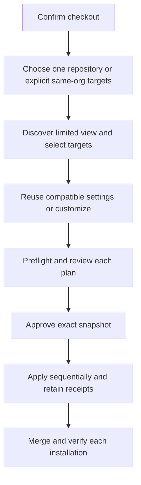
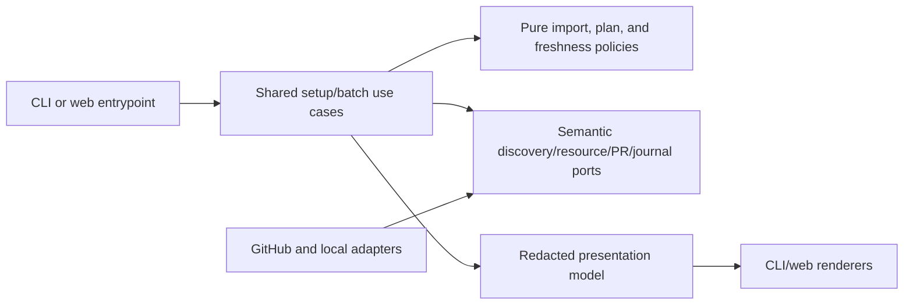

# Organization Configuration Reuse and Batch Setup

- Status: Implemented — local validation complete; pull-request CI and maintainer review pending
- Date: 2026-10-17
- Catalog capability ID: `setup-and-doctor`
- Last verified: 2026-10-17 (automated gates, controlled browser journeys and isolated GitHub Variable probes; PR CI remains a separate merge gate)
- Owners: Copilot maintainers
- Scope: Reuse compatible organization configuration and create reviewed setup pull requests for one to 25 explicitly selected repositories in one organization.
- Related issues/PRs: [Issue #538](https://github.com/vypdev/copilot/issues/538); [#536](https://github.com/vypdev/copilot/issues/536); [#537](https://github.com/vypdev/copilot/pull/537); [platform #159](https://github.com/vypdev/platform/issues/159); [platform #166](https://github.com/vypdev/platform/pull/166)
- Required review gates: product UX, architecture, testing, documentation, security/operations
- Open decisions blocking readiness: None. The owner, limits, limited-token discovery behavior, and installer-owned bootstrap namespace are resolved for this proposal.

## 1. Executive summary

A maintainer can adopt recognized organization settings without repeating completed questions or rewriting shared values, then explicitly select repositories and review a separate plan for each. Single-repository setup remains the default. Batch setup is limited to 1–25 repository IDs in one organization, creates one setup PR per changed target, and reports partial results truthfully. Existing shared Secrets are never written by reuse; uncertain Secret availability blocks that binding until separately provisioned and re-inspected. PR creation is not installation or verification.

```text
Confirm checkout -> choose this repository or selected repositories -> inspect and select targets -> reuse or customize -> review plans -> approve exact snapshot -> create setup PRs -> merge and verify each target
```

## 2. Problem, current behavior, and evidence

### 2.1 Problem

Organization maintainers currently repeat setup questions and re-enter runtime credentials when extending a configured installation. Organization storage and target selection are separate decisions, and organization inventory does not establish that every repository can access a resource. Blind copying risks replacing shared values, hiding repository overrides, creating duplicate setup PRs, or claiming installation before merge and runtime verification.

### 2.2 Current behavior

1. Setup confirms the current checkout and plans configuration for that repository.
2. The wizard collects configuration through the shared questionnaire and credential use cases; PAT preservation is excluded and requires re-entry/audit.
3. Resource inspection primarily describes resources effective for the current repository; `preserveExisting` does not provide complete no-write reuse.
4. Existing-installation management supports inspection and focused edits, while a full installation asks fresh questions.
5. No selected-target batch journey, per-target plan journal, or installer-owned bootstrap namespace is established by this proposal's evidence.

These are the pre-change facts supported by the original catalog/code paths. The implementation and verification evidence below describe the new contract.

### 2.3 Evidence

- Code: `setup_wizard_use_case.ts`, `setup_credentials_use_case.ts`, `setup_configuration_storage_policy.ts`, `setup_questionnaire_policy.ts`, `github_actions_resource_inspector.ts`, and `github_actions_resource_commands.ts`.
- Dogfood: platform #159 and #166 retained 70 effective Variables, preserved the organization PAT, created no repository Secrets, and completed repeated setup without changing existing shared values, visibility, or Secret timestamps.
- Failure evidence: selected organization Variable grants initially returned 404 after updates and needed explicit recovery; permission probes left jobs waiting for an obsolete runner label. Issue #536 / PR #537 addressed a recommendation setup permission mismatch.
- Runtime verification, PAT health, and agent CLI contract passed in the cited dogfood runs. Secret existence, runtime authentication, and complete permission readiness remain distinct facts.
- Unknowns: actual provider behavior under each credential class, rate limits, and precise permission evidence must be established by SDK fixture contracts and controlled live evidence. A resource name alone proves neither target access nor completeness of discovery.
- Primary provider sources: [organization repository listing](https://docs.github.com/en/rest/repos/repos#list-organization-repositories), [organization Variables](https://docs.github.com/en/rest/actions/variables#list-organization-variables), [organization Secrets](https://docs.github.com/en/rest/actions/secrets#list-organization-secrets), [selected repository Secret access](https://docs.github.com/en/rest/actions/secrets#add-selected-repository-to-an-organization-secret), [organization Secret upsert](https://docs.github.com/en/rest/actions/secrets#create-or-update-an-organization-secret), [organization Variable creation](https://docs.github.com/en/rest/actions/variables#create-an-organization-variable), and [PAT management](https://docs.github.com/en/authentication/keeping-your-account-and-data-secure/managing-your-personal-access-tokens).

### 2.4 Retrospective classification (as-built baselines only)

Not applicable: this is a prospective specification and does not reconstruct an implemented baseline.

## 3. Actors, surfaces, and terminology

| Actor | Goal | Entry point | Visible surfaces |
|---|---|---|---|
| Repository maintainer | Configure or extend installation safely | Existing inspect/setup entrypoints | CLI, local web assistant, setup PRs |
| Organization operator | Reuse shared resources and authorize selected targets | Setup journey | Discovery, per-target plans, access review |
| Reviewer | Understand exact setup changes | Setup PR | Files, base/ref, checks, durable operation marker |
| Operator/support | Recover partial work and verify outcomes | Batch report and doctor | CLI/web status, PR/run links, diagnostics |

**Organization reuse** means consuming compatible existing organization Variables and Secrets without changing their values. **Target** means an explicitly selected same-organization repository ID. **Effective access** is target-specific access after considering organization grants and repository overrides. **Installation namespace** means `setup/copilot/<operation-id>`, owned by the installer for approved batch installation and maintenance PRs. It is separate from Action-owned issue branches in both new and installed repositories. **Verified** means the trusted installed/generated health path has supplied the required evidence; it does not mean merely that a Secret exists or `/user` succeeds. Repository labels, files, branches, CI identities, runner requirements, and health are target-owned facts. Organization inventory owns shared resource names, scopes, values where readable, visibility, and membership.

## 4. Goals

### 4.1 Goals

1. Reuse a complete compatible organization configuration with no repeated questions for valid settings and no incidental shared-resource writes.
2. Discover and select explicit repositories with honest visibility and target-specific access checks.
3. Present immutable, reviewable per-target plans before mutation and produce independent, durable outcomes.
4. Preserve the current single-repository journey and use the same application decisions in CLI and web.
5. Make partial success, pending human merge, and runtime verification status clear and recoverable.

### 4.2 Non-goals

1. Organization-wide selection, cross-organization batches, repository creation, automatic merge, release, tag, deployment, or arbitrary code execution.
2. Crawling other repositories to infer shared settings, blind copying, or a mandatory GitHub App/control plane.
3. Importing another codebase's publishing, deployment, CI commands, or approval producers.
4. Collecting or rotating Secret values in batch v1; missing bindings require separate provisioning.
5. Changing the completed setup bugfix or weakening native approval, branch protection, runner-group access, or deployment gates.

### 4.3 Fixed product/safety invariants

1. Default to the current repository. Batch requires explicit selection of 1–25 unique repository IDs in one organization; larger work is split into batches.
2. Preserve existing Variable values, visibility, and memberships. Existing valid values cause zero update calls. Add only explicitly approved missing repository grants through additive add-one-repository operations.
3. Reuse never calls Secret create/update/upsert for a managed shared binding. Existing Secret values are never copied, exported, displayed, logged, or rotated. Missing or uncertain Secret availability blocks that binding pending separate provisioning/customization and fresh inspection. Separately approved disposable permission probes retain their existing journal, collision, and cleanup contract; this exception does not permit writing the reused Secret.
4. Existing overrides remain visible and are never silently deleted or replaced. Resolve conflicts explicitly.
5. Approval binds to exact targets, operation, resource fingerprints, base revisions, and effects. Drift, credential authority change, or target-set change invalidates approval before writes.
6. Apply is sequential in v1, has one active Apply per session and one shared-resource writer per organization/operation, with bounded retries. No cross-repository rollback is implied.
7. Batch installation and maintenance use a disclosed installer-owned `setup/copilot/<operation-id>` ref and verified default base. Installed targets retain Action ownership of every managed issue branch. Never force-push or overwrite human changes. The current-checkout path retains its existing local preview/Apply behavior.

## 5. Current versus proposed product journey

| Stage | Current | Proposed | User/operator effect |
|---|---|---|---|
| Entry | Inspect/setup current checkout | Keep current entrypoints and confirm checkout/organization | Familiar single-repository default |
| Scope | Current repository | Choose “This repository” or “Several repositories in <org>” | Separate storage from target scope; personal repos explain single-only path |
| Discovery | Current checkout facts | Credential-limited paginated/searchable view; explicit exact-name route and temporary operator PAT limited to reviewed IDs | No claim of complete organization discovery |
| Configuration | Questionnaire and explicit PAT re-entry | Reuse compatible settings; ask only missing/invalid and target-specific choices | Provenance and verification limits shown |
| Preflight | Current target | Inspect each selected target's installation, branches, overrides, labels/forms/guidance, CI/runner/access needs | Independent readiness reasons |
| Apply | Single repository | Review exact batch snapshot; sequential setup PR per changed repository | No-op and blocked targets remain independent |
| Finish | Setup result | Per-target PR, waiting, pending verification, verified, action, canceled, unchanged states | PR is never presented as installed |



Text equivalent: confirm checkout, choose scope, discover and select, configure, review, approve, create setup PRs, then merge and verify each target.

## 6. Functional behavior and state model

### 6.1 Happy path

1. Confirm checkout and inferred organization; expose existing inspect and quick-adjustment entrypoints.
2. Default to this repository. If batch is chosen, disclose the credential's current repository view, paginate/search, preselect current repository, and require explicit additional selection.
3. Permit exact repository-name entry when discovery is incomplete. Resolve names to same-organization IDs, then audit/reconnect with a temporary operator PAT limited to reviewed selected targets. Unknown access remains blocked; never assume all-repository access.
4. Offer one choice: “Reuse compatible organization configuration” (recommended) or “Customize configuration.” Explain shared values remain unchanged and selected repositories may need additive access grants. Derive Variable/Secret handling from this choice and storage scope; do not add redundant reuse toggles.
5. Parse recognized organization Variables into typed configuration. Skip valid answers and ask only missing/invalid values and repository-specific choices. Show provenance: Organization, Repository override, New value, Not verified. Secret values are never imported or shown.
6. Preflight every target, including installation, verified default/development branches, effective access and shadows, repository-owned labels/forms/guidance, CI producer identities, runners, required capabilities, and credential authority.
7. Present expandable per-target plans with exact files, grants, new resources, overrides, refs, bases, required permissions, and evidence. A target whose files match has no PR and remains verification pending after resource checks. Approval snapshots all targets and relevant revisions/fingerprints.
8. Revalidate identity, revision, and authority before each write. Apply sequentially, report progress immediately, and journal each receipt. On failure, retain successful results and retry only incomplete work after drift review and any renewed approval.
9. Report each target independently. Require human merge. Run trusted health verification without PR-head code, custom scripts, or model requests.

### 6.2 Alternative paths

- Current-repository Customize follows the existing explicit configuration/replacement contract. Batch Customize changes settings while retaining existing Secret bindings; its label states this limit. Provision missing/replacement credentials through current-repository Customize before restarting batch preflight.
- Existing repository overrides take precedence and require explicit conflict resolution where they conflict with shared values.
- A limited credential may show only its limited view. Exact-name selection plus selected-target reconnect is supported; failure to establish access blocks only affected targets.
- A matching-file target creates no PR; labels, types and resources are still checked and its truthful result is Verification pending. Unchanged is reserved for completely established no-change evidence. Archived, disabled, inaccessible, unsupported, or uninspectable targets cannot be silently included.
- Mixed Variable/Secret scopes are supported; unavailable Secret evidence blocks only the affected binding/target and does not trigger a write.

### 6.3 State machine

| State | Entered when | User-visible meaning | Allowed next states | Recovery/owner |
|---|---|---|---|---|
| Discovering | Read-only inventory starts | Checking selected repository visibility; nothing changed | Selecting, blocked | Maintainer reconnects or enters exact names |
| Selecting | Candidate view available | Explicit targets required | Preflight, canceled | Maintainer edits selection |
| Preflight | Selected IDs resolved | Checking readiness and differences | Review, action, blocked | Setup coordinator retains reasons |
| Review | Plans and snapshot complete | Exact effects awaiting approval | Applying, stale, canceled | Maintainer approves or revises |
| Applying | Approved target operation starts | Sequential work with per-target progress | Partial, complete, canceled, blocked | Journal/use case retains receipts |
| Partial | Some effects succeeded | Completed effects retained; remaining targets need action | Applying, canceled, complete | Retry incomplete targets after inspection |
| Waiting for merge | Setup PR exists | Installation is not complete | Verification pending, canceled | Human reviewer merges/closes |
| Verification pending | Merged but evidence incomplete | Installed state not yet verified | Verified, action | Trusted health path/operator |
| Verified | Required trusted evidence present | Installation verified | — | Doctor/runtime owner |
| Canceled | Pending work stopped | Completed PRs/grants retained | — | Maintainer resumes via fresh inspection |
| Unchanged | Plan has no effects | Target already matches | — | None |

Duplicate apply requests join/reject against the active session; they do not create another operation. Out-of-order or future-schema resumes are rejected. Unknown create responses trigger inspection by durable operation marker and target identity before retry. A stale snapshot cannot be approved or applied.

## 7. User-facing configuration

| Input | Type | Recommended default | Allowed values/range | Scope/persistence |
|---|---|---|---|---|
| Setup scope | Enum | This repository | Current repository or selected same-organization repositories | Operation snapshot |
| Target IDs | Unique repository ID list | Current repository only | 1–25; no duplicates; one org | Journal snapshot |
| Configuration source | Enum | Reuse compatible organization settings after organization storage is selected | Reuse or Customize | Per operation; no independent Variable/Secret toggle |
| Apply mode | Enum | Current checkout retains local preview/Apply; batch creates reviewed PRs sequentially | Batch is PR-only in v1; no automatic merge | Operation snapshot |
| Discovery credential | Paired local operator credential | Existing credential's visible scope | Existing limited view; exact-name route and temporary PAT limited to selected IDs | Local session only; excluded from resume/export |
| Retry count | Bounded policy | At most 3 read attempts; inspect uncertain writes | No blind mutation retry; at most 1 guarded retry per paired session after inspection and fresh approval checks | Operation; not user-expandable |

Validation rejects zero or over-25 targets, duplicates, cross-org IDs, unresolved names, archived/disabled/unsupported targets, missing required capabilities, unknown Secret availability for a required binding, invalid/future resume schema, and invalid branch/base. Precedence is explicit reviewed repository choices > existing repository override > accessible compatible organization values > typed defaults; unknown/unsafe bindings require review. Snapshot non-secret plans, IDs, revisions, fingerprints, operation identity, and receipts; reread remote identities/revisions before writes. Credentials remain paired local session state. Absent legacy batch fields mean single repository; unknown future values fail closed. Example: default single repository with reuse selected after choosing organization storage. Alternative: explicit three-target batch with one blocked target and two actionable plans. Branch names, URLs, commands, secrets, and arbitrary code are never accepted as configuration inputs.

## 8. Clean Architecture

### 8.1 Responsibilities and dependency direction

| Layer/boundary | Owns | Must not own/import |
|---|---|---|
| Domain/pure policy | Typed import, precedence, compatibility, target bounds, plan validity, approval freshness, result states | SDK, HTTP, process, files, UI framework |
| Application | Shared setup coordinator orchestration, discovery/preflight/apply/recovery use cases, immutable per-target contracts | Concrete provider DTOs or CLI/web-specific policy |
| Semantic ports | Repository discovery, resource inventory/access, branch facts, setup PRs, batch journal, credential audit, trusted health evidence | GitHub SDK shapes or product presentation |
| Data/provider adapters | Pagination, endpoint calls, additive grants, PR marker lookup, provider error mapping | Product decisions or secret display |
| Infrastructure/composition | Credential pairing, local persistence, adapter wiring, concurrency locks | Business policy |
| Entrypoints | CLI/web input adaptation and session start/resume | Duplicated orchestration |
| Presentation | Redacted batch view models, localized rendering, status/link formatting | Mutations or transition policy |



### 8.2 Contracts, state, and trust boundaries

- Pure decisions: typed organization import, compatibility, precedence, bounds, target eligibility, diff classification, approval freshness, retry eligibility, and truthful status derivation.
- Application contracts: immutable request, target plan, approval snapshot, apply receipt, and per-target outcome; shared coordinator and existing questionnaire/credential/provisioning use cases are reused through narrow per-target interfaces.
- Semantic ports: paginated visible repository discovery; exact name resolution; target access audit; organization namespace inventory; target effective access/shadow inspection; branch/base inspection; additive grant; PR create/find; trusted health query; durable journal.
- Durable state/schema ownership: application operation model; journal stores schema version, operation ID, non-secret plans/fingerprints, target IDs, receipts, and status. Credentials are never serialized. Reject unknown future schemas.
- Concurrency/idempotency: one active apply per session; one organization shared-resource writer per operation; sequential target writes; durable operation marker plus target identity; inspect before retry after unknown outcomes. Never overwrite human changes.
- Trust: issue/PR/comment text, repository names, labels, provider responses, and discovered values are untrusted data. Sanitize display; do not render as HTML, command, mention, or arbitrary link. Typed schema parsing and allowlisted URL construction only.
- Provider error mapping distinguishes absent, forbidden, not found, rate-limited, transient, malformed, and unknown; 404 after grants is not silently treated as absence. Inventory unavailable means unknown, not empty.

#### Installation refs, ownership and recovery

- The application allocates a canonical UUID operation ID. The only batch installation ref is `setup/copilot/<operation-id>`; users cannot supply a different ref, branch template, base, command, or URL. Each repository has its own ref with that same operation ID.
- The base is the target's authenticated `default_branch` and exact commit observed during preflight. A changed default branch or commit invalidates approval before mutation. Local checkout branch names never determine another target's base.
- The installer owns this namespace for both bootstrap and maintenance. Existing `feature`, `bugfix`, `release`, and other configured issue refs remain owned by the target Action. An installed target does not need a synthetic issue to receive a setup PR. The generated profile, guide and skill must explain this limited installer contract before the batch entrypoint is enabled.
- A prepared installation commit has the approved base as parent and an operation receipt in `.copilot/setup-manifest.json`: schema version 1, operation UUID, repository ID, base SHA and plan digest. It contains no credential or Secret value. The ref is created at that complete prepared commit, rather than at an unmarked intermediate base.
- Recovery requires the exact prepared commit and matching manifest receipt; the ref name alone is not ownership evidence. An unexpected ref, moved head or human change blocks further writes. The installer never force-pushes, deletes an existing branch, or overwrites a PR head.
- The PR body uses `<!-- copilot-setup-operation:v1:<operation-id>:<repository-id> -->`. Before creating a PR, the adapter looks for that exact target/operation marker. An uncertain create response is inspected before any further request. A matching existing PR is reused; a conflicting open installer PR is surfaced for resume/review instead of creating a duplicate.
- Read retries are limited to three total attempts and transient/rate-limit evidence. Mutations are not blindly retried. After an unknown outcome, inspect the operation receipt and effective state; at most one guarded retry per paired session is allowed after identity, revision, authority and approval checks pass again. A new session requires explicit resume, fresh planning/approval and unchanged target/base/digest; it never automatically repeats writes. Longer waits pause the target with a retry action rather than expanding this limit.
- Reuse imports only recognized typed values. CI commands, approval producer identity and branch/runner facts remain target-specific and require their existing checks. Import never executes a discovered command, queries a model, or follows an arbitrary URL. Missing fields and incompatibilities remain explicit questionnaire/review work.
- The fast reuse journey reads existing trusted health evidence; it does not bootstrap or dispatch a workflow. Evidence must match the packaged template, authenticated default-branch SHA, workflow/repository/run identity and current effective Secret metadata, and be at most five minutes old. Each request is bounded to 15 seconds and the complete evidence query to 30 seconds. Missing or stale evidence means verification pending. An actual failed trusted check blocks reuse. PAT authentication alone remains pending for full runtime capabilities.
- Recognized Variable imports are bounded to 30,000 characters per value and parsed through typed configuration validation. A user change to a shared answer becomes an explicitly reviewed repository override; it never updates the shared value. Existing same-name repository values retain precedence. Existing shared values, visibility and other repositories' memberships remain unchanged.
- The installation receipt is a nested `installation` object with schema version 1 inside the existing schema-version-2 setup manifest. Legacy manifests without that optional receipt remain readable. Journals persist only operation/target identities, base and plan digests, effect names and PR/commit receipts; configuration values and file contents stay in the paired process and are not written to the journal.
- The existing current-checkout Apply path remains available, including non-interactive saved configurations. Batch is an explicit interactive choice in v1; non-interactive requests cannot silently activate it. Both frontends use the same import and batch application decisions.

### 8.3 Executable architecture constraints

Architecture tests MUST prevent provider imports in domain/application policy and UI orchestration duplication. Contract tests MUST parse workflow/schema structures, validate bootstrap namespace ownership/ref/base disclosure, and enforce dependency-cycle rules. Journal schemas and operation markers require compatibility fixtures. Existing architecture and specification validators remain required; add focused checks for generated collaboration contract before enabling the bootstrap namespace.

## 9. UI/UX and content contract

### 9.1 Information hierarchy

Every report states current status, completed facts, next transition, required human action, impact/retained effects, inspectable links, then collapsed diagnostics. One primary action is shown per state. Counts and reasons are text, never color-only.

### 9.2 Representative primary view

```markdown
<!-- stable marker: copilot-setup-operation:v1:<operation-id> -->
# Copilot setup plans — vypdev

> **Current status:** Review 3 selected repositories. Nothing has changed.
> **Action required:** Approve the plans below or change the selection.

## Progress

- [x] Organization settings inspected; shared values remain unchanged.
- [x] 3 repository plans checked.
- [ ] Apply awaits approval.

| Repository | Configuration | Next action |
|---|---|---|
| copilot | Already configured | Unchanged; no PR |
| platform | Organization settings + 2 local choices | Create setup PR |
| service-api | Selected PAT access missing | Review access; blocked |

## What happens next

Approval creates at most one setup PR for each changed, ready repository. Each PR waits for human merge and later verification.

<details><summary>Technical details</summary>Sanitized IDs, refs, revisions, capability evidence, and provider diagnostics.</details>
```

Pending/no action:

```markdown
# Checking 3 repositories
**Current status:** Read-only discovery is in progress. Nothing has changed.
**Action required:** None. The selected repositories remain visible below.
```

Action required:

```markdown
# Review service-api access
**Current status:** This repository cannot use the organization PAT.
**Action required:** Review the repository access addition or reconnect with a credential limited to the selected targets.
**Impact:** No setup PR was created for service-api; other plans remain available.
```

Blocked before effects:

```markdown
# Setup paused for service-api
**Current status:** Configuration could not be inspected because this credential lacks access.
**Action required:** Reconnect or correct the repository selection, then inspect again.
**Retained state:** No change was made to this target; other reviewed plans are retained.
```

Partial success:

```markdown
# Setup batch needs attention
**Current status:** 2 setup PRs created; 1 repository needs action.
**Completed:** PRs and approved shared-resource grants are retained.
**Action required:** Inspect service-api access, then retry only that target after drift review.
**Links:** Open each setup PR and the operation report.
```

Completed:

```markdown
# Setup results ready
**Current status:** 2 installations verified; 1 repository already matched.
**Completed:** Each target's PR, merge, and verification status is listed separately.
**Action required:** None for verified and unchanged targets.
**Links:** Open setup PRs, verification runs, and configuration.
```

### 9.3 Issue, PR, and comment behavior

- Titles identify setup operation and repository; PR body discloses exact base/ref, files/resources, operation marker, and human merge requirement.
- Merge installs reviewed files and then permits trusted verification. Closing a PR does not remove grants or other shared effects; retry inspects existing marker and state first.
- Durable marker identifies operation and target. Existing setup PR is reused; human changes are preserved and conflicts require review. Unknown create outcome is inspected before retry.
- Cap output at one operation report and one setup PR per changed target. No duplicate notifications on replay.
- Labels/checks are supplemental status, not proof of access or verification. Provide descriptive direct links; no raw provider IDs as the only navigation.

### 9.4 Accessibility, localization, and responsive behavior

Support existing en/es/fr/pt setup catalogs with locale fallback consistent with current application behavior. All four locales cover primary states, actions, reasons, and errors. Selection is keyboard accessible; narrow layouts use readable stacked target cards or horizontally navigable tables with repository labels and counts. Light/dark contrast, semantic headings, visible focus, and textual diagram equivalent are required. Escape untrusted names and values; allowlist GitHub destinations and encode path segments. Never interpret discovered content as Markdown HTML, commands, mentions, markers, or arbitrary URLs.

## 10. Failure, recovery, and cleanup

| Failure/partial state | User impact | Retained facts | Automatic retry | Required action | Cleanup |
|---|---|---|---|---|---|
| Discovery limited/partial | Some org repositories may be absent | Credential view and selected IDs | Bounded pagination only | Enter exact names/reconnect for selected IDs | No broad access request |
| Inventory unavailable | Reuse status unknown | Last successful snapshot, if any | Bounded transient retry | Reinspect; do not treat as empty | None |
| Grant returns 404/ambiguous | Target access uncertain | Grant attempt receipt and shared values unchanged | No blind retry; inspect first | Re-read effective target inventory, then retry if safe | Never remove existing memberships |
| Secret absent/uncertain | Affected binding blocked | Existing Secret untouched | No | Separate provisioning/customization and fresh inspection | None |
| Drift before target write | Approval stale | Earlier target receipts | No | Review new snapshot and approve again | Retain prior PRs/grants |
| PR create unknown outcome | Duplicate risk | Operation marker and target identity | Inspect first | Find existing PR; retry only if absent | Preserve human edits |
| Later target fails | Partial batch | Successful PRs/grants and per-target receipts | Only incomplete target, after inspection | Correct cause and reapprove if snapshot changed | No cross-repo rollback |
| Cancellation | Pending work stops | Completed effects and links | No | Resume through fresh inspection if desired | Do not revoke potentially shared grants |
| Probe side effect | Stray workflow/job may remain | Probe journal and exact run IDs | No | Report exact cleanup action and owner | Cancel only owned probe runs; never broad cleanup |
| Merge/health pending | PR exists but installation unverified | PR/merge/run facts | Health workflow policy | Human merge or inspect trusted run | Never infer verification from PR creation |

Errors follow impact, cause, action, retained state. Retries are bounded and never convert unknown provider responses into success.

## 11. Security, permissions, and privacy

1. Discovery shows only what the credential can see. Exact-name resolution and a temporary operator PAT limited to reviewed selected repositories establish target access; no all-repository credential is assumed or silently requested. Audit least privilege for all selected targets.
2. Organization inventory is namespace-wide only where authorized; target-effective access and overrides are inspected per repository. Do not crawl other repositories.
3. Selected-repository grants use additive endpoints and explicit approval. Preserve all memberships and global/private visibility. Do not claim one writer prevents external administrators changing resources.
4. Reuse performs no Secret upsert. Secret values and operator credentials never enter journal, report, logs, export, or presentation. Operator PAT stays separate from runtime bot PAT.
5. Current workflow PAT re-entry/always-rewrite behavior is explicitly amended for reuse: no replacement; audit available runtime capability/identity only through trusted installed/generated verification. Missing evidence is pending. Invalid required credentials block the affected target. `/user` success proves neither full permission nor native approval readiness.
6. Health jobs do not execute PR-head code, custom scripts, or model requests. Never weaken branch protection, native approval, runner-group access, or deployment gates.
7. Approval and resume are bound to authenticated session, snapshot, operation ID, schema, and target identities. Forged, stale, replayed, or future-schema operations fail closed.

## 12. Observability and operational UX

- User-facing state is per repository and separates PR created, Waiting for merge, Installed; verification pending, Verified, Needs action, Canceled, and Unchanged.
- Operation report records completed facts and retained effects before technical diagnostics. Each receipt links to the setup PR or relevant verification run.
- Logs use correlation operation/target IDs and redacted provider classifications; no PAT, Secret value, or sensitive configuration value.
- Pending external approval/merge/runner availability is distinct from workflow failure.
- Provider retries are bounded, rate-limit-aware, and visible; ambiguous writes require inspection.
- Notification budget: one operation report plus one setup PR per changed target, with idempotent update.

## 13. Compatibility, migration, rollout, and rollback

- Existing single-repository setup and saved configurations remain valid; absent new fields preserve current single-repository behavior.
- Add a versioned batch journal; reject invalid/future schemas. Credentials are reacquired in paired local session and never migrated into artifacts.
- Update the PAT contract so reuse does not require re-entry or rewrite, while explicit replacement/new-install flows retain current behavior. Audit available evidence; label unavailable verification pending.
- Stages: (1) single-repository organization reuse, (2) explicit discovery/preflight, (3) bounded batch PR creation/recovery, (4) shared CLI/web UX, compatibility, and dogfooding. No stage activates batch by default.
- Batch targets use `setup/copilot/<operation-id>` for approved bootstrap or maintenance PRs; exact branch and base appear in approval. Update the generated collaboration contract before activation. Installed targets retain Action ownership of managed issue branches. Recovery ownership and cleanup are documented; never invent an issue branch or force-push. The legacy current-checkout Apply path remains available.
- Rollback disables new entrypoint while retaining journal/PR/grant facts. Reversal of grants is a separate reviewed action because other consumers may rely on them. No automatic cross-repository rollback.

## 14. Testing strategy and numeric budget

Minimum distinct automated cases: 104. Allocations reflect risk inventory and do not double count.

| Area | Minimum distinct cases | Behaviors/risks covered |
|---|---:|---|
| Domain/configuration/pure planning | 22 | Typed import, precedence, compatibility, bounds, conflicts, snapshots, freshness |
| State/application/idempotency/races | 24 | Sequential apply, retry, replay, drift, cancellation, concurrency, partial receipts |
| Adapters/provider contracts | 18 | Pagination, selected access, grants, inventory, 404/forbidden/rate-limit/unknown outcomes |
| Workflows/setup/schema | 12 | Bootstrap ref/base, markers, permission contracts, workflows, labels/forms/guidance |
| Presentation/localization/accessibility/sanitization | 16 | All states, links, four locales, keyboard/narrow view, untrusted data |
| Integration/security/migration | 12 | Secret no-write, credential separation, health boundary, migration, end-to-end recovery |
| **Total** | **104** | Distinct cases; no double counting |

Retain repository coverage gates in `scripts/coverage-budgets.json`; changed modules must meet or exceed existing thresholds. Cover every reachable branch in new pure decision policies. Use deterministic IDs, clocks, fakes, and SDK fixture transport; no real waits or live services in automated tests. Parse workflow/schema contracts structurally. Use semantic UI assertions in addition to golden fixtures. Regression: repeated reuse performs zero existing shared-value/Secret writes and no duplicate grants or PRs. Six controlled manual journeys: new/existing single repository; mixed multi-targets; missing selected access; partial apply/retry; cancellation/resume; limited-token discovery. Live evidence is controlled and supplemental, not a substitute for contracts.

## 15. Documentation and discoverability

| Audience | Artifact/page | Required content | Validation/navigation |
|---|---|---|---|
| User | `docs/how-to-use.mdx` | Normal single path, explicit batch journey, review and status meanings | Route/link validation and UX fixture |
| Setup owner | `docs/authentication.mdx`, `docs/configuration.mdx`, `docs/configuration-checklist.mdx` | Credential scopes, reuse, precedence, selected grants, limits, examples | Contract fixtures and documentation validation |
| Operator | `docs/security-operations/operations/provisioning.mdx`, `troubleshooting.mdx`, `verification.mdx` | Partial results, retry, cancellation, bootstrap ownership, merge/health states | Recovery decision-tree review |
| Contributor | `docs/development/architecture.mdx` and setup SDDs | Ports, trust boundaries, journal, idempotency, validators | Architecture and spec validators |
| Security operator | `docs/security-operations/security/credentials.mdx` | Secret no-write, PAT separation, evidence limits | Documentation contract checks |

Update the existing setup-and-doctor, configuration-management, local-web-assistant, and PAT onboarding specifications as implementation proceeds, preserving their ownership contracts. Register this companion under existing `setup-and-doctor`; related web capability remains evidence. Update `specs/catalog.json` and generated `specs/CATALOG.md` with the implemented source/test evidence; controlled UX and final CI remain explicit gates. Keep examples synchronized with fixtures. Document bootstrap branch ownership and cleanup before activation.

## 16. Acceptance scenarios

1. Given a complete recognized organization configuration, when a maintainer selects reuse for one repository, then valid questions are skipped, PAT is not re-entered or rewritten, shared values are unchanged, and unavailable verification remains pending.
2. Given a limited credential, when the maintainer selects three exact same-organization repository names, then the UI states the limited discovery view, audits/reconnects with a PAT limited to those reviewed targets, and blocks any target whose access remains unknown.
3. Given a missing selected-repository grant, when the maintainer approves it, then only the additive target grant is made; existing memberships and visibility remain unchanged and effective inventory is read back.
4. Given a same-name repository override, when organization reuse is planned, then the override remains visible and no silent replacement occurs.
5. Given one matching-file target, one ready target, and one blocked target, when the batch is reviewed/applied, then the matching-file target has no PR and remains verification pending, one PR is created for the ready target, and the blocked target has a reason without erasing other results.
6. Given a grant or PR create response is ambiguous, when recovery runs, then the system inspects durable operation marker/target identity before retry and does not duplicate effects.
7. Given a target/base revision, credential authority, target set, or relevant shared fingerprint changes after approval, when apply begins, then the stale plan is rejected before mutation and requires renewed review.
8. Given a new or installed batch target, when its setup PR is created, then the exact `setup/copilot/<operation-id>` ref, verified base and manifest receipt are disclosed, human merge is required, and Action-owned issue branches retain their existing lifecycle.
9. Given a matching-file installation without trusted health evidence, when status is rendered, then it says Verification pending and does not infer readiness from `/user`, Secret existence, or PR creation.
10. Given malicious repository names/values containing Markdown, HTML, mention, command, or URL syntax, when rendered in CLI/web/report, then they remain inert escaped text and navigation uses allowlisted links.
11. Given a user navigating with keyboard in each supported locale and a narrow viewport, when selecting targets and reviewing states, then counts, reasons, focus, and primary action remain understandable without color or diagram reliance.
12. Given existing saved configuration without batch fields, when upgraded, then single-repository behavior remains the default and no batch operation activates.

## 17. Requirements traceability

| Requirement | Policy/use case/adapter/presentation | Test or evidence | Documentation |
|---|---|---|---|
| Reuse, typing, provenance, precedence | Import and configuration policies | Pure planning cases; typed fixtures | Configuration and checklist |
| Limited discovery and explicit target bounds | Discovery use case/adapter | Pagination, exact-name, 1/25/26, cross-org cases | Authentication and how-to-use |
| No-write shared reuse and additive grants | Resource adapter and approval policy | Zero-write regression; grant SDK fixtures | Credentials and provisioning |
| Secret no-write and evidence distinction | Credential/health use cases | Security integration cases | Credentials and verification |
| Per-target plans and stale approval | Batch coordinator/journal | Drift, replay, race, cancellation cases | Provisioning/troubleshooting |
| Bootstrap ownership and PR idempotency | Branch/PR ports and workflow contract | Structural workflow and duplicate-create cases | Architecture/provisioning |
| UX states, locales, accessibility | Shared view model/renderers | Semantic fixtures and manual journeys | How-to-use |
| Migration and rollback | Journal schema/composition | Legacy/future schema and migration cases | Troubleshooting/architecture |

## 18. Implementation sequence

1. Define contracts, fixed limits, PAT amendment, bootstrap ownership, and architecture/schema checks.
2. Implement pure import, precedence, target eligibility, plan, and freshness policies with branch-complete tests.
3. Add shared application orchestration, journal, per-target receipts, concurrency, retry, and cancellation.
4. Add discovery, inventory, additive-grant, PR idempotency, and trusted-health adapters with provider contract tests.
5. Build shared redacted view models and CLI/web presentation, localization, accessibility, and state fixtures.
6. Deliver single-repository reuse first, then explicit discovery/preflight, then bounded batch PR apply/recovery. Update docs and generated collaboration contract before enabling bootstrap namespace.
7. Complete migration, controlled dogfooding, six manual journeys, coverage and all repository validators.

## 19. Definition of Done

- [x] Every normative requirement maps to acceptance and traceability.
- [x] Existing setup contracts are preserved or explicitly amended for PAT reuse and bootstrap ownership.
- [x] Architecture boundaries, dependency/cycle checks, structured workflow/schema checks, and journal compatibility checks pass.
- [x] Numeric test budget of 104 distinct cases and repository/changed-module coverage requirements pass; pure-policy branches are covered.
- [x] Configuration defaults, limits, validation, precedence, persistence, and migration agree.
- [x] Pending, action-required, blocked, partial, and completed UI states are reviewed and implemented.
- [x] Accessibility, en/es/fr/pt localization, responsive behavior, sanitization, and notification budgets pass.
- [x] User, setup, operator, security, migration, recovery, and contributor documentation is discoverable and complete.
- [x] Secret no-write, partial-state, retry, idempotency, credential separation, and cleanup requirements pass.
- [x] Generated CLI/web assets and specification/catalog, workflow, documentation, packaging, architecture, and coverage validators pass.
- [x] `specs/catalog.json` and `specs/CATALOG.md` reflect implementation evidence only after implementation; `pnpm run validate:specifications` passes.
- [x] No readiness-blocking decision remains unresolved.

## 20. References and decisions

- Primary sources: GitHub REST documentation linked in §2.3; provider behavior requires fixture contracts and controlled live evidence.
- Related owning specifications: `specs/setup-configuration-credentials-and-doctor.md` and related setup/PAT specs in the `setup-and-doctor` capability. `specs/local-web-setup-assistant.md` is related web evidence; it is not the owning capability. This new companion path is `specs/organization-configuration-reuse-and-batch-setup.md` and does not already own itself.
- Decision: companion under existing `setup-and-doctor`; no new capability ID. Organization reuse is delivered before batch PR orchestration.
- Decision: limited credential view plus exact-name target entry and selected-target-limited temporary operator PAT; no presumed all-repository access or mandatory GitHub App.
- Decision: `setup/copilot/<operation-id>` is an installer-owned namespace for batch bootstrap and maintenance PRs, with authenticated default-branch bases, prepared-commit/manifest ownership evidence and durable per-target receipts. Installed repositories retain Action ownership of managed issue branches; current-checkout Apply remains available. Update the generated collaboration contract before activation.
- Decision: one reuse/customize source choice, 1–25 explicit targets, one active Apply/session, sequential v1, one shared-resource writer per organization/operation, bounded retries, no cross-repo rollback.
- Rejected alternatives: repeated full questionnaire, scanning other repositories, blind copy, organization-wide selection, automatic merge/deploy, and mandatory hosted control plane.
- Follow-up outside scope: evaluate GitHub App only if measured PAT discovery/permission limitations justify a separate decision; platform dependency remediation remains separate.

## 21. Verification evidence and bounded recovery

- Shared preparation/credential/session tests cover independent unknown inventories,
  failed files, pending additive bindings, missing credentials, stale receipts,
  approval-before-probe ordering, cleanup blocking, stop and one guarded retry.
- Real GitHub dogfood confirmed empty Variable values return 422 and native
  comma empty-list values round-trip (201/200) and delete cleanly (204). No
  probe remains, no Secret value was written and no shared value was changed.
- Empty collection overrides use the existing native parsers (`,`, or `;`
  for organization rules), including the published 3.5.6 Action. Empty inherited
  scalars require an explicit valid value because GitHub cannot store a blank
  scalar override. This introduces no runtime DSL or sentinel.
- Current-repository reuse and batch initial PAT bootstrap perform identity/read
  checks only. Temporary Write probes wait for the final approved plan. Ordinary
  Customize retains its existing disclosed bootstrap verification.
- `--resume-operation <UUID>` loads only the private receipt identities, reacquires
  credentials, re-asks configuration and compares desired digest/base before
  probes. A merged or otherwise changed default base requires inspection of
  retained PRs followed by a fresh operation. No background merge/verification
  monitor or automatic cross-repository rollback is included.
- GitHub read requests allow three total attempts, 15 seconds per request.
  Rate-limited reads honor valid provider waits of at most 15 seconds each
  (at most two waits / 30 seconds total); missing, invalid or longer waits pause
  the target instead of guessing or creating retry storms. Namespace and
  membership collections use 30-item pages with a 1,000-resource bound. Repository
  discovery is limited to 1,000 visible candidates with exact-name lookup.

### Controlled UX evidence — 2026-10-17

The real compiled Svelte frontend and paired loopback bridge were exercised
with deterministic, credential-free provider fixtures. These are controlled UX
journeys, not claims of live multi-repository installation:

| Journey | Observed outcome |
|---|---|
| New single repository | Review separates repository writes from retained Secrets; decline leaves the plan unapplied. |
| Existing single repository | Compatible settings and zero Variable writes are shown; retained PAT requests no value. |
| Mixed targets | Two ready targets and one blocked inventory remain distinct; only ready plans can advance. |
| Missing selected access | Review discloses one additive PAT grant and its permission probes, with no Secret replacement. |
| Partial apply / retry | Completed PR stays visible; unfinished target requires another review before retry. |
| Stop / resume | Keyboard-confirmed stop retains a completed PR and marks pending work stopped; exact receipt/base resume is separately exercised through the application flow. |
| Limited discovery | Current target remains selected, unavailable write target is disabled, and exact-name/access guidance remains visible. |

Viewport 360×800 has no horizontal overflow. English and Spanish were inspected
interactively; en/es/fr/pt semantic rendering and controller/disabled states are
automated. A browser-native confirmation required keyboard confirmation in the
in-app browser; the resulting retained/canceled states were visibly verified.
New pure import/access/selection/review policies have an executable 100% coverage
budget in `scripts/coverage-budgets.json`. Repository-wide coverage budgets and
all existing capability budgets remain in force. The acceptance ledger retains
its 14 previously open items; this feature does not close unrelated evidence.

### Final local gates

The final local suite passes **657 suites / 9,868 tests** (35 pre-existing
skips). Coverage is **97.38% lines, 96.23% statements, 97.02% functions and
93.07% branches**. All eight new pure decision modules pass 100% on all four
metrics through the executable budget. Build, package smoke, TypeScript,
Svelte, lint, documentation, workflow, architecture and specification gates
pass. Multi-platform PR CI and maintainer review remain required before merge;
these local results do not authorize merging or publishing this feature.

### Live SDK inspection and branch preflight

Read-only SDK dogfooding resolved both actual repositories and their current
master revisions, verified readable inherited Variables/Secrets, and inspected
the selected development branch. The available operator credential cannot list
the organization-wide namespace (`forbidden`). Batch therefore requires a
properly scoped temporary operator PAT and stops before mutation; this evidence
is not a live multi-target Apply claim. A known inherited PAT can be retained
without applying the replacement-only namespace warning, while replacement
and an unknown/missing binding retain their previous blocking rules.

Preparation establishes the selected development branch before rendering/apply;
missing and unreadable branches remain distinct per-target blockers. Fresh
write preflight checks it again. The installer creates only its reviewed setup
ref and never invents a development ref or initial revision.

### Automatic-review follow-up

The single-checkout reuse preflight compares both repository and inherited
organization Secret revision metadata in addition to names/access. Same-name
rotations or lost revision evidence block Apply; ordering does not. The terminal
selector requires entered IDs or the explicit `confirm` action for the displayed
selection; a blank answer remains in selection. Regression tests exercise both
actual presentation paths and metadata drift without credential values.

### Review clarification: repository visibility and batch Customize

Single-checkout reuse includes repository visibility in its fresh snapshot, so
private/public/internal drift blocks before files or values change. Batch
Customize intentionally customizes non-secret settings while keeping existing
Secret bindings, as required by the v1 no-value-collection boundary. The source
choice names that limit in all four locales. Missing bindings identify their
supported credential options and direct provisioning to the selected target,
then require a fresh batch preview. A regression covers Customize with existing
bindings and another covers a newly selected provider whose key is missing.

### Backup identity regression

Fresh previews retain each generated backup's relative asset path beneath its
stable content directory. Equal basenames and content from different original
paths remain separate plan entries. The adapter regression reproduces the
previous collision, preserves historical backups and verifies reproducibility
after the timestamp changes.

### Rejected audit and unavailable Secret revision evidence

A rejected permission audit has no trustworthy cleanup result. Its target is
persisted as provider-blocked with `cleanupPending: true`; other pending targets
are stopped, completed effects/PRs remain, and the result is partial. Both the
shared session and direct Apply reject further writes for that saved operation,
including after restart. The terminal and all four web locales direct operators
to inspect GitHub history and the local recovery journal, resolve temporary
resources, and start a fresh preview. A normal failed audit with confirmed cleanup
still blocks only its own target.
Audit probes and receipt updates hold the same exclusive operation lock used by
Apply, reloading the receipt after acquisition and releasing it before Apply
acquires its own lock. A concurrent owner cannot overwrite a cleanup incident.

Batch revalidation requires complete, valid repository Secret revision entries
covering the exact names in both reviewed and current inventories. Two absent
revision lists cannot establish freshness for nonempty Secret inventories.
Regression cases cover missing, partial, wrong-name and invalid metadata, harmless
ordering, rejected audits, durable resume, direct Apply and retained completed PRs.


### Native limited-PAT acceptance correction (2026-10-17)

A real preparation of `vypdev/copilot` and `vypdev/platform` authenticated and
read the organization namespace successfully. Copilot imported 57 settings,
retained 61 organization and seven repository Variables, and proposed only a
repository `PR_APPROVAL_POLICY` serialization. Both targets preserve Secrets;
this preparation is not a completed Apply or runtime verification.

Platform's PAT intentionally lacks optional `Checks: read`; its existing
recommendation policy can use manual producer identities. Native Backend and
Frontend check names contain commas. The web helper rejected them and the
questionnaire split explicit tuples on commas. Both surfaces MUST preserve
commas inside exact `name|App ID|workflow` tuples. Comma-separated numeric
observed selections remain compatible, semicolons separate exact tuples, and
pipe/semicolon/newline constraints and eight-producer bounds remain. Existing
producer attestation stays false; entering a tuple does not grant approval or
certify coverage. All four web locales explain this boundary. Two new
questionnaire cases cover actual Backend/Frontend identities and mixed legacy
indices plus a comma-containing workflow; existing two web-helper rows now
verify exact preservation. User setup docs explain the syntax.

Installer PRs intentionally have no synthetic issue. Source and distributed
issue-centric Commit workflows MUST exclude `setup/copilot/**` from their push
subscription; normal PR review and repository CI remain enabled. A structural
workflow validator and two directory cases reject removal of this exclusion.
This is route ownership, not a successful progress assessment or a CI exemption.
Native batch acceptance must still inspect the complete plans, execute Apply,
verify exact prepared refs/receipts and PRs, and retain waiting-for-merge status
until a human merges. No release, tag, deploy, shared-value replacement or
runtime verification is implied by PR creation.

### Atomic Variable preservation and complete Secret freshness (2026-10-17)

Native review of `c56d0d51` found two actionable boundary defects: the batch
Variable writer could upsert a concurrently edited existing name, and individual
reuse could equate two missing Secret revision snapshots. Both are corrected
before native Apply acceptance or merge.

The documented [GitHub Variable create/update API](https://docs.github.com/en/rest/actions/variables#update-a-repository-variable)
does not expose a revision-precondition parameter for an update. The product
therefore MUST NOT infer atomic update safety from separate reads. Organization
reuse and batch setup use a narrow create-only repository Variable capability.
It MAY retain an already equal value or create an absent name using POST; it
MUST NOT call update, including after a racing creation, uncertain response or
retry. A genuinely different existing repository Variable blocks that target
with a separate reviewed update action. Other ready targets may continue.
Single-repository Customize retains its explicit replacement contract.
Valid `PR_APPROVAL_POLICY` JSON with equal decoded content is retained despite
whitespace or property order. Invalid or behaviorally different policy JSON is
not equivalent. Shared values and memberships remain unchanged by value reuse.

The application exposes the create-only operation separately from upsert. The
batch composition injects a frozen facade containing only create-only writes;
individual reuse selects it explicitly and refuses an older writer lacking the
capability. The data adapter never falls back from a POST conflict to PATCH.
Batch preparation identifies existing-name differences before approval. Existing
journal locking, read-only revalidation and retained-effects recovery remain.
No new permission, configuration flag, Secret value, durable schema or limit is
introduced. Legacy journals cannot override the new write boundary.

Every retained repository and inherited Secret name MUST have one matching valid
revision timestamp before individual reuse Apply. Missing, partial, duplicate,
extra or invalid revision metadata is unknown, even when repeated reads are
identical. Empty proven namespaces need no invented timestamp. The wizard stops
before questions or permission write probes when individual reuse lacks this
metadata; web reconfirmation and final resource provisioning independently stop
before their mutations. Batch repository freshness and its shared-resource
revision snapshots remain mandatory. Reordering complete metadata is harmless.

User-facing blocked content explains either “existing repository Variable needs
a separate reviewed update” or “retained Secret revision metadata could not be
verified”, followed by the recovery action and retained-state fact. It MUST NOT
claim an observed edit when only metadata is unavailable. A new preview is
required after recovery; no automatic destructive remediation is offered.

A minimum **20 additional distinct runtime cases** covers validated JSON
formatting versus behavior changes, create-only/no-update and POST collision
races, unavailable create-only capabilities, per-target conflict isolation,
missing/partial/duplicate/invalid/extra Secret revisions, empty namespace and
ordering, individual wizard/web/resource gates before probes/writes, and bound
credential coordinates. These cases extend existing suites and are disjoint
from the progress budget. Existing pure/global/module budgets remain enforced.
Full tests, coverage, build, type/lint, specs/catalog/docs/workflow checks and
current-head native review remain required. Native acceptance repeats the
selected copilot/platform plans with zero unnecessary policy rewrites, creates
only reviewed installer PRs, and compares independent pre/post resource hashes.
No remaining decision is delegated to a retry or an unknown snapshot.

### Native runner preservation acceptance (2026-10-17)

Operation `0082234b-a58a-47cd-964a-0d9e70bb0717` completed native CLI
Apply against copilot and platform, with confirmed probe cleanup, exact prepared
commit parents and matching installation receipts in PRs copilot #550 and
platform #170. Independent hashes proved all 73 organization Variables, six
organization Secret metadata records, 12 copilot Variables, three copilot Secret
metadata records and both existing platform Variables unchanged. The only
addition was platform's missing `AGENT_ALLOWED_MODELS`. A separate disposable
Variable test returned 201, then 409 on a competing create, retained the original
value and confirmed deletion. These are setup effects, not runtime verification.

The installation PR checks exposed a renderer defect: replacing complete
templates discarded installed self-hosted `runs-on` selections, leaving Codex
without runner authentication on ubuntu-latest. Before merge, normal and batch
rendering MUST preserve each existing matching job's static runner string,
label array or group/labels mapping. Compare and copy MUST use the same effective
rendering, keep original backups and remain idempotent. Job identity is local to
that workflow; removed jobs or other targets cannot supply a runner. New jobs
retain template defaults, and the security-isolated approval observer is excluded
from this retention. Its runner MUST remain the reviewed observer template.

Preservation is a pure text/YAML helper called by the shared file adapter; it
adds no configuration, token grant, durable field or provider operation. It
retains the controlled template's steps, triggers and permissions. Invalid YAML,
duplicate keys, multiple documents, malformed runner selections or an unexpected
template layout MUST block rather than claim preservation. A changed workflow
with a dynamic runner expression MUST require separate review: importing that
expression alone could lose its matrix, inputs or dependent outputs. Existing
identical dynamic templates remain unchanged. Batch rendering failure isolates
the affected target through the existing blocked state before probes or writes.

The primary UI remains the generated workflow diff and waiting-for-merge PR.
Example: `runs-on: [self-hosted, codex, Linux]` remains on the updated Copilot job;
a newly added job still shows `ubuntu-latest` and needs infrastructure review.
Documentation MUST explain retained versus new jobs, dynamic runner recovery
and the independent observer. Original installer PRs remain unmerged evidence;
replacement acceptance uses fresh reviewed plans, never force-pushes their refs.

Root-local `uses: ./` workflows are source Action infrastructure, not consumer
templates. Setup MUST retain their complete jobs, native validation, release
steps and permissions. It MAY only append the installer push exclusion to the source Commit job
workflow, after every positive pattern in its explicit string branch-filter
list; ambiguous Commit push filters block for separate review. Branch Sync MUST
retain its all-branch observer contract. Source targets also retain existing
native workflows without root-local steps (including explicit merge-queue Bash)
and complete existing guide/profile/skill/manifest artifacts, whose version
belongs to their checked-in generator. An entirely absent guidance set receives normal generation. A partial source
guidance inventory MUST block before reconciliation: its checked-in generator
version is required to restore the missing artifact without changing the others. Broader runner profiles and source/generator migration are tracked
separately in [#556](https://github.com/vypdev/copilot/issues/556). This narrow compatibility rule introduces no identity-based
repository allowlist. The original observer isolation rule still applies.

Minimum **39 additional distinct cases**: 36 pure cases for runner forms,
idempotency, missing/different jobs, dynamic dependencies and malformed/ambiguous
YAML/layout, source Action preservation and installer push filtering; two compare/copy integration cases for backups and blocking before
replacement; one real-package batch/observer isolation case. These extend
existing coverage thresholds, full local checks and current-head native review.
Acceptance MUST repeat actual target rendering and inspect the installation PR
runner selections before describing this regression as fixed.


### Interrupted operation recovery acceptance (2026-10-17)

An exclusive-lock collision MUST retain the lock and receipt, report the exact
operation ID/path and link to operator recovery. Automatic PID-based stale-lock
reclamation is intentionally unsupported: PID reuse and concurrent acquisition
cannot establish absence safely. The documented recovery MUST require one
operator, stopped setup sessions, a quiescent journal directory, verified absent
owner, removal of only the exact orphaned lock, and fresh reviewed resume.
Unknown owner identity or access fails closed. Existing nonce-based release
continues to preserve a replacement owner's lock.

Cross-process resume MUST reconstruct current shared-resource metadata through
Prepare before review, probes or Apply. Desired plan identity remains stable
across an operation's own additive membership update, while the newly reviewed
snapshot contains its observed revision. Completed `access` skips its mutation;
no old-process revision cache is restored or trusted. A same-name Secret rotation
after this new review MUST still block; directly replaying a stale plan without
new Prepare/review MUST also block. No shared values or new durable fields are
introduced. Journals remain schema v1 and metadata-only.

Minimum **11 additional distinct cases** beyond the 39 runner cases: six pure
source-classification/filter-order cases, two source workflow/guidance integration
cases, one orphan-lock diagnostic/explicit recovery case, one restarted adapter
revision/rotation case and one complete Prepare/session resume case. Existing
pure helper/global/module budgets, full build, lint/type, docs/spec validation
and current-head native review remain required. Live source installation checks
MUST verify Branch Sync filters, merge queue shell, source generator parity and
retained runners before this compatibility fix is accepted.


### Follow-up native review acceptance (2026-10-17)

Organization reuse resource provisioning MUST use the shared remote-facts policy,
including `credentialHealthWorkflow` and organization access. Installing,
removing or losing visibility of this permission-affecting workflow after review
invalidates Apply before files or resources change. No separate snapshot may
omit a field already part of the shared policy.

Rate-limited GET requests MAY retry only within three total request attempts.
The pure wait policy accepts integer-second or HTTP-date `Retry-After`, otherwise
an integer Unix `x-ratelimit-reset` when Retry-After is absent. A valid wait is
0–15,000 ms and uses at least 1,000 ms to prevent an immediate storm; each call
has at most two waits / 30,000 ms total, in addition to its 15-second request
bounds. Invalid, past, missing or excessive waits pause with the existing
rate-limited result and explicit retry action. POST/PUT/PATCH/DELETE do not gain
automatic retries. These bounds are fixed, with no new operator configuration.

A source Action target with some, but not all, canonical guidance artifacts MUST
block before copying or reconciling existing artifacts. Operators restore the
set with that repository's checked-in generator and prepare again. This is an
intentional fail-closed compatibility boundary: generating one artifact from a
new package could disagree with an old source generator. Complete source guidance
continues unchanged; a completely absent set can be generated normally. Broader
source migration remains in #556.

Minimum **26 additional cases**: 17 pure wait-policy boundaries, two adapter
retry-count/read-versus-mutation cases, four partial-source inventory cases and
three workflow-state transitions before provisioning. The pure retry policy
requires 100% in all coverage metrics; existing global/module budgets remain.
User documentation MUST explain bounded waits, renewed review for workflow drift,
and source-generator recovery before the current-head CI/native review gate.


### Target Project column import regression (2026-10-17)

Nonempty Project column Variables MUST be recorded as target-specific review
work without copying their values into the target draft or marking the question
answered. A source Project's Status names are not evidence for another Project.
Explicitly reviewed target columns remain authoritative even if organization
and repository inventory values differ. Empty bindings remain review work.
Project IDs still require the existing target selection and discovery checks.

Minimum **six additional cases**: each of the four column bindings, explicitly
reviewed target values with conflicting inventories, and an empty binding that
cannot suppress review. The existing exhaustive pure-policy budget remains.
The setup guide MUST explain that Project columns are selected for the target,
not silently prefilled from organization defaults.


### Final permission audit and retained-result recovery (2026-10-17)

Ordinary single-repository terminal organization reuse MUST run the wizard's
final configured Write-capability audit after plan confirmation and before
installation. Its initial bootstrap remains read-only. Browser reuse keeps its
existing deferred Apply audit, and batch planning remains preview-only because
its reviewed per-target audit owns that boundary. Dry runs remain read-only.

Batch preparation MUST require complete valid repository and organization Secret
revision entries before questioning/rendering a target. Empty, missing, wrong-name,
extra or invalid-timestamp metadata for a nonempty namespace blocks that target
before approval; other ready targets continue. Projected selected-scope bindings
carry the inspected shared revisions while their explicit grants remain pending;
metadata projection is never proof that access already applies.

A validated completed batch receipt MAY finish the outer journey without a new
mutation. The batch result carries narrow retained-completion/effects evidence
only after operation/plan matching. The coordinator advances the presentation to
its result stage and the journey accepts that explicit proof; it does not call
Apply or mark a new mutation. Partial retained effects remain partial. Prior
management changes or an unproven fresh result cannot certify installation.
Receipt schema and remote effects are unchanged. CLI completion exits zero and
retains the exact existing PR; incomplete/partial outcomes retain their existing
nonzero result. Both frontends share the same coordinator semantics.

Minimum **22 additional distinct cases**: two terminal read/write-audit outcomes,
one browser deferred-audit case, ten
incomplete revision cases across repository/organization namespaces, two projected
revision/pending-grant cases, four CLI retained/unproven/uncertain-cleanup outcomes, three journey/
coordinator retained-result cases. Existing fresh-completion protections remain
regression evidence and are not counted again. These supplement the three Unicode cases in
the semantic-publication SDD; all budgets, full validation and native checks remain.
Operator docs MUST distinguish completing a retained result from repeating writes.

Repository Secret overrides MUST remain the effective binding in both batch
organization reuse and Customize. A same-name candidate organization Secret in
the projected inventory does not change scope: the shared snapshot and additive
grant list exclude the shadowed organization resource. The credential preflight
retains and checks the repository binding, and an invalid trusted result blocks
instead of falling back to the organization Secret. This restates the existing
precedence contract without changing configuration or grants. Minimum **four
additional composition cases** cover both sources with valid/invalid trusted
health, using the real credential collector and shared-access planner together;
each proves no organization grant or Secret-value prompt. Setup operator docs
must explain that projection does not move a repository Secret to organization
scope. Existing pure-policy/global/module budgets remain required.
