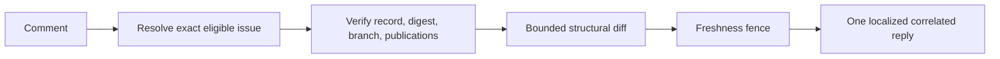
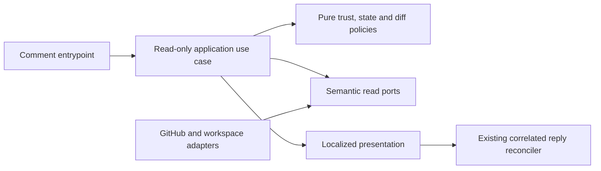

# Proposed change appendix: `/copilot sdd-diff`

- Status: Ready
- Date: 2026-10-12
- Catalog capability ID: `issue-start-and-sdd-readiness`
- Last verified: 2026-10-12 (local integration; live acceptance pending)
- Owners: Existing `issue-start-and-sdd-readiness` capability owners; individual names are not established by the issue.
- Scope: Add a deterministic, read-only command that compares the immutable first publication and current verified publication of the owning SDD for an eligible issue.
- Related issues/PRs: [Issue #464](https://github.com/vypdev/copilot/issues/464); [issue #454](https://github.com/vypdev/copilot/issues/454) provides the first/revised SDD human UX fixture.
- Required review gates: product UX, architecture, testing, documentation, security/operations
- Open decisions blocking readiness: None. PR #465 is merged and the Action synchronized this exact managed branch to the shared foundation. Local implementation is verified; fresh PR review and live issue/PR acceptance remain separate completion gates.

> This is a prospective companion appendix. Preserve the owning SDD and its existing contract verbatim; append this proposed change. Repository-specific paths and contracts cited below must be reconciled with the existing capability before implementation.

## 1. Executive summary

Add `/copilot sdd-diff` with no arguments. Any GitHub participant permitted to comment may invoke it as a deterministic query, subject to the existing issue-start admission/profile policy. For an eligible issue, the command verifies the trusted gate record, exact admitted issue, owning catalogued SDD path, exact linked branch, immutable publications and current issue digest. It then compares the first and current published documents and presents bounded structural evidence with safe immutable links. It does not infer semantic requirement changes.

A ready comparison is permitted only when the digest matches, the current publication is verified and the final freshness fence succeeds. Stale, clarification-pending, initial-only, invalid, absent and unavailable evidence remain distinct. The command has no model or write capability.

```text
comment -> parse exact no-argument command -> resolve eligible target and trusted evidence
        -> verify digest, branch, publications and ancestry -> bounded immutable diff
        -> freshness fence -> update one correlated localized reply
```

## 2. Problem, current behavior, and evidence

### 2.1 Problem

Developers can inspect an SDD gate's first publication and later revisions, but cannot ask the conversation for a bounded structural comparison. Showing an unverified or pending revision as current requirements could mislead branch work.

### 2.2 Current behavior

1. The existing gate records first publication and subsequent revision information; the issue states that first-SDD commit preservation already exists.
2. No current `/copilot sdd-diff` behavior is asserted by the issue.
3. The proposed command uses existing admission, gate record, catalog ownership, linked-branch readiness and publication verification contracts; it introduces no new record store.

### 2.3 Evidence

- Code/workflow/documentation references: supplied answers identify `readSddGateRecord` schema v1, `PreBranchSddWorkspacePort.readSdd`, `verifyPublication`, `isAncestor`, `BoundLinkedBranchReadinessPort.getLinkedBranch`, command parsing/help and comment orchestration. The confirmed semantic boundary is `SddEvidenceQueryPort` in `src/application/ports/sdd_evidence_read_ports.ts` from PR #465. The existing immutable content read is `PreBranchSddWorkspacePort.readSdd` in `src/application/ports/pre_branch_sdd_ports.ts`; the command may receive only a read-only projection of it.
- Incidents or concrete examples: issue #464 reports that developers cannot inspect bounded changes; issue #454 is named as a real first/revised SDD human UX fixture.
- External primary sources: not applicable; the contract is repository-owned.
- Remaining evidence: combined application/composition/routes against the Action-integrated shared query, fresh independent PR review, and live command/replay/locale acceptance. Operator GraphQL reads prove the native response shape, not bot-token permissions or a running command.

### 2.4 Retrospective classification (as-built baselines only)

Not applicable: this is a prospective specification, not a reconstruction of implemented behavior.

## 3. Actors, surfaces, and terminology

| Actor | Goal | Entry point | Visible surfaces |
|---|---|---|---|
| Issue participant | Inspect published SDD structure | Issue comment `/copilot sdd-diff` | One correlated issue reply and immutable links |
| PR participant | Query only an explicitly linked eligible issue | PR comment | One correlated PR reply, or not-applicable/ambiguous/unavailable result |
| Maintainer | Preserve trust and operability | Catalog, docs, checks | Capability evidence and validation output |

**First publication** is the immutable `commitSha`/`baseSha` pair. **Current publication** is `revisionSha`/`revisionBaseSha` when present. **Structural diff** means added/removed lines and changed section titles; it makes no claim about semantic requirements. **Stale** means the current normalized issue digest differs from the trusted record, or exact issue/card/branch/PR authority changed or disagreed during the final fence. **Pending-revision** means the digest matches an awaiting-answer record while the verified first publication remains available; the requested revision is not yet published.

## 4. Goals

### 4.1 Goals

1. Provide a deterministic, read-only comparison for eligible targets.
2. Identify exact immutable first/current SHAs and verified owning SDD path.
3. Keep state distinctions honest and output bounded under hostile or excessive input.
4. Reuse existing gate ownership and correlated-comment behavior without changing the gate contract.

### 4.2 Non-goals

1. Semantic analysis, model calls, requirement inference, or content excerpts.
2. Editing source or SDDs, creating branches, changing approvals, labels, checks, or lifecycle state.
3. Arbitrary paths/refs, branch scans, PR-number equivalence, or user-provided URLs.

### 4.3 Fixed product/safety invariants

1. No current-comparison claim or counts without exact identity, valid trusted record, matching digest, verified publications/ancestry, exact linked branch and successful final freshness fence.
2. No writer capability; no model; no source content in replies.
3. Files and computation are bounded: per document at most 70,000 UTF-16 characters, 280,000 UTF-8 bytes and 2,000 lines; at most 2,000,000 line-comparison steps. The complete reply remains at most 6,000 characters; the renderer reserves wrapper space by limiting its body to 5,600 characters. When both document byte and character ceilings are exceeded, the byte ceiling is reported first; neither limit is raised.
4. At most eight changed section titles, each at most 120 characters, with omitted-title count disclosed. These fixed limits cannot be configured.

## 5. Current versus proposed product journey

| Stage | Current | Proposed | User/operator effect |
|---|---|---|---|
| Issue query | No diff command asserted | Parse exact no-argument command | Predictable entry |
| Target proof | Existing gate policy | Exact issue admission; PR native closing-issue relationship only | No guessed target |
| Evidence | Gate retains publication records | Verify record, digest, linked branch, immutable publication and ancestry | Trustworthy state |
| Comparison | No conversation comparison asserted | Bounded line diff and section titles | Structural changes visible |
| Reply | Existing orchestration | Localized, replay-safe single correlated reply | No duplicate noise |



Text equivalent: comment -> exact target and evidence verification -> bounded comparison -> freshness check -> correlated reply.

## 6. Functional behavior and state model

### 6.1 Happy path

1. Parse `/copilot sdd-diff` with no arguments using the existing deterministic parser. Invalid arguments follow existing help behavior and do not invoke a model.
2. On an issue, apply existing admission/profile policy: feature issues and admitted branch-bearing contract-change issues for which the SDD gate applies are eligible. Unsupported, exempt and help targets return not-applicable without writes other than the correlated query reply.
3. On a PR, query the exact event PR's native GitHub `closingIssuesReferences` relationship through a narrow read-only projection. Validate same-repository canonical PR identity and pagination completeness. Read admission and the existing SDD/start policy for each of at most 100 native closing issues. Select exactly one SDD-eligible issue; zero eligible issues is not-applicable and multiple eligible issues are ambiguous. An unreadable candidate is unavailable rather than assumed ineligible. Recheck selection after document reads and retain the final native association fence. Incomplete/unreadable authority is unavailable. Never infer from equal numbers, body text, branch scans, or a newest candidate.
4. Read the latest configured-bot-owned valid schema-v1 gate record for the exact issue. Confirm current catalog ownership and its allowlisted SDD path. Preserve `commitSha`/`baseSha` as first publication; use `revisionSha`/`revisionBaseSha` as current publication when present. Do not weaken schema or create another store.
5. Verify exact branch linkage and live branch name/head using existing readiness proof. Verify publication and ancestry at immutable SHAs. A missing, deleted, mismatched or unverifiable branch/publication cannot support a current comparison.
6. Compute the same digest as the gate from current normalized title, visible human body, admitted kind, profile and original recorded base. Digest mismatch takes precedence and reports stale. A digest-matching awaiting-answer record with verified first publication reports pending-revision. Neither permits current counts. A current comparison requires matching digest and verified current publication.
7. Read only the catalogued SDD at the two verified immutable SHAs. Apply all fixed input and work limits. If exceeded, report bounded/unavailable with safe verified links and a specific limit explanation; never truncate and claim exact counts.
8. Recheck issue title/body, record, branch identity and relevant publication facts before replying. Any race invalidates current claims.
9. Use effective issue locale, or PR locale on the PR surface. Render complete English/Spanish catalogs; unsupported locale or invalid catalog uses atomic English fallback. Update/reuse the existing exact repository/target/source-comment correlated reply. Replays update one reply; a new source comment gets its own.

### 6.2 Alternative paths

- Eligible issue before first publication: `no-published-SDD`.
- Valid initial publication without revision: `initial-only`; no two-revision comparison.
- Pending clarification with matching digest and verified first publication: `pending-revision`; no current counts.
- Digest mismatch: `stale`, with SDD question-card link; not pending-revision.
- Forged, foreign, malformed or unknown-version record: invalid/unavailable, never a comparison.
- Missing branch/publication and provider read errors: distinct missing/unavailable states where evidence permits; do not fabricate facts.
- PR with zero native closing issues or an ineligible sole issue: not-applicable; ambiguity and authority failure are explicit.
- Changed documents that exceed limits: bounded/unavailable; safe verified revision links may be shown.

### 6.3 State machine

| State | Entered when | User-visible meaning | Allowed next states | Recovery/owner |
|---|---|---|---|---|
| Not-applicable | Target unsupported/exempt or no eligible PR link | This command does not apply | None | User selects applicable issue |
| No-published-SDD | Eligible issue has no first publication | No SDD has been published | Compared after gate publication and retry | Issue owner |
| Initial-only | First publication verified, no revision | Only first version exists | Compared after verified revision | Issue owner |
| Current comparison | Digest, branch, publications and fence all verify | Structural comparison is current | Re-run on new source comment | Gate/application |
| Pending-revision | Matching digest; trusted record awaits answers; first publication verified | Revision is being clarified; no current diff | Compared after publication; stale after issue edit | Issue owner |
| Stale | Current digest differs or authority/head fence changes | Current comparison cannot be certified | Retry the read; refresh clarifications if the issue changed | Issue owner |
| Invalid/unavailable | Trust, linkage or provider evidence fails | Current comparison cannot be verified | Retry when evidence available | Maintainer/operator |
| Bounded | Document or work limit exceeded | Exact comparison unavailable within safety bound | None until input changes | Issue/spec owner |

Duplicate requests follow correlated replay rules. Out-of-order events must pass the final fence or lose current status. Cancellation/provider failure creates no lifecycle mutation; partial provider success is reported only as retained verified facts.

## 7. User-facing configuration

| Input | Type | Recommended default | Allowed values/range | Scope/persistence |
|---|---|---|---|---|
| Command | Exact comment text | `/copilot sdd-diff` | No arguments | Per source comment; no durable setting |
| Diff limits | Fixed policy constants | Limits in §4.3 | No user overrides | Repository contract |
| Locale | Existing effective locale | Issue locale; PR locale on PR | English, Spanish; atomic English fallback | Existing locale policy |

Validation rejects arguments and invalid command forms through existing parser/help. No arbitrary path, ref, URL, limit, or credential is accepted. Existing repository admission/profile precedence applies; the command does not snapshot a new configuration. Limits, read-only behavior, exact identity, and verification requirements are intentionally not configurable. A recommended invocation is `/copilot sdd-diff`; meaningful alternative is the same command on a PR whose native relationship identifies exactly one eligible issue.

## 8. Clean Architecture

### 8.1 Responsibilities and dependency direction

| Layer/boundary | Owns | Must not own/import |
|---|---|---|
| Domain/pure policy | Eligibility result, state precedence, digest decision, line diff bounds, title sanitization | GitHub DTOs, SDKs, I/O |
| Application | Read-only comparison use case, ordered verification and freshness fence | Concrete provider SDK/process concerns or writer ports |
| Adapters/data | Map semantic reads and provider failures; exact PR closing-issue projection | Product state policy |
| Infrastructure/composition | Wire narrowed read ports and existing comment reconciler | Business decisions or extra credentials |
| Entrypoints | Adapt issue/PR event and comment to command input | Duplicate orchestration or inferred identity |
| Presentation | Localized bounded view models and Markdown renderer | Publication mutation or state transitions |



### 8.2 Contracts, state, and trust boundaries

- Pure decisions: target applicability, digest precedence, state mapping, bounded diff/counts, changed-heading extraction, output escaping.
- Application contracts: immutable event identity and operation result; no provider DTOs. Separate comparison reads from reply publication orchestration; the use case receives no write-capable workspace/comment port.
- Semantic ports: reuse/narrow `readSdd`, `verifyPublication`, `isAncestor`, exact `getLinkedBranch`, bound issue comment/title/description/catalog readers. Add a typed read-only PR closing-issue projection through existing GraphQL transport if no exact semantic port exists. Include repository identity and pagination completeness; stop after finding a second eligible issue.
- Durable state/schema ownership: existing bot-owned `readSddGateRecord` schema v1 only. No schema/store changes.
- Concurrency/idempotency: repository, exact target and source-comment correlation through existing reconciler; final issue/record/branch fence immediately before rendering/publishing current claims.
- Trusted inputs: authenticated event identity, canonical repository identity, configured bot ownership, catalog ownership, validated SHA/path and provider-verified linkage/publication. Untrusted: issue/PR/comment text, record content until validated, headings, provider errors and URLs in bodies.
- Provider errors map to bounded unavailable states; raw errors are never echoed.

### 8.3 Executable architecture constraints

Architecture tests MUST prove the use case cannot depend on writer ports, model clients, source-edit/branch/approval/lifecycle services, or provider DTOs. Contract tests MUST assert schema-v1 compatibility and exact PR identity/pagination behavior. Dependency/cycle checks and adapter contract fixtures MUST be added to existing repository checks; exact command names are an implementation discovery item.

## 9. UI/UX and content contract

### 9.1 Information hierarchy

Show current status first, verified facts next, then consequence/action, impact and safe evidence links; technical IDs are secondary. Counts and changed titles appear only for a verified current comparison. Historical links in stale/pending states must be explicitly labelled historical.

### 9.2 Representative primary view

```markdown
<!-- Use existing stable command-reply marker and correlation policy. -->

# 🔎 SDD structural comparison

> **Current status:** Compared verified published revisions
>
> **Action required:** No action required

## Changes

- First publication: `FIRST_SHA`
- Current publication: `CURRENT_SHA`
- Added lines: 12 · Removed lines: 4
- Changed sections: “Scope”, “Failure and recovery”

This is a structural diff. It does not infer semantic requirement changes.

## Links

[First SDD](SAFE_IMMUTABLE_DOCUMENT_URL) · [Current SDD](SAFE_IMMUTABLE_DOCUMENT_URL) · [Compare commits](SAFE_COMPARE_URL)
```

Concrete variants:

- **Pending/no action:** “No SDD revision has been published yet” (`no-published-SDD`) or “Only the first SDD publication is available” (`initial-only`); no current comparison claim.
- **Action required:** stale: “The issue description changed after this SDD record. Refresh the SDD gate before comparing.” Link to verified question card; historical publication links only if all required publication/path/ancestry checks pass.
- **Blocked/failed:** “A current comparison is unavailable because the linked branch could not be verified. Retry after the issue’s linked branch is available.” Retain only verified facts; no counts.
- **Partially complete:** “The published documents were verified, but the comparison exceeded the fixed work limit. Exact counts are unavailable.” Provide only safe verified links.
- **Completed unchanged:** “The verified documents have no structural line changes.” Show both SHAs and safe links, zero counts, and the structural-only caveat.

### 9.3 Issue, PR, and comment behavior

- Deterministic title: localized equivalent of “SDD structural comparison”; purpose is query result, not a gate/status card.
- Merge/close/retry causes no lifecycle effect. Retrying the same source comment updates its correlated reply; a new source comment creates its own reply.
- One reply per source comment; no extra status cards, notifications, labels or checks. Preserve waiting labels.
- Links are built from policy-owned canonical repository identity plus validated SHA/path. No body-derived URL. Link document, commit and compare evidence descriptively.

### 9.4 Accessibility, localization, and responsive behavior

English and Spanish catalogs are complete and selected by existing effective-locale rules; unsupported or invalid catalogs fall back atomically to English. Use textual status, logical headings, short lists and descriptive links; tables are not required in the reply. Must remain readable on narrow screens and light/dark GitHub themes. Escape and bound titles to 120 characters; neutralize mentions, Markdown, control characters and HTML/command markers. Do not echo document contents, raw provider errors or untrusted URLs. Mermaid has the textual flow equivalent in §5.

## 10. Failure, recovery, and cleanup

| Failure/partial state | User impact | Retained facts | Automatic retry | Required action | Cleanup |
|---|---|---|---|---|---|
| No publication | No comparison yet | Exact eligible target | On a new command only | Publish SDD through existing gate | None |
| Initial only | No revision pair | Verified first SHA if safe | No | Publish revision | None |
| Stale digest | Current counts withheld | Digest mismatch; safe historical links only after verification | No | Refresh gate/question card | Preserve labels |
| Pending answers | Requested revision is not current | Verified first publication | No | Answer existing clarification | Preserve labels |
| Record/owner/path invalid | Trust cannot be established | Sanitized state only | Bounded provider retry only | Maintainer review | No record repair by command |
| Branch/publication missing | Current comparison withheld | Independently verified facts | Bounded read retry per existing policy | Restore/fix linkage or retry later | None |
| Provider unavailable/incomplete PR pagination | Target/evidence unavailable | Safe event identity only | Existing bounded retry policy | Retry later | None |
| Input/work bound exceeded | Exact diff unavailable | Verified SHAs and safe links | No | Reduce/change SDD within existing constraints | None |
| Final fence changes | Race invalidates current claim | No current counts | Re-run on new event | Retry command | No stale reply claim |

Errors use `impact -> cause -> action -> retained state`; a failed read must not imply publication or lifecycle failure.

## 11. Security, permissions, and privacy

1. Reuse existing least-privilege read permissions and comment-reply authority; comparison workflow itself has no writer port. Confirm exact workflow permission declarations during implementation.
2. Treat comments, issue/PR content, records and headings as untrusted. Bind repository and target to authenticated event; enforce exact admission, bot ownership, catalog path, branch and publication proofs.
3. Read only allowlisted spec content at immutable verified SHAs. Never accept arbitrary refs/paths/URLs or expand local setup credentials. Do not log or reply with file contents, tokens, PII beyond existing issue identity, or raw provider errors.
4. Resist replay/forgery through validated record ownership, exact source-comment correlation, bounded processing, output escaping, and final freshness fencing.

## 12. Observability and operational UX

- User-facing states are the state table in §6.3; distinguish not-applicable, stale, pending, invalid, missing and unavailable.
- Job Summary is not needed for a comment query; do not add one absent an existing operational convention.
- Logs may record correlation ID, state category, validated SHAs and bound outcome, but not document content or raw errors. Metrics should use bounded state labels; exact existing telemetry is unknown.
- Provider unavailability is not a failed SDD publication. Respect existing rate-limit/retry policy; no unbounded retries.
- Noise budget is one correlated reply per source comment, no notifications/status cards.

## 13. Compatibility, migration, rollout, and rollback

- Existing gate records and in-flight operations remain unchanged. Schema v1 is read as-is; malformed/foreign/unknown version fails closed.
- No config or record migration, deprecation, or feature flag is proposed. Existing command help/parser and orchestration are extended compatibly.
- Rollout adds command/docs/catalog evidence after acceptance checks. Rollback removes command dispatch while retaining existing gate records and behavior; no irreversible SDD or lifecycle effects are introduced.

## 14. Testing strategy and numeric budget

Minimum: **250 distinct extension cases**, with a 24-case risk floor exceeded by the concrete inventory below. Existing shared gate/status/publication cases remain unchanged and are not counted again.

| Area | Distinct cases | Behaviors/risks covered |
|---|---:|---|
| Pure bounded diff | 18 | Exact line/section changes, fenced headings, hostile input, all fixed resource ceilings |
| Presentation/localization/navigation | 67 | Ten states in both catalogs, atomic fallback, immutable commit/blob/compare links, clarification cards, escaping and bounds |
| Application/authority/fences | 77 | Admission, missing/invalid/pending/stale authority, immutable reads, issue/card/head/PR-link races, exact author and no writes |
| Native PR-link adapter | 45 | Bound repository ID/name and head repository, exact PR/head/ref, author identity, complete pagination, malformed/foreign/duplicate rows and denial |
| Read-only composition | 5 | Frozen repository binding, trusted server origin, native event repository ID and receiver-bound document read without writers |
| Parser/routes/agent activity | 15 | Whitespace/case, no arguments, EN/ES/fallback, absent query, no agent activation or activity |
| Correlated publication/replay | 18 | Same-source refresh, unchanged replay, distinct source, ownership/correlation/key isolation, duplicate healing, static catalogs and final sanitization |
| Actual Execution projection | 5 | Native repository ID/issue author/profile digest, immutable input, missing/zero/unsafe identity and native PR target |
| **Total** | **250** | Every case counted once |

The two new shared `SddEvidenceQueryUseCase` opaque-authority regressions are allocated only to the owning status companion (182 + 2 = 184); they are excluded from this 250-case budget. The gate's separate 149-case budget and both communication ledgers remain unchanged.

Repository-wide thresholds remain 90% lines/statements, 88% functions and 82% branches. `scripts/coverage-budgets.json` additionally enforces 100% in every new pure module, and at least 95% lines/statements and 90% branches/functions in each new application, native adapter and composition module. All six new runtime modules currently achieve 100% in the focused scope. Deterministic fakes and actual Execution constructors provide local proof; live GitHub runs independently establish bot permissions, event wiring and human UX.

Required distinct risk coverage includes eligibility/identity (4), record/ownership/publication trust (5), digest/revision races (4), diff/count/bounded work (5), and localization/sanitization/replay/no-write (6), totaling at least 24 cases within the 30-case distribution.

## 15. Documentation and discoverability

| Audience | Artifact/page | Required content | Validation/navigation |
|---|---|---|---|
| User | `docs/issues/comment-commands.mdx` | Exact command, eligible targets, examples, states and links | Command catalog and link checks |
| Issue owner | `docs/issues/pre-branch-sdds.mdx` | First/current revision distinction, stale/pending recovery, structural-only caveat | Examples checked against fixtures |
| Operator | Same SDD guide | Invalid/unavailable evidence, retry and permission boundaries | State decision table review |
| Contributor | Capability SDD and catalog evidence | Ports, trust boundaries, 250-case budget, workflow checks | `pnpm run validate:specifications`; catalog generation/check as repository requires |

Docs must explain PR exact-link rules, limits, no-write behavior and that line/title differences do not establish semantic requirement changes. Update the capability catalogue evidence and owning SDD or this approved bounded companion before branch creation. Keep documentation examples synchronized with fixtures.

## 16. Acceptance

1. Given an admitted eligible issue with a valid schema-v1 record, matching digest, exact linked branch, verified first/current publications and successful final fence, when a participant comments `/copilot sdd-diff`, then one localized reply shows both SHAs, safe immutable links, exact added/removed line counts and at most eight changed titles, and states that the result is structural only.
2. Given an eligible issue with no publication, when queried, then it reports `no-published-SDD` without calling it invalid or ready.
3. Given a verified first publication and no revision, when queried, then it reports `initial-only` and does not invent a comparison.
4. Given a matching digest and awaiting-answer record with verified first publication, when queried, then it reports pending-revision with no current counts.
5. Given any current digest mismatch, including an awaiting-answer record, when queried, then stale takes precedence over pending; no current counts appear and the question-card link is provided.
6. Given a foreign, forged, malformed or unknown-version record, when queried, then no current comparison is claimed and no untrusted values are rendered as authority.
7. Given wrong owner/path, absent publication, deleted or mismatched branch, failed ancestry/publication proof, when queried, then the result is invalid, missing or unavailable as supported by verified facts, never current-ready.
8. Given a PR with exact native same-repository closing-issue authority to zero eligible issues, when queried, then it reports not-applicable; with two SDD-eligible issues or disagreeing identity it reports ambiguous/unavailable.
9. Given incomplete PR pagination or unreadable authority, when queried, then it reports unavailable and does not fall back to body numbers or equal PR/issue numbers.
10. Given a document over any character, byte or line limit, or computation over 2,000,000 steps, when compared, then it reports bounded/unavailable without truncation or guessed counts.
11. Given more than eight changed section titles or unsafe headings, when rendered, then only up to eight escaped, bounded titles appear and the omitted count is explicit; mentions/control/Markdown injection is inert.
12. Given a document with no line changes, when queried, then it reports zero structural changes with verified links.
13. Given replay of the same source comment, when processed again, then the existing correlated reply is updated; a distinct source comment receives its own reply.
14. Given issue, record or branch mutation between collection and publication, when the final fence runs, then current counts and ready claims are withheld.
15. Given provider errors, when rendered, then raw error text and document contents are absent and impact/cause/action/retained-state order is used.
16. Given unsupported locale or invalid locale catalog, when rendered, then a complete English response is used atomically; supported issue/PR locales use English/Spanish catalogs respectively.
17. Given any invocation, when inspecting effects, then no model, source edit, branch, approval, label, lifecycle mutation, extra status card or notification occurred.
18. Given the implementation, when architecture/workflow checks run, then application dependencies contain no writer/model capability and exact PR identity and read-only permissions are structurally verified.
19. Given docs and catalog updates, when repository specification validation runs, then links/evidence are current and examples agree with executable fixtures.
20. Given issue #454's real first and revised SDD, when reviewers inspect the generated UX fixture, then the structural-only distinction and immutable navigation are understandable without inferring semantic requirements.

## 17. Requirements traceability

| Requirement | Policy/use case/adapter/presentation | Test or evidence | Documentation |
|---|---|---|---|
| Exact target and admission | Entry adapter, admission policy, PR-link port | Identity/admission and pagination contracts | Command guide |
| Trusted record and current readiness | Gate reader, digest/publication/branch policies | Forgery, owner, ancestry, race cases | SDD guide |
| Bounded structural result | Pure diff policy, read-only use case | Character/byte/line/step and count tests | Both user pages |
| Safe correlated reply | Renderer/reconciler | Locale, sanitization, replay tests | Command guide |
| Read-only architecture | Application ports/composition | Dependency and workflow permission checks | Contributor SDD |

## 18. Implementation sequence

1. Confirm existing parser, gate record schema, catalog ownership/evidence and repository coverage/workflow contracts; add exact PR closing-issue semantic projection if absent.
2. Define immutable read-only contracts and enforce absence of writer/model dependencies.
3. Implement pure eligibility, state precedence, bounded diff and sanitization policies with tests.
4. Implement ordered application reads, exact linkage/publication checks and final freshness fence.
5. Add adapter mappings and structural PR identity/pagination tests.
6. Add localized states and correlated reply integration with golden and semantic fixtures.
7. Update both issue docs, capability catalogue evidence and this companion/owning SDD before branch creation.
8. Complete 250-case minimum, all existing gate budgets, #454 UX review, architecture/workflow checks and specification validation.

## 19. Definition of Done

- [ ] Every normative requirement maps to acceptance and traceability.
- [ ] Existing SDD gate contract, record schema and budgets remain unchanged.
- [ ] Exact issue/PR identity, owner, path, branch, digest, publications and final fence are verified.
- [ ] Read-only architecture is enforced; no model, source, branch, approval or lifecycle capability is reachable.
- [ ] All fixed input/work/output limits and state distinctions pass.
- [ ] At least 30 distinct risk-derived cases pass, including all 24 named minimum risk categories; coverage meets repository thresholds and new pure policy branch target.
- [ ] English/Spanish, fallback, sanitization, replay, link safety and comment budget pass.
- [ ] Docs and catalog evidence are current; #454 human UX evidence is reviewed.
- [ ] Failure, race, unavailable, bounded and recovery behavior passes without false current claims.
- [ ] `pnpm run validate:specifications` passes and catalog output is current according to repository workflow.
- [ ] No readiness-blocking decision remains unresolved.

## 20. References and decisions

- Primary sources: Issue #464 and its explicit answer rounds supplied with this request; existing repository contracts named in those answers, pending source-path confirmation.
- Related specs/ADRs/issues/PRs: owning `issue-start-and-sdd-readiness` SDD; live issue #454 as UX evidence; exact URLs and catalog identifiers beyond the supplied capability ID remain to be confirmed from repository metadata.
- Decisions: companion SDD under the existing capability; exact native same-repository PR closing-issue relationship is authoritative; digest mismatch always reports stale; pending-revision requires matching digest and verified first publication; first publication fields remain immutable; no arbitrary paths, refs, body URLs, semantic inference, model, writes or new record store.
- Follow-up outside this spec: any broader semantic SDD analysis, changes to gate lifecycle/record schema, or general PR-to-issue discovery.

### Confirmed implementation bindings and dependency gate

The verified shared query is `SddEvidenceQueryPort` in
`src/application/ports/sdd_evidence_read_ports.ts`, implemented by
`sdd_evidence_query_use_case.ts` from PR #465. Its closed snapshot distinguishes
not-required, absent, unavailable, invalid, stale, awaiting-answers,
publication-pending and published. Verified evidence contains the owning path,
capability, exact branch name/head and immutable first/current SHAs. The diff
must consume this query rather than duplicate its gate/digest/ancestry logic.
`PreBranchSddWorkspacePort.readSdd(commitSha, path)` supplies the two immutable
contents through a physically read-only projection; no draft, publish or repair
method may reach the command.

Composition must provide only the shared query, immutable content read and exact
native PR closing-issue query. Both native association and shared evidence are
reread after collecting the documents, with all relevant identities compared
before any current count is rendered. A pending revision may expose a verified
first publication as history, never current counts. An original-only publication
has one immutable version and no fabricated second revision. Unavailable or
bounded comparison produces no guessed counts or silently truncated documents.

### Partial implementation evidence (2026-10-12)

The initial local 33-case observation was 11 new comparator cases plus 22
pre-existing shared card/digest cases. The latter are preserved separately and
excluded from this extension; no shared gate or digest implementation is copied
into the diff feature.

The current independent contribution has **106 distinct new cases**:

| Implemented area | Distinct new cases | Verified risks |
|---|---:|---|
| Pure structural comparator | 18 | Exact line counts, honest character/byte/line/work ceilings, matching Markdown fences, bounded title changes and propagation of unexpected computation faults |
| Localized presentation | 52 | Ten states in English/Spanish, atomic fallback, historical-only pending/stale proof, exact safe repository links, missing projections, hostile headings, omitted titles and the 5,600-character body ceiling |
| Native PR closing-issue adapter | 36 | Exact repository IDs/names, PR number/head, complete bounded inventory, duplicate/foreign/malformed rows, denials, immutable binding/output and a constant read-only query |
| **Implemented partial total** | **106** | No shared helper case counted again |

All four new runtime modules reach 100% lines/statements/branches/functions in
the focused scope. Typecheck and lint passed. Full validation in the existing
older diff worktree passed 563 suites, 7,270 tests and 26 configured skips
(7,296 total), including every unchanged official coverage budget. The setup
acceptance ledger retains 308/350 passing cases and 42 explicitly open cases.
This is partial validation on that worktree's ancestor, not proof of a combined
implementation on current master or the shared foundation.

A read-only operator GraphQL query on real PR #465 confirmed the exact native
contract: repository database ID/name, exact PR number/head, sole same-repository
closing issue #454, totalCount 1 and hasNextPage false. It establishes response
shape only. Bot permission, application orchestration, final evidence/link
fences, parser/help/composition, correlated publication and live issue/PR UX
remain unverified. The final numeric distribution must include their distinct
risk cases before publication. The specification remains Draft.


### Integrated local implementation (2026-10-12)

The earlier 106-case report is a historical partial snapshot. The current implementation has 212 dedicated cases across seven suites plus five actual Execution producer contracts, totaling 217 without shared-case duplication. The six new runtime modules have 100% lines/statements/branches/functions in focused coverage. Native Action-only synchronization committed `ad27952768674c11bb225bcf9389917c3c4b7f9f` and later `0f016278e34a7cbba0bfa4ad290e759492064994`; no manual parent merge or foundation copy was used.

The shared snapshot now carries an optional opaque SHA-256 authority digest over the exact fenced card and live issue authority. It exposes no card contents or raw provider data. The diff application requires that digest before current claims and compares it with canonical publication facts after reading immutable documents. Native PR relationships additionally bind current head repository, ref, SHA and original issue author, including a final association fence.

Only the `copilot-sdd-diff` reply family refreshes its existing exact bot-owned target/source correlation when the newly verified reading changes. Unchanged replay makes no mutation; other reply families retain their existing create-once behavior. Complete static catalogs also bypass dynamic localization for this command. Publication still follows the ordinary non-atomic GitHub comment boundary: the final authority fence prevents changes observed during collection, but does not claim a server-side compare-and-swap transaction.

Live command activation, #454 first/revised UX, PR native-link acceptance, replay and locale checks remain pending promotion. Local coverage is not proof of those outcomes.


Stale presentation does not invent a cause: a card or head race is not described as an issue edit. The next action retries the current read first and directs the owner to clarifications conditionally when the issue itself changed. Existing state/fence cases cover this wording without adding mirrored prose tests or inflating the 240-case budget.


Final local integration on Action merge `86db9b1962915111f02613b4f49ec50a6a3f1cf6` passes the official full validation: 579 suites, 7,952 passing tests and 35 unchanged platform skips. Overall coverage is 97.25% lines, 96.23% statements, 92.70% branches and 97.10% functions; every new comparison module remains at 100%. Type, lint, workflow, documentation/specification validation, generated catalog and graph update pass. Live whitespace/case/newline synchronization run `38253646042` also passed on Windows with all five configured checks before publishing that parent merge. This proves operational synchronization and combined local source; it does not yet activate the new command on master.


### Independent review: native eligibility and inert results (2026-10-12)

PR #469 review finding `4249066303` correctly identified that the provisional all-links ambiguity rule was stricter than the requested exactly-one-eligible behavior. The query now reads bounded native candidate admission and the existing issue-start/SDD requirement policy, selects one eligible candidate, and rechecks that selection before returning counts. It rejects unreadable candidates and the fixed 100-candidate ceiling, and retains the native head/ref/repository/author fence. Eleven distinct cases cover eligible + help/exempt links, selected author, zero/multiple eligible candidates, unreadability, lost/new/swapped eligibility, missing author and the ceiling.

Finding `4249066310` was a false positive: the shared selector already returns before this branch when `result.executed` is false. One regression using Result's default false value proves no comment read or write; the maintainer recorded that evidence and invoked `/copilot dismiss` instead of adding a redundant guard. The current feature inventory is 217 + 11 + 1 = 240. Shared status/authority cases remain outside that total.


### Live first publication and independent final-association regressions (2026-10-13)

Native PR-review command delivery on PR #469 now resolves issue #464 and updates
the existing reply in place to verified first publication at
`82bc9be5eae5170a669313a467cb71919eaff5a1`. The prior not-applicable result was
caused by missing effective branch/SDD flags in repository callbacks; parent
`aa10ee66` supplies the installed configuration consistently. No second
publication or complete live comparison acceptance is claimed by that result.

Finding `4253073961` remained valid despite automatic classification as obsolete.
Eleven new regressions failed before the correction; all 74 query cases now pass.
Every derived PR result, including absent, pending, stale and exempt states and a
changed final authority, rereads the exact native association before publication.
A moved association returns stale without retaining old publication/card links or
counts; unavailable or foreign final PR identity returns unavailable. Stable
pending history remains visible. This adds eleven cases exactly once (229 + 11 =
240); the shared companion remains 184. Full gates and live replay remain pending.

### Final candidate eligibility and historical revision links (2026-10-13)

Native findings `4254268292` and `4254268297` exposed two gaps. A PR with no selected eligible issue MUST re-admit its candidates before returning exemption or ambiguity; changed outcomes become stale and denied reads become unavailable. Stable native PR associations alone cannot certify candidate eligibility. Stale or pending replies MUST retain each verified distinct publication as explicitly historical, including the published revision; they MUST withhold current comparison/counts and reject malformed revision proof atomically.

Ten additional distinct cases cover three candidate outcomes (exempt becomes eligible, ambiguous becomes selected, denied final re-admission) and seven historical presentation outcomes (both states in both locales, no revision, duplicate immutable SHA, malformed revision). The dedicated inventory becomes 240 + 10 = **250**; shared companion cases remain allocated only to their owner. English/Spanish labels distinguish historical first publication and historical published revision. Documentation and all existing bounds/coverage thresholds remain in force.


### Request witness after shared publication integration (2026-10-13)

The Action-managed Core integration at `94653aa5` retained a feature-only
refresh exception for `copilot-sdd-diff` when no source reader was supplied.
Publication MUST fail closed before inventory or any create/update/delete/
compaction when its request witness or reader is absent or the source is denied.
The special fallback is removed; normal SDD comparison replies use the shared
correlated source witness and refresh path. The witness remains private and
adds no model, permission or public input. Positive publication fixtures now
provide the same physically bound evidence expected in production.

Four distinct cases cover missing witness/reader creation, missing-evidence
refresh and duplicate cleanup, reader absence with a witness, and source denial.
Two reproduced the bypass before correction; two are retained negative controls.
The comparison inventory is **254** (250 + 4); the independently allocated
shared authority inventory is unchanged. Global/module coverage and native
reply replay and revision-change acceptance remain required.

## Historical comparison after native completion — dogfooding #496 (2026-10-13)

Native [request on completed feature #454](https://github.com/vypdev/copilot/issues/454#issuecomment-6155687638)
returned not-applicable after completion removed `in-progress`, although the
shared SDD evidence reader supports verified closed publication history. The
outer comparison selector rejected the issue before reaching that reader.

The selector MUST retain current form/profile/kind/configuration admission and
use the shared fenced historical evidence reader when the start label is absent.
Only its verified `historical: true` authority can restore historical comparison
scope. The selector MUST NOT inject a synthetic start label, reopen an issue,
create a publication, call a model, or bypass any immutable commit/card/branch/
authority proof. A feature or branch-bearing contract-change kind remains a
candidate only when managed branches and pre-branch SDD are enabled. Help,
non-contract work, disabled profiles and incomplete forms remain exempt.

Flow: native completed issue -> retained form/kind -> shared historical proof
-> verified first/current immutable documents -> final historical/native fence
-> structural comparison. Text equivalent: completion can remove the start
label without erasing published SDD history; current native and immutable proof
still authorize every read. Open paused work and closed work without a verified
publication do not acquire historical scope. Unavailable or malformed history
cannot be presented as a proven exemption. Losing historical scope during
comparison withholds old counts. Multiple verified native historical candidates
remain ambiguous rather than guessed.

The existing comparison UI is unchanged: **Compared** shows verified first and
current links and bounded structural counts; **Not applicable** requires proven
exemption; **Unavailable/stale** offers inspection/retry while withholding
unverified counts; **Ambiguous** asks for the exact issue conversation. No new
comment, permission, input, schema or locale surface is introduced. Existing
reply correlation, sanitization and native PR association fences remain.

Additional floor: **10 distinct selector cases**: historical feature and
contract-change bugfix success (2), closed unpublished and open paused exemption
(2), two disabled configurations (2), unavailable history (1), historical scope
race (1), multiple native historical candidates (1), and missing shared authority
flag (1). These are counted only here; all prior shared reader, immutable
publication, PR linkage, bounded comparison and security cases remain. The
existing 95% lines/statements and 90% branches/functions module gate applies.

Traceability: historical eligibility -> `SddDiffQueryUseCase.context` -> the ten
new cases; immutable/native final proof -> existing shared evidence and final
comparison fences. `docs/issues/comment-commands.mdx` MUST document comparison
of a completed published issue without restoring `in-progress`. Native
acceptance repeats the #454 request after promotion and verifies historical
links/counts or truthful current-evidence failure, with no native state/label or
publication mutation. Full coverage, build/bundles, documentation/specification
validators, current-head review/CI and Graphify remain mandatory. Rollback
restores premature exemption; no data migration is required.

### Retained merged-branch authority for closed history (2026-10-14)

After promotion, [native query 6156673698](https://github.com/vypdev/copilot/issues/454#issuecomment-6156673698)
correctly entered historical scope but could not certify the retained branch.
GitHub had replaced `linkedBranches` with the issue's native associated PRs;
both PRs were merged, while the live ref still exactly matched the later merged
head. The active readiness adapter intentionally accepted only open PRs.

Closed historical queries MAY use a separate, physically read-only
`getHistoricalLinkedBranch` capability after the active read proves absence.
It accepts only the exact issue-associated, same-repository merged PR whose
head name and full SHA match the live remote ref. A closed unmerged PR, fork,
other branch, moved SHA or deleted ref remains insufficient. Denied active
reads MUST propagate without fallback. Active implementation readiness MUST
continue to reject merged associations; no input, permission, model, writer,
branch recovery or migration is introduced.

Flow: native closed publication -> active linkage absent -> exact merged
association/live-ref proof -> immutable publication/catalog checks -> final
native/card/head fence -> historical structural comparison. The reply retains
the first/current commit links and bounded section counts. If the issue reopens,
the ref moves, or proof becomes unavailable, current comparison is withheld.
Deleted branches remain unverified; this query never recreates them.

Additional floor: **15 distinct cases**: eight adapter cases (exact merged
history, active rejection, six invalid associations/refs), six query cases
(closed success, open exclusion, denied active read, denied history, missing
history capability, moved final head), and one physical binding case. The four
changed runtime modules retain at least 95% lines/statements and 90%
branches/functions. Existing SDD ownership, publication, read-only and native
fence budgets remain. Documentation in `docs/issues/comment-commands.mdx`
explains retained merged association and deleted-ref limits. Native acceptance
repeats the closed #454 comparison without labels/state/publication writes;
full coverage, synchronized build, validators and Graphify update are required.
