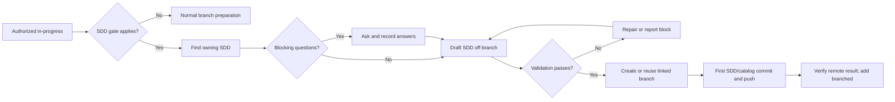
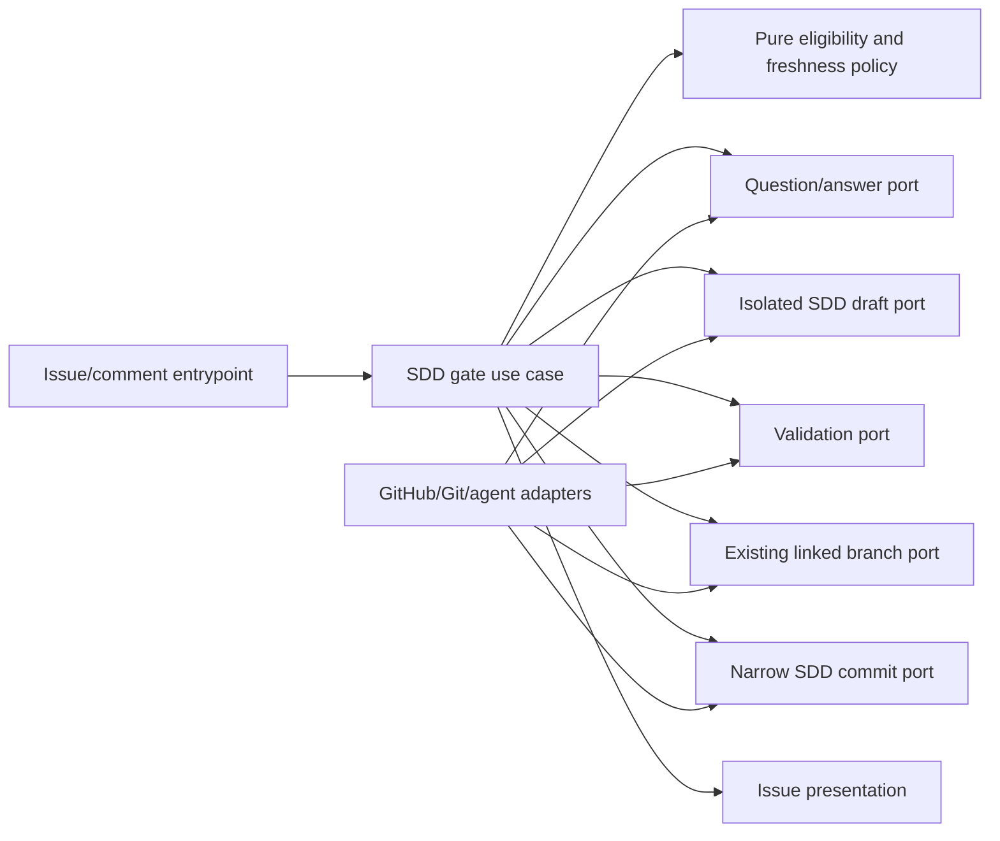
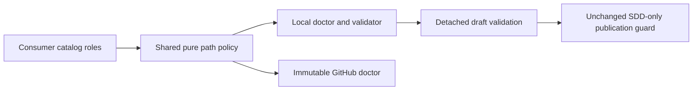
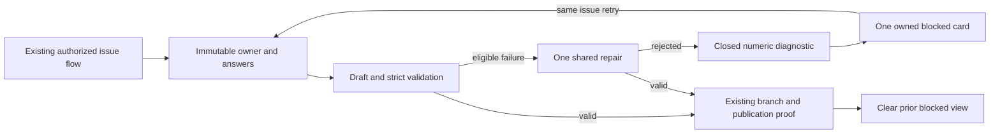

# Pre-branch SDD Gate

- Status: Implemented — automated verification complete; live provider UX review pending
- Date: 2026-09-17
- Catalog capability ID: `issue-start-and-sdd-readiness`
- Last verified: 2026-10-26 (actionable blocked preparation and safe diagnostics, #714)
- Owners: Copilot maintainers
- Scope: clarify, update, validate, and publish the owning SDD before eligible branch-based work
- Related issues/PRs: none; local design work; companion SDD `issue-start-and-branch-readiness.md`
- Required review gates: product UX, architecture, testing, documentation, security/operations
- Open decisions blocking readiness: none in the SDD-only policy; live provider review remains pending

Live dogfooding on 2026-10-10 (#454) exposed a runner checkout hook that required `node` from the service PATH and prevented the already validated SDD commit. SDD publication now uses an empty hooks directory for that single Git invocation; contributor hook configuration is retained. The Action's own SDD and catalog validation remains mandatory before staging and publication. Subsequent review found that a generated update had replaced the owning capability's previous contract with the new feature's scope. Automated updates now preserve the existing owner verbatim and append a proposed change. Publication retries reuse their validated owner without spending another clarification round. These protections bring the minimum budget to 72.

## 1. Executive summary

A repository can enable a pre-branch SDD gate for feature issues and other
branch-bearing issues explicitly marked as behavior changes. After an authorized
`in-progress` start, the Action finds the owning SDD, analyzes the issue, and
asks blocking questions in the issue before an agent drafts any document. Once
the answers are recorded, the agent updates or creates the SDD in a temporary
workspace. The Action validates it, creates or reuses the exact linked branch,
publishes the SDD and required generated catalog metadata as the first
branch-specific commit, verifies the remote result, and then adds `branched`.

This first version supports **SDDs only**. The Action does not select, request,
generate, validate, catalog, or gate Product Requirements Documents (PRDs) or
Architecture Decision Records (ADRs). Their possible future value does not
justify adding two more document lifecycles to issue comments and branch
readiness now.

```text
in-progress -> find owning SDD -> ask blocking questions in the issue
            -> draft and validate SDD off-branch
            -> Action-linked branch -> first SDD/catalog commit/push
            -> verify remote commit -> branched -> implementation later
```

Text equivalent: a permitted start leads to SDD ownership and clarification.
Only after the blocking answers are recorded does the agent draft the SDD. The
Action validates it before branch creation and announces readiness after the
first SDD commit is confirmed remotely.

## 2. Problem, former behavior, and evidence

### 2.1 Problem

Before this change, the issue-to-branch flow had no SDD readiness gate. The repository
already requires an SDD as a shared, testable contract for capability changes,
but agents can begin branch work while scope, acceptance, or architecture
questions remain unresolved. Supporting PRDs and ADRs in this first gate would
also require distinct selection, answer, review, status, schema, and recovery
rules in the Action, increasing the issue workflow without a demonstrated need.

### 2.2 Former behavior before this change

1. `specs/README.md` and `specs/_template.md` define the SDD standard.
2. `specs/catalog.json` identifies capability ownership and SDD paths;
   `specs/CATALOG.md` is generated. The validator checks catalog registration
   and paths.
3. The issue route can recommend a plan or answer help on opening or editing an
   issue. `/copilot clarify` is a separate read-only interaction.
4. Ordinary issue comments without `/copilot` or an exact bot mention are
   currently inert; there is no active clarification-session exception.
5. The branch preparation route currently creates a linked branch before SDD
   generation. The issue workflow checks out the workflow source, so the new
   gate must explicitly pin its semantic base and validate that source.
6. The installed workflows exclude bot-authored events; a bot-applied `SDD` or
   `branched` label cannot be the only continuation signal.

### 2.3 Evidence

- Specification standard and validator: `specs/README.md`,
  `specs/_template.md`, `specs/catalog.json`, and
  `scripts/validate-specification-catalog.cjs`.
- Current issue/comment/branch paths: `src/application/usecases/issue_workflow.ts`,
  `src/application/usecases/issue_use_case.ts`,
  `src/application/usecases/steps/issue/prepare_branches_use_case.ts`,
  `.github/workflows/copilot_issue.yml`, and
  `.github/workflows/copilot_issue_comment.yml`.
- Current user guidance: `docs/issues/comment-commands.mdx`,
  `docs/issues/branch-management.mdx`, and
  `docs/development/specifications.mdx`.
- Provider event and token behavior:
  https://docs.github.com/en/actions/reference/workflows-and-actions/events-that-trigger-workflows
  and https://docs.github.com/en/actions/concepts/security/github_token.
- Unknowns: there is no production evidence for an SDD gate or for PRD/ADR
  demand in this Action. The user chose local design work before dogfooding.

### 2.4 Retrospective classification (as-built baselines only)

Not applicable. This was a prospective change. Section 2.2 records the prior
behavior; the current gate contract is defined here and in the companion SDD.

## 3. Actors, surfaces, and terminology

| Actor | Goal | Entry point | Visible surfaces |
|---|---|---|---|
| Issue author | Describe behavior and answer questions | Issue Form/comments | Issue question/status cards |
| Maintainer | Start and resolve material choices | `in-progress`/comments | Issue, SDD plan, Action run |
| Contributor | Implement a settled contract | Linked branch | SDD commit, branch, later PR |
| Operator | Recover interrupted publication | Rerun/reconcile | Retained branch/commit, status |
| Copilot Action | Enforce the gate and publish facts | Issue/comment events | Labels, comments, Job Summary, branch |

An **SDD** is the repository's integrated product and engineering contract.
The `SDD` label indicates that this issue requires an SDD update; it is not a
claim that drafting is finished. A **question card** is one correlated issue
comment with numbered blocking questions. The **owning SDD** is the catalogued
contract for the affected capability, or a new/companion SDD justified by a
new bounded capability. **SDD readiness** means the required update passed
validation and is confirmed in the exact remote linked branch. Branch
existence alone does not prove it.

## 4. Goals, non-goals, and fixed invariants

### 4.1 Goals

1. When the gate applies, no SDD draft MUST be generated before every blocking
   product, scope, security, and architecture question has an authorized
   answer or an explicitly accepted resolution.
2. The Action MUST identify one owning SDD path from the catalog, or justify
   and register one new/companion SDD for a new bounded capability.
3. The required SDD change MUST pass structure, catalog, link, and content
   checks before branch creation.
4. The first branch-specific commit MUST contain only the required SDD change
   and generated catalog artifacts; `branched` MUST wait for remote verification.
5. One issue MUST have a bounded, inspectable clarification and publication
   history across edits, retries, cancellation, and partial writes.

### 4.2 Non-goals

- No PRD or ADR selection, generation, templates, catalog extensions, status
  labels, or issue-question branches are part of this version. A separate
  future proposal can define them after the SDD workflow is proven useful.
- The gate does not write implementation code, open a PR as a readiness
  prerequisite, merge, release, or deploy.
- Help issues remain branchless and never enter the SDD gate.

### 4.3 Fixed product/safety invariants

1. An enabled SDD gate requires issue-managed branches at setup and runtime.
2. Only an authorized human can start work or resolve material questions.
   Bot-authored text does not count as a human answer.
3. The drafting agent has no repository write credential. A narrow Action-owned
   writer receives only validated SDD/catalog paths and the exact linked ref.
4. A published first commit is never force-pushed away. A retry checks remote
   facts and reuses the same operation, branch, and commit when present.
5. Requirements and decisions remain traceable to issue comments and SDD
   sections; no answer is invented to pass the gate.

## 5. Current versus proposed product journey

| Stage | Current | Proposed | User/operator effect |
|---|---|---|---|
| Start | Branch launcher/type shortcut | `in-progress` then SDD eligibility | One deliberate entry |
| Discovery | Optional plan/clarify | Find owning SDD and gaps | Avoid duplicate contracts |
| Questions | One-off read-only reply | Correlated blocking questions | Clear next actor |
| Draft | Contributor may write after branch | Agent drafts off-branch after answers | No premature branch |
| Publication | General branch work | SDD/catalog first commit | Reviewable contract first |
| Ready | Branch label may launch work | Verified `branched` output | Trustworthy handoff |



Text equivalent: an authorized start either proceeds directly to normal branch
preparation or finds the SDD owner. Blocking questions are answered in the
issue, then the agent drafts and validates the SDD off-branch. The Action
creates the linked branch, publishes its first SDD/catalog commit, verifies it,
and applies `branched`.

## 6. Functional behavior and state model

### 6.1 Eligibility and SDD ownership

- `pre-branch-sdd=true` applies to a branch-bearing feature issue and to any
  other branch-bearing issue whose authorized maintainer applied the fixed
  `contract-change` label. Help never qualifies. The agent can recommend that
  label but cannot apply it as a decision about scope.
- The Action queries the catalog for the affected capability. It updates its
  owning SDD; a genuinely new capability may receive one new SDD, while a
  bounded cross-capability concern may receive a companion. It rejects
  ambiguous ownership before branch creation.
- Even when an existing SDD largely covers the issue, the gate requires a
  meaningful SDD change, such as issue-specific acceptance and traceability.
  It does not create an empty first commit to satisfy the gate.
- The Action adds `SDD` once the gate is required. This derived label survives
  retries and remains until the issue completes or the requirement is
  deliberately reclassified by an authorized maintainer.

### 6.2 Happy path

1. An admitted eligible issue receives `in-progress` from an authorized actor.
   The Action snapshots kind, issue revision, profile, semantic base SHA,
   catalog ownership, and existing SDD evidence.
2. An agent analyzes missing product and technical facts. One numbered question
   card asks all known blocking questions, gives suggested answers where
   useful, and names each human decision owner. No SDD draft exists yet.
3. Authorized human comments answer the numbered questions. If there are no
   blockers, the Action proceeds without asking for a redundant confirmation.
4. The agent drafts the owning/new SDD in a temporary workspace pinned to the
   semantic base, using `specs/_template.md` and `specs/README.md`; a new SDD
   updates catalog metadata and regenerated catalog output.
5. The Action validates structure, content, catalog registration, links,
   numeric test budget, and the allowlisted path diff. It rereads issue,
   answers, profile, and base SHA. Material drift restarts analysis before any
   branch mutation.
6. The existing managed-branch capability creates or reuses the exact linked
   ref. The writer stages only the SDD and required generated catalog files,
   creates the first branch-specific commit, and pushes without force.
7. The Action verifies the remote SHA and changed-path list, updates the issue
   status with SDD/commit/branch links, and adds `branched`. Implementation may
   then begin in that branch; any PR follows the normal later lifecycle.

### 6.3 Alternatives, changes, and cancellation

- With `pre-branch-sdd=false`, the Action skips this gate and follows the
  companion branch-readiness contract. Non-feature issues without
  `contract-change` also skip the gate.
- A relevant authorized human comment can answer active numbered questions
  without a `/copilot` command. Unrelated or bot-authored comments remain inert.
  The Action continues within the current run when no answer is needed; it
  never relies on its own `SDD` label event to continue.
- Material issue or answer edits before the first push invalidate the draft
  digest and trigger bounded re-analysis. Unrelated comments do not. After
  publication, a material change enters revision-pending: the Action removes
  `branched`, retains the first commit, validates an SDD revision on the same
  branch, and restores `branched` after remote verification.
- Removing `in-progress` before branch creation cancels generation but retains
  questions and answers. After branch or commit creation, cancellation stops
  new work and reports retained artifacts; it never deletes or rewrites them.
- An existing linked branch with unrelated commits cannot claim an SDD/catalog
  first commit. The Action blocks, identifies the retained branch, and requires
  a deliberate maintainer resolution instead of rewriting history.

### 6.4 State machine

| State | Entered when | Visible meaning | Next | Owner/recovery |
|---|---|---|---|---|
| not-required | Gate disabled/ineligible | Normal branch path | branch preparation | Action |
| analyzing | Eligible start accepted | SDD owner and gaps being assessed | awaiting-answer, drafting, blocked | Agent |
| awaiting-answer | Numbered blocker posted | Named person must answer | analyzing, canceled | Issue author/maintainer |
| drafting | Answers complete | SDD generated off-branch | validating, blocked | Agent |
| validating | Draft exists | Structure and freshness checks | publishing, drafting, blocked | Action |
| publishing | Valid draft and exact linked ref | First commit in progress | published, partial | Action |
| partial | Branch/commit exists; later step failed | Retained state and retry | publishing, blocked | Operator |
| published | Remote SDD commit verified | Branch can become ready | revision-pending, implemented | Contributor |
| revision-pending | Material post-publication change | Branch retained; `branched` absent | published, blocked | Maintainer/agent |
| blocked | Invalid source/config/permission | No unsafe progress | prior safe state | Named actor |
| canceled | Start removed before branch | No generation | analyzing on new start | Maintainer |

## 7. User-facing configuration

| Input | Type | Recommended default | Allowed values/range | Scope/persistence |
|---|---|---|---|---|
| `pre-branch-sdd` | boolean | `false` until the team opts in | `true`, `false` | Repository setup and Action input; snapshot at accepted start |
| `issue-managed-branches` | boolean | `true` for branch-bearing work | `true`, `false` | Companion SDD; must be true when SDD gate enabled |
| `contract-change` | fixed label | Absent unless maintainer confirms behavior impact | present/absent | Live issue classification at start |
| `SDD` | fixed label | Added when required | derived present/absent | Issue presentation, not an input |

Recommended opt-in:

```yaml
issue-managed-branches: true
pre-branch-sdd: true
```

Meaningful alternative for repositories that are not ready for the gate:

```yaml
issue-managed-branches: true
pre-branch-sdd: false
```

Setup and runtime MUST reject `pre-branch-sdd=true` with managed branches
disabled. An absent setting resolves to `false`; unknown or malformed values
fail validation. The fixed feature/`contract-change` eligibility rule has no
configurable scope or per-document mode. In-flight operations snapshot the
validated setting and base; later setup changes apply only to new starts.
Answer completeness, path allowlist, exact ref, first-commit contents,
validation, and no-force-push rules are not configurable. No legacy
documentation-gate setting exists to migrate.

## 8. Clean Architecture design

### 8.1 Responsibilities and dependency direction

| Boundary | Owns | Must not own/import |
|---|---|---|
| Domain/pure policy | Eligibility, owner choice rules, answer completeness, freshness, states | GitHub/agent SDKs |
| Application use cases | Analyze, ask/consume answers, draft, validate, publish, reconcile | Provider DTOs/process code |
| Semantic ports | Catalog query, issue comments, scratch workspace, validator, linked branch, commit/push | Octokit or Git CLI shapes |
| Adapters | GitHub comments/branch, agent draft, Git workspace, validator invocation | Product eligibility policy |
| Composition | Credentials, model, port wiring, scoped writer | Human decisions |
| Entrypoints | Issue/comment events and admitted operation | Duplicate SDD policy |
| Presentation | Question/status view models and renderers | Repository mutation |



Text equivalent: an admitted event invokes the gate use case. Pure policies
decide eligibility, answer completeness, ownership, and freshness. The use
case coordinates comments, isolated drafting, validation, linked branch, and
commit ports. Adapters implement external operations; presentation reports
the outcome independently of mutation.

### 8.2 Contracts, state, and trust boundaries

- `SddGateSnapshot`: repository/issue ID, admitted kind, actor, issue/answer
  digest, effective profile, catalog owner, semantic base ref/SHA, question IDs,
  operation ID, and completed publication effects.
- `SddPlan`: one owner action (`update | companion | new`), reason, planned
  repository path, blocking question IDs, and source links. No arbitrary
  executable command or branch name appears in the plan.
- `SddGateOutcome`: `skipped | needs-input | draft-invalid | ready-to-publish |
  partial | published | stale | blocked`, exact SDD path, branch/ref/SHA,
  retained effects, and recovery action.
- One durable state record owns the operation. Labels are projections,
  comments are human evidence, the remote SDD commit is document evidence,
  and the exact linked branch is branch authority.
- Repository/issue concurrency serializes publication. Replays compare the
  operation ID, source digest, exact ref, and remote SHA. Bot-generated events
  are never the sole continuation mechanism.
- A comment is accepted as an answer only during active questioning, from the
  issue author or authorized maintainer, after the current card, and mapped to
  a numbered question. Outside that state, ordinary comments stay inert.
- Provider failures map to `unavailable`, `stale`, `invalid`, `unauthorized`, or
  `partial`, without raw exception text in public comments.

### 8.3 Executable architecture constraints

- Pure gate policies cannot import agent, provider, process, or UI code;
  dependency checks enforce this.
- The draft step has no write credential. The commit port accepts a typed
  allowlist of SDD/catalog paths and an exact Action-owned linked ref.
- Catalog validation retains its existing SDD schema. No PRD/ADR file type,
  metadata field, or status parser is introduced for this feature.
- The first-commit path-diff guard rejects source, workflow, secrets,
  executable scripts, or any unselected file.
- Contract tests parse issue forms, setup profile, Action input, question IDs,
  status markers, catalog output, and staged paths structurally.

## 9. UI/UX and content contract

### 9.1 Information hierarchy

The issue presents one current status and one primary human action. It says
what is complete, whether a branch exists, what happens next, and where to
inspect the questions, SDD, Action run, and commit. A single status card is
updated in place; a single question card changes only when the blocking set
changes. A run with no blocking question does not request confirmation merely
to advance.

### 9.2 Representative issue views

Illustrative issue `#501` and URLs below are examples, not existing resources.

Pending analysis:

```markdown
<!-- copilot-sdd-gate:v1 issue=501 -->
## SDD before the branch
> **Current status:** Checking the issue and existing SDDs.
> **Completed:** Work was started; no branch has been created.
> **Next:** Copilot will find the owning SDD and any blocking questions.
> **Action required:** None yet.
[Issue #501](https://github.com/vypdev/copilot/issues/501)
```

Action required:

```markdown
## SDD before the branch
> **Current status:** Waiting for two answers.
> **Completed:** The owning SDD was found; no branch exists yet.
> **Next:** Copilot will draft the SDD after the answers are recorded.
> **Action required:** Issue author, reply with `Q1` and `Q2`.
1. **Q1 — Product:** Which issue kinds may work without a managed branch? Suggested: help only.
2. **Q2 — Architecture:** Who owns the branch-ready fact? Suggested: the Action, verified from the linked ref.
[Owning SDD](https://github.com/vypdev/copilot/tree/develop/specs)
```

Blocked before mutation:

```markdown
## SDD before the branch
> **Current status:** SDD validation blocked publication.
> **Completed:** Answers were recorded; a draft exists only in the temporary workspace.
> **Impact:** No branch or commit was created.
> **Action required:** Maintainer, resolve the duplicate SDD owner reported in the Action run.
[Action run](https://github.com/vypdev/copilot/actions)
```

Partial after branch creation:

```markdown
## SDD before the branch
> **Current status:** The SDD push needs recovery.
> **Completed:** Linked branch `feature/501-work-start` exists; SDD validation passed.
> **Impact:** The SDD commit is not confirmed remotely; implementation remains paused and `branched` is absent.
> **Action required:** Retry publication on the same branch after inspecting its remote head.
[Linked branch](https://github.com/vypdev/copilot/tree/feature/501-work-start) · [Action run](https://github.com/vypdev/copilot/actions)
```

Complete readiness:

```markdown
## SDD before the branch
> **Current status:** SDD published; branch ready for implementation.
> **Completed:** The SDD update is the first branch commit and passed validation.
> **Next:** Continue work on the linked branch; open a PR through the normal workflow.
> **Action required:** No clarification remains.
[SDD commit](https://github.com/vypdev/copilot/commits/feature/501-work-start) · [Linked branch](https://github.com/vypdev/copilot/tree/feature/501-work-start)
```

### 9.3 Issue, comment, and PR behavior

- Durable hidden markers identify one status and one question card per issue.
  A retry updates/reuses them; unchanged replays are silent. At most one new
  clarification notification appears per changed blocking-question set.
- `SDD` remains a requirement indicator. Waiting labels identify whether the
  author or maintainer must act. `branched` is applied only after remote
  verification under the companion SDD.
- The issue links the SDD path and exact first commit. When a contributor later
  opens a PR through the existing flow, its description can link that commit;
  PR creation is not part of this gate or a readiness dependency.
- The Action never asks for a PRD/ADR choice in this workflow.

### 9.4 Accessibility and localization

Use the effective issue locale and the existing complete English fallback.
Question IDs, statuses, and links carry meaning without emoji or color. Cards
use semantic headings, short paragraphs, ordered questions, and narrow/mobile
friendly lists. Sanitize untrusted Markdown, mentions, commands, HTML markers,
URLs, and model output. Every diagram has the adjacent text equivalent;
screen-reader order follows status, completed facts, next action, impact,
links, and technical detail.

## 10. Failure, recovery, and cleanup

| Failure/partial state | User impact | Retained facts | Retry | Action | Cleanup |
|---|---|---|---|---|---|
| Missing/contradictory answers | Draft waits | Questions and prior answers | On relevant human comment | Answer named IDs | No branch |
| Agent invalid output | No publish | Operation/draft diagnostics | Bounded regeneration | Inspect repeated failure | Delete scratch only |
| Catalog/template validation fails | No branch | Draft and validation codes | After repair | Fix ownership/content | Delete scratch only |
| Base or issue changed during draft | Draft stale | Answers and source digest | Re-analyze | Review new question if needed | Discard stale draft |
| Branch created; SDD commit fails | Implementation blocked | Exact branch/base | Same-ref retry | Inspect remote head | Preserve branch |
| Commit pushed; label/status fails | SDD exists remotely | SHA, branch, path | Reconcile | Rerun presentation | Preserve commit |
| Branch already has unrelated commits | Cannot claim first SDD commit | Exact remote head | After human resolution | Inspect branch | No force/delete |
| Cancellation after branch | No further work | Branch and commit | Explicit resume | Decide next step | No force/delete |

Every public error says impact, cause, next action, and retained state in that
order. A pushed SDD commit is not represented as failed because a later label
or status update failed. A retry reads the exact remote SHA before writing.

## 11. Security, permissions, and privacy

1. Start and material answers require the existing actor authorization policy;
   issue creation or an arbitrary comment is not permission to write files.
2. Issue text and comments are untrusted. They cannot override instructions,
   select arbitrary paths, invoke shell commands, choose credentials, or mark
   an unanswered question resolved.
3. The drafting agent receives no repository write token. The writer receives
   only an allowlisted manifest, exact linked branch, expected SHA, and
   short-lived credential. Never expose credentials or private issue content
   in SDDs, logs, or comments.
4. Validate paths against symlinks, traversal, case collisions, generated
   outputs, and sensitive-file exclusions before staging. No force push or
   unrelated branch cleanup is permitted.
5. Cross-repository, stale, forged marker, bot-authored answer, and webhook
   replay attempts fail closed with bounded public detail.
6. On Windows, creation of a new SDD in the detached worktree MUST use an
   atomic no-replace operation after writing a private sibling temporary file.
   A competing file that appears after the initial absence check MUST remain
   unchanged; the writer fails, removes its temporary file, and publishes no
   branch commit. Existing SDD and generated catalog replacements retain their
   separate regular-file checks. This closes the race found by [Bugbot on PR
   #403](https://github.com/vypdev/copilot/pull/403).

A failed first publication persists the exact linked branch and original base in the bot-owned awaiting-answer record without claiming a published commit. Replay may reuse an empty retained branch only when its head belongs to the parent history; implementation commits before the first SDD block recovery. Advancing develop does not rebase, recreate, or force-push that branch. A pushed first SDD is recovered only through the existing author, subject, catalog, path, parent and remote ancestry verification. Action-owned hidden configuration is excluded from human issue freshness. Published records still require the exact verified first commit.

An unchanged awaiting-publication record with no pending questions reuses its
validated owner and answers, drafts again, and repeats validation and freshness
checks. It does not reenter analysis or increment the clarification round.
Automated `update` drafts are proposed appendices, not replacements: trusted
composition retains the complete original Markdown, shifts only prose heading
levels in the appendix, and preserves fenced examples. An appendix has a fixed
18,000-character limit; the combined document retains the 70,000-character
limit. Overflow fails before publication without truncation. Contributors review
and integrate proposals explicitly; new distinct concerns may use a catalogued
companion before branch creation. Existing requirements and test budgets cannot
be silently erased by model output.

## 12. Observability and operational UX

The issue status reports gate stage, SDD path/owner, answer owners, branch
existence, first commit SHA, and any retained partial state. The Job Summary
records operation ID, source/profile/base digests, validated paths, exact
branch/SHA, and semantic error code. Metrics count time waiting for answers,
agent validation failures, retries, and first-commit success without storing
private answer text. Rate-limit errors remain pending/retryable rather than a
false negative decision. One status and one active question card bound timeline
noise.

## 13. Compatibility, migration, rollout, and rollback

This is a new opt-in gate. An absent `pre-branch-sdd` setting means `false`.
There is no legacy SDD-gate schema to preserve. The companion SDD removes old
branch launcher settings in the same future release, as requested by the
user. Setup generates the new input, label, form, and guidance artifacts;
doctor detects drift. Existing branches are not retrofitted with a fictional
first SDD commit. Enabling the gate affects only starts accepted afterward.

Rollout begins with synthetic fixtures and local workflow tests, then a
controlled issue UX check during implementation acceptance. This local SDD
task performs no dogfooding. Rollback disables new starts without erasing
previous SDD commits or branches; partial operations keep explicit recovery
instructions. PRD/ADR support would require a separate future design and is
not a hidden compatibility path in this version.

## 14. Testing strategy and numeric budget

Draft prompts carry the selected validated catalog entry at the immutable base,
including existing specification, code, test and documentation locations, and a
bounded canonical HTTPS issue URL without credentials, query or fragment. Missing
authority is explicit; placeholder repository links and self-owned new companions
are not supported evidence. Authorized retained answers resolve their decisions
across rounds. These inputs remain data and grant no model or workspace authority.

The following **151 distinct cases** are a floor derived from eligibility,
clarification, source freshness, publication races, partial writes, and SDD
ownership/validation.

| Area | Minimum cases | Behaviors and risks |
|---|---:|---|
| Pure selection/configuration/catalog planning | 10 | Boolean mode, feature/label eligibility, owner |
| State, answers, idempotency, cancellation, races | 12 | Q IDs, replay, edits, parallel runs |
| Application use cases | 11 | Analyze through publish and revise; immutable owner evidence and canonical/foreign/credential-bearing issue URL cases |
| Provider/agent/Git adapters | 8 | Comment, scratch workspace, exact ref, errors |
| Workflow/setup/SDD schema | 8 | Forms, profile, template, catalog |
| UX/localization/accessibility/sanitization | 6 | Five states, links, notification budget |
| Integration/security/recovery | 8 | First commit, partial effects, abuse |
| Pending-branch recovery | 6 | Retained base, intervening commits, managed metadata, pending card, replay, post-push recovery |
| Automation hook isolation | 1 | Validated SDD publication ignores failing checkout hooks; configuration preserved |
| Owner preservation and publication replay | 5 | Original contract and fenced examples, appendix bound, combined bound, real Git publication of narrower output, retry after the third clarification round |
| Canonical owner line endings | 1 | CRLF scratch checkout preserves the exact committed owner prefix and verified publication |
| Native branch-to-PR linkage transition | 7 | Exact live same-repository head; closed, fork, wrong branch, stale SHA, deleted ref and invalid SHA rejected |
| Bounded draft generation and recovery | 12 | Three action-specific schema boundaries, one safe regeneration, one exhausted size repair, three malformed outputs, one provider failure, two validation/freshness integration routes and one closed localized recovery presentation |
| Answer history and state encoding | 14 | Four cumulative/current-authorization/base-reset routes, one legacy/new provenance roundtrip with visible round, six invalid-provenance cases, count/encoded-size bounds and comment-terminator isolation |
| Draft format and final clarification recovery | 11 | Two typed content repair reasons, exhausted format, unexpected writer failure, both mixed size/format orders, final round completion, fourth question rejection, full writer/freshness revalidation, missing prepared value and localized closed recovery |
| Native schema length rejection recovery | 9 | Actual findings adapter rejection/repair, exhausted schema repair, foreign path/bound and forged diagnostic rejection, short response rejection, mixed writer/schema failures and typed validator metadata |
| Canonical numeric table budgets | 20 | Three valid table/owner routes, twelve invalid or misplaced table cases, unsafe integer rejection, positive/zero prose compatibility, immutable owner failure identity, actual findings acceptance and real scratch-worktree owner preservation |
| Compact generation targets | 2 | Update and companion target size, unchanged hard schema bounds, original resolved requirements and shared two-attempt ceiling |
| Blocked preparation and safe diagnostics (#714) | 14 | Five cause/recovery presentations, three primary-publication/idempotency cases, three bounded/privacy/ownership evidence cases and three retry/retention/no-premature-branch cases; locale matrix is additional |
| **Total** | **165** | No case counted twice |

The Windows adapter fixture MUST inject a destination creation immediately
before the no-replace operation, assert that the operation fails with the
competing bytes intact, and verify scratch cleanup. The normal new-SDD publish
fixture MUST still pass on Windows. This fixture uses a local bare Git remote
and no repository credentials.

Global Jest thresholds and existing specialized budgets remain mandatory.
New pure eligibility/freshness policy SHOULD reach at least 95% branch
coverage; changed issue/context paths SHOULD meet 95% lines/statements and
90% branches/functions in a dedicated gate. Use deterministic fake IDs,
clocks, events, agents, branch heads, and scratch workspaces; no sleeps or live
services in automated tests. Table-driven cases cover every issue kind,
answer role, and first-commit path. Parse YAML, catalog, question markers,
and staged-path manifests structurally. UI goldens require semantic assertions
besides snapshots. Human evidence later checks issue readability on desktop
and mobile, light/dark, screen-reader order, and controlled partial recovery.

## 15. Documentation and discoverability

| Audience | Artifact/page | Required content | Validation/navigation |
|---|---|---|---|
| Issue author | `docs/issues/index.mdx`, new SDD-gate guide | When questions arrive and how to answer | Route/link tests |
| Setup owner | `docs/issues/configuration.mdx`, setup guide | Boolean opt-in, branch prerequisite, examples | Setup/doctor fixtures |
| Contributor | `docs/development/specifications.mdx` | SDD owner and first commit | Catalog/link tests |
| Operator | `docs/issues/workflow-setup.mdx`, recovery guide | Partial branch/commit replay | Decision tree/golden output |
| Repository agent | Generated profile/guide | Exact Action branch, SDD gate, permitted writes | Generator contract |

Documentation navigation presents the normal path first, then configuration,
failures, recovery, and architecture. Examples match generated fixtures. A new
SDD must be registered in the existing catalog and pass existing link checks;
this feature introduces no PRD/ADR documentation or catalog schema.

## 16. Acceptance scenarios

1. With `pre-branch-sdd=false`, an authorized start reaches branch readiness
   without an SDD gate.
2. With the gate enabled, a feature selects its existing owning SDD or creates
   a justified new one; a routine chore without `contract-change` skips it.
3. A bugfix marked `contract-change` requires an SDD. Help never does.
4. The Action adds `SDD` when the gate is required and does not request a PRD
   or ADR decision, file, label, or catalog entry.
5. An unanswered blocking question creates no SDD draft or branch. A relevant
   authorized human comment answers a numbered question and resumes work;
   unrelated or bot-authored comments have no effect.
6. A fully answered issue generates a meaningful owner-linked SDD change. A
   duplicate owner, missing file, unsafe path, or missing numeric test budget
   blocks before branch creation.
7. A material issue edit or base SHA change before publication invalidates the
   draft; unchanged webhook replay is silent.
8. The Action-created branch's first new commit changes only the selected SDD
   and generated catalog artifacts and is verified remotely before `branched`.
9. Branch creation followed by commit failure retains the exact branch and
   reports same-ref retry; push success followed by label/status failure
   retains the SHA and reconciles without another commit.
10. A material post-publication change retains the first commit, removes
    `branched`, and restores it only after the revised SDD is verified on the
    same branch. An unrelated edit leaves readiness intact.
11. A malicious issue/comment cannot redirect repository, branch, path,
    credential, shell, or answer status.
12. Pending, awaiting-answer, blocked, partial, and published content is
    localized, accessible, sanitized, linked, and bounded on replay.
13. Setup rejects an enabled SDD gate without issue-managed branches and
    rejects invalid values; installed forms, profile, guide, and Action input
    agree on the same boolean setting.
14. Implementation updates current-behavior SDDs, tests, user docs,
    catalog evidence, and generated outputs together.

## 17. Requirements traceability

| Requirement | Policy/use case/adapter/presentation | Test/evidence | Documentation |
|---|---|---|---|
| 4.1.1 answers before draft | Answer-completeness policy/issue continuation | Q/replay tests | SDD-gate guide |
| 4.1.2 owner selection | Catalog query/selection policy | Ownership/duplicate tests | Specifications guide |
| 4.1.3 validation | Validator and freshness policy | Schema/catalog/stale tests | Contributor guide |
| 4.1.4 first commit/readiness | Narrow writer/readiness policy | Path-diff/remote integration | Branch management |
| 4.1.5 bounded conversation | Durable state/presenter | Marker/noise tests | Issue UX guide |
| 4.3.1 branch prerequisite | Setup/runtime validation | Config matrix | Setup guide |
| 4.3.2 human answers | Actor/answer policy | Forgery/security tests | Clarification guide |
| 4.3.3 write isolation | Draft/writer ports | Token/path/boundary tests | Security guide |
| 4.3.4 no rewrite | Git adapter/remote SHA guard | Race/retry tests | Recovery guide |
| 4.3.5 traceability | Catalog/status presenter | Link/schema tests | Specs catalog |

## 18. Implementation sequence

1. Add the boolean SDD setting, fixed eligibility rule, and setup/profile/form
   contract tests before agent generation.
2. Add pure owner selection, answer completeness, freshness, and state policies
   with deterministic tests.
3. Add the active issue-comment continuation and durable question/answer
   record, preserving inert ordinary comments outside the gate.
4. Bind a read-only agent scratch workspace, validation, exact Action-owned
   branch capability, allowlisted writer, and remote SHA guard.
5. Add bounded status/question presentation, locale catalog, generated guide,
   and partial-write recovery.
6. Update current-behavior SDD owners, catalog evidence, tests, user/setup and
   operator docs, and generated catalog together.
7. Run automated gates. Controlled live UX evidence and dogfooding require
   a later GitHub issue and are outside this local implementation task.

## 19. Definition of Done

- [ ] One SDD owner and every blocking question are discoverable before draft.
- [ ] No answer is invented by the agent; comments and SDD decisions are linked.
- [ ] The 60-case floor and repository/changed-module coverage gates pass.
- [ ] SDD template, catalog, paths, links, validation, and generated output
      agree without new PRD/ADR schemas or Action paths.
- [ ] The agent has no writer token; the first branch commit changes only the
      allowed SDD/catalog files on the exact linked ref.
- [ ] Stale/duplicate/parallel events and partial branch/commit/label outcomes
      recover without force push, duplicate commits, or timeline spam.
- [ ] Five primary GitHub states, localization, accessibility, and
      sanitization match examples and human UX review.
- [ ] Setup, issue, operator, contributor, and agent guidance is complete.
- [ ] Current-behavior SDDs and catalog evidence are revised when code is
      implemented; `generate:specifications`, `validate:specifications`,
      documentation, workflow, architecture, and package gates pass.
- [ ] No readiness-blocking product or architecture decision remains open.

## 20. References and decisions

- Local contracts: `specs/README.md`, `specs/_template.md`,
  `specs/managed-issue-and-branch-lifecycle.md`,
  `specs/configurable-issue-workflows-and-admission.md`,
  `specs/comment-automation-and-authorization.md`, and
  `specs/repository-agent-collaboration-contract.md`.
- Companion SDD: `issue-start-and-branch-readiness.md`.
- Primary provider sources:
  https://docs.github.com/en/actions/reference/workflows-and-actions/events-that-trigger-workflows
  and https://docs.github.com/en/actions/concepts/security/github_token.
- Product decision: this first Action workflow gates only the owning SDD for
  features and explicitly marked behavior changes when the repository opts in.
- Deferred: PRD/ADR support requires its own later product and technical
  design, based on experience with the SDD gate. It has no configuration or
  compatibility placeholder in this version.
- Rejected: drafting before blocking clarification, arbitrary document paths,
  branch creation before validated SDD content, and label-only readiness.

## Proposed status readiness extension

The read-only status extension from [issue #454](https://github.com/vypdev/copilot/issues/454) is specified in [`pre-branch-sdd-status-readiness.md`](./pre-branch-sdd-status-readiness.md). Its authoritative current extension minimum is 198 distinct cases, including the original 30 rendering/localization cases as a subset. This is separate from the owning gate's current 149-case budget above. The managed implementation reads the latest owned gate record, verifies immutable catalog ownership and remote publication, and fences current issue/card/branch evidence. PR #465 was promoted on 2026-10-12; live command acceptance then identified a runtime profile projection defect. The companion records its correction and the remaining live acceptance gates; promotion alone does not certify them.

### 1. Executive summary

Append the proposed change below to the existing owning SDD, `specs/pre-branch-sdd-gate.md`, without modifying or restating its existing contract. This addition defines a read-only `/copilot status` view that reports pre-branch SDD readiness from the latest valid Action-bot-owned `copilot:sdd-gate:v1` record for the issue. It preserves all existing status fields and lifecycle behavior. Missing evidence is unavailable; inconsistent evidence is invalid or unverified; neither can appear ready. The command performs no writes and creates no branches, commits, labels, SDDs, or timeline cards. Help issues remain branchless.

The readiness view distinguishes first publication pending from revision pending. A revision-pending view retains the immutable first verified commit as historical evidence, identifies the latest revision as pending, and blocks implementation readiness until the current contract is verified. When verified, `revisionSha` is shown as the latest current evidence while `commitSha` remains visible as the first verified commit.

```text
/copilot status -> preserve existing snapshot -> validate durable SDD gate evidence
                 -> classify readiness -> append localized, read-only SDD section
```

### 4. Goals

1. Report whether an SDD is required, the safe owning SDD path, current clarification question IDs, and verified commit evidence when available.
2. Distinguish not required, awaiting answers, first publication pending, specification ready, revision pending, unavailable, and invalid or unverified evidence.
3. Preserve the existing status snapshot, field order, lifecycle, labels, branch details, and finding counts.
4. Use the existing strict gate evidence and classification rules, with no schema migration, flag, or new eligibility rule.
5. Keep the command read-only and the output localized through complete existing English and Spanish catalogs.

### 8. Clean Architecture

The existing gate remains the authority for eligibility, durable evidence, publication, and revision lifecycle. The status extension is a read-only projection of that authority.

| Boundary | Owns | Must not own/import |
|---|---|---|
| Domain/status policy | Evidence classification and readiness view model | GitHub SDK, rendering, writes |
| Application use case | Read snapshot and validated gate record through typed ports; combine status | Provider DTOs or mutation orchestration |
| Semantic read ports | Issue identity, status snapshot, latest bot-owned gate record, commit/path proof | GitHub-specific shapes or product policy |
| Adapters | Existing strict parser and read-only provider/Git lookups | Readiness decisions or writes |
| Presentation | Append compact readiness section; localized labels and safe links | Evidence validation or mutations |

The classifier MUST validate the latest valid Action-bot-owned `copilot:sdd-gate:v1` record for this issue. Preserve the record version and fields: `issueNumber`, `phase`, `issueDigest`, `plan.path`, `plan.capabilityId`, `plan.questions`, `answers`, `branchName`, `baseSha`, `commitSha`, `revisionBaseSha`, and `revisionSha`. Reuse existing checks for issue identity and digest, bot ownership, allowed phase and plan values, authorized answers, safe specs Markdown paths, full Git object IDs, exact linked branch, and commit ancestry/path proof. Missing, foreign, stale, malformed, or inconsistent evidence cannot establish readiness.

Eligibility is derived from existing issue classification and pre-branch gate policy: features and explicit contract-change work require the gate; supported exempt/help issue kinds show that a specification is not required. Help remains branchless. No status rendering path may mutate GitHub or repository state.

### 14. Testing strategy and numeric budget

The companion's section 14 is the single authoritative distribution for the
current **195 distinct status-extension cases**. The initial 30-case proposal
(28 baseline and two revision cases) is a historical subset, not an alternative
acceptance threshold. The owning gate retains its separate current 149-case
budget. Neither suite recounts the other's existing cases.

Retain repository-wide thresholds and existing gate coverage requirements.
Pure classification targets at least 95% branch coverage; changed status paths
retain 95% lines/statements and 90% branches/functions. Deterministic provider
and Git fixtures avoid live services and real waits. Semantic presentation
assertions and separate desktop/mobile/screen-reader evidence remain required.

### 15. Documentation plan

| Audience | Artifact/page | Required content | Validation/navigation |
|---|---|---|---|
| Issue user | Existing `/copilot status` command guide | Readiness states, question IDs, next action, read-only behavior | Command documentation and link checks |
| Maintainer/operator | Existing status and SDD gate guidance | First publication versus revision pending; historical and latest SHA meanings; invalid/unavailable evidence | Contract fixtures and recovery wording |
| Contributor | Existing specification and status implementation guidance | Typed read ports, strict parser reuse, classifier and renderer boundaries | Architecture and catalog validation |

Update the command documentation with the appended readiness section and its states. Keep examples synchronized with localization fixtures. Do not introduce configuration or a new locale setting. The existing complete catalogs and repository/issues locale resolution apply, with complete English fallback when custom locale support is absent.

### 16. Acceptance scenarios

1. Given a supported exempt/help issue, when `/copilot status` runs, then it reports “Specification not required,” preserves existing status fields, and creates no branch or timeline card.
2. Given a required issue in clarification, when status runs, then it reports “Awaiting specification answers” and only the unanswered current question IDs, up to the existing maximum of eight.
3. Given a required issue before its first verified SDD SHA, when status runs, then it reports first publication pending and does not imply readiness.
4. Given a verified current SDD contract, when status runs, then it reports specification ready and the verified owning path and commit evidence.
5. Given a valid first publication whose issue digest has changed and no verified latest revision, when status runs, then it retains `commitSha` explicitly as the historical first verified SDD commit, reports specification revision pending, blocks implementation readiness, and gives the next action to answer current questions or retry publication.
6. Given malformed or incomplete latest-revision evidence, when status runs, then it never falls back to a ready first publication; it reports invalid or unverified (or unavailable for a read failure), retains every existing status field, and exposes no unsupported commit claim.
7. Given missing evidence or a provider read failure, when status runs, then readiness is unavailable and no SDD is represented as ready.
8. Given foreign, stale, wrong-issue, unsafe-path, unauthorized-answer, invalid-hash, wrong-branch, or failed ancestry/path evidence, when status runs, then it reports invalid or unverified and does not expose the record as authoritative.
9. Given a verified revision, when status runs, then it shows `revisionSha` as the latest current evidence and continues to identify `commitSha` as the immutable historical first verified commit.
10. Given any readiness state, when status runs, then repository, target identity, event, branch, lifecycle, waiting-for, PR description policy, issue labels, PR labels, and finding-state counts remain in their existing order and unchanged; only the compact readiness section is appended.
11. Given English or Spanish locale resolution, when any readiness state renders, then every message is available in the complete catalog, including “Specification revision pending” / “Revisión de la especificación pendiente” and “First verified SDD commit” / “Primer commit del SDD verificado”; unsupported custom locale uses complete English fallback.
12. Given repeated status requests or any evidence state, when the command completes, then it performs no writes, creates no duplicate timeline cards, and does not alter lifecycle, labels, branches, commits, or SDD content.
When GitHub opens a PR for an issue-linked branch, it removes the direct branch connection and retains the native issue-to-PR connection. Readiness MUST preserve this evidence only for an open PR associated with the exact issue, from the same repository, whose exact head name and full commit SHA match the current remote ref. The bounded query reads at most 100 direct linked branches and 100 native associated PRs; no repository-wide search, branch-name inference, PR-body parsing or configurable expansion is permitted. A closed PR, fork, stale head or missing remote ref never proves readiness. Live evidence: issue #453 and PR #460 on 2026-10-10. Primary source: [GitHub branch-to-issue behavior](https://docs.github.com/en/issues/tracking-your-work-with-issues/using-issues/creating-a-branch-for-an-issue).

Automated SDD extension reads the existing owner from the selected immutable Git commit after checking the scratch file boundary. Checkout line-ending conversion cannot change the retained contract or introduce mixed line endings. A real Git fixture with core.autocrlf=true exercises validation, publication, and first-commit verification.


### Live draft size recovery (2026-10-11)

The canonical template's numeric budget table is valid without an additional
prose sentence. A table in section 14 MUST have the `Area` and `Minimum cases`
or `Minimum distinct cases` headers (tests are equivalent), a Markdown separator,
at least one positive safe integer allocation and exactly one positive `Total`
equal to the sum. Standard emphasis/code formatting is permitted in cells.
The equivalent `Área` / `Casos mínimos` or `Pruebas mínimas` headers are supported.
Placeholders, fractional/negative/zero counts, unsafe integer sums, duplicate or
missing totals, unrelated sections/tables and fenced examples cannot prove a
budget. This bounded scan uses the existing 70,000-character document limit,
has linear time/space and introduces no configuration or public command.

Flow: candidate -> positive numeric prose or validated section-14 table ->
unchanged owner/catalog/workspace/freshness checks -> publication. An invalid
immutable owner has a distinct failure identity: regenerating its appendix
cannot repair the owner. Only candidate format failures consume the one repair.
Repair prompts and exhausted-error diagnostics disclose the closed reason
`required-heading` or `test-budget`, never the rejected Markdown or raw diagnostic.

Acceptance: the existing catalogued comment automation SDD with its table-only
budget validates; a matching allocation/total passes the real scratch-worktree
writer without changing retained owner bytes; a mismatching total publishes
nothing; two failed candidates retain the same answer history and do not create
a third attempt. Documentation explains this table contract and the owner boundary.

The answered doctor issue #461 failed because the update writer allowed 18,000
characters while the agent schema allowed 70,000. Application response schemas MUST share the
immutable domain limits: 1,800 minimum, 18,000 update maximum, 70,000
companion/new maximum. An oversized structured response may be regenerated once
for the same owner and answered plan, without echoing its untrusted contents.
It must retain requirements, architecture, numeric tests, documentation and
acceptance; no truncation, automatic owner change or skipped clarification.

The regenerated document passes every existing workspace, catalog, owner,
combined-size and freshness validation before any branch/publication. Provider
failures and malformed output are not size retries. A second oversized response
blocks with a closed localized recovery explaining proportional/companion
preparation and retained answers/SDDs. No new configuration flag.

Flow: analysis and required answers -> bounded draft -> optional single size
regeneration -> unchanged validation/freshness -> publication, or blocked.
Acceptance: the application schema for an update has maxLength 18000; two oversized
responses publish no draft; a base change after regeneration remains blocked.

The live #463 retry rejected an oversized response in local schema validation
before the draft helper received a value. The schema validator MUST expose a
typed maximum-length rejection with the local field path and maximum, never
provider content. Only `$.markdown` with this request's exact action-specific
maximum may enter the existing single regeneration. String-matched diagnostics,
foreign fields/bounds, minimum-length violations, malformed JSON and provider
failures never authorize a retry. Local maximum-length rejection, accepted oversized
output and writer format failure share the same two-attempt ceiling. Nine
additional cases include the real adapter/parser/helper path.

Both attempts receive the literal canonical heading prefixes from the same
constant used by writer validation, preserving capitalization and Markdown
syntax. The prompt accepts the canonical justified numeric test-budget table
or a positive integer sentence describing distinct tests or cases. The first attempt
targets 6,000 characters for an update and 10,000 for a new or companion SDD.
These are preferred generation sizes, not acceptance limits. These instructions do not relax
validation, change ownership or truncate a resolved requirement. This addresses
the repeated required-format rejection in the final clarification of #464.

### Provider output-token limits during drafting (2026-10-17)

Issue [#538](https://github.com/vypdev/copilot/issues/538) failed before SDD or
branch publication. A controlled reproduction in
[#541](https://github.com/vypdev/copilot/issues/541) using the public issue,
immutable catalog/template/standard, configured model and official CLI 0.163.0
reproduced `Incomplete response returned, reason: max_output_tokens`. This is
a provider generation-capacity failure, not proof of a Copilot request timeout,
missing authorization or an unsupported native schema.

Drafting MUST prefer a compact complete document: the target is the smaller of
10,000 characters and one third of the action-specific hard maximum. The full
application/local schema MUST retain the 1,800 minimum and 18,000/70,000 maxima.
The Codex native artifact MUST preserve the strict closed JSON shape while
omitting string `minLength` and `maxLength`; the original acceptance schema is
not mutated. This projection is owned by the provider policy, never by the SDD
use case or user configuration. Both
the first draft and the existing single size/format repair retain the same
owner, answers, resolved requirements, required headings, numeric test budget,
documentation and acceptance. No content is truncated or published on failure.
Provider failures remain terminal and do not gain an automatic retry.

The compact target alone reproduced the same failure. With native string bounds
omitted, the controlled 0.163.0 request produced a complete response which passed
the real scratch-worktree SDD/catalog writer. This establishes the compatibility
correction for this request; it does not assert every bounded native schema fails.

Flow: answered plan -> compact target -> closed native shape -> full local schema ->
unchanged writer/freshness proof -> Action-owned publication. A failed provider
process leaves answers and existing SDDs intact; its fixed terminal diagnostic
is documented in the agent execution contract. There is no new setting, state
marker, timeline card, model selection or credential requirement. The two
compact-target tests belong to this SDD; sixteen provider projection/diagnostic cases are counted
once in the agent execution hardening SDD.


### Clarification history and safe durable state (2026-10-11)

A later clarification round may reuse Q1–Q8. Previously, collecting the new
answers replaced the prior resolved decisions. The gate MUST retain the ordered
answer history for the same issue digest and base, with optional legacy-compatible
round and exact question text provenance. Historical answers are context only:
each current question independently needs a fresh authorized answer after the
prior-answer cutoff. Reused IDs cannot satisfy a new question or overwrite an
earlier decision. Legacy records retain their known text/source without invented
question provenance. Changed issue/base restarts clarification without implicitly
adopting historical decisions.

The fixed history bounds are 24 answers and 64,000 encoded characters; exceeded
bounds stop before draft/publication without truncating decisions. State encoding
escapes angle brackets so an answer cannot terminate its hidden HTML record.
The visible question card names the clarification round in English/Spanish.

Acceptance: after Q1 in rounds one and two, analysis and drafting receive both
distinct decisions with their question/round; the old Q1 alone leaves round two
waiting; an unauthorized current answer cannot progress; state roundtrips
malicious comment terminators without exposing them as markup. These fourteen
new cases belong only to this gate budget.

### Canonical draft format and the final clarification round (2026-10-11)

A generated draft missing required canonical headings or a numeric test budget
MUST be rejected by the existing writer validation. A typed domain content
failure permits one concise regeneration, sharing the same two-attempt ceiling
with size repair. Feedback contains only closed failure categories and the
original requirements; it never echoes rejected Markdown or diagnostics. Every
regenerated candidate passes full owner, catalog, workspace and freshness
validation. Provider, malformed-output, authority and unrelated writer failures
do not trigger a content regeneration. A second invalid format publishes nothing
and gives the closed localized template/acceptance recovery.

The three-round bound counts question sets. After all questions of round three
are answered, a question-free analysis can prepare the draft in round three.
A proposed fourth question set still blocks before drafting or publication;
pending publication retries continue to preserve their existing round.

### Read-only readiness queries

The status reader specified in [pre-branch SDD status readiness](./pre-branch-sdd-status-readiness.md) uses the same admitted-kind/start policy
and issue digest, but receives physically read-only ports. It selects the
highest owned card before validation and never falls back after corruption.
Readiness requires immutable catalog ownership, verified first/revision
publication and a same-repository native link matching the live ref SHA. A
positive stale or foreign native link cannot be replaced by PR fallback.
Repeated title/body/card/label/head reads fence the result before publication.
The companion owns the additional query, presentation and native-ref test
budget; existing gate tests remain counted here only once.


### Portable consumer evidence (2026-10-19, #595)

The former catalog validator and runtime doctor duplicated Copilot-specific
`src/`, TypeScript test-suffix and root-documentation assumptions. The consumer
audit in [#595](https://github.com/vypdev/copilot/issues/595) reproduced existing
Kotlin, Svelte, Python and nested README evidence being rejected before any
language tooling ran. This amendment supersedes those evidence-root restrictions.

The version-1 catalog MUST accept author-declared entrypoint, code, test and
documentation roles for normalized repository-relative regular files regardless
of their roots or extensions. Semantic accuracy remains a review responsibility;
path validation is not a compiler, test runner or framework certification.
Specs MUST retain the `specs/*.md` boundary (including supported nested paths
and reserved standard-file exclusions). Workflow evidence MUST retain YAML under
`.github/workflows/` or `setup/workflows/`. Required arrays, existing-file checks,
duplicate metadata/evidence and unique SDD ownership remain enforced. No new
language whitelist, layout configuration or executable consumer validator exists.

All evidence MUST reject absolute/drive/stream paths, traversal, empty or dot
segments, backslashes, controls, Git metadata and symlinks in any path component.
The filesystem adapter checks real containment and regular files before reading
as-built content; the read-only GitHub doctor uses the immutable regular-file
inventory. Missing/unsupported prerequisites block; incomplete reads remain
unverified. Local doctor MUST inspect the same bundled validator when the gate
is enabled and MUST distinguish metadata validity from framework execution.
The default remains disabled. Existing version-1 catalogs migrate without fields
or replacement paths; symlink evidence requires ordinary contained files.



Text equivalent: consumer evidence uses a shared pure language-neutral policy;
local filesystem and GitHub immutable-tree adapters verify existence differently.
Draft and branch-sync validation use the bundled validator; the writer retains
its exact SDD/catalog allowlist, first-commit, ownership, freshness and numeric
budget checks. Analysis/draft prompts preserve consumer conventions and cannot
invent wrappers or claim runtime support. The generated contributor profile has
no language/layout policy and needs no schema change.

Local doctor UI adds one check before remote credential work, in the existing
complete English/Spanish catalogs. Representative states: **Pending:** prerequisite
inspection is running; **Action required / Blocked:** repair
`specs/catalog.json`, `specs/README.md` and `specs/_template.md` using ordinary
contained files before enabling the gate; **Partial:** other checks completed,
SDD prerequisites could not be inspected and remain unverified; **Complete:**
catalog paths/prerequisites passed, language/framework execution remains
unverified. No new issue card or notification is emitted. Existing error/privacy,
retry, localization and accessibility contracts apply; raw filesystem/provider
exceptions are not surfaced. Retry after repairing the same catalog; publication
and historical commits are retained.

The amendment has a separate minimum **91 distinct cases**, without recounting
the gate's existing budget:

| Area | Minimum distinct cases | Behaviors/risks covered |
|---|---:|---|
| Portable filesystem evidence | 10 | Kotlin, JS/TS monorepo, Python, spec/test suffixes, Java, .NET, Go, Rust, unknown extension |
| Path and filesystem security | 21 | Twelve unsafe spellings, five missing/directory/duplicate/boundary cases, three external link routes and linked catalog/as-built read protection |
| Immutable doctor portability | 26 | Same conventions pass with verified inventory and block missing tests; eight malformed prerequisite structures; explicit absence of each prerequisite; five stray normative-token cases and cross-section fragments |
| Local prerequisite adapter | 21 | Shared doctor/reconcile success; missing, malformed, unsupported, absent evidence and template errors; eight malformed prerequisite structures and unavailable read failure; five stray normative-token cases and cross-section fragments |
| Local doctor presentation | 8 | Pass, blocked, unavailable, missing capability, thrown adapter, disabled opt-in, Spanish recovery and presenter labels |
| Detached publication, sync and bounded prompts | 5 | Real update/companion first commits, invalid evidence blocks publication, sync regenerates; oversized owner evidence is withheld without changing ownership |
| **Total** | **91** | Metadata fixtures do not execute consumer toolchains |

Existing global thresholds remain mandatory. Fixtures use temporary files and
local bare remotes without network, compilers, credentials or sleeps. The
portable tests exercise the standalone validator, real scratch writer, local
prerequisites, remote doctor and sync entrypoint. Existing security, ownership,
SDD-format and publication regressions remain required. Desktop/narrow-terminal
copy review checks that “passed” is scoped to metadata; no new visual interaction
or screen-reader navigation is introduced.

Acceptance/traceability: each supported convention validates through
`portable_specification_catalog.test.ts` and `github_runtime_doctor_policy.test.ts`;
unsafe and escaped files fail in the former; `setup_sdd_prerequisites.test.ts`
and `doctor_use_case.test.ts` prove local opt-in and unverified diagnostics;
`pre_branch_sdd_workspace_adapter.test.ts` proves portable update/companion
publication changes only selected SDD/catalog files and missing evidence creates
no branch; `branch_sync_sdd_catalog.test.ts` proves sync parity. Existing Copilot
catalog tests MUST still pass. Implementation is complete only with current
catalog evidence, generated bundles, full quality/package gates and the support
matrix/migration/recovery guidance in `docs/issues/pre-branch-sdds.mdx` and
`docs/development/specifications.mdx`. Full consumer framework workflows remain
explicitly untested; onboarding or metadata success cannot upgrade that claim.


PR #596 finding [4316596064](https://github.com/vypdev/copilot/pull/596#discussion_r4316596064)
showed that an H1 alone did not prove prerequisite structure. Both local and
immutable-tree doctor MUST use the same pure document policy: a titled standard
with all eight canonical numbered sections, nonempty section content and MUST
guidance; a titled template with all twenty numbered sections, nonempty content
and the exact heading prefixes exported by `SDD_REQUIRED_HEADINGS`. Fenced
examples and HTML comments cannot satisfy these checks. This validates structure,
not semantic completeness or framework execution. Existing adapted standards
must retain the canonical section structure before enabling/retrying the gate.
Sixteen additional cases (eight per adapter surface) cover title-only files,
missing canonical headings/standard sections, fenced documents, empty template
sections and commented-out structure; these are included once in the 91-case
amendment budget above. The draft validator still enforces its independent
Markdown and numeric budget contract. No new setting or publication permission
is introduced.


The Codecov report on the first #596 head identified two untested safety paths:
an oversized immutable owner-evidence prompt and a non-syntax prerequisite read
failure. Regressions MUST verify that the former withholds evidence without
inventing paths or changing ownership, and the latter returns unavailable.
Missing catalog, standard and template are exercised independently so the
explicit presence guard has no unreachable fallback branch. The unused fixture
default is removed; coverage exclusions and repository thresholds are unchanged.
These four cases are included in the 91-case amendment budget above.


PR #596 finding [4316738667](https://github.com/vypdev/copilot/pull/596#discussion_r4316738667)
showed that a token search did not establish the declared normative guidance.
The shared policy MUST recognize the canonical rule “A MUST requires an acceptance
scenario.” inside numbered-section prose (inline emphasis/code formatting is
allowed). Titles, section headings, introductory text, incidental mentions and
fenced examples cannot satisfy this structural rule. This is the canonical
acceptance-link requirement, not a semantic certification of every paragraph.
Ten regression cases exercise those five invalid routes through both doctors;
they are included in the amendment's 91-case floor. Canonical standards need no
migration; adapted standards retain that rule in a numbered section.

The canonical normative rule MUST occur inside one numbered section; concatenating
fragments across section boundaries cannot establish it. Two additional adapter
cases cover this boundary, included in the 91-case amendment floor.


### Safe rejected ownership and bounded recovery (2026-10-21, #636)

Observed defect: semantic ownership validation could reject a successful model
response before any issue card, leaving only generic workflow failure. The gate
MUST preserve validation and classify update-owner mismatch, unknown companion
owner, registered companion path, registered new owner and registered new path
with closed typed reasons. When both companion constraints fail, unknown owner
has deterministic precedence. Generated owner/path values and response text MUST
NOT enter this diagnostic. The immutable snapshot and catalog remain authoritative.

The recovery policy is **one analysis per invocation, zero automatic repairs**.
A maintainer clarifies the catalog ID/path in the same issue and reruns the
original workflow, which performs fresh analysis and unchanged freshness checks.
This amendment selects the maintainer-recovery option; invalid proposals never
become invented clarification plans or stored validated owners. Existing answers,
SDDs and published branches/commits are retained. A provider outage or malformed
shape remains its existing failure, not an ownership retry.

```text
Analysis -> semantic rejection -> owned diagnostic -> maintainer clarification
-> normal rerun -> fresh valid analysis -> unchanged draft/publication checks
```

Text equivalent: a rejected decision blocks; a human clarifies the same issue;
a fresh invocation may progress only after normal semantic and publication checks.

UI: **SDD work status: analysis blocked** explains that no new draft/publication
was prepared, gives the specific closed cause, then asks the maintainer to clarify
and rerun. English/Spanish copy uses the issue locale. An owned, issue-bound
`copilot:sdd-analysis-status:v1` diagnostic is reused and unchanged retries emit
no mutation. It has no readiness marker, no questions, proposed values, commands,
external URLs or new configuration. A later validated owner updates it to
“Publication and branch readiness remain subject to their checks.” Existing
pending/question, partial-publication and completed cards retain their contracts.
A foreign marker is never overwritten. Failed comment publication remains blocked.

Domain owns typed semantic failures; the application presentation policy owns
closed localized content; the use case uses its existing bound comment port.
No SDK, filesystem, process or provider DTO crosses into either pure module.
Typecheck, architecture tests and fault-injected use-case tests enforce the
boundary. No credential or permission expansion, migration or new state schema.
Upgrade the Action, clarify the same issue and rerun; rollback loses this
additional diagnosis but cannot authorize invalid ownership.

The additional budget is **22 distinct cases**: five typed domain classifications;
ten use-case reason/locale boundaries; seven retry, recovery, identity, provider,
malformed-analysis and comment-failure cases. Existing valid update/companion/new tests remain required.
Acceptance checks that invalid analysis makes no draft validation or publication
call, does not add `branched`, leaks no proposed identifiers or response, and is
not parsed as readiness. Documentation: ownership analysis recovery in the
pre-branch SDD guide. Definition of Done also requires existing global quality,
package and catalog gates, preserved safety checks and review of both locale
messages; tests do not claim a live consumer recovery.

### Generated draft consistency (2026-10-21, #653)

Issue [#653](https://github.com/vypdev/copilot/issues/653) documented a published
companion that reused a baseline case ID for the opposite authentication
behavior, had offsetting area-allocation errors and one-sided requirement links,
and cited a nonexistent documentation update path. Arithmetic and catalog
validity alone did not establish a coherent generated contract. This amendment
requires internal publication consistency; Draft/Proposed publication MUST
remain separate from product, security, operator and runtime acceptance.

Generated candidates MUST use these visible English-header tables in their
canonical numbered sections; localized surrounding prose remains supported:

| Section | Columns | Contract |
|---|---|---|
| 4 | Requirement / Behavior | Unique stable IDs for the draft's requirements |
| 14 | Area / Minimum distinct cases / Behaviors/risks covered | Positive integer allocations and one final Total |
| 14 | Case ID / Area / Requirements / Scenario | One distinct full case ID, exact area, comma-separated requirement IDs and observable scenario per row |
| 15 | Path / Change | Immutable existing files for update/reference; explicitly absent proposed files for create |
| 17 | Requirement / Cases | Comma-separated full case IDs; exact reciprocal links for every requirement |

Missing, duplicate, malformed, empty, hidden or fenced inventories block. Every
area's allocation MUST equal its distinct inventory count, and the total MUST
match both. Cases and requirements MUST name only defined IDs and agree in both
directions. Uncovered goals and generic documentation checks cannot establish
acceptance. These structural checks cannot certify the completeness or meaning
of every natural-language requirement; human review remains mandatory.

Every catalogued SDD for the selected owner MUST be read at the immutable base.
Its full case IDs are reserved, including namespaces inferred from legacy
shorthand rows/ranges. A new case MUST NOT redefine a reserved ID, even when its
scenario seems similar. Baseline references use full IDs and do not count as
new cases. New cases use a separate namespace, such as identity-development-C01.
Unavailable owners, more than 30,000 serialized reserved-ID characters, or a
legacy range spanning over 1,000 increments block without truncation or repair
of the immutable owner. These fixed bounds have no public setting. Retained
owners keep their existing prose budgets and bytes; only new candidates need
the tables. No catalog or durable-status schema migration is introduced.

The workspace MUST resolve cited paths against the immutable Git tree, not
uncommitted files or the post-write scratch tree. Repository-relative code
spans, ordinary file citations and relative Markdown destinations are checked;
external URLs and local anchors do not claim repository existence. Existing
files can use any language/layout. Future files MUST be explicitly declared
create, absent from the base and outside symlink/submodule or regular-file
parents. Update/reference declarations require regular files. The selected new
SDD is itself proposed. This flow writes only the selected SDD/catalog files.

```text
answered plan -> read all immutable owners -> reserve baseline case identities
 -> draft visible inventories -> check cases, areas, mappings and paths
 -> one shared repair, or specific non-ready recovery
 -> unchanged freshness/link/first-commit proof -> draft publication
 -> independent human and runtime acceptance
```

Text equivalent: owner evidence precedes drafting; deterministic validation
accepts a candidate or spends the existing single repair. Repeated contradiction
stops before publication. The existing branch/commit proof still follows.

Architecture: the pure src/domain/sdd_draft_consistency.ts policy owns inventory,
identity, budget, mapping and path decisions without filesystem, process,
provider or presentation imports. Application code reads every owner through
the existing port and supplies reserved IDs to both bounded drafting attempts.
The workspace adapter supplies immutable regular-file/directory/blocked-path
sets, validates before composing the retained owner or writing, and always
removes scratch worktrees. Recovery extracts and revalidates the proposed
appendix and verifies recomposed bytes, preserving the existing first commit.
This avoids treating retained owner cases as new definitions during replay.
Existing architecture, type, catalog and publication tests enforce the boundary.

UX retains the existing localized error surface and notification budget.
Pending: validation runs with answers retained. Action required/blocked: after
the shared repair, a closed category identifies case identities, allocations,
requirement mappings or paths. Representative content: "SDD publication stopped
after one automatic repair: per-area allocations disagree with the distinct
case inventory. Review the safe validation diagnostics in the issue status card; reconcile each area and the total with
the enumerated cases. Retry the same issue workflow." Retained state says
answers and published SDDs remain and no draft was published. Partial push
success keeps the exact branch/commit for ordinary replay. Complete means the
consistent draft was published; runtime acceptance remains open. English and
Spanish messages use the existing impact/action/retained-state order, textual
headings, mobile/screen-reader behavior and closed sanitized content. Rejected
Markdown, case IDs, paths and raw diagnostic text MUST NOT enter repair instructions
or public messages. The #714 amendment extends the existing analysis-status
identity with safe typed facts; it adds no label, credential or setting.

The amendment has a minimum **126 distinct cases**, separate from earlier floors:

| Area | Minimum distinct cases | Behaviors/risks covered |
|---|---:|---|
| Pure consistency policy | 95 | Owner collisions and aliases, hidden/malformed inventories, invalid/valid fence and comment boundaries, offsetting budgets, reciprocal mappings, immutable/proposed paths and relative URL components, mutually incompatible proposed paths, portable layouts and bounded ranges |
| Application and bounded draft workflow | 9 | All-owner reads, missing/oversized context, blocked publication, four closed repairs and corrected-draft revalidation |
| Publication replay boundaries | 5 | Minimum/maximum candidate lengths, normalized outer whitespace, retained prefix and exact recomposition |
| Real Git workspace | 13 | Each reported contradiction and falsely closed code block blocks publication; valid relative-link queries resolve immutable/proposed evidence; ignores uncommitted evidence, preserves the owner and removes scratch worktrees |
| Localized recovery | 4 | All four closed variants render English/Spanish retained state without runtime acceptance claims |
| **Total** | **126** | Existing cases are not recounted |

Repository coverage thresholds remain mandatory; new pure policy targets at
least 95% lines, with negative/boundary branch fixtures. Tests use deterministic
text/agents and local bare remotes without providers or sleeps. Existing
update/companion publication and post-push recovery fixtures remain required.
Human content review checks the specific recovery action and the separation of
publication/runtime status; no new interactive layout requires visual testing.

Acceptance/traceability: sdd_draft_consistency.test.ts proves that a case changed
to an owner ID, offsetting allocations, a one-sided link or a missing document
fails its specific category. Workspace tests repeat the four failures against
Git objects and prove no branch or scratch workspace remains. Gate tests prove
every owner reaches reservation and exhausted validation never publishes.
Draft workflow tests prove closed feedback, specific recovery and the shared
two-attempt ceiling. Presentation tests prove both locales. Corrected tables
and intentional new paths pass; existing owner bytes and verified replay remain
preserved. Fixtures establish consistency, not live provider or runtime quality.

Delivery sequence/Definition of Done: implement pure policy and tests; bind
immutable inventory and owner context; preserve verified replay; add localized
closed recovery; update docs/issues/pre-branch-sdds.mdx, catalog evidence and
CATALOG; pass specification, documentation, architecture, type, lint, test,
build and package gates. All new evidence files MUST exist. No runtime
prerequisite, framework or acceptance check may be weakened. In-flight drafts
use the contract at their next validation. Rollback selects the previous Action
version without rewriting historical commits or branches.

PR #654 review finding 4339327223 closes an inventory exemption: section 15 MUST
include the selected SDD itself, with create when absent from the immutable base
and update when it already exists. Reference, omission or a self-link cannot
substitute for this row. No SDD path is implicitly pre-approved. Ten additional
pure cases cover these declarations and malformed table/fence boundaries; five
workspace cases cover omitted update/companion rows, unsafe owner evidence and
recovery rejection for a replaced owner or changed revalidation bytes. They are
included once in the amendment floor above. The existing closed path
recovery, shared retry ceiling and localized publication/acceptance distinction
remain unchanged.

PR #654 review finding 4340243954 requires a matching code fence to close only
when it has at most three leading spaces and only spaces or tabs after its
marker, following [CommonMark fenced-code rules](https://spec.commonmark.org/0.31.2/#fenced-code-blocks).
An info string remains valid on an opening fence. Text after a possible closing
marker, a shorter/different marker or four leading spaces cannot expose the
enclosed contract. Comment syntax inside a fence is literal and MUST NOT be
removed before deciding whether that original line closes the fence. Fence
markers inside HTML comments cannot alter the surrounding visible contract.
Sixteen pure regressions cover invalid backtick/tilde closers, owner reservations,
valid longer closers with trailing whitespace and comment/fence precedence; two real
Git regressions reject update/companion publication while preserving the owner
and cleaning scratch worktrees. These eighteen cases raise the amendment floor
from 93 to 111. No new setting, retry, diagnostic category or public status is
introduced; docs/issues/pre-branch-sdds.mdx explains the visible-table boundary.

PR #654 review finding 4340463276 requires relative Markdown destinations to
resolve their repository pathname independently of URL queries and fragments.
The validator separates literal `?`/`#` delimiters before percent decoding the
pathname, preserving encoded path characters for the existing safety/existence
checks. Query-only or fragment-only destinations keep the current SDD; queries
cannot make a missing, invalidly encoded or unsafe pathname valid. Seven pure
and two real Git update/companion cases cover existing/proposed paths, combined
query/fragment destinations and negative evidence. These nine cases raise the
floor from 111 to 120; docs/issues/pre-branch-sdds.mdx documents the URL behavior.

Release PR #660 finding 4342237483 requires all proposed files to be compatible
with one another as well as the immutable tree. A proposed regular file MUST
NOT also be an ancestor of another proposed file, independent of table order
or nesting depth. Six additional pure cases reject both orders at direct and
deeper depths and accept siblings and distinct pathname prefixes. They raise
the pure floor to 95 and the amendment total to 126. Existing closed path
diagnostics, one-repair budget, immutable evidence and no-publication behavior
remain unchanged; the pre-branch SDD guide documents this boundary.

### Deterministic draft table assembly (2026-10-25, #695)

Observed defect: [#694](https://github.com/vypdev/copilot/issues/694) repeatedly
stopped before its first branch publication because independently generated
budgets and reciprocal requirement links disagreed with the case inventory.
[Run 40168044978](https://github.com/vypdev/copilot/actions/runs/40168044978)
exhausted the shared repair with `case-budget`. Strict consistency checks remain
intentional; this correction changes drafting, not publication readiness or the
resolved acceptance scope. No rejected draft was published.

The provider MUST write each requirement and observable case once, including
the case's exact area and requirement edges. Raw Markdown uses
`{{SDD_CASE_BUDGET}}` on a standalone visible line in section 14 and
`{{SDD_REQUIREMENT_CASES}}` in section 17. Trusted pure code derives exact area
counts, one Total and reciprocal links from those unchanged definitions. Each
slot MUST occur exactly once in the raw response and in its correct visible
section. Missing, duplicate, hidden, fenced, inline and misplaced slots fail
closed. Responses containing neither slot retain their bytes and all checks.

Assembly MUST NOT invent or drop cases, change scenarios, relabel areas, alter
edges, overwrite contradictory supplied tables or normalize repository paths.
Duplicate/invalid IDs, undefined/duplicate edges, uncovered requirements and a
reserved Total area block. The unchanged validator independently checks supplied
tables, immutable owner collisions and paths afterward. All resolved minima and
area allocations remain drafting requirements; they cannot be reduced to meet
the advisory size target. Human review still assesses natural-language scope
and risk coverage; structural consistency cannot certify completeness.

```text
Resolved issue/answers -> explicit requirements and case inventory
 -> pure derived tables -> assembled-size check -> unchanged workspace checks
 -> freshness and remote branch/commit proof -> proposed draft publication
```

Text equivalent: trusted assembly projects definitions before writer validation;
branch creation and runtime acceptance remain separate. The application passes
only assembled Markdown to the existing writer port. The domain policy imports
no provider, filesystem or Git capability. Both raw and assembled candidates
MUST obey the existing 18,000/70,000-character limits. Assembly errors use closed
format categories and share the existing two-attempt size/format ceiling.
Rejected Markdown, IDs, paths and diagnostics never enter repair prompts or
public messages. No input, permission, durable schema, label or card is added.

Pending, blocked, partial-push recovery and completed UI retain existing localized
content and noise limits. Slots disappear before successful publication.
Completed means a consistent proposed draft exists, with implementation/runtime
acceptance still open. Exhaustion publishes nothing and retains the answered
plan and prior commits. In-flight drafts use assembly on their next generation;
historical SDDs and owner bytes stay intact. Rollback selects the prior Action
build. No navigation or configuration migration is needed.

The additional floor is **40 distinct cases**, separate from earlier budgets:

| Area | Minimum distinct cases | Behaviors/risks covered |
|---|---:|---|
| Pure assembly and validator boundaries | 36 | Legacy bytes, exact counts/edges, 96-case seven-area reproduction, multi-edge counting, CRLF/formatting, invalid slot visibility/placement, malformed definitions, supplied contradictions and owner/path rejection |
| Application and real findings adapter | 4 | Native response reaches strict validation after assembly, closed malformed-slot repair, assembled-size rejection and exhausted repair without writer acceptance |
| Total | 40 | Existing cases are not recounted |

New pure assembly targets at least 95% line and branch coverage, using
deterministic fixtures without providers or sleeps. The 96-case fixture tests
assembly arithmetic; it is not 96 executed extension acceptance tests. Existing
all-owner, real Git worktree, replay, localization and publication suites remain
required. Documentation updates `docs/issues/pre-branch-sdds.mdx`; catalog
evidence registers `src/domain/__tests__/sdd_derived_tables.test.ts` and the
review date. Existing architecture constraints enforce the dependency boundary.

Acceptance/traceability: the 96-case fixture MUST yield F12/N14/A12/I16/V14/S16/
E12 and Total96 with exact reciprocal edges and unchanged scenarios. Invalid
definitions, owner IDs, paths and supplied tables MUST remain rejected. The
real findings adapter MUST send assembled Markdown through both existing
validators. An oversized result or repeated malformed slot MUST stop after two
attempts without writer acceptance. DoD includes these 40 cases, the unchanged
broader publication suites, type/lint/architecture, specification/documentation
validation, rebuilt bundles and package checks. The live #694 workflow is a
separate post-promotion acceptance check.


### Blocked preparation and safe validation evidence — #714 (2026-10-26)

**Evidence and scope.** In #702, runs 40220870653, 40220870768 and 40220870888
rejected inconsistent requirement/case tables after the bounded repair. The
conversation had only its welcome; the run said no semantic publication intent
existed and instructed the maintainer to inspect an unpublished draft. This
amendment fixes publication and safe diagnosis. It does not infer that a
rejected candidate proves a validator defect, relax consistency checks, repair
an immutable owner, add draft retries or authorize a branch prematurely.

**Intentional contract.** The gate MUST publish/update one trusted-bot-owned
analysis-status card when draft/content or operational preparation is blocked.
Existing closed ownership-analysis failures retain their separately reviewed
#636 recovery copy and unchanged-replay behavior, using the same upsert seam. This is a feature-owned
publication through its existing bound comment upsert capability. Its marker
remains `copilot:sdd-analysis-status:v1` for that exact issue; it is not an SDD
readiness record. Generic resume publication continues to admit only explicit
semantic intents. The issue coordinator MUST omit the optional welcome while
the SDD gate is waiting or blocked, and MUST withhold recommendation, branch
preparation and deployment until their existing conditions pass.



Text equivalent: existing admission precedes immutable-owner/answer collection.
The candidate passes strict checks or consumes the one existing repair. A
terminal rejection produces bounded typed evidence and updates its owned card.
A retry uses the same issue and retained evidence. Only validated drafts reach
ordinary Action-owned branch/publication proof; recovery of the separate status
card cannot establish readiness or undo a verified commit.

**State and UX.** A preparation-blocked card MUST say no new specification or
branch was published by that preparation attempt, identify the safe cause and
one next action, preserve answers/published specifications, and provide the
current run link when trustworthy runtime coordinates exist. Technical details
include the error code, correlation, closed reason/phase, attempt count and
available section/data-row/count observations. A missing run link or specific
table fact is explicitly unavailable. Unknown/provider failures use reviewed
operational copy; raw errors do not become a supposed ownership diagnosis.

Representative view (illustrative):

> **Specification preparation is blocked**
>
> No new specification or branch was published by this preparation attempt.
>
> **Impact:** Requirements and case mappings are incomplete or inconsistent.
>
> **Action:** Review the safe validation diagnostics below. Clarify requirements
> or decisions in this issue if needed, then retry this same issue workflow.
>
> **Retained state:** Existing answers and published specifications are retained.
>
> **Validation diagnostics:** requirement-mapping, validation, two draft attempts;
> reverse links in section 17, data row 1, expected count 2, observed count 1.
> The actual card links its workflow run and shows its correlation reference.

A partial publication MUST use different copy: an exact linked branch or commit
may already exist, publication is unconfirmed, and recovery inspects/reuses that
same branch. A verified publication remains `published` even if refreshing a
prior diagnostic card fails; that UI failure is returned separately for ordinary
reconciliation. A successful replay of verified publication clears the prior
blocked view without regenerating the SDD. Waiting for answers replaces the old
failure view with the question-card next action. A stale issue/title/base MUST
not publish outdated candidate diagnostics. Existing race/freshness checks and
branch/commit ownership remain in force.

**Architecture and privacy decision.** A new provider artifact is intentionally
unnecessary: the reviewed evidence is a structured projection, not the candidate
itself. Domain diagnostics contain only a closed reason, phase and at most
**eight** facts. Facts contain a closed check ID, section from 0/4/14/15/17
(0 means unspecified), optional positive data-row ordinal, and optional integer
expected/observed counts in **0..100,000**. Row ordinals are in 1..100,000.
Unknown/extra properties, arbitrary text, invalid numbers or oversized lists
MUST fail closed. The domain error copies/freezes these facts; the application
maps them to existing semantic recovery IDs and constructs error prose from
closed reasons. Raw candidate Markdown, requirement/case IDs, areas, paths,
scenarios, source and validator messages are not diagnostic variables.

Actual table failures supply observations such as missing/duplicate sections,
wrong table/column counts, absent cells, invalid identities, reserved baseline
collisions, undefined requirement references, reciprocal-link cardinalities,
budget disagreement and unverified paths. Only proven facts may be included;
missing detail stays unavailable. This evidence explains the check and its
location/count without copying potentially secret table cells or content.

The application use case coordinates failure/recovered publication through
existing repository-bound comment ports. The renderer and locale catalogs own
prose/Markdown; domain code imports no I/O, provider or presentation capability.
Infrastructure supplies optional run coordinates from the current runtime plus
the bound repository, never from a draft or an error message. HTTPS origin,
repository components and positive run ID are validated before forming a URL;
credentials, path/query/fragment injection and invalid coordinates are withheld.
A language port resolves reviewed copy only and receives no candidate content.
Existing dependency, cycle, type, exact reviewed publication-mutation inventory
and composition suites enforce these cuts. The gate retains two create and two
update call sites; ownership/preparation diagnostics share the same upsert.

**Locale, bounds, access and retention.** EN/ES, compatible base catalogs,
validated arbitrary BCP 47 localization and whole-artifact English fallback are
supported. Required SDD/error slices MUST resolve to the same language; a mismatch
falls back for the complete card. The rendered diagnostic card is bounded to
**16,000 characters**. Oversized localized copy falls back to reviewed English
with an explicit technical note, preserving every validated fact rather than
truncating evidence or requirements.

The card inherits issue/repository visibility and existing trusted Action
comment-write authority. A human-authored marker is never updated as owned.
No actions-write scope, artifact upload/download token, signed URL, private
candidate store or elevated permission is added. The current card is replaced
on retry/recovery; GitHub may retain safe prior comment revisions. Diagnostic
facts have no separately expiring artifact. Workflow links follow normal Action
log retention; an expired run is recovered by retrying the same issue for fresh
bounded evidence. Raw runtime debug retention remains outside this diagnostic
feature and is not newly enabled or exposed. There is no configuration, storage
schema migration, new public command or automatic background regeneration.
Rollback restores the former visibility gap without changing retained answers,
owner documents or publication proof.

**Acceptance, documentation and risk budget.** The fourteen minimum distinct
cases in section 14 are new: five cause/recovery behavior groups (identities,
budgets, reciprocal mappings, repository paths and size/format); three primary
outcome/replay/owned-marker cases; three evidence privacy/bound/access cases;
three same-issue retry, retained-answer/owner and no-premature-branch cases.
Additional cases cover stale sources, unavailable diagnostics, UI publication
failure, partial commit recovery and verified-publication preservation. The
locale matrix is additional: en-US/es-ES, en-AU/es-MX, representative dynamic
fr-FR/de-DE/ar-SA/ja-JP, cache reuse, invalid-slice fallback and oversized-copy
fallback. These protocol fixtures do not claim human linguistic review for every
locale or a live consumer recovery.

Traceability: bounded facts and actual check observations ->
`src/domain/__tests__/sdd_validation_diagnostic.test.ts` and existing consistency
fixtures; copy/localization/links/card bounds ->
`src/application/policies/__tests__/sdd_preparation_status_policy.test.ts`;
answers/retry/partial/ownership/source preservation ->
`pre_branch_sdd_gate_use_case.test.ts`; welcome priority ->
`issue_use_case.test.ts`; runtime facts -> composition tests. User recovery and
retention belong to `docs/issues/pre-branch-sdds.mdx`; contributor guidance and
error-reference links describe diagnosis without changing acceptance. Completion
requires full root/extension tests and coverage budgets, preserved pure-policy
checks, type/lint, docs/spec/catalog validation, regenerated bundles and
Graphify, complete remote review without open findings, and Codecov covering
every modified coverable line against the exact current base. Protected-path
human approval remains an independent gate.
