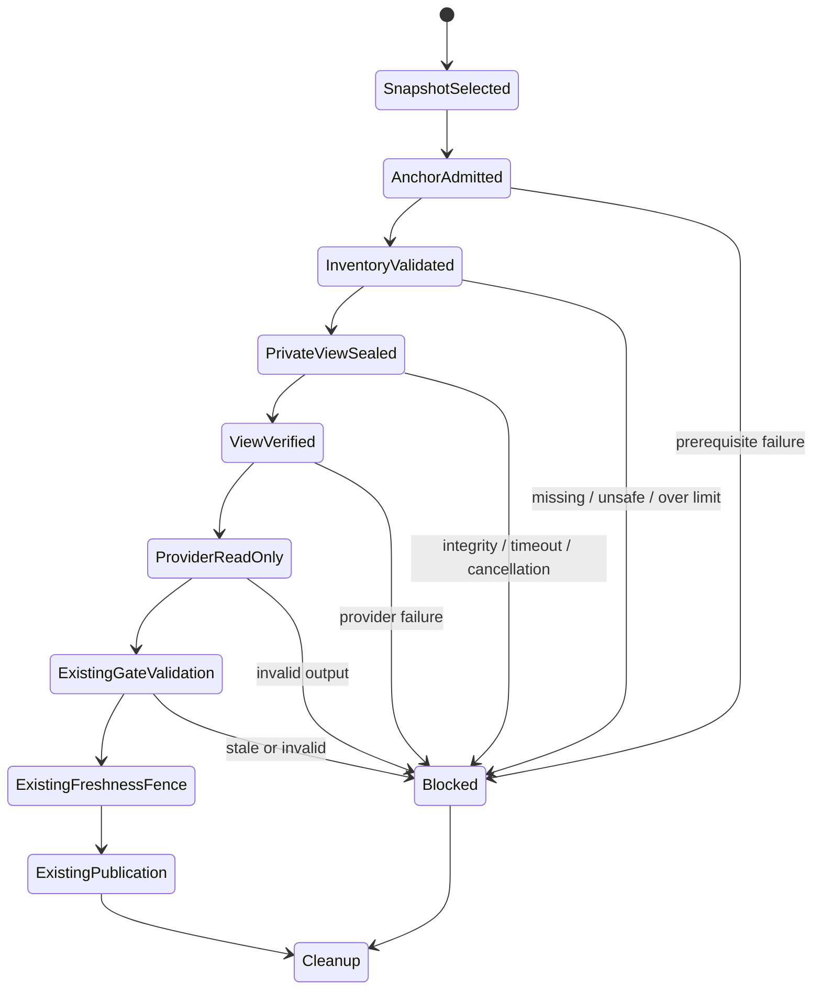

# Immutable source context for pre-branch SDD analysis and drafting

## 1. Executive summary

Issue [#836](https://github.com/vypdev/copilot/issues/836) exposes a split source
identity: the host reads the catalogue from a selected development commit, while
the model CLI reads the workflow's default checkout. Bind both analysis and
writing to that same immutable commit using an SDK-owned, independent, read-only
Git view. Preserve the canonical checkout guard and the existing publication and
freshness fences. This companion belongs to **issue-start-and-sdd-readiness**;
[the gate](pre-branch-sdd-gate.md) remains its primary lifecycle contract.

This is an implementation contract, not a claim that the released SDK or the
reported consumer is already repaired. Native fixture evidence must distinguish
host preparation, child execution, model grounding and a consumer patch release.

## 2. Problem, current behavior, and evidence

### 2.1 Problem

A catalogue path at commit A is not evidence that the CLI can read that path when
its current directory contains commit B. Missing source in B can lead to invented
layout, invalid ownership or a request to restore already tracked files.

### 2.2 Current behavior

`PreBranchSddWorkspaceAdapter.loadSnapshot` resolves an immutable source and reads
its catalogue, standard and template through Git. `FindingsAgentAdapter` formerly
launched analysis and drafting through the planner's default `process.cwd()`.
The canonical root guard was correct, but did not select the source tree.

### 2.3 Evidence

The issue records a consumer whose selected development tree contains the cited
owners and source files, absent from the bootstrap checkout. The SDK reproduction
at base `e7720eeb14238087fe7e44a094bc764ac3dca5a8` has two failing adapter/planner
cases (analysis and draft) and two passing controls (matching source and a truly
absent trusted catalogue). ENOENT occurs in the actual effective CLI workspace.
A local Git prototype preserves the outer HEAD/index/worktree registration and
materializes the selected bytes and commit. It does not prove a live provider's
sandbox or a downstream release. No hidden model tool trace is inferred.

### 2.4 Retrospective classification (as-built baselines only)

Not an as-built baseline. The former source mismatch is a defect, not a supported
alternative. Missing trusted catalogue (#808), draft assembly (#833), protocol
paths (#835) and instructions requiring an unpublished branch (#860) retain their
separate contracts and failures.

## 3. Actors, surfaces, and terminology

The issue author sees the existing SDD status card and questions. Maintainers
inspect its exact source revision, closed reason and linked Action run. The host
owns source selection, Git objects, execution admission and publication. The model
can inspect the admitted view and propose content; it cannot select another root.
**Anchor** is the canonical workflow checkout. **Source view** is the private,
SDK-created repository containing exactly the selected commit's regular tree.
**Binding** is the host fact `{kind, phase, baseSha}`; it is not public configuration.

## 4. Goals, non-goals, and fixed invariants

### 4.1 Goals

- **SC-01:** Pin analysis, draft and its single existing repair to the loaded
  snapshot's exact lowercase 40-character commit, with matching phase/schema.
- **SC-02:** Make every regular selected source file available with exact blob
  bytes and executable intent; reject unsupported or incomplete trees in full.
- **SC-03:** Keep the canonical root guard, provider isolation, original deadline
  and resource budgets; admit and verify the SDK-owned view before child launch.
- **SC-04:** Preserve issue/base freshness, ownership, answer, revision, replay and
  publication fences; source failure consumes no model repair or publication.
- **SC-05:** Present bounded source/phase/reason diagnostics without private Git
  output, paths, content or credentials; use the existing localized status card.
- **SC-06:** Clean up owned execution state on every terminal path and prove
  architecture, native Git/child behavior, coverage and documentation together.

### 4.2 Non-goals

No public workspace selector, arbitrary revision expressions, branch creation
before the gate, additional provider roots, network grant, raised prompt/output
limits, source truncation, catalogue conversion, new draft repair, historical
repository browsing or live consumer deployment is introduced. Native Git SHA-256
repositories are outside the existing 40-character source identity contract.

### 4.3 Fixed product/safety invariants

The requested cwd must still be the canonical Git root and, in Actions, exactly
`GITHUB_WORKSPACE`. Do not change that environment variable to authorize the view.
Managed remote branch ownership remains with the Action. Provider workspace mode
is read-only, child network denied, approvals never and sessions nonpersistent.
Existing 512 KiB prompt, 4 MiB output and 15-minute operation ceilings remain.
Repository text is untrusted evidence. A genuinely absent trusted catalogue fails
before this preparation and retains its existing semantic recovery.

## 5. Current versus proposed product journey

| Step | Former behavior | Required behavior |
|---|---|---|
| Select source | Catalogue read at immutable A | Same source selection |
| Analyze | CLI can inspect bootstrap B | Verified private view has HEAD A and bytes A |
| Draft / repair | Prompt names A, cwd can remain B | Both calls carry the same A with draft phase |
| Missing object / unsafe tree | May become a misleading source inference | No child; bounded source-context failure |
| Publish | Existing validation and freshness checks | Same checks; no earlier branch or publication |

The author continues the same issue workflow. Maintainers repair the actual
prerequisite rather than restoring tracked files into the default checkout.

## 6. Functional behavior and state model

### 6.1 Happy path

The gate derives the binding from the successfully loaded snapshot. The findings
adapter validates phase, task identity, JSON schema presence and schema name,
adds a trusted source instruction, and forwards the binding through the CLI port.
The planner first validates the existing anchor and runtime identity. It then
creates `runtimeDirectory/source`, a separate Git repository with no shared Git
administration. It inventories the selected commit/tree recursively, validates
all paths/types/sizes and imports only that commit plus its trees and blobs.

Git operations use `--no-lazy-fetch`, `--no-replace-objects`, disabled hooks and
fsmonitor, a private empty global/template profile and no inherited credentials
or Git variables. Git lacking `--no-lazy-fetch` fails before consumer object reads.
No missing promisor object can trigger a fetch. Explicit object packing avoids a
history walk; selected HEAD is shallow, with no copied parent objects, remote,
credential configuration, refs, alternates or source index. `read-tree` creates
only the private index. Raw `cat-file --batch` bytes are verified by blob ID and
written without checkout filters, CRLF conversion, ident or archive substitution.
Git's [object packing](https://git-scm.com/docs/git-pack-objects),
[strict import](https://git-scm.com/docs/git-index-pack),
[raw batch protocol](https://git-scm.com/docs/git-cat-file) and
[no-lazy-fetch option](https://git-scm.com/docs/git) define these boundaries.

Before launch, the generic managed-artifact verifier authenticates the private
manifest. Semantic admission rechecks the source binding, owned root, complete
file/directory inventory, bytes/blob IDs, executable intent and every private Git
metadata digest. The provider's ordinary read-only policy receives this effective
workspace. The view is not a registered worktree and needs no remote synchronization.

### 6.2 Alternative paths

Matching anchor/source still uses the same isolated admission path. Linked-branch
revisions use the source selected by the existing resume logic. No source binding
on ordinary findings/language/fixer work changes legacy behavior. A source binding
on a non-SDD task, non-findings capability or mismatched phase/schema is rejected.
A correction of draft format/length retains the binding and the original repair
count. Source preparation failure is not model output and is never regenerated.

### 6.3 State machine

## 7. User-facing configuration

No new input, environment override, setup control, stored field or permission.
The SDK-only binding has exactly `kind: pre-branch-sdd`, `phase: analysis|draft`,
and canonical `baseSha`. Unknown keys, aliases, refs, uppercase SHA and missing
binding for the two SDD tasks are invalid. Provider executable/model configuration
and existing installation prerequisites retain their owner contracts.

| Fixed SDK limit | Value | Failure behavior |
|---|---:|---|
| Regular files / all recursive entries | 10,000 / 20,000 | Reject entire view |
| Individual blob / total regular bytes | 32 MiB / 256 MiB | Reject; no clipping |
| Commit / inventory / packed objects | 1 MiB / 48 MiB / 288 MiB | Reject; no partial import |
| UTF-8 full path / segment | 1,024 / 255 bytes | Reject unsafe path |
| Preparation | 60 seconds, within original timeout | Timeout; no fresh operation budget |

Monotonic elapsed time includes preparation and final admission; the child gets
only the remaining original timeout. Git subprocesses are bounded by the same
remaining preparation deadline. Abort is checked before and between operations.
No timer resets or extra source network attempts are permitted.

## 8. Clean Architecture design

### 8.1 Responsibilities and dependency direction

Domain owns immutable identity, closed failures and diagnostic vocabulary. Pure
application policies validate binding purpose and portable inventory paths.
`PreBranchSddGateUseCase` selects source and retains lifecycle/freshness policy.
Findings/CLI ports carry facts, without Git or filesystem interfaces in application
code. The data adapter forwards facts and the infrastructure planner prepares the
private repository. Small infrastructure Git, materialization and integrity modules
own object I/O and admission; generic CLI execution owns process lifecycle/cleanup.
The existing composition root directly supplies the findings adapter, preserving
the request field without a separate provider-specific SDD implementation.

### 8.2 Contracts, state, and trust boundaries

Bindings are validated and frozen copies. Source provenance comes from the host
snapshot, never the model or issue text. Manifest is an owned managed artifact,
not durable user state. No symlinks, gitlinks, nonregular entries, Windows reserved
names, control/format characters, traversal, case/NFC aliases, trailing dot/space
or `.git` components enter a view. Empty tracked tree directories are retained.
An absent object or unsupported name blocks the whole view, without claiming the
repository lacks the file. Raw source files never enter a failure diagnostic.

### 8.3 Executable architecture constraints

Tests exercise the real findings composition, planner and execution adapter.
Binding mismatch proves zero CLI calls; native Git fixtures prove byte identity,
no lazy-fetch helper invocation, independent metadata and unchanged outer HEAD,
index and worktree registration. Tampered manifest/source/metadata or added entries
prove zero spawn. Existing architecture checks retain capability port boundaries.
Git knowledge remains in infrastructure, not the SDD use case.

## 9. UI/UX and content contract

### 9.1 Information hierarchy

Reuse the existing SDD preparation status card: impact, source/phase/closed reason,
operator action, retained state and linked run/reference. Do not add another card,
repeat the complete catalogue, expose temporary absolute paths or publish raw Git
stderr. A successful recovery updates the owned card through existing rules.

### 9.2 Representative primary view

> **Impact:** SDD analysis stopped because its selected immutable source view is
> unavailable. Source: aaaaaaaaaaaaaaaaaaaaaaaaaaaaaaaaaaaaaaaa.
> Reason: object-unavailable.
>
> **Action:** Inspect the linked run, verify the selected local Git objects and
> SDK prerequisites, then retry the same issue workflow.
>
> **Retained state:** The canonical checkout, existing answers, published SDDs and
> linked branch were retained; no specification or branch was published.

### 9.3 Issue, PR, and comment behavior

`validation.evidence-unavailable` carries recovery `sdd-source-context-unavailable`.
Its only variables are `sourceCommit`, `phase`, `reason`; missing/untrusted binding
uses `none`, `unknown`, `binding-invalid`. The gate only attributes source facts
matching its selected immutable revision. Existing bot ownership, replay and
issue/base freshness checks run immediately before the status write. Stale runs
cannot replace a newer card or publish a specification. No PR is opened by failure.

### 9.4 Accessibility, localization, and responsive behavior

Use semantic Markdown and text labels, with no color/icon-only meaning. English
and Spanish static slices cover all three content fields; other locales use the
existing coherent fallback. Closed machine reason/phase tokens retain stable
spelling. Commit text wraps in the existing card; no new interactive UI or manual
browser acceptance is needed for this backend correction.

## 10. Failure, recovery, and cleanup

Closed reasons: `binding-invalid`, `git-unavailable`, `object-unavailable`,
`unsafe-entry`, `entry-limit`, `file-limit`, `blob-limit`, `byte-limit`,
`metadata-limit`, `materialization-failed`, `view-integrity`. They carry no cause
output. Cancellation, original deadline exhaustion, provider errors and genuine
missing-catalogue failures retain their existing identities. No source error uses
the draft repair allowance or bypasses publication checks.

A missing/incomplete object requires the normal source fetch prerequisite outside
model preparation; unsafe entries require a reviewed source fix; capacity limits
require a product decision, not truncation. Unsupported Git requires a supported
runtime. Retry the same issue after correcting that prerequisite. Generic owned
runtime cleanup removes the independent repository/profile/manifest after success,
provider failure, spawn failure, output rejection, cancellation or timeout. Failed
preparation cleans its partially created runtime before returning; no registered
worktree or ref can be stranded. Outer dirty/untracked state remains unchanged.

## 11. Security, permissions, and privacy

No new token permission or browser access. The view contains the selected tracked
regular tree, including any sensitive bytes already authorized for model source
inspection; untracked/dirty anchor files and credentials are excluded. Private
runtime ownership/mode or Windows ACLs apply at the root and managed artifact
boundary, with inherited private child access. Source files retain read/execute
intent for the owner only. SDK local attributes override transformations using
Git's [attribute precedence](https://git-scm.com/docs/gitattributes).
Read-only provider controls remain the write enforcement; file mode alone is not
claimed as a sandbox. No raw Git errors, object bodies or local paths enter the
public application error or recovery variables. Prompt text explicitly treats
repository instructions as untrusted evidence and does not broaden tool authority.

## 12. Observability and operational UX

Use existing preflight workspace observations and sanitized semantic errors. The
closed diagnostic identifies the selected revision and phase; it never reports
that missing source was restored or a model read occurred when preparation failed.
Tests record local raw fixture facts separately from user-facing output. No live
provider, consumer release, network-isolation or Windows Codex service acceptance
is inferred from a native fake child; existing supported-platform policy applies.

## 13. Compatibility, migration, rollout, and rollback

No stored-state migration or public API option. Existing SDK callers without this
internal binding retain their behavior; official pre-branch task IDs now require
host provenance. Analysis and drafting always use the same admission mechanism.
A patch release must carry the rebuilt Action/CLI/API bundles before downstream
consumers can receive the fix. Merge to develop alone does not repair released
master runtime. Rollback is a normal reviewed code/bundle revert; no user data,
remote ref, credentials or irreversible side effect is introduced by preparation.

## 14. Testing strategy and numeric budget

Minimum **57 distinct cases**, derived from the boundaries below. A matrix row is
one case; parameters extend its partitions without counting it twice. Require
100% modified coverable lines with zero partials in official Codecov against the
live base; new source-context modules require 100% statements/branches/functions/
lines. Preserve repository thresholds and existing test/skip contracts. Use real
local Git objects, deterministic clocks, native fake executables and no live model,
credentials or network. Coverage/fault tests beyond this floor remain necessary
when implementation reveals additional branches.

| Area | Minimum distinct cases | Behaviors/risks covered |
|---|---:|---|
| Domain/configuration/pure planning | 12 | C01–C12 binding, purpose and invariants |
| Immutable Git/filesystem view | 16 | C13–C28 identity, complete bytes and limits |
| Adapter/planner/execution | 10 | C29–C38 admission, tamper and deadlines |
| Gate/lifecycle | 8 | C39–C46 freshness, repair and cleanup |
| Failure/operator/localization | 6 | C47–C52 closed diagnostics and replay |
| Native end-to-end | 5 | C53–C57 composition and publication fences |
| **Total** | **57** | No double counting |

| Case ID | Requirements | Observable contract |
|---|---|---|
| source-context-C01 | SC-01 | Accept exact analysis binding; copy and freeze facts. |
| source-context-C02 | SC-01 | Accept exact draft binding; preserve immutable identity. |
| source-context-C03 | SC-01 | Missing SDD binding rejects before CLI. |
| source-context-C04 | SC-01 | Reject refs, revision expressions and malformed SHA. |
| source-context-C05 | SC-01 | Reject unknown binding fields without exposing values. |
| source-context-C06 | SC-01 | Reject phase/schema/task mismatches. |
| source-context-C07 | SC-01 | Reject binding attached to ordinary non-SDD task. |
| source-context-C08 | SC-03 | Reject source binding for write-capable role. |
| source-context-C09 | SC-03 | Unbound ordinary operations retain legacy execution. |
| source-context-C10 | SC-03 | Canonical root and Actions checkout guard remain enforced. |
| source-context-C11 | SC-03 | Original prompt/output/time ceilings remain unchanged. |
| source-context-C12 | SC-02 | SDK limits are fixed; no configuration override. |
| source-context-C13 | SC-02 | Different bootstrap HEAD still yields selected files. |
| source-context-C14 | SC-02 | Matching anchor/source also uses isolated exact view. |
| source-context-C15 | SC-02 | CRLF and ident attributes cannot transform raw blobs. |
| source-context-C16 | SC-02 | export-ignore and export-subst do not omit/alter files. |
| source-context-C17 | SC-02 | Binary, Unicode and executable files retain identity. |
| source-context-C18 | SC-03 | Repository hooks and ambient Git configuration do not execute. |
| source-context-C19 | SC-02 | Dirty and untracked anchor files are excluded and preserved. |
| source-context-C20 | SC-03 | No parent history, remotes, credentials or alternates copied. |
| source-context-C21 | SC-02 | Replacement refs cannot substitute selected object content. |
| source-context-C22 | SC-02 | Missing objects fail without invoking a promisor helper. |
| source-context-C23 | SC-02 | Reject symlinks and gitlinks before materialization. |
| source-context-C24 | SC-02 | Reject unsafe and case/NFC-colliding paths. |
| source-context-C25 | SC-02 | Reject file/entry caps without partial view. |
| source-context-C26 | SC-02 | Reject over-limit blob with closed reason. |
| source-context-C27 | SC-02 | Reject aggregate/commit/inventory/pack bounds. |
| source-context-C28 | SC-06 | Outer HEAD, index and worktree registrations remain identical. |
| source-context-C29 | SC-01 | Official adapter/composition forwards validated frozen binding. |
| source-context-C30 | SC-01 | Invalid adapter binding makes zero CLI calls. |
| source-context-C31 | SC-03 | All supported provider plans retain read-only authority. |
| source-context-C32 | SC-03 | Preparation failure never launches a child. |
| source-context-C33 | SC-03 | Changed source bytes prevent launch. |
| source-context-C34 | SC-03 | Changed private Git metadata prevents launch. |
| source-context-C35 | SC-03 | Added file or empty directory prevents launch. |
| source-context-C36 | SC-03 | Forbidden provider configuration in selected tree is rejected. |
| source-context-C37 | SC-05 | Bounded failures discard raw Git text and secret paths. |
| source-context-C38 | SC-03 | Preparation and admission consume original monotonic deadline. |
| source-context-C39 | SC-01 | Gate analysis uses actual loaded snapshot SHA. |
| source-context-C40 | SC-01 | Draft and its existing repair retain same source pin. |
| source-context-C41 | SC-04 | Owner facts are read at the same immutable source. |
| source-context-C42 | SC-04 | Linked-branch resume binds its selected revision. |
| source-context-C43 | SC-04 | Base advancement withholds stale failure/publication. |
| source-context-C44 | SC-04 | Issue edit withholds stale failure/publication. |
| source-context-C45 | SC-04 | Source failure consumes no draft repair. |
| source-context-C46 | SC-06 | Success, provider failure, cancellation and timeout clean runtime. |
| source-context-C47 | SC-05 | English source-context recovery shows closed facts. |
| source-context-C48 | SC-05 | Spanish and existing locale fallback retain content parity. |
| source-context-C49 | SC-05 | Malformed recovery cannot leak values or spoof source. |
| source-context-C50 | SC-05 | Genuinely absent trusted catalogue retains original error. |
| source-context-C51 | SC-05 | Foreign failure source is withheld from the card. |
| source-context-C52 | SC-05 | Owned diagnostic replay updates one card without noise. |
| source-context-C53 | SC-06 | Real composition/planner/native child reads selected non-default tree. |
| source-context-C54 | SC-06 | Native child matching-base path retains exact bytes and cleanup. |
| source-context-C55 | SC-06 | Unavailable/incomplete source makes zero child/publication calls. |
| source-context-C56 | SC-06 | Draft correction with native child retains exact same pin. |
| source-context-C57 | SC-06 | Complete source view permits existing verified publication fences. |

## 15. Documentation and discoverability

| Audience | Artifact/page | Required content | Validation/navigation |
|---|---|---|---|
| User / maintainer | docs/issues/pre-branch-sdds.mdx | Selected source versus anchor, retry semantics | Documentation contract |
| Setup owner / operator | docs/agents/execution-contract.mdx | Git prerequisite, limits, private view, cleanup | Runtime contract checks |
| Operator | docs/security-operations/operations/error-reference.mdx | Closed recovery, retained state, no restore workaround | Error catalogue tests |
| Contributor | This SDD, primary gate and execution hardening | Ownership, ports, admission and evidence limits | Specification catalogue |

## 16. Acceptance scenarios

1. Given default checkout B and selected A with different files, both model
   operations inspect A; B's HEAD/index/files/worktree registrations remain intact.
2. Given missing or unsafe content at A, preparation blocks before child launch;
   no partial tree, model repair, branch or SDD is published.
3. Given valid content but changed file/metadata before execution, admission
   rejects and cleans owned runtime.
4. Given an issue edit or source advancement during failure presentation, the
   existing freshness fence withholds the stale status write.
5. Given a draft format repair, its two calls retain A and the original allowance;
   source failure never becomes a format repair.
6. Given repeated failure with current source, the owned card is updated once,
   with closed source/phase/reason, localized action and retained state.
7. Given successful native fake child execution, private state is removed and
   existing verified publication remains authoritative; no live release is claimed.
8. Given no binding on ordinary capabilities, their workspace policy is unchanged.

## 17. Requirements traceability

| Requirement | Policy/use case/adapter/presentation | Test or evidence | Documentation |
|---|---|---|---|
| SC-01 | Domain binding, findings adapter, SDD gate/draft | C01–C07, C29–C30, C39–C40 | Pre-branch SDD guide |
| SC-02 | Source inventory/Git/materializer | C12–C17, C19, C21–C27 | This SDD limits |
| SC-03 | Existing root guard, planner, execution admission | C08–C11, C18, C20, C31–C36, C38 | Execution contract |
| SC-04 | Existing lifecycle and freshness policy | C41–C45 | Primary gate |
| SC-05 | Closed diagnostic, error catalogue, owned card | C37, C47–C52 | Error reference |
| SC-06 | Owned runtime lifecycle and native composition | C28, C46, C53–C57 | Execution contract |

The per-case table is authoritative when a case protects multiple invariants;
links above are navigation, not additional case counts.

## 18. Implementation sequence

Establish baseline red cases and immutable-source contract; implement pure binding,
private Git preparation and sealed admission; forward the gate's source through
composition; add closed diagnostics and docs; exercise lifecycle/freshness and
native child paths; regenerate catalogue/Graphify/bundles, validate full tests and
coverage; obtain exact-head remote review/Codecov before ordinary merge. Downstream
release validation remains a later managed patch step.

## 19. Definition of Done

- Every SC requirement and the 57-case floor has executable evidence.
- Source binding, isolation, deadlines, full-tree admission and cleanup pass.
- No canonical-root weakening, new permissions, source clipping or missing-owner
  restoration workaround is introduced.
- Local required checks, catalogue/docs/Graphify/builds and normal hooks pass.
- Current-head technical checks and full review pass without open findings;
  official Codecov reports all modified lines covered with no partials.
- Exact human protected-path decision is obtained if the final check requests it.
- Issue closure and merge are verified natively; release/consumer proof is not
  inferred from develop or local fixtures.

## 20. References and decisions

Related: [#836](https://github.com/vypdev/copilot/issues/836),
[primary gate](pre-branch-sdd-gate.md),
[execution hardening](agent-execution-policy-hardening.md),
[runtime routing](agent-runtime-provider-and-model-routing.md).
Use independent object-only import instead of a registered worktree, archive or
checkout: it preserves exact commit/bytes without shared refs/admin, export rules,
history, hook/filter execution or changing the canonical root. A host-only file
fact interface was rejected because existing read-only provider tools need a real
bounded repository view. Git official documentation linked in sections 6 and 11
supports the chosen primitives. No copied third-party code is involved.
