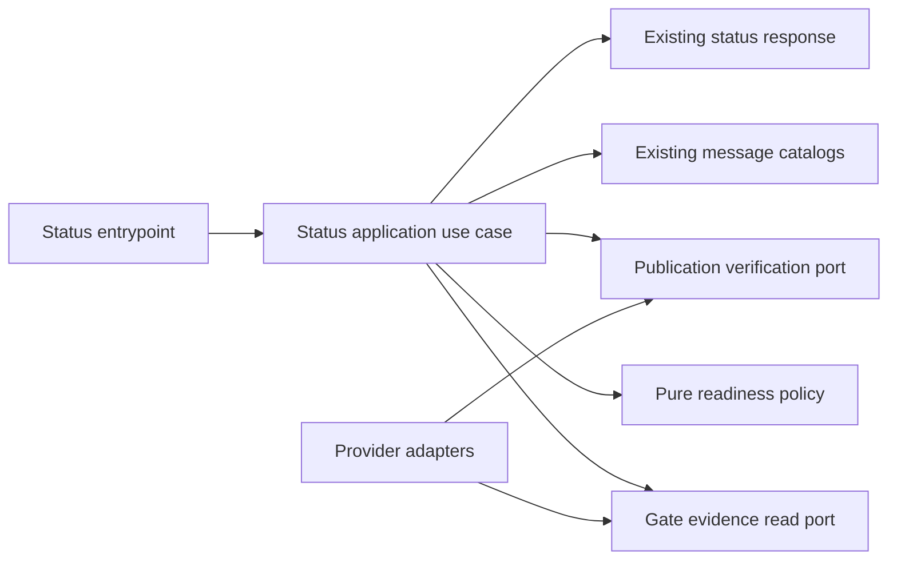

# Pre-branch SDD Readiness in `/copilot status`

- Status: Proposed
- Date: 2026-10-10
- Catalog capability ID: `issue-start-and-sdd-readiness`
- Last verified: 2026-10-11
- Owners: Copilot maintainers
- Scope: Add a localized, read-only view of pre-branch SDD readiness to the existing issue status answer.
- Related issues/PRs: Issue #454; existing owning specification `specs/pre-branch-sdd-gate.md`
- Required review gates: product UX, architecture, testing, documentation, security/operations
- Open decisions blocking readiness: None stated in the supplied issue and answers.

This companion specifies the full status extension for [issue #454](https://github.com/vypdev/copilot/issues/454). The implemented gate contract remains in [`pre-branch-sdd-gate.md`](./pre-branch-sdd-gate.md). The branch now includes typed read-only orchestration, immutable catalog ownership and publication verification, current question/answer provenance, final issue/card/branch fences, and complete English/Spanish presentation. Local acceptance is executable; live Action acceptance and promotion remain pending until the published implementation is exercised.

## 1. Executive summary

Extend the read-only `/copilot status` response for an issue to show its pre-branch SDD readiness using the latest Action-owned `copilot:sdd-gate:v1` evidence. The compact section reports whether an SDD is required, the owning SDD path, pending clarification IDs, and a verified SDD commit when publication has been proven. Missing evidence is unknown when a specification is required; malformed, foreign, stale, or inconsistent evidence is invalid or unverified. Neither a branch nor a `published` phase alone proves readiness.

The command preserves existing status fields, ordering, lifecycle, labels, and finding counts; performs no writes; creates no timeline card; and uses complete existing English and Spanish message catalogs. Help issues remain branchless and show that a specification is not required.

```text
/copilot status -> validate latest durable gate record -> show localized readiness and existing status
```

Text equivalent: a user requests status, the application validates durable evidence, and the response adds a truthful readiness section without changing issue or repository state.

## 2. Problem, current behavior, and evidence

### 2.1 Problem

A maintainer checking an issue while its SDD is being clarified cannot see pending question IDs or publication evidence in the status answer. They must inspect another status comment to learn what blocks branch creation. A status view that trusts incomplete or malformed evidence could incorrectly suggest that implementation may begin.

### 2.2 Current behavior

1. The existing `/copilot status` snapshot reports branch, lifecycle, labels, and Bugbot finding counts, according to the issue description.
2. It does not directly expose the SDD readiness facts specified here.
3. The pre-branch gate already has durable `copilot:sdd-gate:v1` evidence and an existing owning SDD contract at `specs/pre-branch-sdd-gate.md`.
4. Status orchestration is `src/application/usecases/read_copilot_status_workflow.ts`; the closed projection and renderer are `src/application/policies/sdd_status_policy.ts`; catalogs are `src/application/policies/publication_message_catalog.ts`.

### 2.3 Evidence

- Code/workflow/documentation references: Existing owning contract `specs/pre-branch-sdd-gate.md`; issue #454 identifies the status command, durable gate evidence, and complete message catalogs as the relevant scope. Read-only authority is bound by `src/application/ports/sdd_evidence_read_ports.ts` and `src/infrastructure/composition/sdd_evidence_composition_root.ts`; `src/application/usecases/sdd/sdd_evidence_query_use_case.ts` verifies the record against GitHub and immutable Git objects.
- Incidents or concrete examples: Dogfooding feedback says users inspect another status comment to discover SDD blockers.
- External primary sources: Not applicable; this is an internal command and evidence contract.
- Open verification: Live Action rendering after publication, replay behavior, and exact linked-branch behavior on each supported runner. Missing configuration remains unavailable rather than defaulting to not-required.

### 2.4 Retrospective classification (as-built baselines only)

Not applicable. This is a prospective extension; no implemented baseline is reconstructed here.

## 3. Actors, surfaces, and terminology

| Actor | Goal | Entry point | Visible surfaces |
|---|---|---|---|
| Issue author | See whether answers are pending | `/copilot status` on an issue | Localized status comment/answer |
| Maintainer | Confirm SDD owner and branch readiness | `/copilot status` | Readiness section and links/text |
| Contributor | Confirm verified SDD evidence before implementation | `/copilot status` | Owning path and verified commit |
| Copilot Action | Report authoritative readiness facts | Existing status use case | Existing status response |

A **gate record** is the latest Action-bot-owned `copilot:sdd-gate:v1` record for the current issue. **Pending question IDs** are current `plan.questions` IDs without a valid authorized answer in that record. **Verified SDD commit** is the verified latest revision SHA when present, otherwise the first commit SHA, only after existing publication verification proves the commit is on the exact linked remote branch, derives from the recorded base, and changes the owning SDD. **Unknown** means required evidence is absent. **Invalid or unverified** means evidence cannot safely establish readiness.

## 4. Goals, non-goals, and fixed invariants

### 4.1 Goals

1. Show required/not-required status, owning path, pending question IDs, and verified commit when available.
2. Report pending publication, unavailable evidence, and invalid/unverified evidence honestly.
3. Preserve existing status content and ordering guarantees while keeping the command read-only.
4. Provide complete English and Spanish messages using existing catalogs.

### 4.2 Non-goals

1. Change SDD eligibility, gate lifecycle, labels, gate record production, publication, or branch creation.
2. Add locales, configuration flags, providers, timeline cards, or a new SDD workflow.
3. Change branch, lifecycle, label, or finding-count semantics.

### 4.3 Fixed product/safety invariants

1. Status MUST NOT mutate issues, labels, branches, commits, or SDD files.
2. Only the latest Action-owned gate record for this issue may supply durable readiness evidence; arbitrary human comments are not evidence.
3. A branched issue or `published` phase alone MUST NOT be reported ready.
4. Required but absent evidence is unknown; malformed, foreign, stale, or inconsistent evidence is invalid/unverified.
5. Help issues MUST remain branchless and show specification not required/not applicable.

## 5. Current versus proposed product journey

| Stage | Current | Proposed | User/operator effect |
|---|---|---|---|
| Request | `/copilot status` returns existing snapshot | Same command and grammar | No workflow change |
| Gate evidence | No direct SDD readiness section | Read latest valid gate record | Fewer comment inspections |
| Pending questions | Not directly shown | Show current unanswered Q IDs | Clear next action |
| Published SDD | No verified commit in status | Show verified SHA only after proof | Inspectable readiness evidence |
| Invalid/unavailable | Existing snapshot behavior | Preserve snapshot; mark readiness honestly | No false-ready result |

```mermaid
flowchart LR
    A[/copilot status] --> B[Read latest gate record]
    B --> C{Validate ownership, schema, identity, freshness}
    C -->|Valid| D[Derive readiness fields]
    C -->|Missing or invalid| E[Render unknown or unverified]
    D --> F[Append localized read-only section]
    E --> F
    F --> G[Return existing snapshot plus readiness]
```

Text equivalent: the command reads and validates the latest gate evidence, derives readiness or an honest unavailable/unverified state, then returns the existing snapshot with a localized section and no mutations.

## 6. Functional behavior and state model

### 6.1 Happy path

1. The existing status entrypoint receives the issue request and builds the existing snapshot.
2. A typed application port retrieves the latest candidate Action-owned gate record for that issue.
3. A pure validator checks version, ownership, schema, and current issue identity, including the stated record fields: `issueNumber`, `phase`, `plan.path`, `plan.capabilityId`, `plan.questions`, `answers`, `branchName`, `baseSha`, `commitSha`, `revisionBaseSha`, and `revisionSha`.
4. The application derives required status from existing issue classification and gate policy; it does not introduce a classification rule or flag. It derives pending IDs only from current validated questions minus valid authorized answers.
5. For published evidence, the application reports `revisionSha` if present, otherwise `commitSha`, only when existing publication verification proves exact linked remote branch, recorded base ancestry, and an owning SDD change. The first `commitSha` remains immutable.
6. The presenter adds a compact readiness section through existing catalogs and returns all existing status fields unchanged.

### 6.2 Alternative paths

- Help: show “Specification not required / Especificación no obligatoria”; do not create or link a branch.
- Required gate record missing: show evidence unavailable/unknown and implementation blocked; do not infer from branch state.
- Malformed, foreign, stale, or internally inconsistent record: show invalid or unverified; do not guess question IDs or commit.
- Valid unanswered questions: show IDs and “Awaiting specification answers”.
- Valid required record with no verified published SHA: show first publication pending where applicable; do not claim ready.
- Retrieval failure: preserve the original snapshot and show unavailable/unverified readiness.
- Exempt non-help issue: reflect the existing gate eligibility decision; no new policy is introduced.

### 6.3 State machine

| State | Entered when | User-visible meaning | Allowed next states | Recovery/owner |
|---|---|---|---|---|
| Not required | Existing policy exempts issue, including help | No SDD gate applies | Not required | Existing policy |
| Awaiting answers | Valid record has unanswered current questions | Listed Q IDs need answers | Awaiting publication, invalid/unverified | Issue author/maintainer answers through existing flow |
| Publication pending | Required valid record has no verified published SHA | SDD publication is not verified | Ready, invalid/unverified | Existing gate publication flow |
| Ready | Required evidence and remote publication checks pass | SDD evidence is verified | Revision pending if gate evidence changes | Existing gate flow |
| Unknown | Required evidence absent or retrieval unavailable | Readiness cannot be established | Any state on later status read | Retry status / inspect gate |
| Invalid/unverified | Evidence fails validation or verification | Do not proceed on this evidence | Any state after corrected authoritative evidence | Maintainer/operator resolves gate record |

Duplicate status requests repeat the read and produce no write or new card. Superseded question rounds are ignored. Out-of-order or inconsistent records fail closed to unknown/invalid rather than merging. Status does not cancel or advance gate operations.

## 7. User-facing configuration

No new configuration is introduced. Existing issue classification, gate policy, locale selection, and command admission remain authoritative.

| Input | Type | Recommended default | Allowed values/range | Scope/persistence |
|---|---|---|---|---|
| Existing issue classification | Existing policy value | Existing repository behavior | Existing bounded policy | Current issue/gate policy |
| Existing locale selection | Existing locale | Existing behavior and fallback | Supported existing locales, including English and Spanish | Existing status presentation |

No new precedence, migration, or retired value is applicable. Status MUST NOT add a flag to select evidence sources or weaken validation. English and Spanish catalogs must both contain complete readiness messages.

## 8. Clean Architecture design

### 8.1 Responsibilities and dependency direction

| Layer/boundary | Owns | Must not own/import |
|---|---|---|
| Domain/pure policy | Evidence validity, question subtraction, readiness state, SHA selection preconditions | GitHub SDK, UI, process code |
| Application | Status orchestration and immutable readiness result | Provider DTOs and rendering details |
| Semantic ports | Read latest gate evidence; verify publication facts | Octokit/Git shapes |
| Adapters/data | Retrieve records and map provider results/errors | Eligibility or readiness policy |
| Infrastructure/composition | Wire existing provider and catalogs | Product decisions |
| Entrypoints | Parse existing command and pass issue context | Duplicate gate logic |
| Presentation | Localized readiness text appended to existing snapshot | Mutations or evidence validation |



Text equivalent: the existing status use case calls typed read and verification ports, applies pure readiness policy, then passes a view model to the existing catalog-backed presenter.

### 8.2 Contracts, state, and trust boundaries

- Pure decisions: validate the candidate record against current issue identity; derive pending IDs from current questions and valid authorized answers; choose revision SHA over first SHA only after proof; map evidence to ready, pending, unknown, or invalid.
- Application contracts: immutable issue identity and existing snapshot input; typed `SddReadiness` result containing requirement, owner path, pending IDs, verified SHA, and evidence state.
- Semantic ports: `readLatestValidSddGateEvidence(issueIdentity)` and existing publication proof query, without provider-specific DTOs.
- Durable state/schema ownership: the existing gate owns `copilot:sdd-gate:v1`; the status command is a read-only consumer and creates no new durable state.
- Concurrency/idempotency: status is a snapshot read; each request validates current evidence. It neither combines rounds nor writes markers.
- Trusted and untrusted inputs: issue text, human comments, arbitrary markers, and provider payloads are untrusted. Only validated Action-owned durable evidence and existing authorization/publication proofs count.
- Provider error mapping: retrieval failure yields unavailable/unknown; invalid schema or identity yields invalid/unverified. Errors do not discard the existing status snapshot or expose raw exceptions.

### 8.3 Executable architecture constraints

- Readiness policy modules MUST have no provider, rendering, or process imports; enforce through existing dependency rules.
- The status use case MUST depend on typed semantic ports; adapter contract tests validate field mapping and error conversion.
- Tests MUST assert no write-capable port is called and no status card is created.
- Catalog completeness checks MUST parse both supported message catalogs and verify every required message key.

## 9. UI/UX and content contract

### 9.1 Information hierarchy

Keep the existing status content and ordering intact. Add a compact SDD readiness section after the existing snapshot fields, using existing localized status formatting. It presents requirement, owning path, pending IDs, and verified commit when established; otherwise it clearly identifies awaiting answers, publication pending, unavailable, or invalid/unverified. No new comment or timeline card is created.

### 9.2 Representative primary view

Pending answers, English:

```markdown
## SDD readiness
- **Specification:** Required
- **Owning SDD:** `specs/pre-branch-sdd-gate.md`
- **Pending questions:** Q2, Q4
- **Status:** Awaiting specification answers
```

Pending publication, Spanish:

```markdown
## Preparación del SDD
- **Especificación:** Obligatoria
- **SDD responsable:** `specs/pre-branch-sdd-gate.md`
- **Preguntas pendientes:** Ninguna
- **Estado:** Primera publicación del SDD pendiente
```

Blocked/unavailable:

```markdown
## SDD readiness
- **Specification:** Required
- **Owning SDD:** Unavailable
- **Status:** Specification evidence unavailable
- **Impact:** Implementation readiness cannot be established.
```

Partially complete/unverified:

```markdown
## SDD readiness
- **Specification:** Required
- **Owning SDD:** `specs/pre-branch-sdd-gate.md`
- **Verified SDD commit:** Unverified
- **Status:** Specification evidence invalid or unverified
```

Completed:

```markdown
## SDD readiness
- **Specification:** Required
- **Owning SDD:** `specs/pre-branch-sdd-gate.md`
- **Pending questions:** None
- **Verified SDD commit:** `a1b2c3d4`
- **Status:** Specification ready
```

Help issue:

```markdown
## SDD readiness
- **Specification:** Not required
- **Status:** Specification not required
```

### 9.3 Issue, PR, and comment behavior

- Deterministic section title and existing status response location; no new durable marker is required unless the existing renderer requires one, in which case it must not create a separate card.
- Repeated status requests are read-only and do not post duplicate timeline cards.
- Labels remain supplemental existing fields and do not determine readiness.
- The owner path and verified SHA are shown as safe text or descriptive links using existing formatting; exact URL construction follows existing repository conventions.
- Existing command grammar and lifecycle remain unchanged.

### 9.4 Accessibility, localization, and responsive behavior

Use complete English and Spanish catalogs with the exact approved message pairs: Specification required / Especificación obligatoria; Specification not required / Especificación no obligatoria; Owning SDD / SDD responsable; Pending questions / Preguntas pendientes; Verified SDD commit / Commit del SDD verificado; Awaiting specification answers / Esperando respuestas de la especificación; First SDD publication pending / Primera publicación del SDD pendiente; Specification ready / Especificación lista; Specification evidence unavailable / Evidencia de la especificación no disponible; Specification evidence invalid or unverified / Evidencia de la especificación no válida o sin verificar. Use existing locale selection and fallback. Use semantic headings and short lists, readable on mobile and light/dark themes. Escape paths and values; do not render arbitrary comment text or untrusted Markdown.

## 10. Failure, recovery, and cleanup

| Failure/partial state | User impact | Retained facts | Automatic retry | Required action | Cleanup |
|---|---|---|---|---|---|
| Gate evidence absent, required | Readiness unknown | Original status snapshot | On next status request | Inspect gate status/continue existing flow | None |
| Retrieval error | Readiness unavailable | Original status snapshot | Next request/provider retry policy | Retry or inspect provider status | None |
| Malformed/foreign/stale record | Readiness invalid | Original snapshot and safe diagnostic code | No guessed recovery | Maintainer/operator resolve authoritative record | No record mutation by status |
| Publication proof unavailable | Not ready | Valid gate fields, no verified SHA | Next read when proof available | Complete/reconcile existing publication | None |
| Catalog message missing | Existing response must remain safe | Existing snapshot | Normal deployment repair | Restore catalog completeness | None |

Errors follow impact, cause, action, retained state. A readiness read failure never implies the existing status snapshot failed and never changes issue state.

## 11. Security, permissions, and privacy

1. The command uses read-only access for issue and gate evidence; no write credential or mutation port is available to the status use case.
2. Treat issue/comment text and records as untrusted. Validate bot ownership, schema, version, and issue identity before use; never infer from arbitrary comments.
3. Do not expose secrets or raw provider exceptions. Render only validated path, IDs, and commit SHA.
4. Reject foreign, stale, forged, and inconsistent evidence; do not interpret branch presence or phase text as proof.

## 12. Observability and operational UX

- User-facing state: compact readiness state alongside the existing snapshot.
- Job Summary/operator evidence: retain existing status diagnostics; readiness may record bounded reason codes, not raw issue text.
- Logs, metrics, and correlation: use existing request correlation; no new durable data or metrics are required by this scope.
- Pending external dependency versus workflow failure: unavailable evidence is shown distinctly from valid pending questions.
- Rate-limit/retry behavior: map provider retrieval errors to unavailable while preserving the snapshot; follow existing provider retry policy.
- Noise/comment budget: zero additional cards or notifications from status.

## 13. Compatibility, migration, rollout, and rollback

No schema or configuration migration is introduced. Existing gate records remain authoritative and are read using their current version and validation rules. Existing fields, order, command grammar, supported locales, lifecycle, labels, and finding counts remain compatible. Deploying the change adds one section; rollback removes that section without affecting gate records or branches. No rollout flag is supported or needed per the supplied scope.

## 14. Testing strategy and numeric budget

Minimum: **149 distinct cases** for this extension. Existing gate and PR status cases are retained but not counted again here.

| Area | Minimum distinct cases | Behaviors/risks covered |
|---|---:|---|
| Existing basic status presentation | 30 | Original issue readiness, unavailable/not-required and bilingual render regression cases |
| Issue identity | 8 | Canonical visible body/title normalization, profile, kind, issue number and original base digest |
| Owned card selection | 16 | Exact bot ownership, highest comment identity, corruption without older fallback, duplicate markers, safe IDs and retained answer IDs |
| Authority/application/fences | 51 | Immutable first/revision proof, catalog ownership, current authorized answers, partial inventory, issue/card/label/head races, no write capabilities and three status integration outcomes |
| Closed projection/UX | 37 | Canonical requirement/configuration, eight evidence outcomes, withheld historical SHA, malformed proof, safe same-issue links, bounded IDs and both bundled locales |
| Native linked ref adapter | 4 | Stale/deleted refs, foreign/missing repository identity; none may fall back to another PR |
| Immutable workspace reads | 2 | Read the original catalog without checkout/current-file mutation; reject non-SHA identifiers |
| Read-only composition | 1 | Repository-bound live publication query and current maintainer authorization without mutation capability |
| **Total** | **149** | No case counted twice |


Maintain repository-wide thresholds. New pure readiness policy should meet at least 95% branch coverage; changed status modules should meet existing module thresholds, with a target of 90% branches and 95% lines/statements. Use deterministic records, clocks, provider fakes, and publication proofs; no sleeps or live services. Parse catalog structures and gate records rather than grep prose. UI fixtures require semantic assertions beyond snapshots. Manual acceptance confirms the section is readable on mobile and desktop and preserves the existing status ordering.

## 15. Documentation and discoverability

| Audience | Artifact/page | Required content | Validation/navigation |
|---|---|---|---|
| Issue author/maintainer | Existing status command documentation, including `docs/issues/comment-commands.mdx` if it owns this command | Readiness fields and meanings of unknown, invalid, pending answers, and verified commit | Existing docs link/navigation checks |
| Operator | Existing workflow/status guidance | Evidence source, fail-closed behavior, and recovery through existing gate flow | Contract fixture for examples |
| Contributor | `specs/pre-branch-sdd-gate.md` and status implementation guidance | Read-only consumer boundary and verified SHA conditions | Specification validation and architecture checks |

Keep examples synchronized with catalog fixtures. No new guide is mandated if existing command documentation can be updated clearly.

## 16. Acceptance scenarios

1. Given a valid required gate record with unanswered current questions, when `/copilot status` runs, then it shows required, the owning path, and exactly the unanswered current Q IDs.
2. Given authorized answers to all current questions, when status runs before verified publication, then it shows no pending IDs and first publication pending; it does not claim ready.
3. Given valid publication proof on the exact linked remote branch, from the recorded base, changing the owning SDD, when status runs, then it shows `revisionSha` if present, otherwise immutable `commitSha`, as verified.
4. Given only a branched issue or `published` phase without publication proof, when status runs, then it reports unverified and implementation readiness is blocked.
5. Given missing evidence for a required SDD, when status runs, then readiness is unknown/unavailable and existing status fields remain present and unchanged.
6. Given malformed, foreign, stale, or inconsistent evidence, when status runs, then it reports invalid/unverified and does not guess owner, IDs, or SHA.
7. Given an issue classified by existing policy as not requiring an SDD, including help, when status runs, then it says not required; help remains branchless.
8. Given a provider retrieval error, when status runs, then the original snapshot is preserved and readiness is unavailable without a write.
9. Given English or Spanish locale, when status runs in any readiness state, then every readiness label/state is supplied by the corresponding complete catalog.
10. Given repeated status requests, when each request completes, then no issue, label, branch, commit, SDD, or timeline card is created or changed.
11. Given superseded question rounds or arbitrary human comments, when status derives pending IDs, then only current validated gate questions and valid authorized answers are considered.
12. Given existing branch, lifecycle, labels, and finding counts, when the new readiness section is added, then their values and ordering remain compatible.

## 17. Requirements traceability

| Requirement | Policy/use case/adapter/presentation | Test or evidence | Documentation |
|---|---|---|---|
| Read latest Action-owned evidence | Evidence port and validator | Ownership/schema/identity cases | Status command docs |
| Derive pending IDs from current round | Pure readiness policy | Superseded and answer matrix | Status command docs |
| Prove publication before SHA | Verification port and SHA selector | Exact branch/base/path/revision cases | Gate SDD |
| Fail closed on missing/invalid evidence | Application result mapping | Missing, malformed, foreign, stale cases | Operator guidance |
| Preserve snapshot and read-only behavior | Status use case and port set | Snapshot and no-write integration cases | Status command docs |
| Localize complete output | Catalog-backed presenter | English/Spanish key and state coverage | Status command docs |
| Preserve help branchlessness and existing fields | Existing policy/renderer integration | Compatibility scenarios | Existing lifecycle docs |

## 18. Implementation sequence

1. Locate the existing status use case, evidence schema/validator, publication verification, and English/Spanish catalogs; preserve the owning gate contract.
2. Define typed readiness result and semantic read/verification ports; add pure policy tests for ownership, identity, pending IDs, and state mapping.
3. Integrate read-only orchestration into status while retaining the original snapshot on retrieval errors.
4. Add catalog messages and compact rendering for all states; ensure no timeline-card path is invoked.
5. Add adapter, integration, localization, security, and compatibility tests within the 149-case implementation budget.
6. Update command/operator documentation and contract examples.
7. Run specification, architecture, catalog, and repository validation required by the existing project workflow.

## 19. Definition of Done

- [x] Required SDD evidence is shown as unavailable/unverified until authoritative evidence can be verified; status never infers readiness from a marker or branch.
- [x] `/copilot status` remains read-only and preserves all existing fields and ordering.
- [x] English and Spanish catalogs cover the readiness section.
- [x] Typed application ports and Clean Architecture boundaries are enforced by tests/checks.
- [x] All 149 distinct extension cases, full coverage budgets and generated bundles pass before publication.
- [x] User documentation explains the evidence limit and fail-closed behavior.
- [x] Existing command grammar, lifecycle, labels, finding counts, and gate record ownership remain compatible.
- [x] `specs/catalog.json` evidence and generated `specs/CATALOG.md` remain current; `pnpm run validate:specifications` passes.

- [ ] Live runtime acceptance after promotion verifies published, awaiting, stale and unavailable outcomes on GitHub.

## 20. References and decisions

- Owning SDD: `specs/pre-branch-sdd-gate.md`, capability `issue-start-and-sdd-readiness`.
- Issue: #454, dogfooding status readiness request.
- Decisions from explicit answers: use existing feature/contract-change classification; latest Action-owned `copilot:sdd-gate:v1` record only; derive question IDs only from current validated questions and authorized answers; verified revision SHA takes precedence over immutable first commit SHA; help is exempt and branchless; use approved English/Spanish catalog wording; preserve existing status fields and make retrieval failure non-destructive.
- Rejected: inferring readiness from branch existence or `published` phase alone; parsing arbitrary human comments; combining superseded clarification rounds; adding writes, cards, configuration, or locale support.
- Follow-up: exact code and catalog paths are to be resolved during implementation discovery; no product decision remains open.

### As-built evidence and authority limits

The highest owned SDD-card ID is selected before schema validation. A newer
corrupted card cannot revive an older ready record. Stored answers count only
with exact current round and question-text provenance plus current role
authorization; ordinary live answers must follow the card/retained-answer
cutoff. Every ready SHA has first-publication parent/SDD proof, immutable
catalog ownership and live same-repository branch ancestry. Revisions retain
the first publication and prove their own recorded base and owning path.
Final issue title/body, labels, owned card and remote-head reads can downgrade
the result to unverified. Status does not expose question text, raw failure
reasons, model capabilities or mutation ports. Immutable catalog reads may
fetch Git objects locally but never checkout, commit, push or rewrite source.
The four native-ref regressions and two workspace-read cases above belong to
this extension; the gate's existing numeric budget does not count them again.

### Offline implementation validation — 2026-10-11

The 141 distinct extension cases are implemented. Full validation on the Action-managed head `43d710770972df3443b519ca0bd61c6ad6256c93` plus this contribution passed 567 Jest suites with 7,485 tests passed and 35 configured skips. Repository coverage budgets and the setup acceptance ledger passed; the ledger retains its 42 explicitly open cases. New identity and card policies and the read-only composition have 100% coverage; projection branch coverage is 96% and query branch coverage is 97.36%. Typecheck, lint, documentation, specification validation and generated bundles passed. Live acceptance remains pending promotion and is not inferred from these offline checks.

### PR #465 review corrections (2026-10-11)

The review identified two status defects. Evidence navigation now compares an
issue URL against the trusted workflow server origin supplied by the read-only
composition, defaulting to github.com. Matching owner/repository/issue paths on
another origin cannot produce links. Independently configured GitHub Enterprise
origins remain supported; unsafe server configuration suppresses navigation
without changing the evidence state or exposing its value.

An issue with unknown admitted workflow kind now retains the SDD section with
unknown requirement and unavailable evidence. PR and push targets do not infer
issue eligibility from a coincidental kind. No model or new mutation capability
is introduced. Eight distinct cases extend the presentation allocation: three
foreign-origin URLs, configured Enterprise navigation, credential-bearing server
configuration, missing issue admission, and PR/push compatibility.

The initial autofix run 38146515770 admitted the Windows agent but produced no
safe changed paths. These corrections are a normal contributor response on the
exact Action branch and are not evidence that the authenticated fixer succeeded.
Live recheck and native status acceptance remain pending.
