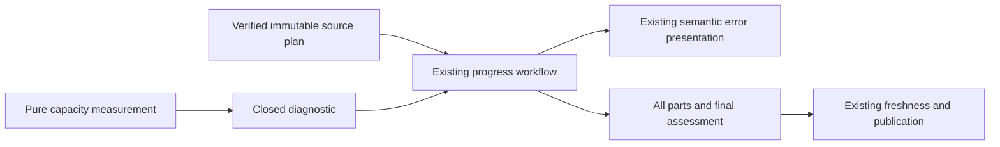

# Complete progress capacity and truthful continuation diagnostics

- Status: Implemented contract; local SDK qualification recorded below; exact-head delivery gates remain mandatory
- Date: 2026-11-04
- Catalog capability ID: `github-communication-experience`
- Owners: Copilot maintainers
- Scope: retain exact known capacity facts and immutable coverage context when a complete progress attempt cannot fit its existing bounds
- Related issue: [#851](https://github.com/vypdev/copilot/issues/851)
- Required review gates: architecture, security, complete evidence, operator UX, tests, documentation and exact-head delivery
- Open decisions blocking implementation: none; the closed schema and per-call-site attribution below are implemented

## 1. Executive summary

A complete progress comparison either runs every bounded source part and the
final assessment, or retains previous progress and reports the actual boundary
that prevented completion. File count alone cannot identify that boundary.
Known phase, dimension, unit, observed/required count and applicable limit MUST
survive to existing terminal/API/Check/Summary surfaces. Missing facts remain
explicitly unavailable. Automatic continuation remains invocation-local.

```text
pin comparison -> verify complete source -> preflight all bounds
 -> all bounded parts/rounds -> exact receipts -> final assessment -> freshness -> publication
 -> deterministic incapacity -> safe capacity/coverage facts -> retain previous progress
```

Text equivalent: all source and request bounds precede analysis; incomplete,
failed or stale attempts never publish a percentage or a partial checkpoint.

## 2. Problem and observed evidence

The original read-only native job is
[125000203225](https://github.com/vypdev/domus/actions/runs/41357362161/job/125000203225).
It resolves SDK source `3e7ceea08e6131360e026937d1c0cc1b120472e0`, pins assessment
base `3131810082760a98ee4af66f11bb65eaac49cc3b` and source head
`f835775b2f230db956750a224f8ebd6cc8bbbb5f`, then reports the fixed analysis
budget rejection. The event's before SHA is not the assessment base. No exact
failing dimension, count, limit, provider output or source-part manifest is
available for that original failure.

The reported 39 files/2,536 changed lines are review metadata, not progress
coverage. Subsequent reports describe new heads growing to 105 required paths
and four source parts, still without a concrete failing dimension. Separate
consumer test successes, real product defects and review-conversation limits
remain separate observations. No consumer rerun or retrospectively inferred
root cause is part of this correction.

At base `cc43f63fcb5ac21e4aedac8511d19b463e6dc853`, several source, scope,
prompt, manifest and fact guards still call the same parameter-free
`progressEvidenceTooLarge()`. Existing complete multipart and immutable-tree
protocols already enforce independent finite capacities. This companion closes
diagnostic gaps and qualifies their supported complete behavior; it does not
replace those protocols.

## 3. Actors and surfaces

The contributor supplies the complete issue and coherent comparison. The data
adapter owns validated immutable source facts. Application policies own exact
capacity measurements and admission. The workflow owns actual validated part
completion and publication freshness. The operator reads the existing run,
error, verification Check and Job Summary. Model output owns neither source
completeness nor authorization, execution or review evidence.

## 4. Requirements and invariants

| ID | Requirement |
|---|---|
| CAP-01 | Every attributable fixed-capacity rejection identifies its exact phase, dimension, units and known count/limit; unknown values are explicit. |
| CAP-02 | Preserve complete bounded processing and independent admission of source, manifest, original/replacement requests and final facts; no clipping or unchecked limit increase. |
| CAP-03 | Preserve immutable required-path/source identity and expose validated reviewed/uncovered facts only when available; never manufacture coverage from a subset or response-array length. |
| CAP-04 | Supported continuation processes the next bounded part/round in the same invocation; failure exposes bounded incapacity and never promises a durable resume handle. |
| CAP-05 | Retain previous progress and all source/body/native-owner/open/ref fences; provider, malformed, corrupt, stale and canceled failures keep their own identity. |
| CAP-06 | Use closed private-safe facts and shared English/Spanish presentation on existing surfaces, with no new timeline chatter, permission or configuration. |
| CAP-07 | Ship risk-derived regressions, documentation/catalog, generated package evidence and complete exact-head delivery gates with every modified line covered. |

Do not split coherent product scope, omit files, reduce acceptance requirements,
reclassify missing execution as complete or infer the original cause from the
number of review files. Capacity is independent of provider availability.

## 5. Before and after journey

| Point | Current gap | Required result |
|---|---|---|
| One serialization is too large | Generic fixed-budget failure | Measured serialized bytes and exact bound at its source phase |
| Full request envelope cannot fit | Raw evidence count obscures framing | Full host-envelope/reserve measurement and applicable phase |
| Complete fact/receipt reservation cannot fit | No concrete allocation information | Minimum/planned capacity and supported allocation, honestly labeled |
| Multipart succeeds | Existing complete processing | Every source and receipt retained through one final assessment/publication |
| Unsupported or interrupted attempt | Ambiguous continuation guidance | Explicit terminal incapacity or fresh-attempt recovery; prior progress remains |

## 6. Diagnostic and state contract

Define one pure, closed capacity diagnostic and one feature-owned semantic
recovery. Reuse nonretryable `validation.evidence-too-large`. Do not parse error
messages or provider text to classify a capacity boundary.

The schema MUST distinguish source serialization, source-part count, manifest,
original scope, native prompt envelope, dynamic reserve, minimum fact allocation
and aggregate capacity. Each dimension has an explicit compatible unit. Counts
are finite bounded nonnegative integers, with exact or lower-bound semantics;
unavailable values use one closed sentinel. Required/planned worst-case bytes
must not be described as an actual provider response size. Invalid caller
allocations cannot become invented negative/NaN usage facts.

The selected public variables are exactly `phase`, `dimension`, `unit`, `bound`,
`observedCount`, `supportedLimit`, `countKind` and `context`. Dimensions constrain
their permitted phase, unit and bound. A known maximum rejection requires an
observed/required count above its limit; a minimum rejection requires a count
below it. A stopped packing scan reports a lower bound, not an exact uncomputed
part total. An integer allocation outside a known range reports its actual
count and minimum/maximum; negative, fractional, nonfinite, unsafe or otherwise
unproven allocations have explicitly unavailable counts. Numeric
facts are nonnegative safe integers; that diagnostic bound does not change any
resource limit.

Context is a separately copied/frozen closed union: unavailable; an exact
original source-line ID; or a comparison with base/head, manifest digest (or
`none` when unavailable at this boundary), separate ordered required/accepted/
uncovered path-inventory digests, reconciled required/reviewed/uncovered totals
and up to eight safe path excerpts within 8,192 serialized bytes. Comparison
context also retains an applicable original physical `sourceLineId`, or `none`;
enrichment cannot discard a known source-line anchor. A verified empty
inventory is distinct from unavailable context. Shape validation does not prove
source attribution: only existing host owners may populate those facts.
Raw single comparisons have no accepted part receipts; they cannot report all
paths reviewed before the final assessment. A successful multipart receipt set
can identify all accepted paths without claiming execution or review passed.

The smallest qualified schema must also account for optional immutable coverage:
validated base/head identity, source-manifest identity where present, required,
reviewed and uncovered totals, and at most eight inert path excerpts. Counts
must reconcile when known. Unknown coverage remains unavailable rather than
zero. A header or an unvalidated receipt count does not prove coverage. Existing
path byte/escaping limits apply; raw source and rejected output never appear.

Public normalization copies/freezes facts and rejects unknown keys, reasons,
units, contradictory counts, unsafe identities and extra content. Legacy,
framed-v1 and immutable-tree-v1 retain their exact source/response contracts.
The existing immutable-tree inventory recovery and model response/length/scope/
completion recoveries retain their own meanings and shapes.

## 7. Configuration and fixed capacities

No new input, flag, permission, environment override or storage is introduced.
Preserve all current profiles and their independent finite accounting:

| Capacity | Existing bound |
|---|---:|
| Source part / manifest | 256,000 bytes each |
| Legacy parts / framed parts | 16 / 64 |
| Analysis rounds | 4 of 16 parts |
| Complete aggregate | 384,000 bytes |
| Complete native prompt | 524,288 bytes |
| Dynamic framing reserve | 1,024 bytes |
| Scope | 64,000 bytes; 32 required/uncertain and 32 excluded clauses |
| Original source | 1,024 nonempty lines; 1,200 code points per line |

Immutable-tree's 1,024 paths, 4,096 units, 512 units per part, 16 epochs,
16 MiB represented source, 2,048 reads, 200,000 entries and adaptive minimum
fact reservation remain unchanged. The original and worst complete final
replacement still fit before admission. A larger valid source allowance never
implies that arbitrary issue/schema/receipt framing fits a model request.

## 8. Clean Architecture



Text equivalent: pure owners report measured boundaries, orchestration adds
only context it can prove, and existing presentation renders a safe failure.
Existing complete analysis and publication stay with their current owners.

Reuse established policies/ports. Do not add provider DTOs, process/workspace
access, network writes or a parallel progress coordinator. Capacity catches
must be local to host planning/aggregation, so a provider-thrown lookalike does
not acquire false source facts or a recovery allowance. API declarations and
the error registry carry the same validated descriptor. Architecture, cycle,
port, type and privacy tests enforce these boundaries.

## 9. Operator UX and localization

Reuse textual status, impact, action, retained state, correlation and run links:

```text
Progress was not assessed; previous progress remains.
Boundary: complete partition request; native prompt bytes.
Required/planned: 524289; supported: 524288. Phase: partition, before admission.
Coverage: no new path assessment admitted; immutable source details available
only where independently validated.
Continuation: bounded parts run within one invocation. This boundary cannot
continue with the same allocation; no durable partial checkpoint was created.
Action: inspect this capacity and the pinned source. A runtime/capacity change
requires its normal reviewed design; do not omit acceptance or evidence.
```

Numbers are illustrative, not original incident facts. Translate known/unread
labels and recovery in English/Spanish with existing whole-artifact fallback.
Keep concise primary meaning and progressively disclosed technical facts;
sanitize paths as inert literal data. No color-only meaning, new layout,
browser permission or fresh VoiceOver campaign is needed for this backend fix.

Representative existing-surface variants (no new comment or cadence):

| State | Primary content and next action |
|---|---|
| Pending | “Collecting the complete pinned comparison. Previous progress remains; no action required.” Inspect the existing run link. |
| Parts in progress | “Assessing part 2 of 7. A final percentage follows only after every part and validation.” No partial percentage is published. |
| Capacity action required | “Progress was not assessed; previous progress remains.” Inspect the safe boundary details and report the complete workload with its run link. |
| Independent partial effect | “Branch publication completed; progress assessment did not complete.” The completed operation retains its own result; no blind write retry is proposed. |
| Complete | “Progress updated to 70% from the pinned comparison; execution remains unverified.” Inspect the issue and existing assessment/run links. |

These are illustrative plain-language views of existing status/result owners,
not new telemetry or assertions about the original incident.

## 10. Failure, continuation and cleanup

| State | Behavior and retained state |
|---|---|
| Complete supported source | Process every bounded part/round; validate all receipts and final estimate before publication |
| Known capacity exhausted | Nonretryable precise facts; retain prior progress; no unchanged-input automatic retry |
| Unknown/invalid capacity facts | Fail closed with explicit unavailability; never leak raw values or guess a dimension |
| Missing/corrupt/moved source | Existing evidence/stale identity; no partial final assessment or publication |
| Failed middle/last part | Provisional earlier facts remain invocation-local and are discarded on failure |
| Interrupted invocation | Fresh normal attempt recollects complete source/budgets; it does not resume old partial receipts |
| Final or publication failure | Preserve existing independent recovery and actual partial-effect classification |

Automatic continuation means the next bounded part/round in this invocation.
There is no durable cross-run checkpoint, new handle, reset ledger or automatic
provider retry. This companion does not add one. Retain compact source-bound
failure/acceptance evidence and the current rollback; retire duplicate owned
SDK/test artifacts after their consumer finishes.

## 11. Security and privacy

Repository text, issue prose, patches and model output remain untrusted. They
cannot select dimensions, capacities, source identities or publication policy.
Use bounded reviewed enums, safe counters, validated hashes and inert bounded
paths. No raw provider response, exception, source excerpt, credential or URL
enters the descriptor. No private consumer content is copied into fixtures.
Missing values must remain unknown, including in a caller that bypasses an
adapter. These diagnostics never authorize mutation or certify tests/review.

## 12. Observability and provenance

Keep the existing correlation and exact comparison/run navigation. Distinguish
actual serialized bytes, planned worst-case envelope/reserve, source inventory,
validated model receipts and reported consumer execution. Do not label current
SDK fixtures as a replay of the unknown original request. No new telemetry,
timeline notification, source journal or rejected-response retention is needed.

## 13. Compatibility, rollout and rollback

Preserve provider failure identity, locale/schema/output constraints, source
selection, native owner/base/head/body/open fences, old assessments and both
independent replacement allowances. A diagnostic-only change cannot grant
repartitioning, extra requests or a new profile. Any necessary supported-plan
adjustment requires proof of exact source conservation and all existing bounds.
Rollout rebuilds all shipped bundles/declaration closure through the ordinary
PR and later patch workflow. Develop merge alone does not update the released
consumer pin. Rollback restores the older diagnostic gap; no state migration.

## 14. Numeric test budget

Minimum **80 new distinct cases**, counted once:

| Area | Minimum | New executed cases | Risks |
|---|---:|---:|---|
| Pure closed diagnostics and coverage facts | 28 | 99 | Keys/types/finite counts/units, unknown versus zero, source/path safety and contradictory coverage |
| Attributable capacity boundaries | 22 | 32 | Serialization, parts, manifests, source bounds, whole original/replacement envelopes, reserves and facts |
| Workflow/publication integration | 14 | 16 | Complete 39-file multipart control, unavailable/corrupt/stale/over-budget/late failure, prior progress and freshness |
| Presentation and packaged public API | 10 | 15 | EN/ES/fallback, known/unavailable counts, inert paths, serialization and declaration closure |
| Protocol/profile and recovery compatibility | 6 | 7 | Legacy/framed/immutable complete control, independent part/final replacements and no durable partial replay |
| **Total** | **80** | **169** | Every distinct case counted once |

Prove meaningful diagnostic regressions fail before correction. Complete
controls may already pass; do not call those an original consumer failure
reproduction. Prefer real shared entrypoint/workflow/adapter boundaries with
deterministic external transports. No live model, consumer mutation or timing
oracle. Require 100% new pure-policy metrics, every modified coverable line hit
with zero partials locally and in official Codecov, and all existing budgets,
ledgers, root/extension/platform/architecture/package gates.

Baseline `cc43f63` executes five cases in
`src/tooling/__tests__/progress_capacity_failure.test.ts`: four fail because
source-unit bytes, legacy part count, native scope envelope and aggregate
reservation discard their known facts. The synthetic 39-file control already
preserves every source byte in two bounded parts and passes. These are SDK-owned
boundary observations, not a reproduction of the original unknown dimension.
They count toward this budget once: four boundaries and one previously
supported compatibility control. Existing amended assertions and package smoke
checks do not inflate the new-case count.

Current full local qualification passes **899 suites / 17,599 tests**, with 35
preexisting platform skips, plus **267 extension tests** at 100% in all four
metrics. All six new runtime modules measure 100% lines, statements, branches
and functions. Full-suite LCOV covers **239/239 modified coverable lines** with
zero misses or partials against `cc43f63`. Existing coverage budgets and the
acceptance ledger pass; 14 preexisting human setup acceptances remain recorded.
These local results do not substitute for official Codecov or native PR gates.

The real 99-file local tarball passes CLI, typed API and isolated web-session
smoke. Its new declaration closure compiles with readonly nested context;
seven actual runtime descriptors and invalid-field rejection are checked.
No package publication or consumer rerun is claimed. A focused test subset
cannot satisfy the global coverage gate; repository thresholds stay unchanged.

## 15. Documentation

Update branch-management progress guidance, agent execution contract and the
operator error reference/troubleshooting with concrete capacities, the meanings
of measured/planned/unknown, supported invocation-local continuation, terminal
incapacity and retained state. Link this companion from the owning progress
contract/catalog and regenerate `specs/CATALOG.md`. No setup input changes.

## 16. Executable acceptance

A complete supported multipart comparison covers every required path and receipt
before one final assessment and publication. An over-budget preflight makes no
model/publication calls and reports its actual attributable boundary. A failed
late part never reaches final assessment. Missing/corrupt/moved/foreign evidence
and provider failure retain their own identity and prior progress. Replays use
fresh source/attempt/budgets, not partial state. Public output has no rejected
text, unsafe path, invented original count or false continuation promise.

## 17. Traceability

| Requirements | Executable owner/evidence | Documentation |
|---|---|---|
| CAP-01, CAP-06 | Closed diagnostic, measured caller guards, semantic error/presentation contracts | Error reference/troubleshooting |
| CAP-02, CAP-04 | Existing partition/protocol/prompt/receipt/final controllers plus new complete/over-budget regressions | Branch progress and execution contract |
| CAP-03, CAP-05 | Source/receipt completeness, actual workflow state, stale/provider/no-publication integration | Primary recovery contracts |
| CAP-07 | Full local/package/normal-hook and exact-head native review/coverage receipts | This SDD/catalog |

Dedicated new suites are `progress_capacity_diagnostic.test.ts`,
`progress_capacity_context.test.ts`, `progress_capacity_boundaries.test.ts`,
`progress_capacity_public.test.ts`, `progress_capacity_profiles.test.ts`,
`progress_capacity.integration.test.ts`, `progress_capacity_adapter.test.ts`
and `progress_capacity_failure.test.ts`.
The catalog records their complete repository paths. Final executed counts and
exact-head delivery receipts accompany the PR; supported SDK fixtures do not
establish the unknown original consumer cause or consumer execution success.

## 18. Implementation sequence

Read immutable failure evidence and current contracts; qualify diagnostic and
coverage attribution; write failing regressions and passing complete controls;
implement smallest shared closed policy and local caller mapping; preserve
bounded continuation/source guards; align docs/catalog; update Graphify/builds;
run full coverage/package/normal hooks; publish exact managed branch; resolve
genuine findings and obtain complete current-head delivery gates.

## 19. Definition of Done

All seven requirements and the 80-case floor have measured evidence. Existing
capacities, source ownership, privacy, completion and publication remain. Docs,
catalog, generated package and declarations agree. All applicable technical
checks, complete current-head review without open findings/native threads and
official Codecov 100% modified coverable lines without misses/partials pass
against the live correct base before ordinary authorized merge. Verify native
issue closure and preserve only necessary evidence/current SDK rollback.

## 20. References and decisions

- [Original issue and all additional native reports](https://github.com/vypdev/copilot/issues/851)
- [Immutable recovery and framed continuation](immutable-progress-content-recovery.md)
- [Complete inventory/profile](complete-progress-comparison-inventory.md)
- [Original scope ownership](progress-scope-source-ownership.md)
- [Part-response recovery](progress-partition-response-recovery.md)
- [Final-assessment recovery](final-progress-completion-recovery.md)

Invocation-local continuation and explicit bounded incapacity are selected;
durable checkpointing, unchecked larger limits and reduced coherent scope are
excluded. The original exact failed dimension remains unknown until evidence
establishes it. SDK regressions must retain that provenance distinction.

## 21. Acceptance batch profile and publication eligibility — #916

`specs/batched-progress-scope.md` defines the reviewed finite extension. Each
classification request owns up to 32 source lines. An attempt supports up to
256 obligations and 256 exclusions, with 32 obligations per assessment. The
human scope and identity projection has a 262,144-byte ceiling. The admitted
native evidence ledger retains the existing immutable comparison profile and
its independent source, unit, byte and recovery limits. Request acceptance data
retains the 64,000-byte envelope. Complete native prompt preflight remains
524,288 bytes, including schema and framing.

One ledger covers at most 120 agent calls and 1,800,000 elapsed milliseconds,
including the existing bounded repairs. The same-head receipt gate requires a
complete compatible outcome for every obligation before aggregate reduction and
the existing publication fence. Both public assessment fields remain bounded
at 8,000 Unicode points. Larger aggregates use compact original source references
while the host retains their full original text and authority.

`progress-batch-retained` provides closed reasons, verified and expected batch
counts, the failing assignment and a safe requirement ID. Incomplete attempts
retain previous progress. Capacity does not authorize publication of a subset.
The original direct single-assessment capacity diagnostic remains available.

Measured deterministic Domus replay classifies 300 human lines in 10 requests,
retains all 157 paths and 16 comparison parts, and assesses 108 fixture obligations
in four groups. It uses 30 agent-port calls with zero real model calls. The
fixture's 50 percent response exercises the protocol. It does not establish
consumer implementation progress. Historical rejection and candidate results
remain distinct evidence on the implementation PR.

Each receipt retains the existing per-assessment fact and 8,000-point field
envelopes. The host reserves all original source references and minimum facts
before requests and supplies a preferred per-requirement text target. Individual
facts may vary within their assessment envelope. The reducer checks the actual
complete summary and remaining projections against 8,000 Unicode points each.
An oversized aggregate retains previous progress. Each assessment prompt states
its hard per-fact limit and the shared aggregate target. Incomplete estimates
retain their card value and use percentage labels capped at 95 percent, preserving the completion
invariant across the issue and PR label adapters.

Classification receipts bind their assigned span IDs to a source snapshot digest,
assignment identity and evaluated head. The final manifest retains the complete
classified span inventory in original source order. Every classification batch
receives complete human context, including published draft case qualifiers, while
its response schema owns only its assigned IDs. Requirement evidence cites an
admitted regular source observation. Generated metadata remains supplemental
comparison context. Source and receipt reordering preserve the aggregate identity.

Evidence extraction shares its complete comparison facts when the whole acceptance
view fits the existing 64,000-byte request envelope. Larger coherent views use
bounded requirement groups against the same frozen comparison. Every group retains
all assigned requirements, exclusions and comparison parts. The host preflights the
entire repeated-evidence plan against the same 120-call limit before collecting
those facts. The pinned Domus fixture retains the shared 30-call path.

Citation arrays use the provider-compatible native array shape with `minItems`
and `maxItems`. The host enforces citation uniqueness and same-head resolution
before accepting any receipt. The deterministic native-projection regression
excludes the unsupported `uniqueItems` keyword while duplicate citations still
reject the whole attempt. A minimal native schema probe reproduced the provider
rejection with that keyword and accepted the same closed shape without it.

Large evidence dictionaries retain their complete enum in the host acceptance
schema. The existing Codex projection omits a native enum that exceeds its
1,000-value request budget or the 15,000-point string budget for enums with over
250 values. Exact local membership and same-head citation validation still apply
to every response. `specs/agent-execution-policy-hardening.md` records the shared
provider adaptation and its deterministic boundary cases.

The assessment response schema and receipt prompt expose only admitted
non-generated evidence IDs. The complete comparison and host manifest retain
generated metadata as supplemental context. A comparison containing exclusively
generated metadata has no admissible primary citation and retains previous
progress before an assessment request. The host also rejects forged generated
citations from an alternate query port and repeats that check during aggregate
publication eligibility, including receipts with recomputed digests.
