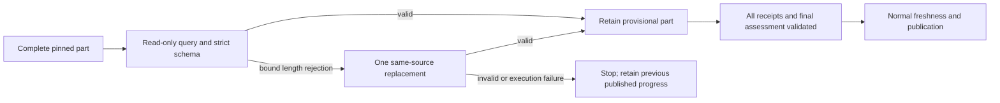

# Bounded Progress Partition Response Recovery

- Status: Implemented candidate; remote acceptance pending
- Date: 2026-11-02
- Catalog capability ID: `github-communication-experience`
- Last verified: 2026-11-02 local full validation; remote acceptance pending
- Owners: Copilot maintainers
- Scope: One bounded replacement for a completed, attributable over-length file fact, preserving the complete immutable comparison and all output limits.
- Related issues/PRs: [#830](https://github.com/vypdev/copilot/issues/830), [#837](https://github.com/vypdev/copilot/pull/837)
- Required review gates: product UX, architecture, testing, documentation, security/operations
- Open decisions blocking readiness: none

## 1. Executive summary

A complete comparison MUST NOT be discarded immediately because one returned
file description exceeds its unchanged output limit. For a completed and
host-bound length rejection, request one concise replacement for that same part.
Every part and final assessment still require normal validation before any
progress publication. Persistent overflow MUST report its exact part, file,
unit, field and observed/maximum Unicode code-point counts without model prose.

```text
Complete immutable comparison → part response → validate → one bounded replacement if eligible → validate every part → final assessment → normal publication, or retain prior progress.
```

## 2. Problem, current behavior, and evidence

### 2.1 Problem

Commit users see `schema-string-long` with a file-array position but no useful
file or count. Repeating the whole run can repeat the same failure.

### 2.2 Current behavior

The JSON adapter knows the parsed output, schema location and maximum, then
reduces a partition failure to the existing five-field rejection. The
application stops at the first rejection. The complete source and old progress
remain intact; no percentage is published.

### 2.3 Evidence

- #830 reports the original consumer and exact run.
- #837 at `7acba0ccfbb9c1cba44c1450531f0905075fd476` reproduced the same field
  failure in two attempts of run 41359130890.
- At `15830271cae1975771ccc5c6fa8f96767f314f28`, run 41362598129 obtained
  895 complete paths in 31 source parts, then rejected a remaining fact.
- Candidate `3ecade315` passed complete review without findings. Both attempts
  of run 41414634366 then rejected a separate final assessment with
  `progress-completion-mismatch`. Raw output was correctly unavailable; the
  exact contradictory direction is not established. The existing prompt stated
  the completion condition in one direction while the host enforces both.
- Owners: `src/data/repository/progress_agent_response_policy.ts`,
  `src/application/policies/progress_partition_response_policy.ts`, `src/application/usecases/actions/summarize_progress_diff_workflow.ts`.
- No external API or protocol change is proposed. The actual rejected prose
  and original generated length were not exposed by those historic diagnostics.

### 2.4 Retrospective classification

Not applicable: this is a prospective recovery companion, not an as-built claim.

## 3. Actors, surfaces, and terminology

| Actor | Goal | Entry point | Visible surfaces |
|---|---|---|---|
| Contributor | Complete an eligible comparison | Commit/PR progress | Existing progress and verification check |
| Operator | Locate a rejected fact | Failed run | Check, Job Summary, CLI, sanitized log |
| Application | Preserve exact source and acceptance | Planned part | Narrow findings-query port |

A **replacement** is a second read-only model request within the same part and
attempt. It is not a new comparison or reuse of a partial result across attempts.
An **attributable** failure has a current host-matched part, path/unit pair,
locale, field and selected bound. Array position alone never proves identity.

## 4. Goals, non-goals, and fixed invariants

| Requirement | Observable contract |
|---|---|
| PL-01 | Capture bounded completed-output length facts and bind actual returned identity to the exact host assignment. |
| PL-02 | Allow at most one replacement per eligible part with unchanged source, schema, model configuration and deadline handling. |
| PL-03 | Preflight original and replacement prompts for every part before the first model request; keep all capacities unchanged. |
| PL-04 | Validate every receipt and final assessment; failed, stale or canceled work never publishes a partial percentage or mutates old progress. |
| PL-05 | Expose precise localized operator facts for persistent attributable overflow without raw output, guessed names or extra comments. |
| PL-06 | Preserve legacy/framed/immutable-tree, non-progress schema behavior, review, approval and coverage gates. |

No truncation, model-message regex recovery, source omission, extra source
collection, new flag, credential grant, approval exemption, release or deploy
belongs to this change. A schema maximum or completeness proof cannot weaken.

## 5. Current versus proposed product journey

| Stage | Current | Proposed |
|---|---|---|
| Valid part | Continue normally | Unchanged |
| Attributable length rejection | Stop immediately | One preflighted replacement of the same part |
| Persistent attributable overflow | Position-only failure | Part/file/unit/field/count diagnostic |
| Unbound or unrelated failure | Existing rejection/execution handling | Unchanged; no guessed recovery |



Text equivalent: validate a current part, replace an eligible rejected response
once, validate all provisional results, then use normal publication or stop.

## 6. Functional behavior and state model

1. Plan every original and replacement prompt against the unchanged runtime
   envelope and scope reserve, before any progress model call.
2. Query the original part through the existing read-only semantic port.
3. Only a typed completed-output length failure with exact current identity,
   locale and maximum may enter replacement. Do not infer eligibility from text.
4. Request the same complete source and schema with a fixed concise-response
   instruction. Never include the rejected body in that prompt.
5. Revalidate the replacement normally, including exact unique assignments and
   protocol/source receipts. Earlier accepted parts stay provisional in memory.
6. A second attributable overflow reports its own actual file and counts. An
   unrelated schema, locale, execution or cancellation failure keeps its category.

The final assessment prompt MUST state the existing completion equivalence in
both directions: all requirements supported with null remaining means exactly
100; any missing/unknown requirement with nonempty remaining means below 100.
Choose statuses before the estimate. The host validator MUST remain unchanged:
neither contradictory result may be normalized, accepted or automatically
repaired. Source-visible implementation and independently required execution
retain their existing distinct evidence/status rules and approval gates.

| State | Meaning | Next |
|---|---|---|
| Planned | Both possible requests fit | Initial query |
| Response rejected | No fact was accepted | Bound replacement, or normal failure |
| Replacement pending | One additional query; no human action yet | Strict validation or failure |
| Part accepted | Provisional; no new percentage | Remaining parts/final assessment |
| Failed/canceled/stale | No partial publication | Operator inspection or fresh normal attempt |
| Complete | Entire assessment passed freshness/publication | Existing completion surface |

Duplicate events and supersession retain existing owners. No partial facts,
repair allowance or result are persisted for replay into a different attempt.

## 7. User-facing configuration

There is no new input, environment override, secret or permission. The fixed
default is one eligible replacement; the alternative outcome is a normal
fail-closed error when attribution or capacity is unavailable.

The selected fact maximum remains the existing budget-derived value, at most
600 code points. The immutable profile retains its own minimum. Source/frame/
part/aggregate limits, final-assessment scope, prompt ceiling, execution
configuration and cancellation deadlines are unchanged and not configurable here.

## 8. Clean Architecture design

| Boundary | Owns | Forbidden |
|---|---|---|
| Domain | Closed scalar context/diagnostic | Provider DTOs, IO, raw returned prose |
| Application policy | Exact current assignment/locale/bound decision and replacement prompt | SDKs, process or storage access |
| Application workflow | One replacement and existing failure mapping | Source collection, publication or capability escalation |
| Data adapter | Strict parsed-output mapping and code-point count | Guessing the current host path/unit association |
| Existing presentation | Localized impact/action/retained state | Retrying or accepting model results |

The adapter may recognize a schema-admitted candidate path/unit, but application
binding MUST verify the pair against the immutable part. Unknown/unsafe
diagnostic metadata keeps the existing identity-unknown failure. No raw body or
provider exception text becomes a recovery variable.

Existing architecture tests enforce inward imports, semantic query ports and
module budgets. The adapter schema, recovery normalizer, prompt-envelope tests
and end-to-end progress fixtures enforce these boundaries executably.

## 9. UI/UX and content contract

Reuse the existing localized error view, correlation/run links, headings,
escaping and progressive technical disclosure. Add no comment or new layout.

| State | Primary content |
|---|---|
| Pending | Assessing the current immutable part; no action required. |
| Replacement pending | One response exceeded its unchanged limit; one bounded replacement is being requested. Existing progress remains. |
| Earlier parts complete | Partial internal work is provisional; no percentage is published. |
| Action required / failed | The replacement still exceeds its limit. Inspect the named part/file/field; produce output satisfying the same schema. |
| Complete | Normal validated progress and existing publication links; no extra warning. |

```text
Impact: A progress part still exceeds its response limit after one bounded
replacement; progress was not published.
Action: Inspect part part-7, file src/example.ts, unit unit-21,
field $.files[0].implemented: observed 618 Unicode code points; maximum 600.
Retained state: Existing progress labels and assessments were preserved.
```

Values are illustrative. The real selected bound and returned counts are
required. Keep textual status/action, narrow-readable content, native catalog
fallback and existing Markdown/HTML/mention sanitization. Do not expose model
body, stack, credentials or an unverified path to improve the message.

## 10. Failure, recovery, and cleanup

| Failure | Recovery | Retained facts |
|---|---|---|
| Bound completed overflow | One same-part replacement | Complete immutable source; old published progress |
| Second bound overflow | Precise closed diagnostic; no third call | Old progress; no new percentage |
| Foreign/malformed identity or unrelated failure | Existing handling; no length-based recovery | No invented attribution |
| Replacement cannot fit prompt capacity | Stop before any model request | Existing source/capacity contract |
| Transport/process/cancellation failure | Preserve original category | No assumed completed result |
| Source changes before publication | Existing freshness rejection | Provisional facts discarded |

No irreversible effect occurs before normal publication. Temporary request
context and provisional facts retire with the attempt; retain compact test and
failure evidence, not rejected response bodies.

## 11. Security, permissions, and privacy

Use the same least-privilege query capability. Repository text, source and model
output remain untrusted. Typed errors are not authority: host matching and closed
diagnostic validation remain mandatory. Do not run source or request new reads,
commands, grants or credentials. Do not log the rejected fact to count it.

## 12. Observability and operational UX

Emit at most one fixed recovery-state log record per replaced part, with no
captured error or returned text. Persistent failures expose the validated bound
identities, field and numeric counts through the shared error presentation and use
`progress-partition-length-invalid`; other rejections keep existing IDs.
Existing correlation and run navigation remain. This flow creates no comment,
extra notification or optional check, and cannot turn partial progress into
approval. Retryability of a fresh attempt remains separate from the exhausted
single replacement within the current attempt.

## 13. Compatibility, migration, rollout, and rollback

No stored-state or response-schema migration. Legacy parts and both framed
profiles keep exact receipts and limits; single-part and non-progress tasks keep
their established behavior. Rebuild Action/CLI/API bundles normally. Deploying
or releasing those bundles is outside this work. Rollback restores immediate
rejection while preserving prior progress; no credentials or data need repair.

## 14. Testing strategy and numeric budget

| Area | Minimum distinct cases | Risks |
|---|---:|---|
| Pure identity/bound policy | 9 | Current versus foreign part/path/unit/locale, malformed facts, unchanged limit |
| Application/state/replacement | 8 | Both fact fields, first/later part, persistent overflow, provider/cancel failure, no third call |
| Adapter/schema | 8 | Code-point count, exact schema identity, missing/unsafe metadata, unrelated task compatibility |
| Whole-prompt capacity | 4 | Original/replacement reserve, later-part preflight, zero calls on overflow, single-part compatibility |
| Product presentation | 4 | English/Spanish facts, no raw output, closed variables and escaped text |
| Complete publication integration | 3 | Successful complete aggregation, failure retains labels, stale result never publishes |
| **Total** | **36** | Distinct cases, beyond existing budgets; no matrix/replay double counting |

Require 100% new pure-policy branches and every modified coverable line with no
partials in Codecov against the correct live base. Preserve repository-wide
thresholds, complete progress/architecture/localization tests and all platform
checks. Use deterministic native-adapter/query doubles, Unicode fixtures and
semantic rendered-output assertions, not real provider waits or prose grep.
Review the actual localized check/summary text for readability; existing renderer
behavior needs no new browser, VoiceOver or permission campaign.

## 15. Documentation and discoverability

Update the execution contract, branch/progress recovery guide and error
reference. Link this focused companion from the existing immutable recovery
owner and capability catalog; generate the catalog and validate specifications,
documentation and docs-page contracts. Explain normal recovery, fixed limits,
unknown identities, retained state and rollback without asking consumers to
weaken their requirements.

## 16. Acceptance scenarios

1. An over-bound implemented/remaining fact receives one conforming same-schema
   replacement, all immutable parts remain, and normal final assessment proceeds.
2. A later part needing replacement does not restart or lose earlier parts.
3. Persistent overflow reports actual part/path/unit/field/counts, performs no
   third call, publishes no new percentage and retains old labels.
4. Wrong binding, locale, count or untyped lookalike errors cannot authorize repair.
5. Replacement capacity failure causes zero model requests; provider/cancel errors
   retain their original category, and a moved source prevents publication.
6. Localized operator output contains the exact safe facts and retained-state
   action without returned prose, unsafe markup or configuration changes.

## 17. Requirements traceability

| Requirement | Owner | Evidence | Documentation |
|---|---|---|---|
| PL-01 | Adapter/domain/binding policy | Length mapping and policy tests | Error reference |
| PL-02 | Partition query workflow | Native-adapter integration and execution-failure cases | Execution contract |
| PL-03 | Complete prompt planner | Capacity and zero-query fixtures | Contributor/recovery guide |
| PL-04 | Existing aggregate/freshness/publication | Complete CheckProgress integration | Progress guide |
| PL-05 | Recovery normalizer and existing catalogs | English/Spanish semantic output and sanitization | Error reference |
| PL-06 | Existing protocol and architecture owners | Legacy/framed/immutable, full suites, bundles and Codecov | This companion and original recovery owner |

## 18. Implementation sequence

Reproduce real adapter rejection; add closed diagnostic and host binding; add
preflighted one-replacement orchestration; preserve failure projection; add
product output, documentation and catalog evidence; run full tests/coverage,
Graphify, normal bundles/hooks and current-head remote review.

## 19. Definition of Done

- [ ] Every requirement has executable acceptance and all 36 risk cases pass.
- [ ] Inward dependencies, semantic ports and module budgets pass.
- [ ] Source, response, prompt, configuration, deadline and publication gates remain.
- [ ] Localized primary states, exact diagnostics and sanitization pass.
- [ ] No raw model data, partial percentage or approval bypass is introduced.
- [ ] Documentation, catalog, generated bundles and all validation are current.
- [ ] Current-head applicable checks, full review without open findings, correct-base
  Codecov 100% modified lines with zero misses/partials and required human approval pass.
- [ ] Cleanup preserves current evidence and rollback; no open design decision remains.

## 20. References and decisions

The existing owners are `specs/immutable-progress-content-recovery.md` and
`specs/complete-progress-comparison-inventory.md`. This companion adds only
same-attempt returned-part length recovery. Preserve their source and acceptance
contracts. Reject silent truncation, larger output limits, guessed positional
identity, workspace execution, incomplete comparison and blind full-run retries.
Final assessment overflow, unsupported capacity and unrelated findings remain
separate work; this change grants no release or deployment authority.
