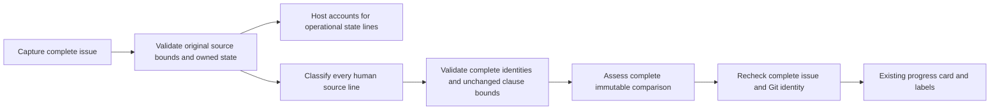

# Progress acceptance scope and persisted state ownership

- Status: Ready for implementation
- Date: 2026-11-01
- Catalog capability ID: github-communication-experience
- Owners: Copilot maintainers
- Scope: Preserve every human acceptance line while keeping persisted Copilot state out of model-defined requirement identities.
- Related issues: [#828](https://github.com/vypdev/copilot/issues/828), dependency for [#841](https://github.com/vypdev/copilot/pull/841).
- Review gates: source ownership, architecture, security, diagnostics, coverage, documentation and exact-head native review.
- Open decisions blocking readiness: none.

## 1. Outcome and fixed invariants

The complete issue snapshot remains the freshness authority. The host accounts
for its physical lines and separates one recognized, valid persisted
configuration block as operational context. The classifier must classify every
remaining nonempty human line exactly once. Only those lines can receive R/X
identities. Generated implementation-plan state cannot create extra acceptance
requirements or consume the 32-clause requirement budget.



Text equivalent: capture and bound the full original source; account for valid
operational state separately; classify all human lines; validate all original
human identities; assess all evidence; recheck the full snapshot before updating
existing progress. No truncated source, partial assessment, automatic repair or
new model invocation is introduced.

## 2. Observed evidence and limitations

Baseline `a032f500d67a91ea69f653d6fea08bec5e117fd6` sends every nonempty
physical issue line to the classifier, including hidden generated configuration.
`parseProgressScopeWithAnchors` allows any returned source ID to become a
requirement. A valid-looking classification of generated plan rows can therefore
exceed the unchanged 32-clause bound.

PR #841 head `842ba24f6547ff512b2e58c0d4b2d75384e5e36d` failed in
[Commit run 41305406177](https://github.com/vypdev/copilot/actions/runs/41305406177)
with `scope-clause-limit`, first crossing source `L125`, reference
`95648af5-551d-460c-b127-45b6c0d451ba`. Its subsequently captured issue snapshot
has 111 nonempty lines, with persisted state at physical L75–L134; L125 is in
that state. The original completed model response was not retained: the actual
selected total is unknown beyond at least 33. This observation is not proof that
metadata classification is the only live failure cause. Synthetic protocol
regressions separately prove the missing host ownership boundary.

The same issue can still exceed the supported human scope, be semantically
ambiguous, or receive invalid model output. Structural completeness does not
prove natural-language interpretation, execution, CI or merge approval.

## 3. Actors, surfaces and terminology

| Actor/surface | Responsibility |
|---|---|
| Issue author | Defines normative acceptance in human issue text. |
| Host source policy | Preserves physical identities, enforces bounds and identifies reserved persisted state. |
| Classifier | Classifies all admitted human IDs; has no authority to redefine operational ownership. |
| Maintainer / Check / Summary | Inspects exact phase, count, limit and source anchor; corrects unsupported or ambiguous scope. |
| Existing progress publisher | Rechecks complete original body and native refs before updating one card/label set. |

**Human line** means a nonempty original physical line outside the recognized
state span. No keyword, language, heading, report identity or prose-length
heuristic removes a human line. **Operational state** means the one complete
block recognized by the existing persisted-configuration delimiter scanner,
containing a JSON object with the currently supported schema version.

## 4. Source and configuration contract

- The original 1,024-nonempty-line and 1,200-code-point-per-line guards apply
  before separation, including operational lines. Oversized metadata cannot
  become an input-limit bypass.
- Reuse the persisted-state scanner, including its supported complete legacy
  fenced records. Ordinary marker mentions, unrelated HTML comments and text
  outside the owned span remain human source. Preserve exact qualifier,
  negation, Unicode, repeated-text identity and CRLF physical line numbering.
- Duplicate, nested, dangling or ambiguous owned delimiters fail closed.
  Invalid JSON, null/array state, absent or unsupported schema versions fail
  before classifier/evidence/final calls; retain existing progress.
- The supported configuration version has one domain owner, with the existing
  model constant and manager scanner imports kept compatible through exports.
- Every human line is classified once under the existing strict ID schema.
  Operational IDs cannot be returned as required, excluded or context entries:
  they are absent from the model ID enumeration and already host-accounted.
- Required plus uncertain lines retain the 32-clause bound; exclusions retain
  their independent 32 bound. Genuine human 33-clause scope still fails.
  Nonempty prose, 64,000-byte scope, 800-point fact ceiling, derived #829 field
  reservation, 8,000-point projection and all current evidence/runtime budgets
  remain unchanged.
- Full issue text remains untrusted context in evidence/final requests and the
  complete byte-for-byte snapshot remains the freshness check. A state-only
  concurrent body edit invalidates the assessment too.
- There are no new user inputs, credentials, permissions, overrides, migrations,
  settings, timers or retry loops. Unknown future schemas require normal reviewed
  adoption. This change does not publish a release or deployment.

## 5. Architecture and state ownership

| Boundary | Owns | Forbidden responsibilities |
|---|---|---|
| Domain | Shared delimiter scanner/version and closed count diagnostic facts | Provider, model invocation or persistence |
| Pure application policy | Whole-source guards, operational span accounting, immutable human IDs, clause validation | Manager/provider imports, file or network I/O |
| Progress use case | Existing sequential scope/evidence/final flow and safe measured source counts | Changing acceptance or bypassing freshness |
| Prompts/native response adapter | Untrusted framing and exact admitted schema identities | Inventing requirements or trusting execution claims |
| Presentation | Localized safe count/limit and recovery content | State mutation or raw source/provider prose |
| Configuration manager | Existing persistence through compatible shared-domain exports | A second divergent delimiter implementation |

The domain scanner is relocated without changing its delimiter behavior; existing
manager imports remain compatible. Dependency/architecture tests, typecheck,
strict native schema tests and the complete existing scanner tests enforce this
boundary. All new policy/diagnostic runtime lines require 100% measured coverage,
with every changed coverable line hit and no partial branches. No exclusions or
existing thresholds are reduced.

## 6. Failure and recovery UX

Pending: “Assessing human acceptance against the complete current comparison.
Previous progress remains available.” Existing surfaces and notification budget
are retained; no new timeline chatter is necessary.

An over-limit complete classification reports safe host-derived facts, for
example:

```text
Progress scope could not be assessed. Previous progress was retained.
Selected required/uncertain lines: 33; supported limit: 32.
First crossing original source: L41; phase: scope.
Inspect the original human scope and classifier result. A fresh valid
classification can help; do not remove requirements or raise limits to pass.
```

The actual count follows complete validated unique source classification; the
limit is exactly 32 and the kind is a closed required/uncertain-or-excluded value.
No raw rejected JSON, human prose, paths, credentials or arbitrary keys become
recovery variables. Native response adapters that reject before host source
validation retain their existing bounded diagnostic; no count is guessed.
Malformed operational state uses the existing configuration-error family and
requires repair before a fresh attempt. Successful source assessment still
leaves CI, actual execution, Bugbot, Codecov and human approval independent.
English and Spanish recovery messages remain bundled; other locales retain the
existing complete fallback. Plain text, headings and concise rows remain usable
in narrow Checks/Summaries without color or hover-only meaning.

## 7. Testing budget and traceability

Minimum **60 distinct new cases**, excluding relocated existing scanner tests:

| Area | Minimum | Required behaviors |
|---|---:|---|
| Pure source ownership | 30 | Recognized/absent state; valid legacy fence; ordinary examples; before/after human lines; repeated text; CRLF; Unicode; complete raw bounds; invalid marker/JSON/version states. |
| Scope/schema contract | 6 | Complete human IDs, operational injection rejection, 32/33 required and excluded bounds, immutable source anchors. |
| Diagnostic/presentation | 12 | Safe exact counts, kind/limit/anchor validation, forged values, EN/ES/fallback and no raw prose. |
| Native/application integration | 12 | Single/multipart success, strict native schema, zero calls on invalid source, old state retention, full-body metadata races, fresh retry and genuine over-limit scope. |
| **Total** | **60** | Parameterized rows count once only for distinct behaviors. |

Use synthetic consumer-neutral fixtures, fake model outputs and actual strict
native response validation. No live inference or operating-system timing is an
acceptance oracle. Prove the source-ownership regression fails against the
baseline before fixing it; preserve pre-fix results separately. Run complete
Jest/extension coverage and enforced ledgers, build/package, types/lint,
architecture, documentation/specification validators and Graphify.

| Requirement | Evidence | Documentation |
|---|---|---|
| Account for all original source without operational promotion | Source-policy and complete human-ID schema regressions | Branch progress source ownership |
| Preserve full original guards and identity | Exact/one-over and before/after-span tests | Fixed source limits |
| Reject malformed/unknown state before querying | Pure and native zero-call tests | Configuration recovery |
| Keep real scope bounds and safe facts | 32/33 and closed diagnostic/presentation tests | Error reference and troubleshooting |
| Preserve prior progress and exact snapshots | Single/multipart rejection, state-only race and fresh-attempt integration | Retained-state semantics |
| Preserve persistence/API compatibility | Existing manager scanner/configuration suites plus re-export and type checks | Architecture and no user migration |

## 8. Documentation, rollout, rollback and DoD

Update the owning communication SDD, this companion, catalog paths and generated
index together. Document source ownership and unchanged bounds in branch progress,
closed count facts in the error reference, recovery in troubleshooting, and shared
scanner ownership for contributors. Run `validate:specifications` for each SDD/
catalog change and regenerate the catalog index after metadata changes.

Implement source/policy and failing regressions first, native flow/diagnostics
second, then documentation/catalog, generated bundles and full verification.
Normal PR rollout atomically adopts schemas, parsers, prompts and bundles.
Rollback restores the prior source/bundles; no stored state or progress-card
migration occurs. Existing assessments remain historical model estimates.

Completion requires all traceability rows, the risk-derived budget, full coverage,
no open findings, a complete current-head review and all applicable checks passing.
Codecov must report 100% modified coverable lines with zero partials against the
live correct base; a configured lower threshold is insufficient. Human protected
approval is a separate exact-head decision. Local passing tests alone do not
certify the dependent PR or authorize its merge.


Historical report provenance: the [complete original public incident reports](./evidence/issue-828-reports.txt)
retain all 21 captured reports, source identities, timestamps and byte hashes.
Repeated observations and reported consumer test counts remain historical data;
they do not count toward this change's test budget or independently prove live
model causality. Normative source ownership and acceptance remain in this SDD and
the issue. The existing shared comments are untouched; any concise replacement
requires explicit human permission and per-comment concurrency checks.
