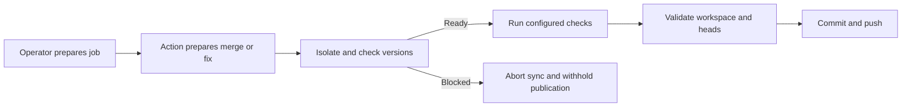
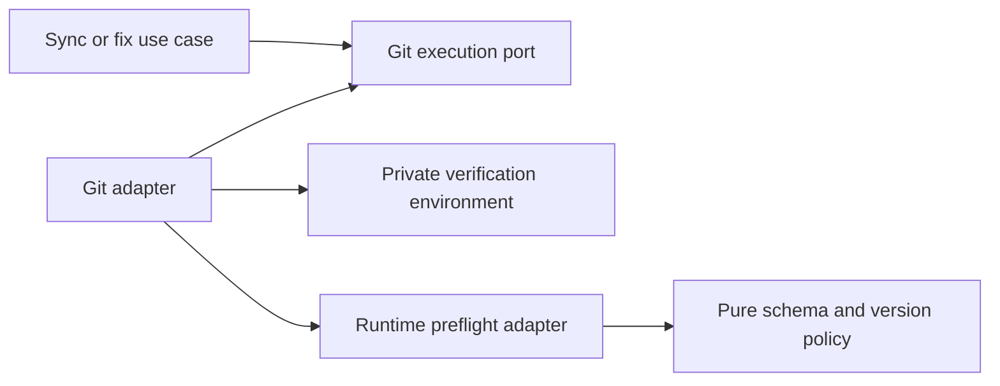

# Repository verification runtime prerequisites

- Status: Implementation candidate
- Date: 2026-10-20
- Catalog capability ID: branch-synchronization (cross-referenced by setup-and-doctor)
- Last verified: 2026-10-20
- Owners: Copilot maintainers
- Scope: Explicit project runtime prerequisites for isolated repository verification.
- Related issues/PRs: [#620](https://github.com/vypdev/copilot/issues/620)
- Required review gates: architecture, security/operations, testing, documentation, GitHub UX
- Open decisions blocking readiness: none

## 1. Executive summary

Operators provision project runtimes in each executing job and MAY declare
reviewed version prefixes in `.copilot/verification-prerequisites.json`.
Copilot MUST check declared runtimes inside the credential-free verification
environment before running a configured repository verification command. Missing
or incompatible prerequisites stop publication. There is no automatic installer.

```text
Review requirements → prepare this job → prepare merge/fix → isolate environment
→ check declared versions → run repository checks → validate workspace/heads → publish
```

## 2. Problem, current behavior, and evidence

### 2.1 Problem

A Kotlin/JVM consumer runs `make ci-local` through issue-comment branch sync. Its
separate application CI provisions Java 17; the command job does not. Verification
fails and aborts a clean merge with little guidance about the missing runtime.

### 2.2 Current behavior

1. Setup chooses a runner route and installs workflow templates.
2. Branch sync prepares a parent merge, then runs configured verification.
3. Repository commands receive an isolated HOME and allowlisted environment;
   the previous allowlist also dropped an operator-provisioned `JAVA_HOME`.
4. A failed verification stops commit/push, but generic failures hide process output.

### 2.3 Evidence

- Issue #620 reports v3.9.0; inspected v3.9.1 templates retain the missing bootstrap guidance.
- `sync_branch_use_case.ts`, `commit_and_push_preflight.ts`,
  `git_commit_adapter.ts`, `untrusted_command_environment.ts` own these boundaries.
- [actions/setup-java](https://github.com/actions/setup-java) documents installation,
  PATH and JAVA_HOME provisioning. Application CI and comment jobs are separate jobs.
- Unknown: no consumer Kotlin/Gradle workflow has been re-executed for this change.
  Tests use real Git and simulated Java version evidence, plus actual Node probes.

### 2.4 Retrospective classification

Not applicable: this is a prospective behavior amendment, not a reconstructed baseline.

## 3. Actors, surfaces, and terminology

| Actor | Goal | Entry point | Surface |
|---|---|---|---|
| Setup owner | Prepare the executing job | Web/CLI generated workflows | comments, setup docs, generated guide |
| Maintainer | Safely synchronize a branch | `/copilot sync-branch --no-agent` | existing command result and run |
| Automated fixer | Verify before publishing | existing commit pipeline | existing failure/result |

A **prerequisite** is a declared runtime version prefix, not a bootstrap command.
The **verification environment** is the private credential-free command environment.
The operator owns installation; the Action owns branch synchronization and publication.

## 4. Goals, non-goals, and fixed invariants

- Goals: actionable missing/version diagnostics; preserve provisioned JAVA_HOME;
  retain existing non-JVM behavior and no-push-on-failure guarantees.
- Non-goals: infer languages, install universal Java, execute manifest scripts,
  provision caches/dependencies, make doctor certify project build readiness,
  retry a failed build automatically, or require a new setup questionnaire answer.
- Invariants: no credential inheritance, arbitrary probe arguments, weakened
  verification, bypass of workspace/head guards, or push after prerequisite failure.

## 5. Current versus proposed product journey

| Stage | Previous | Amendment | Operator effect |
|---|---|---|---|
| Setup | Runner placement | Placement plus runtime help | Prepare every executing job |
| Declaration | None | Optional reviewed fixed-path JSON | Opt in without breaking legacy consumers |
| Verify | Command starts directly | Declared version probes precede command | Missing prerequisite becomes actionable |
| Failure | Generic command failure | Safe version/cause/job/help | Correct bootstrap and retry |



Text equivalent: prepare job, prepare change, isolate and check prerequisites;
failure withholds publication; success runs checks and existing publication guards.

## 6. Functional behavior and state model

The runtime file is reread before each configured verification command, from the
current worktree (including the prepared merge). No cached readiness authorizes a
later command. An absent file or empty map performs no probes. Dry runs and aligned
branches perform no verification and do not certify runtime readiness.

| State | Meaning | Next step/recovery |
|---|---|---|
| Undeclared | Legacy verification behavior | Run configured command normally |
| Checking | Fixed version probes in isolated environment | Ready or blocked |
| Blocked | Invalid file, absent/incompatible/unreadable tool | Correct same-job setup/declaration; retry |
| Ready | Declared versions match | Run actual repository checks |
| Verified | Checks and existing guards pass | Normal commit/push |

Duplicate commands recheck fresh facts. Cancellation cannot grant readiness;
ordinary finally-cleanup removes the private profile. Abrupt runner termination
retains normal runner cleanup limitations. Existing merge recovery remains owner.

## 7. User-facing configuration

| Field | Default | Allowed values | Scope |
|---|---|---|---|
| Fixed manifest path | Absent: legacy behavior | Regular nonlinked file ≤16 KiB | Current worktree, per command |
| `schemaVersion` | Required when file exists | Numeric `1` | Reviewed file |
| `runtimes` | Required map; empty allowed | At most eight closed keys below | Reviewed file |
| Runtime version | Required string per key | Positive major ≤999, up to three numeric components ≤999 | Prefix equality |

Closed keys: `java`, `node`, `pnpm`, `python`, `go`, `dotnet`, `ruby`, `rust`.
No unknown fields, version ranges, scripts, custom URLs, bypasses or schema migration.
`17` matches `17.0.13`, not `21.0.1` or `170.0.1`. Java 1.8 output normalizes to 8.

Recommended JVM example: `{"schemaVersion":1,"runtimes":{"java":"17","node":"24","pnpm":"10"}}`.
Alternative Node-only example: `{"schemaVersion":1,"runtimes":{"node":"24"}}`.
Job bootstrap has no manifest override; setup does not infer or create this file.
There are no new Action inputs or environment-based policy overrides.

## 8. Clean Architecture design

| Boundary | Responsibility | Forbidden dependency |
|---|---|---|
| Pure application policy | Closed schema, version parsing/matching, safe error | fs, child_process, SDK |
| Application workflows | Request prerequisite-checked isolated verification via git port | Concrete runtime adapters |
| Infrastructure | Bounded regular-file read and process probes, profile cleanup | Arbitrary manifest commands |
| Presentation | Existing verified error/result | Raw tool/provider output |
| Setup | Reviewed help comments and generated guidance | Automatic project runtime installation |



Text equivalent: workflows request isolated verification through a port; the adapter
prepares one environment for fixed probes and the command, relying on pure policy.

The internal `verifyRuntimePrerequisites` option requires `untrusted: true`;
caller-supplied environments remain forbidden. Ordinary trusted Git and isolated
hook-free commits do not trigger runtime checks. No new durable operation state.
Typecheck, architecture tests and adapter tests enforce these boundaries.

## 9. UI/UX and content contract

Existing result/check/comment surfaces remain owner; no new comment or marker.
Representative detail (English static fallback, within existing localized shell):

```text
Pending: preparing the merge; runtime readiness has not been established.
Action required: provision Java 17 before Copilot in job copilot-issues.
Blocked: Repository verification is blocked in job copilot-issues: Java 17 is
unavailable. Provision the declared runtime in the same job before Copilot, then
retry. For Java, configure actions/setup-java or a managed JAVA_HOME.
The repository verification command was not run. Help: <verification documentation>
Partial: the temporary merge was prepared, but verification was blocked; no push.
Complete: existing merged-cleanly/merged-with-agent result with verified commit SHA.
```

The actual diagnostic includes the trusted documentation URL and only allowlisted
runtime names, numeric versions and validated job IDs. Existing redacted command
reporting remains; raw version/process output is never copied into comments.
No new language-model translation is introduced. Descriptive links, plain text,
and headings work in narrow/light/dark views without color-only meaning.

## 10. Failure, recovery, and cleanup

| Failure | Impact/retained facts | Retry/action | Cleanup |
|---|---|---|---|
| Invalid/unsafe manifest | No verification command or publication | Review/correct file | Profile removed |
| Missing/version mismatch | No verification command or publication | Provision this job; retry original command | Sync abort; profile removed |
| Probe timeout/error/oversized output | No publication; output withheld | Inspect job provisioning privately | Same cleanup |
| Actual verification fails | Existing safe failure | Fix code/check environment | Existing sync abort |
| Post-check workspace/head race | No stale push | Retry latest heads | Existing abort |
| Post-push reporting failure | Existing commit remains | Existing observer recovery | No rollback of successful push |

No automatic installer or new retry loop. There is no prerequisite-specific
irreversible partial success because preflight runs before commit/push.

## 11. Security, permissions, and privacy

Preserve only JAVA_HOME as additional runtime metadata; PATH remains allowlisted.
JAVA_TOOL_OPTIONS, JDK_JAVA_OPTIONS, NODE_OPTIONS, MAVEN_OPTS, GRADLE_USER_HOME,
credentials and auth-store references remain stripped. HOME/temp/profile paths stay
private. Build tools must not depend on inherited user-home credentials/settings.
Manifest reads reject symbolic/hard links, unsafe parents, oversized and changed
file identities with bounded reads. Device/inode identities MUST use exact 64-bit
comparisons (BigInt), including values beyond JavaScript number precision. This is not a sandbox against a concurrently
hostile worktree/runner; existing trusted checkout and actor guards still apply.

Probe argv comes from a closed registry: Java `-version`; Node/pnpm/Python/.NET/
Ruby/Rust fixed version flags; Go `version`. Python is `python3` on POSIX, `python`
on Windows. JAVA_HOME, when present, must be absolute and selects its Java binary.
Windows pnpm uses only fixed `cmd.exe /d /s /c "pnpm --version"` arguments rooted
in absolute SystemRoot. No manifest content enters shell text. Tool shims may have
normal startup behavior; operators should provision pnpm rather than rely on downloads.

## 12. Observability and operational UX

Each probe is bounded to five seconds and 8 KiB output. At most eight runtimes
per command and twenty existing commands bound total work; first failure stops.
No extra GitHub API calls, telemetry, logs with tool output, comments, retries or
new checks. Existing command results expose job/cause/recovery/help; private build
logs remain the operator's diagnostic source. A missing runtime is a blocked
verification, not an indication that protected publication should be bypassed.

## 13. Compatibility, migration, rollout, and rollback

Existing consumers have no manifest and retain old command semantics; JAVA_HOME
preservation fixes prepared JDK usage independently. To adopt diagnostics: review
requirements, add the manifest, prepare every executing job, upgrade the Action and
generated guidance/templates, then retry normal verification. Existing operator
bootstrap steps remain authoritative. No flags silently weaken failed checks.
Rollback removes the declaration or uses an earlier Action, retaining generic
verification safety but losing new diagnostics; no refs or data are migrated.

## 14. Testing strategy and numeric budget

| Area | Minimum distinct new cases | Risk inventory |
|---|---:|---|
| Pure schema/version/safe diagnostics | 36 | Eight tools, prefixes, invalid schemas/values, forged/raw data |
| Runtime/file/process infrastructure | 31 | Real Node/missing Java, fixed argv, explicit POSIX/Windows path semantics, process failures, links/size/schema, access denial and changed/growing files, exact 64-bit identity |
| Application state and reporting | 5 | Clean/conflict abort, fixer gate, redaction and stop, bot binding |
| Git isolation adapter | 3 | Same environment/order, cleanup on failure, trusted-boundary rejection |
| Real Git integration/migration | 3 | Missing/provisioned simulated JDK and non-JVM remote/ref behavior |
| Generated guidance/workflow contract | 2 | Explicit opt-in and no universal Java installation |
| **Total** | **80** | Shared across capabilities; counted once |

Existing environment credential-exclusion assertions expand without adding a
count. Retain global coverage budgets, aim ≥95% pure policy branch coverage and
≥90% changed adapter statements. Infrastructure fakes cover platform paths;
native Windows/macOS CI must still run. No live model/GitHub/Kotlin dependency in
tests. Human review verifies the copy/example and retains the explicit limitation
that provisioned-JVM fixture probes are simulated, not live Gradle acceptance.

## 15. Documentation and discoverability

- Verification reference: schema, examples, bootstrap placement, environment,
  version semantics, limits, migration and retry.
- Setup web and configuration checklist: runner selection does not install tools.
- Branch-sync and collaboration guides: prerequisites apply even with no agent.
- Troubleshooting: same-job Java guidance and generic legacy-failure explanation.
- Generated guide and six execution workflow templates: durable contextual help.
- Documentation validator checks the emitted help URL and heading.

## 16. Acceptance scenarios

1. Declared Java 17 absent: command does not run; clean merge aborts; remote SHA unchanged.
2. Provisioned compatible evidence: actual command and existing guards run; real merge pushes normally.
3. Node-only or absent manifest: no Java requirement or installer.
4. Incompatible/invalid/linked/oversized declaration: safe blocked result, no publication.
5. JAVA_HOME-only provisioning: exact Java path selected; injection variables/credentials absent.
6. Dry run/aligned branch: no runtime probes and no readiness claim.
7. Retry rereads current declaration/environment; no cached result bypasses verification.
8. Existing redaction and static trusted help prevent raw provider output/mentions in errors.
9. Generated templates contain guidance and no automatic Java setup.

## 17. Requirements traceability

| Contract | Owner | Evidence | Documentation |
|---|---|---|---|
| Closed optional config | runtime policy/manifest adapter | policy and preflight tests | Verification reference |
| Isolated fixed probes | runtime and Git adapters | preflight, Git/environment tests | Environment contract |
| Abort/no publication | sync/fix use cases | sync, commit workspace, real-Git tests | Branch-sync/troubleshooting |
| Safe diagnostics | policy and command runner | policy, runner and sync tests | Recovery examples |
| Operator bootstrap | setup/guidance policies/templates | guide/workflow tests, docs validator | Setup web/checklist |

Existing dry-run/race/cancellation protections remain covered by branch-sync suites;
this change adds no stateful retry or remote race boundary.

## 18. Implementation sequence

1. Establish isolated execution and version/schema policy.
2. Add bounded file/process adapters and version probes.
3. Bind sync and automated-fix verification; preserve JAVA_HOME only.
4. Test abort/publication using real Git and simulated runtime evidence.
5. Update templates, generated guidance, linked docs and catalog.
6. Run focused/full coverage, architecture, docs/workflow/spec checks, build/package validation.

## 19. Definition of Done

- [x] Contract, configuration limits, trust boundaries and docs agree.
- [x] Numeric budget and coverage expectations pass without weakening global gates.
- [x] Real Git no-push/normal-push and credential isolation checks pass.
- [x] Generated artifacts, templates and documentation links validate.
- [x] Typecheck, lint, build, full tests and package verification pass.
- [x] Catalog evidence/index updated; specification validation passes.
- [ ] Remote PR checks/review complete; no live consumer acceptance is implied.

## 20. References and decisions

- Parent contracts: [branch synchronization](./branch-synchronization-and-conflict-recovery.md),
  [runner/setup parity](./setup-runner-profiles-and-installation-parity.md).
- [Issue #620](https://github.com/vypdev/copilot/issues/620),
  [actions/setup-java](https://github.com/actions/setup-java).
- Rejected: universal Java installation, arbitrary bootstrap inputs, language
  inference, credential broadening and parsing untrusted failed-command output.
- Outside scope: live consumer Kotlin/Gradle retest, other home/cache variables,
  automatic setup questionnaire requirements, automatic dependency provisioning.
