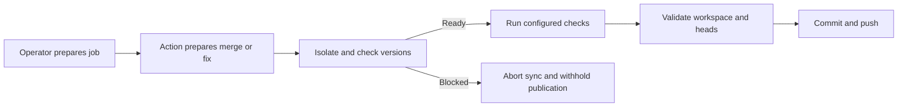
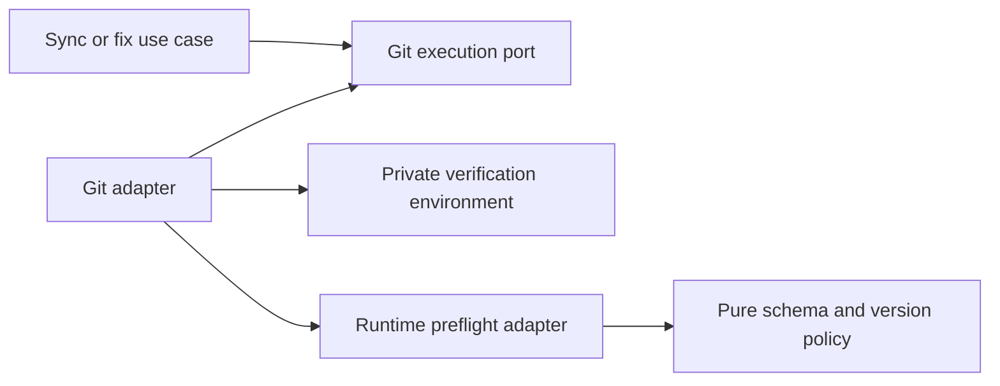

# Repository verification runtime prerequisites

- Status: Implementation candidate
- Date: 2026-10-20
- Catalog capability ID: branch-synchronization (cross-referenced by setup-and-doctor)
- Last verified: 2026-10-20
- Owners: Copilot maintainers
- Scope: Explicit project runtime prerequisites for isolated repository verification.
- Related issues/PRs: [#620](https://github.com/vypdev/copilot/issues/620)
- Required review gates: architecture, security/operations, testing, documentation, GitHub UX
- Open decisions blocking readiness: none

## 1. Executive summary

Operators provision project runtimes in each executing job and MAY declare
reviewed version prefixes in `.copilot/verification-prerequisites.json`.
Copilot MUST check declared runtimes inside the credential-free verification
environment before running a configured repository verification command. Missing
or incompatible prerequisites stop publication. There is no automatic installer.

```text
Review requirements → prepare this job → prepare merge/fix → isolate environment
→ check declared versions → run repository checks → validate workspace/heads → publish
```

## 2. Problem, current behavior, and evidence

### 2.1 Problem

A Kotlin/JVM consumer runs `make ci-local` through issue-comment branch sync. Its
separate application CI provisions Java 17; the command job does not. Verification
fails and aborts a clean merge with little guidance about the missing runtime.

### 2.2 Current behavior

1. Setup chooses a runner route and installs workflow templates.
2. Branch sync prepares a parent merge, then runs configured verification.
3. Repository commands receive an isolated HOME and allowlisted environment;
   the previous allowlist also dropped an operator-provisioned `JAVA_HOME`.
4. A failed verification stops commit/push, but generic failures hide process output.

### 2.3 Evidence

- Issue #620 reports v3.9.0; inspected v3.9.1 templates retain the missing bootstrap guidance.
- `sync_branch_use_case.ts`, `commit_and_push_preflight.ts`,
  `git_commit_adapter.ts`, `untrusted_command_environment.ts` own these boundaries.
- [actions/setup-java](https://github.com/actions/setup-java) documents installation,
  PATH and JAVA_HOME provisioning. Application CI and comment jobs are separate jobs.
- Unknown: no consumer Kotlin/Gradle workflow has been re-executed for this change.
  Tests use real Git and simulated Java version evidence, plus actual Node probes.

### 2.4 Retrospective classification

Not applicable: this is a prospective behavior amendment, not a reconstructed baseline.

## 3. Actors, surfaces, and terminology

| Actor | Goal | Entry point | Surface |
|---|---|---|---|
| Setup owner | Prepare the executing job | Web/CLI generated workflows | comments, setup docs, generated guide |
| Maintainer | Safely synchronize a branch | `/copilot sync-branch --no-agent` | existing command result and run |
| Automated fixer | Verify before publishing | existing commit pipeline | existing failure/result |

A **prerequisite** is a declared runtime version prefix, not a bootstrap command.
The **verification environment** is the private credential-free command environment.
The operator owns installation; the Action owns branch synchronization and publication.

## 4. Goals, non-goals, and fixed invariants

- Goals: actionable missing/version diagnostics; preserve provisioned JAVA_HOME;
  retain existing non-JVM behavior and no-push-on-failure guarantees.
- Non-goals: infer languages, install universal Java, execute manifest scripts,
  provision caches/dependencies, make doctor certify project build readiness,
  retry a failed build automatically, or require a new setup questionnaire answer.
- Invariants: no credential inheritance, arbitrary probe arguments, weakened
  verification, bypass of workspace/head guards, or push after prerequisite failure.

## 5. Current versus proposed product journey

| Stage | Previous | Amendment | Operator effect |
|---|---|---|---|
| Setup | Runner placement | Placement plus runtime help | Prepare every executing job |
| Declaration | None | Optional reviewed fixed-path JSON | Opt in without breaking legacy consumers |
| Verify | Command starts directly | Declared version probes precede command | Missing prerequisite becomes actionable |
| Failure | Generic command failure | Safe version/cause/job/help | Correct bootstrap and retry |



Text equivalent: prepare job, prepare change, isolate and check prerequisites;
failure withholds publication; success runs checks and existing publication guards.

## 6. Functional behavior and state model

The runtime file is reread before each configured verification command, from the
current worktree (including the prepared merge). No cached readiness authorizes a
later command. An absent file or empty map performs no probes. Dry runs and aligned
branches perform no verification and do not certify runtime readiness.

| State | Meaning | Next step/recovery |
|---|---|---|
| Undeclared | Legacy verification behavior | Run configured command normally |
| Checking | Fixed version probes in isolated environment | Ready or blocked |
| Blocked | Invalid file, absent/incompatible/unreadable tool | Correct same-job setup/declaration; retry |
| Ready | Declared versions match | Run actual repository checks |
| Verified | Checks and existing guards pass | Normal commit/push |

Duplicate commands recheck fresh facts. Cancellation cannot grant readiness;
ordinary finally-cleanup removes the private profile. Abrupt runner termination
retains normal runner cleanup limitations. Existing merge recovery remains owner.

## 7. User-facing configuration

| Field | Default | Allowed values | Scope |
|---|---|---|---|
| Fixed manifest path | Absent: legacy behavior | Regular nonlinked file ≤16 KiB | Current worktree, per command |
| `schemaVersion` | Required when file exists | Numeric `1` | Reviewed file |
| `runtimes` | Required map; empty allowed | At most eight closed keys below | Reviewed file |
| Runtime version | Required string per key | Positive major ≤999, up to three numeric components ≤999 | Prefix equality |

Closed keys: `java`, `node`, `pnpm`, `python`, `go`, `dotnet`, `ruby`, `rust`.
No unknown fields, version ranges, scripts, custom URLs, bypasses or schema migration.
`17` matches `17.0.13`, not `21.0.1` or `170.0.1`. Java 1.8 output normalizes to 8.

Recommended JVM example: `{"schemaVersion":1,"runtimes":{"java":"17","node":"24","pnpm":"10"}}`.
Alternative Node-only example: `{"schemaVersion":1,"runtimes":{"node":"24"}}`.
Job bootstrap has no manifest override; setup does not infer or create this file.
There are no new Action inputs or environment-based policy overrides.

## 8. Clean Architecture design

| Boundary | Responsibility | Forbidden dependency |
|---|---|---|
| Pure application policy | Closed schema, version parsing/matching, safe error | fs, child_process, SDK |
| Application workflows | Request prerequisite-checked isolated verification via git port | Concrete runtime adapters |
| Infrastructure | Bounded regular-file read and process probes, profile cleanup | Arbitrary manifest commands |
| Presentation | Existing verified error/result | Raw tool/provider output |
| Setup | Reviewed help comments and generated guidance | Automatic project runtime installation |



Text equivalent: workflows request isolated verification through a port; the adapter
prepares one environment for fixed probes and the command, relying on pure policy.

The internal `verifyRuntimePrerequisites` option requires `untrusted: true`;
caller-supplied environments remain forbidden. Ordinary trusted Git and isolated
hook-free commits do not trigger runtime checks. No new durable operation state.
Typecheck, architecture tests and adapter tests enforce these boundaries.

## 9. UI/UX and content contract

Existing result/check/comment surfaces remain owner; no new comment or marker.
Representative detail (English static fallback, within existing localized shell):

```text
Pending: preparing the merge; runtime readiness has not been established.
Action required: provision Java 17 before Copilot in job copilot-issues.
Blocked: Repository verification is blocked in job copilot-issues: Java 17 is
unavailable. Provision the declared runtime in the same job before Copilot, then
retry. For Java, configure actions/setup-java or a managed JAVA_HOME.
The repository verification command was not run. Help: <verification documentation>
Partial: the temporary merge was prepared, but verification was blocked; no push.
Complete: existing merged-cleanly/merged-with-agent result with verified commit SHA.
```

The actual diagnostic includes the trusted documentation URL and only allowlisted
runtime names, numeric versions and validated job IDs. Existing redacted command
reporting remains; raw version/process output is never copied into comments.
No new language-model translation is introduced. Descriptive links, plain text,
and headings work in narrow/light/dark views without color-only meaning.

## 10. Failure, recovery, and cleanup

| Failure | Impact/retained facts | Retry/action | Cleanup |
|---|---|---|---|
| Invalid/unsafe manifest | No verification command or publication | Review/correct file | Profile removed |
| Missing/version mismatch | No verification command or publication | Provision this job; retry original command | Sync abort; profile removed |
| Probe timeout/error/oversized output | No publication; output withheld | Inspect job provisioning privately | Same cleanup |
| Actual verification fails | Existing safe failure | Fix code/check environment | Existing sync abort |
| Post-check workspace/head race | No stale push | Retry latest heads | Existing abort |
| Post-push reporting failure | Existing commit remains | Existing observer recovery | No rollback of successful push |

No automatic installer or new retry loop. There is no prerequisite-specific
irreversible partial success because preflight runs before commit/push.

## 11. Security, permissions, and privacy

Preserve JAVA_HOME as additional runtime metadata; PATH remains allowlisted.
Inherited JAVA_TOOL_OPTIONS, JDK_JAVA_OPTIONS, NODE_OPTIONS, MAVEN_OPTS,
GRADLE_USER_HOME, credentials and auth-store references remain stripped.
The issue #775 amendment below derives fresh JDK_JAVA_OPTIONS and
GRADLE_USER_HOME from the private verification profile; it never admits the
inherited values. HOME/temp/profile paths stay private. Build tools must not
depend on inherited user-home credentials/settings.
Manifest reads reject symbolic/hard links, unsafe parents, oversized and changed
file identities with bounded reads. Device/inode identities MUST use exact 64-bit
comparisons (BigInt), including values beyond JavaScript number precision. This is not a sandbox against a concurrently
hostile worktree/runner; existing trusted checkout and actor guards still apply.

Probe argv comes from a closed registry: Java `-version`; Node/pnpm/Python/.NET/
Ruby/Rust fixed version flags; Go `version`. Python is `python3` on POSIX, `python`
on Windows. JAVA_HOME, when present, must be absolute and selects its Java binary.
Windows pnpm uses only fixed `cmd.exe /d /s /c "pnpm --version"` arguments rooted
in absolute SystemRoot. No manifest content enters shell text. Tool shims may have
normal startup behavior; operators should provision pnpm rather than rely on downloads.

## 12. Observability and operational UX

Each probe is bounded to five seconds and 8 KiB output. At most eight runtimes
per command and twenty existing commands bound total work; first failure stops.
No extra GitHub API calls, telemetry, logs with tool output, comments, retries or
new checks. Existing command results expose job/cause/recovery/help; private build
logs remain the operator's diagnostic source. A missing runtime is a blocked
verification, not an indication that protected publication should be bypassed.

## 13. Compatibility, migration, rollout, and rollback

Existing consumers have no manifest and retain old command semantics; JAVA_HOME
preservation fixes prepared JDK usage independently. To adopt diagnostics: review
requirements, add the manifest, prepare every executing job, upgrade the Action and
generated guidance/templates, then retry normal verification. Existing operator
bootstrap steps remain authoritative. No flags silently weaken failed checks.
Rollback removes the declaration or uses an earlier Action, retaining generic
verification safety but losing new diagnostics; no refs or data are migrated.

## 14. Testing strategy and numeric budget

| Area | Minimum distinct new cases | Risk inventory |
|---|---:|---|
| Pure schema/version/safe diagnostics | 36 | Eight tools, prefixes, invalid schemas/values, forged/raw data |
| Runtime/file/process infrastructure | 31 | Real Node/missing Java, fixed argv, explicit POSIX/Windows path semantics, process failures, links/size/schema, access denial and changed/growing files, exact 64-bit identity |
| Application state and reporting | 5 | Clean/conflict abort, fixer gate, redaction and stop, bot binding |
| Git isolation adapter | 3 | Same environment/order, cleanup on failure, trusted-boundary rejection |
| Real Git integration/migration | 3 | Missing/provisioned simulated JDK and non-JVM remote/ref behavior |
| Generated guidance/workflow contract | 2 | Explicit opt-in and no universal Java installation |
| **Total** | **80** | Shared across capabilities; counted once |

Existing environment credential-exclusion assertions expand without adding a
count. Retain global coverage budgets, aim ≥95% pure policy branch coverage and
≥90% changed adapter statements. Infrastructure fakes cover platform paths;
native Windows/macOS CI must still run. No live model/GitHub/Kotlin dependency in
tests. Human review verifies the copy/example and retains the explicit limitation
that provisioned-JVM fixture probes are simulated, not live Gradle acceptance.

## 15. Documentation and discoverability

- Verification reference: schema, examples, bootstrap placement, environment,
  version semantics, limits, migration and retry.
- Setup web and configuration checklist: runner selection does not install tools.
- Branch-sync and collaboration guides: prerequisites apply even with no agent.
- Troubleshooting: same-job Java guidance and generic legacy-failure explanation.
- Generated guide and six execution workflow templates: durable contextual help.
- Documentation validator checks the emitted help URL and heading.

## 16. Acceptance scenarios

1. Declared Java 17 absent: command does not run; clean merge aborts; remote SHA unchanged.
2. Provisioned compatible evidence: actual command and existing guards run; real merge pushes normally.
3. Node-only or absent manifest: no Java requirement or installer.
4. Incompatible/invalid/linked/oversized declaration: safe blocked result, no publication.
5. JAVA_HOME-only provisioning: exact Java path selected; injection variables/credentials absent.
6. Dry run/aligned branch: no runtime probes and no readiness claim.
7. Retry rereads current declaration/environment; no cached result bypasses verification.
8. Existing redaction and static trusted help prevent raw provider output/mentions in errors.
9. Generated templates contain guidance and no automatic Java setup.

## 17. Requirements traceability

| Contract | Owner | Evidence | Documentation |
|---|---|---|---|
| Closed optional config | runtime policy/manifest adapter | policy and preflight tests | Verification reference |
| Isolated fixed probes | runtime and Git adapters | preflight, Git/environment tests | Environment contract |
| Abort/no publication | sync/fix use cases | sync, commit workspace, real-Git tests | Branch-sync/troubleshooting |
| Safe diagnostics | policy and command runner | policy, runner and sync tests | Recovery examples |
| Operator bootstrap | setup/guidance policies/templates | guide/workflow tests, docs validator | Setup web/checklist |

Existing dry-run/race/cancellation protections remain covered by branch-sync suites;
this change adds no stateful retry or remote race boundary.

## 18. Implementation sequence

1. Establish isolated execution and version/schema policy.
2. Add bounded file/process adapters and version probes.
3. Bind sync and automated-fix verification; preserve JAVA_HOME only.
4. Test abort/publication using real Git and simulated runtime evidence.
5. Update templates, generated guidance, linked docs and catalog.
6. Run focused/full coverage, architecture, docs/workflow/spec checks, build/package validation.

## 19. Definition of Done

- [x] Contract, configuration limits, trust boundaries and docs agree.
- [x] Numeric budget and coverage expectations pass without weakening global gates.
- [x] Real Git no-push/normal-push and credential isolation checks pass.
- [x] Generated artifacts, templates and documentation links validate.
- [x] Typecheck, lint, build, full tests and package verification pass.
- [x] Catalog evidence/index updated; specification validation passes.
- [ ] Remote PR checks/review complete; no live consumer acceptance is implied.

## 20. References and decisions

- Parent contracts: [branch synchronization](./branch-synchronization-and-conflict-recovery.md),
  [runner/setup parity](./setup-runner-profiles-and-installation-parity.md).
- [Issue #620](https://github.com/vypdev/copilot/issues/620),
  [actions/setup-java](https://github.com/actions/setup-java).
- Rejected: universal Java installation, arbitrary bootstrap inputs, language
  inference, credential broadening and parsing untrusted failed-command output.
- Outside scope: live consumer Kotlin/Gradle retest, other home/cache variables,
  automatic setup questionnaire requirements, automatic dependency provisioning.

## Optional repository setup amendment — issue #647

The [repository-owned setup contract](./repository-verification-setup-hooks.md) adds an explicit disabled-default `verification-setup` boolean. When enabled, a trusted main-branch Node helper prepares each candidate command environment before these existing fixed runtime probes. The runtime declaration remains a version-only policy and never supplies script paths, commands, credentials or installer arguments. With setup disabled, prerequisite behavior is unchanged. The companion owns its incremental tests and bounded setup limits; all existing no-push, isolation and preflight constraints remain required.


### Source candidate dependency correction — #746

The [source candidate readiness amendment](./branch-synchronization-and-conflict-recovery.md#candidate-dependency-readiness-and-failure-facts--746-2026-10-27) owns the incremental source-only frozen-pnpm preparation and closed sync failure facts. Source runtime bootstrap remains before the Action; source dependencies move to each actual candidate verifier boundary after optional native setup and runtime probes. Consumer setup opt-in, runtime-only declarations and generic no-installer behavior remain unchanged. The amendment owns its incremental test budget and separately authorized default-runtime rollout; do not double count it here.

## 21. Private JVM and Gradle discovery — issue #775 (2026-10-29)

### Decision, evidence and boundaries

Status: implementation contract. Owner: Copilot maintainers. Review gates:
runtime security, native workflow compatibility, architecture, testing and
operator documentation. No material design decision remains open.

[Issue #775](https://github.com/vypdev/copilot/issues/775) reports an actual
macOS/JDK 17 observation: changing HOME alone leaves Java user.home at the OS
account home. A successful Gradle run with up-to-date tasks and a global init
message does not prove private discovery or freshly executed tests. No consumer
native continuation was activated by that report.

A separate Linux/aarch64 exploration with the official Gradle 9.8.2/JDK 17
image, pinned to digest
`sha256:2ec771e6a429a3aca72d38aca70a4ea05b41bf4098e4e22868b425a215fa4d0f`,
reproduces the gap using only a disposable account's harmless init/properties
sentinels. Explicit derived-variable controls isolate discovery and preserve
the candidate bytes. Eight additional JDK launcher experiments preserve exact
synthetic property values containing spaces, quotes and Windows-style
backslashes. These are exploration controls, not a completed production/native
acceptance claim.

Primary contracts: [JDK 17 launcher/JDK_JAVA_OPTIONS](https://docs.oracle.com/en/java/javase/17/docs/specs/man/java.html),
[Gradle user home](https://docs.gradle.org/current/userguide/directory_layout.html),
[initialization scripts](https://docs.gradle.org/current/userguide/init_scripts.html)
and [build environment](https://docs.gradle.org/current/userguide/build_environment.html).
Their discovery rules motivate explicit private locations; they do not establish
an OS sandbox. Gradle distribution-level initialization, deliberate candidate
overrides, concurrent same-user access and project verification failures retain
their existing trust boundaries. No wrapper rewrite, skipped command,
credential grant, universal Java installer or new configuration input is added.

### Required behavior and architecture

```text
Admitted verification -> fresh private profile -> derive JVM/Gradle locations
 -> optional native setup -> fixed runtime probes -> configured command
 -> existing workspace/head/publication guards -> owned post cleanup
```

Text equivalent: each command receives a fresh profile and derived locations;
native setup and the verifier share that profile, and ordinary guards and
cleanup still decide publication.

1. The infrastructure environment builder MUST derive exactly one JDK launcher
   property assigning user.home to its canonical private HOME and an absolute
   GRADLE_USER_HOME inside that same profile. Both apply with setup enabled or
   disabled, before prerequisite probes and the configured command.
2. It MUST keep rejecting inherited tool-option injection, including arbitrary
   JDK_JAVA_OPTIONS/GRADLE_USER_HOME. JAVA_TOOL_OPTIONS, _JAVA_OPTIONS,
   GRADLE_OPTS, MAVEN_OPTS, NODE_OPTIONS, credentials and auth-store paths do not
   become allowed inputs. Existing JAVA_HOME/PATH provisioning remains.
3. JVM option encoding MUST preserve the entire path as one property argument,
   including whitespace, either quote and literal backslashes. It uses the JDK
   launcher's own grammar, not shell or JSON escaping. NUL/CR/LF input is rejected
   with a fixed diagnostic before execution; failure to prepare a profile MUST
   clean the newly owned directory and withhold verification/publication.
4. Native pending outputs and canonical setup steps MUST forward only these two
   host-derived values alongside existing runtime metadata. Setup-result parsing
   remains closed to approved PATH/JAVA_HOME; consumer or ambient option values
   MUST NOT replace the worker's derived values or be forwarded as Node
   continuation controls.
5. Every later verification command MUST get a different private profile and
   Gradle state. Cleanup includes the derived Gradle/JVM state and retains native
   profiles until deferred posts finish. No shared readiness/cache authority or
   durable configuration is introduced.

The OS/process-specific encoder and environment builder belong to infrastructure;
they do not add filesystem/process dependencies to domain/application policies.
Existing Git execution ports, setup/session binding, prerequisite checks,
candidate/remote-head fences and localized result presenters remain owners.
Canonical workflow generation and structural mutation checks enforce the closed
native metadata boundary. Agent-provider environments are a separate contract.

### Product journey, configuration and recovery

| State | Existing primary surface and next action |
|---|---|
| Pending | Preparing repository verification; wait for native setup and probes |
| Action required | Declared Java unavailable: provision it in this job or review the trusted setup; retry the original operation |
| Blocked | Private profile/setup/probe failed: verification and publication withheld; inspect the linked run |
| Partial | Candidate prepared but verification failed: existing sync recovery and retained-state report remain authoritative |
| Complete | Configured checks passed in the private profile; existing publication guards decide the final result |
| Canceled/retried | Existing cancellation cleanup; a fresh admitted retry creates new state |

Representative existing result: “Repository setup completed; runtime preflight
and verification may proceed.” Technical acceptance output MAY report only
booleans such as “JVM home is private: true” and “candidate unchanged: true”. It
MUST NOT copy account paths, real properties/init contents or credentials into
issues, summaries or evidence. There are no new comments, labels or operator UI;
existing localized text/fallback, plain-text status, descriptive run/docs links
and narrow/light/dark rendering stay authoritative.

Recommended setup remains explicit same-job Java 17 provisioning (or a reviewed
native composite), with verification commands unchanged. The supported
alternative is a non-JVM project with no Java declaration/installer. Derived
private locations have no caller override and no persistence across commands.
Upgrade the Action and its canonical coordinator/generated callbacks together
so native setup receives the derived fields. Consumer-owned setup assets remain
preserved. Older in-flight jobs retain their original snapshot; retry after the
upgrade. Rollback restores the old discovery limitation and does not migrate or
delete account caches. No automatic retry is added.

### Risk-derived test budget and acceptance

Allocate **32 additional distinct Jest cases** before source implementation:

| Area | Minimum | Risks |
|---|---:|---|
| JVM argument grammar | 12 | spaces, both quotes, backslashes, Unicode, injection-like suffixes and forbidden controls |
| Profile/environment security | 8 | inherited injection excluded, canonical containment, unique profiles, owned cleanup and preparation failures |
| Native protocol/continuation | 6 | derived outputs, malformed fields, foreign values/replay and unchanged closed response |
| Workflow/setup structure | 4 | missing/changed derived bindings and option leakage into continuation |
| Git/prerequisite integration | 2 | same environment/order, failure withholding and legacy non-JVM behavior |
| **Total** | **32** | no repeated-run or existing-case double counting |

New pure encoding targets 100% statements/branches/functions/lines. Changed
environment/native adapters retain at least 95% statements/lines and 90%
branches/functions. All global, module, setup, extension and benchmark budgets,
case selections and timeouts remain unchanged. Unit tests use deterministic
fixtures; normal Node tests gain no Java/Gradle prerequisite or silent skip.

Additional required native observations, separate from the Jest case count:

- Actual source-wired Linux JDK 17/Gradle execution in a disposable OS account
  demonstrates the legacy global-sentinel gap and the corrected private JVM,
  Gradle properties/init/cache discovery, without real user configuration.
- Actual Linux GitHub native setup provisions the tools, resumes the existing
  operation, passes runtime preflight and executes offline Java compilation and
  verification in the private profile. A Java home guard precedes Gradle startup
  on hosted runners. A container is not claimed as native Actions emulation.
- Candidate source/action bytes remain unchanged, inherited injection stays
  excluded, fresh profiles do not share state, and deferred native posts clean
  the owned profiles. Existing failure/no-publication fences stay covered.

| Requirement | Executable evidence | Documentation |
|---|---|---|
| Exact private property and Gradle location | Grammar/environment suites; real JDK/Gradle fixture | Verification environment/reference |
| Same native profile, closed continuation | Controller/generator mutation tests and native Linux job | Native setup and upgrade guidance |
| Failure, freshness and cleanup | Environment/Git integration and native post acceptance | Existing recovery and isolation limits |
| No account secrets or candidate mutation | Disposable sentinels, boolean-only reports and identity assertions | Security/operator trust boundary |

Update this owner, native-setup companion, catalog evidence, verification and
agent/contributor guidance together; regenerate canonical workflows and catalog.
DoD requires the case floor, actual source/native observations, all unchanged
coverage/architecture/docs/workflow/spec/build/package checks, Graphify update,
normal hooks and exact-head CI/three-platform/Codecov/review without findings
before the authorized normal merge to develop.

### Executed observations and bounded workflow representation

The source-wired disposable Linux runs use the same pinned JDK 17/Gradle image,
candidate probe and actual GitCommitAdapter before and after the correction.
Each version completes two fresh compilations and JavaExec verifications with
unchanged source and excluded inherited injection. The baseline discovers the
disposable account's global sentinels; the corrected version discovers only the
private properties/init script and private JVM/Gradle homes. The corrected probe
also checks the actual JDK 17 specification version. No real account data is
mounted or inspected, and no consumer execution is claimed.

All 42 additional distinct regression cases pass in the full current-source
run: 16 grammar, eight profile, ten protocol, six workflow and two Git cases. Encoding
and environment construction reach 100% on every metric. Native-controller
coverage is 95.39% statements, 97.68% lines, 90% branches and 100% functions;
the new per-module budgets enforce these floors without relying on an aggregate.

Adding the native metadata exposed the existing 100,000-byte workflow review
limit: the first full run rejected the 101,210-byte smoke workflow, producing 40
setup/CLI failures from that one cause. The workflow now shares 43 identical
native steps using GitHub-supported YAML anchors. Its 59,394-byte representation
parses to the exact same jobs, steps, inputs, conditions and permissions; all 233
focused setup/CLI/workflow cases pass. The per-file/aggregate review limits,
runner routes, phase count and timeouts are unchanged. Required full and native
remote verification remain separate acceptance gates.

After the workflow representation correction, the full current-source run passes
790 suites and 14,655 tests, with the same 35 existing skips, in 477.661 seconds.
Global coverage is 97.29% statements, 95% branches, 97.95% functions and 98.06%
lines. Every prior and new module budget passes. The setup ledger remains
336/350 passing with 14 explicitly open cases; no open case is represented as
implemented here. Extension verification passes all 267 cases with 100% on every
metric. Native GitHub Linux acceptance and final PR checks still require their
own successful exact-head evidence before merge.

The first GitHub run passed all 790 suites and 14,655 cases, but the controller
branch budget failed at 88% on Linux/macOS. Add six protocol cases before the
next run: absent inherited runtime exports, missing request, malformed snapshot
digest, delayed worker-session publication, continuation entry routing, and an
exhausted boundary that blocks publication and cancels its pending worker.
These supplement the 42 cases above; the new distinct-case count is 48. Keep
the 90% branch floor. The native Linux job separately rejected setup metadata
before preflight; fixture-only diagnostics classify tool/root ownership using
closed enums and booleans, without printing runtime paths or accepting more roots.
That rejection requires a resolved cause and successful native rerun before merge.

The native diagnostic identified the rejected JDK: its lexical tool-cache entry
resolved outside all approved roots, while Python and pnpm stayed within the
current private profile. Keep rejecting that alias. The controlled setup-java
step now uses a step-local RUNNER_TOOL_CACHE beneath the current HOME, so its
real JDK installation is owned by that profile. This changes only native test
provisioning; it does not widen result roots, forward the temporary cache setting
to continuation, change the selected JDK 17, or claim a successful rerun yet.
