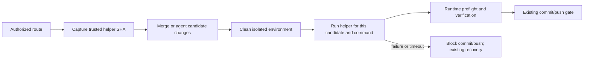
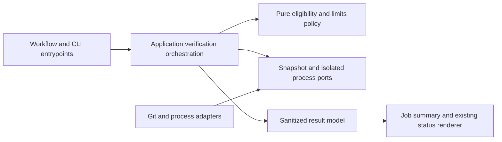

# Repository-Owned Verification Setup Hooks

- Status: Implementation candidate
- Date: 2026-10-21
- Catalog capability ID: branch-synchronization
- Last verified: 2026-10-21
- Owners: Copilot maintainers
- Scope: Define an optional repository-owned preparation helper for authorized operations that run repository verification, including branch synchronization and automated fixes.
- Related issues/PRs: [Issue #647](https://github.com/vypdev/copilot/issues/647); [verification runtime prerequisites](https://github.com/vypdev/copilot/blob/master/docs/security-operations/operations/verification.mdx#repository-verification-prerequisites)
- Required review gates: product UX, architecture, testing, documentation, security/operations
- Open decisions blocking readiness: None; this companion records the resolved contract for implementation review.

## 1. Executive summary

Consumers may enable `verification-setup: true` and add a reviewed helper at `.copilot/verification-setup.mjs` on their trusted main/production branch. Copilot captures an immutable snapshot and invokes it in the credential-free environment immediately before each configured verification command, using the candidate tree being checked. The helper prepares only that repository’s required runtimes and dependencies. Without an enabled helper, existing prerequisite checks and verification behavior remain in force. Any enabled-helper validation, execution, timeout, or result failure blocks verification and commit/push.

```text
authorized operation -> candidate tree ready -> trusted helper snapshot prepares isolated verifier -> preflight and verification -> existing commit/push policy
```

The safety rule is that candidate changes cannot replace the trusted helper, and setup success is never reused for a different command or candidate tree.

## 2. Problem, current behavior, and evidence

### 2.1 Problem

Repository maintainers need project-specific runtimes and dependencies in the same job and isolated environment that executes Copilot verification. Generated workflows belong to Copilot; editing them for each repository creates update drift. A separate successful CI job or preparation job cannot provision the verifier’s environment. Synchronization may produce a temporary merge, and an agent may change manifests, so setup must match the actual candidate checked.

### 2.2 Current behavior

1. Copilot’s verification contract runs configured repository commands subject to existing authorization and prerequisite checks.
2. There is no specified repository-owned helper contract wired through all verification routes.
3. In the reported `vypdev/homeassistant-gateway` run, `python3 -m pytest` failed because `/usr/bin/python3` lacked `pytest`; the temporary merge was aborted without push. This establishes that run’s missing dependency, not a general runner or repository-access failure.

### 2.3 Evidence

- Code/workflow/documentation references: the catalog lists `.github/workflows/copilot_branch_sync.yml`, setup workflow templates for issue, issue-comment, pull-request-comment and branch-sync, and verification policy/preflight and shared commit verification code. These paths are current evidence, not a promise about future execution support.
- Incident: [consumer issue #19](https://github.com/vypdev/homeassistant-gateway/issues/19), [command comment](https://github.com/vypdev/homeassistant-gateway/issues/19#issuecomment-6311691282), [failed run](https://github.com/vypdev/homeassistant-gateway/actions/runs/39570398824), [job](https://github.com/vypdev/homeassistant-gateway/actions/runs/39570398824/job/119122814347).
- External primary sources: none required for this contract.
- Unknowns: implementation-specific workflow syntax and helper result representation must be settled consistently with repository conventions; the fixed observable limits below are resolved.

### 2.4 Retrospective classification (as-built baselines only)

Not applicable: this is a prospective specification and reconstructs no implemented baseline.

## 3. Actors, surfaces, and terminology

| Actor | Goal | Entry point | Visible surfaces |
|---|---|---|---|
| Consumer maintainer | Prepare project tools without editing generated workflows | Trusted branch helper file | Repository, verification logs, documentation |
| Issue/PR/commit actor | Request authorized implementation or autofix | Existing issue, comment, review, or commit route | Issue/PR comments and run result |
| Operator | Understand blocked verification and recovery | Workflow execution | Job summary and bounded logs |
| Copilot | Run setup and verification safely | Sync or shared commit-verification boundary | Check/run status |

“Trusted helper snapshot” means immutable regular-file bytes and SHA captured from the configured trusted main/production branch at composition/admission. “Candidate tree” means the exact workspace revision, including temporary synchronization merge or agent edits, whose manifests verification will check. “Preparation” means one helper invocation immediately before a single configured verification command and its runtime preflight.

## 4. Goals

### 4.1 Goals

1. Provide one documented optional repository-owned setup hook, invoked consistently for every authorized route that actually runs verification.
2. Prepare dependencies for the exact candidate tree in the same isolated execution environment as preflight and verification.
3. Preserve generated workflow ownership, verification policy, authorization and fail-closed commit/push behavior.

### 4.2 Non-goals

1. Globally provisioning consumer dependencies on shared runners or editing generated event workflows per consumer.
2. Weakening verification, removing project checks, automatic setup retries, or claiming a universal OS sandbox for maintainer code.
3. Releasing Copilot as part of this feature.

### 4.3 Fixed product/safety invariants

1. The helper is optional; absence preserves compatible existing behavior and prerequisite diagnostics.
2. An enabled but missing or invalid helper fails closed when verification is requested.
3. Only the trusted snapshot executes; candidate/model edits cannot replace it.
4. Setup failure, timeout, invalid output, or failed verification prevents commit/push. Sync uses existing abort/recovery behavior.
5. No setup runs for read-only queries, dry runs, aligned/no-op branches, or empty verification command lists.
6. No PAT, model/cloud credential, persisted Git write credential, agent auth-store variable/path, or agent credential profile is available to the helper.

## 5. Current versus proposed product journey

| Stage | Current | Proposed | User/operator effect |
|---|---|---|---|
| Configure | No stable managed hook contract | Add or update helper on trusted branch | Consumer owns setup implementation; Copilot owns generated workflows |
| Admit operation | Existing route authorization | Capture helper bytes/SHA before workspace mutation | Provenance is inspectable and candidate cannot substitute code |
| Prepare candidate | Project tools may be absent | Invoke snapshot after merge/fix changes, per command | Dependencies match current manifests |
| Verify | Existing preflight and command policy | Same policy, after setup and preflight | Existing checks remain authoritative |
| Failure | Existing verification failure behavior | Sanitized setup stage/cause; no commit/push | Clear recovery without exposing helper output |



Text equivalent: authorized route captures trusted helper, prepares the changed candidate in isolation, verifies it, then applies the existing commit/push gate; setup failure blocks that gate.

## 6. Functional behavior and state model

### 6.1 Happy path

1. Admission preserves current actor-modification authorization, same-repository/native-head/workspace checks and fork rejection.
2. Before any agent workspace mutation, composition captures the regular-file helper from the configured trusted main/production branch SHA and retains its bytes/SHA privately.
3. Only when a route reaches actual verification does Copilot execute the snapshot from the candidate cwd after merge/fix changes.
4. Each configured command gets a fresh helper invocation, then runtime preflight and that command in the same isolated environment. Setup readiness is not reused.
5. On success, existing verification and commit/push rules continue unchanged.

### 6.2 Alternative paths

- No helper present and hook disabled: retain existing prerequisites and compatible behavior.
- Enabled helper absent, malformed, unsafe, or wrong type: fail closed when verification is requested.
- Snapshot acquisition failure on a route that never verifies: defer the error; read-only acquisition does not cause setup execution.
- Setup command failure or timeout: stop before verifier and commit/push; synchronization aborts through existing recovery.
- Empty command list, no-op/aligned branch, dry run or read-only request: do not invoke setup.

### 6.3 State machine

| State | Entered when | User-visible meaning | Allowed next states | Recovery/owner |
|---|---|---|---|---|
| Not requested | Route does not verify | No project preparation needed | Complete | Existing route owner |
| Snapshot captured | Trusted regular file pinned | Helper provenance fixed | Preparing, failed on later validation | Composition boundary |
| Preparing | Verification command is about to run | Project tools are being prepared | Ready, blocked | Setup runner |
| Ready | Setup and output validation succeed | This candidate/command may be checked | Verifying | Verification orchestration |
| Blocked | Setup/preflight/verification fails | No commit/push will occur | Recovered by existing operation flow | Operator/operation owner |
| Complete | Existing operation finishes | Existing result is final | Terminal | Existing route owner |

Duplicate events follow existing route idempotency. A new candidate or command is a new preparation; stale readiness cannot be reused. Cancellation terminates setup and prevents downstream verification/commit. Partial synchronization remains governed by existing merge recovery.

## 7. User-facing configuration

| Input | Type | Recommended default | Allowed values/range | Scope/persistence |
|---|---|---|---|---|
| `verification-setup` / `VERIFICATION_SETUP` / `repository.verificationSetup` | Boolean | `false` | Only true/false; no arbitrary helper paths or commands | Action input / Repository Variable / setup config |
| `.copilot/verification-setup.mjs` | Optional repository file | Absent/disabled | Standalone regular Node ESM file of at most 64 KiB in the trusted branch snapshot; Node argv contains only its private snapshot path | Repository-owned; snapshot SHA/bytes per admitted operation |
| Helper timeout | Fixed duration | 300 seconds | Not configurable | Per invocation |
| Captured output ceiling | Fixed limit | 64 KiB | Not configurable | Per invocation |
| Result file ceiling | Fixed limit | 16 KiB | Not configurable | Per invocation |

The helper is standalone Node ESM, invoked with the trusted Action Node executable, `shell: false` and no user arguments. Its cwd is the exact candidate workspace. The private invocation environment adds only `COPILOT_VERIFICATION_SETUP_PROTOCOL=1`, `COPILOT_VERIFICATION_SETUP_SOURCE_SHA` and `COPILOT_VERIFICATION_SETUP_RESULT` (a private output file path). These metadata variables are not forwarded to verification commands. Relative module imports resolve in the private snapshot directory; use Node built-ins and explicit candidate-cwd subprocesses instead of sibling imports.

The result file is optional. When present it is one regular, nonlinked UTF-8 JSON file, at most 16 KiB, with numeric `schemaVersion: 1`, optional `path` (at most eight unique absolute directories of at most 2,048 characters each) and optional `environment` containing only `JAVA_HOME`. Null values, unknown keys, non-directories, traversal, control characters, path delimiter injection and escaping symlinks are rejected. Approved roots are the canonical candidate workspace, private HOME and captured trusted `RUNNER_TOOL_CACHE`. PATH additions precede the existing PATH; JAVA_HOME is the only environment override. No result means no overlay. There is no stdout policy channel.

Trusted acquisition uses local Git reads of `refs/remotes/origin/<main-branch>` at admission, regular Git blob mode and verified object digest/UTF-8 bytes. A full checkout must have the configured main ref available; no credentialed fetch occurs during acquisition. Acquisition failures are retained as closed facts and raised only if verification runs. Result reads are bounded and compare exact BigInt filesystem identities. Each setup invocation has a fresh profile; success logs only the fixed path and pinned SHA. Existing localized operation shells own presentation; the technical diagnostic is the same English static fallback used by runtime prerequisites.

The helper MAY install tools and dependencies needed by that candidate, using declared runtime versions and lockfiles. It MUST NOT require shell interpolation. Node execution uses argument arrays. Provision pnpm explicitly; implicit Corepack downloads are not a supported prerequisite. Helper-owned workspace caches must validate lockfiles. Private-profile tools may be recreated for each command.

Only approved output paths are accepted: existing directories contained in the workspace, private profile, or trusted tool root. Reject unknown environment fields, unsafe links, and paths. Invalid cross-field/output combinations fail closed. Helper stdout/stderr is never emitted raw; diagnostics expose bounded stage, cause, pinned path/SHA and exit/status facts only.

Recommended setup: use the repository’s declared Python version and lockfile to install test dependencies, and the declared Node/pnpm versions and lockfile for frontend gates. A meaningful alternative is a JVM toolchain and its project lock/dependency declaration. No arbitrary ref, URL, secret, timeout, or environment override is configurable. Updating Copilot preserves consumer helper contents; first adoption requires review onto the trusted source branch before activation.

## 8. Clean Architecture

### 8.1 Responsibilities and dependency direction

| Layer/boundary | Owns | Must not own/import |
|---|---|---|
| Domain/pure policy | Whether verification is requested; fixed limits and eligibility rules | GitHub SDK, process APIs |
| Application | Immutable snapshot contract and existing verification intent/order via the Git port | Concrete process/provider DTOs |
| Adapters/data | Trusted branch file retrieval and immutable bytes/SHA mapping | Authorization or product policy |
| Infrastructure/composition | Isolated environment creation, process execution, cleanup and route wiring | Decisions about whether a route is authorized |
| Entrypoints | Convert issue/PR/comment/review/commit/sync events to use-case input | Duplicated verification orchestration |
| Presentation | Sanitized status and diagnostic model | Mutations, secret handling, retry policy |



### 8.2 Contracts, state, and trust boundaries

- Pure decisions: operation requires verification, helper enabled/valid, and fixed limits; no-op/read-only exclusions.
- Application contracts: immutable trusted snapshot metadata, candidate identity, command identity, bounded setup result, and verification outcome.
- Semantic ports: read trusted regular file at pinned ref; execute bounded helper in isolated environment; clean environment; report sanitized outcome.
- Durable state/schema ownership: no new durable user state required; snapshot bytes/SHA remain private to the operation and are not sourced again from candidate files.
- Concurrency/idempotency strategy: per-operation snapshot, per-candidate/per-command invocation; no shared readiness cache and no retry.
- Trusted and untrusted inputs: trusted source branch snapshot is executable; event payloads, candidate tree, helper output and model edits are untrusted. Existing authorization and fork checks remain mandatory.
- Provider error mapping: distinguish acquisition, validation, setup exit, timeout, result validation, preflight and verification; expose bounded sanitized cause only.

### 8.3 Executable architecture constraints

Add contract checks proving source and distributed workflow templates route all verification paths through the shared preparation boundary, setup variable planning is consistent, and entrypoints do not duplicate process orchestration. Tests must structurally parse workflows/contracts rather than grep prose. Enforce application-to-semantic-port dependency direction and prevent domain imports of provider/process packages using the repository’s architecture checks.

## 9. UI/UX and content contract

### 9.1 Information hierarchy

Show current verification status, completed setup/verification facts, next transition, whether action is required, commit/push impact, and links before technical details. Setup output and secrets never appear in user-facing content.

### 9.2 Representative primary view

Blocked before irreversible effects:

```markdown
# Verification could not continue

> **Current status:** Repository setup failed before verification.
>
> **Action required:** Review `.copilot/verification-setup.mjs` on the trusted branch and rerun the operation.

## Progress

- [x] Candidate workspace prepared
- [x] Project verification not run
- [x] Commit and push withheld

## What happens next

Correct the setup helper or its declared dependencies, then retry the authorized operation.

<details>
<summary>Technical details</summary>

Setup stage: dependency preparation. Trusted helper SHA: `<short-sha>`. Exit status: `<status>`.

</details>
```

### 9.3 Issue, PR, and comment behavior

Use existing operation titles, durable markers, update behavior and notification budget. Setup is a step within verification, not a new issue/comment lifecycle. Existing issue/PR/comment/review/commit and sync surfaces link to their run. No new labels or checks are required; existing checks remain supplemental state. A blocked result must never imply a commit/push occurred.

### 9.4 Accessibility, localization, and responsive behavior

Use the existing supported locale source and fallback; keep helper path and stage names stable while surrounding prose follows existing localization. The textual flow above is the diagram equivalent. Use concise headings, descriptive links, narrow-screen readable tables, theme-independent status text, and sanitize untrusted helper content, Markdown, mentions, commands, markers and URLs. Do not render raw helper output.

## 10. Failure, recovery, and cleanup

| Failure/partial state | User impact | Retained facts | Automatic retry | Required action | Cleanup |
|---|---|---|---|---|---|
| Enabled helper missing/invalid | Verification blocked | Trusted SHA/path and validation stage | No | Fix helper on trusted branch; rerun | Remove private snapshot after operation |
| Snapshot acquisition failure | If verification requested, operation blocks | Acquisition stage and route identity | No | Inspect trusted branch access/configuration | Discard partial snapshot |
| Helper exits nonzero | No verifier or commit/push | Exit status and pinned SHA | No | Fix helper/dependency declaration | Clean private profile and temporary outputs |
| Timeout at 300 seconds | No verifier or commit/push | Timeout stage and pinned SHA | No | Reduce setup work or correct lock/install behavior | Terminate process; clean outputs |
| Invalid/oversized output or unsafe path | No verifier or commit/push | Validation cause, bounded status | No | Correct helper contract | Remove rejected result and private state |
| Verification fails after setup | Existing verification failure | Setup succeeded for exact candidate/command | No new retry | Fix candidate/project checks | Existing operation cleanup; sync recovery |
| Temporary merge cannot verify | Sync does not push | Merge/recovery facts | Existing behavior only | Follow sync recovery guidance | Existing merge abort/cleanup |

Errors follow impact -> cause -> action -> retained state. No automatic retry is added. Setup process cleanup and credential-profile cleanup occur on success, failure, timeout and cancellation.

## 11. Security, permissions, and privacy

1. Preserve actor modification authorization, same-repository/native-head/workspace checks and fork rejection on every admitted route.
2. Capture immutable regular-file bytes and SHA from the configured trusted main/production branch before workspace mutation. Candidate/model changes cannot replace it. New helper adoption requires review on that trusted source branch.
3. Before setup, clean agent runtime credential profiles and use a fresh private HOME plus the existing allowlisted verification environment. Exclude PAT, model/cloud credentials, persisted Git write credentials, agent auth-store variables and paths.
4. Reject unknown environment fields, unsafe links and output paths outside existing approved workspace/private-profile/trusted-tool-root directories. Bound time and output as specified. Do not claim a universal OS sandbox against malicious maintainer code; retain the trusted-runner boundary.
5. Never log raw helper output, secrets, or credential-bearing environment. Diagnostics identify stage/cause, fixed path, pinned SHA and bounded exit/status only.

## 12. Observability and operational UX

- User-facing state: whether setup was skipped, prepared, or blocked; whether verification and commit/push ran.
- Job Summary/operator evidence: operation correlation, route, candidate identity, helper pinned SHA, stage and bounded outcome; no raw output.
- Logs, metrics, and correlation: structured stage timing and result, correlated with existing run/operation identifiers; do not record environment values.
- Pending external dependency versus workflow failure: setup timeout/exit is a workflow verification failure; trusted source acquisition is reported separately.
- Rate-limit/retry behavior: no setup retry; existing provider retry policies remain unchanged.
- Noise/comment budget: update existing operation status; do not add per-command comments.

## 13. Compatibility, migration, rollout, and rollback

- Existing in-flight operations retain their captured policy and do not acquire a helper mid-operation.
- No schema migration is required. Existing repositories without a helper retain compatible behavior and prerequisite checks.
- The helper requires the explicit boolean opt-in and its fixed path; invalid enabled configuration fails closed. Generated workflow updates must preserve the consumer-owned helper.
- Roll out through setup CLI/template wiring and documentation, then verify controlled local same-managed-branch synchronization. Do not launch a release as part of this work.
- Rollback removes hook invocation while preserving existing verification policy. Never undo a completed external commit/push as part of rollback; this design blocks those effects on failure.

## 14. Testing strategy and numeric budget

Minimum distinct cases, risk-derived from trust, freshness, route coverage, and irreversible commit/push gating:

| Area | Minimum distinct cases | Behaviors/risks covered |
|---|---:|---|
| Domain/configuration/pure planning | 6 | Enabled/absent/invalid helper; verify eligibility; no-op exclusions; fixed limits |
| State/application/idempotency/races | 6 | Snapshot timing; candidate changes; per-command refresh; cancellation; duplicate route; no readiness reuse |
| Adapters/provider contracts | 4 | Regular-file snapshot/SHA; acquisition failure; process arguments; bounded result mapping |
| Workflows/setup | 8 | Issue, PR, general/review comments, commit, autofix and sync boundaries; source/template parity; update idempotency |
| UI/UX/localization/sanitization | 4 | Blocked and success states; links/action; localization fallback; output sanitization |
| Integration/security/migration | 8 | Python pytest prepared/unprepared; Node/pnpm; changed manifests; credential isolation; unsafe path; timeout/failure; no-helper compatibility; controlled sync |
| **Total** | **36** | Distinct cases; no double counting |

Keep repository-wide coverage thresholds in force and meet them in changed modules. New pure eligibility/limits policy requires at least 90% branch coverage. Use table-driven distinct behavior rows, deterministic clocks/IDs/process fakes, no real waits or live services, structural workflow contract checks, and semantic UI assertions alongside golden fixtures. Manual UX evidence must show readable blocked/success results on a narrow view and inspectable run navigation. Controlled acceptance must demonstrate the original branch-sync verification with the same managed branch and no manual generated-workflow edits; no release.

## 15. Documentation and discoverability

| Audience | Artifact/page | Required content | Validation/navigation |
|---|---|---|---|
| User | `docs/security-operations/operations/verification.mdx` | Normal journey, optional helper, Python/Node examples, defaults and no-helper behavior | Link and example contract check |
| Setup owner | Verification guide section | Fixed path/interface, trusted branch, runtimes/lockfiles, pnpm provisioning, approved outputs | Fixture-backed contract test |
| Operator | `docs/security-operations/operations/troubleshooting.mdx` | Failure stages, sanitized diagnostics, recovery, timeout and cleanup | Navigation/link validation |
| Contributor | `docs/development/architecture.mdx` and companion SDD | Ports, snapshot trust, route boundary and workflow checks | Architecture/workflow contract checks |

Document credential boundaries, update preservation, migration/rollback, and the fact that a separate CI job does not provision the verifier. Keep examples synchronized with helper contract fixtures.

## 16. Acceptance

1. Given an authorized verification operation and a valid trusted helper, when a candidate is ready, then the pinned helper runs in the isolated verifier environment before preflight and the configured command.
2. Given a temporary sync merge or changed manifests, when each verification command starts, then setup refreshes against that exact candidate and does not reuse prior readiness.
3. Given no helper and the hook is disabled, when verification runs, then existing prerequisite behavior remains compatible; given an enabled missing/invalid helper, verification fails closed.
4. Given setup exits unsuccessfully, exceeds 300 seconds, or emits invalid/oversized output, when the operation reaches verification, then verification and commit/push are withheld and the diagnostic is sanitized and actionable.
5. Given setup or verification failure during synchronization, when recovery runs, then the temporary merge follows existing abort/recovery behavior and no push occurs.
6. Given a fork or untrusted event, when admission is evaluated, then helper execution is rejected and no credentials or agent auth-store state is exposed.
7. Given a read-only query, dry run, aligned/no-op branch, or empty command list, when the route completes, then setup is not invoked.
8. Given a consumer updates Copilot templates, when setup CLI/templates are refreshed, then the consumer helper contents remain intact and all verification routes reach the shared boundary.
9. Given the `homeassistant-gateway` Python command, when the trusted helper installs declared locked test dependencies, then pytest preflight and configured verification can run; without preparation the missing dependency blocks commit/push.
10. Given controlled same-managed-branch synchronization, when the candidate is merged and verified, then the run succeeds without manual edits to generated Copilot workflows. No release is part of acceptance.

## 17. Requirements traceability

| Requirement | Policy/use case/adapter/presentation | Test or evidence | Documentation |
|---|---|---|---|
| Optional hook and no-op exclusions | Eligibility policy and shared verification orchestration | Pure planning and route tests | Verification guide |
| Trusted immutable snapshot | Composition and snapshot port | SHA/source mutation and fork tests | Setup/security guidance |
| Per-candidate preparation | Verification orchestration | Changed-manifest and sync merge cases | Helper contract |
| Credential/output isolation | Isolated process adapter | Credential, path and sanitization tests | Security and troubleshooting |
| Fixed failure limits and commit gate | Application result policy | Timeout/failure/no-push cases | Troubleshooting |
| All routes and template preservation | Workflow/setup variable planning | Structural route parity/idempotency checks | Contributor guide |
| Understandable status | Sanitized presentation model | Semantic UI/localization fixtures and manual UX evidence | Operator guide |

## 18. Implementation sequence

1. Define helper interface, fixed path, snapshot/result contracts and architecture checks.
2. Implement pure eligibility, limit and output-validation policies with focused tests.
3. Add composition snapshot lifecycle and the existing semantic verification port.
4. Add trusted-file and isolated-process adapters with credential cleanup and bounded execution.
5. Wire sync and shared commit-verification boundaries across source and distributed templates and setup CLI planning.
6. Add sanitized status, fixtures, documentation, troubleshooting, and update-preservation behavior.
7. Complete route/security/integration coverage and controlled local synchronization acceptance; validate specs/catalog artifacts. No release.

## 19. Definition of Done

- [x] Every normative requirement maps to acceptance and traceability.
- [x] Helper path, invocation, limits, trusted SHA and output contract are implemented and validated.
- [x] All actual verification routes use the shared hook; read-only/no-op/dry-run paths do not.
- [x] Snapshot, candidate freshness, credentials, unsafe paths, timeout, output bounds and fail-closed commit gate pass.
- [x] Numeric test budget of at least 36 distinct cases and coverage requirements pass.
- [x] UI states, sanitized diagnostics, navigation, accessibility and localization are reviewed.
- [x] User, setup-owner, operator and contributor documentation is discoverable and examples match fixtures.
- [x] Setup/update preserves consumer helper contents; generated workflow contract checks pass.
- [x] Controlled same-managed-branch sync acceptance passes without manual workflow edits; no release is launched.
- [x] `specs/catalog.json` evidence and `specs/CATALOG.md` are current and `pnpm run validate:specifications` passes.
- [x] No readiness-blocking decision remains unresolved.

## 20. References and decisions

- Primary sources: [Issue #647](https://github.com/vypdev/copilot/issues/647); [repository verification prerequisites](https://github.com/vypdev/copilot/blob/master/docs/security-operations/operations/verification.mdx#repository-verification-prerequisites); [consumer issue #19](https://github.com/vypdev/homeassistant-gateway/issues/19); [failed run](https://github.com/vypdev/homeassistant-gateway/actions/runs/39570398824).
- Related specs/ADRs/issues/PRs: owning specifications are `specs/branch-synchronization-and-conflict-recovery.md` and `specs/repository-verification-runtime-prerequisites.md`; this companion is `specs/repository-verification-setup-hooks.md` and does not replace either owner.
- Decisions and rejected alternatives: fixed optional repository helper and shared managed invocation boundary; rejected editing generated workflows per consumer, global dependency installation, separate preparation jobs, weakening verification, automatic retries, and contributor-created helper activation.
- Follow-up work explicitly outside this spec: implementation admission, Action-managed branch, PR review, release, and any release operation.
## Implementation evidence — issue #647

The two executable verification boundaries are `SyncBranchUseCase.verifyPreparedMerge` and the shared automated commit preflight. General issue/PR comments, natural-language modification, `/copilot implement`, Bugbot autofix, remember-branch changes and review-comment fixes reach those boundaries through the two comment composition roots. Issue lifecycle, PR review, commit analysis and review-state events do not currently run repository verification themselves. The lightweight push sync observer only reads status. All six source/distributed event workflows carry the disabled-default input, so forwarding does not silently activate setup. Existing actor, native-head, workspace and fork admission precedes any verification request; the snapshot itself is read-only and can be captured before admission without executing it.

New files: pure `verification_setup_policy`, semantic `verification_setup_ports`, infrastructure snapshot/process/result/runner adapters. `GitCommitAdapter` runs setup, existing prerequisites and the command in one fresh environment whenever the existing `untrusted + verifyRuntimePrerequisites` intent is present. Trusted commits and Git reads never invoke setup. Agent runtime cleanup still completes before agent results return to verification. Setup never owns or rewrites the helper.

Executable evidence is in `verification_setup_policy.test.ts`, `verification_setup_snapshot.test.ts`, `verification_setup_runner.test.ts`, `verification_setup_configuration.test.ts`, `verification_setup_sync.test.ts`, composition tests and the structural workflow validator. The real local Git fixture first fails unprepared, aborts without changing its remote managed ref, then prepares the merged lockfile twice and pushes the verified merge to exactly that same ref. Its candidate helper deliberately throws; only the captured main helper runs. Other rows cover dry run, aligned state, empty commands, setup failure, byte provenance, credential exclusion, limits, cancellation, paths, update preservation and legacy configuration. No public consumer run or release is claimed.

### Controlled local acceptance (2026-10-21)

Both cases ran through the real `SyncBranchUseCase`, Git adapter, workspace adapter and trusted snapshot against temporary local bare remotes and `feature/42-controlled-managed`. Neither case changed generated workflows or used an agent/network during setup. The first attempt, without setup, failed verification, aborted and retained the remote head. The second attempt prepared the temporary merge, passed the configured command and pushed only the same managed ref with a clean tracked workspace.

| Fixture | Actual toolchain/command | Dependency preparation | Unprepared | Prepared |
|---|---|---|---|---|
| Python | Python 3.14.6; `python3 -m pytest -q -p no:cacheprovider` | Fresh private venv; offline wheelhouse, all five requirements version/hash locked, pytest 8.4.2 | Blocked, no push | `merged-cleanly`, one verification |
| Node/pnpm | Node 24.20.0; explicitly provisioned pnpm 10.12.4; `pnpm test` | Offline frozen install and candidate-manifest preparation | Blocked, no push | `merged-cleanly`, one verification |

The Python wheelhouse was downloaded before the credential-free test from public packages: pytest 8.4.2, pluggy 1.7.0, iniconfig 2.3.1, packaging 26.3 and pygments 2.21.0. Every retained wheel was SHA-256 hashed into the fixture lockfile and installed with `--no-index --require-hashes`. No global dependencies, real consumer branches, public remote refs, tags or releases were modified. This is local controlled acceptance, not a claim that the consumer incident run has been retried.

### Incremental executable inventory

The implementation adds 102 distinct rows in five focused files (27 pure policy, 21 snapshot, 34 runner/result, 14 configuration/workflow, six real-Git sync), two composition admission-order rows and one structural workflow mutation row: **105 new automated cases**, exceeding the 36-case risk minimum above. Existing generated-link assertions are updated without counting them again. The two real Python/pnpm controlled acceptance runs are separate manual evidence, not additional automated budget claims. The new executable coverage budget retains 95% lines/statements and 90% branches/functions for the pure policy and aggregate adapters; the pure policy reached 100% of all metrics in focused coverage.
