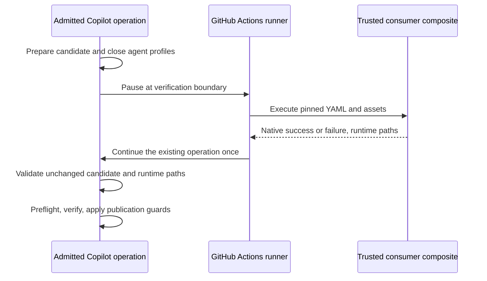

# Repository-owned native verification setup

- Status: Ready for implementation
- Date: 2026-10-22
- Catalog capability ID: branch-synchronization
- Last verified: 2026-10-22
- Owners: Copilot maintainers
- Scope: Prepare authorized repository verification through a trusted native composite action, without editing generated workflows.
- Related issues/PRs: [#647](https://github.com/vypdev/copilot/issues/647), [#652](https://github.com/vypdev/copilot/pull/652)
- Required review gates: product UX, architecture, testing, documentation, security/operations
- Open decisions blocking readiness: none; the maintainer selected a same-job composite dependency action on 2026-10-21 and centralized reusable-workflow coordination on 2026-10-22.

## 1. Executive summary

A repository MAY opt into a consumer-owned `.github/actions/copilot-verification-setup/action.yml` using `runs.using: composite`. GitHub Actions MUST execute its native `uses`/`run` steps after Copilot prepares the candidate and before runtime preflight and each verification command. Copilot MUST retain its existing authorization, verification and publication gates.

```text
Authorized operation -> prepare candidate -> native composite setup
 -> credential-free runtime preflight -> verification -> publication guards -> push
```

This replaces the unreleased Node ESM prototype in PR #652. There is no custom YAML interpreter or cross-job candidate transport. A Copilot-owned reusable workflow encapsulates the complete same-job coordination; the dependency action remains consumer-owned and composite.

## 2. Problem, current behavior, and evidence

### 2.1 Problem

Consumer projects need different runtimes and dependencies. Editing generated Copilot workflows to install them creates maintenance drift. A separate application CI job does not provision the job doing a temporary branch merge or automated fix.

### 2.2 Current behavior

The existing `GitCommitAdapter` prepares a fresh credential-free environment for every verification command. Runtime prerequisites are probed before the command. `SyncBranchUseCase` validates the resulting merge and rereads remote heads before publication; the shared commit preflight validates safe workspace paths. These gates remain authoritative.

### 2.3 Evidence

- Central boundaries: `SyncBranchUseCase.verifyPreparedMerge`, shared `runCommitAndPushPreflight`, `GitCommitAdapter.execute`.
- Only issue-comment and review-comment composition roots construct the mutation adapter. Issue/PR/push/review-state analysis callbacks may forward configuration but do not thereby execute verification. `CommitUseCase` analyzes push metadata and is not a mutation verifier.
- [Composite action metadata](https://docs.github.com/en/actions/reference/workflows-and-actions/metadata-syntax) defines native steps; [GitHub's tutorial](https://docs.github.com/en/actions/tutorials/create-actions/create-a-composite-action) documents local actions.
- Consumer incident: [homeassistant-gateway #19](https://github.com/vypdev/homeassistant-gateway/issues/19).

### 2.4 Retrospective classification

Not applicable: this is a prospective change. The earlier Node implementation is superseded, not a supported compatibility surface.

## 3. Actors, surfaces, and terminology

| Actor | Goal | Surface |
|---|---|---|
| Repository maintainer | Review dependencies once and enable preparation | Consumer action, setup configuration, Repository Variable |
| Authorized contributor | Synchronize or request file changes | Existing issue/PR commands and result comments |
| Operator | Locate setup failure and recover | Named native Actions steps, existing result card, run logs |

The **trusted source** is the configured main/production remote branch captured at an immutable Git commit. The **candidate** is the actual workspace after merge/fixer changes. A **native boundary** pauses an already admitted operation; it does not authorize or replay one.

## 4. Goals, non-goals, and fixed invariants

### 4.1 Goals

1. Let each repository declare native setup actions and shell steps.
2. Prepare the candidate's current dependencies before every configured verifier.
3. Preserve consumer YAML and auxiliary assets during setup/update.
4. Provide inspectable native steps and actionable failures.

### 4.2 Non-goals

Consumer-owned reusable workflows and job matrices inside the dependency hook, YAML emulation, local Actions emulation, arbitrary helper paths and release/deployment changes are out of scope. The Copilot-owned reusable coordinator is in scope and retains the complete operation and native setup in one job.

### 4.3 Fixed product/safety invariants

- Setup MUST NOT grant modification authority or run for forks rejected by existing admission.
- Read-only, dry-run, aligned/no-op and empty-verifier operations MUST NOT execute setup.
- Candidate edits MUST NOT replace the captured action or its auxiliary files.
- Failure, timeout, malformed handoff, changed candidate or invalid runtime paths MUST withhold the command and publication.
- Each verification command MUST use a fresh private HOME; only validated runtime directories and JAVA_HOME return to its environment.

## 5. Current versus proposed product journey

| Stage | Existing | Proposed |
|---|---|---|
| Adoption | Edit generated workflow or provision runner | Review consumer composite onto trusted main, update generated workflows, enable opt-in |
| Candidate preparation | Agent/temporary merge | Unchanged |
| Dependencies | Preinstalled in same job | Native consumer composite, in that same job and candidate workspace |
| Verification/publication | Credential-free checks and existing guards | Same checks and guards after successful setup |



Text equivalent: Copilot prepares the candidate, pauses, the runner executes trusted setup, and the same operation resumes only after validating the unchanged candidate. No agent is rerun.

## 6. Functional behavior and state model

### 6.1 Happy path

1. Composition MUST capture immutable trusted Git objects before candidate mutation. The action directory is limited to 32 regular files, 64 KiB per file and 256 KiB total. Its root metadata MUST be `action.yml`, valid composite YAML with 1–32 steps. Asset paths MUST use portable ASCII letters/digits/underscore/dot/dash/slash, at most 200 characters, without empty/parent segments or Windows reserved names. Symlinks, submodules, unsafe paths and nested local `uses` actions are rejected. Native external actions and reviewed auxiliary scripts are supported.
2. At the existing verifier boundary, a private same-job worker MUST retain the admitted call stack. Generated workflows do not rerun the full operation to continue it.
3. The worker MUST bind HEAD, symbolic branch, index, tracked changes and publishable untracked contents. Git observations are bounded to 16 MiB, 256 untracked files and 16 MiB aggregate untracked contents; oversized candidates fail closed. Ignored dependency caches are excluded.
4. The trusted snapshot MUST be staged at the reserved local metadata path `.git/copilot-verification-setup`, outside publishable candidate files. Native execution requires the normal directory-based `.git` checkout produced by generated `actions/checkout` steps. The candidate's consumer action directory MUST never be rewritten. Staging MUST persist until native post steps finish. Runner state MUST retain the initial source SHA and digest of all captured file paths, bytes and modes. Before each runner-managed aggregate composite post phase, a trusted Copilot post step MUST use its initially pinned absolute Git executable to restore that exact snapshot from Git objects at the pinned SHA and verify the saved digest, never a moved branch or candidate file. This aggregate phase contains the nested actions' post hooks; it is not a composite YAML `post` key or a restoration between individual nested hooks. An unknown preexisting staging directory MUST fail closed without being overwritten.
5. The continuation MUST match the session, current request, run, attempt, job and workspace. Duplicate/stale responses fail closed. The candidate identity MUST still match.
6. Only new existing PATH directories within the workspace, private HOME or trusted tool cache, and an approved JAVA_HOME, MAY reach the verifier. The existing closed 16-KiB result validation and eight-directory ceiling remain in force.
7. Runtime preflight and the configured command MUST execute in that same fresh environment. Basename resolution MUST use its validated PATH, preserving virtual-environment invocation paths rather than the worker PATH or canonical binary target. Subsequent commands repeat setup with a new HOME and the current manifests.

### 6.2 Alternative paths

GitHub's [accepted runner lifecycle ADR](https://github.com/actions/runner/blob/main/docs/adrs/1144-composite-actions.md#prepost-steps-in-nested-actions)
defines the aggregate post step and reverse ordering used above. The trusted
worker output channel belongs to Copilot; repository verification processes
receive the closed environment without GitHub file-command or worker-session
paths. Same-user filesystem access remains the explicit §11 operator boundary.

Disabled setup preserves existing behavior. Enabled setup without native workflow support, including local CLI verification, MUST fail closed with an explanation to update workflows and run in GitHub Actions. Snapshot errors are deferred on routes that do not verify. No automatic setup retry or shared readiness cache is permitted.

### 6.3 State machine

| State | Meaning | Next/recovery |
|---|---|---|
| Disabled/skipped | No preparation requested | Existing operation |
| Prepared candidate | Authorized workspace ready | Pending native setup |
| Pending setup | Native runner owns current setup request | Ready, failed, canceled, timed out |
| Ready | Native success and candidate/runtime validation passed | Preflight and command |
| Blocked | No safe successful continuation | Existing abort/result publication; operator repairs and reruns |
| Complete | Existing operation and its result publication completed | Private session cleanup |

## 7. User-facing configuration

| Surface | Name/type | Default/range | Scope |
|---|---|---|---|
| Action | `verification-setup`, boolean | `false`; only true/false | Invocation |
| Repository Variable | `VERIFICATION_SETUP` | `false`; true/false | Generated workflow |
| Setup config | `repository.verificationSetup`, optional boolean | absent means false | Installation plan |
| Consumer file | Fixed composite directory above | No path override | Repository-owned, never installer-owned |

The setup configuration plans the Variable; generated workflows forward its value. An explicit direct Action input applies to that invocation. Invalid values MUST fail validation. Runtimes are not inferred. Recommended adoption: review the action onto trusted main, update generated workflows with `copilot setup`, then enable the Variable. Alternative: remain disabled and provision dependencies before Copilot in the same job.

The 20-command limit, five-minute native setup timeout, snapshot/result/path bounds, source trust and publication checks are intentionally non-configurable. The former Node helper protocol and 64-KiB suppressed-output ceiling are retired; native step logs use GitHub Actions semantics.

## 8. Clean Architecture design

### 8.1 Responsibilities and dependency direction

| Boundary | Responsibility | Forbidden responsibility |
|---|---|---|
| Pure policy/application ports | Closed limits/errors, immutable prepared snapshot | Runner APIs or process implementation |
| Existing application use cases | Admission, candidate preparation, verification and publication decisions | Native YAML interpretation or duplicate phase orchestration |
| Git adapter/setup runner | Pause precisely before probes/command, validate resume | New mutation authorization |
| Infrastructure snapshot/staging/protocol/controller | Trusted objects, persistent native staging, same-job process lifecycle | Provider business policy or model execution replay |
| Entrypoint/generated workflows | Dispatch native phases and native `uses` | Reimplement verifier/publication rules |
| Presentation | Existing localized result/error surfaces | Executable helper output as policy |

### 8.2 Contracts, state, and trust boundaries

The session contains bounded non-secret metadata and private operational logs. Worker stdout/stderr redact configured secrets and dynamic masking commands before bytes reach disk; PAT/model credentials are never serialized as log content. Credentials remain in the admitted worker's memory/environment as in the existing Action; child verifier environments remain allowlisted. Session provenance, request UUIDs and one-use responses prevent accidental replay across jobs/candidates. Root Action post-job cleanup owns cancellation and private directory removal. The reusable coordinator MUST use GitHub self-repository `$/` references for its initial Action and every continuation/post registration. GitHub resolves these to the called workflow repository and exact commit in its independent Action cache, including when the caller pins a full SHA; candidate files cannot replace this runtime. No second independently moving Action version is permitted. The standalone native acceptance fixture retains its explicitly owned source snapshot. Post hooks run only for the native callback phases, preserving ordinary direct Action behavior. Dependency-only profiles remain private until nested native post steps finish, then the original Action post step removes them; no later verifier reuses them. No artifacts or remote checkpoints are created.

The workflow's fixed native phases support at most 20 setup boundaries per operation. Worker log forwarding preserves complete runner-command lines, with a 1-MiB single-line memory bound; this is distinct from native setup logs. Worker outputs are bounded to 256 KiB.

### 8.3 Executable architecture constraints

Existing architecture/dependency tests remain mandatory. The workflow validator MUST compare the central reusable workflow and compact source/distributed callers with the canonical generator, including events, bot/fork admission, explicit secret bindings, permissions, runner routing, conditions, timeout, runtime-only env and same-commit Action references/inputs. All six existing configuration callbacks retain explicit opt-in forwarding.

## 9. UI/UX and content contract

### 9.1 Information hierarchy

Existing issue/PR result cards remain the primary operation status. Named Actions steps expose preparation and continuation; no new comment stream or labels are introduced. Users see impact, cause, action and retained state before technical details.

### 9.2 Representative primary views

| State | Representative content |
|---|---|
| Pending | Actions: “Prepare repository verification 1”. Operation remains in progress; no user action. |
| Action required | “Repository setup blocked verification (native-workflow-required). Update the generated Copilot workflows and run this operation in GitHub Actions; the local CLI cannot execute composite actions.” |
| Failed | “Repository setup blocked verification (process-failed). Review the trusted action and rerun. Verification, commit and push are withheld.” |
| Partially complete | Candidate prepared; setup failed; no remote publication. Existing sync abort restores the local merge. |
| Complete | “Repository setup completed; runtime preflight and verification may proceed.” Existing operation then reports its actual publication result. |

### 9.3 Issue, PR, and comment behavior

No additional comments: the existing bounded result publication owns success/failure and links to the run. Native raw setup logs MUST NOT be copied into issue/PR content. Diagnostics identify the fixed path, closed cause and pinned source SHA.

### 9.4 Accessibility and localization

Existing localized result cards and plain-text error fallback remain in force. Native diagnostic step names are English operational labels. Text accompanies every diagram; no color-only states or new responsive layout is introduced. Helper stdout is never interpreted as commands to Copilot or Markdown publication content.

## 10. Failure, recovery, and cleanup

| Failure | Impact and action | Cleanup/retry |
|---|---|---|
| Missing/invalid trusted action | No verifier/push; review trusted directory | No automatic retry |
| Native failure or timeout | No verifier/push; inspect native step logs and repair | Worker abort/finally preserves candidate files and uses existing sync recovery |
| Stale/cross-job/replayed response | No continuation; rerun fresh operation | Private session canceled |
| Candidate changed during setup | No verifier/push; make setup dependency-only | Candidate action unchanged; existing recovery |
| Invalid runtime output | No verifier/push; install under approved roots | Fresh HOME disposed |
| Job canceled/worker exits | No new publication; inspect retained operation result | Post action signals cancellation, waits up to 10 seconds, terminates remaining worker and cleans owned staging after native posts |

Request cleanup MUST run only after the invocation validates its native session and successfully publishes its own request. Invalid session paths or identity, and failures before request creation, MUST leave preexisting request files untouched. Successful and failed continuations MUST remove their owned request. Three distinct rejection regressions cover invalid path, invalid identity and failure before request creation; existing success/failure cases assert owned cleanup.

Native setup steps have `timeout-minutes: 5`; the worker also rejects readiness after 300 seconds. The enclosing existing job timeout remains authoritative. A force-killed worker cannot promise application finally blocks ran: the Action cleans its own staging, and normal runner checkout cleanup/operator recovery owns remaining job-local candidate state. Already-completed remote effects MUST retain their existing truthful result semantics.

## 11. Security, permissions, and privacy

Native setup receives only runtime metadata from the private verifier environment, never Copilot's PAT/model inputs or evidence token. Callers MUST explicitly forward the existing named Secrets to the reusable workflow; unrestricted `secrets: inherit` is not generated. The existing Cursor provider condition MUST apply both to the caller's Secret grant and the initial Action environment: only the default provider or findings/fixer/planner/reviewer/tester role selecting Cursor may forward that key. The coordinator MUST keep provider secrets scoped to the initial Copilot Action step, not the job or consumer action. Checkout credentials remain unpersisted. Native actions can use runner facilities required for normal Actions execution; they are reviewed executable maintainer code.

This preserves the trusted-runner boundary and makes no OS-sandbox claim: same-user processes and service-level credentials remain an operator trust concern. PATH/JAVA_HOME are validated after setup; arbitrary `GITHUB_ENV` keys do not enter the verifier. Native external action versions and dependency caches are maintained by the repository owner. Nested local `uses` is excluded because its deferred post scripts could otherwise refer to candidate assets outside the trusted staging tree.

## 12. Observability and operational UX

Logs name the fixed action and pinned source SHA, preparation success, and the existing verification result. Native Actions logs expose setup commands normally; maintainers MUST avoid printing secrets. No new secret-bearing artifacts, telemetry fields or result comments are added. The operation worker drains ordinary Action logs in order so masking commands retain their framing.

## 13. Compatibility, migration, rollout, and rollback

Installer onboarding is specified by the existing setup capability's companion
[`verification-setup-onboarding.md`](./verification-setup-onboarding.md): seed the
fixed action only if missing, preserve existing consumer bytes and auxiliaries,
show the shared terminal/web activation question (default false), and document
CLI/Action-ref/workflow upgrades. Seeding a file does not transfer generator
ownership or alter this native execution/trusted-main contract. The generated
placeholder fails until the owner customizes it and reviews it onto trusted main.


Existing installations remain disabled by default. The unreleased `.copilot/verification-setup.mjs` prototype is removed rather than maintained as a second execution mode. Consumers opting in MUST update generated callbacks before activation and review the composite directory onto trusted main. Setup/install/update MUST preserve that directory and all its assets. Rollback disables the Variable and restores ordinary same-job provisioning; no remote migration, release or tag is required.

## 14. Testing strategy and numeric budget

Minimum **193 distinct automated cases**, allocated without double counting:

| Area | Minimum | Risk |
|---|---:|---|
| Policy/configuration | 30 | Defaults, invalid values, closed runtime schema |
| Trusted snapshot/assets | 22 | Pinning, hashes, file modes, malformed/native metadata |
| Native protocol/controller | 36 | Lifecycle, output framing, replay, timeout, cancellation |
| Candidate/runner orchestration | 24 | Ordering, fresh profiles, candidate identity, failure gates |
| Workflows/setup contracts | 58 | Native step structure, env, limits, source/distribution, preservation |
| Real Git/composition integration | 8 | Exact managed ref, merge manifests, abort/push guards |
| Runtime result filesystem security | 15 | Bounds, links, containment, races, owned staging and three early-rejection request ownership cases |
| **Total** | **193** | Native rewrite adds at least 70 cases beyond retained applicable baseline; release review adds three ownership cases |

Repository-wide thresholds remain in force. New pure policy targets 100% branches; changed setup adapters target aggregate 95% lines/statements and 90% branches/functions. Deterministic unit fakes cover runner responses without interpreting YAML. Separate native CI acceptance MUST execute real composite `uses`/`run` steps with Python/pytest and Node/pnpm on hosted Linux, Windows and macOS, asserting candidate changes, trusted-source selection, fresh profiles candidate preservation, source-runtime immutability even after candidate bundle changes, and final post cleanup. Controlled local Git acceptance covers the exact same managed branch and no release. Native CI evidence is additional to the distinct Jest budget.

## 15. Documentation and discoverability

| Audience | Deliverable | Validation |
|---|---|---|
| User/operator | Verification page: normal flow, Python/Node YAML, native logs, limits, failures and CLI constraint | Documentation links and workflow fixtures |
| Setup owner | Setup configuration reference and same-job adoption order | Setup parser/planning and update-preservation tests |
| Contributor | Generated agent guide, source contract, SDD/catalog evidence | Guidance/specification validation |

## 16. Acceptance scenarios

1. Disabled repositories run existing verification unchanged.
2. Enabled authorized sync prepares dependencies from the temporary merged manifests, verifies and pushes only its existing managed branch.
3. A candidate/model change to the action does not execute; trusted YAML/assets run, the original candidate bytes remain unchanged.
4. Setup success precedes runtime probes; every command gets a fresh HOME. Read-only, dry-run, no-op and empty-command paths execute no setup.
5. Failed/canceled/timed-out setup, changed candidate, malformed output or replayed/cross-job continuation blocks verification and publication and cleans owned staging.
6. Native Python/pytest and Node/pnpm acceptance passes on all three hosted platforms. No PAT/model credentials are forwarded to the consumer action or verifier.
7. Updating Copilot twice preserves the consumer directory. Old/missing native callback support and CLI opt-in fail with actionable help.
8. Existing post-verification remote-head/workspace guards and truthful partial-success reporting remain authoritative.

## 17. Requirements traceability

| Requirements | Implementation/evidence | Documentation |
|---|---|---|
| §§4–7 source/defaults/routes | Policy, snapshot, config/composition and sync tests | Verification/setup reference |
| §6 native handoff/candidate | Runner, protocol, staging, controller tests | Architecture/recovery |
| §§8–11 workflows/security/cleanup | Structural mutation tests, result filesystem tests, platform fixture | Native steps and trust boundary |
| §§12–16 compatibility/acceptance | Setup preservation, real Git integration, hosted native acceptance | Migration/operator guide |

## 18. Implementation sequence

1. Resolve native contract and update specification/issue/PR.
2. Capture composite assets, implement bounded same-job native handoff and cleanup.
3. Generate native callbacks and enforce their structure.
4. Replace prototype tests; add native platform acceptance and real Git integration.
5. Update docs/guidance/catalog/bundles and validate all repository gates.
6. Resolve findings, wait for every required check on the final head, then merge to develop as explicitly authorized.

## 19. Definition of Done

- [x] Normative acceptance and traceability are covered.
- [ ] Native runner executes the composite at the actual candidate verification boundary.
- [x] Architecture, numeric budget, coverage and workflow mutation checks pass.
- [x] Defaults, limits, CLI behavior, failures, replay and cancellation match documentation.
- [x] User/setup/operator/contributor docs, native UI labels and safe diagnostics are reviewed.
- [x] Generated guidance/catalog/bundles and required validations pass.
- [ ] All three hosted native acceptance jobs pass; controlled Git sync preserves the same managed ref.
- [ ] Final-head checks pass and no unresolved review findings remain before merge.

## 20. References and decisions

The maintainer selected the consumer-owned composite dependency action on 2026-10-21. [Issue decision record](https://github.com/vypdev/copilot/issues/647#issuecomment-6318551564). Consumer-owned reusable dependency workflows and the Node ESM helper were rejected. On 2026-10-22 the maintainer selected the Copilot-owned reusable coordinator in §20.1; it executes that same composite hook in one job, without adding a second dependency execution mode. Related contracts: `branch-synchronization`, repository verification prerequisites and the shared automated commit pipeline in the specification catalog.


### 20.1 Central comment coordinator — issue #662

The [coordinator companion](./copilot-comment-workflow-coordinator.md) owns the
incremental 40-case encapsulation contract. Source and installed callbacks call
one Copilot-owned workflow; the whole operation remains in one job. The consumer
dependency action remains composite. The companion defines compact callers,
same-commit self references, named Secret isolation, unchanged timeout/cleanup
behavior, safe runner migration, effective configuration inspection, platform
prerequisites, docs and rollout. This document retains the verifier and trusted
setup execution contract; no cross-job candidate transport is introduced.


### Source candidate dependency correction — #746

The [source candidate readiness amendment](./branch-synchronization-and-conflict-recovery.md#candidate-dependency-readiness-and-failure-facts--746-2026-10-27) owns the incremental source-only frozen-pnpm preparation and closed sync failure facts. Source runtime bootstrap remains before the Action; source dependencies move to each actual candidate verifier boundary after optional native setup and runtime probes. Consumer setup opt-in, runtime-only declarations and generic no-installer behavior remain unchanged. The amendment owns its incremental test budget and separately authorized default-runtime rollout; do not double count it here.

### Derived JVM/Gradle discovery — issue #775

The [private discovery amendment](./repository-verification-runtime-prerequisites.md#21-private-jvm-and-gradle-discovery--issue-775-2026-10-29)
owns the additional 32-case budget and actual JVM/Gradle acceptance. Native
setup receives host-derived JDK_JAVA_OPTIONS and GRADLE_USER_HOME for the current
private profile. They are output metadata, not new caller inputs or accepted
setup-result overrides; the response remains approved PATH/JAVA_HOME only.
Canonical setup bindings carry them, while Node continuation and provider-secret
boundaries remain unchanged. Each subsequent command uses a new private profile;
existing candidate/session/publication guards and post cleanup still apply.

### Derived CPython loader discovery — issue #776

The [CPython amendment](./repository-verification-runtime-prerequisites.md#22-dynamically-linked-cpython-verification-issue-776)
owns the incremental minimum 40-case budget and real Linux acceptance. Its
bootstrap loader directory is local to the trusted Python run step. Verifier
children separately derive a contained library from the captured tool cache,
including copied private-venv base metadata, before ordinary runtime probes.
PATH/JAVA_HOME remain the only native result fields; the parent Node environment,
provider credentials, complete configured commands and deferred cleanup keep
their existing boundaries. Do not double count the amendment's cases here.
