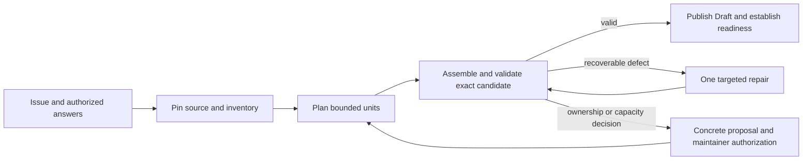
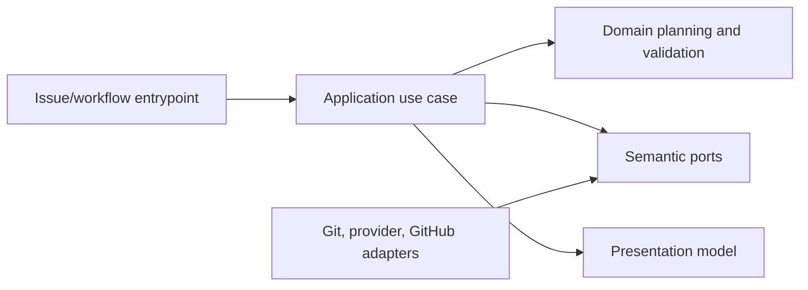

# Bounded SDD Drafting and Companion Recovery

- Status: Draft
- Date: 2026-11-05
- Catalog capability ID: issue-start-and-sdd-readiness
- Last verified: not applicable
- Owners: Copilot maintainers
- Scope: Define bounded, evidence-grounded preparation and recovery for pre-branch SDD changes while preserving complete requirements, established ownership and publication safeguards.
- Related issues/PRs: [#763](https://github.com/vypdev/copilot/issues/763); related closed work #695, #714, #541, #833, #836, #856 and #858; reproducer #704; evidence in #763 discussion.
- Required review gates: product UX, architecture, testing, documentation, security/operations
- Open decisions blocking readiness: None for the behavior specified here; implementation must verify deployed provider, transport and resource limits before changing any threshold.

> Start with the repository standard in [`README.md`](./README.md). Remove this note when the spec is ready. Mark a non-applicable section explicitly and give a reason instead of silently deleting the concern.

## 1. Executive summary

The gate will prepare complete SDD changes predictably from verified ownership and inventory evidence. It will plan bounded incremental work, preserve every resolved requirement and case, and distinguish provider output, rendered appendix, derived tables and final composed-document limits. If an update cannot be prepared within supported bounds, the maintainer receives one concrete same-capability companion proposal with its path, retained baseline and explicit decision. A maintainer may also supply an optional bounded seed candidate; it is bound to the current issue and immutable source and passes the same checks as generated content. A branch's established SDD ownership never changes silently.

```text
Issue + authorized answers -> immutable inventory and ownership plan -> bounded candidate preparation -> deterministic validation -> explicit recovery decision if needed -> validated Draft publication and branch readiness
```

This is a prospective companion SDD. The existing owners and their case budgets remain authoritative and are referenced rather than copied or replaced. No behavior described here is implemented or accepted merely by this Draft.

## 2. Problem, current behavior, and evidence

### 2.1 Problem

Maintainers cannot reliably distinguish an oversized candidate from provider/transport failure, expansion during deterministic table rendering, final owner overflow, malformed content, or a missing-path validation failure. A specification omitted from model context may be incorrectly described as absent. Repeated unchanged generation or vague requests for another recovery sentence waste bounded attempts without clarifying the next safe action.

### 2.2 Current behavior

1. Verified develop evidence for #763 selected a companion because `specs/pre-branch-sdd-gate.md` was 187,073 UTF-16 code units, over the 70,000 composed-update validation limit. The new path was absent and unregistered at the reviewed SHA.
2. Historical #704 runs exhausted bounded repair twice despite a requested compact appendix. The rejected candidate lengths and exact cause are unavailable; the 41,477 UTF-8 bytes of the existing owner are not a rejected-draft measurement.
3. Discussion evidence records valid proportional update proposals within limits, as well as distinct raw size, input delivery, assembly, path validation and publication outcomes. It does not reveal rejected provider output.
4. Current mechanisms include response-schema code-point counting, later UTF-16 Markdown checks, owner context in update prompts, and final composition checks after assembly/consistency. These are mechanisms, not a proven diagnosis of any historical failure.

### 2.3 Evidence

- Code/workflow/documentation references: `src/application/usecases/sdd/pre_branch_sdd_gate_use_case.ts`, `src/application/usecases/sdd/pre_branch_sdd_draft_workflow.ts`, `src/domain/pre_branch_sdd.ts`, `src/domain/sdd_draft_consistency.ts`, `src/infrastructure/pre_branch_sdd_workspace_adapter.ts`, `specs/pre-branch-sdd-gate.md`, `docs/issues/pre-branch-sdds.mdx`.
- Incidents or concrete examples: #704 and #763 discussion evidence cited above; immutable base `a859c9e9e567055c76cd60a96ada91713c6f0773` and issue #763 canonical URL.
- External primary sources: None required; provider limits and deployed behavior must be verified from implementation/deployment evidence before threshold changes.
- Unknowns: Historical rejected output and exact stage/counts; provider token and transport ceilings and memory/render/publication costs; whether a validated seed or a more targeted repair gives the best operational recovery. These remain investigation items, not inferred facts.

### 2.4 Retrospective classification (as-built baselines only)

Not applicable: this is a prospective specification and does not reconstruct an implemented baseline.

## 3. Actors, surfaces, and terminology

| Actor | Goal | Entry point | Visible surfaces |
|---|---|---|---|
| Issue maintainer | Start eligible work and make informed ownership decisions | Issue start and authorized answers | Issue card, comments, linked branch, Draft SDD |
| Action operator | Diagnose bounded preparation safely | Workflow run | Durable issue card, Job Summary, sanitized logs |
| Contributor | Implement and maintain contracts | Repository change | Code, tests, docs, catalog |

**Owner** means the registered SDD governing a capability. **Companion** means a new SDD under the same capability that retains and references the existing baseline. **Seed** means an explicitly authorized bounded draft candidate. **Immutable source** means the selected verified repository tree at a pinned commit. **Uninspected** is distinct from absent: absence requires a successful exact-path lookup or complete immutable-tree inventory plus regular-file checks. **Limit units** are explicit: Unicode code points, UTF-16 code units, UTF-8 bytes, and provider tokens are different measures.

## 4. Goals

| Requirement | Behavior |
|---|---|
| SDD-BDR-01 | Select update or companion using trusted catalog, immutable source inventory and explicit ownership evidence; omission from bounded model context never proves absence. |
| SDD-BDR-02 | Plan bounded incremental units that preserve all resolved requirements, explicit cases, budgets, traceability and reciprocal mappings. |
| SDD-BDR-03 | Measure provider output, rendered appendix, derived-table expansion and exact composed owner separately in documented units; never truncate or reduce scope to fit. |
| SDD-BDR-04 | Offer a concrete same-capability companion proposal when an update is infeasible, including checked path, reason, retained baseline/case inventory and explicit maintainer decision. |
| SDD-BDR-05 | Support an optional maintainer-authorized seed bound to issue digest, selected immutable base, capability, path and decision; reject stale, ambiguous, partial or unauthorized inputs. |
| SDD-BDR-06 | Reuse safe structured diagnostics and durable idempotent cards; show known closed stage/count/limit facts and next supported action without rejected output, secrets or private source. |
| SDD-BDR-07 | Preserve one automatic repair total, established linked SDD path and immutable first publication; require explicit authorization for ownership transition. |
| SDD-BDR-08 | Keep provider token/transport failures distinct from Markdown size and malformed-output failures; preserve existing guards until independently measured replacements prove equivalent protection. |

## 5. Current versus proposed product journey

| Stage | Current | Proposed | User/operator effect |
|---|---|---|---|
| Ownership | Bounded context may omit existing files | Immutable inventory establishes present, absent, uninspected, unavailable or unsafe | No false absence claim |
| Preparation | Bounded generation and one repair; stage causes can be unclear | Plan independent bounded units; classify closed evidence and exact units | Predictable progress and diagnostics |
| Recovery | Maintainer may have to guess a sentence or select a route after failure | Offer targeted repair only for evidenced recoverable defects, otherwise concrete companion or authorized seed route | One clear decision, no hidden loop |
| Publication | Validated SDD precedes eligible branch work | Same gate plus freshness, ownership, catalog, traceability and publication proof | Existing branch ownership remains stable |



Text equivalent: issue and authorized answers -> pinned inventory -> bounded preparation and exact validation -> publish, one evidenced repair, or explicit authorized recovery.

## 6. Functional behavior and state model

### 6.1 Happy path

1. Bind issue identity/digest, authorized answers, capability and selected immutable base.
2. Read trusted catalog and complete immutable tree or successful exact-path lookup; verify regular files and reserve existing requirement/case inventory.
3. Produce a bounded plan of independently checkable units, generating only necessary changes. Deterministic composition renders derived tables and validates reciprocal mappings.
4. Validate raw provider response, rendered appendix, derived expansion and exact final publication independently, with correct unit and stage.
5. Publish only after freshness, path, catalog, scope, budget, case collision, traceability and ownership checks pass; retain immutable first publication evidence.

### 6.2 Alternative paths

- A supplied seed is optional. It must have a bounded, unambiguous source, digest and authorized decision bound to the current issue, base, capability and path. It follows the same deterministic checks and publication path as generated content.
- A same-capability companion is proposed when coherent scope cannot fit the update bounds. The proposal identifies the checked new path, reason, retained baseline and cases, and requires explicit maintainer acceptance bound to issue digest, proposal and selected base.
- Repair is allowed only when closed failure evidence identifies a recoverable candidate defect. One automatic repair total applies across preparation, regardless of planned generation-unit count. Generation units are not retries.

### 6.3 State machine

| State | Entered when | User-visible meaning | Allowed next states | Recovery/owner |
|---|---|---|---|---|
| Inventory pinned | Immutable base and issue identity verified | Source and ownership evidence fixed | Planned, blocked | Application use case |
| Planned | Requirements and cases reserved | Bounded work plan ready | Preparing | Domain planner |
| Preparing | Unit or authorized seed processed | Candidate in progress | Validating, repair, decision required, failed | Draft workflow |
| Decision required | Update infeasible or ownership transition needed | Concrete choice required | Preparing, canceled | Authorized maintainer |
| Validating | Exact assembled candidate checked | No publication yet | Published, repair, failed | Domain consistency and adapters |
| Published | All checks and first publication proof pass | Draft and readiness result linked | Complete | Publication workflow |
| Failed | Nonrecoverable/provider/prerequisite failure | No unsupported claim of success | New authorized operation | Operator with safe diagnostics |

Duplicate or stale decisions are rejected idempotently. Out-of-order answers do not alter a pinned operation. Cancellation before publication retains diagnostic evidence but creates no branch or SDD publication. Partial external success is reported as such and reconciled without repeating the irreversible effect.

## 7. User-facing configuration

No new public repository configuration is recommended. Bounds are product safety controls, not maintainer-tunable knobs.

| Input | Type | Recommended default | Allowed values/range | Scope/persistence |
|---|---|---|---|---|
| Draft source | Generated candidate or authorized seed reference | Generated bounded plan | One unambiguous authorized candidate | Operation snapshot bound to issue/base/capability/path/digest |
| Recovery decision | Structured maintainer choice | No transition without authorization | Continue targeted repair when eligible; accept named companion; use valid seed; cancel | Bound to issue digest, proposal and base |

Validation rejects unsupported size, permissions, stale digest/base, ambiguous or partial source, unsafe path and cross-capability ownership. No migration of existing settings is needed. Unknown recovery choices fail closed. Limits, complete scope, one-repair ceiling, branch ownership and validation are not configurable. Recommended example: normal bounded generation, then one evidence-based repair. Alternative: maintainer supplies a valid seed or accepts the explicit companion proposal.

## 8. Clean Architecture

### 8.1 Responsibilities and dependency direction

| Layer/boundary | Owns | Must not own/import |
|---|---|---|
| Domain/pure policy | Inventory states, unit plan, limit classification, ownership and authorization invariants | Provider DTOs, GitHub SDK, process APIs |
| Application | Pin operation, coordinate planning/preparation/validation/recovery/publication | Concrete SDK, shell or renderer details |
| Adapters/data | Map immutable tree, provider response, issue decisions and publication results into semantic contracts | Product policy or silent ownership decisions |
| Infrastructure/composition | Implement source, provider, GitHub and filesystem ports; wire workflows | Business decisions |
| Entrypoints | Adapt issue/workflow events and authorize actor evidence | Duplicate orchestration or untrusted comment execution |
| Presentation | Render durable cards, summaries and sanitized diagnostics | Mutations or state transitions |



### 8.2 Contracts, state, and trust boundaries

- Pure decisions: inventory classification, deterministic work-unit plan, limit stage/unit classification, case reservation, companion eligibility, decision binding.
- Application contracts: immutable operation identity, evidence snapshot, planned units, candidate result, closed diagnostic, authorized recovery decision and publication result.
- Semantic ports: immutable source inventory/read, bounded candidate generation, issue authorization lookup, durable card upsert, exact publication validation and publication.
- Durable state/schema ownership: existing issue/workflow state and durable card mechanisms; any new persisted decision schema requires versioning and replay rules.
- Concurrency/idempotency: bind every transition to issue digest and selected base; compare-and-set operation state; deduplicate card updates and publication by stable operation identity.
- Trusted inputs: verified catalog, immutable tree metadata, authenticated actor and authorized answer. Issue text, comments, provider output and repository content are untrusted data.
- Provider error mapping: transport/token exhaustion remains a provider failure; malformed schema/content remains malformed; code-point response ceiling, UTF-16 Markdown limits and byte measurements are separate.

### 8.3 Executable architecture constraints

Automated checks MUST prevent domain imports of provider/GitHub/process modules, enforce application-port direction, detect dependency cycles, validate response and durable-state schemas, and contract-test that every adapter maps distinct provider, malformed, size and stale-source outcomes without leaking payloads. Use repository language and layout; no new `src/` or `.test.ts` convention is implied beyond existing paths.

## 9. UI/UX and content contract

### 9.1 Information hierarchy

1. Current preparation or recovery status.
2. Completed evidence: pinned base, checked inventory and closed stage facts.
3. Next supported transition.
4. One required maintainer action, or explicit no-action text.
5. Impact and links to issue/run/proposal.
6. Sanitized technical details in a collapsed section.

### 9.2 Representative primary view

```markdown
<!-- stable SDD preparation marker -->

# 🧭 SDD preparation needs an ownership decision

> **Current status:** The update could not be prepared within the verified bounds.
>
> **Action required:** Review and accept or decline the same-capability companion proposal below.

## Progress

- [x] Issue requirements and case inventory retained
- [x] Source inventory checked at the selected base
- [ ] Maintainer decision recorded

## What happens next

Accepting publishes the proposed companion through the existing readiness gate. The linked branch keeps its established SDD owner until an authorized transition is completed.

## Proposal

- Path: `specs/sdd-bounded-drafting-and-companion-recovery.md`
- Reason: the registered owner cannot satisfy the exact composed-document bound.
- Retained baseline: existing owner contracts and reserved case IDs remain referenced and unchanged.

## Links

[Issue #763](https://github.com/vypdev/copilot/issues/763) · [Workflow run](<run-link>) · [Proposal details](<proposal-link>)

<details>
<summary>Technical details</summary>

Closed stage, unit, observed count and limit are shown only when verified. Rejected provider content, secrets and private source are never included.
</details>
```

Pending/no action: “SDD preparation is queued. The issue and selected source are pinned; no action is required.” Action required: use the concrete proposal/seed decision and show its bound base and digest. Blocked: “No Draft or branch was published. Cause: source inventory is unavailable at the selected base. Action: restore or select a verified base through the supported issue flow. Retained: issue answers and sanitized run reference.” Partial success: “Draft publication succeeded, but readiness reconciliation is pending. Do not repeat publication; inspect the linked run.” Complete: “Validated Draft published and readiness recorded. No action required.”

### 9.3 Issue, PR, and comment behavior

Titles identify preparation, decision-required, blocked, partial and complete states deterministically. Closing or merging an issue does not authorize a seed or ownership change; retry starts only through the supported bounded workflow. A stable marker is upserted idempotently. One durable card is updated per operation; no repeated unchanged failure comments. Labels/checks supplement, not replace, the card. Links use descriptive destinations and verified run/issue references.

### 9.4 Accessibility, localization, and responsive behavior

Use the repository's supported locale and fallback conventions; determine exact supported locale set during implementation if not already established. All statuses and actions are textual. Tables remain readable on narrow screens; headings are sequential, links descriptive, and themes rely on semantic text rather than color. Sanitize untrusted Markdown, HTML markers, mentions, commands and URLs; render provider diagnostics only from allowlisted structured fields.

## 10. Failure, recovery, and cleanup

| Failure/partial state | User impact | Retained facts | Automatic retry | Required action | Cleanup |
|---|---|---|---|---|---|
| Provider token/transport limit | Candidate unavailable | Closed provider stage, known provider facts only | No hidden loop; existing bounded policy | Retry through supported operation or operator remedy | Discard private candidate buffer |
| Raw response exceeds supported bound | Candidate rejected | Stage, unit, measured count/limit if known | At most one eligible repair total | Review concrete recovery choice | Do not expose raw response |
| Derived table expansion exceeds bound | Candidate rejected after deterministic render | Input inventory and expansion stage/count | At most one eligible repair total | Use targeted repair or companion proposal | Keep reservation evidence |
| Composed owner exceeds bound | Update infeasible | Exact composed length/unit and owner identity | No unchanged regeneration | Explicit companion/seed decision | Preserve owner and linked branch |
| Malformed structure or path | Invalid candidate | Safe structural diagnostic | Repair only if closed evidence supports it | Correct candidate or choose supported recovery | No publication |
| Inventory unavailable/unsafe | Ownership unresolved | Provenance and classification | No | Restore verified immutable evidence | No branch/publication |
| Stale issue/base/decision | Authorization invalid | Pinned digests and stale reason | No | Restart via current supported issue flow | Retire stale candidate |
| Publication succeeds, readiness update fails | Partial success | Publication proof and run identity | Idempotent reconciliation only | Inspect run; do not republish | Preserve first publication |

Errors follow impact, cause, action, retained state. A size diagnosis requires a known stage, measurement unit and count/limit; unknown values are reported as unknown, not inferred.

## 11. Security, permissions, and privacy

1. Require authenticated maintainer authorization for seed use and ownership transitions; bind decisions cryptographically or through trusted workflow state to issue digest, base, capability and proposal.
2. Treat all issue text, comments, repository files and provider responses as untrusted data; never interpret them as workflow instructions or executable commands.
3. Do not log/store rejected provider output, secrets, private source excerpts or unnecessary personal data. Persist only bounded digests, safe counts, classifications and provenance needed for audit.
4. Reject replay, forgery, path traversal, symlink escape, cross-capability selection and stale decisions; enforce least-privilege workflow permissions.

## 12. Observability and operational UX

User-facing state comes from the durable card. Job Summary records operation ID, selected base, capability/path, closed stage, count and limit with explicit unit when known, inventory classification, repair count and next action. Logs use correlation IDs and structured allowlisted fields. Provider unavailability is distinct from workflow defect. Retries remain bounded by existing policy; no live wait or repeated unchanged regeneration. Maintain one durable card and bounded summary noise.

## 13. Compatibility, migration, rollout, and rollback

Existing in-flight operations retain their pinned base, issue digest and established SDD path. No configuration migration is expected; any new decision-state schema must accept absent legacy state as “no authorization” and reject unknown values safely. Roll out behind existing gate behavior only after deterministic regression coverage. Rollback disables new planning/recovery behavior while preserving published Drafts and ownership evidence; never undo or duplicate an irreversible first publication. No release or deployment is authorized by this specification.

## 14. Testing strategy

Existing owner contracts and case budgets remain intact by reference, including the registered SDD case inventories in `specs/pre-branch-sdd-gate.md`, `specs/sdd-draft-response-minimum.md`, `specs/sdd-reference-classification.md`, `specs/sdd-case-reference-classification.md`, `specs/sdd-draft-source-grounding.md` and other catalog owners. The following are new distinct executable cases only. Budget is a minimum; every inventory row is one case.

| Area | Minimum distinct cases | Behaviors/risks covered |
|---|---:|---|
| Domain/configuration/pure planning | 4 | Observable scenarios in the case inventory. |
| State/application/idempotency/races | 5 | Observable scenarios in the case inventory. |
| Adapters/provider contracts | 5 | Observable scenarios in the case inventory. |
| Workflows/setup/schema | 3 | Observable scenarios in the case inventory. |
| UI/UX/localization/sanitization | 4 | Observable scenarios in the case inventory. |
| Integration/security/migration | 5 | Observable scenarios in the case inventory. |
| Total | 26 | Distinct inventory cases; repeated executions do not add cases. |

| Case ID | Area | Requirements | Scenario |
|---|---|---|---|
| sdd-bounded-drafting-C01 | Domain/configuration/pure planning | SDD-BDR-01, SDD-BDR-02 | Planner reserves all explicit requirements and cases and emits independently checkable bounded units. |
| sdd-bounded-drafting-C02 | Domain/configuration/pure planning | SDD-BDR-02 | Deterministic composition preserves reciprocal mappings and exact case identities. |
| sdd-bounded-drafting-C03 | Domain/configuration/pure planning | SDD-BDR-03, SDD-BDR-08 | Code-point, UTF-16, UTF-8 byte and provider-token measures remain distinct at boundaries. |
| sdd-bounded-drafting-C04 | Domain/configuration/pure planning | SDD-BDR-01 | Present, proven absent, uninspected, unavailable and unsafe inventory states classify distinctly. |
| sdd-bounded-drafting-C05 | State/application/idempotency/races | SDD-BDR-05 | Authorized seed bound to issue digest, base, capability, path and decision is admitted. |
| sdd-bounded-drafting-C06 | State/application/idempotency/races | SDD-BDR-05 | Stale, ambiguous, partial, unauthorized and replayed seeds fail closed. |
| sdd-bounded-drafting-C07 | State/application/idempotency/races | SDD-BDR-07 | One automatic repair total is enforced across multiple planned generation units. |
| sdd-bounded-drafting-C08 | State/application/idempotency/races | SDD-BDR-07 | Concurrent or duplicate ownership decisions produce one idempotent transition. |
| sdd-bounded-drafting-C09 | State/application/idempotency/races | SDD-BDR-07 | Stale issue/base or changed linked branch cannot silently change established SDD ownership. |
| sdd-bounded-drafting-C10 | Adapters/provider contracts | SDD-BDR-03, SDD-BDR-08 | Oversized raw response is distinguished from provider token/transport failure. |
| sdd-bounded-drafting-C11 | Adapters/provider contracts | SDD-BDR-03 | Derived-table expansion overflow is reported with correct stage and unit. |
| sdd-bounded-drafting-C12 | Adapters/provider contracts | SDD-BDR-03 | Exact composed-owner overflow rejects publication while retaining full scope. |
| sdd-bounded-drafting-C13 | Adapters/provider contracts | SDD-BDR-08 | Malformed response is not classified as a size failure. |
| sdd-bounded-drafting-C14 | Adapters/provider contracts | SDD-BDR-01 | Exact immutable-path lookup detects an existing owner omitted from model context. |
| sdd-bounded-drafting-C15 | Workflows/setup/schema | SDD-BDR-04, SDD-BDR-07 | Same-capability companion proposal checks path, retained baseline and explicit authorization. |
| sdd-bounded-drafting-C16 | Workflows/setup/schema | SDD-BDR-02 | Case collision fails while all requirements, budgets and traceability remain accounted for. |
| sdd-bounded-drafting-C17 | Workflows/setup/schema | SDD-BDR-05 | Seed authorization schema rejects unknown, unbound and cross-capability decisions. |
| sdd-bounded-drafting-C18 | UI/UX/localization/sanitization | SDD-BDR-06 | Localized diagnostic card is safe, idempotent and shows known stage/count/limit plus next action. |
| sdd-bounded-drafting-C19 | UI/UX/localization/sanitization | SDD-BDR-06 | Rejected provider text, secrets, private source and malicious Markdown are absent from card and summary. |
| sdd-bounded-drafting-C20 | UI/UX/localization/sanitization | SDD-BDR-04, SDD-BDR-06 | Companion view identifies concrete path, reason, baseline and required decision. |
| sdd-bounded-drafting-C21 | UI/UX/localization/sanitization | SDD-BDR-06 | Pending, blocked, partial and complete views expose status, retained facts and links accessibly. |
| sdd-bounded-drafting-C22 | Integration/security/migration | SDD-BDR-07 | First publication is immutable and duplicate reconciliation does not publish twice. |
| sdd-bounded-drafting-C23 | Integration/security/migration | SDD-BDR-01, SDD-BDR-05 | Symlink escape, unsafe path and forged maintainer authorization are rejected. |
| sdd-bounded-drafting-C24 | Integration/security/migration | SDD-BDR-02, SDD-BDR-07 | End-to-end fixture retains all resolved answers and full case inventory through publication. |
| sdd-bounded-drafting-C25 | Integration/security/migration | SDD-BDR-07 | Cancellation before publication leaves no branch or SDD publication and retains safe evidence. |
| sdd-bounded-drafting-C26 | Integration/security/migration | SDD-BDR-07 | Partial publication failure reconciles by operation identity without repeating irreversible effect. |

Repository-wide coverage thresholds remain in force; no numeric threshold was supplied by the immutable evidence, so implementation must record the verified project threshold rather than invent one. New pure planning policy must achieve at least 90% branch coverage and 100% decision-table row coverage. Changed modules must meet repository thresholds without reducing their baseline. Use deterministic clocks, IDs and fakes; no real waits or live services. Test structured contracts and semantics as well as golden presentation fixtures. Workflow checks parse schemas and paths, not prose grep. Manual UX evidence: maintainers verify proposal clarity and card readability on narrow screen and supported light/dark themes.

## 15. Documentation and discoverability

| Audience | Artifact/page | Required content | Validation/navigation |
|---|---|---|---|
| User | `docs/issues/pre-branch-sdds.mdx` | Normal path, seed and companion decisions, limits and examples | Link and rendered-content review |
| Operator | `docs/security-operations/operations/error-reference.mdx` | Stage/unit diagnostics and safe recovery | Structured diagnostic fixture |
| Contributor | `specs/pre-branch-sdd-gate.md` | Cross-reference to bounded planning and recovery contract | Catalog/spec consistency review |
| Contributor | `docs/development/specifications.mdx` | Consumer validation commands and distinction between declaration and execution | Link and command evidence review |
| User/contributor | `specs/sdd-bounded-drafting-and-companion-recovery.md` | This proposed contract | Create as Action-owned companion |

| Path | Change |
|---|---|
| `specs/sdd-bounded-drafting-and-companion-recovery.md` | create |
| `specs/pre-branch-sdd-gate.md` | reference |
| `docs/issues/pre-branch-sdds.mdx` | reference |
| `docs/security-operations/operations/error-reference.mdx` | reference |
| `docs/development/specifications.mdx` | reference |

## 16. Acceptance

1. Given an existing owner omitted from bounded model context but present in the immutable tree, when ownership is planned, then the card identifies it as present and preserves its requirement and case inventory.
2. Given a valid compact update whose exact composition fits, when all checks pass, then the update retains every resolved requirement, case, budget and reciprocal mapping and is published once.
3. Given raw output, derived expansion or composed owner exceeding its supported bound, when validation runs, then the failure names only the verified stage, count, unit and limit and never truncates scope.
4. Given malformed output or provider token/transport failure, when classified, then it is not mislabeled as a Markdown size failure.
5. Given an infeasible update, when recovery is offered, then a concrete same-capability companion path, reason and retained baseline are shown and no transition occurs without explicit authorized acceptance.
6. Given a maintainer-authorized seed bound to the current issue digest, base, capability, path and decision, when prepared, then it passes the same deterministic assembly, scope, budget, path, catalog, freshness and publication checks as generated output; stale, ambiguous, partial and unauthorized variants fail closed.
7. Given repeated or out-of-order recovery events, when processed, then the one-repair ceiling and established linked SDD ownership remain unchanged and one idempotent durable card reflects the latest state.
8. Given malicious Markdown, forged authorization, unsafe path or secret-like rejected content, when diagnostics render, then the content is rejected or sanitized and no private output is exposed.
9. Given publication succeeds but readiness reconciliation fails, when the operation resumes, then it reports partial success and reconciles without repeating publication.
10. Given the user documentation is reviewed, when a maintainer follows its normal and recovery paths, then the examples match supported decisions and explain that declared validation is not proof of executed acceptance.

## 17. Requirements traceability

| Requirement | Cases |
|---|---|
| SDD-BDR-01 | sdd-bounded-drafting-C01, sdd-bounded-drafting-C04, sdd-bounded-drafting-C14, sdd-bounded-drafting-C23 |
| SDD-BDR-02 | sdd-bounded-drafting-C01, sdd-bounded-drafting-C02, sdd-bounded-drafting-C16, sdd-bounded-drafting-C24 |
| SDD-BDR-03 | sdd-bounded-drafting-C03, sdd-bounded-drafting-C10, sdd-bounded-drafting-C11, sdd-bounded-drafting-C12 |
| SDD-BDR-04 | sdd-bounded-drafting-C15, sdd-bounded-drafting-C20 |
| SDD-BDR-05 | sdd-bounded-drafting-C05, sdd-bounded-drafting-C06, sdd-bounded-drafting-C17, sdd-bounded-drafting-C23 |
| SDD-BDR-06 | sdd-bounded-drafting-C18, sdd-bounded-drafting-C19, sdd-bounded-drafting-C20, sdd-bounded-drafting-C21 |
| SDD-BDR-07 | sdd-bounded-drafting-C07, sdd-bounded-drafting-C08, sdd-bounded-drafting-C09, sdd-bounded-drafting-C15, sdd-bounded-drafting-C22, sdd-bounded-drafting-C24, sdd-bounded-drafting-C25, sdd-bounded-drafting-C26 |
| SDD-BDR-08 | sdd-bounded-drafting-C03, sdd-bounded-drafting-C10, sdd-bounded-drafting-C13 |

## 18. Implementation sequence

1. Verify deployed pins, current develop behavior, limit units, provider token/transport limits, and current #714 diagnostics before attributing a defect.
2. Define immutable inventory, operation identity, seed authorization and closed diagnostic contracts with schema/architecture checks.
3. Implement pure planning, limit classification, case reservation and deterministic composition with boundary tests.
4. Implement application orchestration, explicit recovery decisions, one-repair budget and idempotent ownership binding.
5. Implement source/provider/GitHub adapters and error mappings; preserve existing path, freshness, catalog and publication guards.
6. Update cards, Job Summary, accessibility/localization fixtures, user/operator/contributor documentation and catalog evidence.
7. Run repository-verified validation, regression and integration checks; collect manual UX evidence and only then assess live end-to-end acceptance.

## 19. Definition of Done

- [ ] Every normative requirement has acceptance and traceability.
- [ ] Architecture boundaries are implemented and automatically enforced.
- [ ] Numeric test budget, distribution, and coverage requirements pass.
- [ ] Configuration defaults, limits, validation, persistence, and migration agree.
- [ ] Primary UI states and content examples are implemented and reviewed.
- [ ] Accessibility, localization, responsive behavior, sanitization, and noise budgets pass.
- [ ] User/setup/operator/contributor documentation is complete and discoverable.
- [ ] Failure, partial success, retry, idempotency, security, and cleanup pass.
- [ ] Required generated artifacts and repository validation commands pass; unverified invocation is stated explicitly.
- [ ] `specs/catalog.json` evidence and `specs/CATALOG.md` are current; structure, ownership/evidence and generated-view consistency pass verified tooling.
- [ ] Deterministic fixtures cover raw, rendered, derived and composed limits separately; passing fixtures or publishing a Draft is not represented as live end-to-end acceptance.
- [ ] No readiness-blocking decision remains unresolved.

## 20. References and decisions

- Primary sources: canonical issue [#763](https://github.com/vypdev/copilot/issues/763); verified start context at `a859c9e9e567055c76cd60a96ada91713c6f0773`.
- Related specs/ADRs/issues/PRs: catalog owners `specs/issue-start-and-branch-readiness.md`, `specs/pre-branch-sdd-gate.md`, `specs/pre-branch-sdd-diff.md`, `specs/pre-branch-sdd-status-readiness.md`, `specs/pre-branch-sdd-source-context.md`, `specs/sdd-draft-response-minimum.md`, `specs/sdd-reference-classification.md`, `specs/sdd-case-reference-classification.md`, `specs/sdd-draft-source-grounding.md`; issues #695, #714, #541, #833, #836, #856, #858; reproducer #704.
- Decisions and rejected alternatives: retain existing owners and case budgets by reference; use evidence-grounded bounded incremental planning; permit an explicitly authorized validated seed as an optional candidate; require explicit same-capability companion approval; do not raise limits, truncate scope, lower budgets, relax validation, expose rejected drafts or bypass publication proof. Do not infer the historical #704 failure cause.
- Follow-up work explicitly outside this spec: retrying #704, changing H3 scope, release, hotfix or deployment.