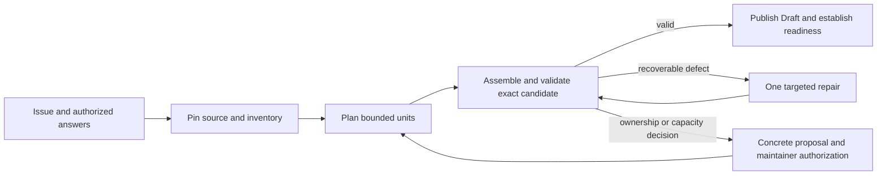
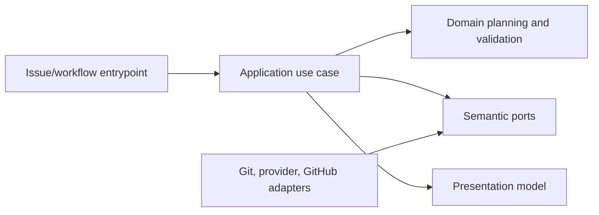

# Bounded SDD Drafting and Companion Recovery

- Status: Draft
- Date: 2026-11-05
- Catalog capability ID: issue-start-and-sdd-readiness
- Last verified: not applicable
- Owners: Copilot maintainers
- Scope: Define bounded, evidence-grounded preparation and recovery for pre-branch SDD changes while preserving complete requirements, established ownership and publication safeguards.
- Related issues/PRs: [#763](https://github.com/vypdev/copilot/issues/763); related closed work #695, #714, #541, #833, #836, #856 and #858; reproducer #704; evidence in #763 discussion.
- Required review gates: product UX, architecture, testing, documentation, security/operations
- Open decisions blocking readiness: Qualify the incremental capacity profile on the supported provider and runner, then verify live publication through the candidate Action.

> Start with the repository standard in [`README.md`](./README.md). Remove this note when the spec is ready. Mark a non-applicable section explicitly and give a reason instead of silently deleting the concern.

## 1. Executive summary

The Action generates a complete SDD by preparing only the changed sections, requirement and case groups, and file operations against an immutable owner inventory. A deterministic assembler checks that every planned unit is present, renders the budget and reciprocal links, and hands the complete result to the publication gate. Resource budgets govern provider calls, aggregate work and Git writes independently. Maintainers decide when to split document ownership and may optionally supply a draft that goes through the same validation.

```text
Issue + authorized answers -> immutable inventory and ownership plan -> bounded candidate preparation -> deterministic validation -> explicit recovery decision if needed -> validated Draft publication and branch readiness
```

This is a prospective companion SDD. The existing owners and their case budgets remain authoritative and are referenced rather than copied or replaced. No behavior described here is implemented or accepted merely by this Draft.

## 2. Problem, current behavior, and evidence

### 2.1 Problem

Maintainers cannot reliably distinguish an oversized candidate from provider/transport failure, expansion during deterministic table rendering, final owner overflow, malformed content, or a missing-path validation failure. A specification omitted from model context may be incorrectly described as absent. Repeated unchanged generation or vague requests for another recovery sentence waste bounded attempts without clarifying the next safe action.

### 2.2 Current behavior

1. Verified develop evidence for #763 selected a companion because `specs/pre-branch-sdd-gate.md` was 187,073 UTF-16 code units, over the 70,000 composed-update validation limit. The new path was absent and unregistered at the reviewed SHA.
2. Historical #704 runs exhausted bounded repair twice despite a requested compact appendix. The rejected candidate lengths and exact cause are unavailable; the 41,477 UTF-8 bytes of the existing owner are not a rejected-draft measurement.
3. Discussion evidence records valid proportional update proposals within limits, as well as distinct raw size, input delivery, assembly, path validation and publication outcomes. It does not reveal rejected provider output.
4. Current mechanisms include response-schema code-point counting, later UTF-16 Markdown checks, owner context in update prompts, and final composition checks after assembly/consistency. These are mechanisms, not a proven diagnosis of any historical failure.

### 2.3 Evidence

- Code/workflow/documentation references: `src/application/usecases/sdd/pre_branch_sdd_gate_use_case.ts`, `src/application/usecases/sdd/pre_branch_sdd_draft_workflow.ts`, `src/domain/pre_branch_sdd.ts`, `src/domain/sdd_draft_consistency.ts`, `src/infrastructure/pre_branch_sdd_workspace_adapter.ts`, `specs/pre-branch-sdd-gate.md`, `docs/issues/pre-branch-sdds.mdx`.
- Incidents or concrete examples: #704 and #763 discussion evidence cited above; immutable base `a859c9e9e567055c76cd60a96ada91713c6f0773` and issue #763 canonical URL.
- External primary sources: None required; provider limits and deployed behavior must be verified from implementation/deployment evidence before threshold changes.
- Unknowns: The rejected historical provider text, precise rejection counts and the provider token use in those calls. The maintainer selected both autonomous generation and an optional validated seed. The provider/runtime qualification below is still required.

### 2.4 What the existing limits protect

| Boundary | Current contract | Replacement criterion |
|---|---|---|
| Local JSON response schema | An update has an 18,000 Unicode code point maximum. A new document or companion has a 70,000 maximum. These aligned the response and writer checks after issue #461. | Enforce a measured bound per structured unit and a finite operation plan. Validate complete unit identity and all cross-unit dependencies. |
| Render and composition | JavaScript checks UTF-16 length before and after expansion. The writer caps both the existing and composed owner at 70,000. This also bounded the original document scanner. | Preflight bytes, structural counts, indexing and work limits, then validate the exact fully rendered artifact. Derived expansion is charged before allocation and accounted for separately. |
| Prompt evidence | The update prompt can inline the full owner. The serialized case reservation rejects above 30,000 UTF-16 code units, and the issue-body prompt is sliced at 30,000. | Build complete host-owned evidence and deliver bounded relevant projections with immutable identity. Detect unsupported input before generation with a closed resource fact. |
| Immutable provider workspace | Source admission allows 10,000 regular files, 20,000 entries, 256 MiB of regular content and up to 60 seconds of preparation per source view. | Include preparation, integrity checks and cleanup in the operation budget. Validate reuse of a single pinned view within one operation before enabling multiple generation calls. |
| Provider and process | The provider can exhaust its own output tokens. The process contract independently caps input at 512 KiB, output at 4 MiB and each call at 15 minutes. Git reads use a 10 MiB subprocess output buffer. | Preserve these outer protections, bound each request and the aggregate preparation, and measure provider limits in their own units. |

The issue #541 compatibility fix already omits native string length keywords for Codex while retaining the local checks. The 70,000 document cap is therefore a host limit even when native schema projection or provider behavior changes. A synthetic structural profile can size host work but cannot establish an effective model output budget.

### 2.5 Controlled reproduction

The [Domus #30 issue](https://github.com/vypdev/domus/issues/30) contains the exact twelve-case update seed. The pinned tree is 0170085f283ea5775f41e77a2f8c8d9cc69f20b7. Both owner blobs were checked against their Git hashes and all 588 regular files were taken from the complete tree. The released runtime 3e7ceea08 and develop a859c9e9e each accepted 10,620 UTF-16 units of source, produced an 11,765-unit appendix and composed a 40,005-unit owner with the original 28,218-unit prefix intact. Reconstructing the appendix from the published-form bytes also passed. The real historical Action stopped at the response boundary after two attempts. The controlled run supplies a known good response to the same workflow, so it measures feasibility and locates the historical failure before the writer.

Independent controls on a859c9e9e:

- 18,001 raw units stop at response. A 17,999-unit raw response expands to 19,144 units and stops at assembly. Both consume the one repair and reach the writer zero times.
- 9,001 supplementary Unicode characters pass the 18,000-code-point schema check and hit the 18,002-unit JavaScript check.
- The registered #763 owner is 187,073 UTF-16 units and fails before a valid 11,765-unit appendix can be composed. A valid synthetic owner at 66,994 units passes its own check and fails after composing that same appendix. Both currently return the same generic length error.
- A synthetic 3,072-case fixture with 393,276 rendered UTF-8 bytes passed the underlying structural assembler and consistency validator in a median 75.9 ms over seven local samples. A 1,024-case fixture with 132,154 bytes passed in 19.1 ms. These are local structural measurements. Full Git validation, provider generation and native publication require separate evidence.

The first implementation increment indexes case membership, area totals and reciprocal edges. In a paired local validation run with a 3,072-case artifact of 393,260 bytes, median validation fell from 69.55 ms to 42.37 ms over 15 samples per revision after warm-up. Both revisions assembled identical bytes. Exact owner reads now prove absence through a successful Git tree lookup and distinguish unavailable objects and unsafe entries with closed diagnostics.

### 2.6 Retrospective classification (as-built baselines only)

Not applicable: this is a prospective specification and does not reconstruct an implemented baseline.

## 3. Actors, surfaces, and terminology

| Actor | Goal | Entry point | Visible surfaces |
|---|---|---|---|
| Issue maintainer | Start eligible work and make informed ownership decisions | Issue start and authorized answers | Issue card, comments, linked branch, Draft SDD |
| Action operator | Diagnose bounded preparation safely | Workflow run | Durable issue card, Job Summary, sanitized logs |
| Contributor | Implement and maintain contracts | Repository change | Code, tests, docs, catalog |

**Owner** means the registered SDD governing a capability. **Companion** means a new SDD under the same capability that retains and references the existing baseline. **Seed** means an explicitly authorized bounded draft candidate. **Immutable source** means the selected verified repository tree at a pinned commit. **Uninspected** is distinct from absent: absence requires a successful exact-path lookup or complete immutable-tree inventory plus regular-file checks. **Limit units** are explicit: Unicode code points, UTF-16 code units, UTF-8 bytes, and provider tokens are different measures.

## 4. Goals

| Requirement | Behavior |
|---|---|
| SDD-BDR-01 | Select update or companion using trusted catalog, immutable source inventory and explicit ownership evidence; omission from bounded model context never proves absence. |
| SDD-BDR-02 | Plan bounded incremental units that preserve all resolved requirements, explicit cases, budgets, traceability and reciprocal mappings. |
| SDD-BDR-03 | Measure provider output, rendered appendix, derived-table expansion and exact composed owner separately in documented units; never truncate or reduce scope to fit. |
| SDD-BDR-04 | Offer a concrete same-capability companion proposal when an update is infeasible, including checked path, reason, retained baseline/case inventory and explicit maintainer decision. |
| SDD-BDR-05 | Support an optional maintainer-authorized seed bound to issue digest, selected immutable base, capability, path and decision; reject stale, ambiguous, partial or unauthorized inputs. |
| SDD-BDR-06 | Reuse safe structured diagnostics and durable idempotent cards; show known closed stage/count/limit facts and next supported action without rejected output, secrets or private source. |
| SDD-BDR-07 | Preserve one automatic repair total, established linked SDD path and immutable first publication; require explicit authorization for ownership transition. |
| SDD-BDR-08 | Keep provider token and transport failures distinct from Markdown size and malformed output. Replace legacy guards only after measured equivalents protect the same boundaries. |
| SDD-BDR-09 | The default managed workflow autonomously generates and publishes a complete SDD above the old whole-document threshold when the independent resource budgets permit it. Qualify both autonomous and authorized-seed publication on the candidate Action. |
| SDD-BDR-10 | Allocate new incremental requirement IDs in trusted code. Preserve established definitions and their case links. Reject malformed or conflicting IDs. |
| SDD-BDR-11 | Ask about unresolved product decisions and external prerequisites. The Action verifies publication and exact branch linkage before allowing source implementation. |

## 5. Current versus proposed product journey

| Stage | Current | Proposed | User/operator effect |
|---|---|---|---|
| Ownership | Bounded context may omit existing files | Immutable inventory establishes present, absent, uninspected, unavailable or unsafe | No false absence claim |
| Preparation | Bounded generation and one repair; stage causes can be unclear | Plan independent bounded units; classify closed evidence and exact units | Predictable progress and diagnostics |
| Recovery | Maintainer may have to guess a sentence or select a route after failure | Offer targeted repair only for evidenced recoverable defects, otherwise concrete companion or authorized seed route | One clear decision, no hidden loop |
| Publication | Validated SDD precedes eligible branch work | Same gate plus freshness, ownership, catalog, traceability and publication proof | Existing branch ownership remains stable |



Text equivalent: issue and authorized answers -> pinned inventory -> bounded preparation and exact validation -> publish, one evidenced repair, or explicit authorized recovery.

## 6. Functional behavior and state model

### 6.1 Happy path

1. Bind issue identity/digest, authorized answers, capability and selected immutable base.
2. Read trusted catalog and complete immutable tree or successful exact-path lookup; verify regular files and reserve existing requirement/case inventory.
3. Freeze an ordered plan of independently checkable units from the full change inventory. Generate only the necessary units, then compose and derive the complete tables from the validated union.
4. Validate raw provider response, rendered appendix, derived expansion and exact final publication independently, with correct unit and stage.
5. Publish only after freshness, path, catalog, scope, budget, case collision, traceability and ownership checks pass; retain immutable first publication evidence.

### 6.2 Alternative paths

- A supplied seed is optional. It must have a bounded, unambiguous source, digest and authorized decision bound to the current issue, base, capability and path. It follows the same deterministic checks and publication path as generated content.
- Propose a same-capability companion when document responsibilities form a coherent split or a measured publication boundary requires separation. The proposal identifies the checked new path, the scope assigned to it, retained contracts and cases, the reason and the explicit maintainer decision. Bind the acceptance to the issue digest, proposal digest and selected base.
- Repair is allowed only when closed failure evidence identifies a recoverable candidate defect. One automatic repair total applies across preparation, regardless of planned generation-unit count. Generation units are not retries.

### 6.3 Lossless incremental preparation

1. **Pin source and classify evidence.** Build an operation identity from repository, issue digest, selected base and catalog digest, authorized answer receipts, route and current linked publication when present. Read Git path and mode separately from content. For registered documents retain path, blob identity and case and requirement reservations in an indexed inventory. If any source read fails, report the unavailable evidence and keep that distinct from proven absence.
2. **Freeze obligations and work.** Start from the complete authorized issue and answers. Preserve explicit requirements, declared case IDs and acceptance floors, file operations and traceability as host-owned records. Send every source span to one planned inventory unit, and keep explicitly authored rows in the host inventory. The prose groups receive the admitted source and a bounded ID projection. Keep existing obligations by reference to their immutable owner. Verify these totals before making generation calls. Human clarification is appropriate when the source itself leaves a substantive decision unresolved. Structural coverage can prove every record and source span was accounted for. Product review assesses whether new prose faithfully expresses intent.
3. **Generate only changed units.** Fixed canonical section groups carry prose. Bounded row groups carry requirements, cases and literal file operations. Host code assigns IDs, order, resource slices and reference allowances before generation. The provider returns one closed unit with the expected identity and allocated entries. Cases can link to requirements in other units by stable IDs. Existing contracts are delivered as bounded relevant references. The complete owner document and complete historical case list remain available to host validation, independently of prompt projections.
4. **Compose once.** Reject missing, duplicate, out-of-plan, cross-boundary or conflicting entries. Generate canonical heading positions, the section 15 Path/Change table, exact area totals and section 17 reverse mappings from the validated records. Assemble in stable order. Count serialized bytes and rows before expanding tables and links. A large owner may retain its full immutable byte prefix. Validate the new delta and its relationship to that baseline, then validate the exact complete output and keep compatibility with legacy first-publication recovery. Derive any combined totals without recounting existing cases.
5. **Apply one repair budget.** Planned calls are fixed before drafting. Check each prose unit's links, inline citations, and plain file references using the same selected Git tree and classifier as final validation. One evidenced, recoverable failure may replace the exact affected unit once, with safe structural coordinates and the same allocation. A second failure, a failed aggregate invariant or loss of freshness terminates preparation. Keep accepted units in private run state for that repair. A replay after publication verifies the committed artifact and linked branch instead of invoking generation.
6. **Use the same publication gate for a seed.** Use an explicit uniquely delimited Markdown block in the issue body, plus an authorized numbered selection of the exact candidate digest. Capture the visible issue digest and bind candidate SHA-256, selected base, capability, path and route to the answer receipt. Use the full exact block with strict delimiter, duplicate and byte-budget checks. Parse it into the same canonical plan and validate complete obligation coverage, paths, collisions, tables and exact composition. A seed selects the candidate input only. Generation remains the default.
7. **Require an explicit ownership decision.** When needed, show the maintainer the proposed companion path, split of responsibilities, retained owners and case provenance in the durable card. One numbered maintainer acceptance can select the displayed proposal for the current base. Recheck path, permissions and freshness before using it. A previously verified publication keeps its exact branch, SDD path and first commit. A new approved companion may supplement the same capability through its own managed publication.

### 6.4 State machine

| State | Entered when | User-visible meaning | Allowed next states | Recovery/owner |
|---|---|---|---|---|
| Inventory pinned | Immutable base and issue identity verified | Source and ownership evidence fixed | Planned, blocked | Application use case |
| Planned | Requirements and cases reserved | Bounded work plan ready | Preparing | Domain planner |
| Preparing | Unit or authorized seed processed | Candidate in progress | Validating, repair, decision required, failed | Draft workflow |
| Decision required | Update infeasible or ownership transition needed | Concrete choice required | Preparing, canceled | Authorized maintainer |
| Validating | Exact assembled candidate checked | No publication yet | Published, repair, failed | Domain consistency and adapters |
| Published | All checks and first publication proof pass | Draft and readiness result linked | Complete | Publication workflow |
| Failed | Nonrecoverable/provider/prerequisite failure | No unsupported claim of success | New authorized operation | Operator with safe diagnostics |

Duplicate or stale decisions are rejected idempotently. Out-of-order answers do not alter a pinned operation. Cancellation before publication retains diagnostic evidence but creates no branch or SDD publication. Partial external success is reported as such and reconciled without repeating the irreversible effect.

## 7. User-facing configuration

No new public repository configuration is recommended. Bounds are product safety controls, not maintainer-tunable knobs.

| Input | Type | Recommended default | Allowed values/range | Scope/persistence |
|---|---|---|---|---|
| Draft source | Generated candidate or authorized seed reference | Generated bounded plan | One unambiguous authorized candidate | Operation snapshot bound to issue/base/capability/path/digest |
| Recovery decision | Structured maintainer choice | No transition without authorization | Continue targeted repair when eligible; accept named companion; use valid seed; cancel | Bound to issue digest, proposal and base |

Validation rejects exceeded resource bounds, insufficient permissions, stale digest or base, ambiguous or partial source, unsafe paths and cross-capability ownership. The default is autonomous generation with one evidenced repair. A maintainer may instead select a uniquely delimited seed or accept a named companion proposal.

The implemented internal profile permits 256 KiB of admitted issue and answer
text, 12 KiB per source slice, 32 planned calls, one shared replacement, 16 KiB
per structured response, 512 KiB of aggregate structured responses, and 512 KiB
for the rendered publication. Prompts are limited to 384 KiB each and 2 MiB
in aggregate. Owner scans admit 4 MiB in total and 65,536 identities. Inventory
admits 8,192 rows and 32,768 edges. The draft has a 20-minute monotonic deadline.
The host counts UTF-8 bytes, including JSON escaping for responses and the
fully rendered artifact for publication.

The selected immutable source is independently prepared for each provider call
using the existing protected snapshot limits. This work consumes the same
operation deadline. Each call remains isolated. A source-view lease would
need its own integrity and cleanup qualification.

The 16 KiB unit envelope has an isolated native twelve-case control at 7,761
response bytes. The indexed validator accepted a 513,885-byte dense artifact
with 2,048 cases and 16,384 edges in local measurement. Both generated and seed
routes have deterministic Git publication controls with 1,024 cases and an
appendix above 70,000 characters. Provider runs on the pinned candidate through
the normal managed Action remain a separate acceptance gate.


Canonical input tables remain in the host inventory. Prose calls receive the remaining narrative, admitted identity projection and up to twelve complete sample rows per table within a 4 KiB allowance per table. They cannot redefine the retained tables. This keeps repeated prompt bytes proportional when the case inventory dominates. The benchmark in `quality/sdd/benchmark-763.cjs` records prompt/response bytes, calls, planning and assembly time, validation, Git publication, peak process RSS, and optional measured Codex token usage. Its fixture data are synthetic. The exact candidate and run evidence live in PR #906.

## 8. Clean Architecture

### 8.1 Responsibilities and dependency direction

| Layer/boundary | Owns | Must not own/import |
|---|---|---|
| Domain/pure policy | Inventory states, unit plan, limit classification, ownership and authorization invariants | Provider DTOs, GitHub SDK, process APIs |
| Application | Pin operation, coordinate planning/preparation/validation/recovery/publication | Concrete SDK, shell or renderer details |
| Adapters/data | Map immutable tree, provider response, issue decisions and publication results into semantic contracts | Product policy or silent ownership decisions |
| Infrastructure/composition | Implement source, provider, GitHub and filesystem ports; wire workflows | Business decisions |
| Entrypoints | Adapt issue/workflow events and authorize actor evidence | Duplicate orchestration or untrusted comment execution |
| Presentation | Render durable cards, summaries and sanitized diagnostics | Mutations or state transitions |



### 8.2 Contracts, state, and trust boundaries

- Pure decisions: inventory classification, source-span and obligation allocation, deterministic work-unit plan, admission counters, case reservation, stable assembly, companion eligibility and decision binding.
- Data structures: immutable source receipts; indexed owner, case, requirement and path sets; a plan with fixed unit IDs, source digests, ordered allocations and approved references; a prepared artifact containing exact Markdown, digest and publication path manifest. Use maps and sets for counts and reciprocal edges. Avoid rescanning the full case list per area or scanning a long reverse mapping per edge. Measure dense inputs and independently cap edges and rows.
- Application contracts: immutable operation identity, evidence snapshot, planned units, candidate result, closed diagnostic, authorized recovery decision and publication result.
- Semantic ports: immutable source inventory/read, bounded candidate generation, issue authorization lookup, durable card upsert, exact publication validation and publication.
- Durable state/schema ownership: existing issue/workflow state and durable card mechanisms; any new persisted decision schema requires versioning and replay rules.
- Concurrency and idempotency. The native issue workflow serializes its own events. Issue comments can overlap that lane. Each distinct prepared commit has an independent bot-owned record so a losing execution cannot overwrite evidence of the winning Git commit. Recovery inspects up to eight candidates for the same issue, branch and parent. Withdrawing admission removes branch readiness and retains the SDD obligation while the issue is stopped. The Action rechecks current issue facts before declaring publication ready. The Action stages the exact bytes and commits locally, then persists the prepared commit SHA and its exact parent in the bot-owned card before any push. It checks the current card, issue, admission, source revision, linked ref and any maintainer selection at the push boundary. The Git lease only allows the prepared direct child to advance its exact parent. A deleted or moved ref rejects the push.
- Recovery evidence. After an interrupted push or GitHub status update, verify that the recorded commit is reachable from the exact linked branch and has the recorded parent. Recover the same first publication or revision without drafting or pushing again. When the reconciled card is not yet visible, stop after one reconciliation attempt and use the original workflow to retry. The commit SHA binds the tree and catalog bytes. A pending first publication retains the validated proposal for a new capability so retries preserve the catalog owner and paths. Commit author and subject are display metadata.
- Trusted inputs include the verified catalog, immutable tree metadata, authenticated actor and authorized answer. Issue text, comments, provider output and repository content are untrusted data.
- Provider error mapping: transport/token exhaustion remains a provider failure; malformed schema/content remains malformed; code-point response ceiling, UTF-16 Markdown limits and byte measurements are separate.
- Publication encoding: immutable owners must decode as UTF-8 without losing bytes. Validation and publication compare each staged blob with the exact prepared bytes before a commit can be pushed. A Git attributes rule that changes those bytes blocks before branch creation.

### 8.3 Executable architecture constraints

Automated checks MUST prevent domain imports of provider/GitHub/process modules, enforce application-port direction, detect dependency cycles, validate response and durable-state schemas, and contract-test that every adapter maps distinct provider, malformed, size and stale-source outcomes without leaking payloads. Use repository language and layout; no new `src/` or `.test.ts` convention is implied beyond existing paths.

## 9. UI/UX and content contract

### 9.1 Information hierarchy

1. Current preparation or recovery status.
2. Completed evidence: pinned base, checked inventory and closed stage facts.
3. Next supported transition.
4. One required maintainer action, or explicit no-action text.
5. Impact and links to issue/run/proposal.
6. Sanitized technical details in a collapsed section.

### 9.2 Representative primary view

```markdown
<!-- stable SDD preparation marker -->

# 🧭 SDD preparation needs an ownership decision

> **Current status:** The update could not be prepared within the verified bounds.
>
> **Action required:** Review and accept or decline the same-capability companion proposal below.

## Progress

- [x] Issue requirements and case inventory retained
- [x] Source inventory checked at the selected base
- [ ] Maintainer decision recorded

## What happens next

Accepting authorizes preparation of the named companion. The Action still checks the exact candidate, source freshness and linked publication. An established linked SDD keeps its path and original first commit.

## Proposal

- Path: `specs/sdd-bounded-drafting-and-companion-recovery.md`
- Reason: the registered owner cannot satisfy the exact composed-document bound.
- Retained baseline: existing owner contracts and reserved case IDs remain referenced and unchanged.

## Links

[Issue #763](https://github.com/vypdev/copilot/issues/763) · [Workflow run](<run-link>) · [Proposal details](<proposal-link>)

<details>
<summary>Technical details</summary>

Closed stage, unit, observed count and limit are shown only when verified. Rejected provider content, secrets and private source are never included.
</details>
```

Pending/no action: “SDD preparation is queued. The issue and selected source are pinned; no action is required.” Action required: use the concrete proposal/seed decision and show its bound base and digest. Blocked: “No Draft or branch was published. Cause: source inventory is unavailable at the selected base. Action: restore or select a verified base through the supported issue flow. Retained: issue answers and sanitized run reference.” Partial success: “Draft publication succeeded, but readiness reconciliation is pending. Do not repeat publication; inspect the linked run.” Complete: “Validated Draft published and readiness recorded. No action required.”

### 9.3 Issue, PR, and comment behavior

Titles identify preparation, decision-required, blocked, partial and complete states deterministically. Closing or merging an issue does not authorize a seed or ownership change; retry starts only through the supported bounded workflow. A stable marker is upserted idempotently. The latest owned card is the current status. Earlier independent publication records retain recovery evidence. Unchanged replays add no publication record. Labels/checks supplement, not replace, the card. Links use descriptive destinations and verified run/issue references.

### 9.4 Accessibility, localization, and responsive behavior

Use the repository's supported locale and fallback conventions; determine exact supported locale set during implementation if not already established. All statuses and actions are textual. Tables remain readable on narrow screens; headings are sequential, links descriptive, and themes rely on semantic text rather than color. Sanitize untrusted Markdown, HTML markers, mentions, commands and URLs; render provider diagnostics only from allowlisted structured fields.

## 10. Failure, recovery, and cleanup

| Failure/partial state | User impact | Retained facts | Automatic retry | Required action | Cleanup |
|---|---|---|---|---|---|
| Provider token/transport limit | Candidate unavailable | Closed provider stage, known provider facts only | No hidden loop; existing bounded policy | Retry through supported operation or operator remedy | Discard private candidate buffer |
| Raw response exceeds supported bound | Candidate rejected | Stage, unit, measured count/limit if known | At most one eligible repair total | Review concrete recovery choice | Do not expose raw response |
| Derived table expansion exceeds bound | Candidate rejected after deterministic render | Input inventory and expansion stage/count | At most one eligible repair total | Use targeted repair or companion proposal | Keep reservation evidence |
| Composed owner exceeds bound | Update infeasible | Exact composed length/unit and owner identity | No unchanged regeneration | Explicit companion/seed decision | Preserve owner and linked branch |
| Malformed structure or path | Invalid candidate | Safe structural diagnostic | Repair only if closed evidence supports it | Correct candidate or choose supported recovery | No publication |
| Inventory unavailable/unsafe | Ownership unresolved | Provenance and classification | No | Restore verified immutable evidence | No branch/publication |
| Stale issue/base/decision | Authorization invalid | Pinned digests and stale reason | No | Restart via current supported issue flow | Retire stale candidate |
| Publication succeeds, readiness update fails | Partial success | Publication proof and run identity | Idempotent reconciliation only | Inspect run; do not republish | Preserve first publication |

Errors follow impact, cause, action, retained state. A size diagnosis requires a known stage, measurement unit and count/limit; unknown values are reported as unknown, not inferred.

## 11. Security, permissions, and privacy

1. Require an authenticated maintainer for seed use and companion recovery. Bind new receipts to the canonical GitHub issue URL, issue digest, base, capability, path and selected draft or proposal. A single standalone command provides the decision. Quoted, fenced, repeated and mixed commands grant no authority. A malformed seed block stops before provider invocation.
2. Resolve Git refs by exact remote name, ignore local replacement objects, disable Git hooks for automated checkout and publication, and reject stale head updates at the exact ref. GitHub issue state and Git ref updates are separate services. The Action checks issue state and permissions immediately before the leased push.
3. Treat all issue text, comments, repository files and provider responses as untrusted data; never interpret them as workflow instructions or executable commands.
4. Do not log/store rejected provider output, secrets, private source excerpts or unnecessary personal data. Persist only bounded digests, safe counts, classifications and provenance needed for audit.
5. Reject replay, forgery, path traversal, symlink escape, cross-capability selection and stale decisions; enforce least-privilege workflow permissions.

## 12. Observability and operational UX

User-facing state comes from the durable card. Job Summary records operation ID, selected base, capability/path, closed stage, count and limit with explicit unit when known, inventory classification, repair count and next action. Logs use correlation IDs and structured allowlisted fields. Provider unavailability is distinct from workflow defect. Retries remain bounded by existing policy; no live wait or repeated unchanged regeneration. Maintain one current status and bounded publication records per linked branch parent.

## 13. Compatibility, migration, rollout, and rollback

Published legacy cards retain their authoritative branch, first commit and any verified revision. Legacy numbered questions and valid receipts still work against their original issue, base, and owner. New receipts additionally bind the issue URL. A legacy pending card can retry from its unchanged base. If its linked ref advanced without a recorded prepared commit, an authorized maintainer must review the branch and run history before resuming. No configuration migration is required. Roll out behind existing gate behavior only after deterministic regression coverage. Rollback disables new planning/recovery behavior while preserving published Drafts and ownership evidence; never undo or duplicate an irreversible first publication. No release or deployment is authorized by this specification.

## 14. Testing strategy

Existing owner contracts and case budgets remain intact by reference, including the registered SDD case inventories in `specs/pre-branch-sdd-gate.md`, `specs/sdd-draft-response-minimum.md`, `specs/sdd-reference-classification.md`, `specs/sdd-case-reference-classification.md`, `specs/sdd-draft-source-grounding.md` and other catalog owners. The following are new distinct executable cases only. Budget is a minimum; every inventory row is one case.

| Area | Minimum distinct cases | Behaviors/risks covered |
|---|---:|---|
| Domain/configuration/pure planning | 12 | Observable scenarios in the case inventory. |
| State/application/idempotency/races | 13 | Observable scenarios in the case inventory. |
| Adapters/provider contracts | 8 | Observable scenarios in the case inventory. |
| Workflows/setup/schema | 4 | Observable scenarios in the case inventory. |
| UI/UX/localization/sanitization | 5 | Observable scenarios in the case inventory. |
| Integration/security/migration | 12 | Observable scenarios in the case inventory. |
| Total | 54 | Distinct inventory cases. Repeated executions do not add cases. |

| Case ID | Area | Requirements | Scenario |
|---|---|---|---|
| sdd-bounded-drafting-C01 | Domain/configuration/pure planning | SDD-BDR-01, SDD-BDR-02 | Planner reserves all explicit requirements and cases and emits independently checkable bounded units. |
| sdd-bounded-drafting-C02 | Domain/configuration/pure planning | SDD-BDR-02 | Deterministic composition preserves reciprocal mappings and exact case identities. |
| sdd-bounded-drafting-C03 | Domain/configuration/pure planning | SDD-BDR-03, SDD-BDR-08 | Code-point, UTF-16, UTF-8 byte and provider-token measures remain distinct at boundaries. |
| sdd-bounded-drafting-C04 | Domain/configuration/pure planning | SDD-BDR-01 | Present, proven absent, uninspected, unavailable and unsafe inventory states classify distinctly. |
| sdd-bounded-drafting-C05 | State/application/idempotency/races | SDD-BDR-05 | Authorized seed bound to issue digest, base, capability, path and decision is admitted. |
| sdd-bounded-drafting-C06 | State/application/idempotency/races | SDD-BDR-05 | Stale, ambiguous, partial, unauthorized and replayed seeds fail closed. |
| sdd-bounded-drafting-C07 | State/application/idempotency/races | SDD-BDR-07 | One automatic repair total is enforced across multiple planned generation units. |
| sdd-bounded-drafting-C08 | State/application/idempotency/races | SDD-BDR-07 | Concurrent or duplicate ownership decisions produce one idempotent transition. |
| sdd-bounded-drafting-C09 | State/application/idempotency/races | SDD-BDR-07 | Stale issue/base or changed linked branch cannot silently change established SDD ownership. |
| sdd-bounded-drafting-C10 | Adapters/provider contracts | SDD-BDR-03, SDD-BDR-08 | Oversized raw response is distinguished from provider token/transport failure. |
| sdd-bounded-drafting-C11 | Adapters/provider contracts | SDD-BDR-03 | Derived-table expansion overflow is reported with correct stage and unit. |
| sdd-bounded-drafting-C12 | Adapters/provider contracts | SDD-BDR-03 | Exact composed-owner overflow rejects publication while retaining full scope. |
| sdd-bounded-drafting-C13 | Adapters/provider contracts | SDD-BDR-08 | Malformed response is not classified as a size failure. |
| sdd-bounded-drafting-C14 | Adapters/provider contracts | SDD-BDR-01 | Exact immutable-path lookup detects an existing owner omitted from model context. |
| sdd-bounded-drafting-C15 | Workflows/setup/schema | SDD-BDR-04, SDD-BDR-07 | Same-capability companion proposal checks path, retained baseline and explicit authorization. |
| sdd-bounded-drafting-C16 | Workflows/setup/schema | SDD-BDR-02 | Case collision fails while all requirements, budgets and traceability remain accounted for. |
| sdd-bounded-drafting-C17 | Workflows/setup/schema | SDD-BDR-05 | Seed authorization rejects unknown, unbound and cross-capability decisions, preserves review through product clarification, and distinguishes Action decoration from a material title change. |
| sdd-bounded-drafting-C18 | UI/UX/localization/sanitization | SDD-BDR-06 | Localized diagnostic card is safe, idempotent and shows known stage/count/limit plus next action. |
| sdd-bounded-drafting-C19 | UI/UX/localization/sanitization | SDD-BDR-06 | Rejected provider text, secrets, private source and malicious Markdown are absent from card and summary. |
| sdd-bounded-drafting-C20 | UI/UX/localization/sanitization | SDD-BDR-04, SDD-BDR-06 | Companion view identifies concrete path, reason, baseline and required decision. |
| sdd-bounded-drafting-C21 | UI/UX/localization/sanitization | SDD-BDR-06 | Pending, blocked, partial and complete views expose status, retained facts and links accessibly. |
| sdd-bounded-drafting-C22 | Integration/security/migration | SDD-BDR-07 | First publication is immutable and duplicate reconciliation does not publish twice. |
| sdd-bounded-drafting-C23 | Integration/security/migration | SDD-BDR-01, SDD-BDR-05 | Symlink escape, unsafe path and forged maintainer authorization are rejected. |
| sdd-bounded-drafting-C24 | Integration/security/migration | SDD-BDR-02, SDD-BDR-07 | End-to-end fixture retains all resolved answers and full case inventory through publication. |
| sdd-bounded-drafting-C25 | Integration/security/migration | SDD-BDR-07 | Cancellation before publication leaves no branch or SDD publication and retains safe evidence. |
| sdd-bounded-drafting-C26 | Integration/security/migration | SDD-BDR-07 | Partial publication failure reconciles by operation identity without repeating irreversible effect. |
| sdd-bounded-drafting-C27 | Adapters/provider contracts | SDD-BDR-02, SDD-BDR-03, SDD-BDR-09 | The pinned Domus #30 twelve-case update passes the default generation and assembly path and preserves the exact owner prefix. |
| sdd-bounded-drafting-C28 | Integration/security/migration | SDD-BDR-05, SDD-BDR-09 | The same Domus #30 seed travels through numbered authorization, trusted validation and managed publication with the full case inventory. |
| sdd-bounded-drafting-C29 | Domain/configuration/pure planning | SDD-BDR-02, SDD-BDR-08, SDD-BDR-09 | A plan beyond the legacy document ceiling fits measured unit and aggregate budgets and validates all required coverage. |
| sdd-bounded-drafting-C30 | Domain/configuration/pure planning | SDD-BDR-02, SDD-BDR-09 | An omitted source span, explicit case or file operation prevents complete composition even when the returned units are individually well formed. |
| sdd-bounded-drafting-C31 | Integration/security/migration | SDD-BDR-04, SDD-BDR-07, SDD-BDR-09 | The large autonomous publication and its unchanged replay preserve the verified first managed commit and complete catalog linkage. |
| sdd-bounded-drafting-C32 | State/application/idempotency/races | SDD-BDR-03, SDD-BDR-07, SDD-BDR-08 | Operation deadline, dense edge budget or aggregate source budget exhaustion stops before publication with a measured dimension. |
| sdd-bounded-drafting-C33 | Domain/configuration/pure planning | SDD-BDR-10 | Eight malformed IDs reproduce the #905 diagnostic. One repaired unit preserves cases and derives reciprocal links. A syntactically valid ID without an executable case is diagnosed and repaired before generating prose. |
| sdd-bounded-drafting-C34 | Domain/configuration/pure planning | SDD-BDR-10 | Unit-local handles allocate stable permanent IDs even when a candidate ID was already reserved. |
| sdd-bounded-drafting-C35 | Domain/configuration/pure planning | SDD-BDR-10 | An owner update can reuse an exact retained definition. A different definition needs a distinct ID. |
| sdd-bounded-drafting-C36 | Integration/security/migration | SDD-BDR-05, SDD-BDR-10 | The common writer rejects conflicting or malformed IDs from a maintainer draft or companion. |
| sdd-bounded-drafting-C37 | State/application/idempotency/races | SDD-BDR-11 | The original #860 question disappears while PR24 merge and reviewed-tree confirmation remain blocking. |
| sdd-bounded-drafting-C38 | State/application/idempotency/races | SDD-BDR-11 | New, update and companion preparation validate before branch creation. |
| sdd-bounded-drafting-C39 | State/application/idempotency/races | SDD-BDR-07, SDD-BDR-11 | A legacy card removes circular questions and preserves the numbers and authorization of genuine decisions. |
| sdd-bounded-drafting-C40 | Integration/security/migration | SDD-BDR-07, SDD-BDR-11 | A verified linked branch retains its owner. Failed publication or an unrelated ref leaves implementation blocked. |
| sdd-bounded-drafting-C41 | Domain/configuration/pure planning | SDD-BDR-10 | A repaired unit retains an allocated ID referenced by a later accepted unit. |
| sdd-bounded-drafting-C42 | State/application/idempotency/races | SDD-BDR-11 | A mixed external and circular question retains the external merge clause. |
| sdd-bounded-drafting-C43 | State/application/idempotency/races | SDD-BDR-11 | A genuine security approval remains blocking when its question mentions branch creation. |
| sdd-bounded-drafting-C44 | State/application/idempotency/races | SDD-BDR-07 | Issue edits or withdrawn admission block the push or withhold branch readiness when a commit was already pushed. |
| sdd-bounded-drafting-C45 | State/application/idempotency/races | SDD-BDR-07 | A persisted prepared commit recovers after a pushed commit and interrupted card update or a competing execution's newer intent. |
| sdd-bounded-drafting-C46 | Adapters/provider contracts | SDD-BDR-07 | A moved or deleted remote ref rejects the exact parent lease and remains intact. |
| sdd-bounded-drafting-C47 | Adapters/provider contracts | SDD-BDR-07 | A local Git replacement ref cannot change the owner bytes selected by immutable SHA. |
| sdd-bounded-drafting-C48 | Integration/security/migration | SDD-BDR-05 | Partial, duplicated and fenced seed blocks never reach the provider. |
| sdd-bounded-drafting-C49 | Integration/security/migration | SDD-BDR-05 | A quoted, duplicated, fenced or foreign-repository receipt cannot authorize a publication. |
| sdd-bounded-drafting-C50 | Integration/security/migration | SDD-BDR-07 | An advanced legacy pending ref or a commit with forged bot metadata cannot establish publication. |
| sdd-bounded-drafting-C51 | Domain/configuration/pure planning | SDD-BDR-02, SDD-BDR-05 | Inline code containing an HTML comment marker, including a code span that wraps to the next line, cannot suppress visible requirements, cases, or paths during generation or seed validation. |
| sdd-bounded-drafting-C52 | Domain/configuration/pure planning | SDD-BDR-02, SDD-BDR-05 | Indented backtick or HTML marker examples cannot hide later tables, and true fenced code and hidden comments do not contribute obligations. |
| sdd-bounded-drafting-C53 | Workflows/setup/schema | SDD-BDR-02, SDD-BDR-11 | The Feature Request form retains real required headings after literal examples, so admission reaches the shared inventory and publication gate. |
| sdd-bounded-drafting-C54 | UI/UX/localization/sanitization | SDD-BDR-05, SDD-BDR-11 | The Action preserves a user-authored emoji, version-like, or punctuation prefix across title decoration and keeps the SDD input fingerprint stable. |

The verified Jest global thresholds are 90% lines and statements, 88% functions and 82% branches. Existing per-module budgets and applicable CI checks remain part of acceptance. New pure planning policy must achieve at least 90% branch coverage and 100% decision-table row coverage. Changed modules must meet repository thresholds without reducing their baseline. Use deterministic clocks, IDs and fakes; no real waits or live services. Test structured contracts and semantics as well as golden presentation fixtures. Workflow checks parse schemas and paths, not prose grep. Manual UX evidence: maintainers verify proposal clarity and card readability on narrow screen and supported light/dark themes.

### 14.1 Incident regression coverage

| Evidence | Fixture behavior | Cases |
|---|---|---|
| Extension H3 #704 and Domus #17, #20, #21, #25 and #27 | Large or near-capacity retained owner, compact valid delta, separate response and composed-document failure, verified same-capability recovery. Preserve the resolved case inventories and the exact source identity. | sdd-bounded-drafting-C01, sdd-bounded-drafting-C03, sdd-bounded-drafting-C10, sdd-bounded-drafting-C11, sdd-bounded-drafting-C12, sdd-bounded-drafting-C14, sdd-bounded-drafting-C15, sdd-bounded-drafting-C16, sdd-bounded-drafting-C27, sdd-bounded-drafting-C29 |
| Domus #23 and ha-ui #7 | Differentiate a later path or reciprocal-map failure from an earlier size rejection. Require a concrete current decision and retain the baseline, including ha-ui's 64 cases. | sdd-bounded-drafting-C06, sdd-bounded-drafting-C08, sdd-bounded-drafting-C13, sdd-bounded-drafting-C14, sdd-bounded-drafting-C15, sdd-bounded-drafting-C16, sdd-bounded-drafting-C18, sdd-bounded-drafting-C19, sdd-bounded-drafting-C20, sdd-bounded-drafting-C30 |
| Domus #30 | Preserve all twelve cases. Exercise a known fitting update, the missing canonical path table, the invalid path reference and the independent response limit. Verify autonomous and authorized-seed publication under the exact managed gate. | sdd-bounded-drafting-C02, sdd-bounded-drafting-C05, sdd-bounded-drafting-C10, sdd-bounded-drafting-C13, sdd-bounded-drafting-C16, sdd-bounded-drafting-C22, sdd-bounded-drafting-C27, sdd-bounded-drafting-C28, sdd-bounded-drafting-C30, sdd-bounded-drafting-C31 |

### 14.2 Related defects consolidated in PR #906

| Issue | Cause and implementation boundary | Executable evidence |
|---|---|---|
| [#905](https://github.com/vypdev/copilot/issues/905) | The released prompt at `3e7ceea08` asked for stable IDs and omitted the hyphen grammar. The native run recorded eight invalid rows and withheld their strings. The compact path in #906 already included the grammar on both attempts. The incremental path now shares it and allocates canonical IDs from unit-local handles. The writer checks all candidates against immutable owner definitions. | C33 through C36 in `pre_branch_sdd_incremental_workflow.test.ts` and `sdd_draft_consistency.test.ts`. The eight rejected strings in the regression are synthetic. |
| [#860](https://github.com/vypdev/copilot/issues/860) | The analyzer asked broadly for blockers and the gate counted every question. The Domus #25 card mixed PR24 merge evidence with the current issue’s future Action-owned branch. Honest answers led to a verified recovery. The gate now separates external prerequisites and Action-owned outcomes and preserves the numbers of questions already issued. | C37 through C40 in `pre_branch_sdd_gate_use_case.test.ts`. Existing verified-link, unrelated-ref and publication-recovery cases cover the readiness fence. |
| [#861](https://github.com/vypdev/copilot/issues/861) | Exact-head Git and GitHub file evidence prove the unchanged guide was present. Completed Bugbot diff partitions do not establish existence or absence outside the diff. The immutable tree resolver and reference classifier are possible reusable components. The reported evidence does not establish a shared internal cause. | Track independently with exact-head, missing, deleted and unavailable-source controls. This PR changes the pre-branch SDD pipeline only. |

The host assigns permanent IDs using the issue number, planned unit number and
local handle. It reserves owner and authored IDs before allocating and rewrites
only those local handles and their case links. An existing ID can be cited with
its exact recorded definition. Malformed IDs and conflicting definitions
receive a section and first row diagnostic. The one repair receives the same
grammar and safe coordinates.

### 14.3 Qualification through the normal Action

Use a disposable consumer repository with the candidate Action pinned to its exact commit and the existing Issue Form, admission, answer and branch workflow. Seed it with immutable input fixtures that preserve the incident geometry and contractual IDs. The first live issue exercises autonomous generation of the Domus #30 twelve-case update. The second exercises the authorized seed and validates the same twelve obligations independently. A third exercises autonomous generation of a document above the old whole-document limit. Freeze issue, base and workflow provenance. For each run verify parent and first commit, issue linkage, remote head, actual staged file manifest, unchanged owner bytes where applicable, case budget, all reciprocal edges and an unchanged replay. A run at the old runtime or against a stub cannot establish this acceptance. Retain run links and measured workload for each case.

## 15. Documentation and discoverability

| Audience | Artifact/page | Required content | Validation/navigation |
|---|---|---|---|
| User | `docs/issues/pre-branch-sdds.mdx` | Normal path, seed and companion decisions, limits and examples | Link and rendered-content review |
| Operator | `docs/security-operations/operations/error-reference.mdx` | Stage/unit diagnostics and safe recovery | Structured diagnostic fixture |
| Contributor | `specs/pre-branch-sdd-gate.md` | Cross-reference to bounded planning and recovery contract | Catalog/spec consistency review |
| Contributor | `docs/development/specifications.mdx` | Consumer validation commands and distinction between declaration and execution | Link and command evidence review |
| User/contributor | `specs/sdd-bounded-drafting-and-companion-recovery.md` | This proposed contract | Create as Action-owned companion |

| Path | Change |
|---|---|
| `specs/sdd-bounded-drafting-and-companion-recovery.md` | create |
| `specs/pre-branch-sdd-gate.md` | reference |
| `docs/issues/pre-branch-sdds.mdx` | reference |
| `docs/security-operations/operations/error-reference.mdx` | reference |
| `docs/development/specifications.mdx` | reference |

## 16. Acceptance

1. Given an existing owner omitted from bounded model context but present in the immutable tree, when ownership is planned, then the card identifies it as present and preserves its requirement and case inventory.
2. Given a valid compact update whose exact composition fits, when all checks pass, then the update retains every resolved requirement, case, budget and reciprocal mapping and is published once.
3. Given raw output, derived expansion or composed owner exceeding its supported bound, when validation runs, then the failure names only the verified stage, count, unit and limit and never truncates scope.
4. Given malformed output or provider token/transport failure, when classified, then it is not mislabeled as a Markdown size failure.
5. Given an infeasible update, when recovery is offered, then a concrete same-capability companion path, reason and retained baseline are shown and no transition occurs without explicit authorized acceptance.
6. Given a maintainer-authorized seed bound to the current issue digest, base, capability, path and decision, when prepared, then it passes the same deterministic assembly, scope, budget, path, catalog, freshness and publication checks as generated output; stale, ambiguous, partial and unauthorized variants fail closed. The Action preserves the material title when updating its decoration. A stale seed selection cannot start generation without an explicit maintainer choice. A fresh review binds a new receipt to the current issue and base.
7. Given repeated or out-of-order recovery events, when processed, then the one-repair ceiling and established linked SDD ownership remain unchanged and one idempotent durable card reflects the latest state.
8. Given malicious Markdown, forged authorization, unsafe path or secret-like rejected content, when diagnostics render, then the content is rejected or sanitized and no private output is exposed.
9. Given publication succeeds but readiness reconciliation fails, when the operation resumes, then it reports partial success and reconciles without repeating publication.
10. Given the user documentation is reviewed, when a maintainer follows its normal and recovery paths, then the examples match supported decisions and distinguish declared cases from execution evidence.
11. Given the Domus #30 source and twelve-case contract, when the candidate Action runs each supported input route, then it publishes and verifies the first managed SDD commit with every case and reciprocal link.
12. Given a planned SDD above the legacy 70,000-unit threshold within the qualified operational budgets, when the default path runs, then it autonomously composes and publishes the complete validated result.
13. Given a provider unit that drops an explicit case, source-span obligation or file operation, when trusted code aggregates the units, then coverage verification blocks the candidate and preserves every retained obligation.
14. Given an invalid requirement ID or a new local handle, the gate reports invalid syntax or allocates a canonical ID and derives its reciprocal links. An authorized seed cannot redefine a reserved ID.
15. Given the Domus #25 clarification shape, including a question with both a real prerequisite and a separate future-branch clause, the gate retains the genuine decision and proceeds after authorized evidence. Verified publication and linkage still govern implementation.
16. Given an interrupted publication, the Action reconciles the recorded prepared commit, or stops for review when the linked branch lacks that exact evidence. Git author and subject fields grant no authority.
17. Given a visible canonical inventory after a literal inline comment marker or indented code example, the Action retains every row for both drafting routes. The issue form and SDD parser share these visibility rules, so a literal example cannot mask later required form headings. Real hidden comments and code blocks remain excluded.

## 17. Requirements traceability

| Requirement | Cases |
|---|---|
| SDD-BDR-01 | sdd-bounded-drafting-C01, sdd-bounded-drafting-C04, sdd-bounded-drafting-C14, sdd-bounded-drafting-C23 |
| SDD-BDR-02 | sdd-bounded-drafting-C01, sdd-bounded-drafting-C02, sdd-bounded-drafting-C16, sdd-bounded-drafting-C24, sdd-bounded-drafting-C27, sdd-bounded-drafting-C29, sdd-bounded-drafting-C30, sdd-bounded-drafting-C51, sdd-bounded-drafting-C52, sdd-bounded-drafting-C53 |
| SDD-BDR-03 | sdd-bounded-drafting-C03, sdd-bounded-drafting-C10, sdd-bounded-drafting-C11, sdd-bounded-drafting-C12, sdd-bounded-drafting-C27, sdd-bounded-drafting-C32 |
| SDD-BDR-04 | sdd-bounded-drafting-C15, sdd-bounded-drafting-C20, sdd-bounded-drafting-C31 |
| SDD-BDR-05 | sdd-bounded-drafting-C05, sdd-bounded-drafting-C06, sdd-bounded-drafting-C17, sdd-bounded-drafting-C23, sdd-bounded-drafting-C28, sdd-bounded-drafting-C36, sdd-bounded-drafting-C48, sdd-bounded-drafting-C49, sdd-bounded-drafting-C51, sdd-bounded-drafting-C52, sdd-bounded-drafting-C54 |
| SDD-BDR-06 | sdd-bounded-drafting-C18, sdd-bounded-drafting-C19, sdd-bounded-drafting-C20, sdd-bounded-drafting-C21 |
| SDD-BDR-07 | sdd-bounded-drafting-C07, sdd-bounded-drafting-C08, sdd-bounded-drafting-C09, sdd-bounded-drafting-C15, sdd-bounded-drafting-C22, sdd-bounded-drafting-C24, sdd-bounded-drafting-C25, sdd-bounded-drafting-C26, sdd-bounded-drafting-C31, sdd-bounded-drafting-C32, sdd-bounded-drafting-C39, sdd-bounded-drafting-C40, sdd-bounded-drafting-C44, sdd-bounded-drafting-C45, sdd-bounded-drafting-C46, sdd-bounded-drafting-C47, sdd-bounded-drafting-C50 |
| SDD-BDR-08 | sdd-bounded-drafting-C03, sdd-bounded-drafting-C10, sdd-bounded-drafting-C13, sdd-bounded-drafting-C29, sdd-bounded-drafting-C32 |
| SDD-BDR-09 | sdd-bounded-drafting-C27, sdd-bounded-drafting-C28, sdd-bounded-drafting-C29, sdd-bounded-drafting-C30, sdd-bounded-drafting-C31 |
| SDD-BDR-10 | sdd-bounded-drafting-C33, sdd-bounded-drafting-C34, sdd-bounded-drafting-C35, sdd-bounded-drafting-C36, sdd-bounded-drafting-C41 |
| SDD-BDR-11 | sdd-bounded-drafting-C37, sdd-bounded-drafting-C38, sdd-bounded-drafting-C39, sdd-bounded-drafting-C40, sdd-bounded-drafting-C42, sdd-bounded-drafting-C43, sdd-bounded-drafting-C53, sdd-bounded-drafting-C54 |

## 18. Implementation sequence

1. Verify deployed pins, current develop behavior, limit units, provider token/transport limits, and current #714 diagnostics before attributing a defect.
2. Define immutable inventory, operation identity, seed authorization and closed diagnostic contracts with schema/architecture checks.
3. Implement pure planning, limit classification, case reservation and deterministic composition with boundary tests.
4. Implement application orchestration, explicit recovery decisions, one-repair budget and idempotent ownership binding.
5. Implement source/provider/GitHub adapters and error mappings; preserve existing path, freshness, catalog and publication guards.
6. Update cards, Job Summary, accessibility/localization fixtures, user/operator/contributor documentation and catalog evidence.
7. Run repository-verified validation, regression and integration checks; collect manual UX evidence and only then assess live end-to-end acceptance.

## 19. Definition of Done

- [ ] Every normative requirement has acceptance and traceability.
- [ ] Architecture boundaries are implemented and automatically enforced.
- [ ] Numeric test budget, distribution, and coverage requirements pass.
- [ ] Configuration defaults, limits, validation, persistence, and migration agree.
- [ ] Primary UI states and content examples are implemented and reviewed.
- [ ] Accessibility, localization, responsive behavior, sanitization, and noise budgets pass.
- [ ] User/setup/operator/contributor documentation is complete and discoverable.
- [ ] Failure, partial success, retry, idempotency, security, and cleanup pass.
- [ ] Required generated artifacts and repository validation commands pass; unverified invocation is stated explicitly.
- [ ] `specs/catalog.json` evidence and `specs/CATALOG.md` are current; structure, ownership/evidence and generated-view consistency pass verified tooling.
- [ ] Deterministic fixtures cover raw response, derived expansion and final composition. Live candidate runs verify both Domus #30 input routes and autonomous publication above the legacy ceiling.
- [ ] No readiness-blocking decision remains unresolved.

## 20. References and decisions

- Primary sources: canonical issue [#763](https://github.com/vypdev/copilot/issues/763); verified start context at `a859c9e9e567055c76cd60a96ada91713c6f0773`.
- Related specs/ADRs/issues/PRs: catalog owners `specs/issue-start-and-branch-readiness.md`, `specs/pre-branch-sdd-gate.md`, `specs/pre-branch-sdd-diff.md`, `specs/pre-branch-sdd-status-readiness.md`, `specs/pre-branch-sdd-source-context.md`, `specs/sdd-draft-response-minimum.md`, `specs/sdd-reference-classification.md`, `specs/sdd-case-reference-classification.md`, `specs/sdd-draft-source-grounding.md`; issues #695, #714, #541, #833, #836, #856, #858; reproducer #704.
- Decisions and rejected alternatives: retain existing owners and case budgets by reference; use evidence-grounded bounded incremental planning; permit an explicitly authorized validated seed as an optional candidate; require explicit same-capability companion approval. Replace coupled size limits only after measured operational bounds cover all protected resources. Attribute historical failures only to the stage supported by recorded evidence.
- Follow-up work explicitly outside this spec: retrying #704, changing H3 scope, release, hotfix or deployment.
