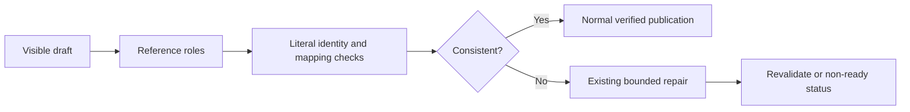

# SDD case-reference classification

- Status: Implemented candidate; remote merge acceptance pending
- Date: 2026-11-03
- Catalog capability ID: issue-start-and-sdd-readiness
- Last verified: 2026-11-03, local source/tests/docs review; remote gates remain independent
- Owners: Copilot maintainers
- Scope: Distinguish ordinary technical designators from shorthand acceptance-case references in proposed SDDs.
- Related issue: [#845](https://github.com/vypdev/copilot/issues/845)
- Required review gates: product UX, architecture, tests, docs, security,
  complete automated review and 100% modified-line coverage
- Open decisions blocking readiness: none; execution and remote acceptance remain pending.

## 1. Executive summary

A technical designation in ordinary prose must not become an acceptance-case
reference merely because its characters resemble an abbreviated ID. Writers
can retain Unicode/control and component terminology. Actual case identities,
references in case roles, budgets, mappings and owner reservations remain
publication gates. Acceptance of an SDD still does not establish product runtime
acceptance.

```text
visible draft -> classify reference roles -> validate unchanged literal inventory
 -> existing bounded repair or normal publication -> independent runtime gates
```

## 2. Problem, current behavior, and evidence

### 2.1 Problem and current behavior

At approved SDK source `771dc505` (merged as `16bf97ff`), the consistency policy
checks the visible source with an unqualified-token regex. It rejects the
reported control designation, a Unicode designation and connector/component
designators with `case-identity` / `case-shorthand`, despite unchanged literal
inventory and reciprocal links.

### 2.2 Verified evidence and limits

The original issue and its original comment were read before admission; the
Action plan independently requires a narrower rule and retained real-reference
checks. The [controlled before/after proof](../quality/sdd/evidence/issue-845.json)
invokes the actual current domain functions from exact approved source. Its independently authored 48-row fixture is valid before
adding each technical fragment. All three intended-positive fragments fail;
all six negative controls remain rejected. Case rows and reverse mappings are
byte-identical across the wording variants.

The [referenced consumer document](https://github.com/vypdev/domus/blob/ca55cdb56779573a0dd45b47b9546b74b4ffcc74/specs/household-entry-interface.md)
was read without cloning or modification; its Git blob is
`ff87750ca63faed8a650718900a52e9ce38e648d` and it contains 48 literal case rows.
Its historical owner/inventory checkpoint was not reconstructed. The controlled
fixture is not that historical candidate, consumer implementation execution,
a newly failed hosted run, a live provider response or 48 executed SDK tests.

### 2.3 Retrospective classification

Not applicable to this prospective correction. Existing lexical behavior is
verified; no unsupported historical rationale is inferred.

## 3. Actors, surfaces, and terminology

| Actor | Goal | Entry point | Visible surfaces |
|---|---|---|---|
| SDD author | Describe technical behavior and real acceptance precisely | Existing issue/SDD workflow | Draft, repair/status card, PR |
| Maintainer | Review a coherent inventory without unrelated prose rewrites | Existing review/CLI route | Diagnostics, docs, job summary |
| Trusted validator | Enforce literal identity and reference roles | Existing pure validation call | Closed reason/count facts |

A **case role** is an explicit case-ID/reference field or column, an explicit
case/reference cue, or a contiguous continuation of a case-ID reference list.
A **technical operand** is ordinary text that has not acquired such a role.
Recognition does not credit an operand as a case or count it toward acceptance.

## 4. Goals, non-goals, and fixed invariants

| Requirement | Behavior |
|---|---|
| SDD-CASE-R1 | Accept ordinary technical designators without rewriting source, literal case definitions or reciprocal links. |
| SDD-CASE-R2 | Classify shorthand only in case-reference roles, explicit reference cues and contiguous case-ID reference lists; retain rejection there. |
| SDD-CASE-R3 | Keep canonical ID fields, unknown qualified references, owner reservations, exact budgets and bidirectional mappings strict. |
| SDD-CASE-R4 | Reuse the existing visibility projection and preserve Unicode text, fences, comments, line endings and publication bytes. |
| SDD-CASE-R5 | Keep the classifier pure and source-bounded; preserve existing immutable-source, repair, publication and cleanup authority. |
| SDD-CASE-R6 | Align generation guidance, localized recovery, SDD/catalog/docs and executable acceptance without treating document validity as runtime execution. |

Non-goals: a general natural-language meaning engine, new case IDs or row
normalization, changes to conservative retained-owner alias/range reservation,
relaxing qualified-reference or repository-path checks, new settings/locales,
permission changes, more provider calls or expanded repair budgets. Required
canonical fields remain language independent. Prose cues supplement those
fields; they cannot certify arbitrary-language requirement completeness.

## 5. Current versus proposed product journey

| Stage | Current | Proposed | Effect |
|---|---|---|---|
| Author writes technical prose | Global token match rejects it | Classify its role | Original terminology retained |
| Author references an acceptance case | Global match rejects shorthand | Case role rejects shorthand | Full identity still required |
| Inventory/mapping validation | Strict canonical tables | Same strict tables | No extra credit or aliases |
| Failure | Existing bounded repair/status | Same route and safe category | No new retry or authority |



Text equivalent: classify the visible draft, validate the same inventory, then
publish normally or use the existing repair/non-ready path.

## 6. Functional behavior and state model

1. The owner policy continues to exclude fenced examples and HTML comments;
   the classifier receives this existing visibility projection.
2. Canonical case-ID and reciprocal-link fields keep their full-ID schemas.
   Recognize explicit case-role columns in other ordinary Markdown tables too;
   reset role context between cells so a scenario does not inherit its ID cell.
3. In prose, recognize explicit case/reference labels and cues, formatting around
   their values, and uninterrupted reference-list/range continuations after a
   case ID. Technical words or an unrelated clause end that continuation.
4. Plain technical text is not a case role. There is no special allowlist for a
   particular control designation, connector number or case-number length.
5. Token boundaries respect Unicode identifier neighbors. Detection must not
   rewrite or normalize IDs, technical values or source bytes.
6. Keep unknown qualified-reference checks and retained-owner reservations in
   the existing policy. No count, namespace or reciprocal link is inferred from
   accepting a technical operand.

| State | Transition | Result |
|---|---|---|
| Technical prose | No case-reference role | Continue the full existing validator |
| Case role with shorthand | Invalid identity/reference | Existing safe consistency failure |
| Invalid budget/mapping/owner/path | Independent rejection | Existing specific failure |
| Valid document | Existing freshness/write checks | Publication, without runtime claims |

Ambiguous adjacent IDs in an established case-reference list remain references.
This is a bounded syntactic role contract, not proof of natural-language meaning.

## 7. User-facing configuration

| Setting/boundary | Contract |
|---|---|
| Public configuration | No new option, override or escape hatch |
| Document size | Existing 70,000-character draft bound remains unchanged |
| Repair | Existing shared two-attempt drafting ceiling remains unchanged |
| Ownership | Same immutable owner/catalog and managed branch authority |
| Roles | Fixed syntax rules tested as code, not user-supplied regex or keywords |

No migration, credential, consent or operator reset is required.

## 8. Clean Architecture design

| Layer | Responsibility | Forbidden dependencies |
|---|---|---|
| New domain classifier | Count shorthand in visible case-reference roles | IO, provider SDK, process, locale service, publication |
| Existing consistency policy | Tables, IDs, reservations, budgets, mappings and paths | New external authority or source rewriting |
| Existing application | Owner reads, draft/repair and final validation | Treat accepted prose as runtime proof |
| Existing workspace | Immutable Git validation, exact composition and publication | Skip checks or touch an unrelated checkout |

The classifier returns only a count. Reuse the existing CommonMark inline
projection for labels/code so formatting and link destinations do not split
reference lists or manufacture case operands; required ID fields remain literal. Diagnostics continue through existing
closed reason/phase/fact types, without rejected prose. Use a linear token walk
with disjoint intervening gaps and line/table role boundaries; avoid repeatedly
rescanning a growing prefix or silently truncating reference context. Tests
cover large technical text and long spacing. No new dependency is needed.

## 9. UI/UX and content contract

Accepted technical content proceeds with its original wording. A genuine case
reference failure keeps the existing localized status/repair surface.

| State | Representative content | Action |
|---|---|---|
| Valid technical prose | Normal consistent-draft status | Continue existing publication checks |
| Genuine case violation | “Case identities or references do not match the literal inventory.” | Correct the real reference and retry normally |
| Repair exhausted | Existing non-ready status and retained answers/SDDs | Review closed facts; no draft is published |
| Published | Existing draft publication status | Runtime/security acceptance remains independent |

Commands, links, categories and counts retain their canonical identities.
English/Spanish recovery uses the existing impact/action/retained-state order;
no raw Markdown, private IDs or paths enter a repair instruction or public
error. Textual headings remain mobile/screen-reader compatible. No new browser
layout or human VoiceOver journey is introduced for this domain correction.

## 10. Failure, recovery, and cleanup

Malformed required tables, identity aliases, unknown qualified references,
owner collisions, wrong allocations and asymmetric links still fail their
specific existing category. A classifier failure cannot authorize partial
publication. Existing exception/finally cleanup and scratch-worktree removal
remain mandatory. Keep meaningful before/after inputs, source identities,
assertions, scope limitations and diagnostics; retire redundant generated
coverage HTML/guards after verification, preserving the current SDK rollback.

## 11. Security, permissions, and privacy

Input Markdown and repository context are data, never instructions to grant
permissions or change validation. Case fields cannot be relabeled as technical
prose to establish an acceptance count: the canonical inventory and reciprocal
links independently enforce full IDs. No token, provider request, network read,
source export, user-setting change or new permission belongs to the classifier.
Retain the unchanged visibility, freshness, path and publication boundaries.

## 12. Observability and operational UX

Use existing correlation, safe category/phase/count and status-card identity.
Do not log technical source merely to explain classification. Local/source,
controlled fixture, actual native execution, complete model review and official
coverage are distinct evidence. A document containing 48 rows is not evidence
of 48 executed tests or runtime acceptance. Replays do not add notifications.

## 13. Compatibility, migration, rollout, and rollback

Compatible typed fields and public recovery IDs remain unchanged. Newly
accepted technical prose needs no content migration. Existing fully qualified
references remain valid; real shorthand still fails in reference roles. Legacy
owner reservations retain their conservative behavior and fixed range bound.
Adopt the corrected SDK through the normal managed runtime route. Roll back
source, prompt guidance and bundles together; never rewrite published SDDs or
undo an already published Git effect as housekeeping.

## 14. Testing strategy and numeric budget

Minimum **40 distinct new cases**, counted once; existing cases remain
mandatory and are not recounted. These SDK regressions are distinct from the
48 hypothetical rows used as input in the controlled reproduction.

| Area | Minimum distinct cases | Behaviors/risks covered |
|---|---:|---|
| Pure | 24 | Technical operands, reference roles, tables, ranges, visibility and bounded deterministic scanning |
| Consistency | 10 | Literal identities, mappings, allocations, reservations and trusted revalidation |
| Publication | 4 | Real local Git acceptance/rejection, retained bytes and replay/cleanup |
| Recovery | 2 | Safe English/Spanish real-case failure content |
| Total | 40 | No repeated execution or fixture row is counted twice |

| Case ID | Area | Requirements | Scenario |
|---|---|---|---|
| sdd-case-ref-C01 | Pure | SDD-CASE-R1 | Ordinary DEL/C1 prose is accepted without rewriting its bytes. |
| sdd-case-ref-C02 | Pure | SDD-CASE-R1 | Unicode C1 designation is accepted in ordinary prose. |
| sdd-case-ref-C03 | Pure | SDD-CASE-R1 | Connector/component designators remain technical operands. |
| sdd-case-ref-C04 | Pure | SDD-CASE-R1 | Inline code technical identifiers remain ordinary text outside case roles. |
| sdd-case-ref-C05 | Pure | SDD-CASE-R1 | Technical identifiers in non-case table columns are accepted. |
| sdd-case-ref-C06 | Pure | SDD-CASE-R1 | A canonical scenario may describe control characters without declaring a shorthand case. |
| sdd-case-ref-C07 | Pure | SDD-CASE-R1 | Requirement behavior may name a technical designator. |
| sdd-case-ref-C08 | Pure | SDD-CASE-R1 | A protocol/URI designator does not acquire case-reference authority. |
| sdd-case-ref-C09 | Pure | SDD-CASE-R2 | An explicit English case reference using a short ID is rejected. |
| sdd-case-ref-C10 | Pure | SDD-CASE-R2 | An explicit Spanish case reference using a short ID is rejected. |
| sdd-case-ref-C11 | Pure | SDD-CASE-R2 | A case-ID label enforces qualified references despite formatting. |
| sdd-case-ref-C12 | Pure | SDD-CASE-R2 | A case-role table column rejects shorthand. |
| sdd-case-ref-C13 | Pure | SDD-CASE-R2 | An adjacent reference-list continuation after a qualified ID rejects shorthand. |
| sdd-case-ref-C14 | Pure | SDD-CASE-R2 | An abbreviated range in an explicit case-reference context is rejected. |
| sdd-case-ref-C15 | Pure | SDD-CASE-R2 | An explicit see/reference cue cannot introduce an unqualified case. |
| sdd-case-ref-C16 | Pure | SDD-CASE-R2 | Hyphenated range shorthand remains a case-reference failure. |
| sdd-case-ref-C17 | Pure | SDD-CASE-R2 | Wrapped labels and long spacing cannot evade reference classification. |
| sdd-case-ref-C18 | Pure | SDD-CASE-R2 | Markdown emphasis and inline-code decoration do not hide reference intent. |
| sdd-case-ref-C19 | Pure | SDD-CASE-R4 | Unicode identifier boundaries do not manufacture standalone short tokens. |
| sdd-case-ref-C20 | Pure | SDD-CASE-R4 | CRLF and LF yield equivalent role decisions. |
| sdd-case-ref-C21 | Pure | SDD-CASE-R4 | Hidden comments remain excluded by the owner visibility projection. |
| sdd-case-ref-C22 | Pure | SDD-CASE-R4 | Fenced negative examples remain excluded by the owner visibility projection. |
| sdd-case-ref-C23 | Pure | SDD-CASE-R5 | Repeated calls are deterministic and do not retain regex cursor state. |
| sdd-case-ref-C24 | Pure | SDD-CASE-R5 | Large technical text and long reference gaps retain the same decisions without silent limits. |
| sdd-case-ref-C25 | Consistency | SDD-CASE-R1 | The reported fragment passes the actual consistency path with 48 literal fixture rows. |
| sdd-case-ref-C26 | Consistency | SDD-CASE-R3 | Technical wording variants retain byte-identical case rows and reverse mappings. |
| sdd-case-ref-C27 | Consistency | SDD-CASE-R3 | A shorthand inventory definition remains invalid. |
| sdd-case-ref-C28 | Consistency | SDD-CASE-R3 | A reserved owner-case collision remains invalid. |
| sdd-case-ref-C29 | Consistency | SDD-CASE-R3 | An undefined fully qualified reference remains invalid. |
| sdd-case-ref-C30 | Consistency | SDD-CASE-R3 | A shorthand reciprocal link remains invalid. |
| sdd-case-ref-C31 | Consistency | SDD-CASE-R3 | A one-sided or missing reverse link remains invalid. |
| sdd-case-ref-C32 | Consistency | SDD-CASE-R3 | A wrong allocation or total remains invalid. |
| sdd-case-ref-C33 | Consistency | SDD-CASE-R3 | Legacy owner aliases and bounded ranges retain their reservations. |
| sdd-case-ref-C34 | Consistency | SDD-CASE-R6 | Trusted derived tables and accepted technical prose survive independent revalidation. |
| sdd-case-ref-C35 | Publication | SDD-CASE-R5 | Real local Git publication accepts technical prose and preserves retained owner bytes. |
| sdd-case-ref-C36 | Publication | SDD-CASE-R2 | Real local Git publication blocks a genuine shorthand reference before push. |
| sdd-case-ref-C37 | Publication | SDD-CASE-R3 | Real local Git publication blocks an invalid identity field before push. |
| sdd-case-ref-C38 | Publication | SDD-CASE-R4 | Publication/replay keeps visibility, byte identity and cleanup boundaries. |
| sdd-case-ref-C39 | Recovery | SDD-CASE-R6 | English recovery preserves closed safe diagnostics and retained state for a real case violation. |
| sdd-case-ref-C40 | Recovery | SDD-CASE-R6 | Spanish recovery preserves closed safe diagnostics and retained state for a real case violation. |

Require 100% new pure-module lines/statements/functions/branches, unchanged
repository budgets and official Codecov 100% modified lines with zero misses
or partials against the correct current base. Run full Jest and extension
regressions, all applicable native-platform checks and complete finding-free
review. Use deterministic text/fakes and local Git; no live provider, credential
grant or consumer execution is part of these tests.

### Local acceptance evidence (2026-11-03)

The final source passes **879 Jest suites / 17,148 tests**, with 35 existing
skips. It adds **77 distinct regressions**: 56 classifier cases, 12 consistency
cases, 4 real local Git cases, 2 localized recovery cases and 3 bounded-draft
cases. The 48 hypothetical fixture rows are not added to that count.
The new pure module measures 100% lines/statements/functions/branches
(59 lines / 39 branches), enforced by an exhaustive budget. Full-suite LCOV
covers **83/83 modified coverable lines**, zero misses or partials against
`16bf97ff`. Extension tests remain 267/267 with every metric at 100%.
These local measurements are not official Codecov, native remote acceptance
or consumer execution; the PR must separately verify its current head/base.

## 15. Documentation and discoverability

| Path | Change |
|---|---|
| specs/sdd-case-reference-classification.md | create |
| specs/pre-branch-sdd-gate.md | update |
| specs/catalog.json | update |
| specs/CATALOG.md | update |
| docs/issues/pre-branch-sdds.mdx | update |
| docs/development/specifications.mdx | update |
| src/domain/sdd_case_reference.ts | create |
| src/domain/sdd_visible_references.ts | update |
| src/testing/sdd_consistency_fixture.ts | update |
| src/application/policies/__tests__/sdd_preparation_status_policy.test.ts | update |
| quality/sdd/evidence/issue-845.json | create |
| src/domain/__tests__/sdd_case_reference.test.ts | create |
| src/domain/sdd_draft_consistency.ts | update |
| src/domain/__tests__/sdd_draft_consistency.test.ts | update |
| src/infrastructure/__tests__/pre_branch_sdd_workspace_adapter.test.ts | update |
| src/application/usecases/sdd/pre_branch_sdd_draft_workflow.test.ts | update |
| scripts/coverage-budgets.json | update |

Explain accepted technical prose, strict case-role fields/references, unchanged
legacy reservations and the distinction between publication and runtime tests.
Update generation guidance to request full case IDs without instructing a writer
to rename unrelated technical terms. Catalog links and docs must validate.

## 16. Acceptance scenarios

1. Given 48 distinct literal fixture rows and exact reciprocal links, adding
   the reported technical fragment passes format/consistency; no row or link
   changes. The original Unicode terminology remains in the accepted bytes.
2. Connector/component and other ordinary technical operands pass outside case
   roles, including scenario/behavior and non-case table cells.
3. Explicit shorthand references, abbreviated ranges and shorthand case fields
   fail before publication. Unknown qualified references, collisions, wrong
   budgets and bad mappings retain their previous failures.
4. Hidden/fenced examples and line-ending/Unicode boundaries retain visibility
   semantics. Repeated/large inputs do not depend on shared regex state or an
   undocumented dropped prefix.
5. Real local Git publication retains owner bytes and cleanup; invalid case
   content never pushes. Existing replay and final validation remain required.
6. Genuine failures use safe existing English/Spanish recovery; acceptance of
   technical prose does not add a case, execution claim, setting or permission.

## 17. Requirements traceability

| Requirement | Cases |
|---|---|
| SDD-CASE-R1 | sdd-case-ref-C01, sdd-case-ref-C02, sdd-case-ref-C03, sdd-case-ref-C04, sdd-case-ref-C05, sdd-case-ref-C06, sdd-case-ref-C07, sdd-case-ref-C08, sdd-case-ref-C25 |
| SDD-CASE-R2 | sdd-case-ref-C09, sdd-case-ref-C10, sdd-case-ref-C11, sdd-case-ref-C12, sdd-case-ref-C13, sdd-case-ref-C14, sdd-case-ref-C15, sdd-case-ref-C16, sdd-case-ref-C17, sdd-case-ref-C18, sdd-case-ref-C36 |
| SDD-CASE-R3 | sdd-case-ref-C26, sdd-case-ref-C27, sdd-case-ref-C28, sdd-case-ref-C29, sdd-case-ref-C30, sdd-case-ref-C31, sdd-case-ref-C32, sdd-case-ref-C33, sdd-case-ref-C37 |
| SDD-CASE-R4 | sdd-case-ref-C19, sdd-case-ref-C20, sdd-case-ref-C21, sdd-case-ref-C22, sdd-case-ref-C38 |
| SDD-CASE-R5 | sdd-case-ref-C23, sdd-case-ref-C24, sdd-case-ref-C35 |
| SDD-CASE-R6 | sdd-case-ref-C34, sdd-case-ref-C39, sdd-case-ref-C40 |

## 18. Implementation sequence

Freeze the exact current-source failure and negative controls; define/test
case-reference roles; integrate the pure counter without changing the remaining
policy; add full consistency, publication/repair and recovery regressions;
update prompt/docs/catalog and exhaustive budget; build bundles and validate
package/coverage/Graphify; publish on the exact Action-created branch; audit the
current head/base, complete review, all native gates and official Codecov before
ordinary merge. Adopt one approved SDK baseline and retire replaced artifacts.

## 19. Definition of Done

- [ ] SDD-CASE-R1–R6 and the six acceptance scenarios have executable evidence.
- [ ] At least 40 distinct new cases satisfy the distribution and preserve old controls.
- [ ] New pure coverage and all modified-line coverage are 100%, without exclusions.
- [ ] Source, prompt guidance, docs, catalog, bundles and Graphify agree.
- [ ] Exact-head CI/native platforms and complete review pass without findings/threads.
- [ ] Official Codecov verifies the correct head/base with zero misses/partials;
      normal merge and native issue closure are verified independently.

## 20. References and decisions

- [Owning gate contract](./pre-branch-sdd-gate.md#generated-draft-consistency-2026-10-21-653).
- [Repository-reference classification](./sdd-reference-classification.md) remains
  an independent path/notation guard; it is not a case-ID exception list.
- Decision: classify reference roles, not a whitelist for one reported operand.
- Decision: preserve conservative immutable owner reservations and qualified
  namespace checks; acceptance of ordinary prose cannot credit a new case.
- Limitation: syntactic roles do not prove arbitrary natural-language meaning,
  runtime execution, historical input identity or completeness of every goal.
- [GFM table syntax](https://github.github.com/gfm/#tables-extension-) informs
  pipe escapes, delimiter/header alignment, variable body-cell counts and
  blank/new-block boundaries. Reuse the existing CommonMark block parser rather
  than inventing independent block-boundary rules. This projection does not
  broaden the canonical required-table schema.
- No unresolved scope decision blocks implementation.
