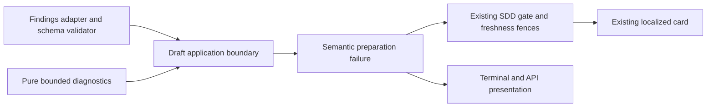

# Safe diagnosis of an undersized SDD draft response

- Status: Implemented and locally qualified; exact-head delivery gates pending
- Date: 2026-11-04
- Catalog capability ID: `issue-start-and-sdd-readiness`
- Owners: Copilot maintainers
- Scope: classify a rejected draft below the existing minimum without changing repair or publication authority
- Related issue: [#850](https://github.com/vypdev/copilot/issues/850)
- Required review gates: architecture, security, testing, operator UX and documentation
- Open decisions blocking readiness: none

## 1. Executive summary

An undersized generated SDD is a response-contract failure. The existing card,
terminal error and API record MUST identify drafting, the applicable minimum,
known attempt count and a safe observed count or its explicit unavailability.
The author can clarify that a complete proposed Markdown document is required
and retry the same issue. Strict rejection, selected ownership, recorded answers
and existing publication fences remain authoritative.

```text
Answered plan -> draft response -> minimum satisfied -> existing validation
                              -> below minimum -> one safe blocked card
                                                 -> clarify complete output
                                                 -> retry same issue
```

Text equivalent: minimum failure terminates this generation attempt and reports
safe facts; it does not regenerate or authorize branch/specification publication.

## 2. Problem, current behavior and evidence

The immutable SDK `3e7ceea08e6131360e026937d1c0cc1b120472e0` rejected `$.markdown`
as too short in [reported run 41339905694](https://github.com/vypdev/domus/actions/runs/41339905694).
Its public result exposed generic retryable `workflow.failed`. The original
response content, actual length and reason for that output are unknown. Reported
validation of the author's proposed input does not establish the model's output.
The mutable linked status card subsequently changed; its current content is not
evidence of what the failed attempt published.

At development base `6bd590dac62bdd075d2894e29aa580791dec81a5`, local schema
validation already throws typed `AgentResponseSchemaFailure('string-short', path)`.
The draft helper recovers only the exact maximum-length error and rethrows the
minimum failure without feature facts. It also accepts a short string from a
query port that bypasses adapter schema validation. Three SDK-owned regressions
fail before correction. They use deterministic transports, not a consumer rerun
or live model, and do not reconstruct the unknown original output.

## 3. Actors, surfaces and terminology

The issue author sees the existing preparation card and supplies clarification.
The maintainer inspects its linked run and correlation. CLI/API consumers receive
the same semantic cause. The host owns the response schema, attempt counter,
source snapshot and publication permission; generated content cannot alter them.

**Minimum** is the declared 1,800 Unicode code points. **Observed** is a count
actually available at this boundary. A typed rejection without retained length
means unavailable, not zero. **Attempt** is the first or second existing draft
query, not an inferred count of provider-internal requests.

## 4. Requirements and limits

| ID | Requirement |
|---|---|
| MIN-01 | Strictly reject undersized draft Markdown with response-stage/minimum/attempt facts; preserve unknown observed length as unavailable. |
| MIN-02 | Preserve the shared two-attempt maximum/format ceiling. Minimum failure, unrelated schema errors and provider failures MUST NOT authorize another generation. |
| MIN-03 | Use closed bounded recovery/diagnostic fields; never retain rejected response, source, raw error text or credentials in public failure facts. |
| MIN-04 | Localize the existing card and final error with concrete clarification/retry guidance and retained state; add no notification surface. |
| MIN-05 | Ordinary Issue and Issue Comment flows MUST retain answers/owner and withhold branch/specification publication on failure; preserve freshness, replay and source binding. |
| MIN-06 | Ship meaningful regressions, documentation, catalog and generated package evidence with complete review and all modified lines covered. |

No minimum reduction, new model prompt repair, unbounded retry, automatic owner
change, consumer mutation, new credential or publication bypass is introduced.

## 5. Current versus proposed journey

| Stage | Observed limitation | Required behavior |
|---|---|---|
| Schema rejects short Markdown | Generic workflow failure loses stage | Narrow typed classification at the draft boundary |
| Port returns a short string | Defensive minimum is absent | Reject before writer validation with an actual code-point count |
| Second query is short after size/format repair | Cause loses attempt identity | Report attempt 2 and stop; no third query |
| Operator reads error | Generic retryable operation | Response-contract cause, known minimum and concrete clarification |
| Recovery | Same issue retains existing state | Same ownership, answers, source and ordinary publication fences |

## 6. State and functional behavior

Only typed `string-short` at exactly `$.markdown` during the draft query maps to
the undersized-response failure. Do not parse exception messages. Other typed
reasons/paths and forged text retain their original identity and retry policy.

An adapter rejection supplies the locally declared minimum and actual host
attempt, with observed count unavailable when that error retained no count.
For a returned string, preserve the existing cheap maximum check before counting
its bounded contents with Unicode code-point semantics. Below-minimum results
fail before table assembly, writer validation or publication. Empty strings
report an observed zero; astral characters count once each.

The new terminal reason is `response-minimum`, phase `response`, with exactly one
`minimum-length` fact in section 0, a positive bounded expected count and optional
observed count strictly below it. No row or unrelated fact can claim this cause.
The application error remains nonretryable `validation.invalid-input`, with
recovery `sdd-draft-response-too-short` and exactly `minimum`, `observed`,
`attempts`. Observed is a bounded nonnegative integer below minimum or the literal
`unavailable`; attempts is 1 or 2. Both projections MUST describe the same facts.

## 7. Configuration

There is no new setting, schema migration, command or permission. The existing
minimum remains 1,800 Unicode code points for update, companion and new plans.
The existing update maximum of 18,000 and companion/new maximum of 70,000 remain.
Schema string bounds use code points; downstream maximum checks currently use
JavaScript string length. This correction preserves that existing maximum
behavior and does not claim to harmonize those units.

Recommended recovery is a concrete complete-output clarification on the same
issue. A genuine oversized draft continues through its existing single repair.
Neither option permits changing the minimum or silently truncating requirements.

## 8. Clean Architecture



Text equivalent: the adapter enforces its schema, application orchestration owns
stage/attempt and narrow classification, pure domain checks bound facts, and the
existing gate/presentation publish only a safe projection.

Reuse the existing generic schema-failure type. Do not introduce provider DTOs,
raw response storage or a parallel SDD coordinator. Domain validation imports no
I/O or presentation. The generic application-error boundary validates the exact
new recovery keys. The card admits structured minimum recovery only after its
closed validator passes; its existing zero-parameter SDD recovery guard remains.
Dependency/cycle, publication-call inventory, type and descriptor tests enforce
these boundaries. No new comment-write call site is needed.

## 9. UI, accessibility and localization

Reuse the current preparation card and its trusted-bot ownership marker:

```text
Specification preparation is blocked
No new specification or branch was published by this preparation attempt.
Impact: The drafting response did not meet the Markdown minimum.
Action: Clarify that a complete proposed Markdown document is required,
        preserving the resolved requirements and owner; retry this issue workflow.
Retained: Existing answers, selected ownership and published specifications.
Technical details: response-minimum; response; attempt 1;
                   minimum 1800 Unicode code points; observed unavailable.
```

Pending, awaiting-answer, valid, partial-publication and recovered views keep
their existing contracts. A minimum failure cannot claim a partial or verified
publication. Known returned-string counts replace unavailable only when measured.
English and Spanish cover impact/action/retained state, units, labels and unknown
count copy; existing whole-artifact locale fallback remains. Use semantic headings,
plain text and progressive detail on narrow/light/dark surfaces. No browser UI
or new human screen-reader campaign is required for this backend correction.

## 10. Failure, recovery, replay and cleanup

| Failure | Generation behavior | Operator action / retained state |
|---|---|---|
| minimum rejection on attempt 1 | terminal after one query | clarify complete output; retain owner/answers |
| minimum rejection on existing repair | terminal after two queries | same; no third query |
| exact maximum or typed format failure | existing shared repair only | unchanged validation and recovery |
| malformed shape / unrelated schema | unchanged terminal identity | no fabricated minimum/provider outage |
| actual unavailable provider | preserve semantic category/correlation | provider recovery; no content-size repair |
| issue/base changes | existing freshness rejection | do not overwrite newer card or publish |

Retry updates the same owned card through existing replay rules. It creates no
new response journal or rejected-content artifact. Existing private source-view
and runtime cleanup remains responsible for terminal paths; no new workspace,
browser package or background worker is introduced.

## 11. Security and privacy

The rejected response may contain secrets or instructions. Never include it,
its fragments, source files, arbitrary exception text or untrusted destinations
in a recovery, card or repair prompt. Facts are copied/frozen and exact-key
validated, with the existing 100,000 numeric ceiling. Missing counts are not
inferred from the author's supplied proposal, JSON byte size or UTF-16 length.
The error's correlation/run coordinates come from trusted existing runtime
ownership, not generated content. Existing visibility and write permissions hold.

## 12. Observability

Keep error code, correlation, run link, response phase, closed minimum reason,
applicable bound and actual host attempt. The API/terminal cannot silently lose
those facts while the card shows them. Explicitly label unknown observed count.
Distinguish local fixture, native CI, current-head review and downstream release
evidence. No original provider root cause or repaired consumer run is claimed.

## 13. Compatibility, rollout and rollback

This adds a validated recovery variant and bounded diagnostic reason. Existing
source selection, stored answers, owner documents, commands and maximum/format
repair remain. Custom query ports that bypass adapter validation must now honor
the already declared minimum as well. Focused format tests must provide inputs
meeting the minimum so they still exercise their intended writer constraint;
do not weaken those assertions or the acceptance schema.

Rebuild Action/CLI/API/deployment bundles and declaration closure, verify the
actual package, then follow the managed patch after the bug backlog. Develop
merge alone does not update the released runtime. A reviewed rollback restores
the former diagnostic gap without changing consumer history or remote branches.

## 14. Numeric test budget

Minimum **40 new distinct cases**, counted once: 10 pure diagnostic/recovery
boundary/security cases; 14 draft/schema/Unicode/attempt/maximum and identity
controls; 8 localized card/API/terminal privacy cases; and 8 Issue/Issue Comment
lifecycle, freshness, replay and retained-state integration cases. The first
three red regressions belong to the draft group, not an additional budget.

Test 0/1799/1800 boundaries, astral code points, unavailable counts, first/second
attempts, exact/foreign maximum errors, malformed/missing/nonstring Markdown,
unrelated schema reasons/paths, forged text and real semantic provider failures.
Use the real findings adapter with deterministic CLI transport for schema
classification and real shared routes for Issue/Issue Comment behavior. No live
model, consumer rerun, sleeps or service credentials. Preserve all root/extension
budgets, existing skips and exhaustive pure checks. Require every modified
coverable line hit in local full-suite LCOV and official Codecov against the
live base, with zero misses or partials.

Local execution on 2026-11-04 passes **83 new distinct cases**: 35 pure
diagnostic cases, 19 draft/schema controls, 20 presentation cases, 8 real-route
integration cases and one exhaustive recovery-inventory case. The original
three regressions failed before the correction and now pass. Existing gate and
repair-feedback controls pass (136 cases); their synthetic generated drafts now
meet the unchanged minimum so they still reach their intended later checks.
The full root run passes 891 suites / 17,429 tests, with 35 preexisting skips;
267 extension tests also pass with 100% statements, branches, functions and
lines. Global coverage budgets pass; the setup ledger retains its 14 explicitly
open human acceptances. Full-suite LCOV hits 52/52 modified coverable lines with no misses or partials
against `6bd590dac62bdd075d2894e29aa580791dec81a5`. Local LCOV is not an official
Codecov result or execution of the original consumer run. Remote gates remain
pending until the exact published head is reviewed and qualified.

## 15. Documentation

Update `docs/issues/pre-branch-sdds.mdx` and the application error reference with
the minimum cause, count availability, shared attempt policy and concrete same-
issue recovery. Link this companion from the primary gate and catalog; regenerate
`specs/CATALOG.md`. No setup, permission or migration input is added. Validate
documentation/navigation, specifications/catalog and packaged public declarations.

## 16. Acceptance

A short draft never publishes a branch/specification or enters minimum repair.
Both ordinary entrypoints retain recorded answers and owner, show safe stage,
minimum and attempt, and identify a measured count or its absence honestly.
A minimum-valid response still reaches unchanged writer checks. Maximum/format
recovery still has only two total queries, including mixed failures. Provider
errors keep their original semantic identity. Replays/freshness preserve the
current owned card and source. Public serialization and EN/ES output contain
neither rejected content nor unresolved interpolation.

## 17. Traceability

| Requirements | Executable evidence | Documentation |
|---|---|---|
| MIN-01–MIN-02 | `src/tooling/__tests__/sdd_minimum_failure.test.ts`; `src/application/usecases/sdd/pre_branch_sdd_draft_workflow.test.ts`; `src/application/usecases/sdd/sdd_repair_feedback.test.ts` | pre-branch SDD guide |
| MIN-03–MIN-04 | `src/domain/__tests__/sdd_minimum_diagnostic.test.ts`; `src/application/policies/__tests__/sdd_minimum_presentation.test.ts`; `src/application/policies/__tests__/application_error_presentation_policy.test.ts` | error reference |
| MIN-05 | `src/tooling/__tests__/sdd_minimum_entrypoints.integration.test.ts`; `src/application/usecases/steps/issue/__tests__/pre_branch_sdd_gate_use_case.test.ts` | guide and primary gate |
| MIN-06 | full coverage/budgets, architecture/types/docs/catalog/package, exact-head checks/review/Codecov | this SDD/catalog |

The counts above refer to executed SDK fixtures. Package, platform, original
consumer and remote review observations retain separate provenance; no
unexecuted budget row is represented as passing evidence.

## 18. Implementation sequence

Preserve original immutable failure facts; reproduce SDK regressions; define
bounded minimum facts and recovery; implement narrow typed/fallback rejection;
project the same facts to existing surfaces; add controls and real route tests;
align docs/catalog, update Graphify and generated bundles; validate full local
acceptance/package and normal hooks; obtain complete exact-head remote gates.

## 19. Definition of Done

All six requirements and the 40-case floor have actual evidence. The existing
minimum, repair ceiling, source/owner/answer and publication fences remain.
Privacy, API/locale parity, documentation/catalog, architecture and generated
artifacts pass. All applicable checks, complete review with no open findings or
threads and official 100% modified-line coverage with zero partials pass for
the current head/base before an ordinary authorized merge. Verify native issue
closure and retire owned disposable outputs while preserving evidence/rollback.

## 20. References and decisions

- [Original issue and reported evidence](https://github.com/vypdev/copilot/issues/850)
- [Primary gate](pre-branch-sdd-gate.md)
- [Immutable source context](pre-branch-sdd-source-context.md)
- [Structural diagnostics and repair](pre-branch-sdd-gate.md#bounded-structural-repair-feedback--833-2026-11-02)

Prefer narrow feature classification of the existing typed schema failure over
message matching, another generic error class or broader retry. Preserve unknown
original output honestly. A bounded returned string permits a code-point count;
an adapter rejection with no retained count does not. Status and final error
share one validated semantic recovery instead of separate invented diagnoses.
