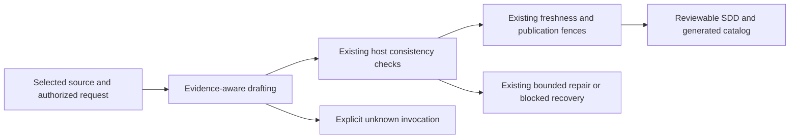
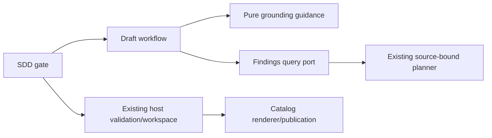

# Grounded verification guidance and faithful SDD evidence

- Status: Draft — implementation prepared; final qualification pending
- Date: 2026-11-04
- Catalog capability ID: issue-start-and-sdd-readiness
- Last verified: prospective change; baseline 4a463a4b0211a71ff75e2a5104561e170e893667
- Owners: Copilot maintainers
- Scope: Ground generated verification instructions and factual inventories in the selected source while retaining existing SDD publication safeguards.
- Related issues/PRs: [#858](https://github.com/vypdev/copilot/issues/858)
- Required review gates: architecture, testing, documentation, security/operations and actual current-head repository controls
- Open decisions blocking readiness: final whole-trial qualification, current-head remote checks and review

## 1. Executive summary

An SDD tells contributors what to verify. Its runnable instructions must come from the selected project, and its proposed cases and paths must retain the resolved scope. Copied SDK examples, structurally correct tables and a successful SDD publication do not prove that a project script exists or that product tests ran.

```text
Selected immutable source + resolved request
 -> inspect command/reference evidence
 -> draft concrete supported guidance or explicit validation outcomes
 -> preserve independent cases and future path declarations
 -> explicit supplied-identity check + existing consistency/freshness/publication checks
```

The pure catalog renderer has no project invocation evidence. Its owned maintenance text therefore describes regeneration and validation outcomes. Its standalone CLI can recommend the real existing `--write` option for stale-output recovery.

## 2. Problem, current behavior, and evidence

### 2.1 Problem

Three reported consumer publications require absent specification-maintenance scripts. Additional comments report mistyped immutable identities and loss of specific independent refinements and prospective paths. These are distinct content observations; no common hidden historical payload or root cause is invented.

### 2.2 Current behavior

The SDK already supplies an independent read-only view of the selected commit to the model. The selected catalog, template and standard come from that same source. Drafting and its existing single repair share the same source binding. Host checks validate format, inventories, paths, ownership/catalog coherence, freshness and allowed publication writes. They do not establish executable project-command semantics or full generated-prose fidelity.

The shared catalog renderer nevertheless prints fixed package-manager commands without receiving package/tooling evidence. Its stale-index CLI message repeats such a command even when the portable SDK runs in a repository without an application package. The reusable template also embeds a repository-specific script in its DoD. The SDK repository itself genuinely declares its maintenance scripts; their legitimate use must remain supported.

### 2.3 Evidence

Immutable consumer base/publication pairs:

- administration: 4b71969d3b3f6df5f28d617ab0da4e86c9be5884 -> a9c4b9723c66868884476743940102ada65d2db0;
- workspace: 6d84d4815a8bbfe071979df6650d01e433dcc2db -> 171244421fcc6289180bdb94bf4e7bb52a990a1b;
- recurrence: 8b1cbc110c389b9cdb6ecd11317c95abf2c4b0a9 -> 91adfe902055cb2c5bb42ceeb57c2b7ab53fb635.

Actual package/document bytes and Git blob identities are verified. Publications changed only SDD/catalog files. The original selected standard/template prescribe scripts absent from the selected package. These facts do not expose the complete original model prompt or rejected payload.

The current unmodified SDK format-only control accepts those three documents. A real authored SDK draft invents absent pnpm scripts for an npm/docs-check project; its two attempts are independently blocked by a missing README reference. Correcting only that reference makes the pure consistency checks accept the still-unsupported command. A native portable SDK control also generates unsupported command guidance without any project package, while actual `--write`/validation succeeds. Historical trials under the previous desktop CLI are retained separately: completed trials scored 6/8 and 3/8, and a third trial was interrupted after five cases. A desktop CLI update invalidated continuation under the frozen runtime. The next matched comparison retained all eight frozen cases but its app-only CLI pin omitted an external code-mode helper. A single authorized diagnostic observed that missing helper, while local native source materialization matched the actual file hashes. Those complete trials and all their raw outcomes remain rejected qualification evidence, not a source-inspection baseline. A new complete official same-version platform runtime has verified registry integrity and strict native signatures; three new whole baselines and three whole candidates use that runtime and the immutable original SDK worktree. The third complete-runtime candidate cohort passed native structure in all 24 executions, but one accepted document renamed all 18 explicitly supplied case identities. That cohort is rejected. A pure supplied-definition check now compares exact section-14 definitions before workspace validation and uses the same single repair; its dedicated regressions cover examples, retained owners, authorized answers, prompt bounds and non-public diagnostics. A later complete cohort had 7/8, 8/8 and 8/8 native acceptances; a code-wrapped table slot followed by a hybrid file/callable citation exhausted its repair in one case. The next candidate retained all eight native-valid documents in its first whole trial, but explicit semantic review rejected its unknown-command case for omitting the three concrete publication outcomes. Its other two trials were not executed after automatic approval rejected the external calls. Neither native validity nor generic review text rescues that omission; guidance now retains the three outcomes explicitly in DoD without adding product cases. All observations remain rejected historical evidence. Final qualification remains pending. Neither historical, interrupted nor runtime-impaired trials establish final qualification.

### 2.4 Retrospective classification

This is a prospective correction. Existing source admission and structural publication guards are preserved intentional contracts. Historical model tool reads and universal model accuracy remain unknown, not reconstructed as facts.

## 3. Actors, surfaces, and terminology

| Actor | Goal | Entry point | Visible surfaces |
|---|---|---|---|
| Issue author/maintainer | Obtain a usable complete owning specification | Existing admitted issue and authorized answers | SDD draft, status card, linked source/run |
| Contributor | Follow supported verification guidance | Generated SDD/catalog | Commands or validation outcomes and retained prerequisites |
| SDK operator | Regenerate and validate a catalog safely | Actual SDK catalog entrypoint | CLI status and supported recovery option |
| Reviewer | Distinguish evidence from generated claims | PR, SDD, qualification evidence | Exact source/response identities and full check results |

A **declared command** has inspectable project evidence; this does not mean its runtime is provisioned or its execution passed. An **outcome** states what must be validated when a concrete invocation is unverified. A **refinement** retains a distinct observable assertion; an alias to an existing journey is not a new counted case. A **prospective path** is an explicit future create operation, not an existing file.

## 4. Goals, non-goals, and fixed invariants

| Requirement | Behavior |
|---|---|
| SG-01 | Generated command guidance MUST use selected-project evidence; preserve genuine declarations and qualify missing, conflicting or unobserved invocations. |
| SG-02 | The pure catalog renderer and reusable template MUST NOT imply that a repository-specific script is universally installed. |
| SG-03 | Standalone stale-catalog recovery MUST identify the supported SDK regeneration action and preserve existing status, validation and safe-write behavior. |
| SG-04 | Factual citations MUST retain exact verified identities or explicit uncertainty; generation MUST preserve resolved independent case assertions, valid supplied identities and future-path declarations. |
| SG-05 | Guidance MUST retain source admission, read-only model authority, existing limits/repair count, ownership, freshness and publication fences. |
| SG-06 | Evidence MUST distinguish structural acceptance, source declarations, model qualification, execution and product acceptance. |
| SG-07 | File navigation assembled from explicit full repository targets MUST resolve from the selected publication directory, encode literal filenames safely and still undergo all native existence/path checks; existing valid Markdown remains supported. |

Non-goals: installing consumer scripts or wrappers, changing workflows/resources to make a false command appear installed, adding a shell interpreter, creating a universal cross-language executable-command verifier, changing providers or output budgets, automatic rewriting of retained owners, consumer deployment or claiming general model precision.

Fixed invariants include no execution of project commands to ground a draft, no raw credential/script-body disclosure, reserved owner IDs remaining references, no silent inventory compression and no additional generation attempts. Existing source inspection capability remains the architecture boundary.

## 5. Current versus proposed product journey

| Stage | Baseline issue | Required behavior |
|---|---|---|
| Read standard/template | A repository-specific example can be promoted to an installed consumer command | Inspect selected project invocation and working-directory/toolchain evidence |
| Evidence unavailable | A familiar command may be invented | State the required outcome and unresolved invocation/prerequisite |
| Preserve scope | Generic case summaries or renamed identities can replace supplied refinements | Preserve valid IDs and each observable assertion; keep all future path operations |
| Render catalog | Fixed pnpm guidance appears without project facts | State regeneration/validation outcomes without assuming scripts |
| Recover stale index | CLI recommends an absent project script | Use the actual SDK entrypoint's supported `--write` action and repeat validation |
| Publish | Host structural checks can be mistaken for execution | Keep checks and clearly separate their evidence from project runtime acceptance |



Text equivalent: source and request -> evidence-aware content -> unchanged consistency checks -> freshness/publication fences -> reviewable result; unknown invocations remain explicit, and invalid drafts retain existing recovery.

## 6. Functional behavior and state model

### 6.1 Happy path

The model inspects actual selected files for the invocation's directory/workspace, declared manager/toolchain and exact script/entrypoint or documented command. It preserves legitimate names, uses safe provenance and distinguishes declaration from successful execution. It verifies exact citations and preserves resolved product definitions. Existing code derives redundant budget/traceability tables. The gate checks explicit supplied new identities before the existing workspace validates the assembled result. Only the Action's existing verified lifecycle can publish.

### 6.2 Alternatives

The required format, internal/cross-document consistency and reciprocal catalog ownership/path/evidence outcomes stay explicit in section 19 even when the invocation is unknown. Generic maintainer acceptance or claim review cannot replace these three publication outcomes; keep them as DoD/invariants rather than adding product goals or case IDs.

No root Node manifest is not proof that the project has no tooling; another language/workspace may provide evidence. Unknown invocation is a valid explicit validation-outcome path, not permission to invent a wrapper. Conflicting or unreadable evidence is qualified rather than replaced with bootstrap facts. Legacy standards/templates remain input evidence, with their command examples checked against the actual project.

Requirement rows describe concrete behavior actually exercised by their linked cases. Publication/ownership metadata constraints belong in their invariant sections and existing validation evidence; they cannot become uncovered generic goals or substitute generic documentation cases for supplied protocol refinements. A mapping repair retains valid supplied new case IDs and assertions. Reserved owner IDs never become new counted definitions.

The pure domain policy recognizes operative visible `Case ID` tables with a `Scenario` or `Assertion` column and fully qualified `case-ID: assertion` declarations in the admitted issue and retained authorized answer text. It ignores fenced, hidden, quoted and indented examples, prose references, reference-only tables and invalid/empty definitions. Deduplicate exact IDs and exclude identities reserved by any immutable owning SDD. Only issue text within the existing drafting prompt bound participates. Every remaining supplied ID must be an actual section-14 definition; a prose reference or renamed alias is insufficient. A missing identity produces only the existing closed `case-identity` diagnostic with expected/observed counts, never the ID or rejected output. The existing single repair and final blocked recovery apply. This checks identity, not whether arbitrary scenario prose is semantically equivalent. To retire or rename an explicit definition intentionally, revise the admitted definition through the normal authorized issue/answer flow rather than relying on a generated alias.

### 6.3 State machine

| State | Meaning | Next/recovery |
|---|---|---|
| Source selected | Existing immutable host selection | Same admitted read-only view |
| Drafting | Evidence inspected; content not execution proof | Existing host validation |
| Invocation unverified | Required outcome known, concrete command/prerequisite unknown | Retain explicit uncertainty; no invented installation |
| Invalid draft | Existing format/consistency guard rejects | Same single repair, then existing blocked card |
| Validated draft | Structural contract accepted | Existing freshness/publication lifecycle |
| Published specification | Verified document/catalog publication | Product implementation/execution acceptance remains separate |

Stale, duplicate, canceled and in-flight operations retain existing semantics. No new durable state is introduced.

The drafting instructions also state the existing native requirement-ID grammar explicitly: use an alphabetic prefix with at least one hyphen-separated alphanumeric segment, such as `G-01`; `G1` and `G01` remain invalid. The raw response contains the declared inventories and existing assembly slots. The final assembled document contains one derived budget and one reciprocal mapping table; the template tables must not be duplicated beside the slots. Path cells contain literal full repository-relative values, optionally as code, with navigation links outside the table. Avoid introducing unsolicited hypothetical path claims into generic scope prose; retain all supplied technical content and keep useful non-operative illustrations explicitly fenced. Never hide a required citation as an example. A whole visible assembly-slot line may have one pair of inline-code backticks; assembly removes that presentation wrapper before rendering the exact derived table. Hidden/fenced markers, duplicates, inline prose and malformed wrappers remain invalid. Final native tables, identities, counts and reciprocal mappings are still mandatory. These representation clarifications retain the final host grammar, response schema and repair count. The additional explicit-identity policy enforces the separately stated supplied-definition contract.

### 6.4 Deterministic file navigation

File markers are a presentation representation of an explicit full repository target, not an existence grant. Every marker target, including one in a fenced UI example or comment, MUST have its literal full path and operation in the operative section-15 Path/Change table. The existing native validator verifies those declarations against immutable source or explicit proposed creates. A hidden/example table never supplies this authority.

In an entire inline URL destination, the host computes the relative address from the selected publication directory and percent-encodes literal filename segments. Descriptive labels remain unchanged; paired backticks around the destination are tolerated, and angle destinations support spaces. The same interpolation applies to representative Markdown UI examples. Outside a URL field, a marker becomes a literal full-path citation, preserving its surrounding formatting without making a nested link. Images use the same declared local-target rule. Existing valid ordinary Markdown and fragment links remain unchanged.

Raw targets are single-line normalized paths without braces or backticks. Malformed markers, incomplete URL wrappers, undeclared targets and unencodable spelling use closed repository-path feedback. Path cells themselves stay literal full paths, never markers. The renderer never guesses a target from a label/basename, creates files, installs tooling or changes authority. All final native reference/declaration checks and the assembled character maximum remain mandatory; every failure shares the existing single repair. Remove authoring notes and describe collections by their actual rows/count rather than inventing filename-shaped patterns.

## 7. User-facing configuration

No new input, flag, environment override, schema migration or permission. Existing source/model/locale settings retain their precedence and snapshots. Source evidence and publication safety are not configurable. The existing standalone SDK `--write` option retains exactly its current semantics.

Recommended path: use the actual supported project invocation when its declaration is verified. Meaningful alternative: describe the validation outcome with explicit unknown invocation. Neither path asserts that tests ran. Examples remain conditional on evidence, not universal command defaults.

## 8. Clean Architecture design

### 8.1 Responsibilities and dependency direction

| Boundary | Responsibility | Forbidden responsibility |
|---|---|---|
| Pure application policy | Evidence/fidelity instructions | Git, filesystem, subprocess or provider access |
| Pure domain consistency | Extract supplied definitions, compare exact identities and derive links from explicit normalized targets | Interpret arbitrary prose, guess targets, establish existence or access files/providers |
| Draft workflow | Append guidance, assemble tables/links, enforce the final bound and call existing validation | Additional attempts or publication authority |
| Source/planner adapters | Existing immutable complete read-only source view | Bootstrap substitution or new source grants |
| Application gate and host workspace | Check supplied identities, then existing structured checks and allowed publication writes | Claiming full command semantics from prose structure |
| Catalog infrastructure | Render source-neutral owned guidance; existing standalone recovery | Assuming a project package manager without facts |
| Presentation/docs | Outcome-first content, scope and evidence limitations | Treating a generated instruction as execution proof |



Text equivalent: the gate coordinates drafting through a pure guidance policy and the existing source-bound query port, checks explicit supplied identities through the domain policy, then uses the existing host workspace and catalog renderer.

### 8.2 Contracts, state and trust

Reuse the existing source binding, JSON response schema and port contracts. Add only the explicit internal file-link assembly representation; final public Markdown remains ordinary navigable Markdown. Guidance supplies no new execution or write capability. Issue, template, standard and source text remain untrusted evidence. No literal manager registry or root-only package DTO is added: the admitted source view already supports real project languages, layouts and workspaces. Model content quality remains probabilistic; source facts and native host checks retain separate owners.

### 8.3 Executable constraints

Existing dependency checks must reject infrastructure imports in application policy. Existing source-context/freshness/publication tests stay in force. Native portable-CLI cases exercise actual matching SDK modules without an application package. Real-model qualification uses the real gate/draft/composition/source/validation path, with controlled ownership and issue/SCM ports; it cannot publish.

## 9. UI/UX and content contract

### 9.1 Information hierarchy

State the required verification outcome, then any evidence-backed invocation, its source and execution status, and any unresolved prerequisite. Technical identifiers support inspection after the primary meaning. Preserve locale/canonical-heading behavior and the existing owned status-card noise budget.

### 9.2 Representative content

Supported declaration: “Project documentation check: use the command declared in the selected project manifest. Its execution result remains outstanding.” A concrete command is included only after that exact declaration is observed.

Unknown invocation: “Required outcome: SDK specification structure, ownership/catalog evidence and generated-view consistency must validate. The project invocation is unverified; no new script is assumed.”

Generated catalog: “Regenerate this view from catalog metadata with this repository's verified specification tooling.”

Stale standalone CLI: “The generated catalog is stale. Regenerate it with this SDK entrypoint's existing `--write` option, then repeat validation.” Final wording must match the executable entrypoint and tests.

### 9.3 State variants and lifecycle

Pending: drafting from selected source; no execution claimed. Action required: retain the named unknown prerequisite or existing repair guidance. Blocked: the existing closed format reason and same-issue recovery, with no new branch/publication. Partial: structural draft validation may be complete while project execution remains outstanding. Complete: claim only the actual verified document/catalog publication or attached execution result. No new comment, label, check or retry protocol.

### 9.4 Accessibility and localization

Semantic Markdown, explicit outcomes, descriptive links and textual diagram equivalents suffice for this backend/documentation correction. Existing locale behavior remains; no new interactive browser UI or VoiceOver acceptance is introduced. Commands and identifiers are content, never auto-executed. Private values are not copied into public examples.

## 10. Failure, recovery and cleanup

| Condition | Retained facts | Behavior/action |
|---|---|---|
| Invocation absent/unobserved/conflicting | Selected source and required outcome | Explicit uncertainty; no invented script or installation |
| Genuine format/path/mapping failure | Existing diagnostic and resolved input | Existing single repair, then existing blocked recovery |
| Source unavailable or stale | Existing source/issue identity | Existing zero-publication/source failure; no false absence inference |
| Stale generated catalog | Original catalog and index | Existing error status; real SDK `--write`, then validation |
| Qualification case fails | All attempts, source identities and diagnostics | Reject entire cohort; do not select only successful samples |

No new retry, cleanup authority or timeout reset. Preserve raw qualification observations, authored inputs and current rollback; retire only owned disposable views/control copies after their review consumer finishes.

## 11. Security, permissions and privacy

Source grounding authorizes inspection only. It never authorizes project command execution, installing dependencies, writing wrappers or changing workflows. Inspect definitions without copying credentials or secret-bearing command bodies. Preserve safe exact commit/blob/checksum provenance and qualify unsupported assertions. Existing isolated read-only provider policy, no source network grant, host publication allowlist and replay/freshness checks remain mandatory.

## 12. Observability and operational UX

No new public telemetry or diagnostic vocabulary. Existing source/phase/run links and bounded errors remain authoritative. Qualification records source/runtime/request/response hashes, actual native host results, ordinary repairs and explicit contributor semantic assessments. A provider result is not a whole-consumer reproduction; a hash alone does not replace retained unique outputs. Native CLI status and stderr identify real regeneration, not a presumed package script.

## 13. Compatibility, migration, rollout and rollback

No stored-state or configuration migration. New guidance must work with the frozen legacy templates/catalogs containing old examples. Do not rewrite retained owners or mutate consumer resources to install missing scripts. Legitimate declared SDK/project commands remain supported. New catalog rendering and portable template wording apply through reviewed normal generation. Develop merge is not a released consumer fix; the managed patch occurs only after the authorized bug queue. Rollback is a normal source/bundle revert, preserving user data and Action-owned branch lifecycle.

## 14. Testing strategy and numeric budget

Minimum **46 distinct SDK cases**: eight provider-backed authored cases, two deterministic portable-CLI behaviors, thirteen pure identity-definition behaviors, six identity application behaviors, twelve link-assembly behaviors, four link workflow/boundary behaviors and one derived-table representation behavior. The 18 product assertions and 95 paths inside one authored input are data, not 113 additional SDK tests. Repeated trials are executions, not new cases. Existing source-context, ownership, limits, schema, publication, security, platform and coverage budgets remain mandatory.

| Area | Minimum distinct cases | Behaviors/risks covered |
|---|---:|---|
| Actual/absent project scripts | 2 | sdd-source-grounding-C01 genuine scripts; sdd-source-grounding-C02 missing copied scripts |
| Toolchain/source selection | 2 | sdd-source-grounding-C03 manager mismatch; sdd-source-grounding-C04 selected versus bootstrap |
| Unknown/outcome path | 2 | sdd-source-grounding-C05 unverified tooling; sdd-source-grounding-C06 generic outcome without wrapper |
| Exact evidence/fidelity | 2 | sdd-source-grounding-C07 exact identities; sdd-source-grounding-C08 independent cases and prospective paths |
| Portable generated guidance/recovery | 2 | sdd-source-grounding-C09 no-package catalog guidance; sdd-source-grounding-C10 real stale recovery |
| Explicit identity definitions | 13 | sdd-source-grounding-C11 through sdd-source-grounding-C23, individually defined below |
| Identity repair/application | 6 | sdd-source-grounding-C24 through sdd-source-grounding-C29, individually defined below |
| File-link assembly | 12 | sdd-source-grounding-C30 through sdd-source-grounding-C39, individually defined below |
| Link workflow/bounds | 4 | sdd-source-grounding-C40 through sdd-source-grounding-C43, individually defined below |
| Derived-table representation | 1 | Whole-line code wrappers without hidden-definition authority |
| **Total** | **46** | No double counting |

| Case ID | Area | Requirements | Scenario |
|---|---|---|---|
| sdd-source-grounding-C01 | Actual/absent project scripts | SG-01, SG-05, SG-06 | Selected project declares both maintenance scripts; the actual SDK draft retains those genuine invocations without inventing a successful run. |
| sdd-source-grounding-C02 | Actual/absent project scripts | SG-01, SG-02, SG-05, SG-06 | Copied SDK script examples are absent; the draft uses actual supported guidance or explicit required outcomes without a mandatory invented script. |
| sdd-source-grounding-C03 | Toolchain/source selection | SG-01, SG-05, SG-06 | The selected source declares npm and docs:check; the draft preserves that invocation and cannot import pnpm specification scripts. |
| sdd-source-grounding-C04 | Toolchain/source selection | SG-01, SG-05, SG-06 | Selected Python source differs from bootstrap Node source; only selected-source guidance or its explicitly qualified outcome is accepted. |
| sdd-source-grounding-C05 | Unknown/outcome path | SG-01, SG-02, SG-05, SG-06 | No invocation is established; retain specification structure, consistency and catalog outcomes with explicit unknown prerequisites, no invented installation or execution. |
| sdd-source-grounding-C06 | Unknown/outcome path | SG-01, SG-05, SG-06 | Generic SDK consistency outcomes remain valid independently of the real documentation check; no wrapper or false equivalence is introduced. |
| sdd-source-grounding-C07 | Exact evidence/fidelity | SG-04, SG-05, SG-06 | Retain exact verified owner blob and SHA-256 values and identify or avoid the supplied mistyped identity. |
| sdd-source-grounding-C08 | Exact evidence/fidelity | SG-04, SG-05, SG-06 | All eighteen valid supplied identities retain their independent concrete assertions and all ninety-five future paths remain actual create declarations; retained aliases do not count as new cases. |
| sdd-source-grounding-C09 | Portable generated guidance/recovery | SG-02, SG-05, SG-06 | Actual matching portable SDK generates and validates a catalog without a project package; owned guidance invents no package scripts and preserves metadata. |
| sdd-source-grounding-C10 | Portable generated guidance/recovery | SG-03, SG-05, SG-06 | Stale standalone index produces nonzero/no success without modifying it; the reported real --write action recovers generation and validation without a package or fake script. |
| sdd-source-grounding-C11 | Explicit identity definitions | SG-04, SG-05 | Collect explicit request/answer definitions, deduplicate repeated IDs and exclude immutable owner identities. |
| sdd-source-grounding-C12 | Explicit identity definitions | SG-04, SG-05 | A prose reference to an existing case does not introduce a new definition. |
| sdd-source-grounding-C13 | Explicit identity definitions | SG-04, SG-05 | A blockquoted case example does not introduce a new definition. |
| sdd-source-grounding-C14 | Explicit identity definitions | SG-04, SG-05 | A space-indented code example does not introduce a new definition. |
| sdd-source-grounding-C15 | Explicit identity definitions | SG-04, SG-05 | A tab-indented code example does not introduce a new definition. |
| sdd-source-grounding-C16 | Explicit identity definitions | SG-04, SG-05 | Fenced case examples remain non-operative. |
| sdd-source-grounding-C17 | Explicit identity definitions | SG-04, SG-05 | HTML-comment case examples remain hidden and non-operative. |
| sdd-source-grounding-C18 | Explicit identity definitions | SG-04, SG-05 | Shorthand and ordinary technical mentions are not promoted to new qualified definitions. |
| sdd-source-grounding-C19 | Explicit identity definitions | SG-04, SG-05 | A reference-only table without Scenario or Assertion does not define new cases. |
| sdd-source-grounding-C20 | Explicit identity definitions | SG-04, SG-05 | Operative scenario/assertion tables retain exact code-wrapped IDs, including an inventory ending at EOF. |
| sdd-source-grounding-C21 | Explicit identity definitions | SG-04, SG-05 | Malformed, truncated, empty or non-case table rows cannot manufacture definitions; subsequent valid declarations remain visible. |
| sdd-source-grounding-C22 | Explicit identity definitions | SG-04, SG-05 | Reject renamed aliases even when case counts, assertions and prose references remain. |
| sdd-source-grounding-C23 | Explicit identity definitions | SG-04, SG-05, SG-06 | Partial preservation reports bounded expected/observed counts without disclosing supplied IDs. |
| sdd-source-grounding-C24 | Identity repair/application | SG-04, SG-05, SG-06 | An update repairs renamed definitions once, retaining source snapshot, schema and publication fences. |
| sdd-source-grounding-C25 | Identity repair/application | SG-04, SG-05, SG-06 | A companion repairs renamed definitions once under the same limits and immutable owner. |
| sdd-source-grounding-C26 | Identity repair/application | SG-04, SG-05, SG-06 | A repeated update identity failure blocks before workspace preparation or publication, without a third draft. |
| sdd-source-grounding-C27 | Identity repair/application | SG-04, SG-05, SG-06 | A repeated companion identity failure blocks before workspace preparation or publication, without a third draft. |
| sdd-source-grounding-C28 | Identity repair/application | SG-04, SG-05, SG-06 | An authorized retained answer establishes a new definition; reserved owner references and unrelated unauthorized comments do not. |
| sdd-source-grounding-C29 | Identity repair/application | SG-04, SG-05 | Definitions outside the unchanged issue prompt bound do not become hidden drafting requirements. |
| sdd-source-grounding-C30 | File-link assembly | SG-05, SG-07 | A same-directory target becomes a correct navigable relative link from its explicit full repository path. |
| sdd-source-grounding-C31 | File-link assembly | SG-05, SG-07 | Sibling and nested publication directories derive exact common-prefix traversal without guessing or escaping the repository. |
| sdd-source-grounding-C32 | File-link assembly | SG-05, SG-07 | Literal filename spaces, fragment-shaped characters, Unicode and Markdown punctuation are encoded/escaped without changing the target identity. |
| sdd-source-grounding-C33 | File-link assembly | SG-05, SG-07 | Ordinary valid Markdown, external issue links and existing fragment navigation remain unchanged when no assembly marker is supplied. |
| sdd-source-grounding-C34 | File-link assembly | SG-05, SG-07 | Unsafe target/publication spellings, traversal, schemes, Git internals and an empty computed destination fail with closed structural feedback. |
| sdd-source-grounding-C35 | File-link assembly | SG-05, SG-07 | Malformed or multiline markers and incomplete URL wrappers cannot leak into a published document or be guessed into valid links. |
| sdd-source-grounding-C36 | File-link assembly | SG-05, SG-07 | UI examples and comments interpolate known targets without becoming file declarations; an undeclared target remains blocked. |
| sdd-source-grounding-C37 | File-link assembly | SG-05, SG-07 | Label/image interpolation remains literal where appropriate and never creates nested navigation; URL targets still require operative declarations. |
| sdd-source-grounding-C38 | File-link assembly | SG-05, SG-07 | An unencodable lone-surrogate target becomes a typed format failure without echoing target text or leaking a URI exception. |
| sdd-source-grounding-C39 | File-link assembly | SG-04, SG-05, SG-07 | Native validation accepts a known or explicitly declared prospective target after assembly and still rejects unknown targets and invalid ordinary links. |
| sdd-source-grounding-C40 | Link workflow/bounds | SG-05, SG-07 | The actual findings adapter and draft workflow assemble file links and redundant tables before unchanged native consistency validation with the same source binding. |
| sdd-source-grounding-C41 | Link workflow/bounds | SG-05, SG-06, SG-07 | A malformed marker spends only the existing repair; a corrected response is fully revalidated and rejected target text is not copied into feedback. |
| sdd-source-grounding-C42 | Link workflow/bounds | SG-05, SG-06, SG-07 | Repeated malformed markers stop at two drafts with the existing blocked recovery and no workspace/publication call. |
| sdd-source-grounding-C43 | Link workflow/bounds | SG-05, SG-07 | Link/table expansion still enforces the original final assembled character maximum and shared attempt ceiling before writer validation. |
| sdd-source-grounding-C44 | File-link assembly | SG-05, SG-07 | Bare and quoted whole-destination markers preserve descriptive labels and literal spaces/percent identity while retaining native checks. |
| sdd-source-grounding-C45 | File-link assembly | SG-04, SG-05, SG-07 | Every explicit marker target needs an operative Path/Change declaration, including root filenames and inert examples; hidden tables do not establish it. |
| sdd-source-grounding-C46 | Derived-table representation | SG-05, SG-06 | A single paired code wrapper on a whole visible assembly-slot line yields the same native-valid budget and traceability; hidden, partial, inline and multiple wrappers remain rejected. |

Freeze cases/references/sources/model before production changes. Execute three whole baselines and three whole candidates, retaining all failed attempts/cohorts. Every final trial must pass all eight model cases and native validation; no final blocked/invalid or unassessed result. The existing bounded repair remains visible and allowed. Explicit semantic assessments bind the exact case, raw response and accepted Markdown digests; no automatic keyword pass or fabricated human approval.

Changed coverable lines must reach official Codecov 100% with zero misses/partials against the actual live base. Keep full Jest, extension, native platforms, type/lint/docs/spec/catalog/build/package checks and ordinary hooks. Provider qualification is an owned targeted campaign, not a live-service dependency added to every CI test. Native cases use actual local matching SDK entrypoints; no real waits or consumer execution.

## 15. Documentation and discoverability

| Audience | Artifact | Work |
|---|---|---|
| Author/maintainer | Pre-branch SDD guide | Evidence-backed commands, outcomes, faithful inventories, declaration versus execution |
| Contributor | SDK specification maintenance guide and quality guide | Real standalone recovery and reproducible qualification scope |
| Template user | Canonical standard/template | Qualify SDK-only invocations; portable outcome-based DoD |
| Operator/reviewer | This companion and evidence | Unchanged guards, exact identities, failed cohorts and limitations |

| Path | Change |
|---|---|
| `specs/sdd-draft-source-grounding.md` | create |
| `src/application/policies/sdd_draft_grounding_policy.ts` | create |
| `src/application/usecases/sdd/pre_branch_sdd_draft_workflow.ts` | update |
| `src/domain/sdd_draft_consistency.ts` | update |
| `src/infrastructure/specification_catalog_validator.cjs` | update |
| `src/tooling/__tests__/proposed_sdd_catalog_entrypoint.test.ts` | update |
| `specs/README.md` | update |
| `specs/_template.md` | update |
| `specs/catalog.json` | update |
| `specs/CATALOG.md` | update |
| `docs/issues/pre-branch-sdds.mdx` | update |
| `docs/development/specifications.mdx` | update |
| `src/application/usecases/sdd/pre_branch_sdd_gate_use_case.ts` | update |
| `src/domain/__tests__/sdd_draft_consistency.test.ts` | update |
| `src/application/usecases/steps/issue/__tests__/pre_branch_sdd_gate_use_case.test.ts` | update |
| `src/domain/sdd_visible_references.ts` | reference |
| `src/application/usecases/sdd/pre_branch_sdd_draft_workflow.test.ts` | update |
| `src/domain/__tests__/sdd_draft_links.test.ts` | create |
| `src/domain/__tests__/sdd_derived_tables.test.ts` | update |
| `quality/sdd/README.md` | update |
| `quality/sdd/evidence/issue-858.json` | create |
| `quality/sdd/evidence/issue-858-driver.cjs.txt` | create |
| `quality/sdd/evidence/issue-858-assessments.json` | create |
| `quality/sdd/evidence/issue-858-cases.json` | create |
| `quality/sdd/evidence/issue-858-source-objects.json` | create |
| `quality/sdd/evidence/issue-858-rejected-observations.jsonl` | create |
| `quality/sdd/evidence/issue-858-final-observations.jsonl` | create |
| `quality/sdd/evidence/issue-858-baseline-observations.jsonl` | create |

Register the companion, source, regression and evidence paths in the existing capability and regenerate its catalog. No new route or setup toggle is needed.

## 16. Acceptance scenarios

1. sdd-source-grounding-C01: genuine selected-project maintenance scripts remain available in generated guidance without invented execution results.
2. sdd-source-grounding-C02: copied examples absent from the selected package become actual supported guidance or explicit required outcomes, with no installed wrapper invented.
3. sdd-source-grounding-C03: a project declaring npm/docs:check does not receive an unsupported pnpm specification script.
4. sdd-source-grounding-C04: a selected Python source cannot borrow bootstrap Node script evidence; any invocation uncertainty remains explicit.
5. sdd-source-grounding-C05: no manifest/tool invocation evidence yields an outcome and visible prerequisites, without execution/installation claims.
6. sdd-source-grounding-C06: generic SDK structure/consistency/catalog outcomes are valid independently of a real separate documentation check.
7. sdd-source-grounding-C07: exact selected identities remain verbatim and a supplied mistyped blob is reconciled or left unverified.
8. sdd-source-grounding-C08: valid supplied independent case IDs and assertions and every future create path remain; aliases are not recounted and a repair cannot rename them or leave uncovered generic goals.
9. sdd-source-grounding-C09: a no-package repository generates/validates a truthful index through the actual portable SDK; owned guidance assumes no project package script.
10. sdd-source-grounding-C10: stale output retains error/no-success behavior and the SDK's reported real regeneration option restores successful validation without adding a project package or script.

11. One derived-table presentation case proves that a code wrapper cannot add hidden authority. The nineteen identity-policy/application cases preserve explicit definitions and authorized scope; the sixteen link cases derive safe exact navigation and enforce native existence, bounded errors, one repair and the unchanged final size bound.

## 17. Requirements traceability

| Requirement | Cases |
|---|---|
| SG-01 | sdd-source-grounding-C01, sdd-source-grounding-C02, sdd-source-grounding-C03, sdd-source-grounding-C04, sdd-source-grounding-C05, sdd-source-grounding-C06 |
| SG-02 | sdd-source-grounding-C02, sdd-source-grounding-C05, sdd-source-grounding-C09 |
| SG-03 | sdd-source-grounding-C10 |
| SG-04 | sdd-source-grounding-C07, sdd-source-grounding-C08, sdd-source-grounding-C11, sdd-source-grounding-C12, sdd-source-grounding-C13, sdd-source-grounding-C14, sdd-source-grounding-C15, sdd-source-grounding-C16, sdd-source-grounding-C17, sdd-source-grounding-C18, sdd-source-grounding-C19, sdd-source-grounding-C20, sdd-source-grounding-C21, sdd-source-grounding-C22, sdd-source-grounding-C23, sdd-source-grounding-C24, sdd-source-grounding-C25, sdd-source-grounding-C26, sdd-source-grounding-C27, sdd-source-grounding-C28, sdd-source-grounding-C29, sdd-source-grounding-C39, sdd-source-grounding-C45 |
| SG-05 | sdd-source-grounding-C01, sdd-source-grounding-C02, sdd-source-grounding-C03, sdd-source-grounding-C04, sdd-source-grounding-C05, sdd-source-grounding-C06, sdd-source-grounding-C07, sdd-source-grounding-C08, sdd-source-grounding-C09, sdd-source-grounding-C10, sdd-source-grounding-C11, sdd-source-grounding-C12, sdd-source-grounding-C13, sdd-source-grounding-C14, sdd-source-grounding-C15, sdd-source-grounding-C16, sdd-source-grounding-C17, sdd-source-grounding-C18, sdd-source-grounding-C19, sdd-source-grounding-C20, sdd-source-grounding-C21, sdd-source-grounding-C22, sdd-source-grounding-C23, sdd-source-grounding-C24, sdd-source-grounding-C25, sdd-source-grounding-C26, sdd-source-grounding-C27, sdd-source-grounding-C28, sdd-source-grounding-C29, sdd-source-grounding-C30, sdd-source-grounding-C31, sdd-source-grounding-C32, sdd-source-grounding-C33, sdd-source-grounding-C34, sdd-source-grounding-C35, sdd-source-grounding-C36, sdd-source-grounding-C37, sdd-source-grounding-C38, sdd-source-grounding-C39, sdd-source-grounding-C40, sdd-source-grounding-C41, sdd-source-grounding-C42, sdd-source-grounding-C43, sdd-source-grounding-C44, sdd-source-grounding-C45, sdd-source-grounding-C46 |
| SG-06 | sdd-source-grounding-C01, sdd-source-grounding-C02, sdd-source-grounding-C03, sdd-source-grounding-C04, sdd-source-grounding-C05, sdd-source-grounding-C06, sdd-source-grounding-C07, sdd-source-grounding-C08, sdd-source-grounding-C09, sdd-source-grounding-C10, sdd-source-grounding-C23, sdd-source-grounding-C24, sdd-source-grounding-C25, sdd-source-grounding-C26, sdd-source-grounding-C27, sdd-source-grounding-C28, sdd-source-grounding-C41, sdd-source-grounding-C42, sdd-source-grounding-C46 |
| SG-07 | sdd-source-grounding-C30, sdd-source-grounding-C31, sdd-source-grounding-C32, sdd-source-grounding-C33, sdd-source-grounding-C34, sdd-source-grounding-C35, sdd-source-grounding-C36, sdd-source-grounding-C37, sdd-source-grounding-C38, sdd-source-grounding-C39, sdd-source-grounding-C40, sdd-source-grounding-C41, sdd-source-grounding-C42, sdd-source-grounding-C43, sdd-source-grounding-C44, sdd-source-grounding-C45 |

Implementation owners and documentation are described in sections 8 and 15. Existing boundary regressions supplement these 46 distinct new cases; their executions do not inflate the new-case budget.

## 18. Implementation sequence

Complete and assess all frozen-runtime baselines; retain the two native red regressions; implement pure guidance, renderer/recovery and portable template/standard wording; update docs/catalog/evidence; run whole candidate qualification without changing inputs or thresholds; validate full suites/coverage/Graphify/builds/package/hooks; publish normal commits to the Action branch; correct findings and obtain exact-head remote CI/review/Codecov; merge ordinarily and verify issue closure; retire owned scratch after preserving authored evidence and rollback.

## 19. Definition of Done

- [ ] Every normative behavior has the scoped acceptance and existing boundary evidence.
- [ ] All 46 SDK case behaviors and every final full model trial pass; failures remain visible.
- [ ] Genuine commands and outcome/unknown paths are both supported.
- [ ] Renderer/template/recovery do not invent installed consumer scripts.
- [ ] Source, ownership, case identities, invariants, limits, repair and publication safeguards remain.
- [ ] Documentation/catalog/generated artifacts, architecture checks, full test budgets, hooks and package checks pass.
- [ ] Current-head native technical checks and full review pass with no open findings/incomplete context.
- [ ] Official Codecov has all modified coverable lines covered with zero partials versus the live correct base.
- [ ] Normal authorized merge, real issue closure and owned cleanup are verified; no release/consumer acceptance is inferred.

## 20. References and decisions

Primary: issue #858 and all comments, retained original blob/parent/content controls, baseline SDK source and authored current-runtime failures. Related: primary pre-branch gate, immutable source-context companion and existing specification catalog/portable tooling documentation.

Reuse the existing full selected-source view rather than add a root-Node-only command registry or natural-language shell validator. The former handles actual project languages/workspaces; the latter would misclassify examples, negative statements, future prerequisites or other-language tools. A pure catalog renderer without command facts uses an honest outcome. Repeated valid-runtime link failures also justify deriving file navigation from explicit source targets, analogous to the existing trusted count/traceability assembly. This is not heuristic correction of an invalid handwritten URL: unchanged native validation still rejects invalid ordinary links. Explicit generation guidance and finite real SDK qualification do not become a proof of universal model accuracy or project runtime success.
