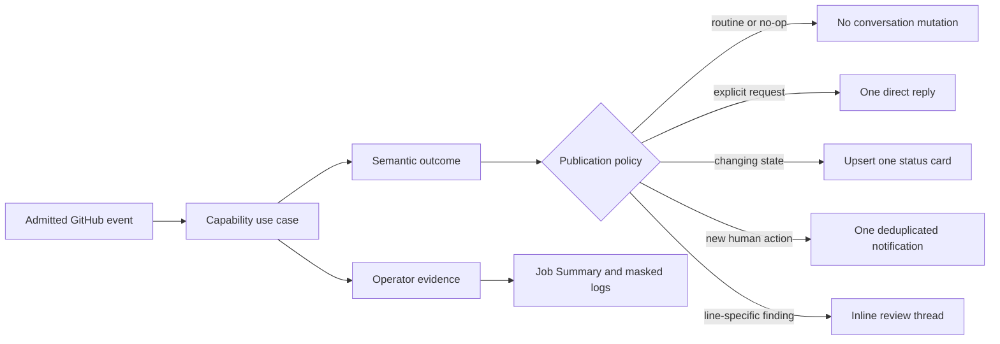
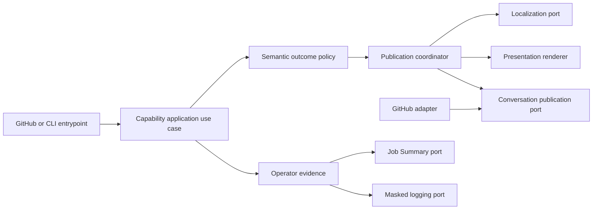
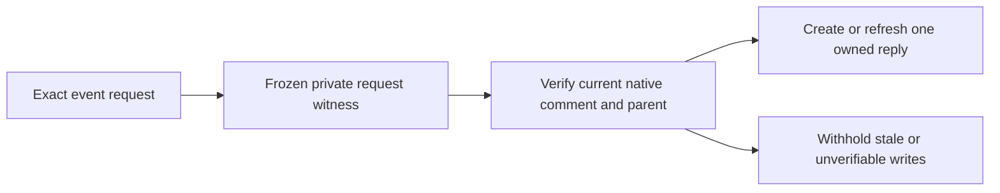
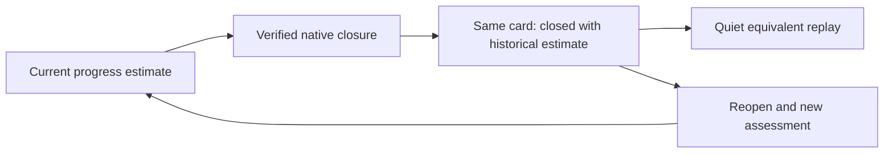
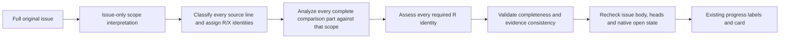

# Semantic GitHub Publication and Notification

- Status: Implemented — automated gates and controlled pull-request UX evidence complete
- Date: 2026-09-14
- Catalog capability ID: github-communication-experience
- Last verified: 2026-09-15 against the merged implementation and the
  executable concurrency and disjoint test-budget evidence described in §13
- Owners: Copilot maintainers
- Scope: Replace generic step-dump comments with bounded, semantic, idempotent GitHub messages across issues, pull requests, reviews, pushes, and single actions.
- Related issues/PRs: [issue #334](https://github.com/vypdev/copilot/issues/334), [issue #344](https://github.com/vypdev/copilot/issues/344), [issue #355](https://github.com/vypdev/copilot/issues/355), [PR #366](https://github.com/vypdev/copilot/pull/366) through [PR #390](https://github.com/vypdev/copilot/pull/390)
- Required review gates: product UX, architecture, testing, documentation, security/operations
- Open decisions blocking readiness: none

## 1. Executive summary

Copilot MUST publish a GitHub conversation message only when that message helps a
person understand an outcome, make a decision, or take an action. Generic
headings such as **Automatic Actions**, **Feature Actions**, and **Release
Actions**, numbered dumps of internal execution steps, decorative GIFs, visible
branding footers, and raw debug logs MUST disappear from issue and pull-request
conversations.

The recommended default is quiet, semantic publication:

- routine metadata and lifecycle work is visible through native GitHub state and
  the workflow Job Summary, with no conversation comment;
- a direct user request receives one concise answer;
- changing product state uses one stable, bot-owned status card per semantic
  subject and updates that card in place;
- an actionable transition may create one deduplicated notification; and
- line-specific review findings remain line-specific.

All visible copy is rendered through the repository-localization contract in
[`repository-locale-and-localization.md`](./repository-locale-and-localization.md).
English (`en-US`) is therefore the default even though examples in this SDD are
written directly in English.

```text
GitHub event -> capability result -> semantic publication decision
             -> no comment | one reply | one status-card upsert | inline finding
             -> operator evidence in Job Summary and logs
```

## 2. Problem, baseline behavior, and evidence

### 2.1 Problem

Before this program, maintainers had to scan many comments to discover whether
anything material happened. The dominant comment template described the branch
category and internal steps rather than the outcome. A one-line fact such as
“waiting state cleared” could arrive inside a roughly one-kilobyte comment
containing a level-one heading, a GIF, a debug disclosure, and a footer.
Repeated workflow events produced new timeline entries instead of updating the
state already shown.

The result has four product costs:

1. important findings and action-required states compete visually with routine
   bookkeeping;
2. GitHub notifications are generated for content that often has no human next
   action;
3. long issue timelines obscure decisions and progress; and
4. internal execution details, including runner paths, can leak into a public
   collaboration surface even when they belong only in operator evidence.

### 2.2 Baseline behavior before rollout

The following sequence was verified in the pre-implementation 2026-09-14
repository snapshot. It is retained as historical evidence and is not a claim
about the implemented product:

1. Use cases append human-readable strings to `Result.steps`, regardless of
   whether those strings are product messages or operational evidence.
2. `projectPublishResultContext` chooses `publish`, `omit-feature-owned`, or
   `omit-metadata-only`; most issue, push, and single-action routes select
   `publish`.
3. `renderResultSections` converts plain steps into one global numbered list.
4. `selectResultPublicationPresentation` chooses a generic title from branch
   type, not from the outcome or required action.
5. `runPublishResume` creates a new issue-style comment. When enabled, the
   comment includes a random image, a debug disclosure, reminders, errors, and
   “Happy coding”.
6. `IssueContentRepository` appends a visible marketplace watermark to every
   created or updated issue/PR timeline comment.
7. Some newer capabilities bypass that path correctly: the release dashboard,
   Bugbot status, and branch-synchronization notice use stable markers and
   update owned comments.
8. Metadata-only PR edits and Bugbot-owned runs recently gained omission rules,
   but close/merge, push, plan, progress, and several lifecycle paths can still
   publish generic or duplicate messages.

### 2.3 Evidence

#### Baseline repository evidence

- Generic completion path:
  `src/application/usecases/steps/common/publish_resume_workflow.ts`,
  `src/application/policies/result_publication_policy.ts`,
  `src/application/policies/result_publication_presentation_policy.ts`, and
  `src/application/policies/result_publication_sections_policy.ts`.
- Operational evidence already has a suitable destination in
  `src/application/policies/action_summary_policy.ts` and
  `src/infrastructure/github/github_action_summary_adapter.ts`.
- Direct comment creation also exists in the issue help/Think, commit notice,
  inactivity, authorization, issue-close, finding, branch-sync, and deployment
  workflows. These call sites form the baseline removal inventory; removing only the
  generic publisher is insufficient.
- Recommendation state fingerprints the issue description and generated plan,
  but publication still travels through generic results:
  `src/application/usecases/actions/recommend_steps_workflow.ts` and
  `recommend_steps_result_policy.ts`.
- Progress is recalculated on pushes and emitted as steps rather than one durable
  projection: `src/application/usecases/actions/check_progress_workflow.ts`.
- Correct stable-card patterns already exist in
  `src/data/repository/deployment/deployment_presentation_repository.ts`,
  `src/application/usecases/steps/commit/bugbot/synchronize_bugbot_review_presentation_use_case.ts`,
  and `src/application/policies/branch_sync_notification_policy.ts`.

#### Live GitHub UX audit

The audit used public REST data from `vypdev/copilot`, filtered to comments and
reviews authored by `vypbot`. It did not infer notification delivery because
that depends on each GitHub user's settings.

| Sample, observed on 2026-09-14 | Bot output | Generic template output | Repeated chrome |
|---|---:|---:|---|
| 12 most recently created PRs: #352, #353, #356–#365 | 33 timeline comments and 12 reviews | 25 comments | all 25 contained debug and a GIF; 24 mentioned clearing waiting state |
| 8 most recently created issues: #339, #340, #341, #344, #346, #350, #354, #355 | 50 comments | 36 comments | all 36 contained debug; 32 contained a GIF |
| Sole open issue #334 | 6 comments | 5 comments | 45,175 total bot-authored characters; two plan comments were 15,946 and 16,941 characters |

The 25 generic PR comments contained 34,495 characters. Removing only the
debug disclosure, image Markdown, and “Happy coding” footer left 5,999
characters. The 36 generic issue comments contained 172,533 characters; the
same mechanical removal left 59,974. These reductions are diagnostic, not a
target metric: the remaining content still includes generic headings and
step-oriented narration.

Representative failure modes:

- PR #358 received six generic comments in addition to its useful Bugbot card;
  five carried substantially the same waiting-state outcome.
- PR #363 received three feature-action comments around metadata/lifecycle
  activity even though a canonical Bugbot card already summarized useful state.
- PR #365 had a useful Bugbot state and a redundant generic close/lifecycle
  comment.
- issue #355 received six generic release comments where one operation dashboard
  would have provided a clearer lifecycle.
- issue #344 alternated repeated progress and review publications, forcing the
  reader to reconstruct the latest state from the timeline.
- issue #334 contains two very large, substantially overlapping implementation
  plans and exposed local runner-oriented details that are not useful issue UI.

#### Baseline documentation and external evidence

- At the baseline, `docs/configuration.mdx`, `docs/issues/configuration.mdx`,
  and `docs/pull-requests/capabilities.mdx` presented images as enabled by
  default.
- At the baseline, `docs/issues/notifications-and-auto-close.mdx` described
  lifecycle comments without a cross-capability notification budget.
- GitHub documents that creating issue, commit, and review comments can trigger
  notifications and secondary rate limiting. GitHub also provides update
  endpoints, so stable bot-owned comments are an available provider primitive.
- GitHub Actions Job Summaries are explicitly intended to hold Markdown results
  and diagnostics on the workflow-run surface.

### 2.4 Retrospective classification

This SDD began as a prospective behavior change. Section 2 preserves the
pre-implementation facts that established the cutover boundary; sections
13–19 record the completed rollout and executable evidence. Baseline behavior
is not part of the implemented contract.

## 3. Actors, surfaces, and terminology

| Actor | Goal | Entry point | Visible surfaces |
|---|---|---|---|
| Issue author | Understand what Copilot changed or recommends | issue open/edit, mention, command | issue body/state, one plan/progress card, one reply |
| PR author/reviewer | Find actionable review or branch state quickly | PR event, review command, push | checks, inline threads, one Bugbot/branch card, PR description |
| Release operator | Know the current irreversible release fact and next action | deployment action or managed PR | one release dashboard, managed PR, Job Summary |
| Repository maintainer | Diagnose a failed or skipped run | Actions run or explicit status command | Check, Job Summary, logs, concise linked notification |
| Copilot application | Communicate without creating timeline noise | any admitted route | semantic publication ports only |
| GitHub | Render state and deliver notifications | API create/update/review calls | timeline, review, checks, Actions UI |

Terms used normatively:

- **Semantic outcome**: immutable application data describing user impact,
  completed facts, next transition, and required action. It is not rendered
  Markdown.
- **Operator evidence**: step IDs, logs, timings, retries, provider errors, and
  diagnostics used to run or debug automation.
- **Direct reply**: one new comment answering an explicitly addressed request.
- **Durable status card**: one bot-owned comment updated in place to show current
  state for a semantic subject.
- **Transition notification**: a short new comment used only when a human newly
  needs to act and an edited card would otherwise be too easy to miss.
- **Inline finding**: a review comment anchored to a relevant diff location.
- **Semantic identity**: `(repository, target kind, target number, topic,
  subject key)`; it is stable across retries and workflow runs.
- **Fingerprint**: a bounded digest of the meaning that prevents duplicate
  notifications. It MUST exclude timestamps, run IDs, and wording variation.
- **Native GitHub state**: labels, assignees, projects, branches, issue state,
  checks, reviews, merge state, releases, and commits already visible without a
  new bot comment.

## 4. Goals, non-goals, and fixed invariants

### 4.1 Goals

1. Eliminate all new comments headed **Automatic Actions**, **Feature Actions**,
   **Bugfix Actions**, **Documentation Actions**, **Chore Actions**, **Release
   Actions**, or **Hotfix Actions**.
2. Make 100% of conversation publications originate from an explicit semantic
   intent rather than the presence of `Result.steps` or debug output.
3. Create zero conversation comments for routine metadata-only, no-op,
   already-satisfied, merge-close, and background success events.
4. Maintain at most one active status card for each semantic identity and heal
   bot-owned duplicates after concurrent creation.
5. Keep every direct response and transition notification within its defined
   size and frequency budget.
6. Make current status and required action understandable before any collapsed
   technical section.
7. Preserve complete operational evidence in the Job Summary and logs.
8. Cover issue plans, progress, commit/push handling, lifecycle closure, branch
   synchronization, Bugbot, releases, errors, and single actions under one
   cross-capability policy.

### 4.2 Non-goals

1. Redesign GitHub's notification settings or guarantee that an edit sends a
   notification.
2. Delete unrelated or historic generic comments during cutover.
3. Replace line-level Bugbot findings with one summary-only review.
4. Change release safety, authorization, merge, branch, or agent-execution
   semantics except where their user-facing publication is explicitly covered.
5. Localize copy inside this SDD; localization ownership belongs to the companion
   repository-locale SDD.
6. Add a user-configurable “verbose conversation” mode.

### 4.3 Fixed product/safety invariants

1. `Result.steps`, logs, exception text, prompts, stack traces, runner paths, and
   provider DTOs MUST NOT be published directly to a GitHub conversation.
2. `debug=true` MAY increase logs and Job Summary evidence but MUST NOT add debug
   text to an issue, PR, review, or commit comment.
3. A no-op background event MUST create zero comments even if it produced logs,
   reminders, or successful `Result` records.
4. A human-authored comment, review, or description MUST never be overwritten by
   the publication system.
5. Only comments authored by the configured bot and containing a valid owned
   marker may be updated, compacted, or deleted.
6. Irreversible success facts MUST remain visible when a later stage fails.
7. Machine markers, codes, refs, commands, and identity keys MUST be stable and
   locale-independent.
8. Decorative media, visible branding footers, and celebratory filler MUST not
   displace status or action content.
9. Failure to publish user-facing UI MUST not repeat an irreversible domain
   operation.
10. Notification and size budgets are safety limits and are not configurable.

## 5. Baseline versus implemented product journey

| Stage | Baseline | Implemented | User/operator effect |
|---|---|---|---|
| Capability work | Use cases accumulate prose in `Result.steps` | Use cases return semantic outcome plus operator evidence | Meaning is explicit and testable |
| Publication decision | Any visible step/error usually enables a comment | Pure policy selects none, reply, status, transition, or inline finding | Routine work stays quiet |
| Presentation | Branch category chooses generic title | Outcome/action chooses a localized title and content model | First line communicates value |
| Repeated event | New comment is appended | Existing card is found by semantic identity and updated | One source of current truth |
| Debug | Collapsed logs can appear in conversation | Bounded Job Summary plus full masked logs | Timeline stays readable |
| Push | Commit notice, progress result, review result, and generic summary can overlap | Progress card and feature-owned review surfaces update; commit facts link from them | No per-push narration |
| Completion | Close/merge may add a generic success comment | Native state changes and existing cards become terminal | No redundant “closed after merge” message |
| Failure | Generic errors mix cause, steps, GIF, and debug | Actionable failures use impact, cause, action, retained state, and a run link | Recovery is obvious |



Text equivalent: an admitted event runs one capability; the capability returns
semantic outcome and operator evidence; a pure policy chooses no conversation
mutation, one reply, one status-card update, one action notification, or inline
findings, while evidence goes to the Job Summary and logs.

## 6. Functional behavior and state model

### 6.1 Publication-intent contract

Every user-facing capability MUST return zero or more typed publication intents.
The initial closed union is:

| Intent | Provider effect | Valid trigger | Required data |
|---|---|---|---|
| `none` | no conversation mutation | routine, no-op, stale, duplicate, superseded | reason code for Job Summary |
| `reply` | create one comment | explicit command/mention or terminal policy explanation | target, semantic message, request correlation |
| `status` | create or update one owned card | durable plan/progress/review/branch/release state | identity, source version, projection, digest |
| `transition` | create once per fingerprint | state newly requires human action | identity, impact, action, fingerprint, status-card link |
| `inline-finding` | create/update/resolve a review thread | line-specific actionable finding | finding identity, location, severity, evidence |

`none` is a first-class result, not an empty or failed publication. The union is
closed so unknown intent kinds fail contract validation instead of defaulting to
a generic comment.

### 6.2 Cross-capability decision matrix

| Event/capability | Conversation contract | Operator/native contract |
|---|---|---|
| Labels, assignees, project fields, issue type/title normalization | no comment | native metadata plus Job Summary |
| Metadata-only PR edit or project sync | no comment | native metadata; neutral/omitted Check per existing lifecycle policy |
| New normal issue | create one concise implementation-plan card; it also contains one-line command discovery | issue metadata and Job Summary |
| Normal issue description edit | update the same plan card only when plan meaning changes | plan fingerprint and Job Summary |
| Help/question issue | one direct answer; no separate welcome or generic result | issue state and Job Summary |
| Release/hotfix issue | release dashboard owns the issue presentation; no plan/welcome/generic comment | durable operation state |
| Push to linked work branch | update progress card when its projection changes; do not post a commit or reopened notice | commit, labels, Checks, Job Summary |
| Explicit command/mention | at most one direct reply; a capability MAY also update its existing card when the reply links to it | command result and Job Summary |
| Branch drift/sync | create one initial stale card; update it to aligned or changed stale state; on a later aligned-to-stale transition, create one fingerprinted notification linked to the card | comparison, publication evidence, and workflow run |
| Bugbot | one canonical aggregate card plus bounded inline findings; no generic result | Review Check and Job Summary |
| Release/hotfix transition | update one dashboard; default mode creates no milestones; configured milestone mode follows its existing bounded contract | managed PR, release, package, Job Summary |
| Merge/close success | no new comment; update any owned active card to a terminal state when useful | native merge/issue state |
| Unauthorized issue closure | one concise terminal explanation with eligibility/recovery guidance | native closed state and audit evidence |
| Inactivity closure | one deduplicated explanation containing the policy and reopening path | native closed state |
| Background recoverable failure | update the relevant status card and Check; create a transition notification only when human action becomes necessary | failing/neutral Check, Job Summary, logs |
| Background failure with no conversation subject | no comment | failing Job Summary/Check |
| Explicit request failure | one concise reply | failed Job Summary/Check where applicable |
| Single action that publishes caller-supplied content | exactly the requested create/update/append; no wrapping generic result | Job Summary records the mutation |

### 6.3 Happy path

1. An entrypoint validates and routes the event without selecting prose.
2. The capability use case performs domain work and returns a semantic outcome
   and separate operator evidence.
3. The publication policy classifies the outcome using trigger, current state,
   human-action transition, prior digest, and surface ownership.
4. Localization resolves one atomic catalog for the target surface.
5. Presentation maps the outcome into a bounded view model and safe Markdown.
6. The publication repository creates a reply or reconciles a durable card.
7. The Job Summary records work performed, publication decision, identity,
   previous/new digest, and any provider failure.

### 6.4 Durable card reconciliation

For a `status` intent the application MUST:

1. derive the semantic identity without model output;
2. list all comments matching the exact valid marker and configured bot identity;
3. select the lowest comment ID as canonical;
4. reject a stale source version before mutation;
5. skip the provider update when the rendered semantic digest is unchanged;
6. create one comment when no canonical card exists;
7. re-list after creation to detect a concurrent duplicate;
8. retain the lowest bot-owned exact-identity comment, update it to current
   state, and delete later exact duplicates; and
9. if duplicate deletion is forbidden, replace the duplicate body with a short,
   localized pointer to the canonical card and record cleanup debt in the Job
   Summary.

Historic generic comments and comments without an exact owned marker MUST NOT be
deleted or rewritten.

For a `transition` intent the application MUST:

1. derive the fingerprint from a closed trusted action, exact semantic identity,
   and trusted source version—never from visible or model-generated prose;
2. accept only a non-empty deterministic message no longer than 400 characters
   with at most two Markdown links and no embedded HTML marker;
3. list comments matching the exact identity, fingerprint, valid transition
   marker, and configured bot identity;
4. create only when no match exists, then re-list to detect concurrent creation;
5. keep the lowest exact bot-owned comment ID as the immutable notification;
6. delete later exact duplicates, or replace them with a localized compact
   pointer when deletion is forbidden; and
7. report topic, target, `created` or `reused`, fingerprint, and bounded cleanup
   evidence in the repository-locale Job Summary without copying message bodies.

A renderer or translation change MUST NOT rewrite or recreate an already-issued
notification for the same fingerprint. Human and third-party markers are inert.

### 6.5 Stable identity and source freshness

The shared marker format is:

```html
<!-- copilot:publication schema="1" topic="progress" target="issue:344" key="work" source="<safe token>" digest="<8-64 hex>" -->
```

Action notifications use a distinct immutable envelope:

```html
<!-- copilot:transition schema="1" topic="branch-sync" target="issue:344" key="dependency:<digest>" fingerprint="<8-64 hex>" message="<safe message key>" -->
```

- Allowed topics at launch are `plan`, `progress`, `branch-sync`, `bugbot`,
  `release`, `inactivity`, and `access-policy`.
- Marker values MUST be generated from trusted domain data, restricted to
  `[A-Za-z0-9._:-]`, and bounded to 128 characters per value.
- Current feature publications use only the shared envelope. Unknown,
  feature-specific, or removed markers are inert and MUST NOT be adopted,
  rewritten, or treated as owned state.
- Reply correlation is exactly `comment:<issue-comment-id>` for
  `issue_comment`. Review comments use the distinct
  `comment:pull_request_review_comment:<review-comment-id>` identity.
  Transports MUST NOT share aliases or fallback correlations; readers compare
  the complete correlation value exactly.
- Commit-derived progress MUST snapshot the authoritative remote branch head
  before analysis. An event-provided head that is already stale MUST stop before
  agent execution. The workflow MUST revalidate the snapshot immediately before
  native issue/PR label mutation, and the card reconciler MUST revalidate it
  immediately before every create or update. SHA-1 and SHA-256 object IDs are
  accepted only in canonical hexadecimal form after case normalization.
- A stale progress result MUST mutate neither native state nor conversation
  state. It is a successful skipped outcome with reason `stale-source`, and the
  repository-locale Job Summary MUST explain that suppression without exposing
  full object IDs.
- Revisioned operations MUST reject any revision lower than the stored revision.
- Events without an orderable revision may update only after the shared workflow
  queue confirms no newer conflicting run; otherwise they resolve to `none` with
  reason `stale-source`.

### 6.5.1 Push and pull-request review ownership

The Commit and Pull Request workflows MUST use distinct native concurrency
groups keyed by repository and branch. A paired `push` and
`pull_request:synchronize` event MUST NOT cancel one another. Each group MAY
cancel only an older replaceable run from the same workflow; PR metadata-only
`edited` events MUST continue to queue without preempting an active PR review.

The Commit route MUST retain native issue state, size, and progress work, then
invoke a read-only Bugbot preflight that resolves the pushed branch through the
provider's exact-head lookup. If that validated selection is an open PR in the
same base repository, the push route MUST stop before loading review context or
invoking the agent. The PR `synchronize` route then exclusively owns Bugbot
review for that head. The decision MUST NOT depend on a `pull_request` field in
the `push` payload. An issue-linked branch without an open PR retains push-time
Bugbot. Fork PR workflows remain outside this contract and MUST stay excluded
by the existing same-repository admission gate.

### 6.6 State machine

| State | Entered when | User-visible meaning | Allowed next states | Recovery/owner |
|---|---|---|---|---|
| `absent` | no owned message exists | nothing has needed publication | `current`, `action-required`, `terminal` | publication use case |
| `current` | a useful nonterminal projection exists | latest known state; no action unless stated | `current`, `action-required`, `partial`, `terminal` | capability event |
| `action-required` | human action changes from false to true | one primary action is shown and may notify once | `current`, `partial`, `terminal` | named human/operator |
| `partial` | irreversible success exists but later work failed/pends | retained success and remaining risk are distinct | `current`, `action-required`, `terminal` | retry or operator |
| `terminal` | completed, aligned, closed, obsolete, or superseded | no further action for this subject | `current` only for explicit reopen/new source | new operation/event |
| `publication-degraded` | domain work succeeded but provider UI mutation failed | Job Summary is authoritative; no domain replay | any state after bounded publication retry | operator/application |

Duplicate events with the same digest produce no provider mutation. Stale,
out-of-order, or canceled runs cannot overwrite a newer card. Superseded runs
write only operator evidence. A partially failed reconciliation preserves the
last valid card and exposes publication degradation in the Job Summary.

## 7. User-facing configuration

The semantic notification rules are intentionally mostly fixed. Configuration
may choose a legitimate release presentation, but it cannot restore generic
step dumps, debug-in-comments, or decorative media.

| Input | Type | Recommended default | Allowed values/range | Scope/persistence |
|---|---|---|---|---|
| `orchestration-comment-mode` | enum | `update` — one dashboard | existing `update`, `milestones` | snapshotted by release operation |
| `orchestration-presentation-mode` | enum | `guided` | existing `guided`, `compact`, `quiet` | snapshotted by release operation |
| locale inputs | BCP-47 profile | see companion SDD | bounded by localization contract | repository/run or operation snapshot |

PR, commit, status, finding, warning, error, progress, plan, welcome, and release
messages never render decorative media. The public action schema exposes no
image toggle or URL-pool input. Because the project has no consumers, retired
image configuration is removed outright rather than parsed, ignored, warned
about, or migrated.

`debug` remains supported for operator logs and Job Summary evidence. It has no
conversation-publication effect.

No inputs are added for generic titles, footer text, raw-step publication,
status-card multiplicity, failure deduplication, notification limits, or
decorative media. Release configuration precedence and snapshot semantics
remain as specified by the release orchestration SDD.

Recommended configuration:

```yaml
with:
  repository-locale: en-US
  orchestration-comment-mode: update
```

Meaningful alternative:

```yaml
with:
  repository-locale: fr-FR
  orchestration-presentation-mode: compact
  orchestration-comment-mode: milestones
```

The alternative localizes output and opts into bounded release milestones; it
does not increase generic publication or expose debug output.

## 8. Clean Architecture design

### 8.1 Responsibilities and dependency direction

| Layer/boundary | Owns | Must not own/import |
|---|---|---|
| Domain/pure policy | semantic identity, outcome/action states, fingerprinting, publication and noise decisions | Octokit, Actions context, Markdown, locale catalogs, logs |
| Application | capability outcomes, publication coordinator, stale guards, semantic ports, operator evidence | concrete GitHub SDK calls, decorative-media selection, raw event DTOs |
| Adapters/data | list/create/update/delete owned comments, reviews, Checks, provider error mapping | deciding whether a comment is useful or selecting copy |
| Infrastructure/composition | bind ports and feature publishers; wire Job Summary and localization | branch/lifecycle product decisions |
| Entrypoints | validate/project input, route event, invoke completion | building comments from results |
| Presentation | localized typed view models, Markdown rendering, size/sanitization | state transitions, API mutation, authorization |



Text equivalent: entrypoints invoke capability use cases; domain policy produces
a semantic outcome; the application coordinator localizes and renders that
outcome before using a semantic GitHub publication port; operator evidence takes
a separate Job Summary/logging route.

### 8.2 Contracts, state, and trust boundaries

- **Pure decisions:** `PublicationDecision`, `PublicationIdentity`,
  `SemanticDigest`, `NotificationFingerprint`, and per-feature projections are
  readonly and deterministic.
- **Application contracts:** a capability returns `{ results/evidence,
  publications }`; `Result` is internal execution evidence and is never a
  conversation DTO.
- **Semantic ports:** `OwnedConversationQueryPort`,
  `ConversationMutationPort`, `InlineFindingPublicationPort`,
  `ActionSummaryPort`, and the companion localization port expose no Octokit
  types.
- **Durable state/schema ownership:** each feature owns its subject state; the
  shared publisher owns only marker schema, canonical comment ID reconciliation,
  render digest, and transition-notification fingerprint.
- **Concurrency/idempotency:** workflow queue/stale-source guards prevent old
  projections; post-create reconciliation heals concurrent card creation;
  feature operation revisions remain authoritative.
- **Trusted inputs:** configured repository identity, validated event numbers,
  feature state, bot login, and generated marker values.
- **Untrusted inputs:** issue/PR text, comments, model output, provider messages,
  URLs not built from trusted repository data, and pre-existing comment bodies.
- **Provider error mapping:** create/update/delete/list failures map to semantic
  application errors and publication-degraded evidence. They never become raw
  conversation prose.

### 8.3 Required application seams

Implementation MUST introduce or converge on the following seams; exact file
names may follow repository conventions:

1. a pure shared publication-decision policy;
2. immutable publication contracts separate from `Result`;
3. a semantic outcome adapter for each existing direct `addComment` and
   `updateComment` call site;
4. one coordinator for status-card reconciliation and transition deduplication;
5. feature renderers for plan, progress, branch sync, Bugbot, release, access,
   inactivity, command replies, and failures;
6. a Job Summary projection that includes compact semantic outcomes, stable
   machine evidence, and localized recovery guidance while leaving internal
   result names and step/debug narration in masked logs; and
7. a strict result-to-intent projection boundary that accepts only current typed
   outcomes, rejects arbitrary `Result.steps`, and records rejected sources in
   tests/logs.

The release dashboard and Bugbot reconciliation keep their feature-specific
state policies. They adopt shared localization, content hierarchy, marker
envelope, and notification-budget primitives rather than moving release or
review rules into the generic publisher.

### 8.4 Executable architecture constraints

1. An architecture test MUST forbid imports of GitHub/Actions SDKs from domain,
   application policy, and presentation modules.
2. A contract test MUST fail when an entrypoint or completion path renders
   `Result.steps` into a conversation.
3. A source-boundary test MUST inventory direct issue/review comment mutations;
   every allowed call site must be an adapter or a catalogued exceptional
   single-action publisher.
4. A string-policy test MUST reject the retired generic headings, “Happy
   coding”, visible default watermark, and “Debug log” in conversation fixtures.
5. Marker parsers and renderers MUST be schema-tested; malformed or forged
   markers are inert.
6. Coverage budgets MUST add the new pure policies at 100% branches, functions,
   lines, and statements and the changed publication path at 95% lines/statements
   and 90% branches/functions.

## 9. UI/UX and content contract

### 9.1 Information hierarchy

Every durable or actionable message presents, in order:

1. a specific outcome/action title;
2. current status in one sentence;
3. completed or retained facts;
4. the single next transition;
5. one primary human action, or a concise statement that none is required;
6. direct descriptive links; and
7. optional collapsed, sanitized technical reference.

Direct replies MAY omit sections that do not apply. Comments use `##` as their
top visible heading because they live inside an issue/PR page. Level-one headings
are reserved for standalone issue/PR descriptions and Job Summaries.

### 9.2 Representative views

#### Pending/no action: implementation plan

```markdown
<!-- copilot:publication schema="1" topic="plan" target="issue:334" key="implementation" source="issue-body:<digest>" digest="<digest>" -->

## Implementation plan

> **Current status:** Ready to start. No action is required from maintainers before implementation.

1. **Introduce semantic publication contracts**
   - Replace arbitrary plan Markdown with bounded structured fields.
2. **Route every user-facing publication path**
   - Cover plan, progress, lifecycle, branch sync, Bugbot, and release output.
3. **Verify idempotency, localization, and security**
   - Exercise replay, malformed output, and configured-locale behavior.
4. **Update user and contributor documentation**

**Acceptance:** Repeated equivalent events create no new comments, and operator details remain available in the workflow run.

Need something else? Mention the bot with a question or use `/copilot help`.
```

The plan MUST contain three to eight ordered steps, at most two short sub-bullets
per step, explicit acceptance, and repository-relative references only. The same
card is updated after a material issue-description change. A new issue that gets
this card does not also get a welcome comment.

#### Current progress

```markdown
<!-- copilot:publication schema="1" topic="progress" target="issue:344" key="work" source="head:abc1234" digest="<digest>" -->

## Progress: 65% — in progress

> **Current status:** Core behavior is implemented; validation remains.

### Completed

- Semantic publication policy and durable identities
- Plan and branch-sync card publication

### Remaining

- Progress/release validation
- Documentation and full validation

**Next:** complete the contract tests and rerun the repository validation suite.

[Compare changes](https://github.com/example/project/compare/develop...feature/344-publication) · [Latest commit](https://github.com/example/project/commit/abc1234)
```

Every push may recalculate progress, but the card is updated only when the head
is current and the semantic projection changes. Reasoning and raw diffs remain
in operator evidence; they are not appended to the issue card.

#### Action required

```markdown
<!-- copilot:publication schema="1" topic="branch-sync" target="pr:81" key="develop:feature-81" source="head:def5678" digest="<digest>" -->

## Action required: resolve branch synchronization

> **Impact:** `feature/81-localization` cannot be updated automatically.

**Cause:** merging `develop` produced conflicts in 3 files.

**Action:** run `/copilot sync-branch` after resolving the protected-file conflict, or update the branch manually.

**Retained state:** no conflicting commit was pushed; the branch still points to `def5678`.

[Compare branches](https://github.com/example/project/compare/develop...feature/81-localization) · [Workflow run](https://github.com/example/project/actions/runs/124)

<details>
<summary>Technical reference</summary>

Reference: `branch-sync:7f31c2ab`
</details>
```

The first false-to-true action transition MAY also create this short notification:

```markdown
Branch synchronization needs attention: protected-file conflicts require a maintainer. [Open the current status](https://github.com/example/project/pull/81#issuecomment-10).
```

The same fingerprint never creates that notification twice.

#### Blocked before an irreversible effect

```markdown
## Release 3.4.0 — blocked before publication

> **Impact:** Production was not changed and package `3.4.0` was not published.

**Cause:** the required production check `build` did not pass.

**Action:** fix the check, then retry the release action.

**Retained state:** the prepared release branch and promotion PR remain available.

[Promotion PR #82](https://github.com/example/project/pull/82) · [Workflow run](https://github.com/example/project/actions/runs/125)
```

#### Partial success after an irreversible effect

```markdown
## Release 3.4.0 — published; reconciliation needs attention

> **Current status:** `3.4.0` is published from production commit `9ac4e21`.

**Remaining:** development reconciliation is blocked by a protected-branch rule.

**Action:** review and merge reconciliation PR #83. Do not republish the package.

[GitHub release](https://github.com/example/project/releases/tag/v3.4.0) · [Reconciliation PR #83](https://github.com/example/project/pull/83)
```

#### Completed

```markdown
## Release 3.4.0 — complete

> **Current status:** Published and reconciled. No action required.

- Production: `master@9ac4e21`
- Package: `example@3.4.0`
- Development: reconciled into `develop`

[GitHub release](https://github.com/example/project/releases/tag/v3.4.0) · [Workflow run](https://github.com/example/project/actions/runs/126)
```

Completion updates the existing dashboard. It does not create a celebratory
comment.

#### Explicit state-command confirmations

`remember` and `dismiss` MUST emit at most one correlated localized reply from
validated application facts. The explicit-command producer owns a typed receipt;
model results, arbitrary producer IDs, diagnostic steps and background events
MUST NOT manufacture this reply. Successful saved rules require completed
verification and push; verified duplicates and zero-match dismissals have an
explicit no-op response. Malformed refs/counts and failed results are rejected.
The existing reply identity/digest/reconciliation handles replay. No new input,
configuration, migration or marker schema is required.

Representative English result: “The rule already exists in
`.copilot/BUGBOT.learned.md` on `docs/work`. No change or additional commit was
needed.” Spanish zero-match result: “No se encontraron hallazgos coincidentes.
No se descartó ninguno.” Permission/capability refusals say the command was not
applied; failed verification/mutation uses the existing semantic error boundary.
User documentation is `docs/issues/comment-commands.mdx`. Pure receipt tests own
presentation/trust/replay coverage; the Bugbot SDD separately owns six routing
outcome cases, with no cross-budget double counting.

#### Bugbot and direct reply

```markdown
## Bugbot: 2 findings need attention

> **Current status:** Review of `7bd90fe` completed with full coverage.

- [SQL query interpolates untrusted input](#discussion_r100)
- [Retry loop has no upper bound](#discussion_r101)

**Action:** review the linked threads or run `/copilot fix all`.

[Verified commit](https://github.com/example/project/commit/7bd90fe) · [Workflow run](https://github.com/example/project/actions/runs/127)
```

```markdown
Done — refreshed the pull-request description from the current diff. [View the updated description](https://github.com/example/project/pull/84#top).
```

The direct reply does not repeat implementation steps or include a second
generic summary.

#### Terminal policy explanation

```markdown
## Issue closed: contributor access required

This repository accepts automated issue processing only from eligible contributors.

If you believe this is incorrect, contact a maintainer or follow the contribution policy.

[Read the contribution policy](https://github.com/example/project/blob/main/CONTRIBUTING.md)
```

### 9.3 Issue, PR, review, and comment behavior

- Titles MUST name the outcome or action, never the branch category that happened
  to trigger it.
- A visible message MUST not enumerate internal use-case names or steps such as
  project linking, label synchronization, waiting-state cleanup, or configuration
  persistence.
- Merge and close events rely on native GitHub state. They update an existing
  card only when terminal state would otherwise be misleading.
- Plans, progress, branch sync, Bugbot, releases, inactivity, and access-policy
  explanations have stable semantic identities.
- Inline findings remain near code. Aggregate counts link to those threads and
  do not duplicate their full content.
- Direct links use descriptive labels and trusted repository URLs. Raw URLs are
  not used as link text.
- Labels and Checks supplement cards; they do not justify duplicate comments.
- Explicit no-change replies use one sentence, for example: “No changes were
  needed — the pull-request description already matches the current diff.”

### 9.4 Comment and notification budget

| Situation | New comments/reviews | Updates | Notes |
|---|---:|---:|---|
| Routine metadata, no-op, duplicate, stale, superseded, merge/close success | 0 | at most one terminal card update | Job Summary only |
| New issue | at most 1 | 0 | plan, answer, release dashboard, or welcome; never multiple |
| Issue description edit | 0 | at most 1 plan card | only semantic change |
| Push | 0 generic; bounded new inline findings only | at most one card per affected topic | no commit/reopen narration |
| Explicit command/mention | at most 1 reply | at most one feature card | reply links rather than duplicates |
| Durable capability operation | at most 1 initial card | at most 1 update per semantic transition | one active card per identity |
| Newly actionable failure | at most 1 transition notification per fingerprint | 1 relevant card | no repeat on retry |
| Release `milestones` alternative | existing bounded milestone allowance | 1 dashboard | opt-in exception only |

A single event affecting several topics MAY update several existing cards, but it
MUST NOT create a generic roll-up comment. Job Summary aggregates the run.

### 9.5 Content and size budgets

- Direct reply: 800 visible characters by default, 4,000 maximum when the answer
  itself requires explanation; translated-request disclosure is counted
  separately under the localization SDD.
- Transition notification: 400 visible characters and two links maximum.
- Plan card: 8,000 visible characters, three to eight primary steps.
- Progress/branch/Bugbot card: 6,000 visible characters.
- Release dashboard: 12,000 visible characters because irreversible state and
  reconciliation may require more facts.
- Collapsed technical reference in conversation: 2,000 characters, stable IDs
  and sanitized facts only; no raw logs or stack traces.
- Job Summary: 20,000 characters per capability section before deterministic
  truncation and links to logs/artifacts.

Truncation MUST preserve current status, impact, action, retained irreversible
facts, and recovery links before optional detail.

### 9.6 Accessibility, localization, and responsive behavior

- Text, not emoji or color, carries state. At most one leading status icon is
  permitted in a title, and removing it must not change meaning.
- Comments MUST remain readable at narrow widths. Use lists before wide tables;
  tables are limited to four columns and require a prose status sentence.
- Decorative media is absent from every generated conversation surface.
- Heading levels are logical. Comments start at `##`; nested sections use `###`.
- Every link is descriptive and independently understandable.
- All copy and user-supplied content follows the companion locale, atomic
  fallback, bidi, and sanitization contract.
- Untrusted Markdown, mentions, slash commands, HTML markers, URLs, and Mermaid
  content are escaped or generated from trusted fixed templates. Model output
  cannot manufacture an owned marker.

## 10. Failure, recovery, and cleanup

| Failure/partial state | User impact | Retained facts | Automatic retry | Required action | Cleanup |
|---|---|---|---|---|---|
| Semantic outcome invalid | no conversation output | domain mutation result and logs | no blind retry | inspect failed Job Summary | fix producer/schema |
| Card list fails before mutation | status may remain stale | prior card untouched | bounded provider retry | open run if failure persists | none |
| Card update fails after domain success | UI is stale; domain result remains valid | old card, domain state | publication-only retry | follow Job Summary | never replay domain work |
| Concurrent card creation | brief duplicate may appear | both exact bot-owned cards | immediate re-list/reconcile | none normally | delete later duplicate or compact pointer |
| Stale run reaches publisher | no visible regression | newer card/state | none | none | record `stale-source` |
| Notification create fails | user may miss newly actionable transition | status card and failing Check | bounded create retry | consult Actions/Check | do not repeat operation |
| Content exceeds budget | optional detail omitted | status/action/retained facts | deterministic rerender | use linked Job Summary | record truncation |
| Irreversible release succeeds, reconciliation fails | package exists; development differs | tag/package/release/production SHA | retry reconciliation only | merge/fix reconciliation | never republish |
| Duplicate cleanup forbidden | compact duplicate remains | canonical card | retry cleanup only | none | Job Summary records comment IDs |

User-facing failures MUST follow `impact -> cause -> action -> retained state ->
links`. Provider error bodies, stack traces, and retry loops belong to operator
evidence. Cleanup is restricted to bot-owned exact-identity duplicates; historic
generic output is left intact.

## 11. Security, permissions, and privacy

1. Existing authorization policies continue to govern domain mutations;
   publication cannot upgrade an actor's permissions.
2. Comment ownership requires both a valid marker and a configured-bot identity
   match. A forged human marker is inert.
3. Model/user/provider text is untrusted. It is bounded, sanitized, and never
   interpolated into marker attributes, trusted URLs, commands, or HTML control
   structure.
4. Debug logs, prompts, tokens, argv, stack traces, absolute runner paths,
   environment variables, and private repository context MUST never appear in a
   conversation message.
5. Job Summaries and logs use existing masking/redaction; publication references
   only stable error codes and random correlation IDs.
6. Automatic duplicate deletion is allowed only for later bot-owned comments
   with the same exact valid semantic identity. Human content and comments
   without the current identity are never eligible.
7. Transition fingerprints exclude attacker-controlled free text after
   normalization, so wording variation cannot bypass deduplication.
8. Comments quoted in direct replies follow the translation trust boundary in
   the companion SDD and cannot create mentions or commands.

## 12. Observability and operational UX

- **User-facing state:** native metadata, feature card, inline finding, direct
  answer, or action notification—never a generic execution transcript.
- **Job Summary:** route, target, semantic outcomes, publication decisions and
  reasons, card identity/comment ID, source version, prior/new digest,
  create/update/skip/cleanup result, truncation, and semantic application errors.
- **Inactivity scan:** the Job Summary MUST project only validated, nonnegative
  safe-integer `scanned`, `closed`, and `skipped` counts from exactly one
  `CloseInactiveIssuesUseCase` result. It MUST show completed closes even if the
  terminal explanation failed, and retain zero counts in a successful no-op.
  Missing, malformed, inconsistent or repeated scan evidence is `unavailable`,
  never invented zero. Other result payloads cannot produce the scan row. This
  row follows repository locale, including atomic fallback, and adds no
  conversation mutation or configuration input.
  A pure capability projection owns internal result identity and validation;
  the generic summary consumes its absent/valid/invalid data without knowing
  use-case IDs or step prose. This new projection requires 100% coverage.
- **Logs:** full masked operational sequence, retry/rate-limit data, and debug
  detail. Logs remain machine-searchable English as specified by localization.
- **Metrics:** count by intent, topic, target, create/update/skip reason,
  duplicate healed, transition notified, rendered bytes, truncation, and
  publication degradation. Never record comment bodies.
- **Correlation:** one random reference connects application error, Job Summary,
  Check, and logs. Run IDs do not participate in semantic deduplication.
- **Pending external dependency:** a card says what GitHub/human state is being
  awaited; the workflow may succeed or be neutral rather than claim failure.
- **Rate limits:** honor provider retry hints and existing bounded backoff. Skip
  unchanged updates before consuming write calls.
- **Noise SLO:** in a replay test of unchanged events, conversation create and
  update calls are both zero; for a changing card, creates remain one over the
  full lifecycle.

## 13. Compatibility, cutover, rollout, and rollback

### 13.1 Greenfield current-state contract

- There are no installed users or production state to migrate.
- Readers recognize only the current shared publication, reply, and transition
  envelopes with exact target, key, source, digest/fingerprint, and bot owner.
  Removed or unknown markers are inert.
- Recommendation state is one closed object containing the issue-description
  fingerprint, plan fingerprint, structured implementation plan, and canonical
  plan locale. Missing fields, removed free-form fields, and additional fields
  are invalid configuration.
- An unchanged-description replay is valid only when the stored plan locale
  equals the current effective issue locale. A different locale requires a
  complete agent-backed replacement and rejects `unchanged`.
- Comments without a current owned identity are never rewritten or deleted.

### 13.2 Greenfield configuration boundary

- Image toggles, URL pools, random-image selection, and their dependencies are
  absent from `action.yml`, runtime configuration, setup, CLI, documentation,
  and generated bundles.
- There is no compatibility alias, ignored-value reader, warning, migration
  path, feature flag, or delayed removal window.
- No configuration restores generic result comments, decorative media, or debug
  disclosure.

### 13.3 Implementation sequence (completed)

1. Land contracts, characterization tests, metrics, and conversation string/call
   inventories with no behavior change.
2. Route routine lifecycle and completion to `none`; move useful semantic
   evidence to the Job Summary and keep internal step/debug narration in masked
   logs or machine results.
3. Route plan, progress, commit/reopen, closure, inactivity, and access-policy
   publication through current typed intents.
4. Apply the shared marker/localization envelope in branch sync, Bugbot, and
   release without changing their domain behavior.
5. Remove decorative-media configuration and runtime code, update docs,
   regenerate bundles, and run a controlled GitHub UX acceptance matrix.
6. Remove the generic renderer, obsolete markers, free-form recommendation
   state, correlation aliases, and watermark rewriting in the same cutover.

The first implementation slices in PRs #367–#372 established semantic
reply/status publication, removed retired generic conversation chrome from the
covered paths, localized branch-sync state, and kept automated reports out of
Bugbot's human-conversation context. The Bugbot slice preserves its
feature-owned review/thread model while replacing ad hoc public strings with a
single typed catalog per publication operation, proper plural forms, stable
machine markers, and bounded English-default/localized renderers. The executable
mutation inventory, locale-branch ratchet, and pseudo-plural ratchet protect
these boundaries. Subsequent deployment and setup-doctor slices cover their
feature-owned views, and the generic Job Summary slice resolves repository-
locale copy atomically, renders aggregate result counts and expands only safe
code-specific localized error recovery, excludes internal result names, steps,
and arbitrary error messages, and renders one localization evidence section
instead of two. The later slices below completed the remaining capability rows;
the closure ledger provides the final non-overlapping numeric evidence.

The shared error-presentation slice replaces route-local Action termination with
semantic results and one final locale-aware conclusion boundary. Generic and
deployment summaries, Action completion, and repository-aware CLI output
compose the same complete code-specific descriptors; stable codes and references
remain language-independent, and raw producer messages are never published.
Closed recovery variants preserve specific partial-operation context through
validated variables without introducing feature-owned presentation prose.

The initial-issue slice now enforces the §6.2 matrix at the route boundary. A
normal issue with a publishable plan emits no welcome; a help/question issue
returns a typed, locale-validated `direct-answer` projection that the shared
reply reconciler sanitizes and creates at most once; failed or unavailable agent
output falls back to one static welcome. Release and hotfix routes emit none of
those three generic onboarding messages, including when conflicting labels are
present. The help agent no longer owns a GitHub mutation port, and the exact
application mutation inventory records that reduced surface. Replayed unchanged
recommendations re-project the persisted plan through the status reconciler so
a deleted card is recreated without a new agent call. Before an optional welcome
is emitted, a read-only comment boundary recognizes only exact-target,
bot-owned plan, direct-answer, or current welcome reply markers; an unavailable history read fails
closed to operator evidence and does not risk a redundant comment.

The structured-plan slice replaces free-form agent Markdown with an immutable
domain contract: three to eight steps, zero to two single-line details per step,
and one bounded verifiable acceptance criterion. The schema, runtime parser,
persisted recommendation state, context projection, replay path, semantic
fingerprint, and renderer share that contract. New output keeps renderer-owned
numbering and headings, rejects malformed or wrong-locale responses before
publication, and updates the existing plan identity on material issue edits.
Persisted structured state carries its canonical output locale; replay requires
an exact locale match, while repository/issue locale changes force a complete
localized replacement and make `unchanged` invalid. Removed free-form state is
rejected rather than read, translated, or converted.

Addressed Think requests now use that same `direct-answer` contract. The Think
application service has only issue-description query and agent-query ports; it
cannot create or update a GitHub comment. Its optional translation provenance is
immutable semantic data, rendered only after the shared publisher resolves the
effective issue or pull-request catalog. Replays therefore reconcile the exact
source-comment identity, and local CLI execution can render the answer without
performing any GitHub publication.

Scheduled inactivity closure now emits exactly one terminal policy explanation
after a successful native close. Its fixed structure contains only outcome,
threshold reason, and reopen guidance; internal scan steps and provider details
remain in the Job Summary and errors. The issue-locale catalog supplies complete
plural messages for scan steps, while the shared summary projects localized
validated counts. Stable ownership markers and payload
keys remain machine-readable. Revalidation, close, and comment-publication
failures are classified separately so a partial publication failure cannot
rewrite the already-completed domain outcome. Because a later scan cannot replay
the missing comment for an already-closed issue, that state is explicitly
non-retryable and gives the operator a localized manual recovery action.

Explicit request failures now use the shared correlated reply reconciler rather
than disappearing into a run-only error or reviving the generic result renderer.
The policy selects at most one primary reply, projects only the semantic error
code, retry decision, correlation reference, and closed recovery descriptor,
and renders impact/action/retained state from the resolved catalog. Background
errors continue to create no conversation output. Translation failures use the
complete English fallback, because a safe requested-language interpretation was
not established. The local action presenter now applies the same outcome versus
evidence split and cannot render internal `Result.steps` or reminder prose.

Progress freshness is now enforced end to end. The progress workflow resolves
the selected remote branch through a credential-bound, provider-neutral query
port, snapshots its canonical SHA-1 or SHA-256 object ID before agent work, and
revalidates it before native label writes. Event SHAs provide an earlier
preflight that discards superseded push runs without invoking the agent; the CLI
supplies its canonical workspace object ID for the same comparison. The
shared status reconciler independently revalidates the same source immediately
before comment creation, canonical-card update, and each duplicate compaction
write. Stale results return typed `stale-source` evidence; the localized Job
Summary displays the suppression reason while issue and PR conversations remain
unchanged. The GitHub adapter and credential binding stay outside application
policy, and the CLI, push, and on-demand Action paths reuse the same guard.

Shared status and correlated-reply reconciliation now completes the exact-
duplicate cleanup contract. Paginated discovery first proves an exact semantic
identity and matching bot login, keeps the lowest comment ID as canonical, and
requests removal only for later matches. GitHub 404 is an idempotent success; an
explicit permission-denied 403 retains a localized compact pointer to the
canonical comment, while rate-limit 403 responses and all other failures remain
visible as provider failures. The localized Job Summary reports the total and
up to 20 affected comment IDs. Commit-derived cards revalidate source freshness
before both deletion and any fallback update. Explicit caller-selected comment
and deployment ports remain narrower and receive no deletion authority.

The shared transition-notification substrate now adds a strict immutable marker,
a fingerprint derived only from closed trusted transition facts, and a bounded
reconciler over the existing semantic issue-comment publication port. It creates
once, re-lists after creation, keeps the lowest exact bot-owned ID, removes or
compacts concurrent duplicates, and never rewrites an issued notification when
copy changes. The generic Job Summary projects only topic, target, effect, and
fingerprint in the configured repository locale. No feature is considered
complete merely because this shared substrate exists; every feature must use
the current envelope before the cutover is accepted.

Branch-sync now uses the shared envelope exclusively. Its current bot-owned
stale/aligned card remains the source of truth: initial stale discovery creates
only the card, identical stale renders mutate nothing, changed comparisons update
the card, and alignment resolves it. A later aligned-to-stale transition with a
canonical push head updates the card and invokes the shared coordinator once.
The localized notification contains one trusted link to current status; dynamic
catalog copy is neutralized before publication, while the link URL and label
structure are policy-owned. Exact concurrent duplicates are deleted or compacted
through the generic semantic publication port, and content-free transition and
cleanup evidence feeds the repository-locale Job Summary. A publication-only
failure preserves the updated stale card and cannot replay branch work.

Native Check and branch-sync command feedback close two additional surface
gaps. Check names remain stable machine contracts, while their title and summary
resolve atomically in the effective issue, pull-request, or repository locale.
An explicitly addressed `sync-branch` request produces one source-correlated
semantic reply for aligned, dry-run, and successful merge outcomes; replay
reuses the reply and never exposes the command's internal `Result.steps`.
Known agent-disabled and fixer-unavailable conflicts also retain their closed
recovery descriptor through that reply. The owning branch-sync specification
allocates six additional route, forged-command and closed presentation cases; they do not count
toward this communication ledger. Command text is a validated fixed descriptor
variable, so dynamic catalog safety still excludes arbitrary commands.

The 2026-09-15 closure audit runs two first-publication calls simultaneously for
status cards, correlated replies, and immutable transition notifications. All
three paths converge on the lowest bot-owned comment ID and idempotently remove
the later exact duplicate. The checked-in budget ledger conservatively allocates
160 semantic cases and 141 localization cases to disjoint test files; matrix rows
count once, and `validate:specifications` fails if a file crosses budgets, an
allocation exceeds qualifying declarations since the baseline, or either SDD
falls below its numeric minimum. PRs #366–#389 provide controlled
English-default GitHub evidence for quiet updates, stable Checks, one edited
Bugbot card, partial coverage disclosure, and inline-finding resolution. PR #390
closes the executable concurrency and disjoint-budget evidence. Multilingual,
bidi, CJK,
expansion, and narrow-layout states are retained as deterministic renderer and
terminal fixtures so validation does not mutate repository-wide locale settings.

No remote product flag is required. Each phase must be independently releasable
and its publication boundary must fail closed to Job Summary, not fall back to
generic comments.

### 13.4 Rollback

Rollback restores one complete known-good application/schema bundle; it does not
add tolerant readers, dual writers, or marker aliases. Current cards are left
untouched because an older or unknown marker is inert. Domain actions are not
rolled back because of presentation failure. If the publisher is disabled
during incident response, all nonessential conversation output becomes
Job-Summary-only; debug-in-comment and generic step dumps remain disabled.

## 14. Testing strategy and numeric budget

The implementation requires at least **135 distinct new or materially rewritten
test cases**. This budget covers semantic publication only; locale resolution,
translation correctness, and multilingual matrices are counted in the companion
SDD and MUST NOT be double-counted here.

`src/architecture/github_communication_test_budget.json` records 179 qualifying
semantic cases from the implementation diff against the specification baseline.
The 2026-10-11 inactivity-summary correction adds four conservative semantic
Jest declarations (23 runtime rows) for no-op/close/partial outcomes, malformed
counts, unrelated payloads and repeated results. Its two locale/fallback rows
are allocated only to the companion localization ledger.
Its files are disjoint from the localization allocation and are enforced by
`pnpm run validate:specifications`.

| Area | Minimum distinct cases | Behaviors/risks covered |
|---|---:|---|
| Domain/configuration/pure planning | 26 | intent decision matrix, identity, digest, transition fingerprint, size/noise rules, decorative-media exclusion |
| State/application/idempotency/races | 30 | create/update/unchanged, stale source, out-of-order revision, duplicate create healing, partial publication, per-feature coordination |
| Adapters/provider contracts | 18 | ownership filtering, pagination, create/update/delete, review threads, rate-limit/error mapping, trusted URLs |
| Workflows/setup/schema | 16 | issue/PR/push/single-action routes, completion omission, setup defaults, doctor warnings, marker/workflow contracts |
| UI/UX/accessibility/sanitization | 33 | all primary states and topics, narrow Markdown, headings, links, truncation, hostile text, no retired chrome; three state-command receipt families (33 semantic rows) cover localized outcomes/replay, malformed or forged evidence and inert ref rendering |
| Integration/security/cutover | 12 | end-to-end lifecycles, permissions, forged/removed markers, strict rejection, rollback, live fixture matrix |
| **Total** | **135** | No double counting |

Required quality gates:

- repository-wide Jest thresholds remain in force;
- all new pure decision/identity/fingerprint policies have 100% branches,
  functions, lines, and statements;
- changed publication-path modules have at least 95% lines/statements and 90%
  branches/functions, enforced in `scripts/coverage-budgets.json`;
- table-driven rows count separately only for distinct semantic behavior;
- replay/race tests use deterministic IDs, source versions, clocks, and fake
  provider pages—no live waits or network services;
- golden Markdown fixtures have semantic assertions for status, action, retained
  facts, links, headings, absence of debug/GIF/footer, and size; snapshots alone
  do not pass;
- a source inventory test detects unauthorized direct comment mutations;
- workflow contract tests parse YAML/action input structure rather than grep
  prose; and
- manual GitHub acceptance captures issue/PR narrow and desktop views for plan,
  progress, Bugbot, branch-sync, release pending/action/partial/complete, direct
  answer, and duplicate reconciliation. No production release is required for
  the acceptance fixture.

## 15. Documentation and discoverability

| Audience | Artifact/page | Required content | Validation/navigation |
|---|---|---|---|
| User | `docs/features.mdx`, `docs/issues/notifications-and-auto-close.mdx` | quiet default, which messages appear, examples, no-op behavior | docs nav/link validation and UI fixture links |
| Issue author | `docs/issues/comment-commands.mdx`, `docs/issues/branch-management.mdx` | direct replies, plan/progress cards, branch-sync action | command contract fixture |
| PR author | `docs/pull-requests/capabilities.mdx`, Bugbot publication docs | status card vs inline finding vs Check; close/merge behavior | review fixture matrix |
| Release operator | `docs/issues/deployment-orchestration.mdx` | one dashboard, opt-in milestones, partial-success wording | operation-state fixture links |
| Setup owner | `docs/configuration.mdx`, issue/PR configuration pages, checklist | public inputs and immutable noise limits | action/setup schema test |
| Operator | troubleshooting, error reference, quality observability | Job Summary ownership, publication degradation, cleanup | decision tree and error-code test |
| CLI/single-action user | single-action available/configuration/workflow pages | requested comment is not wrapped; plan/progress identity | CLI/action parity test |
| Contributor | `docs/development/architecture.mdx`, specification catalog | outcome/evidence split, ports, markers, forbidden call sites | architecture/source inventory tests |

Every before/after example in user documentation MUST be sourced from or checked
against the same semantic fixtures as the renderer tests. Documentation MUST not
state that decorative media, debug comments, generic action headings, or
per-push commit comments are generated after rollout.

## 16. Acceptance scenarios

1. Given a metadata-only PR edit, when the workflow completes successfully,
   then it creates and updates zero conversation comments and records native
   changes in the Job Summary.
2. Given a newly opened normal issue, when Copilot creates an implementation
   plan, then exactly one plan card appears, no separate welcome/generic comment
   appears, and the card contains three to eight steps plus acceptance.
3. Given an unchanged issue description and equivalent plan, when the event is
   replayed, then no comment create/update call occurs.
4. Given a materially edited issue description, when a new plan is ready, then
   the existing plan card is updated and no second plan comment exists.
5. Given pushes to a linked branch, when progress changes across five runs, then
   one progress card reflects the latest valid head and no commit/reopen/generic
   comments are created.
6. Given an older progress run that finishes after a newer head, when it reaches
   publication, then it cannot overwrite progress labels or the newer card, and
   the Job Summary records `stale-source` suppression.
7. Given two concurrent first publications for the same identity, when both
   provider creates succeed, then the lowest bot-owned comment becomes canonical
   and the later exact duplicate is deleted or compacted when deletion is not
   permitted.
8. Given a normal Bugbot run, when findings are published, then one Bugbot card,
   bounded inline threads, and one Check exist with no generic result comment.
9. Given a release published successfully but reconciliation blocked, then the
   existing dashboard says the package is published, instructs reconciliation,
   and never advises republishing.
10. Given a merge closes a linked issue, when terminal state is synchronized,
    then GitHub's native state and any existing terminal card change, but no new
    close-success comment is created.
11. Given an unauthorized issue that policy closes, then one localized policy
    explanation appears with a recovery path and no second generic comment.
12. Given an explicitly addressed no-op command, then one sentence explains that
    no change was needed; a background equivalent emits no comment.
13. Given a branch-sync card that changes from aligned to stale at a canonical
    source head, then one transition notification links to the updated status;
    retries with the same fingerprint create none. Initial stale-card creation
    creates no second comment.
14. Given `debug=true`, then detailed diagnostics appear in masked logs/Job
    Summary and no conversation body contains a debug heading, stack trace,
    prompt, token, or runner path.
15. Given hostile model/provider/user Markdown containing mentions, commands, or
    forged markers, then the visible message is safe and ownership/state cannot
    be forged.
16. Given the public action contract, then no image toggle or URL-pool input is
    present, no runtime image configuration exists, and no generated
    conversation contains decorative image Markdown.
17. Given an action explicitly publishes caller-supplied issue content, then
    exactly that bounded create/update/append occurs without a generic wrapper;
    existing authorization and sanitization contracts remain in force.
18. Given the implementation change, then catalog, action/setup schemas,
    generated bundles, documentation, architecture checks, 135-case budget, and
    repository validations agree.
19. Given one push creates both `push` and `pull_request:synchronize` runs, then
    neither workflow cancels the other, Commit retains progress without running
    Bugbot, and the PR event publishes exactly one review projection for the
    head.
20. Given an addressed Think request, when the agent returns a valid answer,
    then Think performs no comment mutation and the shared reply boundary creates
    or reconciles exactly one `direct-answer` for the source-comment identity;
    local CLI execution prints the same semantic answer without GitHub writes.
21. Given two application calls that both observe no existing status, reply, or
    transition comment before either create returns, then both provider creates
    succeed, both calls select the lowest ID after re-listing, and the durable
    conversation retains exactly one active bot-owned publication.

22. Given a scheduled or manually dispatched inactivity run, then the Job
    Summary reports `Scanned: 1 · Closed: 0 · Skipped: 1` for one recently
    updated waiting issue, creates no conversation comment and leaves it open.
    A close whose terminal comment failed retains `Closed: 1` with the existing
    failure/recovery presentation. Absent, malformed, inconsistent or repeated
    scan evidence shows `unavailable` without guessed counts or raw step prose.

## 17. Requirements traceability

| Requirement | Policy/use case/adapter/presentation | Test or evidence | Documentation |
|---|---|---|---|
| §4.3 outcome/evidence split | publication contracts and strict result-to-intent projection | architecture and result-publication rejection tests | architecture guide |
| §6.1 closed intent union | pure publication decision policy | 26-case domain matrix | feature/notification guide |
| §6.2 capability behavior | capability outcome adapters/coordinator | route and end-to-end cases | issue/PR/release/Bugbot pages |
| §6.4 one canonical card | owned query/mutation ports and reconciler | duplicate/race/pagination tests | operator recovery guide |
| §6.5 freshness | source guard and feature revisions | stale/out-of-order/replay tests | observability guide |
| §6.5.1 event ownership | distinct push/PR groups + exact-head preflight and ownership policy | workflow contract, push-shaped preflight integration test, policy matrix, PR #367 paired-event evidence | workflow setup and Bugbot guides |
| §7 quiet/decorative-media boundary | action and runtime configuration policies | action-schema absence and source-inventory tests | configuration pages |
| §8 clean boundaries | architecture and source-inventory checks | executable boundary tests | contributor architecture |
| §9 message hierarchy/examples | localized feature renderers | semantic golden fixtures and manual UX matrix | user journeys |
| §9.4 notification budget | notification budget policy | per-event/per-lifecycle count assertions | notifications page |
| §9.5 size limits | bounded renderer | boundary/truncation/security tests | operator details |
| §10 partial/recovery | error presentation and publication-only retry | failure/partial/irreversible cases | error/troubleshooting pages |
| §11 trust/ownership | marker parser, sanitizer, authorization | forged marker/mention/secret tests | security operations |
| §12 evidence/metrics | Job Summary and telemetry ports; strict inactivity-count projection | summary/metric assertions; no-op/close/partial/malformed/repeated scan and locale fallback tests | quality observability; issue auto-close guide |
| §13 cutover | exact current markers and greenfield input removal | strict-marker, rollback, and schema-absence tests | architecture and configuration guides |
| §14 quality budget | coverage scripts and disjoint communication test ledger | 167 allocated semantic cases plus CI coverage evidence | contributor testing guide |

## 18. Implementation sequence

1. Add the companion repository-locale value objects, message descriptors, and
   localization ports first; semantic renderers depend on them.
2. Freeze current output in characterization fixtures and add inventories for
   all direct comment/review mutation call sites and retired strings.
3. Introduce immutable semantic publication contracts, identity/digest/budget
   policies, Job Summary evidence, and 100%-covered pure tests.
4. Implement owned-card query/mutation adapters, reconciliation, stale guards,
   transition deduplication, and provider/race tests.
5. Route routine lifecycle and common completion; make generic `Result.steps`
   publication impossible and project only stable, useful operator evidence in
   the Job Summary.
6. Route issue onboarding/help, plans, progress, push/reopen, issue close,
   inactivity, access-policy, and single actions with end-to-end tests.
7. Apply shared contracts in branch sync, Bugbot, and release while retaining
   their feature state and safety policies.
8. Remove image inputs, image runtime code, and random-selection dependencies;
   regenerate action/setup bundles and remove visible watermarks/footers from
   generated messages.
9. Update every named user/operator/contributor page and bind examples to
   renderer fixtures.
10. Run typecheck, lint, unit/integration/coverage, workflow, documentation,
    specification, build, package, and controlled GitHub UX validation before
    declaring implementation complete.

## 19. Definition of Done

- [x] Every conversation publication is created from a typed semantic intent;
      generic `Result.steps` publication is impossible.
- [x] All capability rows in §6.2 satisfy their create/update budgets.
- [x] One-card identity, unchanged replay, stale rejection, concurrent creation,
      and exact duplicate cleanup pass.
- [x] Plans, progress, branch sync, Bugbot, releases, lifecycle, failures,
      explicit replies, and single actions implement the representative contract.
- [x] No new conversation contains retired generic headings, debug logs,
      decorative media, “Happy coding”, or the visible default
      marketplace watermark.
- [x] Job Summary and logs retain bounded, masked operator evidence and link from
      actionable UI.
- [x] Architecture boundaries and direct-mutation inventory are automatically
      enforced.
- [x] The 135-case numeric budget and changed-module coverage gates pass without
      double counting localization tests.
- [x] Action schema, runtime configuration, setup, CLI, docs, dependencies, and
      generated bundles contain no decorative-image configuration surface.
- [x] English-default and configured-locale output passes the companion SDD.
- [x] User, setup, operator, security, cutover, and contributor documentation
      is complete, discoverable, fixture-backed, and contains no stale behavior.
- [x] Failure, partial success, retry, idempotency, security, and cleanup tests
      pass without replaying domain mutations.
- [x] `specs/catalog.json` and `specs/CATALOG.md` are current and
      `pnpm run validate:specifications` passes.
- [x] No readiness-blocking decision remains unresolved.

## 20. References and decisions

### Primary sources

- [GitHub REST API: issue comments](https://docs.github.com/en/rest/issues/comments?apiVersion=2022-11-28)
- [GitHub REST API: pull-request review comments](https://docs.github.com/en/rest/pulls/comments)
- [GitHub Actions: adding a Job Summary](https://docs.github.com/en/actions/writing-workflows/choosing-what-your-workflow-does/workflow-commands-for-github-actions#adding-a-job-summary)

### Related specifications

- [`repository-locale-and-localization.md`](./repository-locale-and-localization.md)
- [`execution-admission-queue-and-publication.md`](./execution-admission-queue-and-publication.md)
- [`comment-automation-and-authorization.md`](./comment-automation-and-authorization.md)
- [`bugbot-review-state-reconciliation.md`](./bugbot-review-state-reconciliation.md)
- [`configurable-release-orchestration.md`](./configurable-release-orchestration.md)
- [`branch-synchronization-and-conflict-recovery.md`](./branch-synchronization-and-conflict-recovery.md)
- [`managed-issue-and-branch-lifecycle.md`](./managed-issue-and-branch-lifecycle.md)
- [`pull-request-lifecycle-and-enrichment.md`](./pull-request-lifecycle-and-enrichment.md)
- [`cli-and-single-action-execution.md`](./cli-and-single-action-execution.md)

When this SDD is implemented, its cross-capability publication and noise rules
supersede generic-comment, title, debug, image, footer, and notification-budget
clauses in the related as-built/implemented SDDs. Their domain-specific state and
safety contracts remain authoritative. Those SDDs MUST be amended in the same
implementation change so current and proposed documentation cannot be confused.

### Decisions and rejected alternatives

1. **Publish every successful step — rejected.** Internal work is not equivalent
   to user value, and GitHub already exposes much of it natively.
2. **Rename generic titles but keep the body — rejected.** The primary defect is
   missing semantic intent and duplicate state, not only wording.
3. **Collapse debug and GIFs — rejected.** Collapsed content still lengthens the
   timeline, exposes the wrong detail, and accompanies notification-producing
   writes.
4. **One new summary per workflow run — rejected.** Runs are operator units, not
   user-conversation units; Job Summary owns run aggregation.
5. **Only edit cards and never create an actionable notification — rejected.** A
   newly required human action may need one visible notification, but it is
   fingerprinted and bounded.
6. **Delete all historic bot comments — rejected.** Historic discussion is
   retained; cleanup is limited to concurrent exact-identity duplicates created
   under the new contract.
7. **Configurable verbosity/debug comments — rejected.** Noise and privacy limits
   are product safety invariants.
8. **Move release/Bugbot state into a generic publisher — rejected.** Shared
   presentation primitives do not replace feature-specific domain ownership.

### Follow-up work explicitly outside this specification

- Measuring reader comprehension or notification-open rates requires product
  analytics and user consent not currently available.

### Pinned progress comparison repair — 2026-10-11

Live PR #465 push run `38146036421` on `windows-intel-runner-1` returned 0% because the model reported that workspace commands were blocked. That statement does not establish the underlying sandbox cause. Progress now receives a trusted GitHub comparison pinned to complete base/head object IDs through a physically read-only repository-bound query. The agent is explicitly asked to assess only the supplied requirements and evidence, without commands or workspace inspection.

All source patches must be present inside a 256,000-byte UTF-8 evidence budget per assessment request; the 2026-10-17 multipart amendment below defines complete larger comparisons. Generated `build/` files and the exact generated `specs/CATALOG.md` index retain their path/status/addition/deletion metadata only; these facts never certify a build or test. Missing source patches, invalid identities/paths/counts, duplicate paths, or the 300-file provider ceiling stop analysis before any model or progress mutation. GitHub documents that comparison files are confined to the first page and capped at 300: [compare-two-commits](https://docs.github.com/en/rest/commits/commits#compare-two-commits). A boundary-sized list is conservatively incomplete.

The live source head and development base are checked again after analysis, before native progress mutations. The existing downstream head freshness gate remains. No permission, sandbox, process, prompt or schema limit is expanded, and no runtime flag is added.

The repair owns **30 distinct cases**: 26 provider-bound immutable-comparison cases and four application outcomes (wrong base, wrong head, unavailable comparison, and a changed base during analysis). The existing head-race and prompt cases are retained, with explicit supplied-evidence and no-shell assertions. The conservative semantic ledger adds ten declarations rather than counting parameterized rows again. User documentation and catalog evidence change with implementation. Live acceptance must prove a supplied-source assessment and retained state on incomplete evidence; successful offline tests alone do not close that acceptance.

Live human doctor push `38162035628`, head `25950008`, exposed a second comparison-boundary problem: 39 files contained 248,563 raw source-patch bytes, including 89,186 bytes of the generated specification index; JSON escaping exceeded the unchanged 256,000-byte budget. The exact generated `specs/CATALOG.md` path now carries metadata only, alongside build outputs. The editable `specs/catalog.json` still requires its full patch. Two distinct provider contracts cover the generated index and its source. At that historical repair, bounds/incomplete data reported `provider.unavailable`; the 2026-10-17 amendment corrects deterministic size failures. Invalid or contradictory object identity uses `workflow.stale`, so the Job Summary does not falsely claim the branch advanced. Fresh live acceptance remains pending.


### Read-only SDD comparison reply refresh (2026-10-12)

`/copilot sdd-diff` adds the closed `copilot-sdd-diff` correlated reply family. Its already bounded EN/ES presentation is selected only from an executed successful `.SddDiff` result with a valid resolved locale. Composition uses the static publication catalog for this deterministic reply, without invoking translation or an agent.

For this family only, a repeated source comment refreshes the exact bot-owned target/correlation/message-key canonical reply when the latest verified reading changes; an identical replay is unchanged. Other reply families retain create-once behavior. Existing owned duplicate cleanup remains applicable and foreign markers are inert. The final sanitizer neutralizes automation markers and mentions. These 17 dedicated cases are allocated to the structural comparison's 217-case inventory, not recounted in the existing 135-case minimum or communication ledgers. Authority/freshness belongs to the comparison application and its shared evidence query; comment publication does not claim an atomic GitHub transaction.

### Current request reply recovery: dogfooding #474 (2026-10-13)

Native run `38331274938` failed after actual Codex execution, but its source
comment `6135920461` retained the earlier validation-error reply. The existing
correlation matcher kept any owned response unchanged. Error and read-only query
replies MUST now refresh the same owned comment when their current result differs;
mutation receipts and terminal action notifications retain their immutable effect
record. Public schema-1 markers, message keys and transport namespaces do not
change. Real SDK review-comment payloads use their separate review namespace even
when GitHub supplies the standard `comment` field rather than an internal alias.



Text equivalent: capture the source ID, transport, author, target and full private
SHA-256 body witness; verify the exact native request; publish one current reply
or retain existing state when the request cannot be verified. No request prose
or credentials enter the witness or its presentation. Source identity, parent,
author, HTTPS API binding, response URL and body are verified, redirects are
refused, and reads have a fixed 70,000-character ceiling. Enterprise API prefixes
are captured once. The provider port exposes only `matches`, without mutation.

Creation, refresh and duplicate cleanup MUST revalidate the source immediately
before their writes. A changed, foreign, denied or missing source MUST cause no
new write. An already-created reply remains a retained effect if the source moves
after creation. The same rendered result is a no-op replay. Without an event
witness/reader, legacy replies remain immutable rather than assuming freshness.
The GitHub completion entrypoint supplies the bound reader in production.
REST has no transaction across source reads and reply writes; the last verified
read and existing workflow queue bound that interval rather than claiming atomic
provider compare-and-swap. Ownership remains valid bot author plus exact marker.

New disjoint allocation: **56 cases** belong to this capability: 30 native
read/identity/error/enterprise cases, 24 publication and witness-projection cases,
and two physical binding cases. Eight read-only persistence and three contextual
recovery cases belong only to execution lifecycle; the real Git cache/security
case and five verification-workspace cases belong only to autofix. The cross-capability extension therefore totals
73, with no case counted twice. The private digest requires 100% coverage and
each native reader, binding and changed reply workflow keeps 95% lines/statements
and 90% branches/functions. Existing global budgets remain unchanged.

Acceptance: edit the failed native request, observe the current error replacing
its earlier message in the same reply; replay without another comment; move the
request during reads and observe no stale writes. Verify EN/ES postflight
recovery, query refresh and retained mutation receipts. Full gates and fresh
native replay remain pending.

Native CI `38341893282` passed all 7,881 cases but exposed an environment-dependent binding fixture: hosted runners define `GITHUB_API_URL`, so the default branch was untested. The two existing binding cases now explicitly isolate and restore that environment variable, proving both the absent default and captured Enterprise override on every host. No case is added, and the 64-case allocation and coverage thresholds are unchanged. Fresh native verification is required before integration.

Native fixer run `38343394796` on Mac published `83a80a52` and completed its configured checks. Its additional source-freshness regression belongs to this capability, bringing publication allocation to 53. Mutation receipts require a matching supplied witness before creation/cleanup while remaining immutable after publication. No model answer or CLI exit alone is used as tool/push evidence. Five workspace-verification cases belong only to autofix; the cross-capability total is now 70 (53 + 11 + 6).


Native review `38355934012` found that an absent witness could still authorize a
comment-correlated reply. Three new regressions reproduced both issue/review
transport omissions and an immutable mutation receipt. Every `comment:`
correlation MUST now fail closed before comment reads or writes when its witness
is absent. Non-comment event replies, including initial branchless help answers,
retain their existing immutable behavior. Existing positive publication and
concurrent-create fixtures now supply actual event witnesses and bound read-only
verification; no test case, gate or namespace was removed. The current allocation
is 56 semantic-publication cases and 73 across the three capabilities
(56 + 11 + 6); earlier totals above describe their historical snapshots.

## 21. Dogfooding correction: native closure retires progress (2026-10-13)

### Evidence and intended contract

Issue [#478](https://github.com/vypdev/copilot/issues/478) closed natively after
PR #479 merged and showed `100%`/Done, while its owned progress card
[#6139943350](https://github.com/vypdev/copilot/issues/478#issuecomment-6139943350)
still said **96% — in progress**. This observed defect is tracked in
[#482](https://github.com/vypdev/copilot/issues/482). Native closure and an
estimated implementation percentage are separate facts; neither proves CI,
coverage, branch alignment, or a new assessment.

An exact `issues:closed` callback and the linked merged-PR completion path MUST
retire existing owned schema-1 `progress` / `issue:N` / `work` cards in place.
No new card, transition notification, or generic close-success reply is created.
A native completed, not-planned, duplicate, or unknown-reason closure MUST show
that exact fact separately from the retained last assessment. The card ID,
identity and link remain stable. Reopening permits a fresh, head-verified normal
assessment to replace the historical card; it MUST NOT fabricate an assessment
or reactivate old text merely because the issue reopened.



Text equivalent: current estimate -> verified native closure -> same historical
card; replay is quiet; only reopening plus a new verified assessment can restore
active progress. A denied or raced read leaves the prior card unchanged.

### Architecture, trust and bounded configuration

`retired_progress_presentation_policy` recognizes an exact current progress
marker/head (40- or 64-character Git object ID) or its own terminal archive.
It renders deterministic English/Spanish copy and inert quoted historical text.
Mentions, slash commands, workflow controls, HTML and secret-like content remain
neutralized. Other valid locales use complete English fallback; retirement
never starts a localization/model request. This static cleanup is distinct from
ordinary open-work catalog resolution.

`RetireProgressUseCase` receives only native issue reads, comment inventory and
update methods, and the existing targeted immutable request/body witness port.
It MUST verify native identity/closed state initially, exact bot ownership and
body freshness, then the same native closure reason immediately before each
update. Foreign, malformed, unknown-source, wrong-target and notification
comments remain untouched. The coordination use case preserves separate
synchronization/progress results, including retained partial failure; it grants
no additional mutation capabilities. Existing closed-route admission remains
before runtime/model, lifecycle, activity and hidden configuration work. Later
closed edit/label callbacks remain quiet. Existing merged-PR completion order
remains native closure reconciliation followed by card retirement.

Progress analysis MUST verify native open state before model work and after
analysis/branch verification before label changes. Progress publication MUST
recheck native open state before every create, update, duplicate deletion or
compaction, in addition to its existing branch-head checks. Missing native read
capability fails closed. A stale assessment cannot overwrite a historical card
merely because its Git head remains unchanged. The read-only capability binds
exact issue identity and exposes no close, label or configuration write method.

No public input, setup permission or repository variable is introduced. Existing
`reopen-issue-on-push` retains its documented meaning. Fixed safety limits are one
comment inventory per progress retirement, at most 20 owned cards, at most one
targeted body/author read and one native closure recheck per changed card,
12,000 UTF-16 units for an active assessment body and 28,000 for a retired body.
Oversized or malformed bodies are inert; limits cannot be weakened through
configuration. No dependency/SDK direction is added: source inventory and
architecture checks enforce the sole new update call and narrow ports.

### User interface and failure/recovery

```markdown
## Issue closed — historical progress

**Current status:** closed as completed.

The last estimate is retained below as history. Closure does not certify a new
percentage, tests, or branch alignment.

**Action required:** none for this closed issue. If work continues, reopen the
issue; a fresh assessment can update this same card.

### Last assessment before closure (historical)

> ## Progress: 96% — in progress
>
> Current status: implementation.
```

Spanish shows **Issue cerrada — progreso histórico** and the corresponding
native reason. Not-planned and duplicate states explicitly retain the old
estimate without saying the implementation completed. Unknown reason says
**closed; reason unavailable**. No action is required while closed; reopening
and a new assessment are the sole useful next steps. Plain headings and quoted
text support narrow screens and both GitHub themes without wide tables or
colour-dependent meaning.

If issue/card reads are denied, identity/body changes, or the issue reopens,
retirement MUST leave the affected card unchanged and report an error in the
Job Summary without exposing raw provider details. Successfully retired earlier
cards remain retired when a later card fails; the result carries verified native
closure and the count of retained updates. Retrying the actual closed callback
or merged-PR operation reconciles remaining cards; equivalent replay performs
no updates. Automatic retries do not recreate work or alter native labels,
branches, metadata, configuration or receipts. Existing old progress cards are
reconciled on real closure/replay rather than mass-rewritten on upgrade. A
rollback preserves comments; reopening with a valid new assessment still uses
the existing canonical identity.

### Numeric test and documentation budget

The correction allocates **45 conservative new Jest declarations** (parameterized
rows count once in the communication ledger), independently of the prior 247
semantic allocations. All five new files belong solely to this semantic budget;
they are not counted in the localization or branch-synchronization ledgers.

| Area | Minimum declarations | Required behavior |
|---|---:|---|
| Pure presentation and safe archive | 13 | four reasons, EN/ES/fallback, SHA-256, replay, reason changes, content controls, malformed/oversized bodies |
| Guarded retirement | 22 | exact identity/author/body, native races, bounded inventory, targeted witnesses, partial effects, provider denial, quiet replay |
| Coordination | 1 | success and retained partial result order |
| Publication integration | 6 | closed/denied/missing native query, per-mutation races, same-card reopening, frozen exact-issue facade |
| Analysis integration | 3 | closed/denied before model, closure during analysis, missing native capability |
| **Total** | **45** | Conservative declarations; runtime rows are reported separately |

Global 90% lines/statements, 88% functions and 82% branches remain mandatory.
New presentation has 100% lines/statements/functions/branches; retirement and
coordination require 95% lines/statements and 90% branches/functions. Existing
progress/freshness module budgets remain enforced. Fakes use no network or real
waits. Normal full Jest/build/lint hooks and workflow, type, documentation,
specification, catalog and canonical bundle checks remain mandatory; general
Windows Node checks remain included.

`docs/issues/notifications-and-auto-close.mdx` MUST explain historical estimates,
reopening, static locale fallback, failure/replay and the lack of new inputs.
The catalog lists the new policy, use cases and five test files. Native UX
acceptance MUST inspect a merged closure and a manual not-planned closure,
confirm same comment identity and retained estimate, quiet replay, and reopening
followed by an actual fresh assessment. Capture a narrow-screen GitHub view in
addition to automated semantic content assertions.

| Requirement | Executable evidence | Documentation |
|---|---|---|
| Accurate native closure and preserved estimate | presentation and retirement suites | status messages and auto-close |
| Author/body/identity and per-update closure fences | retirement suite | failure and recovery |
| No stale model/label/card effects | native analysis and publication integration suites | push and progress behaviour |
| Native close and merged-PR wiring | existing route/PR tests plus coordination suite | auto-close and reopening |
| Quiet replay and same-card fresh reopening | retirement and publication integration suites, native dogfooding | historical estimates |
| Bounds, locale fallback, safe quoted history | pure policy suite and coverage budget | closed-card locale/limits |

Completion requires every row above, the 45-declaration ledger, module/global
coverage, generated catalog and bundle validation, documentation, current-head
native checks/review, and the native closure/replay/reopening UX evidence. No
readiness decision is delegated to an old percentage or a successful model-only
response.

Automated correction evidence: the five new suites contain **83 runtime cases**
(34 pure presentation, 32 guarded retirement, 2 coordination, 11 publication
integration and 4 analysis integration), represented conservatively by the 40
declarations above. The full integrated run passed 598 suites / 8,333 tests with
35 pre-existing skips; new presentation coverage reached 100% in all four
metrics and every unchanged global/module budget passed. Native acceptance
remains a separate gate and is not implied by these automated results.

Native finding `4258834299` on the Action-integrated `fb30b066` exposed HTML
escaping and blockquote-prefix expansion exceeding the 28,000-unit retirement
ceiling even when the active input was within 12,000. The final rendered body
MUST also be within 28,000 UTF-16 units before publication; otherwise the card
remains inert and unchanged rather than receiving an archive its own replay
cannot read. A retained large safe archive MUST remain replayable, including a
verified closure-reason and locale change. No limit is raised and no last
estimate is invented or silently truncated.
Four distinct cases add escaped-HTML and newline expansion rejection, retained
large replay and guarded no-update behaviour. Three failed before correction;
the large-safe replay control already passed. The runtime inventory is now
**87 cases** (37 pure, 33 guarded retirement, 2 coordination, 11 publication
integration, 4 analysis integration), conservatively allocated as 43 declarations.
The prior 83-case evidence above remains historical; current full/native checks
and closure/replay/reopening acceptance remain mandatory. All pure/global/module
budgets and provider-read limits stay unchanged.

Native finding `4259131469` additionally reproduced an accepted English archive
at the output boundary that could not be rerendered in Spanish. Acceptance now
checks all eight fixed English/Spanish closure-reason renderings before updating
any card, so later supported locale/reason changes retain the same archive within
the unchanged 28,000-unit ceiling. Two additional cases cover withholding the
unsafe boundary and all safe near-limit replays; one failed before correction.
The current inventory is 89 runtime cases (39 pure, 33 retirement, 2 coordination,
11 publication and 4 analysis) and 45 conservative declarations.


### Missing-reader integration regression (2026-10-13)

The Action-owned SDD comparison integration `20e817bd` retained the comparison
source guard but restored a legacy fallback for other comment-correlated
replies when both witness and reader were absent. Three distinct regressions
failed before correction: ordinary issue-comment reply, review-comment reply,
and immutable mutation receipt. Every `comment:` correlation now requires its
private native request witness before any comment read or publication effect,
independently of whether a reader was bound. Verified read-only refreshes and
non-comment immutable publication retain their existing contracts.

These **three cases** belong only to semantic publication, bringing that
request-witness extension from 56 to **59** cases; the original cross-capability
allocation becomes **76** (59 + 11 execution + 6 autofix). They are excluded
from the SDD comparison's separate 254-case inventory. No permission,
configuration, coverage threshold or platform changes. Documentation of the
source-freshness boundary remains in the comment-command guide.


## 22. Bounded multipart progress: dogfooding #547 (2026-10-17)

- Status: Ready for implementation; native acceptance pending.
- Owner: Copilot maintainers; capability: github-communication-experience.
- Evidence: [#547](https://github.com/vypdev/copilot/issues/547), push
  `39057684084` for [#546](https://github.com/vypdev/copilot/pull/546).
- Scope: complete progress assessment of larger comparisons with truthful
  terminal size failures. No unresolved design decision.

### Problem, product journey and fixed limits

Observed behavior: the complete source comparison exceeds 256,000 UTF-8 bytes.
The adapter labels that deterministic local limit as a retryable provider outage.
Changing only the error leaves legitimate larger work impossible to assess.
The intended contract preserves the per-request bound and all source evidence.

```text
Pinned complete comparison -> one request, or 2–16 complete file partitions
 -> validated facts for every assigned file -> one final assessment
 -> recheck both heads and native open issue -> existing progress publication
```

Text equivalent: partition only after the complete provider comparison is
validated; summarize every assigned file, assess all summaries together, and
publish only after existing freshness and native issue-state fences succeed.
A small comparison keeps its existing single-call behavior. No partition can
independently publish a percentage or change a label/card.

The adapter MUST validate every file before any model call. Every source patch
MUST occur in exactly one partition, without truncation, dropping files or
workspace fallback. Generated `build/` and exact `specs/CATALOG.md` paths retain
metadata only and never prove build/test success. The conservative 300-file
provider ceiling remains unchanged. Partitions contain complete files, so an
individual file exceeding the unchanged 256,000-byte serialized evidence budget
is terminal. At most 16 partitions and one final assessment are allowed. The
manifest MUST fit 256,000 UTF-8 bytes. Model-derived facts have a separate maximum
384,000-byte budget, further reduced by the exact final issue/prompt envelope
inside the unchanged 524,288-byte runtime ceiling. Before any model request,
progress analysis reserves every path and JSON framing and derives one prose-length limit
(up to 600 Unicode code points per fact) using worst-case six-byte JSON escaping per code point.
The provider schema and parser enforce this same limit. Facts are requested
concisely, never truncated after receipt; every path remains in the final data.
The aggregate contains compact partition IDs/counts rather than duplicating all
paths inside an embedded manifest. All source-part prompts are also checked
against the unchanged runtime ceiling before the first call. These fixed limits
are intentionally not configurable; there are no new inputs, PAT scopes,
variables, secrets, flags, saved state or migration. Larger single files and
larger batches require smaller reviewed changes.

### Architecture, trust and atomic completion

The immutable query port distinguishes `single` and `partitioned` comparisons.
A pure partition policy serializes the same admitted file facts and packs whole
files deterministically by byte length. The repository adapter retains GitHub
identity/path/status/count/patch validation and provides no workspace capability.
A separate pure response policy validates exact partition identity, requested
locale, bounded per-file facts and the exact complete assigned path set: missing,
extra, duplicate, malformed or oversized facts fail closed. The application
orchestrates sequential bounded agent calls, then a final assessment using only
the compact partition identities/counts and complete validated per-file facts. Facts are untrusted analysis, never
instructions or CI attestation. The final model must preserve uncertainty and
must not average partition percentages. All parts complete before final progress
assessment; any failed part prevents final assessment and publication.

Existing closed-issue admission, final native-open/head/base fences and semantic
publication ownership remain authoritative. Results are invocation-local; a
retry rereads the pinned comparison, and cancellation leaves prior progress.
There is no partial durable assessment or resume receipt. Typed semantic errors
cross the existing Result/Job Summary path. `validation.evidence-too-large` is
nonretryable and distinct from genuine transient provider failures. Identical
oversized input MUST NOT recommend retry. Existing dependency and semantic
publication guards plus type checking enforce adapter/application boundaries;
new pure-policy budgets require 100% coverage in all four metrics.

### User and operator experience

| State | Visible meaning and next action | Retained state |
|---|---|---|
| Pending | Log: assessing complete comparison in 3 parts; no action needed | prior labels/card |
| Part 2 of 3 | Only internal facts collected; no partial percentage | prior labels/card |
| Complete | Existing progress card shows final assessment; inspect linked run | normal current projection |
| Size blocked | Summary: progress could not be assessed within fixed evidence limits; reduce comparison before a new assessment | prior labels/card |
| Failed part/provider | Existing sanitized failure and correlation; inspect run, retry only when appropriate | prior labels/card |
| Stale/canceled | Existing stale/canceled outcome; inspect latest revision | prior labels/card |

Representative terminal Job Summary content:

```markdown
Progress could not be assessed within the fixed evidence limits.
Error code: validation.evidence-too-large
Action: Reduce the comparison size or split the work into smaller reviewed
changes before running a new assessment.
Retained state: Existing progress labels and published assessments were preserved.
Retryable: No
```

English and Spanish catalogs provide deterministic error text; other locales use
the existing complete catalog translation/fallback contract. No new issue
comment, notification, marker or wide table is introduced in product UI. Existing
accessible headings, plain status text, sanitization and linked run navigation
remain in force. No raw patches, credentials or model output enter diagnostic
logs. A part's completion is not a public success, so there is no partial-success
notification or cleanup beyond invocation-local memory.

### Test budget, documentation, acceptance and rollout

A minimum **30 new distinct cases** is required: 10 pure packing/boundary cases,
10 exact response/completeness/locale/abuse cases, six application success,
failed-middle, malformed and stale/closed cases, two provider error-mapping
cases and two semantic error/presentation cases. Existing source completeness,
head races and native closure tests remain. Parameterized rows count only once
in the conservative communication ledger. All global and existing module gates
remain unchanged. Deterministic fakes use no network or sleeps. Full Jest,
coverage, type/lint/build, docs/workflow/specification and generated-bundle gates
are required. Native acceptance must prove #546's complete larger comparison is
assessed successfully, and the terminal error presents No with retained state;
a model-only exit is insufficient evidence.

`docs/issues/branch-management.mdx` explains the normal single/multipart flow,
fixed limits, retained state and recovery. The operations error reference adds
the terminal code. Catalog evidence includes both policies, orchestration and
their tests; generated catalog and specification validation must pass together.
No setup/credential documentation change is needed because scopes do not change.

| Requirement | Executable acceptance | Documentation |
|---|---|---|
| Complete lossless bounded input | exact-byte/UTF-8 packing, 16/17 limits, full file set, oversized individual file | progress evidence |
| No partial assessment | exact IDs/paths, missing/duplicate/extra/invalid facts, failed-middle and final-call counters | retained state |
| Correct failure and freshness | nonretryable size, transient error preserved, native open/head/base races | error reference |
| Existing UX and compatibility | unchanged single-call path, locale/schema and catalog checks, native run review | progress evidence |

Implementation order: immutable contract and SDD; packing/response policies;
application orchestration; provider and semantic mappings; docs/catalog/generated
bundles; full automated gates and native acceptance. Rollout uses the repository's
normal PR flow; no release or flag is implicitly authorized. Rollback restores
single-call behavior without modifying existing cards. Definition of Done is all
traceability rows, the 30-case floor, unchanged global/module budgets, 100% new
pure policies, complete docs/catalog, green current-head native checks and a
verified complete #546 assessment. No clipping, downgraded check or partial
assessment may be used to achieve green status.


### Large-file-list aggregation regression (2026-10-17)

Native review #546 found that a complete 299-file comparison can fit all source
partitions while its two long valid facts per path exceed one source
part's 256,000-byte budget. The adaptive fact limit and separate aggregate budget above MUST admit this
case within the existing runtime prompt ceiling, including worst-case escaping
and long valid paths. An issue envelope leaving no space, or any over-budget
source-part prompt, fails terminally before any model call or publication. Source parts, the 16-part ceiling, manifest limit,
299-file completeness boundary, locale/exact-path validation and publication
fences remain unchanged. Over-budget aggregates still report the terminal size
error; no percentages are averaged and no evidence is silently shortened.

Minimum **15 additional distinct cases**: 11 pure cases (the 299-file worst-case
serialized boundary, five invalid/insufficient budgets, empty assignment, smaller
schema/parser limit and three invalid aggregation budgets) and four application
cases (299-file complete replay, oversized issue envelope, oversized source-part
prompt and oversized single-part final prompt). The existing aggregate oversize
case is updated rather than counted again. All paths and source-part bounds
remain intact, and the final replay above 256,000 bytes stays inside 512 KiB.
Existing pure 100% and orchestration coverage
budgets, full validation and current-head native review remain required. User
branch-management documentation states the separate model-facts budget.


### Unicode fact-bound agreement (2026-10-17)

JSON Schema `maxLength`, the shared local validator's `minLength`/`maxLength`,
and the response parser MUST all count Unicode code points, including
supplementary characters. This follows the [JSON Schema string-validation
contract](https://json-schema.org/draft/2020-12/json-schema-validation#name-maxlength).
JavaScript UTF-16 string length is
not the schema boundary. Worst-case JSON escaping remains six bytes per code
point, so the aggregate arithmetic and fixed runtime/source limits are unchanged.
Minimum **three additional pure cases** cover the 600-code-point supplementary
boundary, 601-code-point rejection and the smaller calculated limit. No locale
or user configuration changes are introduced; all pure coverage budgets remain.

An additional **six distinct cases** MUST cover the local validation boundary:
four supplementary-character minimum/maximum accept/reject cases and two
schema-validation-to-progress-parser compositions at the default 600 and an
adaptive 20 code-point limit. The compositions accept the boundary and reject
one extra code point at both stages. They supplement, rather than recount, the
three parser-only cases. Existing response size/prompt byte ceilings and typed,
sanitized length failures remain unchanged; catalog evidence and operator docs
must identify the shared local validator.


### Omitted progress patches are terminal evidence loss (2026-10-20, #611)

Observed defect: GitHub returned 14 file records for an immutable dependency
remediation comparison, but omitted the changed `frontend/pnpm-lock.yaml` patch.
The adapter mislabeled this as a retryable provider outage. The intentional
contract now reports **`validation.evidence-unavailable`, nonretryable**, before
any model call or progress mutation. Transport failures remain distinct and
retryable. The code is part of the shared error model and English/Spanish catalog;
other locales retain complete-catalog resolution/fallback. It introduces no
additional publication, permission, configuration, stored state or migration.

```text
exact-SHA authenticated comparison -> all required source patches present -> existing assessment
                                  -> omitted required patch -> unassessed; retain progress
                                  -> transport failure -> existing retryable provider failure
```

Text equivalent: validate the entire inventory before assessment; complete
evidence permits analysis, omitted evidence stops without assessing progress,
and actual transport failures retain their temporary-provider semantics.

Every changed source path, including pnpm lockfiles, binary changes, empty-file
changes and content-unproven renames, MUST provide a nonempty patch. Only paths
explicitly marked unchanged with zero additions/deletions may carry empty source
evidence. Existing `build/` and exact `specs/CATALOG.md` exceptions retain their
explicit generated metadata label; metadata never proves reviewed contents,
builds, tests, or completion. Lockfiles MUST NOT become a metadata exception.
The patch release deliberately uses the issue's supported terminal-diagnostic
route rather than adding a content retrieval fallback. Requests remain bound to
the configured credential and exact base/head SHAs; no mutable ref, workspace
read, ignored file, truncation, or increased limit is introduced.

Representative Job Summary/CLI content:

```text
Impact: Progress was not assessed because GitHub omitted a required file patch.
Error code: validation.evidence-unavailable
Action: Inspect the exact base/head comparison manually or split the work into
smaller reviewed changes with complete patches before a new assessment.
Retrying the same commits cannot restore omitted evidence.
Retained state: Existing progress labels and published assessments were preserved;
no model assessment was made.
Retryable: No
```

Pending/complete/stale/canceled states keep the existing content. If other steps
succeed, their completed facts remain visible alongside this failed assessment;
there is no partial percentage. Existing linked-run navigation, plain-language
labels, sanitization and accessibility rules apply. The maintainer inspects the
exact immutable comparison in GitHub and may split subsequent reviewed work to
obtain complete patches. Manual review alone MUST NOT alter progress or mark
Copilot completion. Repeating the same input is not an automated recovery path.

The **12-case regression budget** is distributed as eight adapter cases (14-file
pnpm incident, four zero-line/binary/empty/rename ambiguity cases, two explicit
generated exceptions, one complete lockfile), one adapter-to-use-case case with
no model/label calls, two localized terminal-diagnostic cases, and the updated
closed error-model contract. Existing exact-SHA, token, 299/300-file, per-file,
partition, invalid-input, and real transport-failure tests remain mandatory.
Deterministic fakes use no network or sleeps. Global coverage, dependency and
semantic publication guards remain unchanged; full tests/build/type/lint,
specification/catalog and documentation checks are required.

Traceability: the patch-presence rule belongs to `ProgressDiffRepository` and its
repository tests; no-assessment/state retention belongs to the existing progress
use case plus its adapter integration fixture; the terminal content belongs to
the shared error model/catalog and presentation tests. Documentation changes
land in `docs/agents/execution-contract.mdx` and the operational error reference.
Acceptance MUST reproduce the omitted 14th patch, preserve existing progress,
make zero model calls, report No for retry, and keep genuine outage semantics.
A complete lockfile patch still assesses normally. Rollout is a patch upgrade
with no state migration; rollback restores misleading retry guidance. Live
consumer verification remains separate from deterministic local evidence.

Primary source: [GitHub compare-two-commits](https://docs.github.com/en/rest/commits/commits#compare-two-commits)
documents missing binary patches and the fixed first-page file inventory bound.


## Pull request title compatibility — issue #621 (2026-10-20)

Native PR title precedence, conventional generation, live-metadata reads and
the independent 36-case regression budget are specified in
[pull request title compatibility](./pull-request-title-compatibility.md).
No new comment/notification route or publication-budget allocation is added.

### Concurrent closed-issue cleanup — #622

[Concurrent completion](./managed-issue-and-branch-lifecycle.md#concurrent-completion-convergence--622-2026-10-20)
keeps terminal card retirement silent and verifies the exact final owned body
before adopting a superseded invocation. The localized Job Summary exposes
verified/already-converged cleanup or bounded partial-failure recovery. Required
errors remain fatal; no generic stale-error suppression or new conversation
message is introduced. The lifecycle extension owns the additional test budget.


### Rejected command replies — #701 (2026-10-26)

Command validation failures retain the existing `application-error` semantic
reply intent and source-comment identity. The closed reason/command recovery
specified by the comment-automation SDD survives result projection and is
rendered through the shared localized presenter. No standalone validation
comment, raw command, new marker or retry identity is introduced. Replaying the
same rejected source MUST reuse/update its canonical reply; a corrected new
comment proceeds through normal admission. The command route/replay suite owns
this acceptance case and its numeric budget, with existing freshness, duplicate
and trusted-bot checks retained. No schema or provider API change is required.


### Feature-owned SDD blocking status — #714 (2026-10-26)

The pre-branch gate's existing analysis-status identity owns safe failure and
recovery cards through its repository-bound upsert port. It is not parsed as a
readiness record or routed as a generic issue error. While the SDD is waiting or
blocked, the optional issue welcome MUST be omitted; a welcome/recommendation
cannot stand in for the blocking outcome. Other generic event errors remain
operator evidence unless explicitly mapped. The owning pre-branch SDD defines
bounded typed diagnostics, same-issue replay, partial-publication facts and the
fourteen-case primary budget; semantic publication does not count them again.


Catalog compatibility amendment (#716, 2026-10-27): unsupported/malformed
publication profiles reuse the existing owned SDD preparation card and primary
outcome priority. A closed reason and independent immutable-source freshness
proof precede that publication; the renderer never accepts catalog text or
validator output as a recovery operand. Catalog/table evidence is exclusive,
source-unavailable or stale attempts retain the current status, and no additional
create/update call site or notification authority is introduced. The owning
pre-branch SDD defines the supported profile and numeric regression budget.


## 24. Issue-bound progress acceptance: dogfooding #717 (2026-10-27)

- Status: implemented contract; current-head automated evidence is required for merge.
- Owner: Copilot maintainers; capability: github-communication-experience.
- Evidence: [#717](https://github.com/vypdev/copilot/issues/717). The reported
  consumer assessment added search correctness and mobile device execution to an
  input/accessibility issue with separate debt and compatibility-only mobile scope.
- Open decisions: none. This repair does not prescribe a percentage, trust
  consumer execution claims, change the consumer repository or add a native
  execution-attestation service. Historical model inference is nondeterministic;
  the protocol regression is reproducible without replaying that inference.

### Contract, architecture and trust

Completion MUST use the original issue requirements, qualifiers and exclusions.
Reports, patches and intermediate model facts MUST NOT expand acceptance. When
search correctness or device execution really belongs to the issue, it MUST
remain assessable. Missing verification for an actual requirement MUST remain
unknown; it MUST NOT turn into successful execution or unrelated implementation
work. A percentage remains a model estimate, independent of review/merge gates.



Text equivalent: identify scope before patches, validate exhaustive source-line classification and
identities, analyze all source parts, validate one complete assessment, then
publish only after the current issue and Git comparison still match. A failed
scope/part/final response or failed freshness read publishes no new progress.
Retries start from a fresh issue and immutable comparison, with no durable
partial scope or additional comments. Cancellation retains prior progress.

The pure `progress_scope_policy` owns schema, exact whole trimmed source-line
citation validation, immutable in-memory R/X identities, bounded completeness,
closed evidence/status values and projection. R identities use source order;
exclusions use X identities and are never admissible final requirement IDs.
`progress_response` delegates to that policy. `progress_analysis_workflow` owns
the issue-only request and existing bounded orchestration through the read-only
agent/diff ports; it imports no concrete provider or mutation capability. Prompt
construction remains in `src/prompts`. `check_progress_workflow` owns final
issue-body freshness alongside existing Git/native gates and publication. Full
Jest architecture/dependency checks and type checking enforce these boundaries.

Scope extraction receives the complete nonempty source-line inventory as untrusted
JSON, with immutable physical-line IDs and full trimmed line text. No patches,
model summaries, generic field clipping or workspace access participate. The
native strict schema enumerates exact source IDs and requires one result for
EVERY source line. Runtime validation rejects missing/extra/unknown/duplicate
IDs, incorrect counts, invalid roles and extra fields. The response classifies
each line as `required`, `excluded`, `context` or `uncertain`; no unverified
subset may define the final assessment schema. Source order assigns R/X display
identities and quote text comes from the captured issue, never a free model quote.
Repeated text at different physical lines retains independent source identities.

The classifier, every comparison-part request and the final assessment MUST prefix
the trusted untrusted-content policy. Complete issue JSON, extracted acceptance
scope and comparison/model evidence MUST use verbatim untrusted-data blocks with
a non-colliding terminator. Labels saying “untrusted” or JSON serialization alone
are insufficient framing. The prompt builder checks UTF-8 byte bounds before
framing and never clips or normalizes away source qualifiers; the 64,000-byte
scope and 524,288-byte runtime ceilings remain unchanged. Delimiter-like content
and embedded instructions remain data. Framing overhead participates in existing
complete-prompt preflight; any overflow rejects the affected query with the
existing terminal size diagnostic and preserves previous progress.

Required and uncertain lines both enter the final assessment. An uncertain line
MUST remain `verification-unknown` and request scope clarification; it cannot be
supported or turned into missing implementation. Every original line is thus
accounted for before comparison analysis, including unchanged acceptance sections.
Exact source coverage proves no structural omission; it does **not prove semantic
classification**. A model can still misclassify a requirement as context or attach
unrelated prose to a valid R identity. Prompts preserve qualifiers/non-goals,
classify ambiguity conservatively and prohibit such behavior; human review remains
necessary for semantic ambiguity. No deterministic natural-language oracle or
trusted execution proof is claimed. Closed failure reasons identify the rejected
stage without logging raw issue/model content. A failure retains progress and
must be corrected before a fresh full assessment.

Every final requirement has `supported`, `missing` or `verification-unknown`
status and one of `source-only`, `external-unverified`, `unavailable` or
`contradictory` evidence. `supported` requires source-only support and null
remaining; this means source implementation support, never successful test
execution. Actual required execution without independent evidence is unknown.
Missing/unknown entries require a nonempty scoped next step. Final responses
MUST cover every exact R ID once; extra, missing, duplicate or X IDs fail. Free
model top-level summary/remaining fields are rejected. The application derives
both display fields from ordered requirement citations and bounded per-ID prose.
No external claim can be upgraded to supported execution by a runtime enum.
A model incorrectly labelling prose as source support remains a semantic model
risk, not trusted attestation. No live execution proof is synthesized here.

A finite 0–100 estimate MUST agree with remaining work: 100 has none; lower
values have at least one outstanding requirement. Values below 100 MUST NOT
round into 100. Invalid results fail with the existing sanitized `agent.failed`
semantic error and retained state, rather than inventing a missing criterion.

### Fixed configuration, compatibility and UX

There are no new inputs, flags, credentials, scopes, persisted schemas or setup
changes. Fixed non-configurable bounds are 1,024 nonempty source lines, 32 required/uncertain and 32 exclusion lines,
1,200 Unicode code points per complete source line (overlong context also fails closed rather than being silently excluded), 64,000 serialized UTF-8 scope bytes,
800 code points per assessment fact, and 8,000 code points for each projected
summary/remaining field. Overflow is rejected, never clipped. The scope envelope
is reserved before any request; original 256,000-byte source/manifest,
384,000-byte model aggregate, 16-part and 524,288-byte runtime limits remain.
Small comparisons now use two calls (scope plus final); multipart uses at most
18 (scope plus 16 parts plus final). All complete part prompts and the reserved
final prompt are preflighted before the scope call. A scope larger than these
fixed limits is unavailable, not silently reduced. Existing typed terminal size
errors and transient provider failures keep distinct recovery semantics.

The internal agent protocol changes atomically with its prompts/parsers/bundles;
there is no fallback accepting old free-form remaining output. Existing labels,
markers, locale selection, single progress card, sanitizer, links, notification
budget and complete-batch publication remain. Original quote text is preserved
in the source language; assessment prose uses the target locale. Whole-line
quotes are displayed as bounded text through existing product sanitization;
embedded commands/mentions grant no authority. There is no new notification or
side-debt issue creation. Rollout uses a normal PR, rollback restores the prior
bundles without migrating cards. No release or deployment is authorized here.

| State | Visible outcome and next action | Preserved facts |
|---|---|---|
| Scope/parts pending | prior card remains; run is assessing evidence, no user action | prior progress |
| Partial source support | same card cites R IDs and verification uncertainty | separate debt is not promoted |
| Complete source assessment | existing card has no remaining requirement; inspect CI/review separately | no execution attestation implied |
| Invalid/ambiguous interpretation | existing failed assessment result; inspect run, clarify scope and rerun | no label/card overwrite |
| Oversized input/output | retained state and existing typed diagnostic; split/clarify before retry | no clipped scope |
| Issue/body/head/native race | stale result, inspect current issue and comparison | prior card and labels |

Representative content in the existing card (illustrative, not a promised score):

```text
Progress: 75% — in progress
[R1] Edit and clear inventoried inputs. — Source callbacks are visible;
reported external execution is not independently verified.
Remaining: [R1] Edit and clear inventoried inputs. — Provide independent
verification for the required input behavior.
```

The input-only scope does not list semantic search repair or excluded device
journeys as remaining. When either is an actual issue requirement, its own R
identity remains visible. Existing headings, narrow readable text, sanitized
content and English/Spanish locale behavior remain. No raw report/private
consumer body is copied into regression fixtures. Synthetic examples describe
only the public defect contract; local evidence distinguishes protocol replay
from nondeterministic model behavior and actual execution.

### Verification, documentation and acceptance

Minimum **60 new distinct cases**: 28 pure complete-source/identity/status/evidence/bounds
cases, twelve orchestration/single/multipart/failure/race/retry cases, twelve prompt
and trust/locale cases, and eight strict-schema/security/regression compositions.
The eight trust-boundary additions cover exact Unicode/delimiter preservation,
UTF-8 rather than UTF-16 limits, complete long source inventory, oversized
classification rejection, isolated final issue/scope/model fields, exact/oversized
scope bounds, and adversarial single/multipart request compositions. Four of the
final/pipeline regressions fail against the pre-fix sources; passing protocol
replays do not claim deterministic resistance by a live model. Two further retained-state composition cases keep individual inputs admitted while rejecting an oversized complete classifier prompt and an oversized single-comparison final prompt; no provider or label call is allowed.
Parameterized rows count separately only for distinct behavior; the existing
135-case communication baseline is not replaced. New pure policy MUST reach
100% in all four coverage metrics; existing full-suite/module budgets remain.
No threshold/exclusion is weakened. Deterministic fakes prove enforcement and
request ordering, not successful production model inference. Current-head CI,
three platform jobs, complete review with no open findings and 100% modified
Codecov lines including zero partials remain merge gates.

| Requirement | Executable acceptance / evidence | Documentation |
|---|---|---|
| Preserve scope and exclusions | issue-only prompt before patches; complete source-ID coverage; derived full quotes; R/X mismatch rejection; genuine search/device positive case | branch management scope and verification |
| Preserve uncertainty | external/unavailable/contradictory support rejection; unknown execution accepted below 100 | progress evidence |
| Every remaining item is scoped | complete unique ID set; extra/free-form remaining rejected; ordered projected citations | example card |
| No partial or stale publication | failed extraction/part/final and issue-edit/head/native races; retry reads fresh scope | retained state and recovery |
| Fixed bounds and trust | 1,024/1,025 source lines, 32/33 clauses, 1,200/1,201 and supplementary Unicode, serialized/combined overflow; preflight before queries; all-phase untrusted framing, delimiter collision and UTF-8 bounds; no new permissions | limits and model limitations |
| Provider compatibility and independent gates | strict schema/local validator compositions, full native CI/review/Codecov evidence | no setup migration; CI/review remain independent |

Implementation sequence: scope/projection policy and SDD; prompt and sequential
orchestration; freshness guard; regressions; user documentation/catalog and
bundles; full local and current-head remote gates. Definition of Done includes
all traceability rows, the risk budget, Graphify update, specs/docs/build/type/
lint/package validation, truthful evidence limitations and a normal verified-head
merge after any specific human protected-path decision. A fabricated 100% or
accepted unverified execution is never an acceptable fix.


## Branch advisory relationship authority — #723

The [branch synchronization SDD](./branch-synchronization-and-conflict-recovery.md#authoritative-relationships-and-historical-advisory-repair--issue-723)
owns the primary 59-case discovery/repair contract. Semantic publication keeps
one authoritative current pair; contextual issue mentions cannot publish another
pair's status. At a verified eligible observation, historical bot-owned cards for
other pairs are updated in place to neutral relationship-retired copy, preserving
their old identity and comment URL. This is distinct from alignment and native
issue closure: neither current nor historical synchronization is certified by
retirement. Original-body freshness, current issue/relationship fences, verified
readback, fixed 20-card bound, partial-effect reporting, forged-card rejection,
English/Spanish rendering, replay, reopening and closure convergence are mandatory.
The communication ledger records the new repair tests and incremental observer/
closure cases as evidence; it does not create a second allocation of the owning
SDD's acceptance cases. Current card/transition behavior and all merge/verification
gates remain in force. No consumer migration or runtime promotion is implied.


## Complete immutable progress recovery — #726 (2026-10-27)

[Immutable progress content recovery](./immutable-progress-content-recovery.md)
extends the whole-file #547 contract and supersedes the no-fallback limitation
of #611 when complete regular text can be verified from pinned Git objects. It
keeps terminal retention when recovery is incomplete, all existing source/model
bounds and freshness gates, and semantic publication ownership. Its 104-case
regression floor owns recovery, units and exact aggregation; it adds no card or
notification route. The communication ledger uses conservative declaration
counts independently of that scenario floor.


## Native progress comparison and inherited binaries — #727 (2026-10-27)

[The recovery SDD amendment](./immutable-progress-content-recovery.md#21-native-pr-comparison-source-and-inherited-binary-evidence--727)
binds progress to one exact native same-repository PR target, with a proven
configured-development fallback only when no PR owns that head. It preserves all
complete-evidence and source-freshness gates and reports actually unsupported
binary paths through the existing localized error surface. Its additional
90-case budget owns source identity, binary retention and diagnostic boundaries;
no semantic publication identity, card or notification budget is added.
