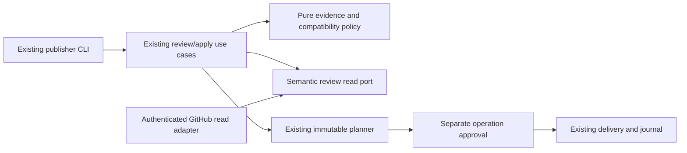
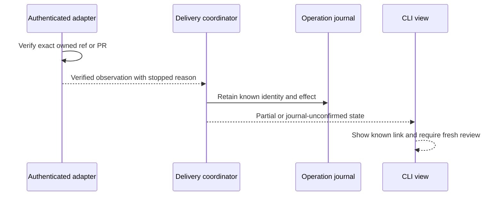

# Reviewed Setup delivery for the Bugbot status publisher

- Status: Ready for official SDD review; no implementation approval or executed acceptance is claimed
- Date: 2026-11-20
- Owners: Copilot maintainers
- Catalog capability ID: setup-and-doctor
- Official companion publication path: specs/setup-bugbot-publisher-manifest-route.md
- Existing owning registered SDD: specs/organization-configuration-reuse-and-batch-setup.md
- Scope: One explicit publisher-purpose CLI route through shared Setup file delivery, with exact preview, purpose-bound recovery and no resource writers.
- Coordination: #977 owns operational installation/native acceptance; #976 supplies reviewed publisher code; #814 retains broader maintenance/release/web work. This source feature closes none of those acceptance requirements automatically.
- Review gates: official SDD, architecture, security, product/content, tests, packaging, documentation and final native checks.
- Open product decisions: none selected for implementation; the official SDD gate must review the decisions below before code starts. Exact installation source/default/canary pins are later operational evidence, not invented source-feature prerequisites.

## 1. Executive summary

Add `copilot setup --publisher-manifest <path>` to inspect one proposal, show the complete final workflow and manifest receipt, obtain fresh approval and deliver one installer PR. Share existing Setup commit/ref/PR phases and persistence primitives. The SDK feature ends at tested source and truthful delivery behavior. Actual default installation and native-canary acceptance remain #977, require their specific authorization, and are not inferred from a source merge or package test.

## 2. Problem, current behavior, and evidence

The #977 artifact is a review-only proposal, not a supported CLI selection. Current `setup_execution.ts` routes batch/resume into broad configuration/resource orchestration. `SetupBatchGithubApplyAdapter` owns Git delivery together with Variables/grants/labels/types and broad Secret metadata revalidation; supplying fake configuration or no-op resource writers does not establish a narrow path. `prepareCommit` creates Git objects, so it is not a preview. `assertPrepared` currently proves parent and nested receipt, but not the complete approved tree difference. The private batch journal is strict v1, metadata-only and exclusively locked.

These observations come from the actual CLI, application, adapter/journal and issue977 proposal sources. The seven inspected installer files are byte-identical at the prepared c7d6d6a2eb0db6d02376df8348707e5795a36999 packet and integrated26e9dd8ede0490774d59bae946156514c43f6d20 source. At the observed default ace49e4a7ce0f6a007fef5d11479eb9b7a5846e3, a compatible schema2/contract1 manifest exists; this snapshot is not a later freshness assertion. The old #976 source pin is not installation authority and must be refreshed after actual integration.

The existing #977 branch has preparation commits and no published SDD card. The first-SDD retained-branch ancestry guard cannot be retrofitted by rewriting that history. Use the new enabled feature's Action-owned branch and official first SDD. Keep #977's packet and #814's unstarted broader requirements intact. No failed first-SDD attempt or maintainer recovery is claimed.

GitHub tree, commit and ref creation are separate effects. A base tree retains unrelated files; separate reads are not an atomic CAS. Workflow edits need their relevant write authority. Primary references: https://docs.github.com/en/rest/git/trees#create-a-tree ; https://docs.github.com/en/rest/git/commits#create-a-commit ; https://docs.github.com/en/rest/git/refs#create-a-reference ; https://docs.github.com/en/rest/repos/contents#create-or-update-file-contents . Existing fixtures and actual outcomes remain separate from these provider contracts.

## 3. Actors, surfaces, and terminology

Maintainer: selects and reviews exact bytes in the terminal. Installer: delivers approved files and retains effects. Reviewer: inspects source/default/base, diff, receipt and PR. Operator: separately authorizes merge/native canary and records actual #977 evidence. A proposal is untrusted data; a Boolean or prior receipt cannot grant approval. Prepared, PR-created, merged and native-verified are distinct facts.

## 4. Goals, non-goals, and fixed invariants

| Requirement | Behavior |
|---|---|
| PU977-G01 | Validate one closed publisher proposal and independently pin destination, source and exact allowed file scope. |
| PU977-G02 | Show the complete two-file preview and bind fresh approval to the immutable final bytes; dry-run/decline creates no effects. |
| PU977-G03 | Use shared existing installation delivery with complete approved-tree/parent/receipt proof and the established Setup namespace. |
| PU977-G04 | Bind durable metadata to purpose and operation; retain partial/unknown effects and never overwrite, force, delete or blindly replay. |
| PU977-G05 | Use only relevant source/destination authority reads and approved file effects; no resource writers or permission probes are implied. |
| PU977-G06 | Expose one explicit bounded CLI journey and truthful pending/partial/PR/native states with safe content and useful next actions. |
| PU977-G07 | Preserve compatible installed metadata, legacy batch behavior, private journals and fixed authority; unsupported state blocks. |
| PU977-G08 | Require separate specific default-installation and real-canary evidence before verified acceptance; keep production disabled and pilot writes zero. |

Only `.github/workflows/copilot_bugbot_status_card.yml` and `.copilot/setup-manifest.json` receipt may differ for this purpose. Preserve other manifest data, guidance, source-generator identity, workflows and runner selections. Require a supported existing Setup manifest and complete compatible guidance; missing/unknown/future state blocks rather than fabricating artifacts/profile defaults. An absent publisher is supported; a foreign/customized/equivalent renamed publisher blocks. Do not overwrite or delete it.

Non-goals: full #814 release/custom-YAML migration, new web controls, repository/organization resource changes, probes, model calls, auto-merge, releases, deployment or verification activation. Keep this rollout's production verification disabled and evaluated-pilot PR writes zero. Human/platform Setup observations remain separate.

## 5. Current versus proposed product journey

```text
Proposal -> relevant read-only inspection -> complete two-file preview
 -> fresh exact-snapshot approval -> shared Setup delivery -> PR awaiting merge
 -> separately authorized installation and native evidence owned by #977
```

Text equivalent: inspect, review, approve, deliver and hand off; no stage infers the next. Ordinary setup remains the default. The new explicit option bypasses broad questionnaire/resource orchestration before any effects. Dry-run/decline creates no objects, refs, PRs, probes or journal. The result links retained facts and the next action.

## 6. Functional behavior and state model

Validate the local proposal before transport, independently resolve source/destination identity, and inspect complete relevant workflow/manifest facts. Unknown/denied/incomplete inventory is not absence. An exact current installation has no empty PR and retains native-verification-pending status. Pin final intended workflow bytes before preview.

The purpose-separated plan digest binds operation, repository/default/base, source identities, proposed workflow hash, original manifest identity, receipt format and audited actor/relevant authority. Derive the final receipt after that noncircular digest is known; approval binds both complete rendered files. Private credential/session generation is also fenced, without storing credentials or credential hashes. Credential/actor/authority drift requires fresh review.

After approval, use the common file-delivery coordinator. Revalidate relevant default/base/identity/authority before every mutation. Preserve the fixed Setup namespace, exact prepared parent/tree/receipt and operation marker. Cancellation stops later effects and retains completed/uncertain facts. Detecting a race after an effect reports partial state, not rollback or atomic CAS.

| State | Meaning | Primary next action |
|---|---|---|
| Inspecting | Read-only facts pending; no effects | Wait |
| Review | Complete files and effects disclosed | Approve or cancel |
| Blocked/stale | Unknown, foreign, denied or changed snapshot | Correct cause and prepare again |
| Applying | Approved delivery active | Wait or stop pending work |
| Partial | Completed/uncertain effects retained | Inspect receipt; freshly reviewed recovery |
| Waiting for merge | Exact installer PR exists | Review PR |
| Unchanged / verification pending | No new file effects; native proof is separate | Inspect actual default/native evidence |

Only actual separately authorized #977 evidence can establish installed/native-verified acceptance; the new source route does not fabricate that terminal state.

## 7. User-facing configuration

The only new option is `--publisher-manifest <path>`. Allow existing `--token`, `--debug`, read-only `--dry-run`, and optional `--resume-operation`. Normal help/version remain. Reject explicitly supplied `--web`, `--batch`, `--yes`, `--non-interactive` and every generic feature/configuration/Variable/Secret/approval/update override, including false/empty/default-looking explicit values. Commander provenance stays in the CLI adapter; pure policy receives closed facts. Dispatch before generic terminal/web/configuration/probe setup.

The proposal is one regular nonsymlink strict-UTF8 JSON file, at most 128 KiB, schemaVersion1 and kind `review-only-publisher-installation-proposal`. Use the existing artifact's closed top-level/nested sets: destination(repository, repositoryId, defaultBranch, head); path; baseline; source(repository, commit, pullRequest, merged, maintainerApproval, workflowSha256, actionManifestSha256, actionBundleSha256); proposedWorkflowSha256; sourceChange; consumerTemplatesChanged; productionVerification; installationAuthorized; installedDestinationSha; nativeCanary(status, explicitlyAuthorizedPullRequest, runId); dependency; coordination. IDs are positive safe integers; Git IDs full 40-character hex; SHA-256 full 64-character hex. Use existing coordinate/ref validation. Descriptive fields are at most 512 characters and never select code/transport/authority. Reject extra keys, invalid types/kind/schema/hash, unsupported completed-result shapes and unreadable/oversized input before transport.

Proposal approval/merge/native fields are observations, not authority. Independently prove reviewed merged source and exact workflow/action/bundle bytes; declarations alone do not pass. Source-derived workflow transformation requires the canonical layout and exactly one root-local `uses: ./` step. Replace only that invocation with `vypdev/copilot@<full reviewed source SHA>`, retain every other byte and verify proposedWorkflowSha256. No arbitrary renderer/template/runner/path override is accepted.

Dry-run may read an existing publisher resume but writes no new journal/lock/object. Later Apply prepares/reviews its own snapshot. Bare resume retains legacy batch and never infers publisher purpose. Keep existing read/backoff and payload bounds and the 40,000-byte private journal bound. No user-selectable ref/base/template/runner/URL or new repository Variable is introduced. Absent the new option preserves ordinary behavior.

## 8. Clean Architecture design

```text
CLI adaptation -> publisher review/apply use case -> pure scope/approval/tree policy
   -> narrow read/freshness/journal/file-delivery ports
   -> shared application delivery coordinator -> existing extracted GitHub delivery
Ordinary batch keeps resource phases and invokes that same file coordinator.
```

Text equivalent: frontends adapt inputs, application owns decisions/states, ports expose semantic capabilities, adapters own provider/filesystem operations, and pure policy owns validation. No provider DTO or process/SDK/filesystem import enters pure policy; no raw HTTP/process orchestration enters the application. Enforce actual composition and existing dependency/cycle rules.

Extract common approved-final-files/receipt contracts and formatter, application prepare/ref/PR phases, GitHub delivery and private UUID/file/lock primitives. Ordinary batch retains its resource stages and broad freshness wrapper; publisher receives relevant read/authority, file delivery, journal and presentation only. No dummy SetupConfiguration, no-op resource writers, second installer or new renderer abstraction. Preserve existing ordinary manifest behavior in its wrapper; publisher requires a real compatible baseline.

Complete prepared-tree proof uses an approved-path prefix trie. Read complete non-recursive base/prepared trees. All unmentioned siblings must retain name/mode/type/object identity. Descend only approved ancestors; reject non-tree ancestors, duplicate/unsafe entries, unknown/truncated responses and unapproved differences. Approved leaves match exact mode and blob identity from approved bytes. Only ordinary explicitly approved deletions remain supported; publisher never deletes. Exact single parent and nested receipt are separately required. Sampling two expected blobs is insufficient.

Keep installed manifest/receipt format unchanged unless separately reviewed. Use a closed publisher-v2 operation (`purpose: bugbot-status-publisher`, one repository and only file effects) with the same private store/UUID/lock namespace. Legacy v1 parser/records remain on their route; reject cross-purpose/future/resource-effect resume. Never silently migrate old journals. Preserve ownership and nonce-based release; no PID-only orphan-lock recovery.

## 9. UI/UX and content contract

```text
Install the Bugbot status publisher — vypdev/copilot
Review the publisher workflow and installation receipt on the inspected default.
[Review full diff] [Approve this snapshot] [Cancel]
Technical details: source identity, permissions, hashes and retained effects
```

Pending: `Inspecting the proposal and destination. No changes started.`
Action: `Review both final files before creating the PR.`
Blocked: `The default revision changed. Prepare a new preview; the previous receipt is retained.`
Partial: `The installation branch exists; PR creation is unconfirmed. Inspect this operation before resuming. Setup has not updated the default branch.`
Complete delivery: `The installation PR is ready for review. Merge and native verification remain pending.`

Lead with status, completed facts, next action, human action, impact, direct links, then technical detail. One operation report and at most one installer PR; no progress-comment stream. Provide keyboard interaction, textual states/diagram fallback, readable narrow terminal content and inert escaped names/values/Markdown/URLs. No new web or human screen-reader acceptance is claimed.

Provide complete static en/es/fr/pt catalogs through existing catalog primitives, with atomic English fallback. Normalize LC_ALL, then LC_MESSAGES, then LANG for display only; absent/invalid/unsupported locale defaults en-US. Locale cannot change approval, files, digest, target or authority. No new locale flag or language/model call. publisher977-C54 covers English, publisher977-C61, publisher977-C62, publisher977-C63 the other three catalogs, publisher977-C64 fallback. All primary states/actions/recovery must remain understandable.

## 10. Failure, recovery, and cleanup

Unknown tree/commit POST outcomes with no identifiable prepared object block automatic retry/adoption. Retain uncertainty; any new operation needs a fully disclosed new snapshot and fresh approval, preserving prior unknown effects. Inspect ref/PR outcomes by exact operation/target/commit marker; no blind POST replay, force-push, deletion, automatic rebase or human-head overwrite. Existing read retries/backoff remain fixed. Report denied/unknown/stale/foreign states without claiming an observed edit merely from unavailable metadata. Do not remove completed PRs/grants or unrelated work.

## 11. Security, permissions, and privacy

Preview uses relevant GET/local reads only; no organization Secret inventories, resource writers, permission probes, scripts or models. Apply requests only the reviewed repository file/PR and workflow authority. Credentials stay paired private session state and never enter journals, logs, exports, digests or preview. Sanitize bounded diagnostics instead of echoing arbitrary provider payloads. Keep source/destination/producer identity distinct from independent producer-code attestation; artifact/run/receipt identity alone is not that attestation. Preserve protected routes, runner policy and approval/rollback fences.

## 12. Observability and operational UX

Retain operation/target, source/default/base, proposal/rendered byte hashes, prepared commit, exact ref/PR and known/uncertain effect receipts. Public view shows meaningful states and descriptive links; secondary diagnostics remain redacted. Queued/skipped runs, source-only merges and packaged passes cannot become installed/native-verified outcomes.

## 13. Compatibility, migration, rollout, and rollback

Source feature sequence: official SDD -> shared extraction/parity -> narrow route -> 64 controls and existing gates -> final native source review/merge. It does not install a workflow. Then #977 refreshes its #976-dependent proposal, prepares the concrete complete installation, obtains specific authorization, delivers/merges through the trusted route and runs only an explicitly authorized canary. No preparation PR closes #977 as accepted. #814's broader release/customization/web work and all 14 actual Setup observations remain open.

Rollback is a separately reviewed normal change from a fresh snapshot retaining prior receipt/workflow facts. No reference deletion or overwrite of newer human work. No release, production activation or automatic merge is part of this feature.

## 14. Testing strategy and numeric budget

Minimum 64 distinct new cases, separate from existing9 artifact /149 shadow /14 packaged evidence. Distribution:16 pure planning,8 read/freshness,12 application/recovery,10 provider/delivery,12 CLI/content,6 packaged/security. These are floors; add meaningful cases if required. Repeated execution does not add cases.

Pure policy:100% all metrics. New catalogued modules: at least 95% lines/statements and 90% branches/functions, plus existing global budgets. The owning Setup SDD additionally requires zero incomplete executable changed lines in the final uploaded report. Do not lower exclusions, thresholds, assertions or timeouts. Use deterministic clocks/IDs/provider/filesystem seams, actual CLI/packed entrypoints, retained-state and no-unapproved-effect assertions. Model-free tests prove contracts, not installation, human/platform or provider acceptance.

| Area | Minimum distinct cases | Behaviors/risks covered |
|---|---|---|
| Pure proposal/scope/plan policy | 16 | Closed proposal, exact source/scope/approval, receipt and compatibility policy |
| Read-only planning/freshness | 8 | Relevant complete reads, absence versus unknown, identity and freshness |
| Application/recovery | 12 | Cancellation, partial effects, locking, purpose-bound resume and uncertainty |
| Provider/delivery contracts | 10 | Complete tree/parent/receipt, exact owned refs/PRs, provider denial and races |
| CLI/content | 12 | Early explicit CLI dispatch, conflicts, four static locales and truthful content |
| Packaged integration/security | 6 | Actual packed CLI, narrow credentials/composition and legacy parity |
| Total | 64 | Every new executable case counted once |

| Case ID | Area | Requirements | Scenario |
|---|---|---|---|
| publisher977-C01 | Pure proposal/scope/plan policy | PU977-G01 | A structurally valid closed proposal admits exactly one target, source pin, workflow hash and supported artifact kind. |
| publisher977-C02 | Pure proposal/scope/plan policy | PU977-G01 | Repository ID/name/default declarations must agree internally; an arbitrary URL or contradictory identity is rejected. |
| publisher977-C03 | Pure proposal/scope/plan policy | PU977-G01 | Malformed or missing commit, bundle, workflow and manifest digests are rejected without coercion. |
| publisher977-C04 | Pure proposal/scope/plan policy | PU977-G01, PU977-G03 | Extra file, deletion, path traversal, absolute path or wrong file mode cannot enter the two-file delivery plan. |
| publisher977-C05 | Pure proposal/scope/plan policy | PU977-G01, PU977-G07 | Only the canonical publisher workflow path is selectable; no proposal field supplies a destination override or arbitrary template. |
| publisher977-C06 | Pure proposal/scope/plan policy | PU977-G01, PU977-G02, PU977-G04 | The plan digest changes for purpose, operation, repository/default/base, source identity, workflow bytes or original manifest identity. |
| publisher977-C07 | Pure proposal/scope/plan policy | PU977-G02 | Approval binds the complete rendered workflow and receipt bytes, so any post-preview byte change invalidates it. |
| publisher977-C08 | Pure proposal/scope/plan policy | PU977-G02, PU977-G05 | A manifest approved/authorized Boolean or an old review receipt cannot grant a fresh Apply. |
| publisher977-C09 | Pure proposal/scope/plan policy | PU977-G02, PU977-G03 | Receipt derivation is deterministic and noncircular: purpose-separated plan digest first, complete approval-byte digest afterward. |
| publisher977-C10 | Pure proposal/scope/plan policy | PU977-G03, PU977-G07 | Supported existing manifest fields/artifacts remain semantically intact outside the disclosed installation-receipt change. |
| publisher977-C11 | Pure proposal/scope/plan policy | PU977-G07 | Future/unsupported manifest or installation-receipt shape is blocked rather than normalized into a supported version. |
| publisher977-C12 | Pure proposal/scope/plan policy | PU977-G01, PU977-G07 | Partial, mismatched or tampered source-guidance identities block the narrow maintenance plan. |
| publisher977-C13 | Pure proposal/scope/plan policy | PU977-G05, PU977-G07 | An absent Setup manifest cannot become an invented empty artifacts/profile baseline. |
| publisher977-C14 | Pure proposal/scope/plan policy | PU977-G04, PU977-G07 | The closed publisher journal accepts only its v2 purpose and file-delivery effects; resource effects are rejected. |
| publisher977-C15 | Pure proposal/scope/plan policy | PU977-G03, PU977-G08 | An operation marker or matching receipt alone never produces a verified-native or independent producer-attestation claim. |
| publisher977-C16 | Pure proposal/scope/plan policy | PU977-G01, PU977-G07 | Symlink/nonregular proposal or unsupported path ancestry is rejected without following it as source authority. |
| publisher977-C17 | Read-only planning/freshness | PU977-G01, PU977-G02, PU977-G05 | Readable absent publisher plus compatible existing Setup state produces a full preview using only relevant reads. |
| publisher977-C18 | Read-only planning/freshness | PU977-G01, PU977-G05 | A denied relevant read remains unknown and cannot be classified as absent or safe to overwrite. |
| publisher977-C19 | Read-only planning/freshness | PU977-G01, PU977-G05 | Incomplete/truncated workflow or manifest inventory blocks an absence claim. |
| publisher977-C20 | Read-only planning/freshness | PU977-G01, PU977-G07 | An equivalent renamed or foreign/customized publisher is detected or remains explicitly unknown; no second publisher is added. |
| publisher977-C21 | Read-only planning/freshness | PU977-G01, PU977-G02 | A changed authenticated default branch or base before review requires a new plan and preview. |
| publisher977-C22 | Read-only planning/freshness | PU977-G01, PU977-G02 | A changed or mismatched source commit/bundle/workflow digest prevents reuse of the old proposal approval. |
| publisher977-C23 | Read-only planning/freshness | PU977-G05, PU977-G07 | Supported reads do not invent empty organization resources, permission evidence or source-guidance facts when access is unavailable. |
| publisher977-C24 | Read-only planning/freshness | PU977-G01, PU977-G06, PU977-G08 | An exact existing publisher yields unchanged/no empty PR while real-canary status remains separately pending. |
| publisher977-C25 | Application/recovery | PU977-G02, PU977-G05 | Declining the preview leaves GitHub and the durable operation store unchanged. |
| publisher977-C26 | Application/recovery | PU977-G02, PU977-G03, PU977-G05 | A fresh approved snapshot invokes the shared file-delivery sequence and no generic resource stage. |
| publisher977-C27 | Application/recovery | PU977-G02, PU977-G04 | Explicit cancellation before effects stops Apply without creating objects, refs or PRs. |
| publisher977-C28 | Application/recovery | PU977-G04 | Cancellation after a completed object effect retains partial metadata and starts no later effect or destructive cleanup. |
| publisher977-C29 | Application/recovery | PU977-G04, PU977-G07 | A concurrent Apply cannot acquire the exclusive UUID lock or perform a duplicate write. |
| publisher977-C30 | Application/recovery | PU977-G03, PU977-G04 | Restart after a known exact prepared commit revalidates/adopts it without preparing another commit. |
| publisher977-C31 | Application/recovery | PU977-G03, PU977-G04 | Restart after the exact owned ref reuses that ref and preserves its matching complete receipt. |
| publisher977-C32 | Application/recovery | PU977-G04 | Unknown tree/commit creation without an identifiable object blocks automatic retry and retains uncertainty. |
| publisher977-C33 | Application/recovery | PU977-G03, PU977-G04 | An uncertain PR response is recovered only after exact marker/head/base/repository inspection. |
| publisher977-C34 | Application/recovery | PU977-G04, PU977-G07 | Legacy v1/different-purpose/future journals cannot resume publisher work or cause legacy resource effects. |
| publisher977-C35 | Application/recovery | PU977-G02, PU977-G04 | Changed reviewed digest/base or a human-advanced owned head blocks resume until the appropriate fresh review; no overwrite occurs. |
| publisher977-C36 | Application/recovery | PU977-G04, PU977-G06 | A journal save failure after an effect stops later writes and reports partial/unknown recovery instead of claiming durable success. |
| publisher977-C37 | Provider/delivery contracts | PU977-G03 | Tree creation retains the reviewed base tree and the resulting full scope equals only the approved files. |
| publisher977-C38 | Provider/delivery contracts | PU977-G03, PU977-G04 | An unexpected prepared parent cannot be adopted even when its marker/receipt otherwise matches. |
| publisher977-C39 | Provider/delivery contracts | PU977-G03 | An extra sibling file or changed subtree is rejected even when both expected blobs are correct. |
| publisher977-C40 | Provider/delivery contracts | PU977-G02, PU977-G03 | Wrong workflow bytes, file mode, receipt identity or digest is rejected before ref/PR adoption. |
| publisher977-C41 | Provider/delivery contracts | PU977-G04, PU977-G05 | GitHub denial at an approved workflow/content write produces the correct blocked/partial outcome without permission escalation or a probe fallback. |
| publisher977-C42 | Provider/delivery contracts | PU977-G03, PU977-G04 | Unknown ref creation followed by the exact expected ref adopts once without blindly repeating POST. |
| publisher977-C43 | Provider/delivery contracts | PU977-G03, PU977-G04 | An existing UUID ref at a different human commit blocks with no force, deletion or replacement. |
| publisher977-C44 | Provider/delivery contracts | PU977-G03, PU977-G04 | PR inspection handles full pagination and rejects missing, duplicate or foreign matches rather than creating another PR. |
| publisher977-C45 | Provider/delivery contracts | PU977-G01, PU977-G04 | Default/base movement between provider effects stops remaining work; movement detected after an effect is honestly partial, not claimed atomic CAS. |
| publisher977-C46 | Provider/delivery contracts | PU977-G03, PU977-G04 | A head changed during PR creation/readback is retained as a partial ownership conflict with no cleanup or silent adoption. |
| publisher977-C47 | CLI/content | PU977-G01, PU977-G06 | The explicit publisher option selects the narrow application before generic setup configuration or probing. |
| publisher977-C48 | CLI/content | PU977-G05, PU977-G06 | Explicitly supplied forbidden generic options are rejected even when Commander parses an empty or default-looking value. |
| publisher977-C49 | CLI/content | PU977-G02, PU977-G06 | --yes and --non-interactive cannot turn proposal fields or a previous preview into Apply approval. |
| publisher977-C50 | CLI/content | PU977-G05, PU977-G06 | --web/--batch conflicts start neither a web server nor organization selection/model/permission setup. |
| publisher977-C51 | CLI/content | PU977-G02, PU977-G05, PU977-G06 | Valid dry-run shows both final files using controlled relevant reads and creates no journal, object, ref, PR or resource probe. |
| publisher977-C52 | CLI/content | PU977-G04, PU977-G06, PU977-G07 | Publisher resume requires its explicit proposal route and fresh review; bare resume retains the ordinary legacy batch route. |
| publisher977-C53 | CLI/content | PU977-G06, PU977-G08 | Pending, partial, waiting-for-merge and verification-pending copy links to the actual known operation/run and never invents successful installation or canary evidence. |
| publisher977-C54 | CLI/content | PU977-G06, PU977-G07 | English primary content, textual status, descriptive links and sanitized failures expose no credential or arbitrary provider payload. |
| publisher977-C55 | Packaged integration/security | PU977-G06 | The actual packed CLI help advertises the selected option and supported review/preview journey. |
| publisher977-C56 | Packaged integration/security | PU977-G01, PU977-G05, PU977-G07 | The actual packed CLI rejects an oversized, malformed or nonregular proposal before transport or generic setup effects. |
| publisher977-C57 | Packaged integration/security | PU977-G02, PU977-G05, PU977-G06 | The actual packed CLI rejects conflicting automation flags before authentication or generic orchestration. |
| publisher977-C58 | Packaged integration/security | PU977-G01, PU977-G06 | Outside a local Git checkout, a well-formed proposal with missing credentials reports the narrow credential prerequisite, without initializing or configuring a checkout. |
| publisher977-C59 | Packaged integration/security | PU977-G03, PU977-G05, PU977-G07 | Architecture/composition enforcement gives the publisher no resource writers/probes or raw application process/HTTP imports and proves both routes share one delivery implementation. |
| publisher977-C60 | Packaged integration/security | PU977-G03, PU977-G04, PU977-G07, PU977-G08 | A controlled cross-route integration preserves ordinary batch resource stages/Secret retention while publisher delivery remains file-only and cannot adopt a legacy operation; no production/model/native acceptance is inferred. |
| publisher977-C61 | CLI/content | PU977-G06, PU977-G07 | Spanish primary states/actions/recovery render from a complete static catalog with inert untrusted values and no language-agent or model request. |
| publisher977-C62 | CLI/content | PU977-G06, PU977-G07 | French primary states/actions/recovery render from a complete static catalog with inert untrusted values and no language-agent or model request. |
| publisher977-C63 | CLI/content | PU977-G06, PU977-G07 | Portuguese primary states/actions/recovery render from a complete static catalog with inert untrusted values and no language-agent or model request. |
| publisher977-C64 | CLI/content | PU977-G06, PU977-G07 | Unknown/invalid terminal locale or an incomplete catalog falls back atomically to English without changing approved bytes/digest or granting authority. |

## 15. Documentation and discoverability

Document the supported route/defaults/preview, relevant credentials, drift, uncertain effects, purpose-bound resume, legacy compatibility, source/default/native distinctions and rollback. Update existing CLI help, how-to-use/configuration, provisioning/troubleshooting, Bugbot failure guidance and issue977 evidence. Register actual code/test/docs only as implemented; regenerate and validate the catalog. Keep existing routes and validate links/content/locale fixtures.

Existing paths below are verified; Create paths are explicit proposed filenames under existing directories, not claimed implementation or catalog evidence.

| Path | Change |
|---|---|
| `specs/setup-bugbot-publisher-manifest-route.md` | create |
| `specs/organization-configuration-reuse-and-batch-setup.md` | update |
| `src/cli/commands/setup.ts` | update |
| `src/cli/commands/setup_execution.ts` | update |
| `src/cli/setup_command_options.ts` | update |
| `src/domain/setup_publisher_installation.ts` | create |
| `src/application/contracts/setup_installation_delivery.ts` | create |
| `src/application/ports/setup_installation_delivery_ports.ts` | create |
| `src/application/policies/setup_publisher_installation_policy.ts` | create |
| `src/application/policies/setup_installation_receipt_policy.ts` | create |
| `src/application/policies/setup_installation_tree_policy.ts` | create |
| `src/application/policies/setup_publisher_message_catalog.ts` | create |
| `src/application/usecases/setup/deliver_setup_installation_use_case.ts` | create |
| `src/application/usecases/setup/review_setup_publisher_installation_use_case.ts` | create |
| `src/application/usecases/setup/apply_setup_batch_use_case.ts` | update |
| `src/application/ports/setup_batch_ports.ts` | update |
| `src/infrastructure/setup_batch_github_apply_adapter.ts` | update |
| `src/infrastructure/setup_installation_github_delivery_adapter.ts` | create |
| `src/infrastructure/setup_operation_journal_store.ts` | create |
| `src/infrastructure/setup_batch_journal_adapter.ts` | update |
| `src/infrastructure/setup_publisher_journal_adapter.ts` | create |
| `src/infrastructure/composition/setup_publisher_installation_composition_root.ts` | create |
| `src/cli/setup_publisher_installation_adapter.ts` | create |
| `src/application/policies/__tests__/setup_publisher_installation.test.ts` | create |
| `src/application/usecases/setup/__tests__/setup_publisher_installation.test.ts` | create |
| `src/infrastructure/__tests__/setup_publisher_installation.test.ts` | create |
| `src/cli/__tests__/setup_publisher_installation.test.ts` | create |
| `src/tooling/__tests__/setup_publisher_installation_package.test.ts` | create |
| `src/architecture/__tests__/setup_doctor_boundaries.test.ts` | update |
| `scripts/coverage-budgets.json` | update |
| `docs/how-to-use.mdx` | update |
| `docs/configuration.mdx` | update |
| `docs/security-operations/operations/provisioning.mdx` | update |
| `docs/security-operations/operations/troubleshooting.mdx` | update |
| `docs/bugbot/failure-scenarios.mdx` | update |
| `specs/catalog.json` | update |
| `specs/CATALOG.md` | update |

Implementation responsibilities:

Path: `specs/setup-bugbot-publisher-manifest-route.md`. The Action publishes this companion for the existing setup-and-doctor capability; the existing registered owner remains coordinated.

Path: `specs/organization-configuration-reuse-and-batch-setup.md`. Update the registered setup owner through the official SDD flow on a suitable Action-managed source branch.

Path: `src/cli/commands/setup.ts`. Update option declaration and Commander provenance adaptation.

Path: `src/cli/commands/setup_execution.ts`. Update early explicit dispatch before generic terminal/config/credential/probe setup.

Path: `src/cli/setup_command_options.ts`. Update closed explicit-option facts; no Commander DTO in pure policy.

Path: `src/domain/setup_publisher_installation.ts`. Create publisher proposal/plan and closed purpose-bound operation entities.

Path: `src/application/contracts/setup_installation_delivery.ts`. Create narrow approved-final-files and common delivery receipt contracts.

Path: `src/application/ports/setup_installation_delivery_ports.ts`. Create read/freshness/commit/ref/PR/journal ports without resource writers.

Path: `src/application/policies/setup_publisher_installation_policy.ts`. Create bounded proposal/source derivation, two-file plan and freshness policy.

Path: `src/application/policies/setup_installation_receipt_policy.ts`. Create shared pure receipt/final-file derivation; legacy wrapper preserves its existing manifest behavior.

Path: `src/application/policies/setup_installation_tree_policy.ts`. Create complete approved-trie/sibling/tree admission policy.

Path: `src/application/policies/setup_publisher_message_catalog.ts`. Create complete static en/es/fr/pt primary content and atomic fallback using existing catalog primitives.

Path: `src/application/usecases/setup/deliver_setup_installation_use_case.ts`. Create extracted common file-delivery phases used by ordinary batch and publisher.

Path: `src/application/usecases/setup/review_setup_publisher_installation_use_case.ts`. Create narrow read/review/approve/resume orchestration.

Path: `src/application/usecases/setup/apply_setup_batch_use_case.ts`. Update delegation of file phases; retain ordinary resource stages and policy.

Path: `src/application/ports/setup_batch_ports.ts`. Update reference to shared delivery contracts while retaining legacy resource boundaries.

Path: `src/infrastructure/setup_batch_github_apply_adapter.ts`. Update delegation to the common GitHub file-delivery implementation; preserve broad legacy revalidation.

Path: `src/infrastructure/setup_installation_github_delivery_adapter.ts`. Create extraction of existing fixed commit/ref/PR transport and complete-tree verification, not a second installer.

Path: `src/infrastructure/setup_operation_journal_store.ts`. Create extraction of existing private UUID/file/lock primitives shared by both typed journals.

Path: `src/infrastructure/setup_batch_journal_adapter.ts`. Update delegation while preserving strict v1 parse/records/recovery.

Path: `src/infrastructure/setup_publisher_journal_adapter.ts`. Create closed publisher-v2 parser/store facade in the same private namespace.

Path: `src/infrastructure/composition/setup_publisher_installation_composition_root.ts`. Create narrow real composition without Variables/Secrets/grants/labels/issue-types/probe writers.

Path: `src/cli/setup_publisher_installation_adapter.ts`. Create terminal read/preview/approval rendering and local credential boundary.

Path: `src/application/policies/__tests__/setup_publisher_installation.test.ts`. Create pure policy/receipt/tree/catalog controls, with exact case traceability.

Path: `src/application/usecases/setup/__tests__/setup_publisher_installation.test.ts`. Create application review/recovery and shared-coordinator controls.

Path: `src/infrastructure/__tests__/setup_publisher_installation.test.ts`. Create read/delivery/journal/provider adversarial controls and legacy parity.

Path: `src/cli/__tests__/setup_publisher_installation.test.ts`. Create actual CLI/provenance/content route controls.

Path: `src/tooling/__tests__/setup_publisher_installation_package.test.ts`. Create real packed CLI/transport boundary controls.

Path: `src/architecture/__tests__/setup_doctor_boundaries.test.ts`. Update actual composition/dependency enforcement.

Path: `scripts/coverage-budgets.json`. Register new pure/module floors and preserve complete changed-path coverage acceptance.

Path: `docs/how-to-use.mdx`. Update supported route, defaults, four static locales and exact preview.

Path: `docs/configuration.mdx`. Update supported route, defaults, four static locales and exact preview.

Path: `docs/security-operations/operations/provisioning.mdx`. Update bounded permissions, retained effects, purpose-bound resume and unknown-object recovery.

Path: `docs/security-operations/operations/troubleshooting.mdx`. Update bounded permissions, retained effects, purpose-bound resume and unknown-object recovery.

Path: `docs/bugbot/failure-scenarios.mdx`. Update prepared/installed/native-canary distinctions and exact tuple evidence.

Path: `specs/catalog.json`. Register actual implemented evidence, regenerate and validate with implementation.

Path: `specs/CATALOG.md`. Register actual implemented evidence, regenerate and validate with implementation.

The operational #977 evidence packet is maintained on its own retained branch after actual source integration; it is not an existing file at this immutable source-feature base. Its prepared source is [the historical review packet](https://github.com/vypdev/copilot/blob/c7d6d6a2eb0db6d02376df8348707e5795a36999/quality/bugbot/evidence/issue-977/README.md). This link is history, not installation authority.

## 16. Acceptance scenarios

Valid supported proposal yields a complete two-file preview with zero effects. Dry-run/decline writes nothing. Fresh approval yields one exact prepared parent/tree/receipt and one owned ref/PR. Exact installed bytes produce no empty PR. Foreign/renamed/incomplete/future/denied state blocks. Pre-write drift stops; post-effect drift reports partial. Unknown outcomes preserve receipts and avoid duplicate writes. Cross-purpose/legacy records cannot acquire authority. Ordinary batch keeps resource stages and Secret retention while the publisher composition has none. Four static catalogs/fallback and actual packed CLI entrypoints behave as declared. Source acceptance ends at these tested behaviors; actual installation/native acceptance remains separately open in #977.

## 17. Requirements traceability

| Requirement | Cases |
|---|---|
| PU977-G01 | publisher977-C01, publisher977-C02, publisher977-C03, publisher977-C04, publisher977-C05, publisher977-C06, publisher977-C12, publisher977-C16, publisher977-C17, publisher977-C18, publisher977-C19, publisher977-C20, publisher977-C21, publisher977-C22, publisher977-C24, publisher977-C45, publisher977-C47, publisher977-C56, publisher977-C58 |
| PU977-G02 | publisher977-C06, publisher977-C07, publisher977-C08, publisher977-C09, publisher977-C17, publisher977-C21, publisher977-C22, publisher977-C25, publisher977-C26, publisher977-C27, publisher977-C35, publisher977-C40, publisher977-C49, publisher977-C51, publisher977-C57 |
| PU977-G03 | publisher977-C04, publisher977-C09, publisher977-C10, publisher977-C15, publisher977-C26, publisher977-C30, publisher977-C31, publisher977-C33, publisher977-C37, publisher977-C38, publisher977-C39, publisher977-C40, publisher977-C42, publisher977-C43, publisher977-C44, publisher977-C46, publisher977-C59, publisher977-C60 |
| PU977-G04 | publisher977-C06, publisher977-C14, publisher977-C27, publisher977-C28, publisher977-C29, publisher977-C30, publisher977-C31, publisher977-C32, publisher977-C33, publisher977-C34, publisher977-C35, publisher977-C36, publisher977-C38, publisher977-C41, publisher977-C42, publisher977-C43, publisher977-C44, publisher977-C45, publisher977-C46, publisher977-C52, publisher977-C60 |
| PU977-G05 | publisher977-C08, publisher977-C13, publisher977-C17, publisher977-C18, publisher977-C19, publisher977-C23, publisher977-C25, publisher977-C26, publisher977-C41, publisher977-C48, publisher977-C50, publisher977-C51, publisher977-C56, publisher977-C57, publisher977-C59 |
| PU977-G06 | publisher977-C24, publisher977-C36, publisher977-C47, publisher977-C48, publisher977-C49, publisher977-C50, publisher977-C51, publisher977-C52, publisher977-C53, publisher977-C54, publisher977-C55, publisher977-C57, publisher977-C58, publisher977-C61, publisher977-C62, publisher977-C63, publisher977-C64 |
| PU977-G07 | publisher977-C05, publisher977-C10, publisher977-C11, publisher977-C12, publisher977-C13, publisher977-C14, publisher977-C16, publisher977-C20, publisher977-C23, publisher977-C29, publisher977-C34, publisher977-C52, publisher977-C54, publisher977-C56, publisher977-C59, publisher977-C60, publisher977-C61, publisher977-C62, publisher977-C63, publisher977-C64 |
| PU977-G08 | publisher977-C15, publisher977-C24, publisher977-C53, publisher977-C60 |

Each case is counted once. Architecture owns layer/composition enforcement; section15 owns documentation paths. #977 actual authorization/default/native observations are not unit cases and cannot be inferred from this source feature's pass.

## 18. Implementation sequence

Resolve this bounded feature through the official first-SDD/seed gate on its Action-created branch. Implement pure scope/approval/tree policy; extract shared contracts/coordinator/provider/store with legacy parity; add publisher review/apply/resume and early CLI dispatch; complete static content, docs/catalog/package/security fixtures; meet all 64 cases, changed-path/global coverage and final native findings. Only then prepare #977's exact installation; do not ask for installation permission before the concrete preview is reviewable.

## 19. Definition of Done

- Official SDD/owner/branch readiness is verified before implementation.
- All 64 new cases and unchanged legacy/global/module/changed-path gates pass.
- Real CLI and packed route, actual narrow composition, shared delivery and v1/v2 recovery are enforced.
- Exact preview, fresh approval, complete tree proof and truthful retained-state UI work in all four locales/fallback.
- Docs/help/catalog/generated assets agree; actual build/type/lint/package/workflow/spec/documentation checks and final SHA native findings are complete.
- Source integration creates no default installation, canary, model request, release, protection/runner change or production activation.
- #977's installation authorization/default/native acceptance and #981/#982's14 observations remain explicitly separate, with no false completion claim.

## 20. References and decisions

Use the installed workflow skill/profile/guide, canonical specification standard/template/catalog, full organization reuse/batch owner, and actual CLI/prepare/apply/delivery/journal/proposal sources. The extended read-only design retains the source evidence and rejected alternatives; it is not an implementation or native result. Primary GitHub references are in section2. Decisions are one explicit publisher purpose, existing compatible manifest/guidance, fixed source-byte derivation, complete tree proof, common delivery/store and purpose-separated v2 state. Reject fake generic configuration, no-op writers, arbitrary renderers, parallel installers, hand-created remote refs and automatic installation/verification claims.

## Independently reviewed producer inventory for publisher Setup

- Status: Draft for official SDD review; implementation waits for verified Action publication and branch readiness.
- Date: 2026-11-28
- Catalog capability ID: setup-and-doctor
- Owners: Copilot maintainers
- Scope: Authenticate independently reviewed producer behavior in the existing publisher-only CLI route.
- Related issue: https://github.com/vypdev/copilot/issues/1006 ; operational acceptance remains https://github.com/vypdev/copilot/issues/977 .
- Selected source: c64b7d63829a8c6b07049268e7e11d5066610796.
- Required review gates: product content, architecture, authority/security, tests, documentation and packaging.
- Open decisions blocking this source contract: none after the five numbered author answers; an actual independent inventory review and installation approval are separate future operational prerequisites, not assertions made here.
- Publication mode: append this complete change to the selected existing publisher SDD without replacing its retained baseline. No source implementation, test execution or installation is claimed by this draft.

### 1. Executive summary

Setup can authenticate a real, purpose-specific independent review of the exact destination producers, distinguish compatible behavior from unresolved execution and then offer the existing exact two-file installation preview. The approved inventory does not approve installation. Unknown behavior, incompatible direct writers and foreign publishers remain blocking.

```text
Inspect source and complete workflow closure -> independent inventory review
 -> authenticate current decision and bindings -> show producer dispositions
 -> eligible exact two-file preview -> separate operation approval -> existing delivery
```

### 2. Problem, current behavior, and evidence

The original actual preview made49GET requests, zero mutating REST attempts and returned20UNKNOWN. Its destination was master at ace49e4a7ce0f6a007fef5d11479eb9b7a5846e3. Current source has a conservative workflow classifier, authenticated SDK source-merge proof and a narrow immutable planner, but no independently authenticated producer-review input. Source merge and metadata hashes cannot establish other programs' behavior. Static audits retain actual workspace/input and legacy-writer gaps; those are not approvals. In particular, candidate Action regression workflows must not be blindly pinned away as an installation shortcut. Relevant actual source paths appear in section15; the original result is retained in the canonical https://github.com/vypdev/copilot/issues/950#issuecomment-7015916845 . Historic intent beyond those inspected facts is unknown. This is a prospective change, not a retrospective claim of implemented acceptance.

### 3. Actors, surfaces, and terminology

The preparing maintainer authors a complete source-bound document. A distinct independent maintainer reviews the actual programs and submits a purpose-specific GitHub decision. The CLI operator inspects the resulting dispositions and separately approves exact installation bytes. Authenticated adapters own provider observations; domain policy owns eligibility; existing application/delivery owns state and effects. Review document, reviewed-compatible inventory, approved installation, PR-created, merged and native-verified are distinct facts. The evidence PR may use its own immutable base while its document binds the separately inspected destination snapshot. No evidence-PR executable tree is adopted by inspection.

### 4. Goals, non-goals, and fixed invariants

| Requirement | Behavior |
|---|---|
| IR977-R01 | Accept only closed canonical purpose-specific review inputs; preserve version1 behavior and fixed resource limits. |
| IR977-R02 | Independently authenticate the exact current GitHub review, distinct actor, decision and permission without fabricating human review. |
| IR977-R03 | Bind the complete workflow set, executable closure and effective input sources; unsupported or missing facts remain unresolved. |
| IR977-R04 | Require actual serialized producer compatibility; positive conflicts and reachable direct legacy writers remain blocking. |
| IR977-R05 | Bind stable review/source facts to approval and revalidate before effects and recovery, preserving actual partial state. |
| IR977-R06 | Use the existing narrow route, semantic ports and delivery/journal; preserve its two-file scope and ordinary batch behavior. |
| IR977-R07 | Render truthful bounded review/install states, safe links and four locales without duplicate comments or credential disclosure. |
| IR977-R08 | Deliver mapped controls, package/architecture/documentation/catalog acceptance while keeping operational review/installation separate. |

Non-goals: general release selection or workflow migration from #814; a second installer; web controls; new grants, resources, runners or services; model queries; automatic reviews, installation approval, merges, activation or releases. Preserve the existing CLI flags, current consumer template defaults, private credential/session ownership, complete-tree/delivery fences and all previous acceptance. This source feature cannot claim that the actual20workflows are compatible. Production verification stays disabled and evaluated-pilot writes remain zero.

### 5. Current versus proposed product journey

| Stage | Current | Proposed | Effect |
|---|---|---|---|
| Inventory | Opaque execution blocks | Display source-bound dispositions backed by verified review | Missing evidence stays blocked |
| Review | No supported review channel | Authenticate exact purpose, head, decision and permission | No mutation or installation authority |
| Preview | Unknown inventory rejects | Supported compatible inventory can reach existing exact preview | Still requires separate approval |
| Apply/resume | Existing narrow delivery | Same delivery plus current review freshness | Retain real partial effects |

The overview in section1 is also the textual equivalent: inspect, independently review, authenticate, preview, separately approve and deliver. Cancellation or failed inspection keeps the last proved state, and no stage implies completion of the next.

### 6. Functional behavior and state model

#### 6.1 Closed evidence and canonical bytes

Use one fixed destination evidence-document path, the fixed destination artifact coordinate shown below, read only from the exact same-repository evidence-PR head; it is a consumer review artifact, not a file added by installation. Closed document schema v1: schemaVersion=1, kind=bugbot-publisher-producer-inventory-review, destination{repositoryId,repository,defaultBranch,head,tree}, publisher{repositoryId,commit,workflowSha256,actionManifestSha256,actionBundleSha256,contractSha256}, workflowSetSha256, workflows, units, edges, inputs. Each workflow records path/mode/blob/contentSha256, entry-unit IDs and disposition(non-producer|serialized-producer|incompatible|unresolved); each unit records unique ID, kind, repository ID/full name, exact commit/tree, path/mode/blob/contentSha256 and reviewed behavior; edges reference existing unit IDs and an explicit dependency/input role; inputs bind workflow/job/step/input identity, precedence origin and a value-free source fingerprint, never Secret values. Require all fields, reject unknown fields, invalid Unicode, floats/unsafe integers, duplicate identities/edges and missing references. Canonical bytes are UTF-8 JSON with recursively ASCII-key-sorted closed objects, two-space indentation and one trailing LF; arrays sort by unique workflow path/unit ID/input identity/edge tuple, with no content/path normalization. Require raw bytes to equal canonical reserialization, which also rejects duplicate JSON object keys; SHA256 covers those entire bytes, with no self-digest field. workflowSetSha256 covers the canonical sorted complete path/mode/blob/contentSha256 array; contractSha256 covers the closed supported publisher contract and source identities. Fixed limits: document 1,048,576 bytes, 128 workflows, 2,048 units, 8,192 edges, 1,024 input records, nesting 16, one behavior/reason string 2,048 UTF-8 bytes. Exceeding any bound rejects the whole evidence without truncation. The existing proposal remains capped at128KiB; v2 carries only {pullRequest,head,documentSha256}; v1 retains conservative behavior. Keep existing Git-reader asset/tree bounds and reject unsupported reads; these new document limits never enlarge other provider or runtime budgets. No evidence or approval is asserted by this design answer. In the SDD, distinguish that normative destination evidence-document address from SDK implementation-source citations: show the external artifact coordinate in a labelled protocol block, not as a claim that the document exists at the SDK base. It is created later in an Action-managed documentation issue/PR, outside Apply. Section15 must declare real new implementation files as create and existing full source/test/doc paths as update/reference; do not add a fake reviewed inventory to the SDK or hide any actual SDK source citation.

The following is the normative external destination review-artifact address, not a claim that an inventory exists in the immutable SDK source or a file created by this source delivery:

```json
{"destinationEvidenceDocumentPath":".copilot/bugbot-publisher-inventory-review.json"}
```

#### 6.2 Current review authority

Read the authenticated same-destination-repository PR and complete review pages, preserving the existing bounded provider pagination contract; exhaustion, malformed pages/records, inconsistent identity/head or unavailable reads leave authority unverified. Require an open evidence PR, exact selected head in the same repository, and a complete evidence-PR immutable-base-to-head tree proof that only the fixed document changed. Independently authenticate that PR base commit/tree; it may differ from the destination head. Bind the document claims to the separately fetched live destination, not to the evidence PR execution tree. This permits an Action-managed documentation PR based on develop to review a master snapshot; no evidence-PR code is executed or adopted. The document binds the separately fetched live destination ref; the PR base DTO is not proof of that ref. Eligible actors have provider type User, stable matching ID/login, are distinct from the evidence-PR author and preparing automation, and have freshly observed write/admin base permission. A type=User record alone does not prove human deliberation; an actual independent maintainer must perform the review, and preparing automation must never submit its own approval. Group submitted decisions by actor ID, ordered by submitted_at then numeric review ID; ambiguous/malformed ordering rejects. Ignore PENDING/COMMENTED for decision reduction. The latest of APPROVED/CHANGES_REQUESTED/DISMISSED for an actor supersedes that actor's earlier authority; DISMISSED cannot revive an older approval. Any latest CHANGES_REQUESTED from a currently qualified independent actor blocks, even if made on an older commit, until superseded or dismissed. An APPROVED decision qualifies only on the exact selected head and with a single closed purpose-bound JSON statement between copilot:publisher-inventory-review:v1 markers containing kind=bugbot-publisher-inventory-review, decision=compatible, documentSha256, destinationRepositoryId, destinationHead and publisherContractSha256, all matching the observed document. Generic later approval supersedes but cannot renew a prior purpose approval. Require at least one qualifying current approval and no blocking decision. A denied/unknown permission lookup for a relevant decisive actor is unresolved rather than ignored; known read/none roles cannot grant authority. Never trust supplied review DTOs, author association labels, PR merge status, a workflow result, copied markers or evidence-document claims instead of authenticated reads. A later independent review and a separate installation approval are still required for #977; answering this SDD question provides neither.

#### 6.3 Supported executable closure

Support only a finite explicitly declared source graph that the reader can bind and the independent maintainer can review: complete destination workflow files; literal SHA-pinned GitHub actions and reusable workflows in authenticated repositories; literal local action/workflow paths only when the actual checkout/workspace source commit is immutable and enforced; composite steps; every declared JS pre/main/post entrypoint; literal shell bodies and their source-bound called programs/data; checked-in generated bundles only when their exact committed bytes are read and all runtime imports/fetches are closed. Record dependency edges and resolve all referenced units, modes and source hashes from complete Git trees/blobs without executing repository code. Static parser/manifest identity checks establish bindings, while the purpose-bound human review establishes semantic claims; do not claim general static verification of arbitrary programs. Effective inputs must use the actual default/with/env/repository-or-organization Variable/INPUT_VARS_JSON precedence of the bound Action source. Read required non-secret variable facts through narrowly scoped authenticated GETs; record only source/value fingerprints and provenance, not values. Missing permissions, source scope, selectors or expression resolution remain unresolved. Secret values are never fetched; a symbolic credential reference is supported only where behavior is independent of its value, while Secret-derived code/ref/behavior selection remains unresolved. No network repository-code execution or model call is used to inspect closure. Mutable tags/branches, dynamic refs, candidate-controlled checkout, unresolved matrices/expressions/outputs, unavailable pre/post or transitive code, symlink/gitlink executable ancestry, runtime code downloads/generation without an enforced immutable source fence, unknown effective config and graph cycles without a supported finite interpretation leave the affected workflow unresolved. A one-time resolution of a floating tag is insufficient; an enforced source fence must constrain what actually executes. A complete repository/package tree can be one opaque reviewed source unit only if all runtime entrypoints and external dependencies are declared, fetched and bound; it cannot hide an unreviewed fetch or Secret-derived selector. Preserve existing runner/platform trust assumptions explicitly; this inventory is source/behavior review, not proof of a native runtime observation. Future candidate-execution isolation or producer migration is a separate prerequisite where these rules block the actual default workflows.

#### 6.4 Producer meaning

A serialized-producer disposition needs a complete source/input/entrypoint graph plus an independent purpose-specific maintainer claim identifying every path that can write the Bugbot status card and showing that all such writes use the existing reviewed publisher contract. Bind the repository identity/PR key, exact source-authorized wakeup, current generation/source checks, private-read denial, last-verified preservation, and the publisher's shared copilot-bugbot-status repository-id/PR concurrency lane with cancellation disabled and queued work preserved. The inspector independently verifies observable workflow structure, normalized complete set, exact code/input/contract bindings and conflict markers; the maintainer review supplies semantic assurance about the bound programs. A source-complete non-producer must have no status-card writer path, not merely lack the new selector. A direct issues.createComment/updateComment status-card writer outside that lane, a bypass/fallback legacy writer reachable under effective inputs, a second/customized/renamed publisher or a violated source/private-read/preservation contract stays blocking regardless of review approval. Positive foreign conflicts take precedence; incompatible and unresolved dispositions are never converted to absent. The new channel may discharge an opaque-program unknown only by a complete authenticated source-bound review with independently checked bindings; a bare compatible label or self-consistent document cannot do so. Review identity is not an oracle about dynamic behavior and does not replace missing closure. Keep the present exact-installed workflow/no-op rule and two-file installation scope. If the actual old producer needs a change, prepare its separate reviewed migration; preserve intended candidate Action regression coverage and do not silently pin it away. Document all trusted-base assumptions and unsupported cases. No actual workflow is classified compatible by this SDD answer, and no operational review or installation approval is fabricated.

#### 6.5 Approval, freshness and recovery

Use the existing inspect->plan->present->confirm->freshness->shared-delivery->resume route. During initial inspect independently read source, destination live ref/complete workflows, closure/input facts and full review/permission authority. Bind stable evidence-PR/head/review/actor IDs and decisions, canonical evidence/closure/workflow/contract digests and permission facts into the immutable plan and existing exact-approved-byte digest; exclude read timestamps, provider session IDs and credentials. After presentation and a fresh operation-specific confirmation, re-inspect and require the same complete authority/digest and exact two file bytes. Extend the existing semantic revalidate callback, without another installer, so the live default ref, relevant source/input facts, full review decision/head and reviewer permissions are freshly checked before each mutating provider phase(tree,commit,ref,PR) and before recovery authorizes any remaining phase. Immutable blobs may be session-scoped cached by their verified object identity; refs, decisions, permissions and mutable inputs may not be reused as fresh observations. Recheck active credential/session/cancellation synchronously at dispatch. Pre-effect drift or revocation stops with zero writes. Once an effect has occurred, a later change stops subsequent effects, retains actual durable tree/commit/ref/known PR and uncertainty, reports partial or verification-pending as appropriate, and never erases prior success or repeats an uncertain write. Existing owned-ref/PR reconstruction and complete-tree checks remain; changes to foreign/human state block. Resume re-establishes complete current evidence/authority and exact owned remaining work, with fresh approval where the digest changes; old journals/receipts never grant the new authority. Reuse publisher v2 journal+planDigest if sufficient; retain readable old records and block missing new proof rather than inferring it or inventing a new durable schema. Provider GET and mutation are not one atomic transaction: document that interval and server-side ref/head/ownership fences instead of claiming instantaneous revocation across it. Do not write a new review, evidence PR, resource or producer migration within Apply. No native canary is triggered; its target and installation remain separately authorized operational work.

#### 6.6 States and transitions

| State | Verified fact | Next action |
|---|---|---|
| Inspecting | Relevant reads pending; no new effects | Wait or cancel |
| Review needed | No current qualifying independent decision | Review actual inventory source |
| Unresolved | Closure/source/input fact unavailable | Resolve named prerequisite and inspect again |
| Incompatible | A positive producer conflict is established | Complete separate reviewed migration |
| Stale/revoked | A former bound fact changed | Refresh review and operation approval |
| Eligible preview | Complete compatible facts and exact two-file plan | Inspect and separately approve bytes |
| Applying | Current operation approval and existing delivery active | Wait or cancel pending work |
| Partial | Some durable or uncertain effect retained | Inspect actual receipt/PR before resume |
| Unchanged | Exact supported installation; no new files needed | Inspect separate native readiness |
| Cancelled | Pending effects stopped | Keep retained known state |

### 7. User-facing configuration

Keep the existing publisher-manifest route and flags. The recommended version2 proposal supplies the closed review locator only; its document/review claims are untrusted until authenticated. An unchanged version1 proposal is the supported alternative and retains conservative blocking where behavior is unknown. Keep the128KiB proposal ceiling and fixed document limits from section6. No user override can relabel an unresolved/conflicting producer or weaken freshness. The locator cannot select another host, arbitrary evidence URL, action template or runner. Snapshot stable authority in the plan and re-read mutable facts at fences; absent/future/retired inputs never gain implicit authority. Do not introduce repository Variables or a broad configuration wizard.

### 8. Clean Architecture design



Text equivalent: the CLI adapts inputs; existing use cases obtain semantic facts through authenticated adapters; pure policy decides eligibility; the existing planner binds exact output bytes and approved delivery owns mutations. The proposed domain file owns closed input/fact types; the proposed policy owns canonical binding and decision reduction; the proposed read adapter owns complete GitHub/source/config reads and closed errors. Provider DTOs, credentials, filesystem, process execution and HTTP cannot enter pure policy. Presentation renders facts and never creates authority or mutates state. Enforce existing dependency/cycle checks, policy coverage, actual composition tests and package effect guards. The publisher composition must retain zero resource writers. Keep the journal schema where planDigest already binds the new facts; any proven durable schema need requires review before coding, never an inferred upgrade of old operations.

### 9. UI/UX and content contract

The primary view answers current status, completed facts, next action, impact and retained state, then links/evidence. Use descriptive verified GitHub review/source/PR and validated local-operation links. Keep technical identities collapsed or subordinate. Render a bounded complete disposition list; do not silently show a subset as complete.

```text
Publisher installation is blocked.
20 workflows inspected; producer behavior still needs an independent review.
Next: review the source-bound inventory. No installation changes have started.
[Open inventory review] [Keep current installation]

Publisher installation is blocked.
A workflow can still write the status card directly.
Next: complete its reviewed migration and prepare a fresh inventory.
Existing installation is unchanged. [Inspect workflow and reason]

Inventory review is current. Installation changes are ready to review.
Next: inspect the two files and decide whether to approve this operation.
The publisher is not installed. [Review exact changes]

Installation stopped after a recorded effect.
Inventory approval changed before the next step. A prepared PR is retained.
Next: inspect that PR and refresh the review before resuming. [Open retained PR]
```

Pending says inspection is in progress and no action is needed; cancelled preserves its real stopped state; unchanged states that no new files are needed while native readiness remains separate. English, Spanish, French and Portuguese plus English fallback retain identical semantics. Wrap long paths at narrow terminal widths, retain text in light/dark terminals and provide headings/text rather than color-only signals. Sanitize mentions, Markdown markers, credential-bearing URLs and repository-controlled names. Update existing durable surfaces; zero duplicate progress comments or review requests are created. This CLI-only feature has no new web/browser acceptance. Packaged blocked/eligible/partial views require human readability inspection; that is not a producer review.

### 10. Failure, recovery, and cleanup

Malformed, incomplete, denied, unsupported or exhausted evidence blocks with no authority. Before any effect, changed source/ref/permission/review stops delivery. After a known effect, report the retained fact before the cause and next action. Unknown provider outcomes stay unknown; never replay them to obtain a tidy result. Resume re-proves source and review authority and reuses only the exact owned work. Cancelling stops later effects without deleting prior PRs/refs. Immutable verified blobs may be cached within the active session; mutable authority may not. Read-only inspection creates no journal or temporary remote assets. Existing private-profile and lock cleanup retain their ownership rules; do not expand rollback into deleting another actor's work. Retry requires changed/repaired facts and fresh fences, not an unchanged failing request.

### 11. Security, permissions, and privacy

Use authenticated GETs for repository/ref/Git objects, reviews, current reviewer base permissions and only relevant non-secret effective-input facts. New read permission cannot be inferred from write grants or requested automatically; denied reads remain unresolved. Source and review identity are different trust facts. Account type and approval state are not cryptographic proof of human deliberation; the preparing automation cannot supply the independent decision. Never query Secret values or store credentials, credential hashes, account paths or raw private programs in public logs/comments. Use value-free provenance for non-secret inputs. The document and its claims are untrusted even if internally self-consistent. Reject replay across purpose, repository, source, workflow set, contract, evidence head or operation. Preserve cancellation and source/complete-tree fences at every actual mutation. Only the existing publisher workflow and installation manifest may differ in the final installation; the external review artifact cannot become a third installer file.

### 12. Observability and operational UX

Expose checked workflow count, current disposition summary, verified review/source links, current operation and retained effects without exposing private source. Operator diagnostics use closed causes such as missing-review, unresolved-closure, incompatible-producer, stale-review and permission-unavailable, with existing correlation IDs; implementation must select exact enum names in the declared domain policy and keep them stable. Native workflow/run identity is evidence only when read, not invented in examples. Logs distinguish no effects, known effects and uncertain effects. No new telemetry service, notification loop, model call or background renewal. Keep read/backoff/cancellation limits and complete bounded pagination, with no partial PASS from exhaustion.

### 13. Compatibility, migration, rollout, and rollback

Version1 proposals keep their original strict behavior; version2 adds the review locator through this same route. Existing journal records remain readable and never gain new authority from missing fields. In-flight approved plans must fail freshness if their new review fact is absent or differs; safe recovery re-establishes facts rather than rewriting history. Keep prior publisher/ordinary-batch contracts and coverage. General release/template/workflow migration remains #814. A proven incompatible producer requires its own reviewed source/workflow transition, preserving candidate regression tests and production disabled state. Source merge is followed by real inventory review, an eligible preview, specific installation authorization, effective default installation and separately authorized native evidence in #977. Rollback uses the existing reviewed source/config/workflow tuple and normal review, without force-push, remote deletion or overwriting newer human changes.

### 14. Testing strategy and numeric budget

Minimum58 additional distinct cases; planned assertions are not executed results. The allocation derives from input forgery, independent authority, opaque execution, revocation/partial recovery, truthful UI and real route integration. Preserve stricter existing global/module/changed-path coverage; new pure policy needs100percent branch coverage. Use deterministic transports, Git trees, clocks, filesystem/session fixtures and causal forged-evidence controls, with no real waits or live services in unit cases. Actual composition and packed CLI effect guards must traverse the real reader/policy/planner rather than injecting a preapproved verdict.

| Area | Minimum distinct cases | Behaviors/risks covered |
|---|---:|---|
| Input and binding | 10 | Source-bound behaviors enumerated below |
| Review authority | 12 | Source-bound behaviors enumerated below |
| Execution closure | 12 | Source-bound behaviors enumerated below |
| Freshness and recovery | 8 | Source-bound behaviors enumerated below |
| Presentation | 6 | Source-bound behaviors enumerated below |
| Composition and compatibility | 10 | Source-bound behaviors enumerated below |
| Total | 58 | Each case counted once |

| Case ID | Area | Requirements | Scenario |
|---|---|---|---|
| publisher-inventory-C01 | Input and binding | IR977-R01, IR977-R08 | A valid closed version2 proposal locates the independently reviewed document without granting Apply approval. |
| publisher-inventory-C02 | Input and binding | IR977-R01, IR977-R08 | A version1 proposal retains its original conservative inventory behavior and does not gain review authority. |
| publisher-inventory-C03 | Input and binding | IR977-R01 | Missing required locator fields are rejected before provider work. |
| publisher-inventory-C04 | Input and binding | IR977-R01 | Future versions and unknown fields in the document or locator reject rather than downgrade. |
| publisher-inventory-C05 | Input and binding | IR977-R01 | Noncanonical serialization and duplicate object keys reject rather than alias the canonical digest. |
| publisher-inventory-C06 | Input and binding | IR977-R01 | An over-byte, depth or collection limit rejects the complete document without clipping. |
| publisher-inventory-C07 | Input and binding | IR977-R01, IR977-R03 | A repository, source commit or contract-digest mismatch rejects otherwise self-consistent evidence. |
| publisher-inventory-C08 | Input and binding | IR977-R01, IR977-R03 | A case-colliding path, unsupported mode or nonregular executable ancestry rejects source binding. |
| publisher-inventory-C09 | Input and binding | IR977-R01, IR977-R03 | Duplicate unit/input/edge identities and dangling unit references reject graph binding. |
| publisher-inventory-C10 | Input and binding | IR977-R01, IR977-R02 | A document or review statement with another purpose cannot supply inventory authority. |
| publisher-inventory-C11 | Review authority | IR977-R02 | A current exact-head purpose-bound approval from a distinct qualified maintainer establishes only the review fact. |
| publisher-inventory-C12 | Review authority | IR977-R02 | A generic approval with no matching purpose statement cannot establish the review fact. |
| publisher-inventory-C13 | Review authority | IR977-R02 | An evidence PR from another repository rejects even when its document bytes match. |
| publisher-inventory-C14 | Review authority | IR977-R02 | An approval of another head cannot authorize the current evidence document. |
| publisher-inventory-C15 | Review authority | IR977-R02 | A provider Bot review cannot grant independent-maintainer authority. |
| publisher-inventory-C16 | Review authority | IR977-R02 | An evidence PR author self-review or preparing-automation approval is not accepted as independent review. |
| publisher-inventory-C17 | Review authority | IR977-R02 | A known read-only actor cannot grant authority and a denied permission read remains unresolved. |
| publisher-inventory-C18 | Review authority | IR977-R02 | A permission response with a mismatching stable user identity rejects the claimed reviewer. |
| publisher-inventory-C19 | Review authority | IR977-R02 | Complete pagination observes a decisive review beyond the first page; exhausted pagination rejects. |
| publisher-inventory-C20 | Review authority | IR977-R02 | A dismissed latest decisive review does not revive an older approval. |
| publisher-inventory-C21 | Review authority | IR977-R02, IR977-R05 | A later generic approval supersedes the former purpose approval without silently renewing its authority. |
| publisher-inventory-C22 | Review authority | IR977-R02 | An effective qualified changes-requested review blocks eligibility until superseded or dismissed. |
| publisher-inventory-C23 | Execution closure | IR977-R03, IR977-R04 | An exact complete workflow and source graph with reviewed supported dispositions can supply compatibility facts. |
| publisher-inventory-C24 | Execution closure | IR977-R03 | An omitted destination workflow leaves the complete inventory unresolved. |
| publisher-inventory-C25 | Execution closure | IR977-R03, IR977-R05 | A newly added destination workflow invalidates the previously complete inventory. |
| publisher-inventory-C26 | Execution closure | IR977-R03, IR977-R05 | A changed workflow mode or content invalidates its reviewed source binding. |
| publisher-inventory-C27 | Execution closure | IR977-R03 | A transitive action not actually read and bound leaves the calling workflow unresolved. |
| publisher-inventory-C28 | Execution closure | IR977-R03 | An unavailable pre or post program prevents a main-only action review from proving closure. |
| publisher-inventory-C29 | Execution closure | IR977-R03 | A candidate-controlled local checkout without an enforced immutable fence remains unresolved. |
| publisher-inventory-C30 | Execution closure | IR977-R03 | Effective input precedence uses the bound Action implementation; missing Variable facts remain unresolved. |
| publisher-inventory-C31 | Execution closure | IR977-R03 | A floating ref or runtime fetch without an enforced source fence remains unresolved despite one resolved SHA. |
| publisher-inventory-C32 | Execution closure | IR977-R04 | An explicit foreign/customized/renamed publisher stays blocking despite an approved compatible claim. |
| publisher-inventory-C33 | Execution closure | IR977-R04 | A reachable legacy direct status-card writer outside the shared lane stays incompatible despite approval. |
| publisher-inventory-C34 | Execution closure | IR977-R03, IR977-R04 | A source-complete reviewed producer whose every status-card write uses the bound serialized lane is compatible. |
| publisher-inventory-C35 | Freshness and recovery | IR977-R05 | Drift during preview invalidates the old approval before any file delivery. |
| publisher-inventory-C36 | Freshness and recovery | IR977-R05 | A live destination-ref movement before a provider phase stops that phase without replay. |
| publisher-inventory-C37 | Freshness and recovery | IR977-R02, IR977-R05 | A revoked or superseded review stops the next mutating phase. |
| publisher-inventory-C38 | Freshness and recovery | IR977-R02, IR977-R05 | A reviewer permission revocation invalidates the formerly approved inventory. |
| publisher-inventory-C39 | Freshness and recovery | IR977-R05, IR977-R06 | A credential/session replacement cannot reuse an approval from the previous private generation. |
| publisher-inventory-C40 | Freshness and recovery | IR977-R05, IR977-R06 | Known cancellation is checked at actual transport dispatch and causes no later effect. |
| publisher-inventory-C41 | Freshness and recovery | IR977-R05, IR977-R07 | Post-effect drift preserves the actual durable effect and known PR link while reporting partial state. |
| publisher-inventory-C42 | Freshness and recovery | IR977-R05, IR977-R08 | Resume from an old journal requires fresh review authority and never manufactures it from absent fields. |
| publisher-inventory-C43 | Presentation | IR977-R07 | Pending and missing-review views show current work, retained state and one correct next action. |
| publisher-inventory-C44 | Presentation | IR977-R04, IR977-R07 | Incompatible and unresolved workflows have distinct explanations and neither is displayed as absent. |
| publisher-inventory-C45 | Presentation | IR977-R07 | An eligible inventory preview explicitly states that installation is not approved or completed. |
| publisher-inventory-C46 | Presentation | IR977-R07 | Cancelled and unchanged views preserve their real status and avoid creating new work. |
| publisher-inventory-C47 | Presentation | IR977-R05, IR977-R07 | A partial view preserves validated operation and known PR links without implying rollback. |
| publisher-inventory-C48 | Presentation | IR977-R07, IR977-R08 | All four locales and fallback preserve the same semantics, narrow wrapping and credential/mention sanitization. |
| publisher-inventory-C49 | Composition and compatibility | IR977-R01, IR977-R02, IR977-R03, IR977-R04, IR977-R06 | The actual read adapter and pure planner admit a complete purpose-reviewed compatible source fixture without injected ready verdicts. |
| publisher-inventory-C50 | Composition and compatibility | IR977-R01, IR977-R02, IR977-R06 | Actual adapter malformed provider identity/document responses cannot reach an approved plan. |
| publisher-inventory-C51 | Composition and compatibility | IR977-R02, IR977-R06 | Actual paginated reader exhaustion never yields partial successful authority. |
| publisher-inventory-C52 | Composition and compatibility | IR977-R01, IR977-R06, IR977-R08 | The legacy version1 packed route retains all earlier unknown/conflict and argument behavior. |
| publisher-inventory-C53 | Composition and compatibility | IR977-R05, IR977-R06 | Replacing evidence, reviewer or closure while retaining file bytes changes the plan digest and rejects old approval. |
| publisher-inventory-C54 | Composition and compatibility | IR977-R04, IR977-R06 | An exact supported installed workflow with current compatible inventory remains a no-op without an empty PR. |
| publisher-inventory-C55 | Composition and compatibility | IR977-R04, IR977-R06 | A positive foreign-publisher conflict wins over approved inventory claims in actual composition. |
| publisher-inventory-C56 | Composition and compatibility | IR977-R05, IR977-R06 | The existing complete-tree fence rejects any third changed file, including an evidence artifact or producer migration. |
| publisher-inventory-C57 | Composition and compatibility | IR977-R05, IR977-R06, IR977-R07 | Actual packed CLI dry-run and decline perform zero mutating-provider attempts and never create review or installation PRs. |
| publisher-inventory-C58 | Composition and compatibility | IR977-R05, IR977-R06, IR977-R08 | Ordinary batch and shared-journal recovery keep prior resource behavior and cannot acquire publisher-review authority. |

Human packaged CLI readability, actual independent review of actual source and actual installation/native observations remain separate explicitly recorded evidence. A fake approved fixture proves policy handling only. No case may relabel the original negative174 campaign or start42 paired reviews.

### 15. Documentation and discoverability

Update the CLI reference, provisioning and guidance troubleshooting with the normal review journey, permissions, schema/bounds, source/closure limits, independent reviewer role, producer-migration prerequisite, stale/revoked review, partial recovery and rollback. Update architecture guidance, owning SDD and catalog scope/evidence together; regenerate the catalog and validate docs/specs using the selected package's actual declared scripts. The following is the complete prospective SDK source/test/doc inventory for this change. Existing files use update; new implementation files use create. The future destination review input in section6 is an operational artifact supplied by a separate documentation PR, not a claimed SDK-base file or an installation effect.

| Path | Change |
|---|---|
| specs/setup-bugbot-publisher-manifest-route.md | update |
| specs/organization-configuration-reuse-and-batch-setup.md | update |
| specs/catalog.json | update |
| specs/CATALOG.md | update |
| src/domain/setup_publisher_installation.ts | update |
| src/application/ports/setup_publisher_review_ports.ts | update |
| src/application/policies/setup_publisher_installation_policy.ts | update |
| src/application/policies/setup_publisher_plan_policy.ts | update |
| src/application/policies/setup_publisher_message_catalog.ts | update |
| src/application/usecases/setup/review_setup_publisher_use_case.ts | update |
| src/application/usecases/setup/apply_setup_publisher_use_case.ts | update |
| src/infrastructure/setup_publisher_github_read_adapter.ts | update |
| src/infrastructure/setup_publisher_workflow_inventory.ts | update |
| src/infrastructure/composition/setup_publisher_installation_composition_root.ts | update |
| src/cli/setup_publisher_installation_presenter.ts | update |
| src/cli/__tests__/setup_publisher_installation_presenter.test.ts | update |
| src/infrastructure/__tests__/setup_publisher_composition.test.ts | update |
| src/tooling/__tests__/setup_publisher_package_guard.test.ts | update |
| jest.config.js | update |
| docs/how-to-use.mdx | update |
| docs/security-operations/operations/provisioning.mdx | update |
| docs/agents/repository-guidance-troubleshooting.mdx | update |
| docs/development/architecture.mdx | update |
| src/domain/setup_publisher_inventory_review.ts | create |
| src/application/policies/setup_publisher_inventory_review_policy.ts | create |
| src/infrastructure/setup_publisher_inventory_review_adapter.ts | create |
| src/application/policies/__tests__/setup_publisher_inventory_review_policy.test.ts | create |
| src/infrastructure/__tests__/setup_publisher_inventory_review_adapter.test.ts | create |

### 16. Acceptance scenarios

An absent, forged or unrelated review keeps the original blocked state and performs zero writes. A complete authenticated compatible inventory reaches exact preview without acquiring installation approval. A known legacy direct writer or foreign publisher remains blocking even when a review says compatible. Any changed source/input/workflow/review/permission fact invalidates prior approval. Detected post-effect change retains known effects and PR links. Resume cannot promote an old record to review authority. Exact supported installed bytes avoid an empty PR. Dry-run/decline remain effect-free in the actual packed route. Four localized views communicate pending, required action, blocked, partial, cancelled and unchanged states. The case inventory and reciprocal mapping are executable acceptance obligations, not proof that implementation/tests already exist.

### 17. Requirements traceability

| Requirement | Cases |
|---|---|
| IR977-R01 | publisher-inventory-C01, publisher-inventory-C02, publisher-inventory-C03, publisher-inventory-C04, publisher-inventory-C05, publisher-inventory-C06, publisher-inventory-C07, publisher-inventory-C08, publisher-inventory-C09, publisher-inventory-C10, publisher-inventory-C49, publisher-inventory-C50, publisher-inventory-C52 |
| IR977-R02 | publisher-inventory-C10, publisher-inventory-C11, publisher-inventory-C12, publisher-inventory-C13, publisher-inventory-C14, publisher-inventory-C15, publisher-inventory-C16, publisher-inventory-C17, publisher-inventory-C18, publisher-inventory-C19, publisher-inventory-C20, publisher-inventory-C21, publisher-inventory-C22, publisher-inventory-C37, publisher-inventory-C38, publisher-inventory-C49, publisher-inventory-C50, publisher-inventory-C51 |
| IR977-R03 | publisher-inventory-C07, publisher-inventory-C08, publisher-inventory-C09, publisher-inventory-C23, publisher-inventory-C24, publisher-inventory-C25, publisher-inventory-C26, publisher-inventory-C27, publisher-inventory-C28, publisher-inventory-C29, publisher-inventory-C30, publisher-inventory-C31, publisher-inventory-C34, publisher-inventory-C49 |
| IR977-R04 | publisher-inventory-C23, publisher-inventory-C32, publisher-inventory-C33, publisher-inventory-C34, publisher-inventory-C44, publisher-inventory-C49, publisher-inventory-C54, publisher-inventory-C55 |
| IR977-R05 | publisher-inventory-C21, publisher-inventory-C25, publisher-inventory-C26, publisher-inventory-C35, publisher-inventory-C36, publisher-inventory-C37, publisher-inventory-C38, publisher-inventory-C39, publisher-inventory-C40, publisher-inventory-C41, publisher-inventory-C42, publisher-inventory-C47, publisher-inventory-C53, publisher-inventory-C56, publisher-inventory-C57, publisher-inventory-C58 |
| IR977-R06 | publisher-inventory-C39, publisher-inventory-C40, publisher-inventory-C49, publisher-inventory-C50, publisher-inventory-C51, publisher-inventory-C52, publisher-inventory-C53, publisher-inventory-C54, publisher-inventory-C55, publisher-inventory-C56, publisher-inventory-C57, publisher-inventory-C58 |
| IR977-R07 | publisher-inventory-C41, publisher-inventory-C43, publisher-inventory-C44, publisher-inventory-C45, publisher-inventory-C46, publisher-inventory-C47, publisher-inventory-C48, publisher-inventory-C57 |
| IR977-R08 | publisher-inventory-C01, publisher-inventory-C02, publisher-inventory-C42, publisher-inventory-C48, publisher-inventory-C52, publisher-inventory-C58 |

Policy/type requirements map to the declared new domain/policy files; read authority/closure maps to the declared adapter and existing read composition; state/approval maps to existing review/apply/planner; UI maps to existing presenter/catalog; package and compatibility map to existing composition/package tests. Documentation for each is specified in section15. Preserve both directions of the explicit case mapping when implementation adds further cases.

### 18. Implementation sequence

First verify the official selected SDD/catalog commit and Action-owned branch. Implement closed contracts/canonical pure policies with their tests, then authenticated review/closure adapters and actual reader composition. Extend existing immutable plan/freshness/recovery without new writers. Add the renderer/catalog states and package integration. Update docs/owners/catalog, enforce58cases and all unchanged gates, run exact-source native checks and adjudicate valid findings. Only then prepare #977's real evidence and reviewable installation result. Do not ask for installation approval while this source contract or real eligibility is missing.

### 19. Definition of Done

Every requirement has the58-case reciprocal allocation and executable verification. Actual source enforces architecture, pure-policy coverage, schema/resource/purpose limits, supported closure, current review/permission and complete-tree approval. Four locales and packaged CLI views are inspected; privacy, cancellation, idempotency, partial recovery, v1/batch parity and rollback behavior pass. Documentation and catalog are coherent; source-declared build/type/lint/test/workflow/specification/documentation/package checks pass; Graphify is updated after code changes. Current-head native findings are adjudicated. No unresolved material source-design decision remains. Implementation source acceptance does not claim actual inventory review, installation, native canary or qualified profile; report each separately in #977/#974/#975 and keep production disabled and pilot writes zero.

### 20. References and decisions

Canonical sources are the immutable selected repository paths in section15, the issue/authorized five design answers and preserved #950 history. Provider primary references: https://docs.github.com/en/rest/pulls/reviews#list-reviews-for-a-pull-request and https://docs.github.com/en/rest/collaborators/collaborators#get-repository-permissions-for-a-user . Provider records supply identity/state/current permission; purpose and producer semantics are additional product requirements. Decisions: one closed review input, one native GitHub review root, complete source-bound closure, explicit incompatible/unresolved results, separate installation approval and existing narrow delivery. Reject absence booleans, arbitrary trust URLs, a new signing service, generic approval-as-behavior, silent producer migration, limit relaxation and synthetic native/human acceptance. This draft does not assert which path was rejected in the discarded generated candidates.

## Preserve verified publisher effects when review authority changes

- Status: Draft amendment for the existing issue's official revision gate.
- Date: 2026-11-28
- Catalog capability ID: setup-and-doctor
- Owners: Copilot maintainers
- Scope: Complete the existing publisher inventory review's partial recovery and blocked CLI journey.
- Related issue: https://github.com/vypdev/copilot/issues/1006 ; actual installation remains https://github.com/vypdev/copilot/issues/977 .
- Selected immutable base: 67366365a20a1c590597179e3a06fbbe6be2043b.
- Required gates: official selected SDD revision, architecture, security, recovery, UI, tests, documentation and packaging.
- Open implementation-design decisions: none. Actual independent producer review and installation authorization remain separate prerequisites.
- Publication mode: retain the complete selected owner verbatim and append this amendment through the Action on the same linked branch. Preserve its first publication. No manually edited selected artifact or replacement branch.

### 1. Executive summary

When a previously approved operation creates a branch or PR and then loses current review authority, Setup must stop subsequent changes while retaining the objects it has independently confirmed. The operator sees the known PR link and current blocking reason. Observing an existing object never grants permission to continue.

```text
Verify owned object -> retain its identity -> report review revocation
 -> show known effects and next action -> fresh review before recovery
```

The existing inventory contract and its 58-case floor remain in force. This amendment adds four distinct adversarial cases, for a cumulative minimum of 62, and extends the prospective source inventory for the shared delivery boundary and existing CLI entrypoint.

### 2. Problem, observed behavior and evidence

At the selected base, the shared Git delivery adapter independently verifies the expected branch and PR, then awaits its freshness callback before returning the result. The coordinator only records a returned ref/PR result. A revocation in that interval therefore stops later writes but can discard the already verified effect and PR number from the operation report. Tree and commit observations already reach the journal before later freshness checks.

A controlled reproduction uses the actual authenticated source/destination/review reader, review and apply use cases, common coordinator, Git delivery adapter and owned temporary filesystem journal. It uses complete Git-object fixtures without injecting an eligible verdict. All 33 focal cases execute: 31 pass and two fail, specifically the branch and PR confirmation-retention assertions; tree and commit cases pass. This is controlled source evidence, not a real GitHub installation or native qualification. Historical motivation for the result-return ordering is unknown.

The intentional contract keeps every pre-mutation freshness and cancellation check, complete ownership inspection, narrow two-file delivery and conservative uncertainty. The proposed correction concerns retained observations and truthful presentation. No unsafe retry, relaxed review authority or retrospective acceptance is proposed. A full as-built reconstruction is not applicable to this prospective amendment.

### 3. Actors, surfaces and terminology

The operator needs the actual retained state and one recovery action. The independent inventory reviewer supplies only the purpose-bound semantic decision defined by the retained owner. The authenticated adapter establishes an observation of a specific owned ref/PR. The coordinator and journal own retained operation facts. The CLI renders a blocked-review view or partial operation; neither view is an approved installation plan.

Confirmed means that complete authenticated ownership and identity checks succeeded at an observed time. Current authority means that fresh source, destination, review, permissions and session checks permit the next action. These are separate facts. Unavailable ownership is not confirmation.

### 4. Goals, non-goals and fixed invariants

| Requirement | Behavior |
|---|---|
| IR977-R09 | Retain a completely verified owned ref or PR observation before reporting later freshness or cancellation failure, without granting authority or starting another mutation. |
| IR977-R10 | Preserve known facts and honest durability uncertainty on persistence or blocked-presentation failure; show retained operation and PR navigation separately from inventory or installation approval. |

Retain every definition of IR977-R01 through IR977-R08. There is no new installer, journal schema, remote resource, review submission, native canary, producer migration, release, activation or runner privilege change. Preserve all existing bounds, ownership rules, private-read requirements, production-disabled state and zero evaluated-pilot writes.

### 5. Current versus proposed journey

| Stage | Current observed behavior | Required behavior |
|---|---|---|
| Pre-effect revocation | Stops without a write | Preserve this behavior |
| Known ref/PR followed by revocation | May retain only uncertainty | Retain the validated historical effect and known number, then stop |
| Unavailable or conflicting readback | Ownership remains unknown | Preserve uncertainty; never invent confirmation |
| Missing initial inventory review during resume | Generic error may hide retained navigation | Display current reason and retained operation/PR without a plan |
| Renewed review and resume | Existing ownership and complete-tree fences apply | Re-prove current authority; never infer it from recorded effects |



The textual equivalent is: authenticate the owned object, retain the verified fact, stop on lost authority, render the known result, then require new review before recovery.

### 6. Functional behavior and state model

Extend the existing semantic delivery boundary with a closed typed stopped result/error that can carry a verified branch or PR observation. It binds the observation to the exact prepared commit and effect phase; a PR observation also has a positive safe integer number. It contains a closed drift/cancellation reason, not a provider DTO, credential, approval or arbitrary callback. The concrete adapter emits it only after the same complete branch/PR ownership checks that currently precede its final freshness check. Provider failures, foreign state, incomplete pagination and unconfirmed POST results cannot emit verified observations.

The common coordinator accepts an observation only for its current uncertain ref/PR phase and exact prepared commit. It validates its closed kind and ID fields. It records the effect and known PR number before returning the stopped outcome. It does not call the next provider phase. Invalid, out-of-order or unrelated observations remain failures with the previous uncertainty intact. Duplicate effects cannot duplicate writes or change an existing conflicting identity.

Retaining a verified historical effect does not certify present ownership or new authority. Recovery re-inspects live source, target, review decision, reviewer permission, session, complete tree and owned ref/PR exactly as required by the retained owner. The interval between GET and mutation is not atomic; no instantaneous revocation claim is made.

If saving an observed effect fails, the application keeps the newly known identity in its returned error/report and separately exposes the last persisted record. It reports that the journal update is unconfirmed, stops later effects and never removes the PR/ref or silently retries the write. Old records remain readable.

A missing, stale, unresolved, denied or incompatible inventory before planning produces a closed blocked-review view carrying only validated display coordinates, current cause, operation ID and optional retained record. It has no plan bytes, approval digest or ready status. The CLI entrypoint maps this semantic view to the existing presenter/catalog. An error or cancelled rendering cannot continue to confirm or apply. Retained PR links remain available even when a fresh inventory cannot be admitted.

### 7. User-facing configuration

No new option or flag is added. The recommended path remains inspect with the existing dry-run option, then separately approve the exact operation. The meaningful alternative is existing explicit resume after reviewing retained effects and renewed authority. Version1 and version2 proposals retain their current closed inputs and precedence. The typed observation and blocked view are internal semantic results, never user-supplied authority. No configurable switch disables freshness or uncertainty.

### 8. Clean Architecture

The delivery semantic port defines the closed stopped observation. The authenticated Git adapter validates provider ownership and maps the observation. The common application coordinator validates phase/commit binding and retains state. Publisher apply retains known versus persisted state. The review use case carries a blocked semantic view; CLI entrypoint and presenter render it. The existing journal and composition remain the only persistence and effect route.

Application/domain code must not import a concrete provider or CLI renderer. Presentation must not construct an eligible plan, journal authority or delivery command. Existing executable architecture and package guards remain in force; add contracts for the closed observation/view, including malformed and unrelated values. No second provider writer or parallel installer is introduced.

### 9. UI/UX and content

The first view answers current state, retained facts, next action and impact. Pending says inspection is running. Missing review asks for independent review of the bound inventory. Unresolved closure asks to resolve the named prerequisite. Incompatible producers require a separate migration. A partial state lists confirmed effects and any known PR before asking for fresh review; journal failure explicitly separates observed facts from the older saved record. Cancelled remains stopped; unchanged creates no empty PR; successful delivery remains waiting for merge/native verification.

Representative partial CLI content:

```text
Installation stopped: the reviewed inventory changed.
Retained: Git tree, commit, installation branch and installation PR.
Installation pull request: https://github.com/owner/project/pull/73
Next: inspect this operation and obtain a fresh inventory review before resuming.
The existing PR was not removed. Production verification remains disabled.
```

Representative initial blocked resume:

```text
Inventory review required. No new installation changes started.
Retained installation pull request: https://github.com/owner/project/pull/73
Next: obtain an independent purpose-bound review of the current inventory.
The retained operation does not approve another change.
```

Use the existing catalog in English, Spanish, French and Portuguese plus English fallback. Preserve narrow-terminal wrapping, plain text in light/dark terminals, sanitized mentions/controls/Markdown markers and credential-free fixed-host links. Do not render a fabricated approved plan to reuse preview UI. No new web surface, accessibility campaign, GitHub progress comment or notification is added; actual packaged readability remains distinct from automated assertions and producer review.

### 10. Failure, recovery and cleanup

Pre-effect drift has zero writes. Confirmed-effect drift keeps its fact and stops. Unconfirmed provider outcome keeps uncertainty and no blind replay. Journal failure returns known identities with an explicit durability warning and the older saved record. Invalid observed effects cannot rewrite another phase. Blocked resume shows retained navigation and asks for current review, never new installation approval based only on history. Owned temporary test journals are removed after assertions; source, original negative evidence, rollback and operation records are preserved. No cleanup deletes a remote ref or PR.

### 11. Security, permissions and privacy

Keep existing credential/session/cancellation dispatch checks and all source/head/ownership fences. No API scope or privilege is added. Verified observations originate inside the adapter after authenticated complete reads, never from JSON proposals or evidence documents. Validate commit, phase and safe positive PR number again at application retention. Never serialize provider error bodies, credentials, secret values or private source into the view/journal. Safe links derive from validated repository coordinates and known IDs. A recorded effect grants no authority for a future mutation.

### 12. Observability and operations

Retain the original two failed assertions and before/after results with exact source/fixture identities. Distinguish observed, persisted, uncertain, stopped and currently approved facts. Use existing closed error categories and operation IDs, with no telemetry service or model call. No unchanged job retry is required to collect the result. Record actual provider-attempt counts and keep scientific/native qualification separate.

### 13. Compatibility, rollout and rollback

Preserve publisher-v2 journal schema and old readable records. Both proposal versions and ordinary batch delivery use the same coordinator and ownership checks. New stopped observations only disclose verified effects earlier; they do not bypass pre-effect admission or acquire authority for legacy records. Verify batch resources are unchanged and cancellation still stops dispatch. Keep rollback to the last reviewed source tuple and normal operation review, without force-push, remote deletion, a new remote branch or automatic effect reversal. The actual installation remains separately authorized after source acceptance and real inventory review.

### 14. Testing strategy and numeric budget

The retained 58 distinct publisher-inventory cases remain mandatory, including per-phase revocation, partial links and recovery. Add four distinct cases for the new semantic-result and blocked-view risks. The cumulative minimum is 62; the following table counts only this amendment's four additional cases, never the retained cases again. Keep every global/module/changed-path floor and 100-percent branch coverage for new pure policy. Use deterministic controlled transports, actual Git-object fixtures and owned temporary journals with no live service, wait or model invocation. A typed fixture alone cannot replace the complete reader/planner/composition/packed CLI checks.

| Area | Minimum distinct cases | Behaviors/risks covered |
|---|---:|---|
| Observed-effect boundary | 3 | Phase/commit forgery, persistence failure and incomplete ownership |
| Blocked CLI boundary | 1 | No approval authority, retained navigation and localized failure |
| Total | 4 | Four new distinct cases, cumulative minimum62 |

| Case ID | Area | Requirements | Scenario |
|---|---|---|---|
| publisher-inventory-recovery-C01 | Observed-effect boundary | IR977-R09 | A malformed, wrong-phase or wrong-commit typed observed effect cannot add confirmation, replace a known ID or authorize another write. |
| publisher-inventory-recovery-C02 | Observed-effect boundary | IR977-R09, IR977-R10 | A journal failure while retaining a verified PR preserves its known number in the report and the distinct older durable record, with no later or repeated write. |
| publisher-inventory-recovery-C03 | Observed-effect boundary | IR977-R09 | Incomplete or ownership-conflicting PR readback cannot emit confirmed observation; uncertainty remains and POST is not blindly repeated. |
| publisher-inventory-recovery-C04 | Blocked CLI boundary | IR977-R10 | The actual CLI handles initial and resumed inventory rejection without an approved plan or confirmation, preserving the current cause and known PR navigation across four locales and fallback. |

### 15. Documentation and extended source inventory

Update the retained CLI reference, provisioning, guidance troubleshooting and architecture work with known-versus-persisted effects, blocked resume, safe navigation and renewed-review recovery. Keep owner/catalog evidence and its generated view coherent. The selected SDD and its existing 28-path prospective inventory remain retained. This table explicitly extends that inventory; every additional path is an existing file at the selected base and uses update.

| Path | Change |
|---|---|
| specs/setup-bugbot-publisher-manifest-route.md | update |
| src/application/ports/setup_installation_delivery_ports.ts | update |
| src/application/usecases/setup/deliver_setup_installation_use_case.ts | update |
| src/infrastructure/setup_installation_github_delivery_adapter.ts | update |
| src/application/usecases/setup/__tests__/setup_publisher_installation.test.ts | update |
| src/application/usecases/setup/__tests__/apply_setup_publisher_use_case.test.ts | update |
| src/infrastructure/__tests__/setup_publisher_installation.test.ts | update |
| src/infrastructure/__tests__/setup_batch_github_apply_adapter.test.ts | update |
| src/cli/setup_publisher_installation_adapter.ts | update |
| src/cli/__tests__/setup_publisher_installation_adapter.test.ts | update |

### 16. Acceptance

The existing four-phase causal reproduction must preserve tree, commit, ref and verified PR facts after revocation and start no later mutation. A stopped observation unrelated to the current operation must not acquire authority or confirmation. A failed save must preserve a known PR link in the report without claiming the saved journal contains it. An incomplete owned-PR read must retain uncertainty. Initial blocked review and blocked resume must show the correct current cause, one next action and actual retained navigation without synthesizing approved files. Existing publisher and batch behavior, two-file scope and all retained acceptance criteria must still pass.

### 17. Traceability

| Requirement | Cases |
|---|---|
| IR977-R09 | publisher-inventory-recovery-C01, publisher-inventory-recovery-C02, publisher-inventory-recovery-C03 |
| IR977-R10 | publisher-inventory-recovery-C02, publisher-inventory-recovery-C04 |

IR977-R09 belongs to the semantic delivery port, authenticated Git adapter and common coordinator, with the extended source paths above and retained inventory/partial cases. IR977-R10 belongs to publisher apply/review, existing CLI entrypoint, presenter/catalog and documentation from the retained owner. The new cases supplement those existing mappings; no old requirement or scenario is redefined, removed or counted twice.

### 18. Implementation sequence

First validate and publish this revision through the existing issue and linked Action-owned branch, preserving the first publication. Retain the failing causal controls. Implement and validate the closed observed-effect result and shared retention before changing UI handling. Add blocked semantic views, actual CLI and failure/persistence/compatibility controls. Complete the retained inventory's remaining scenarios, documentation/catalog and all source-declared validation/package/native gates before source acceptance. Then resume the actual independent producer-review and installation journey.

### 19. Definition of Done

Both new requirements have the four additional distinct executable cases and reciprocal mapping; the original58-case allocation and its complete semantics remain satisfied. The causal before/after evidence proves known effects survive revocation without further writes. Persistence and UI preserve known versus saved state, four locales/fallback and safe links. No architecture boundary, old batch resource behavior, dispatch fence or coverage threshold regresses. Documentation, owner/catalog and generated view agree; actual declared type/lint/build/test/spec/documentation/package checks and current-head native review pass; Graphify is updated after code changes. No unreviewed scope decision remains. No actual independent human producer review, installation, native canary or qualified profile is claimed by this source revision.

### 20. Decisions and references

The existing issue, selected publisher SDD and repository source inventory are the primary references. Existing IR977-R01 through IR977-R08 and their cases retain their original meaning. Choose a closed semantic observed-effect result and blocked display model through the existing application/adapter boundary. Reject skipping the final freshness check, swallowing revocation as success, reading a journal as authority, a second installer, fabricated eligible previews, arbitrary provider error payloads, blind replay, remote rollback and manually replaced SDD publication. No new provider API behavior or permission is assumed. The original negative174 result, unstarted42 phase, disabled production and zero evaluated-pilot writes remain unchanged.
