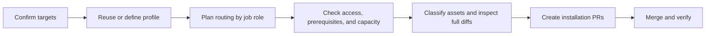
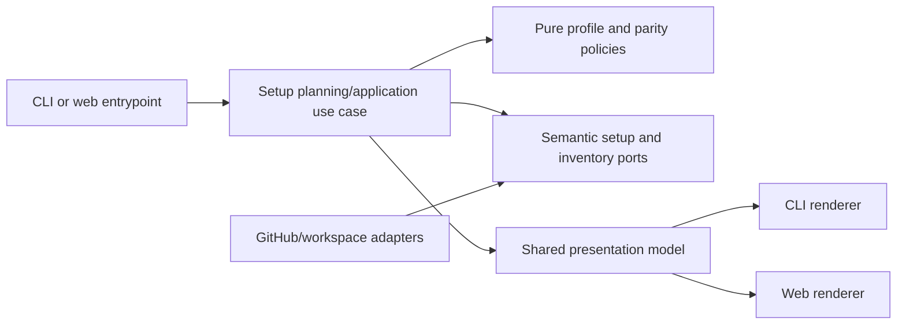

# Runner Profiles and Installation Parity

- Status: Ready for implementation
- Date: 2026-10-18
- Catalog capability ID: `setup-and-doctor`
- Last verified: not applicable (prospective companion)
- Owners: Copilot maintainers
- Scope: Add explicit runner-profile planning and safe source/consumer installation parity review to setup for single and multiple repositories.
- Related issues/PRs: [#556](https://github.com/vypdev/copilot/issues/556), [#538](https://github.com/vypdev/copilot/issues/538), [#546](https://github.com/vypdev/copilot/issues/546), [#555](https://github.com/vypdev/copilot/pull/555), [#559](https://github.com/vypdev/copilot/pull/559), [platform#175](https://github.com/vypdev/platform/pull/175)
- Required review gates: product UX, architecture, testing, documentation, security/operations
- Open decisions blocking readiness: none; implementation details remain subject to the stated invariants and acceptance evidence.

This is an additive companion to the existing setup capability. Owning specifications are `specs/setup-configuration-credentials-and-doctor.md`, `specs/setup-doctor-architecture-hardening.md`, `specs/organization-configuration-reuse-and-batch-setup.md`, and `specs/setup-pat-permission-guidance-and-verification.md`. The proposed companion does not already own itself. Existing catalog paths describe current evidence, not required future file locations.

## 1. Executive summary

Setup will let an operator retain installed runner routing, explicitly select a hosted or known self-hosted profile, and review the effective routing for each job role before creating installation pull requests. In the same plan, setup will compare source and consumer assets, explain source-only extensions and compatibility, and produce a complete reviewable diff with backup and recovery information.

The default preserves reviewed installed routing. If no routing exists, setup shows the hosted template choice; it never selects self-hosted execution implicitly. Shared organization profiles are non-secret configuration snapshots. The primary safety rule is that agent jobs, ordinary validation, trusted approval observers, and release/publication jobs retain distinct routes and protections.

```text
Select targets -> inspect installed configuration and optional inventory -> choose or retain a profile -> review per-role routing and parity -> inspect full diffs -> create PRs -> merge and verify
```

## 2. Problem, current behavior, and evidence

### 2.1 Problem

Setup currently installs `ubuntu-latest` templates and expects operators to adapt runner routing manually. Reusing Variables and Secret bindings does not make a workflow run on the runner where Codex is authenticated. Operators need to understand which jobs run where, whether access is verified, and whether runners have capacity before applying changes. Maintainers also need to distinguish true consumer drift from intentional source-only workflows and configuration.

### 2.2 Current behavior

1. Setup can plan repository configuration and reuse organization configuration, including batch targets, but the supplied evidence does not establish a guided job-role runner profile chooser.
2. Existing installation previews and applies can update repository workflows; previous dogfooding showed that replacing existing routing or source workflow content can be unsafe.
3. Copilot source includes custom workflows and validation behavior that clean consumer templates do not share.
4. Optional source workflows `agent-cli-provisioning.yml` and `copilot_credential_health.yml` are absent from the current source checkout/master evidence. They must not be enabled without compatible definitions and validators.

The first three items describe current behavior from supplied issue and catalog evidence. No assumption is made that every catalogued workflow currently exists in the checkout.

### 2.3 Evidence

- Code/spec ownership: catalog capability `setup-and-doctor`; current owning specifications listed above; cataloged batch setup ports, policies, use cases, and CLI/web adapters.
- Concrete evidence: issue #556 records previews #550 and `vypdev/platform#170` that replaced routing/workflows, corrected PRs #555 and `vypdev/platform#175`, and source validator findings from smoke run `39069446089`. SDD admission run `39080887942` stopped on the appendix size limit; the compact companion was published successfully by run `39081097654`.
- Compatibility fixtures required: preserve Branch Sync all-branch coverage, merge-queue explicit Bash shell, fork/merge-group hosted isolation, trusted-default observer checkout, source Action references, release/npm jobs, and installer exclusions.
- Unknowns: exact existing UI components and provider endpoints to reuse are implementation discovery; they do not alter the product contract.

### 2.4 Retrospective classification (as-built baselines only)

Not applicable: this is a prospective companion and does not reconstruct an implemented baseline.

## 3. Actors, surfaces, and terminology

| Actor | Goal | Entry point | Visible surfaces |
|---|---|---|---|
| Repository maintainer | Install or update one repository safely | Setup CLI or web setup | Plan, profile review, diff, PR, docs |
| Organization operator | Reuse a profile across selected repositories | Batch setup | Per-repository readiness and exceptions |
| Copilot maintainer | Reconcile source and consumer assets | Source setup/parity review | Inventory, compatibility results, PR diff |
| Reviewer/operator | Verify outcome and recover safely | Installation PR/checks | Job summary, checks, troubleshooting docs |

A **profile** is bounded non-secret routing configuration. A **role** is an execution purpose: agent, ordinary validation, trusted observer, or release/publication. **Readiness** means the plan has sufficient evidence to propose the selected route; it does not guarantee capacity or group authorization. **Parity inventory** classifies each relevant asset as shared/generated, intentional source-only extension, missing, customized, or incompatible with the installed generator version. **Snapshot** means the reviewed profile values stored in a proposed installation plan; it is not a Secret copy.

## 4. Goals

### 4.1 Goals

1. Enable one guided CLI or web session to select an explicit profile for one or more repositories and show readiness and exceptions per target.
2. Make job routing, authentication prerequisites, group-access uncertainty, and capacity status understandable before Apply.
3. Reconcile source and consumer assets without erasing source-only behavior, customizations, or incompatible guidance.
4. Make reviewed setup repeatable and idempotent, with recoverable partial completion.

### 4.2 Non-goals

1. Registering runners, changing runner-group membership/access, or expanding organization permissions.
2. Reading/copying Secret values, changing credential bindings, or remediating vulnerabilities.
3. Automatically merging PRs, releasing, or replacing the existing Action-owned issue/branch lifecycle.
4. Copying all Copilot workflows into consumers or suppressing manual YAML editing as an advanced option.

### 4.3 Fixed product/safety invariants

1. Retain existing reviewed routing unless an operator explicitly chooses a replacement; without existing routing, show hosted defaults explicitly.
2. Never silently fall back to a different execution environment. Busy/offline is pending capacity; unknown access remains unknown.
3. Agent, validation, observer, and publication jobs are routed independently. Trusted observers remain isolated; hosted OIDC publication requirements remain intact.
4. Reuse cannot change shared Variables, Secret bindings, runner-group access, or unrelated repository memberships.
5. Apply requires review of effective YAML and complete diffs. Backups and human customizations are retained through migration.

## 5. Current versus proposed product journey

| Stage | Current | Proposed | User/operator effect |
|---|---|---|---|
| Confirm targets | Existing setup selection | Single or explicitly selected batch targets | Target set is visible and fixed for the plan |
| Reuse configuration | Organization configuration reuse is available | Reuse a named profile snapshot, with per-repository exception | Shared values are visible without secret contents |
| Choose execution | Templates default to hosted runner | Retain routing or explicitly choose hosted/existing self-hosted profile | Role-specific effective YAML and prerequisites shown |
| Check readiness | Operators adapt YAML and discover failures later | Optional read-only inventory; access and capacity reported separately | Clear verified, unknown, and pending states |
| Review changes | Workflow/resource plan | Asset classifications, compatibility, full diff, backup | Source extensions and customization are inspectable |
| Apply and verify | Setup PR/apply lifecycle | Create installation PR(s); normal review, merge, verification | No implicit merge or release |



Text equivalent: confirm targets -> select a profile -> review role routes and readiness -> inspect parity and diffs -> create PRs -> merge and verify.

## 6. Functional behavior and state model

### 6.1 Happy path

1. The CLI/web entrypoint collects explicit targets and reads existing repository configuration and workflows through application ports.
2. Setup offers retained routing, a hosted default when routing is absent, reusable organization profiles, and manual entry of a known self-hosted profile.
3. A pure planner resolves each job role independently and produces effective YAML, prerequisites, access evidence, and per-target exceptions.
4. Optional read-only discovery enriches evidence. If inventory permission is missing, the plan remains usable and marks group/label access unverified.
5. The parity planner classifies relevant assets and generator compatibility, then computes a complete diff and backup manifest.
6. The operator reviews every target and applies; setup creates the authorized installation PR(s), records receipts, and reports partial outcomes accurately.

### 6.2 Alternative paths

- An exact manually entered profile is accepted without organization inventory permission, with an explicit unverified-access notice.
- A busy/offline runner keeps the plan pending capacity; it does not trigger hosted fallback.
- An unsupported or unverifiable route blocks only applying that route and names a recovery action, such as choose a supported profile or ask an organization administrator to verify access.
- A customized asset is preserved and surfaced for review. An incompatible generator version prevents silent regeneration; the operator must select a compatible version or retain the current asset.
- Manual YAML remains available as an advanced path and is reported as customized/drifted on later audits.

### 6.3 State machine

| State | Entered when | User-visible meaning | Allowed next states | Recovery/owner |
|---|---|---|---|---|
| Draft | Targets selected | No changes proposed yet | Planned, canceled | Operator edits targets |
| Planned | Profile and inventory evaluated | Routes and asset diff are reviewable | Pending capacity, blocked, ready | Setup planner |
| Pending capacity | Runner is busy/offline | Route is valid; capacity is unavailable now | Ready, canceled | Retry readiness check or wait |
| Blocked | Unsupported route or incompatible asset | Apply is unavailable for affected change | Planned, canceled | Correct profile/version or retain asset |
| Ready for review | All required decisions are explicit | Full diff and effective YAML available | Applying, canceled | Operator reviews |
| Partially applied | Some target PRs/resources succeeded | Completed targets retained; others need recovery | Ready for review, complete | Retry failed targets only |
| Complete | Requested PRs created and receipts recorded | Review/merge and verification remain | Complete | Operator/reviewer |
| Canceled | Operator cancels before further effects | No additional changes will be applied | — | Retain receipts/backups if effects occurred |

Duplicate planning is idempotent for the same target, profile snapshot, generator version, and source facts. Stale facts require re-planning before Apply. Out-of-order or canceled requests cannot apply an older plan. Partial batch retries target only incomplete repositories and preserve successful receipts.

## 7. User-facing configuration

| Input | Type | Recommended default | Allowed values/range | Scope/persistence |
|---|---|---|---|---|
| Profile source | Enum | `retain` if installed routing exists; otherwise `hosted` | `retain`, `hosted`, `organization-profile`, `manual-self-hosted` | Operation; snapshot in reviewed plan |
| Agent runner group | Bounded string | Existing value; for vypdev profile `vypdev` | 1–100 characters; GitHub-supported group name | Organization profile or repository exception; snapshot |
| Agent labels | Ordered unique list | Existing values; vypdev profile: `self-hosted`, `codex`, `Linux` | 1–10 labels, each 1–100 characters | Same as group |
| Repository exception | Bounded mapping | None | Explicit target repository to profile override; existing maximum 25 targets per operation | Operation snapshot |
| Generator compatibility (observed) | Contract metadata | Retain the compatible installed generator | Profile schema 2/contract 2, manifest schema 2/contract 1, runner snapshot schema 1; unknown/future metadata is retained or blocks regeneration | Per asset/plan; select a compatible CLI/source generator outside the wizard |

Validation rejects empty labels, duplicate labels, control characters, unsupported YAML values, unbounded target lists, and profile fields that attempt to set credentials, arbitrary commands, refs, or URLs. Group and labels do not prove authorization. Job-role routes are not user-configurable as a single global override.

Precedence is: explicit repository exception > explicitly selected organization profile snapshot > retained repository routing > hosted default when no routing exists. The operator must confirm any replacement. Plans snapshot values at review; if target configuration or generator compatibility changes before Apply, setup invalidates the stale plan and re-reads facts. An absent legacy runners configuration means retain. Incomplete registry entries and unknown future registry fields/versions are rejected and surfaced for review; they never infer access.

Recommended example: retain current routing for existing targets and reuse an organization agent profile with group `vypdev` and labels `self-hosted`, `codex`, `Linux`; keep observer and release routes independent. Meaningful alternative: explicitly choose hosted agent execution where appropriate and review the hosted YAML. Never configurable: secret access, group membership, observer isolation, hosted OIDC publication, or automatic fallback.

## 8. Clean Architecture design

### 8.1 Responsibilities and dependency direction

| Layer/boundary | Owns | Must not own/import |
|---|---|---|
| Domain/pure policy | Profile validation, precedence, role routing, asset classification, compatibility decisions | GitHub SDK, process, UI |
| Application | Plan/review/apply/retry use cases; immutable plan and receipt contracts | Provider DTOs or concrete CLI/web frameworks |
| Adapters/data | Read repository/workflow facts, optional runner inventory, create PRs, retain backups | Product decisions or fallback policy |
| Infrastructure/composition | GitHub/process implementations, wiring, bounded persistence/journaling | Business decisions |
| Entrypoints | CLI/web input validation and invoking use cases | Duplicated planning/orchestration |
| Presentation | Shared view model, CLI and web rendering of states/diffs | Mutations or independent state transitions |



### 8.2 Contracts, state, and trust boundaries

- Pure decisions: schema validation, profile precedence, per-role route resolution, readiness classification, asset parity, version compatibility, diff safety, and retry target selection.
- Application contracts: immutable target facts, profile snapshot, `RunnerRolePlan`, `AssetFinding`, `SetupPlan`, `ApplyReceipt`, and typed failure result. No secret material is present.
- Semantic ports: read existing routing/assets; optionally enumerate eligible groups/labels; inspect repository access evidence; create reviewed PR; write/verify backup; read generator compatibility metadata.
- Durable state/schema ownership: the plan owns target/configuration snapshots and rendered files; the private journal owns operation IDs, plan digests, target receipt transitions and exact prepared commits. Generator contracts and backups remain reviewed repository assets, bound by the commit and plan digest. The journal contains neither configuration values nor Secret values.
- Concurrency/idempotency: bind Apply to plan hash and fresh target facts; deduplicate by operation/target; serialize conflicting writes per repository; partial retry excludes completed targets.
- Trust: issue, PR, workflow, repository, and inventory text are untrusted data. Parse profile fields against bounded schemas; render/sanitize Markdown and URLs; never execute discovered strings.
- Provider mapping: permission denial becomes `inventory-unavailable` or `access-unknown`, not empty inventory; busy/offline becomes `pending-capacity`; not-found and malformed provider responses remain distinct actionable errors.

### 8.3 Executable architecture constraints

Automated architecture tests MUST enforce domain independence from GitHub/CLI/web modules, application dependency on semantic ports only, and presentation dependence on view models only. Contract tests MUST parse generated YAML and assert every role route, shell, trigger, Action reference, publication condition, and generator version structurally. A parity fixture MUST fail if source-only native CI, root-local Action usage, release/npm jobs, Branch Sync coverage, or explicit Bash disappears, or if incompatible optional workflows are enabled.

## 9. UI/UX and content contract

### 9.1 Information hierarchy

Show current plan/readiness first, then completed discovery facts, next review/apply step, human action, impact and target links, and collapsed sanitized diagnostics. Use the same state and planning decisions in CLI and web.

### 9.2 Representative primary view

Pending capacity:

```markdown
# Runner profile review

> **Current status:** Profile is valid; no matching runner is available right now.
>
> **Action required:** No change is required to the profile. Check capacity, then refresh readiness.

## Progress

- [x] Reused organization profile `vypdev-agent` for `vypdev/platform` and `vypdev/copilot`
- [x] Agent jobs route to group `vypdev` with labels `self-hosted`, `codex`, `Linux`
- [ ] Runner capacity is pending for `vypdev/platform`

## What happens next

The setup plan keeps the selected route and will not switch to hosted execution.

## Links

[Review platform installation diff](https://github.com/vypdev/platform/pull/175/files) · [Runner access guidance](https://github.com/vypdev/copilot/blob/master/docs/how-to-use.mdx)

<details>
<summary>Technical details</summary>

Inventory was read-only. Group authorization is unverified; capacity check returned busy.
</details>
```

Required variants use the same hierarchy:

- **Action required:** “Profile access could not be verified. Ask an organization administrator to confirm repository access, or choose a verified profile. No PR has been created.”
- **Blocked:** “The selected generator cannot safely render this customized workflow. Retain it or select a compatible generator version. No files were changed.”
- **Partial:** “PRs were created for 2 of 3 repositories. Those PRs and backups are retained. Review the two links; retry only the remaining repository.”
- **Complete:** “Installation PRs were created for all 3 repositories. Review and merge them, then run verification. No PR was merged automatically.”

### 9.3 Issue, PR, and comment behavior

- PR title retains `chore: configure Copilot`; one PR per target repository, deterministic target-specific body and plan marker. A runner/parity section records the selected managed agent route, source exceptions, observation counts, asset counts, plan digest, backup location and verification handoff. Registry source values never enter the PR body.
- Merge creates the reviewed repository changes; close leaves repository content unchanged; retry only resumes incomplete targets after fresh planning. Merge does not trigger setup automation beyond existing repository workflows.
- The existing installer marker and manifest receipt retain operation ID, repository identity, reviewed base SHA and plan digest. That digest binds the snapshot files; generator contracts remain in guidance metadata and backups remain tree assets. No receipt/journal schema changes or registry values are persisted in the private journal. Updates are idempotent and preserve human edits by invalidating stale diffs.
- No setup comments are required. At most one updated status comment per operation if an existing lifecycle requires it; checks and labels are supplemental.
- Link each target to its PR, full comparison, backup artifact, relevant run, and recovery documentation.

### 9.4 Accessibility, localization, and responsive behavior

Use the existing supported locale catalog and fallback behavior; translate user-facing states consistently across CLI/web. Diagrams have the textual equivalent above. Tables must remain readable on narrow screens; provide a stacked role summary when needed. Use logical headings, descriptive links, non-color status words, and accessible focus order. Sanitize untrusted Markdown, mentions, commands, HTML markers, and URLs; diagnostics are escaped and collapsed.

## 10. Failure, recovery, and cleanup

| Failure/partial state | User impact | Retained facts | Automatic retry | Required action | Cleanup |
|---|---|---|---|---|---|
| Inventory permission unavailable | Access is unknown | Exact manual profile and target facts | No repeated permission probing | Continue with manual profile or request access verification | No permission changes |
| Runner busy/offline | Work cannot start yet | Selected route and pending status | Bounded readiness refresh only | Wait or check capacity | None |
| Unsupported route | Profile cannot be applied | Plan and diagnostics | No | Select supported route | Discard stale plan |
| Generator/profile incompatible | Potential workflow breakage | Existing asset and version evidence | No | Retain asset or choose compatible generator | Keep backup |
| Stale target facts | Diff may overwrite new edits | Prior plan hash | Replan, not blind retry | Review new complete diff | Retain old backup reference |
| PR creation fails for target | Batch incomplete | Successful receipts and failed target error | Retry failed target only | Correct permission/rate limit and retry | No rollback of successful PRs |
| Backup write fails | Recovery is unavailable | No apply receipt | No apply | Restore backup capability, then re-plan | No mutation allowed |

Errors follow `impact -> cause -> action -> retained state`. An already created PR is never described as failed because another target failed.

## 11. Security, permissions, and privacy

1. Inventory discovery is optional and read-only. Use existing least-privilege setup authorization; never request broad organization administration solely for profile entry.
2. Profiles contain only bounded group/label and role-routing metadata. Never read or copy Secret values; preserve bindings and shared Variables without overwriting.
3. Do not grant runner-group access, register runners, or infer access from labels, refs, or workflow restrictions. Unknown remains explicit.
4. Treat repository and GitHub content as untrusted; validate structured inputs and sanitize output. Do not execute profile or asset text.
5. Preserve trusted observer isolation, hosted publication/OIDC constraints, and fork/merge-group isolation. Log identifiers and sanitized evidence only.

## 12. Observability and operational UX

- User-facing state: per-target profile, role routes, readiness, parity classification, and next action.
- PR summary: plan hash, generator version, asset inventory counts, route summary, backup reference, and verification instructions.
- Logs: correlate operation and target IDs; record provider outcome categories, never secret values or raw sensitive content.
- Pending capacity and unknown access are not workflow failures. Unsupported routes and failed writes are failures with recovery actions.
- Respect provider rate limits; bounded backoff only for idempotent reads/writes, with visible retry state. No notification storm: one status update per meaningful transition.

## 13. Compatibility, migration, rollout, and rollback

Existing installations are read before planning. The proposed diff preserves current routing and customizations unless explicitly replaced. Organization profiles snapshot into each reviewed installation and do not mutate the source profile or shared resources. Existing installations without runner metadata retain their routes or explicitly select hosted defaults. Registry schema 1 requires complete role metadata; future/unknown schema versions cannot be applied automatically. A changed CLI/generator can change the plan digest: keep prior journals and PRs, resume with the matching generator or start a fresh reviewed operation; never rewrite an old receipt or force-adopt an existing branch.

Roll out behind the existing setup admission path after parity fixtures pass. First exercise a clean consumer, organization-profile reuse across selected repositories, and an existing source installation. Keep backup copies and full diffs for every target. Rollback means close an unmerged PR or revert the merged commit using its backup; never auto-revert unrelated human changes. Enabling the two optional source workflows requires compatible source definitions and validators in the same reviewed change.

## 14. Testing strategy and numeric budget

The initial floor is 56 distinct cases. The allocations below are disjoint; parameterized rows count only when they exercise distinct behavior. Existing repository budgets and thresholds remain in force.

| Area | Minimum distinct cases | Behaviors/risks covered |
|---|---:|---|
| Profile validation and precedence | 10 | Bounds, invalid fields, defaults, retained routing, organization reuse, repository exception, unknown schema |
| Job routing and isolation | 10 | Agent/validation/observer/publication routes, auth prerequisite, shell, fork and merge-group isolation, OIDC |
| Guided discovery authorization | 8 | Default off, reviewed read-only prefill, personal owner, manual recovery, fixed config, conditional audit, retained choice and private intent |
| Discovery and access failure | 8 | Optional inventory, permission denial, unknown access, busy/offline capacity, malformed and unsupported evidence |
| Source/consumer parity and version compatibility | 8 | Asset classifications, source extensions, missing optional workflows, generator mismatch, shell/trigger/Action/release regressions |
| CLI/web UX | 6 | Shared states, pending/action/blocked/partial/complete content, accessible and sanitized output |
| Migration/idempotency/partial recovery | 6 | Backup, stale plan, repeated setup, customization preservation, partial batch retry, rollback evidence |
| **Total** | **56** | No double counting |

New pure decisions require 100% branch coverage. Repository-wide coverage budgets remain unchanged; changed modules must meet or exceed their existing configured thresholds. Add table-driven domain tests, application replay/race tests, adapter contract tests, structural YAML/workflow checks, security tests for untrusted content, and golden UX fixtures with semantic assertions. Use deterministic IDs, clocks, and fakes; no real waits or live services in automated tests. Manual UX evidence must show readable role routing, readiness, and full diff in CLI and web at narrow and normal widths. Controlled live acceptance covers a clean consumer, organization-profile reuse across selected repositories, and an existing source installation.

## 15. Documentation and discoverability

| Audience | Artifact/page | Required content | Validation/navigation |
|---|---|---|---|
| User | `docs/how-to-use.mdx` | Guided profile journey, defaults, role explanations, examples | Link and rendered-content check |
| Setup owner | `docs/configuration.mdx`, `docs/configuration-checklist.mdx` | Profile schema, precedence, permissions, snapshots, exceptions | Config fixture/contract test |
| Operator | `docs/security-operations/operations/troubleshooting.mdx`, `verification.mdx` | Pending capacity, unknown access, failure and recovery | Decision-tree review |
| Contributor | `docs/development/architecture.mdx` | Boundaries, ports, parity classifications, version rules | Architecture test and documentation validator |

Document backup, migration, manual YAML ownership, and rollback. Examples must match profile and YAML fixtures. Add navigation from the setup guide and relevant configuration pages.

## 16. Acceptance scenarios

1. Given an existing Copilot installation and selected organization repositories, when the operator reuses the `vypdev` agent profile, then the preview shows each target, role-specific effective YAML, readiness, exceptions, and no changes to shared Variables, Secret bindings, or group membership.
2. Given no installed routing, when setup starts, then it presents the hosted default explicitly and does not infer or select self-hosted routing.
3. Given a busy or offline matching runner, when readiness is checked, then the state is pending capacity and the selected route remains unchanged with a refresh/wait action.
4. Given inventory permission is unavailable, when an exact manual profile is entered, then planning remains available and access is clearly unverified; applying does not grant access.
5. Given agent, observer, validation, and publication jobs, when YAML is rendered, then each role retains its own route, observer isolation, and hosted OIDC publication requirements.
6. Given an incompatible generator version or customized source workflow, when parity is reviewed, then the asset is classified and setup blocks silent regeneration while retaining a backup and offering a compatible-version or retain action.
7. Given source parity fixtures, when a shell, Branch Sync coverage, source-local Action reference, release job, or required workflow condition is removed, then the structural parity check fails before Apply.
8. Given a batch where one PR creation fails, when the operator retries, then completed target PRs remain recorded and only the failed target is retried; the result names retained links and next actions.
9. Given the same reviewed plan and unchanged target facts applied twice, when setup reconciles, then it produces no duplicate changes or PR and reports the existing receipt.
10. Given hostile Markdown or URL content in repository metadata, when rendered in CLI/web/PR summaries, then it is escaped or omitted and cannot create an actionable forged link or command.
11. Given narrow/mobile rendering, when a user reviews all states, then role and readiness meaning is available without color or horizontal-only information.
12. Given implementation completion, when documentation and architecture validation run, then examples match fixtures, catalog ownership is updated for the new companion path, and `pnpm run validate:specifications` passes.

## 17. Requirements traceability

| Requirement | Policy/use case/adapter/presentation | Test or evidence | Documentation |
|---|---|---|---|
| Retained/default profile and bounded precedence | Profile planner and setup use case | Profile cases 1–10 | Configuration reference |
| Role routing and fixed protections | Role-routing policy and YAML adapter | Routing cases 1–10; structural fixtures | User guide, architecture |
| Optional inventory and unknown access | Inventory port and evidence mapper | Discovery cases 1–8 | Setup permissions, troubleshooting |
| Source/consumer classifications | Parity policy and generator adapter | Parity cases 1–8 | Contributor guide |
| Shared CLI/web plan and accessible states | Presentation model/renderers | UX cases 1–6 plus manual evidence | User guide |
| Backup, idempotency, partial recovery | Apply use case and journal | Recovery cases 1–6 | Operator verification and rollback |
| No secret/access expansion | Profile schema, ports, security constraints | Security assertions across budget | Credentials and permissions docs |

## 18. Implementation sequence

1. Define profile, role-plan, parity, and receipt contracts; add architecture and workflow structural constraints.
2. Implement pure validation, precedence, routing, readiness, and compatibility policies with complete branch coverage.
3. Add application planning, stale-plan protection, partial retry, and idempotent apply orchestration.
4. Add read-only inventory and repository/workspace adapters with typed provider error mapping and backup handling.
5. Build shared presentation models and CLI/web renderers for all states; review accessibility and localization.
6. Add source/consumer fixtures, compatible optional workflow definitions only where supported, and migration/recovery behavior.
7. Complete docs, catalog updates, controlled live acceptance, coverage evidence, and final validation.

## 19. Definition of Done

- [ ] Every normative requirement has an acceptance scenario and traceability entry.
- [ ] Domain/application/adapter/presentation boundaries and structural workflow constraints pass.
- [ ] At least 48 distinct cases pass in the stated allocation; new pure decisions have full branch coverage; existing budgets remain satisfied.
- [ ] Defaults, bounds, precedence, snapshots, stale-plan behavior, and migration agree across CLI and web.
- [ ] Pending, action-required, blocked, partial, and complete content is reviewed for accessibility, localization, responsive use, and sanitization.
- [ ] No Secret values are read/copied; no shared resources are overwritten; no access is broadened; observer and publication protections remain.
- [ ] Backups, complete diffs, idempotency, partial recovery, rollback, and three controlled live acceptance cases pass.
- [ ] User, setup, operator, and contributor documentation is complete and discoverable, with examples checked against fixtures.
- [ ] Required generated artifacts and repository validation commands pass.
- [ ] Catalog evidence and `specs/CATALOG.md` are current; `pnpm run validate:specifications` passes.
- [ ] No readiness-blocking decision remains unresolved.

## 20. References and decisions

- Primary source: [issue #556](https://github.com/vypdev/copilot/issues/556), including supplied controlled setup evidence.
- Owning specifications: setup/configuration/doctor, setup architecture hardening, organization configuration reuse and batch setup, and setup PAT permission guidance and verification.
- Related evidence: [#538](https://github.com/vypdev/copilot/issues/538), [#546](https://github.com/vypdev/copilot/issues/546), [#555](https://github.com/vypdev/copilot/pull/555), [#559](https://github.com/vypdev/copilot/pull/559), [platform#175](https://github.com/vypdev/platform/pull/175).
- Decisions: additive companion under `setup-and-doctor`; retain installed routing by default; use explicit hosted default when absent; reusable profiles are non-secret snapshots; optional read-only discovery; preserve per-role security routes; classify intentional source extensions and require compatible rendering.
- Outside scope: automatic merge/release, group access changes, Secret handling, vulnerability remediation, and replacing the existing Action-owned lifecycle.

### Concrete configuration and adapter contract (2026-10-18)

`SetupConfiguration.runners` is additive; absence means `retain`. Its fields are
`mode` (`retain`, `hosted`, `organization-profile`, `manual-self-hosted`),
`profileId` (empty or 1–50 safe identifier characters), `group` (empty or 1–100
single-line literal characters), `labels` (1–10 unique literal labels of 1–100
characters for a selected self-hosted route), and `validation` (`hosted` or
`agent`). Group and label inputs reject expressions and control characters.
Self-hosted selections require `self-hosted` and a Linux or macOS label because
the generated workflows require Bash; Windows service Codex execution is outside
this contract. The validation choice is an advanced exception, never a global
replacement. Agent CLI provisioning uses the agent route. Credential health and
ordinary automation use the validation route. Merge-group checks and consumer
approval observers keep their trusted hosted templates. Consumer publication
and source npm/OIDC jobs keep their publication route.

An existing non-secret Variable `COPILOT_RUNNER_PROFILES` contains
`{"schemaVersion":1,"profiles":[{"id":"vypdev-agent","group":"vypdev","labels":["self-hosted","codex","Linux"],"validation":"hosted"}]}`.
At most ten distinct profiles and 16,000 characters are accepted. Unknown schema
versions and fields are rejected with a recovery action rather than executed.
An existing repository Variable wins over the organization Variable; an invalid
repository override cannot expose a shadowed organization profile as effective.
Setup reads this registry and snapshots a chosen profile; it never writes the
registry or adds repository access to it. The effective selected snapshot is
recorded in `.copilot/runner-profile.json`, with source scope and a digest for
freshness checks; unselected profiles are never copied into the repository. Manual selection creates no Variable or Secret. Selection is
per target, so the existing batch configuration review provides visible target
exceptions. Profile-source drift invalidates Apply before permission probes.

Before PAT collection in Customize, organization reuse and multi-repository setup, the shared permission-intent questionnaire asks the optional
boolean `runners.discover` (default false). Opting in discloses and prefills
repository Administration read and organization Self-hosted runners read via
`administration=read` and `organization_self_hosted_runners=read`. Personal
owners get only the repository grant. Conditional discovery grants never block
manual configuration, are never added to the workflow PAT, and remain distinct
from runner access changes. Fixed config skips the repeated intent question;
the final questionnaire retains that explicit choice. Batch target defaults and replacement PAT links preserve it without dropping the previous target’s selected route. Discovery runs only when
enabled, including when enabled later using an existing PAT. The selected-route
snapshot excludes this local intent. The PAT link leaves GitHub repository
selection to the operator.

Read-only discovery has a separate semantic port. Fixed GitHub routes inspect
repository-local runners and, where allowed, organization groups filtered by
`visible_to_repository`, then matching group runners. Each collection is bounded
to 1,000 entries and ten pages of 100. Group fan-out is limited to ten
eligible groups and the combined runner inventory to 1,000 entries. Group visibility is not enough to establish
workflow/ref eligibility when `restricted_to_workflows` is true: report access
unknown. A failed/truncated/malformed collection cannot establish absence. An
empty repository-local list does not establish absence of organization runners.
Capacity is observational and never participates in plan identity: busy/offline
produces pending capacity without changing YAML or claiming runtime verification.
Manual access remains unverified and can be explicitly reviewed for an
installation PR; unsupported routing blocks. Setup never schedules a probe job
or changes runner permissions during discovery.

Source workflows with root-local Action execution and source-owned guidance
remain preserved as complete assets. Explicit profile replacement affects
managed consumer jobs and newly enabled optional source workflows; native source
extensions retain their routes and are shown as exceptions. Source validation
and fixture checks must continue to detect loss of native jobs, shells, trust
conditions and branch filters. The parity inventory includes disabled optional
assets, so missing health/provisioning workflows remain visible even when their
features are off. Unknown generator metadata is classified as incompatible and
retained or blocked before regeneration; setup does not claim it can migrate a
future generator. Full before/after workflow content is available in review,
with credential-like literals redacted in presentation, and existing backup and
immutable installer receipts remain the recovery mechanism.

Primary provider references:
[runner API](https://docs.github.com/en/rest/actions/self-hosted-runners),
[group API](https://docs.github.com/en/rest/actions/self-hosted-runner-groups), and
[workflow routing](https://docs.github.com/en/actions/how-tos/manage-runners/self-hosted-runners/use-in-a-workflow).


The profile schema and guidance ownership manifest use distinct generator
contracts: repository-profile schema 2/contract 2 and setup-manifest schema
2/contract 1. Swapping those versions is incompatible, even though both documents
use schema version 2. Batch defaults reuse the preceding explicit runner choice
for the next target, visibly before its questionnaire; registry precedence is
resolved again for that target, and every repository can choose an exception.
A selected registry's repository/organization scope is shown even when its value
is invalid, without exposing that invalid value. Recognizable credential material
is rejected from literal IDs, groups and labels before it can reach presentation
or a snapshot.
