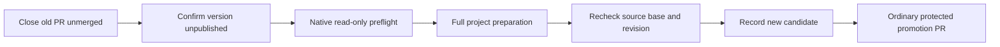
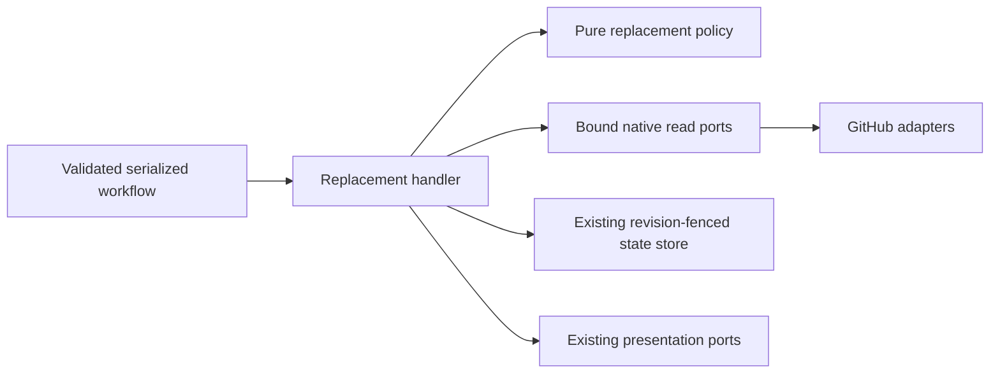

# Replace an unpublished release or hotfix candidate

- Status: Implemented; local validation complete, exact-head remote merge gates required
- Date: 2026-10-28
- Catalog capability ID: release-orchestration
- Last verified: 2026-10-28; 772 root suites / 14,078 tests, all budgets/setup acceptance, 267 extension tests at 100%; remote gates recorded in the implementation PR
- Owners: Copilot maintainers
- Scope: explicit replacement of one closed, unmerged, unpublished candidate on its existing managed branch
- Related issues/PRs: [#732](https://github.com/vypdev/copilot/issues/732)
- Required review gates: product UX, architecture, testing, documentation, security/operations
- Open decisions blocking readiness: none

## 1. Executive summary

A maintainer can correct a prepared candidate without editing durable JSON or
changing its version. The default `prepare` behavior remains immutable. An
explicit `replace` workflow run checks the old operation, repeats the complete
project preparation, and records a new operation with new source evidence.
Accepted production commits, tags and published packages remain immutable.

```text
close old promotion unmerged -> inspect unpublished version -> replace dispatch
  -> read-only native preflight -> full fresh preparation -> fence source/base
  -> record new operation and old candidate audit -> new ordinary promotion PR
```

## 2. Problem, current behavior, and evidence

### 2.1 Problem

Promotion-only CI can discover a legitimate source fix after candidate
preparation. Ordinary prepare freezes sourceSha and correctly refuses changed
content, but offers no supported way to supersede that unpublished attempt.

### 2.2 Current behavior

1. PreparePromotionHandler stores an operation and opens a marked promotion PR.
2. Its resume path blocks a moved source branch with a nonretryable failure.
3. Publish/resume only continue the existing identity; neither replaces it.
4. Closing the old PR can remove active native branch readiness for the deploy
   label. A successful label run does not establish that preparation launched.

### 2.3 Evidence

- `src/application/usecases/actions/deployment_handlers/prepare_promotion_handler.ts`
- `src/domain/deployment_operation.ts`, `deployment_state_fence.ts`
- `src/data/repository/branch/linked_branch_readiness_repository.ts`
- `docs/issues/deployment-orchestration.mdx#recovery-by-visible-phase`
- Issue #732 records zstandard issue170/PR173, operation594f6029, sourcef55bc5bc,
  full candidate validation and a subsequent PR-only consumer fixture failure.
  That fixture failure was not caused by Copilot. Upstream recovery is reproduced
  with deterministic fakes; this change does not modify that live candidate.
- GitHub [reference reads](https://docs.github.com/en/rest/git/refs#get-a-reference)
  distinguish an exact missing ref from other failures. GitHub
  [release reads](https://docs.github.com/en/rest/releases/releases#get-a-release-by-tag-name)
  and authenticated release inventory provide native version effects. The
  [list contract](https://docs.github.com/en/rest/releases/releases#list-releases)
  limits draft visibility to principals with push access; the native inspector
  must prove that visibility rather than trusting an empty public listing.
- Unknown: contents of arbitrary external registries cannot be inferred from a
  missing GitHub tag. Registry vacancy is explicitly checked and confirmed by
  the project maintainer; Copilot must not describe that as its own registry query.

### 2.4 Retrospective classification

Not applicable: this specifies new recovery behavior, rather than reclassifying
an implemented baseline.

## 3. Actors, surfaces, and terminology

| Actor | Goal | Entry point | Visible surfaces |
|---|---|---|---|
| Maintainer | replace a still-unpublished candidate | release/hotfix workflow, mode replace | workflow inputs, issue control center, old/new PRs, Summary |
| Project preparation | validate corrected content | existing project version/build/test jobs | exact successful run and candidate SHA |
| Continuation | accept only the current operation | existing serialized callback | current operation and native PR identity |

A superseded candidate is an old immutable identity, not an accepted or
published version. The existing managed branch, version, origin and snapshotted
policy belong to the launcher. Native provider facts outrank labels and prose.

## 4. Goals, non-goals, and fixed invariants

### 4.1 Goals

1. Replace one unmerged candidate through a fresh, complete, serialized run.
2. Preserve version, origin, managed branch and old operation/PR evidence.
3. Reject old callbacks, moved heads/base, stale revisions and publication effects.

### 4.2 Non-goals

No version/tag movement, force-push, branch replacement, manual publisher,
revalidation shortcut, automatic source repair, arbitrary registry discovery,
new deployment authorization, or live consumer adoption is included.

### 4.3 Fixed product/safety invariants

Replacement MUST require the exact previous operation and durable revision,
positive launcher, same release/hotfix kind/version, same source/origin branches,
and an unmerged closed native promotion with matching repository, marker and
recorded number. No other open promotion may own the same branch/base.

Replacement MUST be refused after production acceptance, any recorded
publication receipt, publicationVerified, reconciliation, native version tag or
GitHub Release, including a conflicting draft. Unreadable native authority is
unknown and blocks. A maintainer confirmation cannot override these facts.

The new source MUST descend from the old prepared commit through normal Git
history. Source and production base MUST match the freshly validated candidate
and preflight base immediately before persistence. Ordinary prepare never
silently replaces a source, and old evidence never attests the new SHA.

## 5. Current versus proposed product journey

| Stage | Current | Proposed | Operator effect |
|---|---|---|---|
| PR-only CI finds source fix | changed source permanently blocks old operation | close unmerged old PR and prepare reviewed fix on same branch | version and ownership retained |
| Start recovery | hidden state edit or unsafe workaround | explicit replace dispatch with exact operation/revision/source | intent and stale requests visible |
| Validate | previous run cannot attest new source | rerun every project preparation dependency | fresh evidence, no skipped predecessor |
| Promote | old marker/source remains frozen | new operation and new ordinary PR | old callbacks rejected |



Text equivalent: close and inspect -> preflight -> fresh preparation -> recheck
-> new durable identity -> normal protected promotion.

## 6. Functional behavior and state model

### 6.1 Happy path

1. The maintainer disables merge automation and closes the old promotion
   unmerged, fixes the same branch with a normal commit, and checks every
   project registry for the exact unpublished version.
2. Dispatch the installed compatible release/hotfix workflow on that reviewed
   managed ref in replace mode. Supply old operation ID/revision, source SHA,
   exact version/issue, and confirm-unpublished. Leave title/changelog empty.
3. A read-only preflight verifies the durable and native facts before any
   version/build commit. It snapshots production base and old revision.
4. The ordinary project version/build/test/smoke jobs run again. Each dependent
   checkout must match its successful predecessor's source output; normal
   pushes reject a concurrently moved branch. The final candidate SHA is exposed
   only after complete successful preparation.
5. The final promotion adapter additionally reads this exact native workflow run
   and attempt. It requires successful `Inspect unpublished candidate replacement`
   / `Read native candidate authority` and one complete project producer. Its
   `Verify reviewed replacement source`, `Complete fresh replacement verification`
   and `Confirm prepared replacement identity` steps must all succeed. A separate
   compiled producer also requires successful version preparation. Missing,
   ambiguous, skipped or unreadable proof blocks; generic JSON inputs cannot
   synthesize the replacement action or alter its declared proofs.
6. A fixed application handler rereads authority and applies the same guards.
   It records a fresh operation ID/source, resets only preparation/promotion
   fields, preserves the previous locale/policy/version/origin, and appends a
   compact immutable predecessor record.
7. Update the old control center as superseded and create the current ordinary
   dashboard/PR. Existing merge rules and publication continuations apply.

The readonly `deployment-recovery` subaction has its own Node24 bundle and no
main-run, agent or completion persistence entrypoint. Active/source workflows and
consumer templates use it before any preparation mutation. Templates ship a
failing complete-verification placeholder: projects must configure all native
build/test/coverage/smoke/package and registry-vacancy validators before use.
Named proof steps and dependency roles are part of the supported workflow contract.

### 6.2 Alternatives

If the version cannot be confirmed unpublished, retain the current state and
choose the normal new-version workflow. An open or queued old PR is not safe
replacement authority. A deploy label without active native association is not
a reset command: use the explicit workflow dispatch, whose authority includes
the stored operation and exact closed native PR, rather than a bare branch name.

### 6.3 State transitions

| State | Meaning | Recovery |
|---|---|---|
| preparing/promotion_pr_pending | old candidate is not accepted | explicit replace only after native closed-unmerged proof |
| blocked from either preparation phase | old failure, including source movement, retained | same guarded replacement may supersede it |
| fresh preparation running | old immutable state still current; old PR closed | cancellation keeps old state; start a complete fresh replace run |
| new preparing/promotion_pr_pending | replacement persisted, predecessor recorded | idempotently recover new PR/dashboard without allocating another operation |
| promoted or later/recorded effects | acceptance/publication may exist | replacement blocked; normal publication/reconciliation recovery only |

A duplicate matching replacement request takes a recovery-only workflow path
without source mutation, after proving the same predecessor/reviewed SHA and
current native head. It reuses the recorded successor; it
never creates a second successor. A rerun may retain the original reviewed run
head; redispatch may use the exact recorded final candidate as native run head.
No third SHA is accepted. Terminal exact replay is mutation-free. If preparation
moved the source but no successor was persisted, the next fresh replacement must
review the current corrected SHA and repeat complete validation; no partial run
output is promoted. A different source requires a new explicit
request against the current operation/revision. Old acceptance, failure and
publication callbacks MUST fail before mutating the successor.

## 7. User-facing configuration

| Input | Type | Default | Allowed values/scope |
|---|---|---|---|
| mode | workflow choice | prepare | prepare, replace, publish, resume |
| operation-id | identifier | empty | existing bounded ID required in replace/publish/resume |
| expected-revision | workflow string | empty | positive safe integer only in replace |
| source-sha | workflow string | empty | canonical full reviewed commit SHA only in replace |
| confirm-unpublished | workflow boolean | false | explicit maintainer registry-vacancy attestation, required true only in replace |

Version and positive issue remain required. Replace reuses persisted title and
changelog; nonempty replacements are rejected. Other modes reject replacement
inputs. Internal single-action proof inputs bind validated candidate, preflight
production base and expected revision; they cannot authorize a standalone/local
CLI deployment. Bounds and ownership checks are not configurable.

Recommended: ordinary prepare for a new version. Alternative: replace for an
unmerged unpublished correction, with registry inspection and a complete fresh
run. No automatic migration or implicit replacement is enabled.

## 8. Clean Architecture design

### 8.1 Responsibilities

| Boundary | Owns | Forbidden |
|---|---|---|
| Domain/pure policy | bounded predecessor schema and replacement eligibility | SDK, process, Execution |
| Application | fixed replacement handler and ordering/fences | raw provider DTOs and YAML |
| Semantic ports | exact native PR/ref/publication queries | generic arbitrary URL/command execution |
| Data adapters | native reads, absence/error classification | replacement decision/presentation |
| Composition | credential-bound capabilities | hidden deployment authority in local CLI |
| Presentation | superseded/current status, provenance, links/locales | state mutation or acceptance |



Text equivalent: workflow -> application/pure policy -> native reads -> fenced
state -> presentation. Provider errors do not become successful vacancy proof.

### 8.2 Contracts and ownership

State version1 gains an optional bounded predecessor inventory. Existing
snapshots without it remain valid; malformed/future snapshots still block.
Each record holds old operation ID/revision/source SHA/promotion PR, the reviewed
corrected source SHA, and its preflight production base. Reviewed source and final
validated candidate are distinct when preparation commits generated files. At most8
predecessors are allowed, with distinct IDs and no current-ID cycle. More
replacements require an operator-supported fresh version/launcher, never
truncating audit history. The old dashboards/PRs retain full prior evidence.

The workflow-level issue mutex is unchanged. The preflight has read-only automatic-token permissions and no agent secrets.
Its fixed native reader uses the existing product PAT only for reads; it confirms
the principal has native push access before treating a complete release listing
as proof, because GitHub hides drafts from other viewers. No PAT scope is added. It performs no operation or branch mutation.
The final handler persists through the existing monotonic revision fence,
with an explicit replacement expectation. Ordinary writes cannot change the
operation ID. The state store requires the exact immutable predecessor/history
and preserved snapshot when it accepts the new ID.

### 8.3 Executable constraints

Tests enforce provider-free policies/handlers, fixed deployment-only entrypoints,
credential-bound ports, exact mutex/permissions, preflight-before-mutation,
complete preparation ancestry, exact SHA outputs, unchanged publish gating,
and no local deployment adapter composition.

## 9. UI/UX and content contract

### 9.1 Hierarchy

Current status -> completed immutable facts -> next action -> impact -> links ->
collapsed IDs/SHAs/revision. The issue remains the control center.

### 9.2 Representative views

```markdown
## Candidate replaced
> This unpublished candidate was superseded by a newly validated candidate.
> Do not reopen or merge its previous promotion PR. Follow the current candidate.
[Current launcher](https://github.com/example/project/issues/170) ·
[Previous promotion](https://github.com/example/project/pull/173)
<details><summary>Candidate history</summary>
Previous operation, prepared SHA and revision; successor operation and SHA.
</details>
```

Pending: “The corrected candidate is being validated. The previous PR remains
closed and no publication has been performed.” Action required: “Close the
previous PR unmerged, inspect the exact version in every project registry, then
run Replace unpublished candidate with the current revision and reviewed SHA.”
Blocked: “The candidate was not replaced because its source, base or state
changed. Refresh the control center and inspect the linked refs. Existing state
and evidence were retained.” Partial: “The new candidate is recorded; its PR or
control-center update needs recovery. Retry the same request; it will reuse the
recorded successor.” Complete preparation: normal pending-promotion view, with
predecessor history available in details. Acceptance/publication remains pending
until the existing workflow confirms it.

### 9.3 Publication behavior

One dashboard per operation; update the old dashboard as superseded and reuse
its stable marker. No conversational success/failure duplicates. New promotion
uses the existing ordinary deterministic title and operation/issue marker.
Closing/reopening an old PR does not authorize successor acceptance.

### 9.4 Accessibility and localization

English/Spanish reviewed catalogs and existing whole-catalog fallback apply.
Use descriptive links, plain headings and text beside diagrams; sanitize all
untrusted text and preserve existing light/dark/mobile Markdown readability.
IDs, refs and hashes are data, not executable instructions.

## 10. Failure, recovery, and cleanup

| Condition | Impact/retained facts | Retry/action |
|---|---|---|
| unconfirmed registry vacancy | no candidate/branch mutation | inspect project registries and explicitly confirm |
| unknown native read / tag / release / accepted PR | old state/evidence retained | resolve authority/conflict; never infer absence |
| moved source/base/revision | no successor persisted | review current facts and start full fresh validation |
| preparation failure/cancel | old PR closed, old identity retained | rerun complete preparation; old evidence is insufficient |
| persisted successor, lost PR/UI response | new identity remains authoritative | exact replay recovers without duplicating operation |
| stale old callback | successor unchanged | inspect current candidate; no old callback replay |
| predecessor bound reached | history retained | new version/launcher, no silent truncation |

No tags, branches, releases, registries or old audit artifacts are deleted.
Temporary test fixtures are owned, isolated and removed after evidence retention.

## 11. Security, permissions, and privacy

The workflow dispatch is explicit maintainer intent, not a label-based reset.
Existing deployment authorization and the exact issue mutex remain. Preflight
uses read requests and no agent credentials; ordinary preparation and final
promotion retain their existing least-privilege job capabilities. No new PAT
scope is required. Core reads all known native effects and durable receipts;
its user confirmation is not described as an automated arbitrary-registry scan.
No secret, raw provider body or untrusted command is stored in predecessor data.

## 12. Observability and operational UX

Summary distinguishes unchanged old state, fresh validation, persisted
successor, and pending external promotion. Operation/revision/run/PR links make
retries auditable. Unknown provider outcomes remain blocked. There is no polling
runner, retry storm, duplicated milestone conversation or new periodic job.

## 13. Compatibility, migration, rollout, and rollback

Ordinary prepare/publish/resume and old version1 snapshots remain unchanged.
Install matching reviewed runtime and workflow before replace is available;
updating develop is not a live default-branch/runtime adoption. Preserve custom
project validators when updating workflows. All required project checks must
run afresh, including registry-specific validation owned by that project.
An older strict runtime may reject the additive predecessor data; it must not
rewrite or publish it. No downgrade conversion or audit deletion is provided.

## 14. Testing strategy and numeric budget

| Area | Minimum distinct cases | Risk |
|---|---:|---|
| Domain/schema/pure eligibility | 24 | phases, receipt contradictions, bounded history and identity |
| Application/state/replay/races | 28 | new operation, exact replay, changed facts, failure boundaries |
| Provider adapters | 16 | native PR/ref/publication facts and unknown/absent classification |
| Workflow/setup/input contracts | 20 | read preflight, full fresh validators, exact outputs and mode gates |
| Presentation/localization/security | 12 | superseded/current/partial content and safe links |
| Integration/compatibility | 12 | real entry projections, callbacks, old snapshots and native linkage |
| **Total** | **112** | No double-counted declarations |

New pure policy requires 100% statements/branches/functions/lines. Changed modules
retain all repository budgets. Add a failing-before regression for the exact
unpublished-source correction, deterministic provider/race fakes, actual YAML
script execution tests, and semantic EN/ES UI assertions. Global coverage,
setup acceptance and extension tests remain required. Current-head remote CI,
review with zero findings and Codecov100% patch/zero misses/partials precede merge.
No live consumer execution is claimed by isolated or local evidence.

## 15. Documentation and discoverability

Update deployment orchestration journey/recovery, release/hotfix setup and
single-action reference, contributor state/architecture documentation, owning
SDDs/catalog/traceability and generated catalog. Examples use exact workflow
inputs and preserve origin/version; explain why a deploy label is insufficient
once the historical PR is closed. Validate specifications, documentation,
workflows and every generated package/bundle contract.

## 16. Acceptance scenarios

1. Closed-unmerged unpublished release plus a normal source fix yields one new
   operation and promotion after complete fresh validation, same version/origin.
2. Hotfix follows the same guards and preserves its production-tag origin.
3. Old prepare does not silently accept a different source.
4. Open/merged/queued/foreign/mismatched old PR, publication facts, tag/release,
   unreadable authority, source/base/revision drift or invalid confirmation block.
5. Exact replay recovers the successor after a lost persistence/PR/UI response.
6. Every old acceptance/publication/failure callback leaves the successor intact.
7. Closed native historical association is verified through the stored operation
   and exact PR in replace dispatch; no bare name or manual branched label proves readiness.
8. EN/ES/fallback UI identifies previous/current candidates and pending acceptance.
9. Invalid modes/input combinations receive no mutation credential/job.
10. Complete source/package/docs/specs/workflow/architecture checks and remote
    same-head gates pass; no deployment or live rollout is implied.

## 17. Requirements traceability

| Requirement | Owner | Evidence | Documentation |
|---|---|---|---|
| 4/6 immutable replacement | domain + fixed handler | eligibility/state/replay/race regressions | recovery decision tree |
| 6/7 fresh evidence | workflow + entry projection | actual-script/YAML/integration cases | dispatch example and project validation contract |
| 8 native authority | credential-bound adapters | absent/conflict/unknown/foreign tests | permissions/troubleshooting |
| 9 superseded UI | presentation catalog/policy | semantic locale/link tests | control-center examples |
| 13 compatibility | schema/state boundary | old/future/malformed/callback tests | rollout/rollback guidance |

## 18. Implementation sequence

1. Pure schema/eligibility and failing-before regression.
2. Exact proof inputs, bound read capabilities and fixed replacement handler.
3. Read-only preflight and complete preparation/output graph in active/templates.
4. Superseded/current presentation, replay/failure recovery and integration.
5. Documentation, owning SDD/catalog/test budgets, Graphify and build artifacts.
6. Frozen complete validation, normal hooks/push, exact-head remote gates and merge.

## 19. Definition of Done

- [x] All normative requirements have executable acceptance and traceability.
- [x] No source is accepted under old evidence; history and fences remain bounded.
- [x] Architecture, least privileges, native authority and local rejection pass.
- [x] 112-case minimum, pure100%, all global budgets and setup/extension acceptance pass.
- [x] Static EN/ES/fallback Markdown, sanitization, links and noise regressions pass; no live consumer/mobile rollout is claimed.
- [x] Configuration, migration/rollback, docs, workflows and catalog are consistent.
- [x] Failure/replay/cancellation and stale callbacks preserve required state.
- [x] Generated bundles/package, Graphify, specs/docs/type/lint validations pass.
- [ ] Normal hooks and current-head CI/review0/Codecov 100% patch pass before merge.
- [x] No material decision remains unresolved; no unperformed live rollout is claimed.

## 20. References and decisions

- Owning: configurable-release-orchestration.md and deployment-concurrency-and-state-fencing.md.
- [Issue732](https://github.com/vypdev/copilot/issues/732) is evidence, not authority to mutate a consumer.
- [GitHub job outputs](https://docs.github.com/en/actions/how-tos/write-workflows/choose-what-workflows-do/pass-job-outputs)
  require explicit direct dependency edges; SHA proof cannot use an implicit ancestor.
- Decision: explicit replace mode, closed native old PR, full new validation and
  new operation identity; no silent sourceSha update, hidden JSON reset, force
  push, moved tag or generic auto-merge shortcut.
- External registry inspection remains project/maintainer-owned and explicitly
  confirmed; native publication conflicts and recorded receipts always override it.

### Native producer proof references

GitHub [jobs for a workflow run attempt](https://docs.github.com/en/rest/actions/workflow-jobs#list-jobs-for-a-workflow-run-attempt)
provides bounded exact-attempt job and step conclusions. The adapter exhausts at
most ten pages of 100 jobs, rejects duplicate/foreign identities and never replaces
missing proof with a run-level green conclusion. The invocation scope is captured
from native GitHub context, outside generic configuration.

### Final local verification receipt (2026-10-28)

The complete final coverage campaign passed 772 root Jest suites, 14,078 tests
and the 35 existing skips, every repository/module budget and setup acceptance.
All 267 extension tests passed with 100% in four metrics. The nine new modules
meet 100% statements/branches/functions/lines; the final patch audit covers 431
executable modified lines with zero misses or uncovered changed branches.
Architecture/workflow regressions, types, lint, specifications, docs/agent docs,
full build and real package validation (87 shipped files) passed. CLI, typed API,
local web and three actual standalone-bundle HTTP fixture scenarios passed.
Normal commit hooks and exact-head remote CI, review and Codecov remain the
publication/merge gates; their receipts are recorded in the implementation PR.
