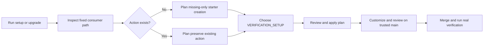
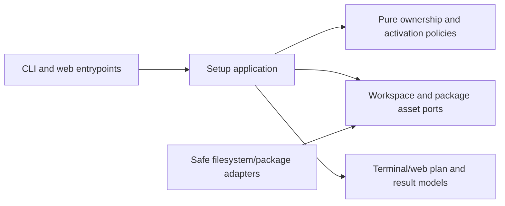

# Verification Setup Onboarding Specification

- Status: Implemented in source; final-head CI and review pending
- Date: 2026-10-21
- Catalog capability ID: `local-web-setup-assistant`
- Last verified: 2026-10-21 (local focused suites, package smoke and responsive fixture; final-head evidence remains pending)
- Owners: Copilot maintainers
- Scope: Complete onboarding for the repository-owned verification setup starter, its explicit activation choice, and safe upgrade guidance.
- Related issues/PRs: [Issue #656](https://github.com/vypdev/copilot/issues/656), #647, #652; existing owning specifications: [`specs/local-web-setup-assistant.md`](./local-web-setup-assistant.md), [`specs/setup-configuration-management.md`](./setup-configuration-management.md); native execution contract: [`specs/repository-verification-setup-hooks.md`](./repository-verification-setup-hooks.md).
- Required review gates: product UX, architecture, testing, documentation, security/operations
- Open decisions blocking readiness: none

## 1. Executive summary

Setup will offer to create the fixed consumer-owned action `.github/actions/copilot-verification-setup/action.yml` when absent and clearly report preservation when it exists. A minimal composite starter fails with instructions until customized, so generation cannot imply that verification is ready. The shared terminal and web questionnaire will expose the existing `repository.verificationSetup` boolean, disabled by default. Enabling it opts into the existing native setup hook contract; it does not configure dependencies or establish that the hook has been reviewed on the trusted main branch.

Setup, workflow upgrade, batch setup, and package installation must preserve existing consumer action bytes and auxiliary files. Dry-run, cancellation, and declined approval make no writes. A create operation must reject unsafe paths, symlinks, wrong file kinds, collisions, and a file that appears after preview, without truncating or replacing consumer data. Documentation will explain the separate CLI, remote Action reference, and committed workflow upgrade layers, including ordered migration and rollback.

```text
Inspect fixed action path -> create starter if absent / preserve if present -> choose VERIFICATION_SETUP -> review plan -> apply -> customize and review on trusted main -> merge -> run real verification
```

## 2. Problem, current behavior, and evidence

### 2.1 Problem

Repository maintainers cannot discover the native verification starter or its activation option through the normal setup journey. They must create the action themselves and infer an upgrade sequence from separate documents. This adds setup friction and risks overwriting consumer configuration if generator ownership is unclear.

### 2.2 Current behavior

1. The installer generates event workflows but no consumer verification setup action.
2. `verificationSetup` may be configured and is represented as a Variable, but there is no dedicated questionnaire prompt.
3. The native setup contract exists; this follow-up completes onboarding and upgrade UX.
4. Version 3.9.3 is the last published release; support merged into `develop` is not thereby a published release.

These facts are supplied by the issue evidence; implementation behavior proposed here is not yet established.

### 2.3 Evidence

- Code and tests: `src/utils/setup_files.ts`, `src/application/policies/setup_questionnaire_policy.ts`, `src/application/policies/setup_configuration_plan.ts`, `src/infrastructure/__tests__/verification_setup_configuration.test.ts`.
- Documentation: `docs/security-operations/operations/verification.mdx`.
- Related source contract: `specs/repository-verification-setup-hooks.md`.
- Incidents or concrete examples: none supplied.
- External primary sources: not applicable.
- Unknowns: implementation details and exact existing package/adapter extension points are for implementation discovery; they do not change the fixed product contract.

### 2.4 Retrospective classification (as-built baselines only)

Not applicable: this is a prospective companion specification, not a reconstruction of an implemented baseline.

## 3. Actors, surfaces, and terminology

| Actor | Goal | Entry point | Visible surfaces |
|---|---|---|---|
| Repository maintainer | Install or upgrade generated workflows safely | `copilot setup`, workflow update, batch setup | Terminal/web wizard, plan, result, repository files |
| Verification owner | Define project-specific preparation | Trusted main branch after PR | Consumer action, review and merge, real verification run |
| Operator/contributor | Diagnose setup and package behavior | Documentation and CI | Upgrade guide, tests, package artifact |

The **consumer action** is the fixed path above and remains consumer-owned after initial creation. **Starter** means a fail-closed composite action with a customization instruction. **Activation** means the existing `repository.verificationSetup` boolean / `VERIFICATION_SETUP` binding. **Trusted main** means the repository's configured trusted main branch (`MAIN_BRANCH`), not a branch inferred from the installer PR. Generator ownership of workflow files does not imply ownership of consumer action assets.

## 4. Goals

### 4.1 Goals

1. Offer an explicit create-or-preserve result in initial setup and workflow upgrades, including local and batch flows.
2. Ask the existing verification activation question in the shared terminal/web questionnaire and explain the choice in plan and result.
3. Ship and publish a minimal starter that fails until customized, without guessing languages, dependencies, commands, or running installation during setup.
4. Preserve consumer assets across repeated setup, workflow updates, deselection, and batch maintenance.
5. Document upgrade layers, ordered migration, rollback, trusted-branch review, and the distinction between merge and release.

### 4.2 Non-goals

1. Automatically enabling verification or inferring project dependencies and commands.
2. Running dependency installation or claiming runtime readiness during setup.
3. Replacing, retiring, or managing consumer action contents or auxiliary files after creation.
4. Publishing a release or installing changes into other repositories as part of this specification.

### 4.3 Fixed product/safety invariants

1. Create only when the fixed path is absent; preserve existing regular-file bytes and auxiliary files.
2. `verificationSetup` remains an explicit boolean, disabled by default; configuration and preselection are respected, including organization reuse.
3. Creating an installer PR does not establish runtime readiness. The owner must customize, review, and merge on trusted main, then run real verification.
4. Existing manifest receipts, permission checks, review gates, runner selections, and credential handling remain intact.
5. Missing-only creation never follows unsafe parent links, overwrites collisions, or truncates a file created between preview and Apply.

## 5. Current versus proposed product journey

| Stage | Current | Proposed | User/operator effect |
|---|---|---|---|
| Inspect action | No generated starter; user discovers path themselves | Show create if absent or preserve if present | Ownership outcome is visible |
| Choose activation | Config-only; no dedicated question | Shared explicit boolean prompt with help | Same decision in terminal and web |
| Review plan | No joined guidance | Show action result and enabled/disabled state | User sees consequence before Apply |
| Upgrade | Layers are scattered across docs | Ordered CLI, Action ref, workflow migration and rollback | Safer, reviewable upgrade |
| Runtime readiness | May be inferred from setup | Explicitly requires customization, trusted-main review/merge, and real run | No false readiness claim |



Text equivalent: setup inspects the fixed path, plans creation or preservation, records the explicit activation choice, applies only an approved safe plan, then the owner customizes and reviews on trusted main before merging and running verification.

## 6. Functional behavior and state model

### 6.1 Happy path

1. The setup application gathers the current action-path state without writing.
2. If absent, the plan offers creation of the packaged starter; if a regular file exists, it offers preservation and reports that no bytes will change.
3. The questionnaire asks whether to enable `VERIFICATION_SETUP`, with concise help and a link to verification guidance. It honors configured or preselected values and organization reuse.
4. The plan and result display both the action outcome and activation state. Apply rechecks absence atomically before creation.
5. The owner customizes the placeholder, reviews and merges it on trusted main, then runs a real verification.

### 6.2 Alternative paths

- Existing regular action: preserve bytes; do not merge starter content or rewrite line endings.
- Existing directory, symlink, dangling link, or other collision: block with path and corrective action; retain contents.
- Disabled activation: create/preserve result is still visible; generated workflow binding remains disabled.
- Dry-run, cancel, declined approval: show planned outcome where applicable, write nothing.
- Batch setup: apply the same per-repository inspect/plan/recheck rules; one collision does not authorize replacement in another repository.
- File appears after preview: report stale plan and preserve the newly created file; require a refreshed plan.

### 6.3 State machine

| State | Entered when | User-visible meaning | Allowed next states | Recovery/owner |
|---|---|---|---|---|
| Inspected absent | No path entry exists | Starter can be planned | Planned create, blocked | Setup application |
| Inspected present | Regular file exists | Consumer action will be preserved | Planned preserve | Setup application |
| Planned | User reviews proposed result and flag | No write has happened | Applied, canceled, declined, stale, blocked | User / setup application |
| Applied | Approved safe plan completes | Starter created if absent; existing action untouched | Customize/review | Repository maintainer |
| Blocked | Unsafe path, file kind, or collision | No unsafe write occurred | Correct path and retry | Repository maintainer |
| Runtime reviewed | Customized action merged on trusted main | Owner-defined setup is available | Verified or failed run | Verification owner |

Duplicate setup and workflow updates are idempotent for consumer assets. Stale plans are rejected at Apply. Cancellation and declined approval terminate without writes. Partial batch success reports each repository outcome independently and never retries a destructive replacement.

## 7. User-facing configuration

| Input | Type | Recommended default | Allowed values/range | Scope/persistence |
|---|---|---|---|---|
| `repository.verificationSetup` / `VERIFICATION_SETUP` | Boolean | `false` — opt-in must remain explicit | `true` or `false` | Existing repository configuration and setup snapshot; existing organization reuse and override precedence apply |

Validation accepts only the existing boolean contract; malformed values follow current configuration validation and must not silently enable. The questionnaire's explicit answer takes effect through existing setup precedence; configured/preselected values are honored and shown. The value controls activation only, not starter content, dependency installation, or readiness. Missing legacy values resolve to disabled. No arbitrary command, URL, ref, or secret is accepted as part of this feature. Safety invariants in §4.3 are not configurable.

Recommended example: leave `verificationSetup: false` until the owner customizes and reviews the action. Meaningful alternative: set it to `true` after deciding to activate the native hook; readiness still requires the owner-defined action to be merged and exercised.

## 8. Clean Architecture

### 8.1 Responsibilities and dependency direction

| Layer/boundary | Owns | Must not own/import |
|---|---|---|
| Domain/pure policy | Boolean normalization, create/preserve/block decision, stale-plan rules | Filesystem APIs, GitHub SDK, UI framework |
| Application | Setup questionnaire, immutable plan/result, batch orchestration and Apply sequencing | Concrete filesystem/process APIs or presentation strings as policy |
| Adapters/data | Safe path inspection and atomic missing-only creation; package asset resolution | Product decisions or overwrite policy |
| Infrastructure/composition | Wire local and batch adapters and packaged starter | Duplicate business rules |
| Entrypoints | Adapt terminal/web answers and approvals | Independent questionnaire semantics or duplicated orchestration |
| Presentation | Render help, plan, blockers, outcomes in terminal/web | Filesystem mutation or flag-policy decisions |



Text equivalent: terminal and web entrypoints call the same application policies and ports; safe adapters perform approved file operations; presentation renders application outcomes.

### 8.2 Contracts, state, and trust boundaries

- Pure decisions: action absent/present/unsafe and activation choice map to immutable plan outcomes.
- Application contracts: plan includes inspected state, intended action, flag value, and whether Apply needs revalidation; result distinguishes created, preserved, unchanged, and blocked.
- Semantic ports: inspect fixed consumer path and create a supplied packaged asset only if absent; no general overwrite operation is exposed for this asset.
- Durable state/schema ownership: preserve the existing configuration schema and manifest receipts; no new durable state is required.
- Concurrency/idempotency: Apply performs an atomic create-if-absent or equivalent exclusive operation; never truncate. Recheck parent components without following links. Stale inspection returns a blocker.
- Trusted and untrusted inputs: config, user answers, filesystem entries, and repository contents are data. Path is fixed by product contract, not supplied as arbitrary user input. Starter is package-controlled; consumer action contents are untrusted consumer-owned data.
- Provider error mapping: permission, unsafe path, wrong file kind, collision, and I/O failures become actionable outcomes without leaking credentials or claiming success.

### 8.3 Executable architecture constraints

Automated boundary checks MUST ensure questionnaire semantics are shared by terminal and web, pure policies have no filesystem/UI imports, application ports contain no provider DTOs, and only the safe adapter can create the consumer starter. Contract tests MUST verify packaged asset presence and local/batch parity. Existing setup permission, manifest receipt, review, runner, and credential contracts remain enforced.

## 9. UI/UX and content contract

### 9.1 Information hierarchy

1. Current action-path outcome and activation state.
2. What setup changed or preserved.
3. Next step: customize/review/merge/run when enabled or intended.
4. Whether human action is required.
5. Impact and inspectable plan/result.
6. Technical diagnostics in expandable or secondary output.

### 9.2 Representative primary view

```markdown
# Verification setup

> **Current status:** Starter created; verification activation is enabled.
>
> **Action required:** Customize the placeholder, review and merge on `MAIN_BRANCH`, then run a real verification.

## Progress

- [x] Created `.github/actions/copilot-verification-setup/action.yml` because it was absent.
- [x] Set `VERIFICATION_SETUP` to enabled.
- [x] Customize and review the action on the configured trusted main branch.

## What happens next

The starter fails until its placeholder is replaced. This setup result does not prove runtime readiness.

## Links

[Verification setup and upgrade guide](../security-operations/operations/verification.mdx)
```

Concrete state variants:

- **Pending/no action:** “Plan only: the action is absent and would be created; verification remains disabled. No files have changed.”
- **Action required:** “Existing action preserved byte-for-byte. Activation is enabled; review your action on trusted main and run verification.”
- **Blocked:** “No action file was changed. The target path is a symlink/collision; inspect and correct the path, then rerun setup.”
- **Partial batch:** “2 repositories updated; 1 was blocked because its target is not a regular file. Successful repositories remain complete; correct the blocked path and retry that repository.”
- **Complete:** “Starter created (or existing action preserved); activation is disabled/enabled as selected. Customize and review before relying on verification.”

### 9.3 Issue, PR, and comment behavior

This feature does not require new issue/PR automation or comments; these surfaces are not applicable to runtime setup. If setup creates or updates an implementation PR, its description must state what was created/preserved, activation state, required customization/review/run steps, and that merging into `develop` does not publish a release. Use deterministic setup plan labels and existing result/receipt mechanisms; do not add notification comments. Link to the canonical issue and verification guide where relevant. Merge of an installer PR is not evidence of consumer runtime readiness.

### 9.4 Accessibility, localization, and responsive behavior

Use the existing shared terminal/web questionnaire content and supported web locales English, Spanish, French, and Portuguese, with the repository's existing fallback. The activation question must include text help; no color-only or icon-only state. Keep plan/result readable at narrow widths and in light/dark themes. Use descriptive links and semantic headings. Treat repository paths and existing action content as untrusted text: escape for terminal/web/Markdown contexts; do not render executable Markdown, mentions, commands, or URLs from file contents.

## 10. Failure, recovery, and cleanup

| Failure/partial state | User impact | Retained facts | Automatic retry | Required action | Cleanup |
|---|---|---|---|---|---|
| Dry-run/cancel/decline | No starter or config write | Plan/decision only | No | Re-run and approve if desired | None |
| Unsafe parent symlink | Creation blocked | Existing path and contents intact | No | Replace/inspect unsafe parent, then rerun | None |
| Target collision/wrong kind | Creation blocked | Collision unchanged | No | Resolve path manually | None |
| Target appears after preview | Stale plan blocked | New file intact | No | Refresh plan; preserve new file | None |
| Permission/I/O error | Setup may be incomplete | Any already completed independent repository outcomes are reported | Bounded only under existing setup rules | Correct permission or storage issue, retry affected item | No automatic removal of consumer files |
| Starter customized incorrectly | Runtime verification fails closed or owner-defined behavior fails | Consumer action retained | Owner-controlled | Fix, review, merge, rerun | Consumer-owned cleanup |

Errors follow impact → cause → action → retained state. Successful creation in one batch repository must not be described as failed because another repository was blocked.

## 11. Security, permissions, and privacy

1. Use existing setup authorization and permission gates; do not add permissions for creating a local consumer file.
2. Treat filesystem entries and repository content as untrusted. Do not follow symlinked parents, execute setup commands, infer dependencies, or accept arbitrary paths.
3. Do not log secrets or action contents. Report fixed paths and sanitized causes only.
4. Use exclusive missing-only creation to resist races; a collision or stale preview must never overwrite user data.
5. The starter explicitly fails with a customization instruction until its placeholder step is replaced; it must not silently succeed as a no-op.

## 12. Observability and operational UX

The plan/result records per-repository created, preserved, disabled/enabled, blocked, canceled, and unchanged outcomes. Existing receipts remain authoritative for workflow files and permissions; consumer action preservation is reported separately and is not converted into generator ownership. Logs use existing correlation and redaction conventions. Do not add metrics or comments solely for this local setup behavior. Distinguish an external verification failure from setup-plan failure, and link users to the action and run when available.

## 13. Compatibility, migration, rollout, and rollback

- Existing configuration remains valid; absent activation remains disabled. No schema migration is required.
- Three independent upgrade layers must be documented and reviewed in order: (1) installed CLI version, (2) remote Action reference such as floating `@v3` versus exact version/SHA, and (3) committed generated workflow files. Changing one does not update the others.
- Migration: back up/review current workflows and consumer action; update the CLI using the normal release channel; inspect remote Action reference and choose the repository's pinning policy; run workflow upgrade; review create/preserve result and diff; configure activation explicitly; customize action; open/review/merge changes on configured trusted `MAIN_BRANCH`; run a real verification and inspect its result.
- If the consumer action already exists, migration preserves it. If absent, the starter is fail-closed until customized.
- Rollback: disable `VERIFICATION_SETUP` through the normal configuration path; revert generated workflow changes or restore the previously reviewed Action ref according to repository policy; restore action bytes from the reviewed backup/commit if owner changes caused the issue. Do not delete consumer assets automatically.
- A merge into `develop` is not a published release. Consumers receive a CLI change only through a published package/release and a remote Action change only through its published/ref update.

## 14. Testing strategy and numeric budget

Minimum: 48 distinct focused cases, with no double counting.

| Area | Minimum distinct cases | Behaviors/risks covered |
|---|---:|---|
| Domain/configuration/pure planning | 8 | Boolean default/precedence, create/preserve/block decisions, invalid values |
| State/application/idempotency/races | 10 | Repeat setup, cancellation, decline, stale plan, file appears before Apply, batch isolation |
| Adapters/provider contracts | 8 | Safe parent inspection, symlink rejection, exclusive create, permission and I/O mapping |
| Workflows/setup/schema | 6 | Local/batch parity, existing manifest receipts, gates, runner/credential invariants |
| UI/UX/localization/sanitization | 6 | Terminal/web parity, enabled/disabled guidance, blocker and result content, locale and path escaping |
| Integration/security/migration/packaging | 10 | npm inclusion, fail-closed starter, docs flow, rollback, package/local integration, unsafe path/race security |
| **Total** | **48** | Distinct behaviors only |

Preserve repository-wide coverage budgets. New pure policy branches MUST reach 100%; new adapter lines/statements MUST reach 95% and branches/functions 90%, where the repository tooling reports those metrics. Add at least 48 distinct focused cases as allocated above; parameter rows count only when behavior differs. Use deterministic filesystem fakes and controlled race hooks, no real waits or live services. Include structural package/workflow contract checks, semantic assertions beyond snapshots, and golden terminal/web plan/result fixtures. Manual UX evidence must confirm the create/preserve and activation guidance is understandable in both entrypoints and at narrow web widths.

## 15. Documentation and discoverability

| Audience | Artifact/page | Required content | Validation/navigation |
|---|---|---|---|
| User | `docs/security-operations/operations/verification.mdx` | Starter, explicit activation, create/preserve, customization and runtime readiness | Existing docs navigation/link validation |
| Setup owner | `docs/configuration.mdx` and setup guidance | Boolean default, precedence, examples, plan/result meaning | Configuration contract tests |
| Operator | Verification operations guide | Troubleshooting blockers, batch partial results, migration and rollback | Documentation checkout/link validation |
| Contributor | `docs/development/architecture.mdx` and relevant spec | Ownership boundary, safe adapter, package asset and test constraints | Architecture and specification validation |

The upgrade guide must clearly separate installed CLI, remote Action ref (`@v3` versus exact version/SHA), and committed generated workflows. Give ordered migration and rollback steps, state that merge into develop is not a release, and say that creating an installer PR does not prove runtime readiness. Keep examples synchronized with fixtures.

## 16. Acceptance scenarios

Scenario IDs use the `VSO-` namespace and are unique.

1. **VSO-01 absent create:** Given the fixed path is absent, when an approved setup applies, then it creates the packaged starter exactly once and reports “created.”
2. **VSO-02 existing preserve:** Given a regular consumer action and auxiliary files exist, when setup or workflow upgrade runs repeatedly, then all bytes and auxiliary files remain unchanged and the result says “preserved.”
3. **VSO-03 fail closed:** Given the generated starter is used uncustomized, when its placeholder step runs, then it exits unsuccessfully with a clear customization instruction.
4. **VSO-04 wizard parity:** Given terminal or web setup, when the user answers activation, then both use the same explicit boolean question and guidance.
5. **VSO-05 default and reuse:** Given no value is configured, then the default is disabled; given a preselected/configured or organization-reused value, then it is respected and shown.
6. **VSO-06 activation meaning:** Given activation is enabled, then plan/result state it enables the existing hook only and does not claim dependency configuration or readiness.
7. **VSO-07 no-write exits:** Given dry-run, cancellation, or declined approval, when setup ends, then no starter or configuration write occurs.
8. **VSO-08 unsafe path:** Given a symlinked parent, dangling link, directory collision, or invalid file kind, then setup blocks with an actionable reason and preserves contents.
9. **VSO-09 race safety:** Given a file appears after preview, when Apply executes, then it is not truncated or replaced and the plan is reported stale.
10. **VSO-10 local and batch:** Given local or batch setup, then each repository receives the same create/preserve rules and independent truthful outcomes.
11. **VSO-11 package:** Given the npm package is built, then the starter asset is present at the expected packaged location and the packaged setup can resolve it.
12. **VSO-12 upgrade/rollback docs:** Given a maintainer follows the guide, then CLI, remote Action ref, and committed workflows are distinct ordered layers with rollback guidance; merge into develop is not described as release.
13. **VSO-13 consumer ownership:** Given activation is deselected or batch maintenance repeats, then no consumer action is retired or overwritten.
14. **VSO-14 review gates:** Given implementation is proposed for merge, then existing receipts, permission checks, review gates, runner choices, and credential handling still pass their contracts.
15. **VSO-15 final-head delivery:** Given the PR is ready, then it is merged into `develop` only after applicable final-head checks pass and no findings remain unresolved; no release or external installation is implied.

## 17. Requirements traceability

| Requirement | Policy/use case/adapter/presentation | Test or evidence | Documentation |
|---|---|---|---|
| Create if absent; preserve if present | Ownership policy, setup plan, safe filesystem port | VSO-01, VSO-02, VSO-08, VSO-09 | Verification operations guide |
| Explicit activation and default | Questionnaire policy and shared view model | VSO-04, VSO-05, VSO-06 | Configuration and verification pages |
| Fail-closed starter and package inclusion | Package asset and execution contract | VSO-03, VSO-11 | Verification guide |
| Dry-run, cancellation, decline, batch | Application orchestration and Apply adapter | VSO-07, VSO-10 | Setup and troubleshooting guidance |
| Preserve existing setup gates | Existing workflow and receipt contracts | VSO-14 | Contributor architecture guidance |
| Upgrade and rollback layers | Documentation and release guidance | VSO-12 | Verification operations guide |
| Final-head PR delivery | Repository workflow gates | VSO-15 | Contributor/release guidance |

## 18. Implementation sequence

1. Confirm existing ownership and configuration contracts; add pure ownership decision and questionnaire contract tests.
2. Add safe missing-only filesystem/package port behavior with race and unsafe-path tests.
3. Wire shared application plan and result for local and batch setup without changing existing receipts or gates.
4. Add shared terminal/web prompt, help, enabled/disabled guidance, blockers, and localized content.
5. Package the fail-closed starter and validate packed npm assets.
6. Update verification and configuration documentation with migration, rollback, and release distinction.
7. Complete acceptance trace, numeric coverage thresholds, manual UX review, specification/catalog checks, and applicable final-head checks before merge.

## 19. Definition of Done

- [x] Every normative requirement maps to acceptance and traceability.
- [x] Consumer action creation is missing-only, race-safe, and preserves existing bytes and auxiliary files.
- [x] Shared terminal/web activation uses the existing boolean, remains disabled by default, and respects preselected/configured values.
- [x] Starter fails with customization instructions until replaced; setup performs no inferred installation.
- [x] Local, batch, and packaged flows satisfy the same ownership contract.
- [x] Existing receipts, permission checks, review gates, runner selections, and credential handling remain valid.
- [x] Numeric 48-case budget and pure-policy/adapter coverage thresholds pass; repository-wide budgets remain satisfied.
- [x] Accessibility, localization, responsive content, sanitization, and UX review pass.
- [x] Migration, rollback, three-layer upgrade, and release distinction are documented and discoverable.
- [x] Failure, partial success, retry, race, security, and cleanup scenarios pass.
- [x] Required generated artifacts and repository validation commands pass.
- [x] `specs/catalog.json` and `specs/CATALOG.md` are current and `pnpm run validate:specifications` passes.
- [ ] PR is merged into `develop` only after applicable final-head checks pass and no findings remain unresolved; no release is implied.
- [x] No readiness-blocking decision remains unresolved.

## 20. References and decisions

- Primary sources: supplied issue evidence for `src/utils/setup_files.ts`, setup questionnaire and plan policies, `src/infrastructure/__tests__/verification_setup_configuration.test.ts`, and `docs/security-operations/operations/verification.mdx` on `develop`.
- Related specs: [`specs/local-web-setup-assistant.md`](./local-web-setup-assistant.md), [`specs/setup-configuration-management.md`](./setup-configuration-management.md), [`specs/repository-verification-setup-hooks.md`](./repository-verification-setup-hooks.md).
- Related issue/PRs: [Issue #656](https://github.com/vypdev/copilot/issues/656), #647, #652.
- Decisions: companion owned by existing `local-web-setup-assistant` capability; native execution contract remains in `repository-verification-setup-hooks.md`; consumer action is create-once and consumer-owned; activation is explicit; starter is fail-closed; no automatic release or installation into other repositories.
- Follow-up outside scope: publishing a release and installing changes into consumer repositories.
### Implementation and local verification evidence

The create-once adapter is `src/infrastructure/setup_verification_action.ts`;
`src/domain/setup_verification_action.ts` fixes its path and public review facts.
`setup_files.ts` and `setup_installation_review.ts` share this adapter. The
reviewed create/preserve state travels through CLI/application/workspace contracts
so a changed path blocks Apply; exclusive creation also rejects a final collision.
Batch inventory preserves the exact action as an unchanged base-tree entry and
rejects unsafe parent/file modes and case collisions before downloading blobs.
The action never enters the generator ownership manifest.

Executable coverage is in `setup_verification_action.test.ts`,
`setup_verification_onboarding_policy.test.ts`,
`setup_verification_onboarding_flow.test.ts`,
`setup_verification_onboarding_components.test.ts`, and focused additions to the
batch inventory/workspace, initial setup workflow and context projection suites.
The new summary policy and file adapter have explicit coverage budgets. The complete local suite after review correction passed: 707 suites, 11,607
passed tests and 35 existing skips, including all 97 VSO cases present at that measurement. Two additional
platform-neutral post-validation regressions pass in the focused suite, bringing
the source total to 99 distinct VSO cases. The pure
summary has 100% coverage; the safe adapter exceeds every enforced budget. All
repository coverage budgets and setup acceptance validation pass. Package validation and an extracted npm
smoke verify the starter and its CLI resolver. The credential-free
`serve-web-setup-review.cjs runner-plan` fixture was reviewed at 1280 px and 375 px,
including Spanish: the fixed path wraps and the create/disabled/trusted-main and
customization guidance remain readable. SSR contracts cover create/preserve/blocked,
enabled/disabled and completion navigation in all four supported locales.

No release or consumer installation was performed. Final PR checks and resolved
finding evidence belong to the linked implementation PR.

### Review correction: parent replacement at Apply

[PR #657](https://github.com/vypdev/copilot/pull/657#discussion_r4340366893)
identified a real race in path-based exclusive creation: a checked parent could
be replaced before the leaf open. The corrected adapter walks fixed single-name
components from a pinned repository directory. It keeps each directory descriptor
open while matching `fstat` and `lstat` identities, enters that same directory,
and confirms its identity with BigInt device/inode values before the next
relative operation. The OS working directory pins the validated location, so a
later parent replacement cannot redirect creation. The bounded section contains
no awaits or user callbacks, restores the caller's physical cwd and closes handles
in `finally`; setup's file application and isolated batch rendering are synchronous
main-thread entrypoints. The selected checkout root remains the existing trusted
setup anchor.

The leaf uses exclusive creation, final route checks reject relocation, and
failure cleanup addresses only the created inode in the pinned directory. New
regressions cover replacement before directory entry, replacement of both a leaf
parent and an ancestor just before opening the file, symlink and directory swaps,
directory access/identity failure, and cwd restoration. They assert that creation
never reaches the external target, including transient creation before cleanup.
Windows may reject a pinned-directory rename; the test verifies that denial or
that the original validated location is retained. Final three-platform CI remains
a delivery gate.

Primary API evidence: [Node filesystem APIs](https://nodejs.org/docs/latest-v24.x/api/fs.html),
[Node process directory API](https://nodejs.org/docs/latest-v24.x/api/process.html#processchdirdirectory),
[POSIX pathname resolution](https://pubs.opengroup.org/onlinepubs/009696699/basedefs/xbd_chap04.html),
[Windows current-directory lifetime](https://learn.microsoft.com/en-us/windows/win32/api/winbase/nf-winbase-setcurrentdirectory),
and [libuv's Windows directory-compatible opener](https://github.com/libuv/libuv/blob/v1.x/src/win/fs.c).
